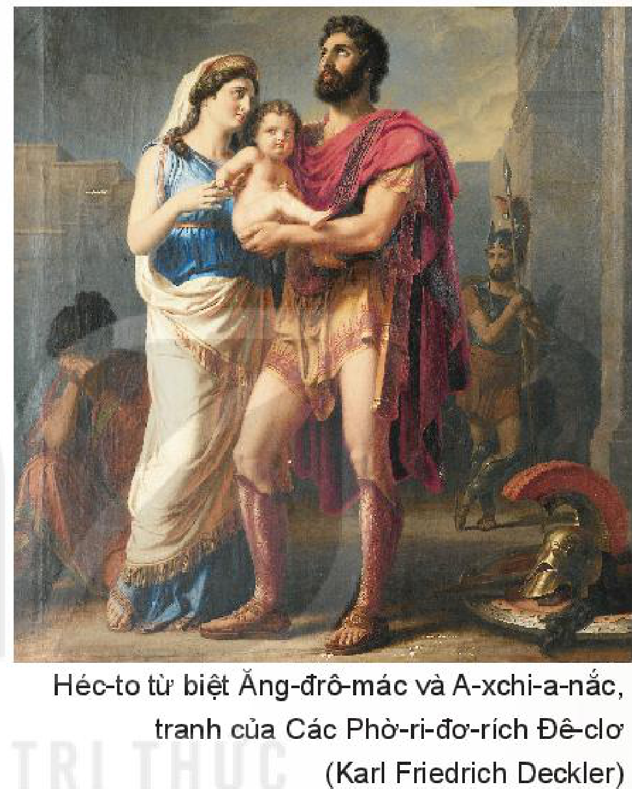
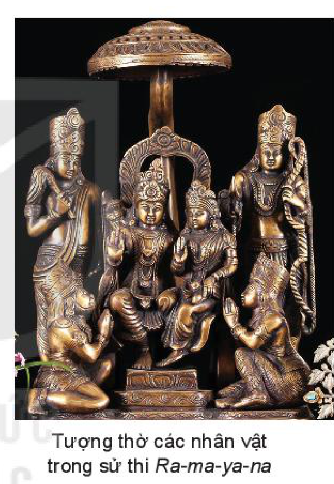

<!-- pdf:98 -->

# BÀI 4: SỨC SỐNG CỦA SỬ THI

## 🎯 Yêu cầu cần đạt

- Nhận biết và phân tích được một số yếu tố của sử thi: không gian, thời gian, cốt truyện, nhân vật, lời người kể chuyện và lời nhân vật.
- Biết nhận xét nội dung bao quát của văn bản; biết phân tích các chi tiết tiêu biểu, đề tài, câu chuyện, nhân vật và mối quan hệ giữa chúng; nêu được ý nghĩa của tác phẩm đối với người đọc.
- Hiểu được cách đánh dấu phần bị tỉnh lược trong văn bản, cách chú thích trích dẫn và ghi cước chú.
- Viết được báo cáo nghiên cứu, có sử dụng trích dẫn, cước chú; có hiểu biết về quyền sở hữu trí tuệ và tránh đạo văn.
- Biết trình bày báo cáo kết quả nghiên cứu về một vấn đề.
- Biết trân trọng các giá trị tinh thần to lớn được thể hiện trong những sáng tác ngôn từ thời cổ đại còn truyền đến nay.

## ĐỌC

### TRI THỨC NGỮ VĂN

**Sử thi**

<!-- term: cốt truyện của sử thi -->
**Sử thi (anh hùng ca)** là thể loại tự sự dài, dung lượng đồ sộ, ra đời vào thời cổ đại. Cốt truyện của sử thi xoay quanh những biến cố trọng đại liên quan đến vận mệnh của toàn thể cộng đồng như chiến tranh hay công cuộc chinh phục thiên nhiên để ổn định và mở rộng địa bàn cư trú.

<!-- term: không gian sử thi -->
**Nhân vật sử thi** là người anh hùng đại diện cho sức mạnh, phẩm chất lí tưởng và khát vọng chung của cộng đồng. Không gian sử thi kì vĩ, cao rộng, mang tính cộng đồng, có thể bao quát cả thế giới thần linh và con người. **Thời gian sử thi** là quá khứ thiêng liêng, thuộc về một thời đại xa xưa được cộng đồng ngưỡng vọng.

<!-- pdf:99 -->

<!-- term: lời kể trong sử thi -->
Lời kể trong sử thi thành kính, trang trọng; nhịp điệu chậm rãi; trần thuật tỉ mỉ, lặp đi lặp lại những từ ngữ khắc hoạ đặc điểm cố định của nhân vật, sự vật; thường xuyên sử dụng biện pháp tu từ so sánh và điệp ngữ. Lời người kể chuyện và cả lời nhân vật nhiều khi mang tính khoa trương, cường điệu.

Sử thi không chỉ lưu dấu những biến cố quan trọng trong lịch sử của một cộng đồng, mà còn phản ánh diện mạo đời sống tinh thần, hệ giá trị, niềm tin của cộng đồng ấy. Nhiều chủ đề trong sử thi vẫn còn có ý nghĩa lớn đối với nhân loại. Những tác phẩm sử thi như *Ma-ha-bha-ra-ta* (*Mahabharata*), *Ra-ma-ya-na* (*Ramayana*) (Ấn Độ); *I-li-át* (*Iliad*), *Ô-đi-xê* (*Odyssey*) (Hy Lạp); *Đăm Săn* (Việt Nam);... vẫn tiếp tục khơi nguồn cảm hứng cho nhiều sáng tạo thuộc nhiều loại hình nghệ thuật đời sau.

**Trích dẫn trong văn bản**

Trích dẫn trong văn bản thường có hai loại: trích dẫn trực tiếp và trích dẫn gián tiếp. **Trích dẫn trực tiếp** là đưa nguyên văn một phần câu, một câu, một đoạn văn,... của bản gốc vào bài viết và toàn bộ phần trích dẫn này phải được đặt trong ngoặc kép. **Trích dẫn gián tiếp** là sử dụng ý tưởng của người khác và diễn đạt lại theo cách viết của mình nhưng phải đảm bảo trung thành với ý tưởng được trích dẫn. Phần trích dẫn gián tiếp không phải đặt trong dấu ngoặc kép. Khi tạo lập văn bản, cần tránh lạm dụng trích dẫn vì điều đó dẫn đến tình trạng ý kiến riêng của người viết bị lu mờ hoặc chỉ còn mang tính chất phụ hoạ.

Để việc trích dẫn đảm bảo tính chính xác, khoa học, khách quan, các phần trích dẫn cần được ghi rõ nguồn gốc, bao gồm thông tin về tác giả, tên văn bản gốc, nơi công bố, thời gian công bố văn bản, vị trí của phần trích dẫn trong văn bản gốc.

**Phần bị tỉnh lược trong văn bản**

**Phần bị tỉnh lược** là phần thông tin ít quan trọng của văn bản gốc (theo cách nhìn và định hướng sử dụng văn bản của người tổ chức bản thảo) đã được lược bỏ, giúp cho nội dung văn bản trích dẫn trở nên tập trung và cô đọng hơn. Phần bị tỉnh lược thường được đánh dấu bằng dấu ngoặc vuông và dấu ba chấm [...].

<!-- pdf:100 -->

### VĂN BẢN 1: Héc-to từ biệt Ăng-đrô-mác(*)

*(Trích I-li-át)*

**Hô-me-rơ (Hómèros)**

Trong cuộc sống, việc thực hiện bổn phận với cộng đồng và với gia đình nhiều khi mâu thuẫn. Theo bạn, ứng xử thế nào mới là hợp tình, hợp lí?

Cuộc chiến vây hãm thành Tơ-roa (Troy) của quân A-kê-en (Achaean)(1), tức quân Hy Lạp, bước sang năm thứ mười vẫn không phân thắng bại.

A-khin (Achilles), dũng tướng tài giỏi nhất của quân Hy Lạp, tức giận vì bị chủ soái A-ga-mem-nông (Agamemnon)(2) tước mất chiến lợi phẩm là nàng Bri-dê-ít (Briseis), quyết không tham chiến, đồng thời qua mẹ của mình là nữ thần Thê-ti-xơ (Thetis), cầu xin thần Dớt (Zeus) làm cho quân Hy Lạp thất bại. Thần Dớt (Zeus) hứa hẹn, nhưng chưa thực hiện lời hứa. Thoả thuận về một cuộc chiến tay đôi chấm dứt chiến tranh không thành, quân Hy Lạp và quân Tơ-roa lại tiếp tục giao chiến. Cuộc chiến nơi hạ giới luôn có sự can thiệp của các vị thần chia làm hai phe ủng hộ hai bên. Quân Hy Lạp nhất thời giành thế áp đảo. Hoàng tử Héc-to (Hector), chủ soái quân đội thành Tơ-roa, quay vào thành thúc giục binh sĩ, khẩn cầu nữ thần A-tê-na giúp đỡ. Chàng ghé về nhà thăm vợ con.

Héc-to về tới ngôi nhà êm ấm của mình, nhưng không thấy Ăng-đrô-mác cánh tay trắng ngần trong buồng như thường lệ. Nàng cùng con thơ với cô hầu gái xống áo thướt tha, đứng trên tháp canh nức nở, lòng đắng cay chan chứa nỗi buồn. Vào nhà, Héc-to không trông thấy phu nhân hiền thục của mình. Chàng bước qua ngưỡng cửa, dừng lại, hỏi mấy nô tì: “Này, các ngươi mau nói hết ta hay, phu nhân Ăng-đrô-mác đâu rồi? Nàng đi gặp chị gặp em, qua chỗ những cô dâu trang phục diễm lệ(3), hay tới đền thờ A-tê-na cùng các

> (\*) Nhan đề đoạn trích do người biên soạn sách giáo khoa đặt (Héc-to: hoàng tử thành Tơ-roa; Ăng-đrô-mác (Andromache): phu nhân của Héc-to).
> (1) *A-kê-en*: một trong bốn tộc người lớn nhất sinh sống trên đất Hy Lạp cổ đại. Ở đây dùng để chỉ chung những người ở bán đảo Hy Lạp, phân biệt với những người Tơ-roa ở bán đảo Tiểu Á.
> (2) *A-ga-mem-nông*: thủ lĩnh của người A-kê-en trong chiến tranh thành Tơ-roa.
> (3) *Diễm lệ*: đẹp rực rỡ, lộng lẫy.

<!-- pdf:101 -->

phu nhân thành Tơ-roa vấn tóc chỉnh tề dâng lễ cầu xin nữ thần rủ lòng thương, nguôi cơn thịnh nộ?”. Đáp lời Héc-to, tì nữ quản gia nhanh nhảu nói: “Bẩm, ngài đã yêu cầu, con xin thưa rõ. Không phải phu nhân đi gặp chị gặp em, hay qua chỗ những cô dâu trang phục diễm lệ. Cũng không phải bà tới đền thờ A-tê-na, cùng các phu nhân thành Tơ-roa vấn tóc chỉnh tề dâng lễ cầu xin nữ thần nguôi cơn thịnh nộ. Nghe tin quân A-kê-en khí thế áp đảo, những chiến binh Tơ-roa của chúng ta buộc phải thoái lui, phu nhân vội vã tới toà tháp lớn thành I-li-ông (Ilion)(1). Như người mất trí, bà vừa đi vừa chạy lên thành, đầu không ngoảnh lại. Nhũ mẫu(2) bồng con thơ tất tả theo sau”.

> Lưu ý những chi tiết miêu tả hành động và tâm trạng của Ăng-đrô-mác.
<!-- ocr-ok: hộp chỉ dẫn đọc cột phải bị OCR đọc xen dòng với cột trái, đã đối chiếu ảnh trang PDF 101 -->

Tì nữ đáp vậy. Héc-to tức thì rời nhà, chạy ngược theo những dãy phố thành Tơ-roa xây dựng khang trang. Xuyên qua phố xá thành Tơ-roa rộng lớn, chàng tới cổng Xkê (Skey) (qua đó là bước ra bình nguyên ngoài thành luỹ). Chính tại đây phu nhân Ăng-đrô-mác nhào tới đón chàng.

Trong phục trang diễm lệ, Ăng-đrô-mác toát lên vẻ cao quý của nàng công chúa con vua Ê-ê-xi-ông (Eetion) quả cảm. Vua Ê-ê-xi-ông sống ở dưới chân núi rừng Pla-cốt (Placos)(3). Ông là đại thống lãnh của những người Ki-li-kiêng (Cilician) thành Te-bơ. Người con gái được nhà vua gả cho Héc-to sáng loáng khiên đồng chính là nàng Ăng-đrô-mác.

Ăng-đrô-mác tới bên chàng, theo sau là cô hầu gái bồng một hài nhi vô tư, thơ dại. Cậu bé đẹp như một vì sao sáng trên trời ấy chính là con trai thương yêu, duy nhất của họ. Héc-to đặt tên cho cậu là Xca-măng-đri-ốt (Skamandrios), còn với mọi người – cậu là A-xchi-a-nắc (Astyanax)(4), con của người trấn giữ thành Tơ-roa.

Trông thấy con thơ, người cha mỉm cười, không nói. Phu nhân lại bên chàng, nước mắt đầm đìa.

Xiết chặt tay chàng, nàng nức nở: “Ôi, chàng thật tệ! Lòng can đảm của chàng sẽ huỷ hoại chàng! Chàng chẳng biết thương cả con trai thơ dại, cả người mẹ thiểu não này. Ra trận, bọn A-kê-en nhất loạt xông lên sẽ tức khắc hạ sát chàng, chẳng mấy nữa thiếp thành goá phụ. Thiếp nguyện xuống mồ sâu còn hơn để mất chàng. Chàng bỏ thiếp lại một mình, còn gì thiết tha trên cõi đời này nữa. Phận thiếp

> Lí do nào khiến Ăng-đrô-mác không muốn Héc-to ra trận?
<!-- ocr-ok: hộp chỉ dẫn đọc cột phải bị OCR đọc xen dòng với cột trái, đã đối chiếu ảnh trang PDF 101 -->

> (1) *I-li-ông*: tên gọi khác của thành Tơ-roa. Nhan đề sử thi *I-li-át* có nguồn gốc từ tên gọi này.
> (2) *Nhũ mẫu*: người nuôi con người khác bằng sữa của mình, phục vụ trong những gia đình quyền quý.
> (3) *Pla-cốt*: rặng núi thuộc thành bang Te-bơ, lãnh địa của những người Ki-li-kiêng.
> (4) *A-xchi-a-nắc*: trong tiếng Hy Lạp cổ có nghĩa là “người trấn giữ thành phố”.

<!-- pdf:102 -->

toàn những khổ đau. Thiếp chẳng còn cha, mẹ hiền cũng không còn nữa. A-khin có đôi chân nhanh đã hạ sát lão vương cha thiếp, triệt phá tận nền móng thành Te-bơ cổng lớn tường cao, đô thị đẹp đẽ của những người Ki-li-kiêng. Tự tay hắn đã hạ sát vua Ê-ê-xi-ông, song không dám tước vũ khí, bởi hãi sợ hành vi không chính trực tự tâm can. Hắn thiêu nguyên thi hài của người cùng vũ khí tinh xảo, vun đất thành gò chôn cất. Quanh gò mọc lên những cây tiểu du(1) do những nàng con gái thần Dớt choàng áo da dê, những tiên nữ nanh-phơ (nymphe)(2) chăm sóc. Rồi cả bảy người anh cùng cha với thiếp, chỉ trong một ngày, lần lượt đi về thế giới bên kia. Họ bị A-khin sáng láng, con trai của Pê-lê (Peleus), đánh bại tại bãi chăn những đàn bò đủng đỉnh và những đàn cừu lông trắng như mây. Còn mẹ thiếp, nữ hoàng xứ Pla-cốt đại ngàn, bị hắn bắt giải đi cùng những chiến lợi phẩm của mình. Hắn chỉ trả lại tự do cho bà khi nhận được khoản chuộc lớn không kể xiết. Về tới cung vua cha, bà lại đột ngột bị nữ thần xạ thủ Ác-tê-mít (Artemis) cướp đi sinh mệnh(3). Héc-to chàng hỡi, giờ đây với thiếp, chàng là cha và cả mẹ kính yêu; chàng là cả anh trai duy nhất, cả đức lang quân cao quý của thiếp. Xin chàng hãy rủ lòng thương thiếp và con mà đừng ra trận, hãy ở lại trên tháp canh này, đừng để trẻ thơ phải mồ côi, vợ hiền thành goá phụ. Hãy bố trí một toán quân chốt chặn chỗ cây vả, nơi dễ leo lên tường thành, dễ vào thành nhất. Đã ba lần, những dũng sĩ quả cảm dưới sự chỉ huy của I-đô-mê-nê (Idomeneus)(4) danh tiếng, của hai gã A-giắc (Ajax)(5), hai người con lừng danh của A-tơ-rê (Atreus)(6) và người con trai dũng mãnh của Ti-đê (Tydeus)(7) tấn công vào chính chỗ này. Chắc hẳn, có vị tiên tri nào phán bảo, hay linh tính thôi thúc chúng xông vào nơi đó”.

Héc-to lẫy lừng, mũ trụ sáng loáng, đáp lời nàng: “Phu nhân ơi, cả ta cũng lo lắng khôn nguôi về mọi điều nàng nói. Nhưng sẽ hổ thẹn xiết bao với những chiến binh và những người phụ nữ thành Tơ-roa xống áo thướt tha, nếu ta ở lại đây, như kẻ hèn nhát, đứng nhìn từ xa, tránh không xung trận. Hơn nữa, bầu nhiệt huyết trong ta không cho phép ta làm vậy: từ lâu ta đã học cách luôn ở tuyến đầu, can trường chiến đấu, giành vinh quang cho thân phụ và bản thân. Ta biết, bằng cả

> Lưu ý những lí lẽ khiến Héc-to vẫn quyết định ra trận.

> (1) *Tiểu du*: một loại cây gỗ nhỏ, lá có cuống ngắn, chóp nhọn, rìa mép có răng cưa, mặt trên xanh lục tươi, hơi ráp, mặt dưới xanh nhạt, mọc nhiều ở vùng khí hậu ôn đới.
> (2) *Nanh-phơ*: nữ thần sông núi. Theo thần thoại Hy Lạp, các tiên nữ nanh-phơ là con gái của thần Dớt – chúa tể các vị thần.
> (3) *Bị nữ thần xạ thủ Ác-tê-mít cướp đi sinh mệnh*: người Hy Lạp cổ đại cho rằng người chết đột ngột không rõ lí do chính là bị trúng tên của nữ thần săn bắn Ác-tê-mít.
> (4), (5), (6), (7) *I-đô-mê-nê, A-giắc, hai người con lừng danh của A-tơ-rê, người con trai dũng mãnh của Ti-đê*: các dũng tướng của quân Hy Lạp.

<!-- pdf:103 -->

trái tim và lí trí, tự ta biết rõ: sẽ tới ngày thành Tơ-roa thiêng liêng thất thủ. Cả vua Pri-am (Priam)(1) cùng thần dân giương cao ngọn giáo của người cũng sẽ bị tiêu diệt. Song điều làm tim ta tan vỡ không chỉ là nỗi thống khổ sẽ tới của những thần dân thành Tơ-roa, của chính hoàng hậu Hê-cu-ba (Hecuba)(2) và quốc vương Pri-am, không chỉ là nỗi thống khổ của đàn em trai ta rồi đây sẽ bị đòn thù ác nghiệt quật ngã xuống đất bụi mịt mờ, mà còn là nỗi thống khổ của nàng! Một gã A-kê-en sáng loáng khiên đồng sẽ tới bắt nàng đi. Lã chã tuôn dòng lệ đắng, nàng sẽ không còn ngày tháng tự do. Nàng sẽ phải làm nô lệ, ở Ác-gốt (Argos)(3) dệt vải cho người, hay phải lặn lội tới tận lạch nguồn sông Mét-xê-ít (Messeis)(4), Hi-pê-rê (Hypereia)(5) lấy nước: cực nhọc trăm bề, đắng cay muôn nỗi. Một ngày, thấy nàng tuôn rơi hàng lệ, ai đó sẽ bảo: “Đó là vợ của Héc-to, kẻ can trường nhất trong số những người Tơ-roa giỏi luyện ngựa từng chiến đấu giữ thành I-li-ông năm xưa”. Người nói vậy lại là đánh thức nỗi thống khổ luôn mới lại trong lòng nàng. Nàng quặn nhớ người chồng lẽ ra có thể cứu nàng khỏi kiếp tôi đòi. Song lúc ấy ta đã không còn, đã bị vùi dưới đất dày từ trước khi thấy nàng bị đoạ đày ô nhục và nghe được tiếng than xé ruột của nàng!”.

Héc-to từ biệt Ăng-đrô-mác và A-xchi-a-nắc, tranh của Các Phờ-ri-đơ-rích Đê-clơ (Karl Friedrich Deckler)

Dứt lời, Héc-to lừng danh cúi xuống muốn ôm con trai vào lòng. Nhưng cậu bé khóc ré lên, nhao người về phía nhũ mẫu xống áo thướt tha. Ánh đồng sáng loá và cái ngù bờm ngựa cong cong trên mũ trụ của cha làm nó e sợ. Người cha hồn hậu và người mẹ dịu hiền bật cười. Héc-to tháo ngay mũ trụ sáng loáng của mình đặt xuống đất. Rồi chàng bồng cậu con trai thân yêu lên tay, thơm nó, vừa nâng nó lên cao, đu đưa, vừa khẩn cầu con trai của thần Crô-nốt (Cronos)(6) và các vị thần khác: “Hỡi thần Dớt và các vị thần vĩ đại! Xin hãy cho con trai tôi, cũng được như cha,

> Hình dung về cảnh tượng được miêu tả.
<!-- ocr-ok: hộp chỉ dẫn đọc cột phải bị OCR đọc sót và nhầm chữ, đã đối chiếu ảnh trang PDF 103 -->

> (1) *Pri-am*: quốc vương thành Tơ-roa, cha của Héc-to.
> (2) *Hê-cu-ba*: hoàng hậu thành Tơ-roa, mẹ của Héc-to.
> (3) *Ác-gốt*: thành bang ở đông bắc bán đảo Pê-lô-pôn-nét, Hy Lạp.
> (4), (5) *Mét-xê-ít, Hi-pê-rê*: hai con sông ở thành bang Ác-gốt.
> (6) *Con trai của thần Crô-nốt*: thần Dớt.

<!-- pdf:104 -->

nổi danh giữa những người Tơ-roa về sức mạnh và trị vì thành I-li-ông thật oai hùng. Để một ngày kia, thấy chàng trở về từ trận chiến, người ta phải thốt lên: “Chà, chàng đã vượt xa thân phụ của mình!”. Để với chiến lợi phẩm vấy máu, sau khi đánh bại kẻ thù, chàng trai từ chiến trận trở về làm vui lòng người mẹ”.

Nói rồi, chàng trao cậu con trai yêu quý tận tay cho vợ. Người mẹ ôm chặt con vào bầu ngực thơm tho, cười qua hàng lệ. Lòng Héc-to nhói buốt. Chàng đưa tay vuốt ve nàng, rồi cất lời an ủi: “Phu nhân khốn khổ của ta ơi! Nàng đừng dằn vặt lòng mình quá thế! Một người trần mắt thịt không thể bất chấp số phận mà bắt ta xuống địa phủ của thần Ha-đét (Hades)(1) được. Và đã sinh ra trên mặt đất này, chẳng một ai, dù quả cảm hay rụt rè, có thể trốn chạy được số phận. Nàng hãy về nhà chăm lo công việc của mình, quay xa kéo sợi, dệt vải, sai bảo nữ tì chăm chỉ. Chiến tranh là bổn phận của mỗi người đàn ông sinh ra tại thành I-li-ông này, nhất là ta”.

> Chú ý đến ý thức của Héc-to về số phận và bổn phận.

Dứt lời, chàng nâng mũ trụ đồng thau sáng loáng lên. Còn Ăng-đrô-mác bước về nhà, hàng lệ tuôn rơi, chốc chốc lại ngoái nhìn theo bóng hình phu quân yêu quý.

(Hải Phong dịch, tạp chí *Văn học và Tuổi trẻ*, số ra tháng 2/2021, tr. 34 – 37)

**Hô-me-rơ**, nhà thơ huyền thoại của Hy Lạp cổ đại, được coi là tác giả của sử thi *I-li-át* và *Ô-đi-xê*. Một số tài liệu từ thời cổ đại ước định Hô-me-rơ sống trong khoảng thế kỉ VIII – VII trước Công nguyên, nhưng không thống nhất về quê quán của nhà thơ: không rõ ở Hy Lạp hay ở Tiểu Á. Theo truyền thuyết, ông bị mù và là một người hát rong – kể chuyện tài năng. Một số học giả cho rằng Hô-me-rơ có thể là một cái tên hư cấu, hoặc là tên gọi chung cho một tập thể người hát rong – kể chuyện từ thời cổ đại. Dù thế nào đi nữa, hai bộ sử thi cùng các tác phẩm được coi là của Hô-me-rơ cũng trở thành những mẫu mực của văn chương đối với nhiều thời đại về sau.

***I-li-át*** được cho là ra đời từ thế kỉ thứ VIII trước Công nguyên. Đây là thiên sử thi đồ sộ gồm 15 693 câu thơ, chia làm 24 khúc ca, kể về những sự kiện diễn ra trong 51 ngày, năm thứ mười cuộc chiến tranh của những người Hy Lạp tấn công thành Tơ-roa ở vùng tây bắc bán đảo Tiểu Á, cuộc chiến tranh được xác định là đã diễn ra vào khoảng thế kỉ XII trước Công nguyên. Với cốt truyện được huyền thoại hoá, *I-li-át* ngợi ca vẻ đẹp lí tưởng của con người trong chiến tranh.

***Héc-to từ biệt Ăng-đrô-mác*** là đoạn trích từ câu thơ 370 đến 496, khúc ca VI, sử thi *I-li-át*. Sau khi từ biệt Ăng-đrô-mác, Héc-to ra trận, dũng cảm chiến đấu với dũng tướng A-giắc của quân Hy Lạp. Thần Dớt bắt đầu thực hiện lời hứa của mình: làm cho quân Hy Lạp thất thế. Quân Tơ-roa đánh lui quân Hy Lạp tới các chiến thuyền ngoài bờ biển. Pa-tơ-rô-clơ (Patroclus), chiến hữu thân cận của A-khin, mượn giáp trụ và vũ khí của A-khin xung trận. Pa-tơ-rô-clơ bị Héc-to giết chết. Nỗi đau thương và khát vọng trả thù cho bạn thôi thúc A-khin quay lại chiến trường, giành thế áp đảo cho

> (1) *Xuống địa phủ của thần Ha-đét*: Ha-đét là vị thần cai quản cõi âm. Ở đây ám chỉ cái chết.

<!-- pdf:105 -->

quân Hy Lạp. A-khin giết chết Héc-to, kéo xác chàng quanh thành. A-khin trả lại thi hài Héc-to cho vua Pri-am khi xúc động trước nỗi đau và lời cầu xin của người cha tới chuộc xác con. Sử thi *I-li-át* khép lại với lễ an táng Héc-to cùng những binh sĩ tử trận của cả hai bên.

*Héc-to từ biệt Ăng-đrô-mác* được coi là một trong những cảnh ấn tượng nhất trong sử thi *I-li-át* và trong lịch sử văn học nhân loại. Nhà nghiên cứu văn hoá Hy Lạp cổ đại Mi-kha-in Ga-xpa-rốp (Mikhail Gasparov) khẳng định: “[...] sự tương phản bi thảm của bầu không khí chiến tranh hung hiểm với cuộc sống gia đình êm ấm”(1) trong tình tiết này đã tạo nên ấn tượng sâu sắc trong lòng nhiều thế hệ độc giả. Từ trang sử thi của Hô-me-rơ, cảnh Héc-to từ biệt Ăng-đrô-mác đã khơi nguồn cảm hứng bất tận cho sáng tác nghệ thuật thời sau.

**Trả lời câu hỏi**

1. Biến cố nào dẫn đến việc Héc-to phải từ biệt Ăng-đrô-mác? Vì sao có thể xem đó là biến cố đặc trưng cho thể loại sử thi?
2. Xác định những từ ngữ lặp lại khắc hoạ đặc điểm cố định của nhân vật trong đoạn trích. Theo bạn, vì sao sử thi lại có cách khắc hoạ nhân vật như vậy?
3. Phân tích những đặc trưng của không gian sử thi trong đoạn trích.
4. Những lời nói, hành động của Ăng-đrô-mác thể hiện phẩm chất gì của nhân vật?
5. Vì sao Héc-to vẫn quyết định mở cổng thành nghênh chiến với quân Hy Lạp? Bạn suy nghĩ gì về hành động đó của nhân vật?
6. Đoạn trích *Héc-to từ biệt Ăng-đrô-mác* đã đặt ra những vấn đề nhân sinh nào? Những vấn đề đó còn có ý nghĩa với đời sống ngày nay không? Vì sao?
7. Qua những lời nói, hành động của Héc-to, hãy xác định những phẩm chất tạo dựng nên hình mẫu người anh hùng của Hy Lạp thời cổ đại.

#### Kết nối đọc – viết

Viết đoạn văn (khoảng 150 chữ) phân tích một chi tiết mà bạn cho là đặc sắc nhất trong đoạn trích.

> (1) Mi-kha-in Ga-xpa-rốp, *Hy Lạp hấp dẫn – Những mẩu chuyện về văn hoá Hy Lạp cổ đại*, NXB GLK – NLO, Mát-xcơ-va, 1995.

<!-- pdf:106 -->

### VĂN BẢN 2: Đăm Săn đi bắt Nữ Thần Mặt Trời

*(Trích Đăm Săn)*

**Sử thi Ê-đê**

- Tìm hiểu và chia sẻ với các bạn thông tin về một số đặc điểm văn hoá của người Ê-đê (ví dụ: trang phục, ẩm thực, nhà ở, lễ hội,...).
- Tìm hiểu ý nghĩa của biểu tượng mặt trời trong một số nền văn hoá.

Sau khi đã chiến thắng Mtao Grự và Mtao Mxây để giải cứu Hơ Nhị, Hơ Bhị, Đăm Săn trở nên một tù trưởng giàu mạnh, danh vang đến thần, tiếng lừng khắp núi. Nhưng chàng vẫn quyết tâm đi hết tháng hết năm để chinh phục Nữ Thần Mặt Trời, để “từ người Ê-đê bên bờ sông cho đến người Mnông ở dưới thấp không còn một ai dám trái lời”, không một tù trưởng nào có thể sánh với chàng. Bị Nữ Thần Mặt Trời từ chối, Đăm Săn kiên quyết ra về, mặc Nữ Thần Mặt Trời cảnh báo là chàng sẽ chết khi mặt trời lên.

**1.** *Hai người ra đi(1). Mười ngày họ ngủ lại, sáu đêm họ nằm lại dọc đường. Họ đi suốt tháng suốt năm, lúc nghe sông nước rì rào, lúc nghe biển cả gào thét, người cưỡi ngựa đực, người cưỡi ngựa cái, ngựa thở hổn ha hổn hển.*
<!-- ocr-ok: chữ in nghiêng lời kể sử thi bị OCR nhận dạng sai nhiều từ, đã đối chiếu ảnh trang PDF 106 -->

*Họ đến làng Đăm Par Kvây. Bọn đàn ông con trai trong làng chạy ra tận giếng làng để xem, còn bọn đàn bà con gái thì đứng nhìn từ các sàn sân. Ai ai cũng đã từng nghe đồn Đăm Săn là một tù trưởng giàu mạnh, đầu đội khăn nhiễu, vai mang nải hoa.*

*Đăm Săn đến bãi ven làng, rồi đến nhà Đăm Par Kvây. Người trong nhà chạy xuống, kẻ giữ ngựa tháo yên, người đưa lời thăm hỏi. Chồm lên hai lần, chàng leo hết cầu thang. Chàng giậm chân trên sàn sân, hai lần sàn sân làm như vỗ cánh, bảy hàng cột nhà chao qua chao lại từ đông sang tây. Chàng giắt chà gạc(2) lên, rồi ngồi xuống, trông nghênh nghênh như con rắn trong hang, ngang ngang như con cọp trong đầm, như con tê giác trong thung. Chàng nói nói cười cười, tiếng oang oang như sấm gầm sét dậy. Khắp các tù trưởng không một ai như chàng Đăm Săn cả!*

> Chú ý các chi tiết mô tả Đăm Săn khi đến nhà của Đăm Par Kvây.

> (1) *Hai người ra đi*: chỉ Đăm Săn và Tăng Măng, người được Đăm Săn nhờ dẫn đường tới nơi ở của Nữ Thần Mặt Trời.
> (2) *Chà gạc*: loại dao đi rừng có nhiều chức năng (phát rẫy, làm các đồ dùng gia đình, có thể sử dụng như vũ khí tự vệ hay tấn công,...), cán thường được làm bằng gỗ cứng hoặc thân tre già gần gốc, chỗ tra lưỡi uốn cong, lưỡi sắt ngắn được rèn kĩ, mài sắc, đôi khi có tạo hình cầu kì thể hiện vị thế và uy quyền của người sở hữu.

<!-- pdf:107 -->

**Đăm Par Kvây** – Ơ các con, ơ các con, đem gối ra cho diêng(1) của ta nào, đem chiếu đem chăn ra cho diêng của ta nào!

*Tôi tớ trải dưới một chiếu trắng, trải trên một chiếu đỏ làm chỗ ngồi cho nhà tù trưởng. Rồi họ đem ra thuốc sợi cả hòm đồng, thuốc lá cả sọt đại, trầu vỏ cả gùi to, không còn sợ thiếu thuốc thiếu trầu cho Đăm Săn ăn, hút. Họ đốt một gà mái ấp, giết một gà mái đẻ, giã gạo trắng như hoa êpang, sáng như ánh mặt trời, nấu cơm mời khách. Họ đi lấy rượu, đem ra một ché tuk(2) da lươn, một ché êbah(3) Mnông, trên vẽ hoa kơ-u, dưới lượn hoa văn, tai ché hình mỏ vẹt xâu lỗ. Đó là những cái ché ngã giá phải ba voi. Ai đi lấy nước cứ đi lấy nước, ai đánh chiêng cứ đánh chiêng, ai cắm cần cứ cắm cần. Cần cắm rồi, người ta mời Đăm Săn ngồi vào uống.*
<!-- ocr-ok: chữ in nghiêng lời kể sử thi bị OCR đọc xen dòng với hộp chỉ dẫn cột phải, đã đối chiếu ảnh trang PDF 107 -->

> Hình dung cảnh tiếp đón Đăm Săn trong nhà Đăm Par Kvây. Chú ý các chi tiết về đời sống văn hoá và phong tục của người Ê-đê.

*Đăm Săn ngồi vào uống, vừa uống vừa nói chuyện:*
<!-- ocr-ok: chữ in nghiêng lời kể sử thi bị OCR đọc nhầm, đã đối chiếu ảnh trang PDF 107 -->

**Đăm Par Kvây** – Ơ diêng, ơ diêng, rượu tôi đã cột, gà tôi đã đốt, cơm tôi đã dọn trong mâm đồng chậu thau, xin mời diêng đến ăn cho! Xin hỏi diêng đi có việc gì? Phải chăng đã có kẻ đến đánh diêng tại nhà, vây diêng tại làng, bắt hết trai gái làng diêng đi rồi phải không?

**Đăm Săn** – Không phải thế đâu, diêng ơi. Tôi đi đây chẳng vì công này, cũng không vì việc nọ. Tôi đến rủ diêng, muốn cùng diêng mặt giáp mặt bàn xem chúng ta đi bắt Nữ Thần Mặt Trời có được hay không?

**Đăm Par Kvây** – Ấy chết, diêng ơi! Rừng này nhiều cọp, đường này nhiều rắn, không ai vào bắt Nữ Thần Mặt Trời được đâu! Đường đi hái cà người ta trồng chông lớn, đường đi hái ớt người ta trồng chông nhỏ, người lớn đi chết đằng người lớn, nhà giàu đi chết đằng nhà giàu, dũng tướng đi chết đằng dũng tướng.

> Dự báo về hành trình tới nhà Nữ Thần Mặt Trời.

**Đăm Săn** – Người dũng tướng chắc chết mười mươi vẫn không lùi bước há cũng không vào đó được sao! (Ông Đu, ông Điê(4) nghe được liền đét cho Đăm Săn

> (1) *Diêng*: bạn bè thân thiết, gắn bó như anh em.
> (2), (3) *Ché tuk, ché êbah*: đồ đựng bằng gốm, thân tròn, giữa phình to, miệng loe, thường dùng để ủ rượu, đựng rượu; ché gồm nhiều loại với kích thước và hoa văn đa dạng, có giá trị trao đổi khác nhau, trong đó tuk và êbah thuộc loại ché quý.
> (4) *Ông Đu, ông Điê*: là hai vị thần cao nhất trong hệ thống thần của người Ê-đê. Ông Điê được coi là thần sáng tạo (*pô cih*), là thần ban phước (*pô thiê*). Ông Đu được coi là thần giữ gìn sinh mệnh của con người.

<!-- pdf:108 -->

một đét vào người). Diêng không cho tôi đi, cũng mặc. Tôi đã mang theo đây các ngải(1) từng giúp ông chúng tôi chiến thắng, những ngải cho sức mạnh chém tê giác dưới vực, giết hùm beo trên rừng. Để xem tê giác, hùm beo có chết dưới mũi giáo lưỡi gươm của Đăm Săn này hay không! Dù diêng có bảo đường đi lắm rết, nhiều bọ cạp, núi rừng đầy tê giác, hùm beo, chưa từng có ai đi vào đó, tôi cũng không nghe diêng đâu.

**Đăm Par Kvây** – Ối chao! Chết thật đó, diêng ơi! Nước thì nhiều đỉa, rừng thì nhiều vắt, người ta chưa hề đem nhau đi vào đó bao giờ. Ven rừng đầy xương người. Trong rừng đầy xương bò, xương trâu. Biết bao tù trưởng nhà giàu, biết bao dũng tướng anh hùng đã bỏ mạng nơi đây. Rừng Đen(2) đất nhão là nơi đã chôn vùi nhiều tù trưởng nhà giàu. Tôi cột diêng bằng thừng, tôi trói diêng bằng dây, tôi không cho diêng đi vào đấy đâu. Tôi xin cúng cầu phúc cho diêng một lợn, tôi xin tiễn chân diêng một trâu, tôi không cho diêng đi vào rừng thiêng của Nhà Trời đâu. Ở đấy, chông lớn nhiều như lông nhím, chông nhỏ nhiều như lông chó, con sóc nhảy vào thân nó cũng khó mà vẹn toàn nữa là!

> Lời khuyên của Đăm Par Kvây với Đăm Săn.

**Đăm Săn** – Mặc, diêng cứ để tôi làm bàn trang tôi san đường tôi đi(3). Gặp cọp, tôi sẽ giết cọp. Gặp tê giác, tôi sẽ giết tê giác.

> Chú ý thái độ của Đăm Săn khi nghe lời khuyên của Đăm Par Kvây.

**Đăm Par Kvây** – Giữ diêng, diêng không ở. Cầm diêng, diêng không dừng. Vậy diêng định đốt đuốc ra đi trong đêm này ư?

**Đăm Săn** – Khắp vùng Ê-đê trên cao, Mnông dưới thấp, khắp tây đông, thử hỏi còn ai dám chống lại Đăm Săn này, chống lại người tù trưởng giàu mạnh, đầu đội khăn nhiễu, vai mang nải hoa này? Tôi không sợ đâu.

**Đăm Par Kvây** – Cột không dừng, giữ không ở, đốt đuốc ra đi giữa canh khuya, diêng hãy coi chừng kẻo rơi vào Rừng cỏ cằn đất nhão. Rừng bà Sun Y Rít đó, diêng ơi!

*Đến đây Đăm Par Kvây quay gót trở về. Trời đã nửa đêm, gà đã te te gáy.*
<!-- ocr-ok: chữ in nghiêng lời kể sử thi bị OCR đọc nhầm, đã đối chiếu ảnh trang PDF 108 -->

> (1) *Ngải*: thuốc có phép mê hoặc hay khuất phục người khác (theo mê tín).
> (2) *Rừng Đen*: người Ê-đê cho rằng đất với trời vốn là một, từ khi trời tách khỏi đất thì bên kia phần đất cứng dành cho người ở là một vùng đất đen, ban đêm cứng, ban ngày nhão ra và dính như sáp ong, trên mặt đất chỉ mọc mỗi thứ cỏ lông (*kmăn*). Vùng đất đen này được giao cho bà Sun với người cháu là Y Rít cai quản. Với gốc tích và đặc điểm đó, nó được gọi bằng những cái tên khác nhau là Rừng Đen, Rừng (Đất) Sáp Đen, Rừng bà Sun Y Rít, Rừng cỏ cằn đất nhão (cỏ lông),...
> (3) Ý nói sẽ khắc phục mọi khó khăn, nguy hiểm trên đường đi.

<!-- pdf:109 -->

**Đăm Par Kvây** – Ơ diêng, ơ diêng, trời đã gần sáng, mặt trời muốn ló lên rồi, diêng hãy thúc ngựa chạy nhanh giữa lúc trời còn tối, đất còn cứng. Có ánh mặt trời chiếu xuống là đất sẽ nhão ra. Rừng bà Sun Y Rít sẽ bắt đầu động đấy.

**2.** *Thế là Đăm Săn ra đi. Chàng đi hết rừng rậm đến núi xanh, cỏ tranh xé tay, gai mây đâm chân, không màng ăn uống. Chàng đi, đi mãi, rừng núi quạnh hiu, vắng như không, không như vắng. Nhưng rồi chàng cũng đến được bãi thả trâu bò, rồi bãi thả diều làng ông Đu, ông Điê. [...] Sau đó là cảnh người đi đi lại lại như trong sương mù. Chàng liền đến bờ rào làng xem thì thấy dưới giăng dây đồng, trên giăng dây sắt, cảnh làng người anh giữ mặt trời, người em giữ mặt trăng(1) quả là đẹp thật! Chỗ hai anh em họ ở là một cánh núi ngăn một dòng nước đục chảy cho đến nơi đất giáp với trời(2). Chàng đi đến nhà cô gái không chồng, nàng Hơ Kung của chàng Y Đu, nàng thì đã vào ở giữ mặt trăng, còn chàng thì đã vào ở giữ mặt trời. Ở đây sấm nổ ầm ầm, mưa đổ ào ào, tiếng vó ngựa ngày đêm nghe rầm rập. Từ đây, Đăm Săn đứng ngắm ngôi nhà của Nữ Thần Mặt Trời. Cầu thang trông như cái cầu vồng. Cối giã gạo bằng vàng, chày cũng bằng vàng. Chày nhà tù trưởng giàu có này giã gạo trông cứ lấp la lấp lánh!*

> Đối chiếu từ ngữ miêu tả ngôi nhà Nữ Thần Mặt Trời với phần chú thích văn bản.

> Hình dung về cảnh tượng ngôi nhà Nữ Thần Mặt Trời.
<!-- ocr-ok: hộp chỉ dẫn đọc cột phải bị OCR đọc nhầm dấu thanh, đã đối chiếu ảnh trang PDF 109 -->

*Đăm Săn xuống ngựa, tháo yên. Khi chàng nhoai lên cầu thang thì trong nhà người ta đã nghe. Khi chàng giậm chân bước trên sàn hiên thì trong nhà người ta đã thấy. Chàng vào nhà. Toà nhà dài dằng dặc, voi vây chặt sàn sân, chiêng xếp đầy nhà ngoài, cồng chất đầy nhà trong, tôi trai tớ gái như ong đi lấy nước, như vò vẽ đi chuyển hoa, các xà ngang xà dọc đều thếp vàng. Khắp các nhà giàu có, không thấy đâu có một ngôi nhà như vậy cả.*
<!-- ocr-ok: chữ in nghiêng lời kể sử thi bị OCR đọc nhầm nhiều từ, đã đối chiếu ảnh trang PDF 109 -->

*Đăm Săn gác chà gạc lên, rồi đến ngồi trên ghế. Người đi ra đi vào nhà trong nhà ngoài đưa mắt nhìn chàng, thấy chàng oai như một vị thần. Tiếng xì xào ca ngợi chàng đã vọng tới tai Nữ Thần Mặt Trời ở nhà trong.*
<!-- ocr-ok: chữ in nghiêng lời kể sử thi bị OCR đọc nhầm nhiều từ, đã đối chiếu ảnh trang PDF 109 -->

**Nữ Thần** – Ơ các con, ơ các con, khách nào ở ngoài ấy?

> (1) *Người anh giữ mặt trời, người em giữ mặt trăng*: tức Y Đu và Hơ Kung, hai nhân vật trong văn học dân gian Ê-đê, là hai người canh giữ mặt trăng và mặt trời, dù yêu nhau nhưng phải sống cách biệt, chỉ gặp nhau khi có nhật thực, nguyệt thực.
> (2) Theo nhiều người Ê-đê kể, cánh núi này chính là ở Đrai Hling trên sông Xê-rê-pốc ngày nay, nơi tận cùng phía tây lãnh thổ của người Ê-đê xưa. Nói “một dòng nước đục chảy cho đến nơi đất giáp với trời” là nói đến dòng nước đục ở gần cánh núi đó.

<!-- pdf:110 -->

**Người hầu** – Thưa bà, chúng con không được quen. Khách mặc một áo lụa đẹp, khoác ngoài một áo chiến(1) cũng thật là đẹp. Lông chân như chải, lông đùi như chuốt, tiếng nghe như chong chóng gõ mõ(2). Khắp các đầu làng không có một ai như khách cả.

> Tưởng tượng về hình ảnh Nữ Thần Mặt Trời.

*Nữ Thần bỏ váy cũ mặc váy mới. Chưa hài lòng với váy này, nàng lấy váy kia. Nàng mặc một váy ánh như sét, loáng như chớp. Mái tóc nàng vén bên tai trông thật là đẹp. Nàng từ trong buồng đi ra, cửa buồng liền bừng sáng. Nàng đi trông như diều bay ó liệng, như nước lững lờ trôi cũng không bằng. Lỡ chân hụt bước chăng, nàng liền tần ngần đứng lại hay ngồi xuống(3) không một ai giống như nàng cả. Tiếng nàng lanh lảnh, người chưa tới mà tiếng đã vẳng lại. Thật không thấy có một ai như nàng cả. Trước mặt Đăm Săn là một cô gái thân hình như cái nụ tai, cổ như cổ công, nàng rõ ràng là con của Thần Đất và Thần Trời rồi!*
<!-- ocr-ok: chữ in nghiêng lời kể sử thi bị OCR đọc nhầm nhiều từ, đã đối chiếu ảnh trang PDF 110 -->

**Nữ Thần** – Hỡi người con của trần thế, ngươi muốn gì?

**Đăm Săn** – Vâng, tôi đã đến đây, tôi muốn có người nấu cơm canh tôi ăn, dệt khố áo tôi mặc.

**Nữ Thần** – Thế phải chăng ngươi còn là lưỡi dao chưa tra cán, còn là cái chốt chưa có lỗ cài, là gái còn ở không, trai còn ở rỗi?

**Đăm Săn** – Tôi là lưỡi dao đã vướng cán, là lưỡi giáo đã có tay cầm. Dưới trần gian, trai gái nào mà không có đôi có lứa(4).

**Nữ Thần** – Thế sao bây giờ đằng lưng ngươi còn ưng, đằng bụng ngươi còn nói nói cười cười với người khác? Ngươi nghĩ gì vậy?

**Đăm Săn** – Tôi muốn có vợ lẽ thứ hai, muốn cả ba vợ tôi đều là những nàng tiên xinh đẹp. Tôi muốn đem nàng xuống trần làm duê(5), làm êngai(6), làm chị làm em với Hơ Nhị, Hơ Bhị.

**Nữ Thần** – Sao ta lại đi? Tạo hoá đã định quê hương đất tổ của Mặt Trời Mặt Trăng là nơi cuối đất chân trời này rồi cơ mà.

**Đăm Săn** – Nàng dù không đi thì tôi cũng đã rẽ đất đến đầu gối, lội bùn đến ngang hông, na đất na bùn đến nhà nàng rồi.

**Nữ Thần** – Nhưng nếu ta đi thì lợn dưới gà trên, cọp tê giác ngựa trâu sẽ chết hết. Chết cả người Kur, người Lào vì hết đất làm nương. Chết cả người Ê-đê Ê-ga vì không còn nước uống.

> Vì sao Nữ Thần Mặt Trời từ chối Đăm Săn?

> (1) *Áo chiến* (nguyên văn là *ao thăt*): loại áo gọn gàng, thường dùng khi chiến đấu.
> (2) *Chong chóng gõ mõ* (nguyên văn *dhiăr*): một công cụ tự động đuổi chim ở rẫy bằng tiếng động.
> (3) Là một công thức nói về cách đi đứng sao cho đẹp khi lỡ chân hụt bước.
> (4) Ý của Nữ Thần Mặt Trời là muốn hỏi Đăm Săn đã có vợ chưa và ý của Đăm Săn trả lời là đã có vợ rồi.
> (5), (6) *Duê, êngai*: từ chỉ những người nữ cùng họ trong thị tộc mẫu hệ.

<!-- pdf:111 -->

Chết cả gầm ghì cu xanh(1) vì không còn trái ăn. Nếu ta đi, cây trong rừng sẽ tuyệt diệt, cây trên rú sẽ chết khô, lau lách sẽ ngừng đâm chồi, cỏ cây sẽ tàn lụi, đất đai sẽ nứt nẻ, sông suối sẽ cạn khô. Thôi, ngươi hãy đi lấy gùi nước về đi! Ta sắp ra đi đây.

**Đăm Săn** – Tôi không về. Với cây chà gạc phát rẫy này, tôi đã rạch rừng tôi đi. Tôi đã giết tê giác trong thung, giết cọp beo trên núi, giết kên kên quạ dữ trên ngọn cây, chém ma thiêng quỷ ác trên đường đi. Tôi thương nàng da diết, lòng dạ tôi khôn nguôi, vì vậy tôi đã đến đây với nàng, muốn cùng nàng nên nghĩa vợ chồng, có lấy được nàng tôi mới về.

**Nữ Thần** – Từ cái sàn sân này, ngươi hãy về đi! Ngươi hãy đi khỏi cái nhà này đi! Ta là con của Thần Trời, dù ngươi mới chỉ được ăn cơm, tắm nước lã, hương nghệ chưa vương(2) cũng đành vậy.

> Lưu ý phản ứng của Đăm Săn khi bị Nữ Thần Mặt Trời từ chối.

**Đăm Săn** – Tôi nghĩ tôi thương nàng, hỡi người con của Thần Trời, nhưng cho đến bây giờ đằng lưng nàng đã không ưng, đằng bụng nàng cũng không ưa, cả tiếng nói tiếng cười với tôi nàng cũng tiếc. Tôi đành quay về làng hoang nhà cũ của tôi vậy, tôi quay về ăn thịt trâu thịt bò của tôi vậy.

**Nữ Thần** – Ấy, ngươi đừng ra về vội! Ta ra đi bây giờ đây, ngươi chết mất thôi.

**Đăm Săn** – Sống được chết đành! Tôi về đây.

> Tưởng tượng cảnh Đăm Săn trong Rừng Đen.

**3.** *Thế là Đăm Săn ra về. Chàng nhảy lên ngựa ra đi.*
<!-- ocr-ok: chữ in nghiêng lời kể sử thi bị OCR đọc nhầm, đã đối chiếu ảnh trang PDF 111 -->

*Lúc này, mặt trời mới ló lên ở đầu núi, ngựa của Đăm Săn vẫn còn kiệu được. Khi ngựa đến giữa Rừng Đen thì mặt trời đã lên cao, mỗi lúc mỗi thêm cao, ngựa bắt đầu bị dính ở chân. Mặt trời lên cao nữa, khi nó chấm ngang cây xà dọc phía đông thì đất loãng ra. Ngựa tuy nhiên vẫn còn chạy được, nó tiếp tục chạy nhưng lún dần cho đến khi bị dính ngang đầu gối. Từ đó, nó phải đi bước một, cứ bước một đi mãi. Khi mặt trời lên quá cây xà dọc phía đông, ngựa đã lún đến sát bẹn, nhưng nó vẫn ráng bước tới. Cho đến khi mặt trời đứng bóng thì ngựa không sao bước tới được nữa. Nó đã bị ngập đến ngang lưng đến mức cả ngựa, cả Đăm Săn đều chìm xuống.*

(Nguyễn Hữu Thấu sưu tầm, biên dịch, chỉnh lí, *Sử thi Ê-đê, Khan Đăm Săn và Khan Đăm Kteh Mlan*, tập II, NXB Chính trị quốc gia, Hà Nội, 2003, tr. 66 – 72)

***Đăm Săn*** (hay còn gọi là *Bài ca chàng Đăm Săn*) là pho sử thi nổi tiếng của người Ê-đê. Sử thi *Đăm Săn* thường được diễn xướng theo lối kể khan, trong đó già làng vừa kể, hát, vừa sử dụng nét mặt, điệu bộ để diễn tả câu chuyện bên bếp lửa nhiều đêm liền, trong các nhà dài, trên chòi rẫy, vào dịp lễ hội hay lúc nông nhàn. Nghe kể khan *Đăm Săn* là một truyền thống văn hoá của người Ê-đê.

> (1) *Gầm ghì cu xanh*: các loại chim cu gáy.
> (2) *Hương nghệ chưa vương*: ý nói chưa phải là người trưởng thành.

<!-- pdf:112 -->

**Trả lời câu hỏi**

1. Tóm tắt những sự kiện chính trong đoạn trích. Những sự kiện đó thể hiện phẩm chất gì của người anh hùng Đăm Săn?
2. Lời kể, lời miêu tả, lời đối thoại có vai trò gì trong việc khắc hoạ nhân vật? Hãy làm rõ những đặc trưng của lời văn sử thi trong đoạn trích này.
3. Người kể chuyện trong đoạn trích này là ai? Hãy tìm hiểu một số thông tin về hình thức kể chuyện sử thi của người Ê-đê.
4. Theo bạn, hình tượng Nữ Thần Mặt Trời trong sử thi *Đăm Săn* mang những ý nghĩa gì?
5. Bạn có suy nghĩ gì về cái chết của Đăm Săn trong Rừng Đen? Phải chăng đó là kết quả tất yếu của việc theo đuổi một mục tiêu vượt quá giới hạn con người?
6. Qua đoạn trích *Đăm Săn đi bắt Nữ Thần Mặt Trời*, bạn nhận ra những đặc trưng nào trong phong tục, tập quán, tín ngưỡng của người Ê-đê xưa?
7. Qua hai đoạn trích *Héc-to từ biệt Ăng-đrô-mác* và *Đăm Săn đi bắt Nữ Thần Mặt Trời*, hãy nêu những điểm tương đồng và khác biệt trong quan niệm của người Hy Lạp cổ đại và người Ê-đê về người anh hùng.

#### Kết nối đọc – viết

*Phải chăng một tác phẩm sử thi ra đời ở một thời đại quá xa xôi như* I-li-át *hay* Đăm Săn *không còn nhiều ý nghĩa đối với con người hiện đại?*

Hãy viết đoạn văn (khoảng 150 chữ) trình bày quan điểm của bạn.

<!-- pdf:113 -->

### Thực hành tiếng Việt: Sử dụng trích dẫn, cước chú và cách đánh dấu phần bị tỉnh lược trong văn bản

**1.** Đọc đoạn văn viết về tác giả Hô-me-rơ, sử thi *I-li-át* cùng đoạn giới thiệu đoạn trích *Héc-to từ biệt Ăng-đrô-mác* (tr. 103 – 104) và cho biết:

a. Tại sao lời trích dẫn trong đoạn văn giới thiệu về tác giả Hô-me-rơ không sử dụng dấu ngoặc kép?

b. Câu văn được đưa vào ngoặc kép trong đoạn văn từ “Héc-to từ biệt Ăng-đrô-mác được coi là” đến “sáng tác nghệ thuật thời sau” có nội dung gì?

c. Phần được đánh dấu ngoặc vuông [...] ở đoạn văn từ “Héc-to từ biệt Ăng-đrô-mác được coi là” đến “sáng tác nghệ thuật thời sau” có ý nghĩa gì?

**2.** Đọc đoạn văn trong phần 2 đoạn trích *Đăm Săn đi bắt Nữ Thần Mặt Trời*, từ câu: “Thế là Đăm Săn ra đi.” đến “Chày nhà tù trưởng giàu có này giã gạo trông cứ lấp la lấp lánh!” và cho biết:

a. Phần cước chú ở chân trang bao gồm những thông tin gì, được trình bày bằng hình thức như thế nào? Cho biết chức năng, tác dụng của những thông tin đó.

b. Đoạn văn có bao nhiêu cước chú? Các cước chú đó thuộc những loại nào?

> Để tôn trọng quyền sở hữu trí tuệ, cần tránh các lỗi thường gặp khi sử dụng trích dẫn:
> - Sử dụng trích dẫn (trực tiếp hoặc gián tiếp) nhưng không ghi rõ xuất xứ.
> - Sử dụng trích dẫn trực tiếp nhưng không đặt trong dấu ngoặc kép.

**3.** Tìm ở các bài đã học những ví dụ về trích dẫn (trực tiếp hoặc gián tiếp), cước chú và tỉnh lược trong văn bản.

<!-- pdf:114 -->

## VIẾT

**Viết báo cáo nghiên cứu về một vấn đề**

Báo cáo nghiên cứu là văn bản trình bày kết quả nghiên cứu về một vấn đề dựa trên các dữ liệu khách quan, chính xác, đáng tin cậy. Viết báo cáo nghiên cứu là một hoạt động thực hành giúp bạn phát triển kĩ năng tìm hiểu, khám phá về đời sống xã hội và tự nhiên (con người, sự kiện, địa điểm, môi trường,...) qua tư liệu thu thập được và trình bày kết quả tìm hiểu, khám phá đó.

Vấn đề nghiên cứu có thể là một vấn đề đời sống hoặc một vấn đề gợi ra từ tác phẩm văn học mà bạn đã đọc.

**Yêu cầu**

- Nêu được đề tài và vấn đề nghiên cứu đặt ra trong báo cáo.
- Trình bày được kết quả nghiên cứu thông qua hệ thống các luận điểm sáng rõ, thông tin xác thực.
- Khai thác được các nguồn tham khảo chính xác, đáng tin cậy; sử dụng các trích dẫn, cước chú và phương tiện hỗ trợ phù hợp, thể hiện sự minh bạch trong việc kế thừa những kết quả nghiên cứu đã có.
- Có danh mục tài liệu tham khảo ở cuối báo cáo.

### Bài viết tham khảo

**Một số dấu ấn của sử thi Ấn Độ *Ra-ma-ya-na*(1) trong văn hoá Việt Nam**

**1. Đặt vấn đề**

*Ra-ma-ya-na* là một trong hai bộ sử thi lớn nhất của người Ấn Độ, bên cạnh *Ma-ha-bha-ra-ta*. Tương truyền, sử thi *Ra-ma-ya-na* do Van-mi-ki (Valmiki)(2), một tu sĩ Bà La Môn, sáng tác bằng tiếng Phạn vào thế kỉ III trước Công nguyên. Tác phẩm này cũng được coi là một trong những pho sử thi cổ đại đồ sộ nhất của văn học thế giới. Không chỉ có vị trí quan trọng trong văn hoá của Ấn Độ, *Ra-ma-ya-na* còn có sức ảnh hưởng sâu rộng trong văn hoá Đông Nam Á. Nhiều dân tộc Đông Nam Á đều có những phiên bản *Ra-ma-ya-na*, gắn liền với những đặc thù lịch sử, văn hoá,

> Giới thiệu vấn đề nghiên cứu.

> Sử dụng cước chú cho những từ ngữ, chi tiết cần được giải thích.

> (1) *Ra-ma-ya-na*: một trong hai bộ sử thi nổi tiếng nhất của Ấn Độ, xuất hiện vào khoảng thế kỉ III trước Công nguyên. Sử thi *Ra-ma-ya-na* có ảnh hưởng sâu rộng đến nền văn hoá Ấn Độ cũng như văn hoá của nhiều quốc gia Đông Nam Á như Thái Lan, Lào, Cam-pu-chia (Campuchia), Việt Nam,...
> (2) *Van-mi-ki*: nhà thơ Ấn Độ thời cổ đại (khoảng thế kỉ V trước Công nguyên), được coi là tác giả đầu tiên của sử thi *Ra-ma-ya-na*.

<!-- pdf:115 -->

tôn giáo của dân tộc mình. Có thể nói đến sử thi *Riêm Kê* của Cam-pu-chia, *Sri Rama* của In-đô-nê-xi-a (Indonesia),... Việt Nam và Ấn Độ vốn là hai đất nước có sự giao lưu văn hoá từ thời cổ đại và dấu ấn của *Ra-ma-ya-na* trong văn hoá Việt Nam cũng có những điểm thú vị, đáng khám phá.

> Khái quát quan điểm nghiên cứu.
<!-- ocr-ok: hộp chỉ dẫn cột phải bị OCR đọc nhầm thành Khối quái, đã đối chiếu ảnh trang PDF 115 -->

**2. Giải quyết vấn đề**
<!-- ocr-ok: tiêu đề mục màu cam bị OCR bỏ sót, đã đối chiếu ảnh trang PDF 115 -->

**a. Dấu ấn của sử thi *Ra-ma-ya-na* trong văn học dân gian và văn học viết thời trung đại**
<!-- ocr-ok: tiêu đề mục màu cam bị OCR bỏ sót, đã đối chiếu ảnh trang PDF 115 -->

Trước hết, người Chăm có sử thi *Tewa Munô* được xem là một phiên bản bản địa của *Ra-ma-ya-na*. Đây là tác phẩm văn học được người Chăm yêu quý và tôn trọng, thậm chí là niềm tự hào của người Chăm về dân tộc mình. Tuy có nhà nghiên cứu đã chứng minh rằng sử thi này vay mượn cốt truyện từ tác phẩm *Hikayat Deva Muno* của Ma-lai-xi-a (Malaysia) nhưng *Hikayat Deva Muno* lại chính là một dị bản của *Ra-ma-ya-na*. Trong sử thi của người Chăm, đã có những biến đổi nhất định về cốt truyện, về nhân vật. Tác phẩm kể về hành trình tìm cha của hoàng tử Tewa Munô, lồng trong đó là chuyện tình của hoàng tử và công chúa Ratna và những cuộc chiến của chàng với đối thủ, Tewa Samulaik. Có lẽ nét đặc sắc nhất của sử thi Chăm là tính khoan dung của nó khi dân gian vẫn dành sự độ lượng cho ngay cả nhân vật đối thủ của Tewa Munô, thay vì để cho nhân vật bị tiêu diệt.

> Trình bày các kết quả nghiên cứu.

> Luận điểm 1

> Bằng chứng để làm sáng tỏ luận điểm 1.

Theo nhà nghiên cứu Phan Đăng Nhật, ngay trong *Lĩnh Nam chích quái* của Trần Thế Pháp (chưa rõ năm sinh, năm mất), một tập truyện truyền kì ra đời dưới thời nhà Trần, truyện *Dạ Thoa vương* có thể xem là một phiên bản tóm lược sử thi này (1). Tuy nhiên, theo ý kiến của nhà nghiên cứu Đinh Gia Khánh, truyện này có nguồn gốc Chăm. Trong các cộng đồng dân tộc của Việt Nam, văn hoá Chăm-pa có nhiều mối quan hệ mật thiết với văn hoá Ấn Độ và dấu ấn của sử thi *Ra-ma-ya-na* trong văn hoá của cộng đồng Chăm cũng đậm nét nhất. Sử thi *Ra-ma-ya-na* để lại ảnh hưởng của nó lên nhiều loại hình nghệ thuật của người Chăm (2).

> Luận điểm 2

> Bằng chứng để làm sáng tỏ luận điểm 2.

**b. Dấu ấn của sử thi *Ra-ma-ya-na* trong nghệ thuật điêu khắc**

Không chỉ ở lĩnh vực văn học, dấu ấn của sử thi *Ra-ma-ya-na* hiện diện rất đậm nét trong nghệ thuật điêu khắc – một thành tựu nghệ thuật nổi bật của văn minh Chăm. Tại Bảo tàng Điêu khắc Chăm Đà Nẵng, người xem có thể quan sát nhiều hoạt cảnh trong sử thi *Ra-ma-ya-na* được tái tạo trên các bức phù điêu. Có lẽ thú vị hơn cả là hình tượng Ha-nu-man (Hanuman) – thần Khỉ, nhân vật trợ giúp cho hoàng tử

> Luận điểm 3

<!-- pdf:116 -->

Ra-ma (Rama), giúp chàng lập nên những chiến công kì vĩ – được khắc hoạ rất sống động, thể hiện sự cầu kì, công phu trong nghệ thuật điêu khắc của người Chăm. Theo tác giả Hồ Tấn Tuấn, đáng chú ý hơn cả là bức phù điêu *Chiến sĩ và khỉ*. Tác phẩm này đã tái tạo lại một cảnh tượng kì vĩ trong sử thi *Ra-ma-ya-na*: cuộc giao đấu giữa Ha-nu-man và quỷ Ra-va-na (Ravana). Nhìn vào những tác phẩm điêu khắc này, có thể thấy các nghệ nhân người Chăm đã bị hấp dẫn bởi sự kì vĩ, hoành tráng của pho sử thi Ấn Độ (3).

> Bằng chứng để làm sáng tỏ luận điểm 3.

**c. Dấu ấn của sử thi *Ra-ma-ya-na* trong văn hoá đương đại**

Không chỉ để lại những dấu ấn trong văn hoá Việt Nam thời cổ trung đại, sử thi *Ra-ma-ya-na* còn là nguồn cảm hứng cho một số tác phẩm nghệ thuật Việt Nam hiện đại. Năm 1988, lần đầu tiên, sử thi này được dịch giả Phạm Thuỷ Ba dịch toàn văn sang tiếng Việt. Trong lời giới thiệu bản dịch tiếng Việt của sử thi này, nhà nghiên cứu Phan Ngọc đã cho rằng điều kì diệu nhất làm nên sự vĩ đại của *Ra-ma-ya-na* là sự khám phá tâm lí nhân vật. Ông khẳng định: “Có thể nói không quá đáng rằng chỉ đến lúc Uy-li-am Sếch-xpia (William Shakespeare) xuất hiện, Van-mi-ki mới có đối thủ” (4). Trên sân khấu Việt Nam, sử thi này đã được hai nhà soạn kịch Lưu Quang Thuận – Lưu Quang Vũ chuyển thể thành tác phẩm chèo *Nàng Xi-ta* (Sita). Vở diễn cho đến giờ vẫn được xem là một dấu son của nghệ thuật chèo hiện đại. Có thể nói, hai nhà soạn kịch đã có những cải biên thú vị để khiến sử thi *Ra-ma-ya-na* phù hợp với tâm lí và quan niệm đạo đức của người Việt Nam. Vở chèo này hiện vẫn còn thường xuyên được công diễn và nhận được sự yêu thích của công chúng. Mới nhất, trong tập truyện *Lời tiên tri của giọt sương* (2011), nhà văn Nhật Chiêu đã sáng tạo một truyện cực ngắn có tên là *Sử thi nàng Xi-ta*. Không kể nhan đề, truyện ngắn này chỉ cô đúc trong mấy chữ:

“Sử thi nàng Xi-ta”
(mới phát hiện, tuyệt ngắn)
*Đất.*

> Luận điểm 4

> Bằng chứng để làm sáng tỏ luận điểm 4.

> Sử dụng từ ngữ, câu văn chính xác, khách quan.
<!-- ocr-ok: hộp chỉ dẫn cột phải bị OCR đọc nhầm chữ chính xác, khách quan, đã đối chiếu ảnh trang PDF 116 -->

**3. Kết luận**

Không có nhiều tác phẩm văn học nước ngoài để lại dấu ấn sâu sắc lên nhiều cộng đồng văn hoá của người Việt Nam từ quá khứ đến hiện tại như sử thi *Ra-ma-ya-na*. Việc nghiên cứu những dấu ấn này vẫn cần được tiếp tục với một quy mô mới, chiều sâu mới, để qua đó, chúng ta có thể hiểu thêm và củng cố mối quan hệ giao lưu văn hoá giữa Việt Nam và Ấn Độ.

> Tóm tắt, mở rộng và nâng cao vấn đề.

> Khẳng định kết quả nghiên cứu và ý nghĩa của vấn đề nghiên cứu.

> Gợi mở những vấn đề mới.

(Nhóm biên soạn)

<!-- pdf:117 -->

**Tài liệu tham khảo**

1. Phan Đăng Nhật (2000), *Sử thi Việt Nam trong mối quan hệ với sử thi nước ngoài*, Việt Nam học, Kỉ yếu hội thảo quốc tế lần thứ nhất, Hà Nội.
2. Vũ Quỳnh – Kiều Phú (1960), *Lĩnh Nam chích quái*, Đinh Gia Khánh – Nguyễn Ngọc San phiên dịch, chú thích và giới thiệu, NXB Văn hoá, Viện Văn học, Hà Nội.
3. Hồ Tấn Tuấn (2016), *Hiện thân của thần Ha-nu-man bất tử*, https://baodanang.vn//bao-da-nang-xuan-2016.
4. *Ra-ma-ya-na – Sử thi Ấn Độ* (1988), NXB Văn học, Hà Nội.

> Tài liệu tham khảo được sắp xếp theo trật tự, có ghi rõ tên tác giả, thời gian công bố, nơi công bố.

1. Vấn đề (câu hỏi) nghiên cứu của tác giả trong bài viết là gì?
2. Để triển khai bài viết, tác giả đã sử dụng những luận điểm chính nào?
3. Tác giả đã sử dụng những loại bằng chứng nào để làm sáng tỏ các luận điểm chính?

### Thực hành viết

**Chuẩn bị viết**

*Lựa chọn đề tài*

Hãy bắt đầu bằng điều khiến bạn thấy hứng thú và quan tâm nhất sau khi đọc một tác phẩm văn học hay một tài liệu nào đó. Điều gì ở tác phẩm hấp dẫn bạn? Đâu là điều bạn muốn tìm hiểu thêm? Trong các tài liệu mà bạn đọc, liệu có điểm gì mâu thuẫn hoặc chưa sáng tỏ hay không? Ví dụ: sau khi đọc đoạn trích *Đăm Săn đi bắt Nữ Thần Mặt Trời*, có thể bạn muốn biết thêm về đời sống của người Ê-đê; sau khi đọc xong đoạn trích *Héc-to từ biệt Ăng-đrô-mác*, có thể bạn muốn tìm hiểu thêm về lịch sử thành Tơ-roa và dấu tích của những địa danh được nhắc tới trong tác phẩm trên bản đồ thế giới đương đại...; sau khi xem một bộ phim hay một tác phẩm văn học lấy cảm hứng từ các nhân vật, cốt truyện trong sử thi, bạn có ý tưởng so sánh các tác phẩm đó với các sử thi thời cổ đại,... Trong số những ý tưởng đã được phác thảo ở phần trên, hãy chọn một ý tưởng mà bạn tâm đắc nhất để làm đề tài cho bài viết của mình. Dĩ nhiên, bạn cũng có thể chọn một đề tài khác phù hợp.

*Thu thập thông tin*

Để có được thông tin cần thiết cho báo cáo nghiên cứu, bạn cần tìm đọc các sách báo có liên quan. Các tài liệu trên internet cũng là nguồn cung cấp quan trọng mà bạn cần khai thác. Chỉ cần gõ những từ khoá có liên quan đến vấn đề nghiên cứu vào ô quy định ở một số trang mạng hỗ trợ tìm kiếm phổ biến trên internet, bạn có thể nhanh chóng tìm thấy đường dẫn để mở và đọc những tài liệu hữu ích. Trước khi quyết định sử dụng thông tin từ một tài liệu nào đó, xin nhớ kiểm tra độ tin cậy dựa vào những tiêu chí như: Tác giả

<!-- pdf:118 -->

của tài liệu là ai? Có phải là chuyên gia có uy tín trong lĩnh vực có liên quan hay không? Tổ chức nào công bố tài liệu hay quản lí trang mạng có tài liệu mà bạn tìm thấy? Tác giả hay tổ chức đó công bố tài liệu nhằm mục đích gì? Bạn có thấy nội dung của tài liệu được trình bày khách quan và thuyết phục không?

**Xây dựng đề cương**

- Trước khi xây dựng đề cương, cần tập hợp những thông tin thu thập được thành các ý, xoay quanh những câu hỏi chung như: Vấn đề được chọn nghiên cứu có thể triển khai như thế nào? Những khía cạnh nào của vấn đề cần được tập trung tìm hiểu, khám phá? Vấn đề nghiên cứu có ý nghĩa gì?,...

Lời đáp cho những câu hỏi trên có thể tìm thấy trong những thông tin mà bạn đã thu thập từ bước thực hành viết ở trên hoặc sẽ thu thập thêm (nếu cần).

- Trên cơ sở các ý huy động được, bạn xây dựng thành một đề cương, sắp xếp các ý theo trật tự nhất định, chẳng hạn theo trật tự thời gian, trật tự không gian, theo logic của vấn đề,... Đây có thể coi là bản tóm tắt ngắn gọn những thông tin chính của một báo cáo nghiên cứu, vừa thể hiện cô đọng kết quả của quá trình chuẩn bị viết, vừa định hướng cho toàn bộ quá trình viết tiếp theo. Đề cương nghiên cứu cần có các phần sau:

> Ví dụ: **Dấu ấn của sử thi Ấn Độ *Ra-ma-ya-na* trong văn hoá Việt Nam**
>
> **1. Đặt vấn đề**
>
> Sử thi *Ra-ma-ya-na* có ảnh hưởng đáng kể tới văn hoá Việt Nam qua các giai đoạn lịch sử khác nhau với những biểu hiện đa dạng.
>
> **2. Giải quyết vấn đề**
>
> a. Dấu ấn của sử thi *Ra-ma-ya-na* trong văn học dân gian và văn học viết thời trung đại
> – Sử thi Chăm *Tewa Munô*
> – Truyện *Dạ Thoa vương* (Trần Thế Pháp)
>
> b. Dấu ấn của sử thi *Ra-ma-ya-na* trong nghệ thuật điêu khắc
> Phù điêu *Chiến sĩ và khỉ*
>
> c. Dấu ấn của sử thi *Ra-ma-ya-na* trong văn hoá đương đại
> – Kịch *Nàng Xi-ta* (Lưu Quang Vũ)
> – Truyện cực ngắn *Sử thi nàng Xi-ta* (Nhật Chiêu)
>
> **3. Kết luận**
>
> **4. Tài liệu tham khảo**

*Đặt vấn đề*: Nêu rõ đề tài và vấn đề nghiên cứu.

*Giải quyết vấn đề*: Trình bày các kết quả nghiên cứu chính thông qua hệ thống luận điểm, có các dữ liệu, bằng chứng.

*Kết luận*: Khẳng định kết quả nghiên cứu và ý nghĩa của vấn đề nghiên cứu, gợi mở những hướng tiếp cận mới.

<!-- pdf:119 -->

*Tài liệu tham khảo*: Ghi rõ tên tác giả, thời gian công bố, tên tài liệu, nơi công bố.

Bạn cũng có thể trình bày đề cương dưới dạng một sơ đồ. Xác định ý tưởng trung tâm và viết quan điểm nghiên cứu dưới dạng một câu, sau đó phát triển ý tưởng trung tâm thành các ý chính, ý phụ và lựa chọn các dữ liệu, bằng chứng, để làm sáng tỏ các ý.

**Viết**

- Triển khai mỗi luận điểm đã được xác định trong đề cương thành một đoạn văn. Mỗi đoạn văn cần có câu chủ đề, được đặt ở đầu hoặc cuối đoạn văn. Các câu khác trong đoạn cần cung cấp thông tin, chi tiết để làm sáng tỏ câu chủ đề. Mỗi đoạn văn chỉ nên diễn đạt một luận điểm.
- Chú ý sử dụng ngôn ngữ phù hợp. Tuy chưa phải là một nghiên cứu khoa học chuyên nghiệp nhưng báo cáo nghiên cứu cũng cần sử dụng ngôn ngữ khoa học, khách quan, trung tính (Ví dụ: sử dụng đại từ nhân xưng “chúng tôi” thay vì dùng “tôi”, sử dụng các số liệu, thông tin khách quan thay vì nêu các nhận định cảm tính, tránh thể hiện cảm xúc của người viết).
- Sử dụng các từ ngữ liên kết để thể hiện mối quan hệ logic giữa các ý, các đoạn như: thứ nhất, thứ hai, thứ ba, tuy nhiên, tóm lại,...
- Khi trích dẫn dù trực tiếp hay gián tiếp, cần ghi nguồn trích dẫn theo đúng quy cách.
- Sắp xếp các tài liệu tham khảo theo đúng thông lệ: trật tự dựa vào trật tự chữ cái đầu tiên trong tên hoặc họ của tác giả.
- Có thể chọn đưa vào báo cáo nghiên cứu một số sơ đồ, biểu đồ, hình ảnh,... phù hợp.

**Chỉnh sửa, hoàn thiện**

Tự rà soát lại bài báo cáo nghiên cứu của mình theo các tiêu chí sau:

- Phần giới thiệu nêu rõ được vấn đề nghiên cứu, gây được sự chú ý và hấp dẫn đối với người đọc.
- Các luận điểm chính đã được làm sáng tỏ qua những dữ liệu, bằng chứng xác thực, đáng tin cậy.
- Các phần được sắp xếp theo trật tự logic, có sự liên kết chặt chẽ, không có sự trùng lặp.
- Không có các thông tin thừa hay không liên quan trực tiếp đến đề tài.
- Bài viết đảm bảo tuân thủ các quy định về chính tả, không mắc lỗi từ ngữ và câu.

<!-- pdf:120 -->

## NÓI VÀ NGHE

**Trình bày báo cáo kết quả nghiên cứu về một vấn đề**

**Yêu cầu**

- Giới thiệu được vấn đề nghiên cứu và lí do chọn vấn đề đó.
- Trình bày khái quát những kết quả nghiên cứu chính ở phần trọng tâm của bài nói.
- Nêu thu hoạch bổ ích của bản thân khi tiến hành nghiên cứu về đề tài ở phần cuối bài nói.

**Chuẩn bị nói và nghe**

**Chuẩn bị nói**

Trong việc trình bày báo cáo kết quả nghiên cứu, người nói cần đưa tới cho người nghe những thông tin khái quát, trung thực về nội dung công việc đã hoàn thành ở phần *Viết*. Để đáp ứng được yêu cầu này, cần thực hiện các thao tác sau:

- Tóm tắt báo cáo kết quả nghiên cứu đã viết (trong khoảng 1 – 1,5 trang giấy).
- Gạch chân những luận điểm hoặc thông tin chính của bài viết. Ghi chú về các ngữ liệu minh hoạ quan trọng cần được nêu lên khi trình bày về từng luận điểm.
- Xác định đúng những từ ngữ then chốt gắn với từng luận điểm để dễ nhớ và dễ triển khai luận điểm, đảm bảo cho bài nói có trọng tâm, không sa vào lối kể chuyện, bình tán dông dài.
- Chuẩn bị PowerPoint (nếu có): PowerPoint cần được soạn với các thông tin chắt lọc, hình ảnh, video minh hoạ sinh động, thể hiện nét đặc trưng của báo cáo kết quả nghiên cứu về một vấn đề.

**Chuẩn bị nghe**

Tìm hiểu trước về tên của báo cáo kết quả nghiên cứu sẽ được trình bày để có định hướng nghe phù hợp. Phác ra những câu hỏi ban đầu về vấn đề để dễ theo dõi nội dung của bài trình bày. Chẳng hạn, nếu báo cáo được nghe có tên là “Một số dấu ấn của sử thi Ấn Độ *Ra-ma-ya-na* trong văn hoá Việt Nam” thì câu hỏi có thể nảy sinh là: Bằng cách nào mà sử thi *Ra-ma-ya-na* có thể lưu truyền tới Việt Nam? Ảnh hưởng của sử thi *Ra-ma-ya-na* đối với văn hoá Việt Nam thể hiện ở những điểm nào?... Với những câu hỏi loại này, người nghe sẽ thể hiện được một tâm thế nghe tích cực.

<!-- pdf:121 -->

**Thực hành nói và nghe**

| Người nói | Người nghe |
| --- | --- |
| - *Mở đầu*: Nêu tên và lí do chọn vấn đề nghiên cứu; trình bày ngắn gọn về quá trình thực hiện. - *Triển khai*: Trình bày tóm tắt các luận điểm, thông tin chính có trong bản viết theo trình tự hợp lí, kết hợp nhịp nhàng với việc trình chiếu PowerPoint (nếu có). Có thể tổ chức lại nội dung từng luận điểm theo hình thức *câu hỏi – lời đáp* (vì thực chất của việc nghiên cứu là tìm lời đáp cho những thắc mắc nảy sinh trong quá trình tiếp xúc với đối tượng). - *Kết luận*: Khái quát lại những kết quả nghiên cứu chính; cảm ơn người nghe và tỏ thái độ sẵn sàng tiếp nhận những ý kiến trao đổi, đối thoại. | - Theo dõi cách trình bày của người nói, ghi ra giấy những câu hỏi, ý nghĩ nảy sinh trong quá trình nghe. - Hỗ trợ bạn trong việc sử dụng bản trình chiếu (nếu có). |

**Trao đổi**

**Người nghe**

Dựa vào những gì đã chuẩn bị trước khi nghe và tiếp nhận được trong khi nghe, nêu câu hỏi hay bổ sung ý kiến về những nội dung cụ thể của báo cáo; nêu cách nhìn nhận và đánh giá khác (nếu có) về vấn đề được báo cáo đề cập. Cần góp ý kĩ về cách trình bày kết quả nghiên cứu của người nói.

**Người nói**

Trả lời các câu hỏi, làm sáng tỏ thêm các vấn đề được người nghe nêu lên; nêu hướng hoàn thiện báo cáo cũng như cách trình bày báo cáo.

Người nói tự đánh giá và người nghe đánh giá về bài nói (báo cáo kết quả nghiên cứu) theo các nội dung gợi ý sau:

| STT | Nội dung đánh giá | Kết quả: Đạt | Kết quả: Chưa đạt |
| --- | --- | --- | --- |
| 1 | Vấn đề nghiên cứu nêu trong báo cáo có ý nghĩa và gây hứng thú. | | |
| 2 | Báo cáo cung cấp thông tin rõ ràng về các thao tác nghiên cứu đã sử dụng. | | |
| 3 | Báo cáo thể hiện được sự phù hợp giữa kết quả đạt được với mục tiêu nghiên cứu. | | |
| 4 | Phong thái trình bày tự tin, chủ động. | | |
| 5 | Các phương tiện hỗ trợ được sử dụng hiệu quả. | | |
| 6 | Việc điều chỉnh cách trình bày nhằm thu hút sự chú ý của người nghe đã được quan tâm thích đáng. | | |

<!-- pdf:122 -->

## CỦNG CỐ, MỞ RỘNG

1. Lập bảng tổng hợp những đặc trưng của sử thi được thể hiện trong hai đoạn trích *Héc-to từ biệt Ăng-đrô-mác* và *Đăm Săn đi bắt Nữ Thần Mặt Trời* trên các phương diện: nhân vật, cốt truyện, không gian, thời gian, người kể chuyện.
2. Tìm đọc thêm các tài liệu viết về Hy Lạp và Ấn Độ thời cổ đại. Tóm tắt nội dung chính và trích dẫn những thông tin quan trọng trong các tài liệu, có sử dụng cước chú.
3. Tập thuyết trình về một vấn đề văn hoá, lịch sử Tây Nguyên và lắng nghe phản hồi của bạn về bài thuyết trình của mình.
4. Đọc thêm các tác phẩm văn học hiện đại mang âm hưởng sử thi hoặc lấy cảm hứng từ các nhân vật, sự kiện, địa điểm trong sử thi (Ví dụ: *Bài ca chim Chơ-rao* của Thu Bồn, *Ta đi tới* của Tố Hữu, *Đất nước* của Nguyễn Đình Thi, *Mặt đường khát vọng* của Nguyễn Khoa Điềm,...) và nhận xét về ảnh hưởng của thể loại sử thi trong văn học Việt Nam hiện đại.

## THỰC HÀNH ĐỌC

**Một số điều cần lưu ý khi đọc văn bản:**

- Xác định các phẩm chất của nhân vật chính được thể hiện qua lời nói, hành động.
- Tìm hiểu cách miêu tả nhân vật.
- Chú ý đến lời của người kể chuyện, giọng điệu kể chuyện.
- Đọc phần chú thích để hiểu về các yếu tố văn hoá xoay quanh đoạn trích.

**Ra-ma buộc tội**(*)

*(Trích Ra-ma-ya-na)*
<!-- ocr-ok: chữ Ra-ma-ya-na bị OCR đọc nhầm thành Ra-ma-Uua-na, đã đối chiếu ảnh trang PDF 122 -->

**Van-mi-ki**

Gia-na-ki (Janaki)(1) khiêm nhường đứng trước Ra-ma. Ra-ma nói: “Hỡi phu nhân cao quý! Ta đưa nàng tới đây sau khi đã đánh bại kẻ thù. Ta đã làm tất cả bằng khả năng của mình. Ta đã trả thù kẻ lăng nhục ta và cơn giận của ta đã hả. Ngày hôm nay, ai nấy đều đã được chứng kiến tài nghệ của ta. Ta đã làm tròn lời hứa, và giờ đây không

> (\*) Nhan đề đoạn trích do người biên soạn sách giáo khoa đặt.
> (1) *Gia-na-ki*: một tên khác của Xi-ta, gọi theo tên nhà vua Gia-na-ka (Janaka). Khi cày đất chuẩn bị cho lễ tế sinh, vua Gia-na-ka thấy một bé gái xinh đẹp trên luống cày liền mang về nuôi, đặt tên là Xi-ta (có nghĩa luống cày). Xi-ta chính là con của nữ thần Đất Mẹ Pri-thi-vi (Prithvi).

<!-- pdf:123 -->

còn gì vướng mắc với chính mình. Nàng đã bị gã Rắc-sa-xa (Rakshasa)(1) tâm địa xảo trá bắt cóc khi vắng mặt ta, đó là do số phận nàng xui nên, nhưng ta đã gỡ cho nàng khỏi điều vu khống. Kẻ nào bị quân thù lăng nhục mà không đem tài nghệ của mình ra để trả thù là kẻ tầm thường. Ngày hôm nay, việc chàng Ha-nu-man hảo hán vượt biển cả đã kết thúc thành công; việc đốt phá Lan-ka (Lanka) và những kì tích khác đã đem lại vinh quang. Ngày hôm nay, tài nghệ và những lời khuyên sáng suốt của Vi-phi-sa-na (Viphisana)(2) đã hoàn toàn được chứng tỏ; cả những cố gắng của chàng cũng thành công tốt đẹp, chàng đã từ bỏ người anh bất hảo của mình, ủng hộ đại nghĩa của ta và nương tựa vào ta”.

Nghe những lời đó, Gia-na-ki mở tròn đôi mắt đẫm lệ. Thấy người đẹp khuôn mặt bông sen với những cuộn tóc lượn sóng đứng trước mặt mình, lòng Ra-ma đau như dao cắt. Nhưng vì sợ tai tiếng, chàng bèn nói với nàng, trước mặt những người khác: “Để trả thù sự lăng nhục, ta đã làm những gì mà một con người phải làm: ta đã tiêu diệt Ra-va-na. Cũng như đại đạo sĩ A-ga-xti-a (Agaxtia) nhờ công sám hối khổ hạnh đã giải thoát cho các xứ phương Nam khỏi nỗi kinh khiếp đối với In-van (Ilvala) và Va-ta-pi (Vatapi)(3), ta cũng giải thoát cho cõi thế gian này khỏi mối lo sợ Ra-va-na. Phải biết chắc điều này: chẳng phải vì nàng mà ta đã đánh thắng kẻ thù với sự giúp đỡ của bạn bè. Ta làm điều đó vì nhân phẩm của ta, để xoá bỏ vết ô nhục, để bảo vệ uy tín và danh dự của dòng họ lừng lẫy tiếng tăm của ta. Ta làm điều đó chính là để chứng tỏ ta không thuộc về một gia đình bình thường. Nay ta phải nghi ngờ tư cách của nàng, vì nàng đã lưu lại lâu trong nhà một kẻ xa lạ. Giờ đây, nàng đang đứng trước mặt ta, nhưng trông thấy nàng, ta không chịu nổi, chẳng khác nào ánh sáng đối với người bị đau mắt. Vậy ta nói cho nàng hay, nàng muốn đi đâu tuỳ nàng, ta không ưng có nàng nữa. Người đã sinh trưởng trong một gia đình cao quý có thể nào lại lấy về một người vợ từng sống trong nhà kẻ khác, đơn giản chỉ vì mụ ta là một vật để yêu đương? Nàng đã bị quấy nhiễu khi ở trong vạt áo của Ra-va-na, đôi mắt tội lỗi của hắn đã hau háu nhìn khắp người nàng, vậy làm sao ta có thể nhận nàng về khi nghĩ tới gia đình cao quý đã sinh ra ta?

Nay mục đích cứu nàng đã đạt được rồi, ta không cần đến nàng nữa. Nàng muốn đi đâu tuỳ ý. Hỡi phu nhân cao quý! Ta nói rõ cho nàng hay, chẳng chút quanh co, ngập ngừng:

> (1) *Rắc-sa-xa*: một loài yêu quỷ. Ra-va-na, kẻ bắt cóc Xi-ta, là vua của yêu quỷ Rắc-sa-xa sống trên đảo Lan-ka.
> (2) *Vi-phi-sa-na*: em trai của Ra-va-na. Khuyên Ra-va-na trả Xi-ta lại cho Ra-ma không được, Vi-phi-sa-na đã từ bỏ người anh tội lỗi của mình sang chiến đấu bên phe của Ra-ma. Sau khi tiêu diệt Ra-va-na, Ra-ma đưa Vi-phi-sa-na lên ngôi cai trị đảo Lan-ka.
> (3) *In-van và Va-ta-pi*: hai anh em nhà quỷ độc ác thường ăn thịt các tu sĩ Bà La Môn. Chúng bị đạo sĩ A-ga-xti-a tiêu diệt.

<!-- pdf:124 -->

nàng có thể để tâm đến Lắc-ma-na (Laksmana), Bha-ra-ta (Bharata), Xa-tru-na (Xatruna)(1), Xu-gri-va (Xugriva)(2), hay nếu nàng thích, nàng có thể đi theo Vi-phi-sa-na cũng được,...

Thấy nàng yêu kiều xinh đẹp, lại có được nàng trong nhà hắn, Ra-va-na đâu có chịu đựng được lâu”.

Nghe những lời giận dữ đó của Ra-ma, Gia-na-ki đau đớn đến nghẹt thở, như một cây dây leo bị vòi voi quật nát. Nghe những lời tố cáo chưa từng có, trước mặt đông đủ mọi người, Gia-na-ki xấu hổ cho số kiếp của nàng. Nàng muốn tự chôn vùi cả hình hài thân xác của mình. Mỗi lời nói của Ra-ma xuyên vào trái tim nàng như một mũi tên. Nước mắt nàng đổ ra như suối. Lấy tà áo lau nước mắt, rồi bằng giọng nghẹn ngào, nức nở, nàng nói: “Cớ sao chàng lại dùng những lời lẽ gay gắt khó tả như vậy đối với thiếp, giống như một kẻ thấp hèn chửi mắng một con mụ thấp hèn? Thiếp đâu phải là người như chàng tưởng! Thiếp có thể lấy tư cách của thiếp ra mà thề, hãy tin vào danh dự của thiếp. Suy từ hành vi của loại phụ nữ thấp hèn, chàng đã ngờ vực tất cả giới phụ nữ, nhưng như thế đâu có phải. Nếu chàng có hiểu biết thiếp chút đỉnh thì xin hãy từ bỏ mối ngờ vực không căn cứ đó đi.

Chàng xem, Ra-va-na đã đụng tới thiếp khi mà thiếp đang chết ngất đi, làm thế nào tránh được? Về điều đó, chỉ có số mệnh của thiếp là đáng bị chê trách, nhưng những gì nằm trong vòng kiểm soát của thiếp, tức trái tim thiếp đây, là thuộc về chàng. Thiếp có thể làm gì với cái thân thiếp đây, bởi nó có thể phụ thuộc vào kẻ khác, khi thiếp hoàn toàn ở dưới quyền lực của hắn. Thiếp còn gì là thanh danh, nếu như chàng vẫn chưa hiểu được thiếp qua tình yêu của thiếp và qua tiếp xúc với tâm hồn của thiếp. Hồi chàng phái Ha-nu-man(3) tới dò tin tức về thiếp, cớ sao chàng không gửi cho thiếp lời nhắn nhủ chàng từ bỏ thiếp? Nếu thế thì thiếp đã kết liễu đời mình ngay trước mặt chàng Va-na-ra (Vanara)(4) đó rồi. Mà sự thể đã như vậy, thì chàng chẳng cần phải mạo hiểm để có thể nguy hại đến thân mình; và các bạn hữu của chàng đã khỏi phải chịu đựng những phiền muộn, đau khổ. Hỡi Đức vua! Như một người thấp hèn bị cơn giận giày vò, Người đang nghĩ về thiếp như một phụ nữ tầm thường. Tên thiếp là Gia-na-ki, bởi vì thiếp có liên quan đến lễ tế sinh của nhà vua Gia-na-ka chứ không phải vì thiếp sinh ra trong gia đình đó; chỉ có nữ thần Đất là mẹ của thiếp thôi. Vì không thể suy xét cho đúng đắn, chàng đã không hiểu được bản chất của thiếp. Chàng không nghĩ đến vì sao hồi còn

> (1) *Xa-tru-na*: em của Ra-ma (cũng như Bha-ra-ta, Lắc-ma-na).
> (2) *Xu-gri-va*: vua của loài khỉ Va-na-ra sống ở núi rừng trên cao nguyên Đê-can (Deccan), miền Nam Ấn Độ.
> (3) *Ha-nu-man*: một tướng tài ba, dũng cảm của loài khỉ Va-na-ra.
> (4) *Va-na-ra*: ở đây chỉ Ha-nu-man.

<!-- pdf:125 -->

thanh niên chàng đã cưới thiếp. Tình yêu của thiếp, lòng trung thành của thiếp nay xem ra hoàn toàn vô ích!”.

Nói dứt lời, Gia-na-ki oà khóc. Nàng nói với Lắc-ma-na lúc này đang buồn bã và suy nghĩ ủ ê: “Hỡi Lắc-ma-na, em hãy chuẩn bị cho chị một giàn hoả thiêu. Với nông nỗi đáng buồn hiện nay, đó là phương thức duy nhất cho chị. Chị không muốn sống sau những lời tố cáo lầm lạc như vậy. Chồng chị không hài lòng về chị, chàng đã ruồng rẫy chị trước mặt mọi người. Giờ thì chị sẽ từ bỏ tấm thân này cho ngọn lửa”.

Cố nén cơn giận, Lắc-ma-na nhìn Ra-ma, và qua nét mặt, cử chỉ của người anh, Lắc-ma-na đoán được động cơ của anh. Chàng chuẩn bị một giàn hoả thiêu cho Xi-ta.

Vào lúc đó, chẳng có ai trong đám bạn hữu dám nói gì với Ra-ma, hoặc nhìn vào chàng; lúc đó nom chàng khủng khiếp như thần Chết vậy.

Ra-ma vẫn ngồi, mắt dán xuống đất, Xi-ta lượn quanh chàng rồi bước tới giàn lửa. Sau khi cúi lạy chư thần, đấng Bra-ma (Brahma)(1), nàng thưa với thần Lửa A-nhi (Agni)(2): “Nếu con trước sau một lòng một dạ với Ra-ma thì cúi xin thần hãy tìm cách bảo vệ con. Ra-ma đã coi một phụ nữ trinh tiết như một kẻ gian dối, nhưng nếu con trong trắng, xin thần A-nhi phù hộ cho con”.

Nói dứt lời, Gia-na-ki lượn quanh giàn thiêu rồi dũng cảm bước vào ngọn lửa. Ai nấy, già cũng như trẻ, đau lòng đứt ruột xem nàng Gia-na-ki đứng trong giàn hoả. Trước mặt mọi người, trang tuyệt thế giai nhân đó nạp mình cho lửa. Các bậc thánh, các chư thần nhìn Gia-na-ki bước vào lửa, chẳng khác một lễ vật trong lễ tế sinh.

Tượng thờ các nhân vật trong sử thi *Ra-ma-ya-na*

Thấy nàng như vậy, như một thiên thần bị đuổi khỏi trời do một thần chú nguyền rủa, các phụ nữ bật ra tiếng kêu khóc thảm thương. Cả loài Rắc-sa-xa lẫn loài Va-na-ra cùng kêu khóc vang trời trước cảnh tượng đó.

(*Ngữ văn 10*, tập một, NXB Giáo dục Việt Nam, Hà Nội, 2019, tr. 56 – 59)

> (1) *Bra-ma*: thần Sáng tạo, một trong ba vị thần tối cao của đạo Bà La Môn.
> (2) *A-nhi*: thần Lửa, rất quan trọng trong văn hoá Ấn Độ. Trong lễ hiến tế, con người dâng lễ vật trên giàn lửa, thần A-nhi đóng vai trò trung gian giữa con người và các vị thần. Trong hôn lễ, cô dâu và chú rể đi vòng quanh lửa thiêng bảy vòng, thần A-nhi làm chứng cho sự thề nguyền thuỷ chung suốt đời của họ. Thần Lửa có mặt ở khắp mọi nơi, biết tất cả mọi hành động tốt, xấu mà con người đã làm, nên nghi lễ thử lửa được tin là có thể kiểm chứng đức hạnh con người. Lửa còn có sức mạnh thanh tẩy. Hoả táng là nghi lễ tang ma của Ấn Độ, được xem như lễ tế sinh cuối cùng mà người chết dâng mình như một lễ vật cho thần linh.

## 📷 Danh sách hình trong bài

| Mã hình | Trang PDF | Vị trí trong bài | Chú thích gốc |
| --- | --- | --- | --- |
| H10-ngu_van-b04-01 | 103 | Văn bản 1 – Héc-to từ biệt Ăng-đrô-mác (trang 102) | Héc-to từ biệt Ăng-đrô-mác và A-xchi-a-nắc, tranh của Các Phờ-ri-đơ-rích Đê-clơ (Karl Friedrich Deckler) |
| H10-ngu_van-b04-02 | 125 | Thực hành đọc – Ra-ma buộc tội (trang 124) | Tượng thờ các nhân vật trong sử thi Ra-ma-ya-na |
