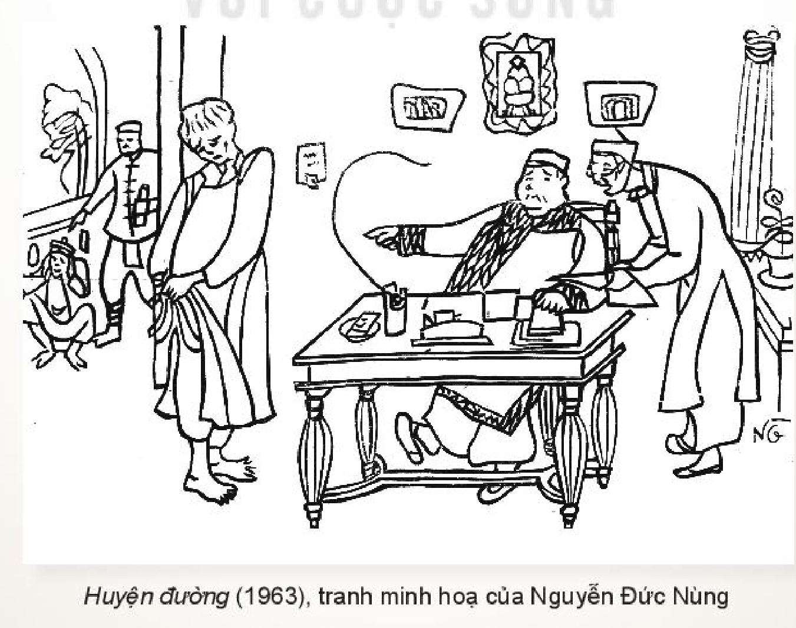

<!-- pdf:126 -->

# BÀI 5: TÍCH TRÒ SÂN KHẤU DÂN GIAN

## 🎯 Yêu cầu cần đạt

- Nhận biết và phân tích được một số yếu tố của văn bản chèo hoặc tuồng như: đề tài, tính vô danh, tích truyện, nhân vật, lời thoại, phương thức lưu truyền; phát hiện được các giá trị đạo đức, văn hoá từ văn bản được học.
- Nêu được ý nghĩa hay tác động của văn bản thông tin đã đọc đối với bản thân.
- Viết được báo cáo nghiên cứu, có sử dụng trích dẫn, cước chú và phương tiện hỗ trợ; có hiểu biết về quyền sở hữu trí tuệ và tránh đạo văn.
- Biết lắng nghe và phản hồi về một bài thuyết trình kết quả nghiên cứu.
- Có thái độ trân trọng đối với những di sản nghệ thuật quý báu mà ông cha truyền lại.

## ĐỌC

### TRI THỨC NGỮ VĂN

**Chèo**

**Chèo** nguyên là một loại hình kịch hát dân gian, phổ biến ở vùng đồng bằng Bắc Bộ, thường được diễn ở sân đình trong thời gian có các lễ hội. Về sau, chèo được chuyên nghiệp hoá dần với sự hình thành của các gánh chèo, đoàn chèo.

<!-- term: nghệ thuật chèo -->
Nghệ thuật chèo mang tính tổng hợp, có sự phối hợp nhuần nhuyễn giữa nói, hát, múa với sự hỗ trợ của các đạo cụ, nhạc khí dân tộc độc đáo, trên cơ sở một *tích trò* (còn gọi *tích truyện*, *chèo bản* hay đơn giản là *tích*) có sẵn.

<!-- pdf:127 -->

**Tích trò** là yếu tố đầu tiên, quan trọng nhất của vở chèo, làm điểm tựa cho toàn bộ hoạt động biểu diễn, tuy có tính ổn định nhưng vẫn để ngỏ khả năng thêm thắt, bổ sung cho diễn viên. Vì thế, một tích trò có nhiều dị bản là một sáng tạo mang tính tập thể. Tích trò của chèo dân gian (tích chèo) thường được xây dựng dựa vào truyện cổ tích hay truyện thơ Nôm, thể hiện các đề tài sinh hoạt, đạo đức gần gũi với khán giả bình dân.

<!-- term: nhân vật của chèo -->
Nhân vật của chèo không xa lạ với đời sống thường ngày của người dân lao động xưa, gồm nhiều hạng người trong xã hội, có địa vị, nghề nghiệp, giới tính, tuổi tác khác nhau. Xét theo tính cách, nhân vật chèo được phân thành hai loại chính: *vai chín* (tích cực) và *vai lệch* (tiêu cực). Mỗi loại nhân vật thường tự biểu hiện mình bằng một số điệu hát và động tác múa đặc trưng. Gây được ấn tượng mạnh nhất trong các vở chèo thường là những *vai nữ*, *vai hề*.

**Tuồng**

**Tuồng** là một loại hình kịch hát cổ truyền của dân tộc, phát triển mạnh dưới triều Nguyễn ở vùng Nam Trung Bộ. Tuồng có hai bộ phận tương đối khác biệt nhau là *tuồng cung đình* và *tuồng dân gian*.

<!-- term: nghệ thuật tuồng -->
Nghệ thuật tuồng mang tính tổng hợp, phối hợp cả văn học, ca nhạc và vũ đạo. Tích tuồng dân gian giàu yếu tố hài, hướng tới châm biếm các thói hư tật xấu hay đả kích một số hạng người nhất định trong xã hội. Một tích tuồng thường có nhiều dị bản, do nó được bổ sung, nắn chỉnh thường xuyên trong quá trình biểu diễn, lưu truyền.

<!-- pdf:128 -->

### VĂN BẢN 1: Xuý Vân giả dại

*(Trích chèo Kim Nham)*

- Giữa sự nở rộ của muôn vàn phương tiện nghe nhìn và các hoạt động giải trí hấp dẫn, bạn nghĩ như thế nào nếu ai đó đề nghị bạn bỏ chút thời gian xem một vở chèo cổ?
- Bạn có thấy tò mò khi nghe đến tên lớp chèo *Xuý Vân giả dại* hay không? Hãy tận dụng các điều kiện hiện có của mình để xem lớp chèo này hoặc toàn bộ vở chèo *Kim Nham*.

Kim Nham là một nho sinh, trọ học ở Tràng An(1). Sau khi kết duyên với Xuý Vân, chàng tiếp tục lên kinh miệt mài đèn sách đợi khoa thi, để Xuý Vân sống trong cảnh cô đơn, buồn bã. Ở quê, Xuý Vân bị gã Trần Phương tán tỉnh, hứa hẹn ngon ngọt. Nàng giả điên với hi vọng thoát khỏi Kim Nham để theo Trần Phương. Sau những cố gắng chạy chữa cho vợ không thành, Kim Nham đành phải để nàng được tự do. Xuý Vân tìm đến Trần Phương nhưng bị hắn trở mặt, quay lưng. Từ chỗ giả điên, Xuý Vân đã hoá điên thật. Đoạn trích dưới đây thể hiện cảnh Xuý Vân tự dựng lên màn điên loạn của chính mình.

**XUÝ VÂN** *(Nói lệch)*(2):

Đau thiết thiệt van(3),
Than cùng bà Nguyệt(4).
Đánh cho lê liệt,
Chết mệt con đồng.
Bắt đò sang sông,
Bớ đò, bớ đò(5).

> Hình dung khi thể hiện lời thoại này, diễn viên sẽ có động tác diễn xuất tương ứng như thế nào.

> (1) *Tràng An*: nguyên là tên gọi một kinh đô cũ của Trung Quốc, ở đây dùng để chỉ Hà Nội với thái độ trọng thị.
> (2) *Nói lệch*: một lối nói có giọng điệu riêng trong chèo, thường được dùng để tạo không khí sôi nổi hoặc gấp gáp.
> (3) *Đau thiết thiệt van*: đau đớn quá đến mức phải kêu lên.
> (4) *Bà Nguyệt*: là một vị thần, cùng với ông Tơ cai quản chuyện tình yêu đôi lứa (theo quan niệm dân gian Việt Nam, gần với quan niệm về Nguyệt lão trong văn hoá Trung Quốc).
> (5) *Bớ đò*: tiếng gọi đò quen thuộc ngày xưa.

<!-- pdf:129 -->

*(Vỉa)*(1):

Tôi kêu đò, đò nọ không thưa,
Tôi càng chờ càng đợi, càng trưa chuyến đò.

*(Hát quá giang)*(2):

Nên tôi phải luỵ(3) đò,
Cách con sông nên tôi phải luỵ đò,
Bởi ông trời tối, phải luỵ cô bán hàng.
Chả nên gia thất thì về,
Ở làm chi mãi cho chúng(4) chê, bạn cười.
Tôi chắp tay lạy bạn đừng cười,
Tôi không trăng gió lại gặp người gió trăng.
Gió trăng thời mặc gió trăng,
Ai ơi giữ lấy đạo hằng(5) chớ quên.
Chị em ơi!
Ra đây có phải xưng danh không nhỉ?

> Lời thoại này thể hiện trạng thái tâm lí gì của nhân vật?

*(Đế)*(6):

Không xưng danh, ai biết là ai?

**XUÝ VÂN**:

Bước chân vào tôi thưa rằng vậy,
Chẳng giấu gì Xuý Vân là tôi,
Tuy dại dột, tài cao vô giá,
Thiên hạ đồn rằng tôi hát hay đã lạ,
Ai cũng gọi là cô ả Xuý Vân.
Phụ Kim Nham, say đắm Trần Phương,
Nên đến nỗi điên cuồng, rồ dại.

> Chú ý cách nhân vật chèo xưng danh, tự giới thiệu trước khán giả.
<!-- ocr-ok: hộp chỉ dẫn đọc cột phải bị OCR ghép lẫn vào dòng thơ bên trái, đã đối chiếu ảnh trang PDF 129 -->

> (1) *Vỉa*: một lối nói có giọng điệu riêng trong chèo, được dùng làm cầu nối để bắt vào điệu hát chính.
> (2) *Hát quá giang*: một điệu hát chèo, còn được gọi là *hát gọi đò*, thường dùng khi diễn tả tâm trạng hụt hẫng của nhân vật.
> (3) *Luỵ*: nhún mình, tạm chiều theo ý của người khác để được việc riêng.
> (4) *Chúng*: người đời. *Chúng bạn*: bạn bè nói chung.
> (5) *Đạo hằng*: chuẩn mực đạo đức vững bền (nghĩa trong văn bản).
> (6) *Đế*: nói lời chêm vào hoặc tiếng nói chêm vào, phụ hoạ với lời nói của diễn viên chèo đang diễn (tiếng đế xuất phát từ khán giả hay từ người đứng trong cánh gà sân khấu).

<!-- pdf:130 -->

*(Hát điệu con gà rừng)*(1):

Con gà rừng ăn lẫn với công,
Đắng cay chẳng có chịu được, ức!
Mà để láng giềng ai hay?
Bông bông dắt, bông bông díu,
Xa xa lắc, xa xa líu,
Láng giềng ai hay, ức bởi xuân huyên(2).
Chờ cho bông lúa chín vàng,
Để anh đi gặt, để nàng mang cơm.
Bông bông dắt, bông bông díu,
Xa xa lắc, xa xa líu,
Láng giềng ai hay, ức bởi xuân huyên.

> Hình ảnh vợ chồng quấn quýt xuất hiện ở đây có ý nghĩa gì?

*(Tiếng trống nhịp nổi lên, Xuý Vân múa điệu bắt nhện, xe tơ, dệt cửi. Múa xong, Xuý Vân hát lên rồi cười và hát điệu sa lệch(3)...)*
<!-- ocr-ok: chỉ dẫn sân khấu in nghiêng bị OCR đọc lỗi nhiều từ, đã đối chiếu ảnh trang PDF 130 -->

Rủ nhau lên núi Thiên Thai(4),
Thấy hai con quạ đang ăn xoài trên cây.
Ba cô bán mắm trong làng,
Mắm không bán hết, còn quang với thùng...
Chị em ơi, tôi than thân tôi vài câu nhé.

*(Đế)*:

Ờ.

**XUÝ VÂN** *(Nói điệu sử rầu)*(5):

Than ôi!
Tôi thương nhân ngãi, tôi nhớ nhân tình(6),
Đêm năm canh tôi thức cả vừa năm.

> Chú ý sự ý thức của nhân vật về chính mình.

> (1) *Điệu con gà rừng*: một điệu hát chèo, thường được dùng khi muốn diễn tả nỗi niềm đắng cay, bực tức của nhân vật.
> (2) *Xuân huyên*: cha mẹ. Xuân, huyên là hai loại cây sống lâu, thường được ví với cha (*xuân*) và mẹ (*huyên*).
> (3) *Điệu sa lệch*: một điệu hát chèo, thường được dùng khi cần thể hiện tâm trạng lưu luyến, nhớ thương hay ai oán.
> (4) *Núi Thiên Thai*: một ngọn núi nhỏ thuộc huyện Gia Bình, tỉnh Bắc Ninh.
> (5) *Điệu sử rầu*: một lối nói có giọng điệu ngâm nga, chậm rãi, thường được dùng ở những lớp chèo giàu tính trữ tình, khi nhân vật giãi bày tâm sự.
> (6) *Nhân ngãi, nhân tình*: người tình (dùng trong bối cảnh đang nói về quan hệ yêu đương không đứng đắn).

<!-- pdf:131 -->

*(Hát sắp)*(1):

Than rằng nhân ngãi, cựu tình(2) tôi đâu,
Con cá rô nằm vũng chân trâu,
Để cho năm bảy cần câu châu vào!

*(Nói)*:

Chị em ơi, tôi hát xuôi cũng được,
Mà tôi hát ngược cũng hay,
Tôi hát câu này cho chị em nghe nhé!

*(Hát ngược)*(3):

Chiếc trống cơm(4), ai khéo vỗ nên bông,
Một đàn các cô con gái lội sông té bèo.
Chuột đậu cành rào, muỗi ấp cánh dơi,
Ông Bụt kia bẻ cổ con nai,
Cái trứng gà mà tha con quạ lên ngồi trên cây.
Ở trong đình có cái khua, cái nhôi(5),
Ở trong cái nón có cái kèo, cái cột,
Ở dưới sông có cái phố bán bát,
Lên trên biển ta đốn gỗ làm nhà,
Con vâm(6) kia ấp trứng ba ba,
Cưỡi con gà mà đi đánh giặc!

> Lưu ý ngôn ngữ và cách liên hệ bất thường của người điên hoặc giả điên.
<!-- ocr-ok: hộp chỉ dẫn đọc cột phải bị OCR ghép lẫn vào dòng thơ bên trái, đã đối chiếu ảnh trang PDF 131 -->

*(Xuý Vân vào, vừa đi vừa cười điên dại).*
<!-- ocr-ok: chỉ dẫn sân khấu in nghiêng bị OCR đọc nhầm thành "Xuú Vân cào, cừa đi cừa cười điện dại", đã đối chiếu ảnh trang PDF 131 -->

(*Ngữ văn 10 Nâng cao*, tập một, NXB Giáo dục Việt Nam, Hà Nội, 2018, tr. 129 – 132)

> (1) *Hát sắp*: một điệu hát chèo, thường có tiết tấu tươi vui, rộn ràng.
> (2) *Cựu tình*: người yêu cũ (nghĩa trong văn bản).
> (3) *Hát ngược*: một điệu hát chèo, thường được dùng khi cần diễn tả tâm trạng điên loạn của nhân vật, lời hát được khai thác từ loại ca dao nói ngược.
> (4) *Trống cơm*: một loại trống nhỏ, cũng là loại nhạc cụ thuộc bộ gõ.
> (5) *Khua, nhôi*: những bộ phận trong chiếc nón bằng cổ truyền của người Việt.
> (6) *Con vâm*: con voi.

<!-- pdf:132 -->

***Kim Nham*** nêu cao bài học đạo lí khi thể hiện quan hệ gia đình, chồng vợ, đồng thời cũng bộc lộ sự cảm thông với thân phận của người phụ nữ trong xã hội nam quyền xưa.

*Kim Nham* hội tụ được những tinh hoa của nghệ thuật chèo, vừa giàu tính bi kịch, vừa đầy tiếng cười hài hước, có những lớp, những màn(1) hết sức đặc sắc, gắn liền với tài năng biểu diễn của các nghệ sĩ qua nhiều thời.

Tích trò *Kim Nham* có một số dị bản, kể khác nhau ít nhiều về nguồn gốc gia đình Xuý Vân, nguyên cớ chính khiến Xuý Vân giả điên và đoạn kết thúc số phận bi kịch của nàng.

***Xuý Vân giả dại*** là lớp chèo thuộc loại đỉnh cao không chỉ của riêng vở *Kim Nham* mà còn của cả nền chèo cổ Việt Nam. Đã có nhiều diễn viên khẳng định tài năng xuất chúng của mình nhờ lớp chèo này như Dịu Hương, Diễm Lộc, Thuý Ngần,...

**Trả lời câu hỏi**

1. Nêu nguyên nhân dẫn đến hành động giả dại của Xuý Vân.
2. Trong lớp chèo *Xuý Vân giả dại*, đoạn lời thoại nào thể hiện rõ nhất “ngôn ngữ điên” của nhân vật? Vì sao bạn xác định như vậy?
3. Hãy chọn phân tích một đoạn lời thoại để làm rõ những mâu thuẫn giằng xé trong nội tâm của nhân vật Xuý Vân.
4. Đoạn lời thoại được thể hiện theo điệu “con gà rừng” cho biết những điều gì về cảnh ngộ đời sống cũng như niềm mong ước của Xuý Vân?
5. Qua đoạn xưng danh của Xuý Vân, có thể nhận ra được những đặc điểm gì của sân khấu chèo (cách xưng danh, sự tương tác giữa người xem và người diễn,...)?
6. Nêu một số đặc điểm của ngôn ngữ chèo mà bạn nhận biết được qua đoạn trích (thể thơ quen dùng; chất liệu ca dao, dân ca;...).
7. Qua lớp chèo này, bạn hiểu thêm được những điều gì về đời sống văn hoá làng xã Việt Nam thuở xưa?
8. Xuý Vân giả dại để che giấu điều gì? Bạn đánh giá như thế nào về hành động này của nhân vật?
9. Với văn bản lớp chèo *Xuý Vân giả dại*, ta chỉ cần khoảng 3 phút để đọc xong, nhưng để diễn trên sân khấu, cần tới gần 15 phút. Từ thực tế này, có thể rút ra được nhận xét gì về nghệ thuật chèo? (Gợi ý: chức năng của tích trò; tầm quan trọng của diễn xuất gồm hát, múa và các hình thức biểu cảm khác;...)

#### Kết nối đọc – viết

Viết đoạn văn (khoảng 150 chữ) trình bày suy nghĩ của bạn về nỗi niềm của nhân vật Xuý Vân được thể hiện qua lớp chèo *Xuý Vân giả dại*.

> (1) *Lớp, màn*: những đoạn tương đối độc lập của tích trò hay vở diễn.

<!-- pdf:133 -->

### VĂN BẢN 2: Huyện đường(*)
<!-- ocr-ok: nhãn VĂN BẢN 2 trên nền màu xanh bị OCR bỏ sót, đã đối chiếu ảnh trang PDF 133 -->

*(Trích tuồng Nghêu, Sò, Ốc, Hến)*
<!-- ocr-ok: dòng phụ đề in nghiêng bị OCR đọc nhầm dấu ("tuông", "Hền"), đã đối chiếu ảnh trang PDF 133 -->

- Bạn đã xem biểu diễn tuồng bao giờ chưa? Bạn nghĩ sao khi loại nghệ thuật sân khấu truyền thống này đang gặp khó khăn trên con đường đến với khán giả hiện đại?
- Hãy tìm xem trên internet toàn bộ hoặc từng trích đoạn của vở tuồng này.

Một đêm nọ, Ốc (kẻ chuyên nghề “đào ngạch”) hợp tác với Nghêu (thầy bói) đột nhập nhà trùm Sò (địa chủ) để ăn trộm. Nghêu bị bắt giữ còn Ốc chạy thoát được. Đang khi Ốc đem đồ ăn trộm bán cho Thị Hến – một người goá chồng, làm nghề buôn bán – thì trùm Sò và lí trưởng dẫn người ập đến bắt quả tang. Lí trưởng lợi dụng chuyện này đòi Thị Hến đút lót. Việc không thành, tất cả dắt nhau lên huyện đường. Tại đây, Ốc bị phạt tù, Nghêu và lí trưởng bị đánh đòn. Riêng lí trưởng, trùm Sò còn phải chi tiền để hối lộ tri huyện(1). Nhờ có nhan sắc, Thị Hến không những không bị hạch tội, lại còn được tri huyện và đề lại(2) “chiếu cố” hẹn hò. Lũ háo sắc ấy (có thêm cả lí trưởng) rơi vào bẫy của Thị Hến khi giáp mặt nhau tại nhà chị ta và bị các bà vợ đến đánh ghen một trận tơi bời. Đoạn trích dưới đây kể lại một cảnh làm việc nơi huyện đường, vào thời điểm diễn ra cuộc kiện tụng giữa các nhân vật liên quan đến vụ trộm.

**Cảnh 1**

*– Bàn giấy của tri huyện.*
<!-- ocr-ok: chữ in nghiêng bị OCR đọc nhầm thành "Bàn giấu của trí huyện", đã đối chiếu ảnh trang PDF 133 -->

*Trên tường chính giữa là bức hoành phi đề hai chữ “Huyện đường”. Hai bên có hai câu đối. Bên cạnh câu đối phía trái có cửa vào nhà trong.*

*Một chiếc bàn to để chính giữa làm bàn giấy của tri huyện, trên bàn có ống bút, nghiên mực, điếu bình. Bên trái, bàn giấy của viên đề lại để xây mặt ra khán giả phía phải của sân khấu, trên bàn cũng có nghiên bút và một chồng đơn từ.*

> Cách bài trí nơi huyện đường – những chỉ dẫn cho việc thiết kế sân khấu.

*Màn mở: tri huyện từ trong nhà bước ra, ngồi vào ghế.*
<!-- ocr-ok: chữ in nghiêng bị OCR đọc nhầm thành "Màn mớ: trí huyận... ngồi nào ghế", đã đối chiếu ảnh trang PDF 133 -->

> (\*) Nhan đề đoạn trích do người biên soạn sách giáo khoa đặt.
> *Huyện đường*: nơi làm việc của bộ máy chính quyền thuộc đơn vị huyện thời phong kiến.
> (1) *Tri huyện*: chức quan cai quản một huyện ở Việt Nam thời phong kiến và được duy trì trong thời thuộc Pháp (tại những miền thực dân Pháp đặt chế độ bảo hộ).
> (2) *Đề lại*: viên thư kí ở huyện đường.

<!-- pdf:134 -->

**TRI HUYỆN**

*(Nói lối)*(1)

Quyền trọng(2) trấn nha môn(3)
Bản chức(4) xưng tri huyện
Đỉnh chung(5) đà đủ miếng
Hoa nguyệt(6) cũng quen mùi
Lấy của cậy ngọn roi
Làm quan nhờ lỗ khẩu(7)
Sự lí thường phân ẩu(8)
Được thua tự đồng tiền
Dân xã nếu không kiêng(9)
Bỏ xuống lao(10) giam kĩ
<!-- ocr-ok: các số mũ cước chú (2)..(10) bị OCR đọc nhầm thành kí hiệu và "lao" thành "la", đã đối chiếu ảnh trang PDF 134 -->

> Lưu ý cách tự giới thiệu của nhân vật trong tuồng.

*(một lát, cười)*

Quan chức nghĩ nên thú vị
Vào ra cũng phải chuyên cần

**ĐỀ LẠI** *(bước ra)*

Bẩm quan ạ!

**TRI HUYỆN**

Vâng, chào thầy. A, thầy Đề này, hôm nay sao mà

*(Nói lối)*

Nha lại vắng bẩm thân
Dân xã không đấu cáo(11)

> (1) *Nói lối*: một kiểu nói có giọng điệu riêng của tuồng.
> (2) *Quyền trọng*: vị trí, uy thế lớn.
> (3) *Nha môn*: cửa quan, chốn làm việc của bộ máy quan lại. Nghĩa cả câu: có quyền lớn nhất ở chốn công đường.
> (4) *Bản chức*: từ tự xưng của người có chức vụ ở thời xưa với người dân.
> (5) *Đỉnh chung*: vạc và chuông. Đây chỉ lợi lộc có được nhờ chức vụ.
> (6) *Hoa nguyệt*: ẩn dụ chỉ quan hệ tình ái.
> (7) *Lỗ khẩu*: lỗ miệng.
> (8) *Phân ẩu*: phân xử tuỳ tiện.
> (9) *Kiêng*: nể sợ.
> (10) *Lao*: nơi giam giữ.
> (11) *Đấu cáo*: kêu cầu, thưa kiện, nhờ phân xử.
<!-- ocr-ok: số thứ tự cước chú và chữ in nghiêng cỡ nhỏ chân trang bị OCR nhận dạng sai, đã đối chiếu ảnh trang PDF 134 -->

<!-- pdf:135 -->

**ĐỀ LẠI**

Vâng, hôm nay chả thấy ai kiện cáo gì cả. Còn vụ Thị Hến, Nguyễn Sò quan đã định dứt khoát như thế nào chưa?

**TRI HUYỆN**

Vụ ấy à? Ý thầy thế nào? *(không đợi đề lại trả lời)* Tôi thì tôi nghĩ cứ để đu đưa như vậy đã. Thằng Sò này giàu lắm, chúng mình có thể “ấy” được.

**ĐỀ LẠI**

Vâng, ta cứ bảo là để tra cứu đã. Thưa còn thằng Ốc, thằng Nghêu, lí trưởng, Thị Hến thì liệu xử cho xong, bọn này toàn đầu trọc cả.

**TRI HUYỆN**

Phải, nắm đứa có tóc ai nắm kẻ trọc đầu. *(cười khoái trá)* Xử Ốc năm năm tù, Nghêu phạt đòn năm chục trượng, lí trưởng đòi ăn lót cần phạt trừng giới(1) năm mươi quan tiền.

> Chú ý sự hể hả, trắng trợn của tri huyện khi tự “thưởng thức” những mưu mô của mình.

**ĐỀ LẠI**

Bẩm quan xử thật sâu sắc, nhưng đã xử Nghêu và Ốc rồi thì lấy lí gì mà không xử Sò và Hến được.

> Hoạt động “ăn ý” giữa tri huyện và đề lại.

**TRI HUYỆN** *(cười)*

Ăn thua là những chỗ khó đấy đấy, lưỡi không xương nhiều đường lắt léo, nói thế nào lại chả được. Thị Hến thì cũng có thể cho về nhưng chưa nên xử vội, vì xử Hến thì phải xử Sò. Thầy hiểu chứ?

**ĐỀ LẠI**

Vâng ạ, quan xử hay lắm. *(gọi)* Lệ(2) đâu?
<!-- ocr-ok: chữ in nghiêng và số mũ cước chú bị OCR đọc nhầm thành "(sợi) Lệ?", đã đối chiếu ảnh trang PDF 135 -->

**LÍNH LỆ A** *(lễ phép bước ra)*

Bẩm quan dạy ạ.

**ĐỀ LẠI**

Ra đòi vụ Nguyễn Sò vào hầu, cả bên nguyên, bên bị, nhân chứng.

**LÍNH LỆ A**

Vâng ạ. *(quay đi)*

> (1) *Trừng giới*: phạt để răn đe.
> (2) *Lệ*: lính hầu.
<!-- ocr-ok: cước chú chân trang cỡ chữ nhỏ bị OCR đọc sai dấu và số thứ tự, đã đối chiếu ảnh trang PDF 135 -->

<!-- pdf:136 -->

**TRI HUYỆN**

Lệ hầu đâu?

**LÍNH LỆ B** *(từ trong)*

Vâng. *(cầm quạt lông ra hầu cạnh tri huyện)*

*(Có tiếng lệ A nói to bên trong: “Để ba người này vào trước. Đinh Ốc, Phan Nghêu vào sau, ngồi đấy”.)*

**LÍNH LỆ A** *(dắt lí trưởng, Trùm Sò và Thị Hến vào. Vừa vào, lệ A bấm mấy người đứng lại nói nhỏ)*
<!-- ocr-ok: chỉ dẫn sân khấu in nghiêng bị OCR đọc lỗi nhiều từ, đã đối chiếu ảnh trang PDF 136 -->

Nhắc lại ông Trùm, anh xã và chị Hến biết rằng hôm nay quan bận lắm, tôi bẩm mãi quan mới chịu xử vụ này đấy.

> Điều gì sẽ xảy ra sau lời nói này của lính lệ A?

**LÍ TRƯỞNG**

Vâng, tôi biết anh tử tế lắm, chúng ta với nhau rồi...

**TRÙM SÒ**

Vâng, tôi xin hậu tạ, anh cứ giúp đỡ cho.

**LÍNH LỆ A**

Thế bây giờ đứng đây, tôi vào bẩm lại đã. *(chạy vào chắp tay trước bàn giấy tri huyện)* Bẩm con đã đòi vụ Nguyễn Sò đến hầu ạ.

(Hoàng Châu Ký chỉnh lí, *Nghêu, Sò, Ốc, Hến*, NXB Phổ thông – Bộ Văn hoá, Hà Nội, 1957, tr. 41 – 45)

*Huyện đường* (1963), tranh minh hoạ của Nguyễn Đức Nùng

<!-- pdf:137 -->

***Nghêu, Sò, Ốc, Hến*** thuộc loại tuồng đồ (tuồng hài), châm biếm sâu sắc nhiều thói tật trong xã hội và lật tẩy bộ mặt xấu xa của một số kẻ thuộc bộ máy cai trị ở địa phương trong xã hội xưa.

Đây là tác phẩm tiêu biểu trong di sản tuồng truyền thống và là vở tuồng đồ thuộc loại đặc sắc nhất.

Tích tuồng *Nghêu, Sò, Ốc, Hến* có một số dị bản, kể khác nhau ở một vài chỗ, trong đó có tình tiết đánh ghen cuối vở.

Văn bản *Nghêu, Sò, Ốc, Hến* do Hoàng Châu Ký chỉnh lí (1957) gồm có tất cả ba hồi. Đoạn trích ***Huyện đường*** thuộc cảnh I của hồi thứ II, thể hiện cảnh tri huyện và đề lại bàn bạc với nhau về cách nhũng nhiễu(1) người kêu kiện.

**Trả lời câu hỏi**

1. Tóm tắt các sự việc trong đoạn trích.
2. Liệt kê những lời thoại cho thấy sự tương đồng về bản chất, thủ đoạn giữa các nhân vật ở huyện đường, từ tri huyện đến đề lại và lính lệ.
3. Đoạn trích cho thấy tri huyện và đề lại không cần phải giữ ý với nhau. Vì sao vậy? Phân tích sự hô ứng nhịp nhàng trong lời thoại giữa hai nhân vật.
4. Qua theo dõi cảnh tuồng *Huyện đường*, bạn hiểu như thế nào về thái độ và cách nhìn nhận của người dân xưa đối với chốn “cửa quan”?
5. Lời tự giới thiệu (qua hình thức nói lối) của nhân vật tri huyện đã giúp người xem, người đọc hiểu được điều gì về con người ông ta? Hãy so sánh lời tự giới thiệu đó của một nhân vật cụ thể trong tuồng với những lời tự giới thiệu thường gặp trong đời sống để rút ra nhận xét cần thiết.
6. Nếu được tham gia dựng lại cảnh *Huyện đường* trên sân khấu, bạn sẽ lưu ý điều gì về diễn xuất của diễn viên? Vì sao?

#### Kết nối đọc – viết

Viết đoạn văn (khoảng 150 chữ) trình bày suy nghĩ về tiếng cười châm biếm của tác giả dân gian thể hiện qua đoạn trích.

> (1) *Nhũng nhiễu*: dựa vào uy thế, vị trí của mình trong bộ máy cai trị để hạch sách, quấy rầy, đòi hỏi cái này cái nọ.

<!-- pdf:138 -->

### VĂN BẢN 3: Múa rối nước hiện đại soi bóng tiền nhân(*)

**Phạm Thuỳ Dung**

- Khi nghe cụm từ “con rối”, điều đầu tiên bạn nghĩ tới là gì? Vì sao như vậy?
- Bạn đã có những hiểu biết gì về rối nước? Hãy nêu những điều bạn còn thắc mắc và muốn tìm hiểu sâu thêm về loại hình nghệ thuật này.

***Có một trò diễn mà sàn diễn là mặt nước còn diễn viên lại xuất thân từ những miếng gỗ. Có một trò diễn mà con người chỉ thầm lặng đứng ở hậu trường trong khi những hình nhân vô tri lại toả sáng dưới ánh đèn sân khấu. Trò diễn đó chính là múa rối nước, một loại hình nghệ thuật biểu diễn mang đậm hơi thở của nền văn minh lúa nước đồng bằng Bắc Bộ Việt Nam.***

> Đoạn chữ in đậm này là sa-pô của văn bản. Hãy nhớ lại các chức năng thông thường của một sa-pô.

Hiếm người biết chính xác múa rối nước ra đời từ bao giờ, bởi nó bắt đầu nảy mầm, len lỏi trong lòng các xóm làng chiêm trũng rồi lớn dần lên giữa những sinh hoạt nhỏ bé đời thường. Tương truyền, múa rối nước được hình thành từ thế kỉ XI – XII. Theo thời gian, múa rối nước ngày càng trở nên phổ biến và hoàn thiện thông qua những đúc kết của nhiều thế hệ.

> Trò rối nước ở Việt Nam ra đời từ bao giờ?

Múa rối nước vốn thường được biểu diễn trong các buổi hội làng hay các dịp lễ tết, khi bà con đã thu xếp xong việc đồng áng để cùng ra đình góp vui. Sau này, rối vào thành phố, rối vào nhà hát, diễn viên vẫn là rối gỗ, sân khấu vẫn là mặt nước, người điều khiển vẫn đứng sau bức mành, nhưng không khí và quy mô của nó đã khác hơn nhiều.

> (\*) *Tiền nhân*: người đời trước, người xưa, người thuộc các thế hệ đã qua.

<!-- pdf:139 -->

Nghệ thuật múa rối là sự kết hợp độc đáo giữa nghệ thuật tạo hình và kĩ thuật biểu diễn. Để diễn được trò rối nước, người ta phải dựng lên nhà rối (còn gọi là thuỷ đình) trên mặt ao làng với lối kiến trúc mái chùa cong cùng mành tre, cờ phướn, võng lọng, cổng hàng mã,... tạo nên một sân khấu sinh động. Thời nay, thuỷ đình được dựng ngay trong các nhà hát và trong các khu du lịch sinh thái,... với sân khấu là hồ nhân tạo. Khán giả làng đứng ngồi xúm xít quanh ao xem rối còn khán giả phố ngồi ghế ngay hàng thẳng lối xem rối. Khán giả làng xem rối giữa hây hây gió trời còn khán giả phố lại xem rối giữa mát mẻ điều hoà. Tuy có sự khác nhau về không gian biểu diễn, nhưng các nghệ nhân và nghệ sĩ đều cố gắng đem lại cho khán giả những nét đặc trưng của nghệ thuật rối nước Việt Nam.

> Không gian biểu diễn đặc trưng của múa rối nước.

Rối nước khác rối cạn (rối cạn gồm rối tay, rối que, rối dây) là người điều khiển sử dụng hệ thống sào kết hợp với dây để điều khiển con rối. Hệ thống sào, dây giúp người đứng sau bức mành (còn gọi là buồng trò) có thể điều khiển những con rối cử động theo ý muốn. Lối điều khiển đòi hỏi kĩ năng thuần thục, làm sao để các cử động của rối nhịp nhàng và phù hợp với lời thoại, âm nhạc, từ đó lột tả được thần thái nhân vật. Phần thân trên của rối nổi lên mặt nước còn phần chân chìm dưới nước được gắn đế để giữ thăng bằng và lắp bộ điều khiển. Những con rối được đẽo gọt từ gỗ sung (thứ gỗ nhẹ và nổi được trên nước), được tạo hình ngộ nghĩnh với màu sắc rực rỡ, tươi vui và dân dã. Ngoài ra, âm thanh và ánh sáng cũng là yếu tố góp phần quan trọng vào sự thành công của một tiết mục rối nước. Rối nước cần tiếng đàn, tiếng hát, tiếng trống mõ, tiếng kèn sáo và cả những tiếng pháo phụ trợ để thật tròn vai.

> Trong trò rối nước, con rối đã được chế tác và điều khiển như thế nào?

Giữa nhịp sống tốc độ thời cách mạng Công nghiệp 4.0, nghệ thuật múa rối vẫn được duy trì và bảo tồn. Bên cạnh những sinh hoạt biểu diễn hội hè đã thành thông lệ ở nhiều làng xã, trên khắp cả nước có rất nhiều địa điểm tổ chức biểu diễn múa rối nước hấp dẫn khán giả, đặc biệt là các khán giả nhỏ tuổi và người nước ngoài. Lớp trẻ được tiếp cận gần gũi với nghệ thuật biểu diễn dân gian còn người nước ngoài được biết thêm một nét văn hoá đặc sắc của Việt Nam.

> Việc bảo tồn, phát triển rối nước có điểm gì chung với việc bảo tồn, phát triển các loại hình nghệ thuật cổ truyền khác của dân tộc?

Tuy nhiên, những người tâm huyết với nghệ thuật múa rối còn kì vọng hơn thế. Bởi duy trì được nhưng đã phát triển được hay chưa? Phát triển ở đây không chỉ là

<!-- pdf:140 -->

nhân rộng địa điểm biểu diễn, tăng số lượng suất diễn, thu hút được khán giả mua vé, mà cao hơn nữa phải là sự tìm tòi, sáng tạo để đào sâu và phát huy những giá trị vốn có của nghệ thuật múa rối nước mà các thế hệ đi trước đã gây dựng.

Những người yêu nghệ thuật rối nước, những nghệ nhân múa rối nước và tạo tác con rối vẫn luôn trăn trở để gìn giữ môn nghệ thuật truyền thống thấm đẫm tinh thần Việt.

(Theo tạp chí *Heritage*, số ra tháng 7/2019, tr. 116 – 118)

**Trả lời câu hỏi**

1. Tóm tắt những thông tin chính của văn bản.
2. Tìm trong văn bản những thông tin cho phép khẳng định múa rối nước là “môn nghệ thuật truyền thống thấm đẫm tinh thần Việt”.
3. Nêu đặc điểm của cách triển khai thông tin trong văn bản. Hãy phân tích mức độ thuyết phục của cách triển khai ấy.
4. Nêu nhận xét về phần sa-pô của văn bản, từ đó rút ra cách viết sa-pô cho một văn bản thông tin nói chung.
5. Nếu được phép bổ sung vào văn bản những thông tin về các câu chuyện được kể trên sân khấu rối nước, bạn có thể nói điều gì?
6. Từ văn bản được học, hãy nêu cảm xúc, suy nghĩ của bạn về rối nước nói riêng và nghệ thuật cổ truyền của dân tộc nói chung.

#### Kết nối đọc – viết

Viết đoạn văn (khoảng 150 chữ) về chủ đề: *Múa rối nước – món quà kì diệu từ đồng ruộng Việt Nam*.

<!-- pdf:141 -->

## VIẾT

**Viết báo cáo nghiên cứu (Về một vấn đề văn hoá truyền thống Việt Nam)**

Ở Bài 4, bạn đã bước đầu tập viết báo cáo nghiên cứu về một vấn đề. Đến với bài này, trên cơ sở những dữ liệu mới, bạn có được cơ hội củng cố kĩ năng viết loại văn bản quan trọng này với những nội dung có nhiều thách thức hơn. Hãy biến những thách thức đó thành một cơ hội khám phá, nghiên cứu.

**Yêu cầu**

- Nêu được vấn đề muốn nghiên cứu về văn hoá truyền thống của dân tộc Việt Nam.
- Xây dựng được hệ thống luận điểm sáng rõ; làm nổi bật được các kết quả nghiên cứu với những cứ liệu minh hoạ cụ thể, sát hợp.
- Sử dụng ngôn ngữ khách quan, khoa học để trình bày kết quả nghiên cứu và thể hiện quan điểm đánh giá riêng.
- Khái quát được ý nghĩa của vấn đề văn hoá truyền thống Việt Nam đã chọn nghiên cứu.
- Thể hiện được thái độ trung thực khi kế thừa kết quả nghiên cứu của những người khác.

### Bài viết tham khảo

**Ngôn ngữ đối thoại trong chèo**
<!-- ocr-ok: tiêu đề màu cam đè lên chữ chìm nền trang bị OCR bỏ sót, đã đối chiếu ảnh trang PDF 141 -->

*(Trích)*

**Hà Văn Cầu**

Ở tất cả mọi loại hình sân khấu, về phương diện kịch bản – và cả trong diễn xuất, *ngôn ngữ đối thoại* luôn luôn giữ vai trò quan trọng nhất.

> Nêu vấn đề nghiên cứu.

Ở chèo cũng vậy.

Tác giả chèo xưa có thể là một trí thức bình dân, cũng có thể là người nông dân thất học, bước vào chiếu diễn mới “lợi khẩu thành văn”. Do đó, trong ngôn ngữ sân khấu chèo, đoạn này có thể là những câu thơ chữ Hán đầy điển cố, khó hiểu, đoạn khác lại gần như một câu ca dao nuột nà, phơi phới tình người. Bất kì vở chèo cổ nào cũng đều do “tập thể” tác giả ấy sáng tạo nên. Vì vậy, tình trạng “nửa nôm, nửa tự”(1) là hiện tượng đặc biệt trong ngôn ngữ của chèo cổ.

> (1) *Nửa nôm, nửa tự*: thành ngữ (ít dùng) chỉ cách diễn đạt, nói năng vừa dùng những từ quen thuộc, thông dụng của người Việt (*Nôm*: chữ Nôm, tiếng Nôm – tiếng của người Việt) vừa dùng những thành ngữ, điển tích lấy từ các kinh sách chữ Hán (*tự*: chữ, ở đây chỉ Hán văn; trước đây, người Việt coi “nói chữ” là cách nói có sử dụng từ ngữ, chữ nghĩa trong kinh sách Hán văn).

<!-- pdf:142 -->

Không thể lấy các quy tắc thơ văn Hán học để phân tích toàn bộ văn chương của chèo cổ mà phải từ những thành tựu văn học cụ thể của chèo, rút ra những quy tắc riêng biệt của nó.

> Nêu định hướng nghiên cứu.

Một vở chèo cổ được sáng tác ra là để *diễn* và chỉ để *diễn*, không phải để in hay để đọc và giảng dạy, do đó, xem xét các câu văn trong chèo, phải đánh giá chúng theo quan điểm của người *hoạt động sân khấu*, chứ không thể theo quan điểm của người *nghiên cứu văn bản học* đơn thuần. Bởi vì, trong chèo cổ, người đọc luôn luôn bắt gặp những câu thơ phá cách, sai cả niêm, luật, vần điệu, song chúng lại rất hoàn chỉnh, rất phù hợp với nhân vật và tình huống khi được biểu diễn trước khán giả.

Chúng tôi xem xét văn học trong chèo cổ luôn luôn với ý nghĩa là ngôn ngữ sân khấu, lấy diễn xuất và hiệu quả truyền cảm của chúng trong diễn xuất làm tiêu chuẩn đánh giá. Đương nhiên, trong quá trình phân tích, chúng tôi không bỏ qua các quy tắc văn chương đã được vận dụng vào việc sáng tác từ lâu đời.

Trong những nét chung lớn, chúng tôi thu hoạch được những điều sau đây:

Ngôn ngữ trong một vở chèo là phương tiện để xác định thân phận nhân vật đồng thời lại là sự thể hiện hành động của nhân vật đó.

> Trình bày kết quả nghiên cứu.
<!-- ocr-ok: hộp chỉ dẫn đọc cột phải bị OCR ghép lẫn vào dòng văn bản chính, đã đối chiếu ảnh trang PDF 142 -->

Một câu đối thoại hay luôn luôn là câu nói vừa giải thích được những đặc điểm riêng của nhân vật đồng thời lại vừa nói lên được hành động của nhân vật đó. Ví dụ: nhân vật Xuý Vân khi giả điên, gặp chồng:

> Nêu luận điểm – kết quả nghiên cứu.

**KIM NHAM**:

*Đương cơn lửa cháy*
*Lại đổ thêm dầu*
*Cơn cớ vì đâu*
*Hoặc tà tí hay là khí huyết*(1)
<!-- ocr-ok: đoạn thơ trích dẫn in nghiêng bị OCR đọc nhầm nhiều chữ ("cháu", "đầu", "tì", "hau"), đã đối chiếu ảnh trang PDF 142 -->

> Dẫn cứ liệu để khẳng định luận điểm.

**XUÝ VÂN**:

*Nham chàng,*
*Tà gì mà tà*
*Tí gì mà tí*
*Tà tí khí huyết*
*Đàn đàn việt việt*(2)
<!-- ocr-ok: đoạn thơ trích dẫn in nghiêng bị OCR đọc nhầm "khí huyết" và "việt việt", đã đối chiếu ảnh trang PDF 142 -->

> (1) *Hoặc tà tí hay là khí huyết*: do bị tà ma (bên ngoài) ám hay do khí huyết (bên trong) bị thương tổn.
> (2) *Đàn việt*: bố thí, người bố thí; đây chỉ việc đi khấn vái, cầu cúng mong tai qua nạn khỏi (*đàn đàn việt việt* chính là *đàn việt* được nói với giọng day nghiến, chì chiết).

<!-- pdf:143 -->

*Thuốc thuốc thang thang*
*Tang tính tình tang*
*Hỡi người tình nhân kia hỡi, lại đây chị hát cho mà nghe:*

*(Hát)*:

*Tai nghe lệnh ngự*(1)
*Ta lới*(2) *gõ sênh*(3)
*Bỏ con thơ dại ta lới đem mình ra đi*
*Ai đua sông Cái thì đua*
*Có miếu có chùa, ta lới linh thiêng...*
<!-- ocr-ok: đoạn hát trích dẫn in nghiêng kèm số mũ cước chú bị OCR đọc lỗi nhiều từ, đã đối chiếu ảnh trang PDF 143 -->

Rõ ràng, thông qua ngôn ngữ của các nhân vật, tác giả đã phát hiện được phẩm chất chủ quan trong hành động của Xuý Vân, một con người đầy dằn vặt bên trong, được thể hiện bằng các trổ(4) câu ngắn, phá luật, với tiết tấu thơ gấp vội. Ngôn ngữ đó, kết hợp với diễn xuất và vũ đạo, làm nổi bật lên bố cục thứ hai của đối thoại tức là những ý ngầm ẩn giấu đằng sau lời trò. Đó là những yếu tố tạo cho tính cách nhân vật và hành động của nhân vật có một sức chứa đựng lớn về tư tưởng, tâm lí, khiến cho trong diễn xuất, người diễn viên có tiền đề biểu hiện nhân vật.

> Phân tích sâu và triển khai thêm luận điểm đã nêu.
<!-- ocr-ok: hộp chỉ dẫn đọc cột phải bị OCR đọc nhầm ("Phần tích", "nôu"), đã đối chiếu ảnh trang PDF 143 -->

Do đó, chẳng những khán giả thấy được nhân vật “đang làm gì” mà còn thấy nhân vật đó “làm như thế nào” một cách hết sức sinh động. Hành động của nhân vật nhờ đó mà trở thành điều “có thể trông thấy được”, điều mà chúng ta quen gọi là tính tạo hình sân khấu.

Chính vì thế mà những đoạn ngôn ngữ hay trong chèo xưa đều là những ngôn ngữ hành động gắn liền với tình huống. Ở đó, nhân vật được đặt trước tình huống, đánh giá tình huống và phản ứng với tình huống. Như bà Sùng trong lớp đánh Thị Kính:

*Giải kiếp, giải kiếp*(5)
*Cả gan thật cả gan*
*May con tạo sực tỉnh giấc vàng*
*Đỉnh đinh đinh nữa còn gì mà chẳng chết*
*Mày có trót say hoa đắm nguyệt*
*Trót trong dâu, trên bộc hẹn hò*
*Thú với bà, bà cũng thứ đi cho*
*Can gì phải dụng tình bất trắc*(6)...
<!-- ocr-ok: đoạn thơ trích dẫn in nghiêng bị OCR đọc lỗi nhiều từ, đã đối chiếu ảnh trang PDF 143 -->

> (1) *Lệnh ngự*: lệnh, lời truyền của vua ban xuống.
> (2) *Ta lới*: tiếng đệm trong hát chèo.
> (3) *Sênh*: nhạc khí cổ làm bằng hai thỏi gỗ cứng, dùng để điểm nhịp khi biểu diễn hay khi xem ca vũ.
> (4) *Trổ*: đoạn nhạc trong một điệu hát hay một bài hát được hợp thành từ phần chính (giai điệu của bài ca) và các phần khác, tạo nên lối biểu hiện riêng biệt của hát chèo.
> (5) *Giải kiếp*: cụm từ thường dùng trong khẩu ngữ, chỉ sự may mắn thoát khỏi kiếp nạn.
> (6) *Can gì phải dụng tình bất trắc*: việc gì phải bày những trò khó lường, nguy hiểm.

<!-- pdf:144 -->

Hành động và tình huống làm sâu thêm ý nghĩa của ngôn ngữ, làm cho ngôn ngữ có một giọng điệu cá biệt, rõ ràng, có ý nghĩa độc đáo, gây nên trong lòng người nghe, ngoài khái niệm trực tiếp ra, còn cả một loạt những cảm xúc buồn, vui, yêu, giận. [...]

Đó là cách khêu gợi ở người xem một sự thụ cảm tích cực mang tính chất sáng tạo nghệ thuật chứ không ru ngủ người xem.

Xét ngôn ngữ trong một vở chèo, trước hết chúng ta thấy đó là ngôn ngữ mang tính tư tưởng. Đó là sức sống bên trong của nhân vật, đồng thời lại là chiếc xe chở tư tưởng của tác giả. Xuý Vân bước ra sân khấu với tất cả sự sôi nổi, thèm khát hạnh phúc:

> Nêu luận điểm – kết quả nghiên cứu.

*Đau thiết thiệt van*
*Than cùng bà Nguyệt.*
*Đánh cho lê liệt,*
*Chết mệt con đồng.*
*Bắt đò sang sông,*
*Bớ đò, bớ đò.*
<!-- ocr-ok: đoạn thơ trích dẫn in nghiêng bị OCR đọc lỗi nhiều từ, đã đối chiếu ảnh trang PDF 144 -->

*(Hát)*:

*Cách con sông nên tôi phải luỵ đò,*
*Bởi ông trời tối phải luỵ cô bán hàng.*
*Chả nên gia thất thì về,*
*Ở làm chi mãi cho chúng chê, bạn cười.*
<!-- ocr-ok: đoạn thơ trích dẫn in nghiêng bị OCR đọc lỗi nhiều từ, đã đối chiếu ảnh trang PDF 144 -->

> Dẫn cứ liệu để khẳng định luận điểm.

Rõ ràng trong lời trò của Xuý Vân, tác giả muốn gửi gắm một lời kêu gọi giải phóng cá nhân, trước hết là giải phóng phụ nữ.

Tất cả các nhân vật đều nói chung một tiếng nói dân tộc, nhưng tuỳ tính cách, tuỳ tình huống, tuỳ tư tưởng (trong hành động), mỗi nhân vật có một giọng điệu riêng, một hệ thống từ ngữ không lặp lại của nhân vật khác. [...]

Trong khi viết ngôn ngữ cho nhân vật, các tác giả xưa rất chú ý đến nhịp điệu và âm luật của câu văn. Ở mỗi vở, chúng ta đều tìm được những đoạn thơ hết sức giản dị nhưng lại hết sức trữ tình và trong sáng. Ví dụ: bức thư của Thị Kính để lại sau khi chết (được trình bày dưới hình thức *nói hạnh*(1)) lời thơ lắng rất sâu trong lòng người nghe:

> Nêu luận điểm – kết quả nghiên cứu.

*Ơn sơn hải một chút gì chưa báo*
*Ở sao đành mà đi có sao đành*
<!-- ocr-ok: câu thơ trích dẫn in nghiêng bị OCR đọc nhầm thành "Ơn sơn hựi một chút sì chưa báo / CO sao đành mà ất có sao đành", đã đối chiếu ảnh trang PDF 144 -->

> Dẫn cứ liệu để khẳng định luận điểm.

> (1) *Nói hạnh*: một lối nói riêng trong nghệ thuật chèo, giống như hình thức đọc kinh, âm điệu chậm rãi, thể hiện tình cảm bi thương.

<!-- pdf:145 -->

*Phận liễu bồ mười có cũng là không*
*Sống cũng tủi, thác thời cũng tủi...*

Qua các kịch bản cũ, ta thấy được công phu của cha ông chúng ta trong khi viết nên những câu văn hết sức cân nhắc về tiết tấu và vần luật. Đó là những câu tràn đầy mồ hôi và công sức. Xuý Vân phá phách với những câu ngắn gọn:

*Điên điên dại dại*
*Dại dại điên điên*
*Roi này chị quất rẽ duyên cùng chàng!*
<!-- ocr-ok: câu thơ trích dẫn in nghiêng bị OCR đọc nhầm dấu, đã đối chiếu ảnh trang PDF 145 -->

Trịnh Nguyên đau xót tuyệt vọng với những lời than vãn kể lể, tưởng như không dứt với người chồng đã qua đời:

*(Rỉ vong)*(1):

*Ới anh ơi,*
*Thảm thiết nhường này anh có biết không?*
*Lòng tôi chí tín, chí trung*
*Trực tiết thờ chồng, nuôi lấy hai con*
*Ới anh ơi*
<!-- ocr-ok: đoạn thơ trích dẫn in nghiêng bị OCR đọc lỗi nhiều từ, đã đối chiếu ảnh trang PDF 145 -->

*(Vỉa ba than)*(2):

*Anh có khôn thiêng xin anh phù hộ*
*Cho thiếp ra kinh kì*
*Thiếp khấn anh rồi thiếp mới rời chân...*

[...] Các lời trò ấy, tuy đã phá vỡ các quy định về số chữ của câu, về niêm luật, vần điệu và cách ngắt hơi, nhưng đã có sức sống thật mãnh liệt. Ngày nay trong khi học tập truyền thống, người diễn viên chỉ cần quên một câu, thậm chí quên đôi ba chữ, là lập tức tiết tấu, nhạc điệu của toàn đoạn lời trò bị phá vỡ ngay. [...]

Cũng trong phạm vi ngôn ngữ nhân vật, ở một số vở chèo xưa, có những nhân vật không hề nói tiếng nói của bản thân họ mà nói bằng một loại ngôn ngữ *nâng cao*; ở đó, tác giả chỉ nhằm *tả ý* mà không *tả chân*, *chủ thần* mà không *nệ thực*(3). Ngôn ngữ nhân vật thoát ra khỏi tính chất khẩu ngữ hằng ngày mà vươn tới chỗ nửa tượng trưng. Ví dụ nhân vật Thị Kính, vốn là “con nhà cua ốc” mà lại nói bằng thứ ngôn ngữ gọt dũa của trí thức phong kiến, giàu điển cố: *đạo tam tòng, cõi linh thông, chồi đan quế, thân Lão Lai, chữ tòng phu, thừa hoan tất hạ,...*

> Nêu luận điểm – kết quả nghiên cứu.

> (1) *Rỉ vong*: một làn điệu chèo, có tiết tấu tự do, thể hiện nỗi buồn thương, ngậm ngùi.
> (2) *Vỉa ba than*: một làn điệu chèo, dùng trong trường hợp kể lể nỗi buồn.
> (3) *Chủ thần mà không nệ thực*: cốt làm toát được tinh thần chứ không quá câu nệ vào việc làm sao cho giống thực.

<!-- pdf:146 -->

Nơi đây, chúng tôi không còn thấy ở nhân vật, một tính cách hay một hình tượng mà chỉ còn thấy một diện mạo trong tình cảnh giả định hết sức chọn lọc, chọn lọc đến mức độ nửa tượng trưng, khiến cho người xem đi vào một thế giới thơ đầy xúc động. [...]

Một đặc điểm nữa của ngôn ngữ đối thoại trong chèo là tính ước lệ. Vì chèo là hình thức ca kịch, cung cách biểu diễn là cung cách ước lệ và cách điệu. Đó là những đặc điểm nổi bật trong tính hoàn chỉnh của loại thể và phong cách tự sự dân tộc của chèo. Phong cách đó quán xuyến toàn bộ mọi yếu tố của chèo. Ngôn ngữ văn học là yếu tố đầu tiên cho nên nó phải là *yếu tố cơ sở* làm tiền đề cho nghệ thuật biểu diễn cách điệu và ước lệ. [...]

> Nêu luận điểm – kết quả nghiên cứu.

Về mặt hình thái văn học, ngôn ngữ trong chèo được trình bày dưới ba dạng sau đây:

– *Nói thường*: dùng trong những khi trao đổi, dẫn chuyện, đặc biệt dùng cho các nhân vật hề.

– *Nói có tuyền luật*(1): dùng để trình bày tư tưởng tình cảm, ý đồ, hành động của nhân vật cốt truyện. Loại này rất phong phú, song quan trọng nhất là các loại nói sử.

– *Hát*: dùng trong những lớp trữ tình, kịch tính, những lớp cần bộc lộ tâm trạng, những lớp cần tranh luận, trao đổi tâm tình, những lớp cần gây không khí, trình bày dưới các hình thức hát lẻ, hát đôi hoặc hát tập thể.

> Nêu luận điểm – kết quả nghiên cứu.

Câu nói thường trong chèo, tuy là được trình bày theo hình thái tự nhiên trong khi dẫn trò, nó cũng yêu cầu phải vần vè và mang tính hình ảnh. [...] Câu nói có tuyền luật và câu hát được xây dựng dưới các hình thức thơ và trong các khuôn nhạc nhất định. Chúng có một vị trí rất quan trọng trong toàn bộ phong cách chèo. [...]

Những vấn đề nghiên cứu về nghệ thuật chèo ngày nay thật nhiều vô kể. Giải quyết các vấn đề đó không phải là công việc của một người, cũng không phải là công việc làm trong một thời gian ngắn. [...] Trong khi chờ đợi những công trình lớn [...] chúng tôi cố gắng phát biểu những thu hoạch bước đầu trong việc học tập truyền thống, nhằm góp những nhát cuốc đầu vào việc khơi nguồn, chắc còn xa mới đáp ứng được yêu cầu của bạn đọc.

> Kết luận, nêu ý nghĩa của vấn đề nghiên cứu.

(Hà Văn Cầu, *Mấy vấn đề trong kịch bản chèo*, NXB Văn hoá, Hà Nội, 1977, tr. 20 – 35, 228)

1. Nhan đề của báo cáo nghiên cứu cho biết điều gì về nội dung và phạm vi nghiên cứu?
2. Báo cáo nghiên cứu có những luận điểm chính nào?
3. Tác giả đã sử dụng cứ liệu như thế nào để làm sáng tỏ các luận điểm?
4. Cuối báo cáo nghiên cứu không có danh mục tài liệu tham khảo. Hãy cho biết suy nghĩ của bạn về điều này.

> (1) *Nói có tuyền luật*: nói theo các hình thức thơ có luật lệ riêng.

<!-- pdf:147 -->

### Thực hành viết

**Chuẩn bị viết**

*Lựa chọn đề tài*

– Bài viết tham khảo ở trên giúp bạn hình dung cách triển khai báo cáo nghiên cứu về một đề tài cụ thể. Dựa vào các văn bản vừa học và kết quả tìm kiếm, khám phá thông tin từ nhiều nguồn, trước hết có thể viết về các đề tài: hình tượng Xuý Vân qua lớp chèo *Xuý Vân giả dại*; nhân vật tri huyện qua cảnh tuồng *Huyện đường*; nội dung thường gặp trong các tích chèo, tuồng; cách bài trí sân khấu chèo, tuồng; trống và các loại nhạc cụ khác của chèo, tuồng; việc vận dụng tục ngữ, thành ngữ, ca dao trong lời thoại của nhân vật chèo;... Ngoài ra, bạn có thể viết về các đề tài khác gần gũi với trải nghiệm của mình như: thói quen ẩm thực của người Việt; nét đẹp của một số trang phục truyền thống; lễ tục ngày Tết; trò chơi dân gian trong các lễ hội;... (*Lưu ý*: Khi viết về các đề tài trên, cần thể hiện được đòi hỏi riêng của báo cáo nghiên cứu so với một văn bản thuyết minh thông thường).

– Đề tài được lựa chọn nên gắn liền với một vấn đề nào đó (tức là câu hỏi nghiên cứu) còn khiến bạn băn khoăn tìm lời đáp, từng gây cho bạn ít nhiều khó khăn khi bạn muốn tìm hiểu về văn hoá truyền thống Việt Nam.

– Đề tài có thể được nảy sinh qua trao đổi với bạn bè hoặc người khác. Tất cả các ý kiến thu thập được, dù thể hiện niềm đam mê hoặc thờ ơ với văn hoá truyền thống Việt Nam, đều có thể gợi nhiều suy nghĩ, mở đường cho việc nghiên cứu, khám phá của bạn.

*Lưu ý*: Đề tài càng có tính xác định cao thì việc triển khai bài viết càng thuận lợi, không nên đặt ra và giải quyết một vấn đề quá lớn hoặc nhiều vấn đề cùng một lúc. Chỉ nên chọn đề tài nào mà với nó, bạn có thể nêu được những cảm nhận, phát hiện mới hay cách đánh giá mới của mình, dù ít ỏi.

*Thu thập thông tin*

Để có được những ý tưởng và luận điểm cần thiết cho báo cáo nghiên cứu, cần tìm đọc, xem các tài liệu, sách, báo, các phương tiện thông tin và truyền thông,... có liên quan để nắm được những ý kiến bàn luận đã có. Cũng có thể gặp trực tiếp các chuyên gia nghiên cứu văn hoá Việt Nam, các nghệ nhân, diễn viên sân khấu truyền thống để học hỏi, tham khảo ý kiến.

**Xây dựng đề cương**

- Trong đề cương nghiên cứu, thành phần quan trọng nhất là hệ thống luận điểm khái quát. Để xây dựng luận điểm cho báo cáo nghiên cứu, cần tập trung suy nghĩ về các câu hỏi sau:
  + Vấn đề được chọn nghiên cứu có ý nghĩa gì? (Câu đầu tiên trong báo cáo nghiên cứu tham khảo đã khẳng định ý nghĩa của vấn đề nghiên cứu: ngôn ngữ đối thoại luôn giữ vai trò quan trọng nhất.)
  + Cần xác định hướng nghiên cứu như thế nào? (Đoạn từ “Không thể lấy...” đến “từ lâu đời” trong báo cáo nghiên cứu tham khảo đã thể hiện yêu cầu này.)

<!-- pdf:148 -->

  + Những khía cạnh nào của vấn đề cần được tập trung phân tích? (Báo cáo nghiên cứu tham khảo cho thấy tác giả ý thức rất rõ về điều này khi lần lượt nêu các luận điểm đầu mỗi phần phân tích.)
  + Những cứ liệu minh hoạ nào có thể huy động? (Báo cáo nghiên cứu tham khảo đã chú ý nêu các cứ liệu minh hoạ rất chọn lọc lấy từ nhiều kịch bản chèo khác nhau; với những đề tài khác, có thể sử dụng tranh ảnh, sơ đồ,...)
  + Thái độ nên có trước các đối tượng được đề cập là gì? (Báo cáo nghiên cứu tham khảo đã chú ý làm rõ vấn đề này cuối phần trình bày từng luận điểm.)
- Cần sắp xếp các luận điểm đã có vào đúng vị trí trong bố cục của báo cáo nghiên cứu:
  *Đặt vấn đề*: Nêu động cơ, niềm hứng thú, sự thôi thúc ở người viết khi quyết định chọn đề tài để nghiên cứu (bao hàm trong đó việc gọi tên vấn đề).
  *Giải quyết vấn đề*: Lần lượt đánh giá hay trình bày quan điểm về từng khía cạnh của vấn đề (đánh giá bao quát, phân tích từng mặt của đối tượng, tranh luận với các quan điểm đánh giá khác, nêu khuyến nghị,...).
  *Kết luận*: Khái quát ý nghĩa của vấn đề nghiên cứu và kết quả nghiên cứu đạt được.

**Viết**

- Bám sát đề cương đã lập để viết. Ngay từ đầu, cần thể hiện thái độ trân trọng đối với kho báu văn hoá truyền thống mà ông cha để lại.
- Mỗi luận điểm cần được triển khai thành một đoạn văn, trong đó có câu chủ đề, những ý nhỏ, các cứ liệu phù hợp (tức là bằng chứng về đối tượng được đề cập hay nhận định của những người nghiên cứu đi trước). Các cứ liệu được trích dẫn, phân tích phải đảm bảo độ chính xác tối đa, có xuất xứ rõ ràng.
- Cần chọn hình thức diễn đạt khách quan, cô đọng; tránh dùng các thán từ và lối kể lể lan man, không xoáy vào các luận điểm then chốt.
- Để làm tăng tính thuyết phục của báo cáo nghiên cứu cần chọn đưa vào một số sơ đồ, biểu đồ, hình ảnh,... phù hợp.

**Chỉnh sửa, hoàn thiện**

Đọc lại báo cáo nghiên cứu, đối chiếu với yêu cầu của kiểu bài và đề cương đã lập để chỉnh sửa, hoàn thiện trên các mặt chủ yếu sau:

- Sự tường minh của lí do chọn đề tài.
- Sự nhất quán trong cách nhìn nhận, đánh giá vấn đề.
- Sự khách quan, chặt chẽ trong lập luận.
- Sự tinh gọn và đầy đủ của các cứ liệu, bằng chứng.
- Sự minh bạch trong việc dẫn nguồn tài liệu hay ghi chú xuất xứ của các ý kiến được trích dẫn.
- Sự tuân thủ các quy tắc ngữ pháp và những quy định về chính tả, cách trình bày văn bản.

<!-- pdf:149 -->

## NÓI VÀ NGHE

**Lắng nghe và phản hồi về một bài thuyết trình kết quả nghiên cứu**

**Yêu cầu**

- Hiểu rõ mục đích viết của tác giả có báo cáo nghiên cứu được thuyết trình.
- Nắm bắt đúng và đánh giá được nội dung chính của bài thuyết trình (vấn đề được đề cập, các luận điểm hay kết quả nghiên cứu đạt được,...).
- Nắm bắt đúng và đánh giá được đặc điểm cấu trúc của bài thuyết trình cũng như quá trình viết, hoàn thiện báo cáo nghiên cứu của tác giả.
- Hiểu và nhận xét được cách tác giả sử dụng các phương tiện phi ngôn ngữ như cử chỉ, điệu bộ, hình ảnh, số liệu, sơ đồ, bảng biểu,... khi thuyết trình về kết quả nghiên cứu.
- Thể hiện thái độ trân trọng tác giả của báo cáo nghiên cứu và kết quả mà tác giả đã đạt được.

**Chuẩn bị nói và nghe**

*Chuẩn bị nói*

- Dù đặt trọng tâm vào việc rèn luyện kĩ năng lắng nghe và phản hồi về nội dung thuyết trình kết quả nghiên cứu, nhưng tiết Nói và nghe này không thể thiếu nội dung nói. Nếu là người được chỉ định hay được phân công thuyết trình, bạn cần thực hiện đầy đủ các thao tác đã được hướng dẫn ở Bài 4, trong đó, việc đầu tiên là phải xây dựng được một bài thuyết trình kết quả nghiên cứu, dựa trên bài hay công trình nghiên cứu đã có.
- Khi thuyết trình, dựa trên văn bản đã soạn, cần nêu rõ vấn đề nghiên cứu, các luận điểm chính được đề xuất, những bằng chứng và lí lẽ đã sử dụng để làm rõ hệ thống luận điểm, đặc biệt cần nhấn mạnh những phát hiện mới về vấn đề. Để việc thuyết trình đạt hiệu quả cao, thu hút được sự chú ý của người nghe, bạn có thể sử dụng thêm các phương tiện hỗ trợ như hình ảnh, sơ đồ, bảng biểu,... nhằm cụ thể hoá, trực quan hoá nội dung bài thuyết trình.

*Chuẩn bị nghe*

- Bạn cần tìm hiểu trước về tên của bài thuyết trình kết quả nghiên cứu, cũng là vấn đề sẽ được trình bày để có được tâm thế chủ động khi nghe và phản hồi về bài thuyết trình. Cần hình dung được những câu hỏi cần giải đáp về vấn đề để dễ nhận ra nét riêng trong cách tiếp cận

<!-- pdf:150 -->

và giải quyết nhiệm vụ nghiên cứu mà tác giả bài thuyết trình đã thực hiện. Ví dụ: Nếu báo cáo được nghe có tên là “Sự chân thật trong hành động giả dại của Xuý Vân (trong đoạn trích *Xuý Vân giả dại*)”, thì câu hỏi có thể nảy sinh lập tức là: Đã giả dại, tại sao lại còn chân thật? Nếu có sự chân thật thì sự chân thật được bộc lộ ở phương diện nào? Tác giả kịch bản cũng như diễn viên đã thể hiện mâu thuẫn này như thế nào trong văn bản ngôn từ cũng như diễn xuất?...
- Ghi những điều bạn đã biết và muốn biết vào bảng sau:

| Điều bạn đã biết | Điều bạn muốn biết |
| --- | --- |
| | |

**Thực hành nói và nghe**

*Người nói*

- *Mở đầu*: Nêu vấn đề nghiên cứu và lí do chọn vấn đề đó; trình bày ngắn gọn về cách thức và quá trình thực hiện công việc nghiên cứu.
- *Triển khai*: Dựa vào văn bản báo cáo kết quả nghiên cứu để trình bày tóm tắt các luận điểm, thông tin chính có trong công trình nghiên cứu, kết hợp với việc trình chiếu PowerPoint (nếu có).
- *Kết luận*: Khái quát lại những kết quả nghiên cứu chính, khẳng định ý nghĩa của vấn đề nghiên cứu và gợi mở những hướng tiếp cận mới.

*Người nghe*

- Nắm bắt được mục đích nghiên cứu của người thuyết trình (chú ý lắng nghe phần mở đầu và kết thúc bản thuyết trình để có được những thông tin cần thiết).
- Nhận biết cấu trúc của bài thuyết trình kết quả nghiên cứu (luận điểm lớn, luận điểm nhỏ, bằng chứng, hình ảnh, số liệu,...). Khi lắng nghe thuyết trình, nên ghi lại các từ khoá, dùng một số kí hiệu thông dụng để đánh dấu các luận điểm lớn, luận điểm nhỏ và mối quan hệ giữa chúng.
- Theo dõi và đánh giá được tác dụng tích cực các hình ảnh, sơ đồ, bảng biểu, động tác hình thể mà tác giả của bài báo cáo nghiên cứu đã sử dụng lúc thuyết trình.
- Phát hiện các tư liệu, bằng chứng chưa đủ độ tin cậy trong bài thuyết trình: xem xét kĩ xuất xứ các dữ liệu, bằng chứng được cung cấp để kiểm chứng tính chính xác, trung thực, đáng tin cậy của nguồn thông tin, phát hiện ra những điểm mâu thuẫn trong lập luận của người thuyết trình.

<!-- pdf:151 -->

**Trao đổi**

*Người nghe*

Sau khi lắng nghe một cách tích cực nội dung bài thuyết trình, bạn có thể phản hồi lại bằng cách:

- Đặt các câu hỏi với thái độ tìm hiểu chân thành đề nghị người thuyết trình làm rõ thêm một số vấn đề trong nội dung bài thuyết trình.
- Phản biện những điểm còn mơ hồ, mâu thuẫn, thiếu chính xác trong bài thuyết trình với thái độ xây dựng: chỉ ra những lỗi về lập luận, đối chiếu các dữ liệu được trình bày với các dữ liệu từ các nguồn thông tin khác để giúp người nói chỉnh sửa và hoàn thiện bài thuyết trình.
- Đánh giá khái quát về nội dung bài thuyết trình và sự thuyết trình, chỉ ra được những điểm tích cực và điểm chưa hợp lí.
- Trình bày góc nhìn, cách kiến giải khác về vấn đề được bài thuyết trình đề cập (có thể cung cấp tài liệu của các tác giả khác hoặc đưa ra quan điểm, góc nhìn của riêng bạn về vấn đề này).

*Người nói*

Tiếp nhận ý kiến, phản hồi và trao đổi với các thành viên khác trong nhóm, lớp với thái độ cầu thị (bảo lưu hoặc tiếp thu, nêu phương án sửa chữa, hoàn thiện,...).

Để tự đánh giá và đánh giá được một cách khách quan, toàn diện về bài thuyết trình, có thể tham khảo các nội dung đánh giá trong bảng sau:

| STT | Nội dung đánh giá | Kết quả: Đạt | Kết quả: Chưa đạt |
| --- | --- | --- | --- |
| 1 | Vấn đề thuyết trình thú vị và có ý nghĩa, giúp người nghe có thêm hiểu biết mới. | | |
| 2 | Thông tin về quá trình nghiên cứu và kết quả nghiên cứu chính được thuyết trình rõ ràng, mạch lạc. | | |
| 3 | Bài thuyết trình có đủ ba phần: *Mở đầu, Triển khai, Kết luận*. | | |
| 4 | Người nói có phong thái tự tin, diễn đạt lưu loát, truyền cảm. | | |
| 5 | Các phương tiện hỗ trợ (PowerPoint, hình ảnh minh hoạ, bảng biểu,...) được sử dụng hiệu quả. | | |
| 6 | Người nói tương tác tích cực với người nghe khi thuyết trình. | | |
| 7 | Người nói có tinh thần cầu thị khi trao đổi, đối thoại với người nghe. | | |

<!-- pdf:152 -->

## CỦNG CỐ, MỞ RỘNG

1. Nêu ngắn gọn những điều bạn đã biết về chèo, tuồng dân gian qua bài học này. Bạn muốn trang bị thêm những kiến thức gì để có thể khám phá thế giới độc đáo của sân khấu chèo, tuồng?
2. Sau khi học bài học này, bạn có thái độ, tình cảm như thế nào đối với các loại hình nghệ thuật sân khấu dân gian như chèo, tuồng, múa rối nước?
3. Chọn một đề tài phù hợp được gợi ý trong phần Viết để hoàn thành bản báo cáo kết quả nghiên cứu mới (ngoài báo cáo đã viết).
4. Dành thời gian để xem trực tiếp hoặc xem qua internet các vở diễn chèo, tuồng nổi tiếng. Có thể tìm đọc thêm một số tài liệu nghiên cứu chèo, tuồng để bổ sung kiến thức về các loại hình nghệ thuật sân khấu đặc sắc này của dân tộc.
   - Về chèo, có thể tìm đọc: *Tuyển tập chèo cổ*, NXB Sân khấu, Hà Nội, 1999; Trần Việt Ngữ, *Về nghệ thuật chèo*, NXB Sân khấu, Hà Nội, 2013; Bùi Đức Hạnh, *150 làn điệu chèo cổ*, NXB Văn hoá dân tộc, Hà Nội, 2006; Hà Văn Cầu, *Hề chèo*, NXB Trẻ, Thành phố Hồ Chí Minh, 2005;...
   - Về tuồng, có thể tìm đọc: Mịch Quang, *Tìm hiểu nghệ thuật tuồng*, NXB Quân đội nhân dân, Hà Nội, 2017; Hoàng Châu Ký (Chủ biên), *Tổng tập văn học Việt Nam*, tập 15A, NXB Khoa học xã hội, Hà Nội, 1994; Trung tâm Khoa học xã hội và Nhân văn quốc gia, *Tổng tập văn học Việt Nam*, tập 12, NXB Khoa học xã hội, Hà Nội, 2000;...

## THỰC HÀNH ĐỌC

**Một số điều cần lưu ý khi đọc văn bản:**

- Sự khác biệt về ngôn ngữ giữa đoạn trích tuồng *Sơn Hậu* (tuồng cung đình) với đoạn trích tuồng *Nghêu, Sò, Ốc, Hến* (tuồng dân gian) đã học trước đó.
- Chất bi hùng của sự kiện và nghĩa vua tôi, tình huynh đệ được thể hiện trong đoạn trích – một trong những điều tạo nên sức hấp dẫn mê hoặc của tuồng đối với khán giả thời trước.

<!-- pdf:153 -->

**Hồn thiêng đưa đường**(*)

*(Trích tuồng Sơn Hậu(1))*
<!-- ocr-ok: phụ đề in nghiêng kèm số mũ cước chú bị OCR đọc nhầm thành "(Trích tuông Sơn Hậu!)", đã đối chiếu ảnh trang PDF 153 -->

**KIM LÂN**:

Phá muôn vòng quân sĩ
Thắng trăm trận pháo tên,
Kiếm Thứ phi(2) kiếm chẳng thấy tin,
Tìm mẫu hậu(3) tìm không ra tích(4)
Thương tử hoàng còn nhỏ
Khát sữa lại đói cơm.
Cắn máu tay thấm giọt nhi long(5)
Nhất thời trợ miễn ư cơ khát(6)

*(Này)*

Sau lưng không tiếng nhạc
Trước mắt thấy đầu non
Lạc vào chốn sơn trung(7)
Đã không dời nước bước (rồi đây!)
Xưa Hán Minh giúp nước
Mặt trời xuất tan canh(8).

> (\*) Nhan đề đoạn trích do người biên soạn sách giáo khoa đặt.
> (1) *Sơn Hậu*: vở tuồng cổ mẫu mực, ra đời từ khoảng giữa thế kỉ XVIII, chưa rõ tác giả, được nhiều nhà soạn tuồng nổi tiếng như Đào Tấn, Nguyễn Hiển Dĩnh tham gia chỉnh lí. Tóm tắt tích truyện: Vua Tề băng hà, lũ gian thần đứng đầu là Thái sư Tạ Thiên Lăng âm mưu cướp ngôi, tống giam Phàn thứ phi ngay lúc nàng đang mang thai. Những người trung thành với vua như Nguyệt Hạo (cũng là một thứ phi khác), Tử Trình, Đổng Kim Lân, Khương Linh Tá,... quyết cứu Phàn thứ phi cùng hoàng tử mới sinh và đưa họ đi trốn. Linh Tá tự nguyện đi sau để cản đường quân phản nghịch do Tạ Ôn Đình chỉ huy. Trong cuộc giao tranh, Linh Tá bị chém rơi đầu, nhưng hồn Linh Tá đã hoá thành ngọn đuốc để đưa đường cho Kim Lân hộ tống hoàng tử và thứ phi về tới thành Sơn Hậu an toàn, chuẩn bị cho cuộc phục thù đánh đuổi gian thần, đưa hoàng tử nhỏ lên ngôi.
> (2) *Thứ phi*: vợ vua, địa vị dưới hoàng hậu.
> (3) *Mẫu hậu*: mẹ của vua.
> (4) *Tích*: dấu vết.
> (5) *Nhi long*: rồng nhỏ, chỉ hoàng tử.
> (6) *Nhất thời trợ miễn ư cơ khát*: tạm thời giúp qua cơn đói khát.
> (7) *Sơn trung*: trong núi.
> (8) *Mặt trời xuất tan canh*: mặt trời mọc xua bóng đêm.

<!-- pdf:154 -->

*(Huống chi)*

Nay ta giúp vận Tề quân(1)
Sao lại tuyệt kì đăng hoả(2)
*(Hồn Linh Tá báo đèn hiệu)*

**HỒN LINH TÁ**:

Đổng Kim Lân hiền hữu(3)
Đệ(4) biểu tự(5) Khương Linh.
Phút sa cơ(6) bị Tạ Ôn Đình
Hồn em đã xa chơi dị lộ(7).
<!-- ocr-ok: các số mũ cước chú (3)..(7) bị OCR nhận dạng sai kí tự, đã đối chiếu ảnh trang PDF 154 -->

**KIM LÂN**:

Xa nghe tiếng họ Khương đã phải
Những mơ màng lòng gẫm khó tin
Có đâu sự nhỡn tiền(8),
Thác mà còn hiện tại(9)?

**HỒN LINH TÁ**:

Xưa có lời đoan thệ(10)
Nay phải đến báo tin.
Cậy anh phù(11) Hoàng tử Thứ phi
Khá gắng sức nghiệp Tề đem lại

**KIM LÂN**:

Ta(12) Linh Tá! Ta Linh Tá!
Mệnh dĩ vong(13)! Mệnh dĩ vong!
Thủ cấp lưu tại thử(14)
Công hà nhật tấn công(15).

> (1) *Tề quân*: vua Tề.
> (2) *Tuyệt kì đăng hoả*: không hề có lửa đèn gì hết.
> (3) *Hiền hữu*: bạn hiền.
> (4) *Đệ*: em trai ruột hoặc em trai kết nghĩa; cũng thường được dùng để tự xưng theo lối khiêm nhường.
> (5) *Biểu tự*: tên chữ để cho người ngoài gọi.
> (6) *Sa cơ*: rơi vào tình thế rủi ro.
> (7) *Dị lộ*: đường khác.
> (8) *Nhỡn tiền*: trước mặt.
> (9) *Thác mà còn hiện tại*: đã chết mà còn thấy đây.
> (10) *Đoan thệ*: lời thề nghiêm trang.
> (11) *Phù*: trợ giúp, ủng hộ.
> (12) *Ta*: thán từ, giống như *ôi*.
> (13) *Mệnh dĩ vong*: mạng đã mất, cũng gần cách nói: người đã chết.
> (14) *Thủ cấp lưu tại thử*: đầu còn giữ ở đây.
> (15) *Công hà nhật tấn công*: ý nói biết ngày nào được mai táng chu tất.

<!-- pdf:155 -->

*(Ban)*(1):

Kì ba linh lạc trường lưu thuỷ(2)
Kinh phá như hà đắc đoàn viên(3)
Thống thiết các can tràng đoạn đoạn(4)
Sầu đê mê ngọc lệ sái uông uông(5).
Đãn ước bách niên toàn huynh đệ(6)
Thuỳ tri nhất đán biệt Sâm Thương(7)!
Thuỳ tri nhất đán biệt Sâm Thương!
Tiếc bấy anh hùng,
Lầm tay phản tặc
Lấy ai phù bật,
Vây cánh cho nhau?
Vị quốc gia chi đại nghĩa(8)
Hoài cơ nghiệp tận kì trung(9).
(Yêng(10) ôi, như bây giờ)
Phò Hoàng tử đã đành có mỗ(11)
Ngăn tặc binh(12) sở cậy(13) nhà ngươi.
Hồn yêng đà chín suối xa chơi
Biết thuở nào cùng nhau thấy mặt.

**HỒN LINH TÁ**:

Đổng Kim Lân yêng ơi! Như em đây
Giữa đêm khuya hoá ngọn đèn hồng

*(Đến đây)*

Đưa chân bạn thoát vòng nguy biến
Gắng mà lần theo em yêng ơi!

> (1) *Ban*: từ dùng trong kịch bản tuồng, nhắc diễn viên chú ý chuyển điệu khi biểu diễn.
> (2) *Kì ba linh lạc trường lưu thuỷ*: hoa lạ trôi nổi miên man theo dòng nước.
> (3) *Kinh phá như hà đắc đoàn viên*: kinh thành hỗn loạn biết đến khi nào được sum họp.
> (4) *Thống thiết các can tràng đoạn đoạn*: đau đớn như gan ruột bị cắt rời từng phần, từng khúc.
> (5) *Sầu đê mê ngọc lệ sái uông uông*: buồn miên man, nước mắt chảy ròng ròng.
> (6) *Đãn ước bách niên toàn huynh đệ*: những muốn trăm năm anh em toàn vẹn.
> (7) *Thuỳ tri nhất đán biệt Sâm Thương*: đâu ngờ bỗng chốc cách biệt Sâm Thương (*Sâm, Thương* là tên hai chòm sao, một chòm ở phía tây (*Sâm*), một chòm ở phía đông (*Thương*), không bao giờ xuất hiện cùng một lúc trên bầu trời).
> (8) *Vị quốc gia chi đại nghĩa*: vì việc lớn của quốc gia.
> (9) *Hoài cơ nghiệp tận kì trung*: ý nói luôn trung thành với cơ đồ, sự nghiệp của quốc gia.
> (10) *Yêng*: anh.
> (11) *Mỗ*: tôi.
> (12) *Tặc binh*: quân giặc.
> (13) *Sở cậy*: nhờ.

<!-- pdf:156 -->

**KIM LÂN**:

Hiển hiện chân hiển hiện(1)
Anh linh thị anh linh(2)!

*(Nếu vậy)*

Gẫm âu thiên đạo(3)
Trợ ngã Tề triều(4).
Đoán bên non thấy ngọn hoả hào(5)
Giục tuấn mã(6) vội vàng theo dõi.
<!-- ocr-ok: các số mũ cước chú (3)..(6) và chữ đầu dòng bị OCR đọc nhầm ("Câm", "Ciục"), đã đối chiếu ảnh trang PDF 156 -->

*(Hát nam)*:

Tuấn mã vội vàng theo dõi,
Mặt đoái nhìn chói lọi dường sao.
Sau dù đem lại Tề trào
Dốc đền ơn đó mới đành dạ đây.
Hồn thương hồn tiếc hây hây
Âm dương một phút từ nay xa vời
*(Hồn Linh Tá biến thành ngọn đèn đưa*
*Kim Lân qua đèo đến thành Sơn Hậu)*
Ngọn đèn vừa phụt tắt
Chân trời đã hây hây

*Anh ơi!*

Chốn sơn đầu(7) anh ở lại đây

*(Để cho em)*

Nơi Sơn Hậu em tìm qua đó.

*Hạ*

(Hoàng Châu Ký (Chủ biên), *Tổng tập Văn học Việt Nam*, tập 15A, NXB Khoa học xã hội, Hà Nội, 1994, tr. 129 – 131)

> (1) *Hiển hiện chân hiển hiện*: ý nói sự thực hiện ra rõ ràng, không còn gì phải nghi ngờ.
> (2) *Anh linh thị anh linh*: ý nói đích xác là anh linh của người đã chết.
> (3) *Gẫm âu thiên đạo*: ưu tư về đạo trung quân (trung với vua).
> (4) *Trợ ngã Tề triều*: giúp triều Tề của ta.
> (5) *Hoả hào*: lửa hồng.
> (6) *Tuấn mã*: ngựa hay, ngựa tốt.
> (7) *Sơn đầu*: đầu núi.

## 📷 Danh sách hình trong bài

| Mã hình | Trang PDF | Vị trí trong bài | Chú thích gốc |
| --- | --- | --- | --- |
| H10-ngu_van-b05-01 | 136 | Văn bản 2 – Cuối văn bản Huyện đường (trang 135) | Huyện đường (1963), tranh minh hoạ của Nguyễn Đức Nùng |
