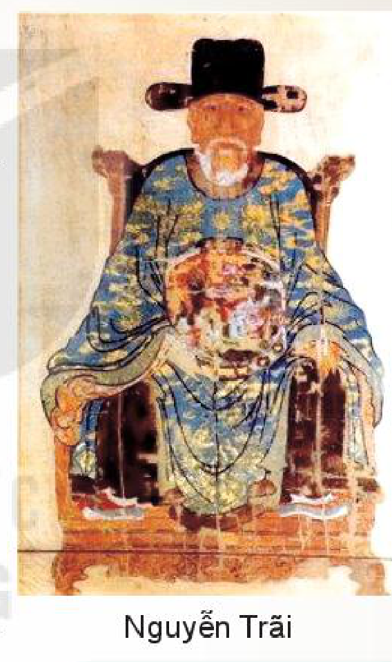
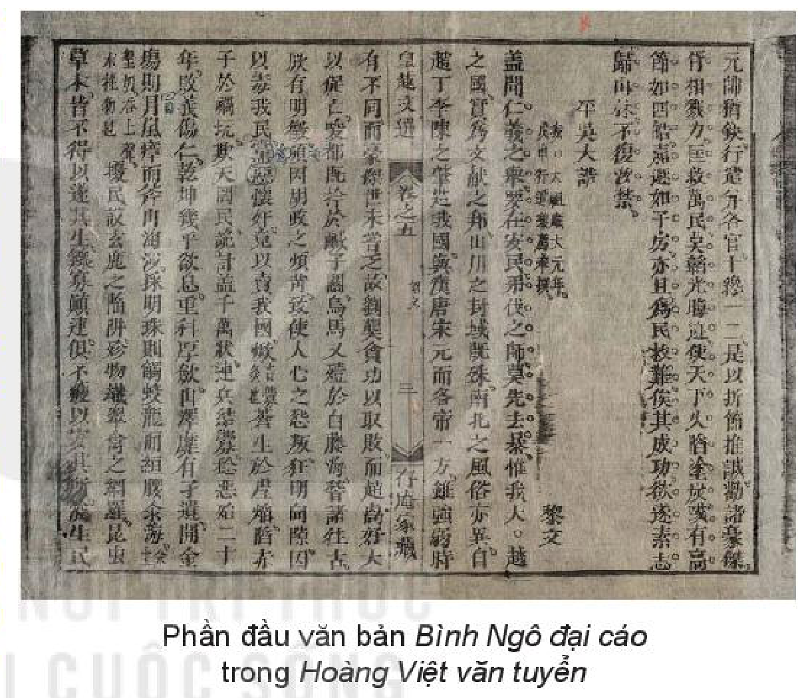

<!-- pdf:5 -->

# BÀI 6: NGUYỄN TRÃI – “DÀNH CÒN ĐỂ TRỢ DÂN NÀY”

## 🎯 Yêu cầu cần đạt

- Vận dụng được những hiểu biết về Nguyễn Trãi để đọc hiểu một số tác phẩm của tác gia này.
- Nhận biết và phân tích được bối cảnh lịch sử – văn hoá được thể hiện trong văn bản văn học.
- Nhận biết và phân tích được cách sắp xếp, trình bày luận điểm, lí lẽ, bằng chứng và vai trò của yếu tố biểu cảm trong văn bản nghị luận.
- Viết được văn bản nghị luận về một vấn đề xã hội: trình bày rõ quan điểm và hệ thống luận điểm, bài viết có cấu trúc chặt chẽ, sử dụng các bằng chứng thuyết phục.
- Biết thảo luận về một vấn đề có những ý kiến khác nhau; đưa ra được những căn cứ thuyết phục; tôn trọng người đối thoại.
- Kính trọng, biết ơn và học tập những nhân vật kiệt xuất đã có đóng góp lớn lao cho lịch sử, văn hoá dân tộc.

## ĐỌC

### TRI THỨC NGỮ VĂN

**Văn học trung đại Việt Nam**

**Văn học trung đại Việt Nam** hình thành, phát triển trong khoảng thời gian từ thế kỉ X đến hết thế kỉ XIX, trong thời kì phong kiến. Văn học trung đại Việt Nam gồm hai bộ phận: văn học viết bằng chữ Hán và văn học viết bằng chữ Nôm. Văn học trung đại Việt Nam có liên hệ mật thiết với nguồn mạch văn học dân gian; đồng thời tiếp thu một cách chọn lọc, sáng tạo tinh hoa của nhiều nền văn học trong khu vực, đặc biệt là văn học cổ điển Trung Hoa.

> (\*) Câu thơ trích trong bài *Tùng*, thuộc *Quốc âm thi tập* của Nguyễn Trãi.

<!-- pdf:6 -->

Văn học trung đại Việt Nam luôn gắn bó sâu sắc với vận mệnh của quốc gia, dân tộc, thể hiện rõ tinh thần yêu nước và đề cao các giá trị nhân văn, nhân đạo. Tính quy phạm được xem là đặc trưng nổi bật nhất trong văn học trung đại, theo đó, sáng tác văn học phải tuân theo những quy định chặt chẽ có tính khuôn mẫu, từ quan điểm sáng tác, kiểu tư duy nghệ thuật, hình thức thể loại đến hệ thống thi liệu và các thủ pháp ngôn ngữ,... Tuy nhiên, trong quá trình phát triển của văn học trung đại Việt Nam và ở sáng tác của nhiều tác giả, một số đặc điểm quy phạm đã bị phá vỡ, thể hiện tính dân tộc và ý thức cá tính trong cả nội dung và hình thức nghệ thuật.

**Tác giả văn học trung đại Việt Nam**

Nền văn học trung đại Việt Nam được tạo dựng bởi các thế hệ trí thức giàu ý thức tự tôn dân tộc. **Tác giả văn học trung đại Việt Nam** hấp thụ tinh hoa văn hoá dân gian của người Việt và tiếp nhận ảnh hưởng của các hệ tư tưởng Nho, Phật, Đạo theo xu hướng dân tộc hoá. Nhiều tác giả là anh hùng dân tộc có đóng góp to lớn cho sự nghiệp dựng nước và giữ nước.

**Văn nghị luận Việt Nam thời trung đại**

**Văn nghị luận Việt Nam thời trung đại** có thành tựu rất phong phú, được viết theo nhiều thể văn khác nhau như hịch, cáo, chiếu, biểu, thư, trát, luận thuyết, tự, bạt,... Văn nghị luận thời trung đại thường có bố cục mang tính quy phạm với các phần đảm nhiệm những chức năng cụ thể, lời văn chứa nhiều điển tích, điển cố, lập luận chặt chẽ,... Trong đó, hịch, cáo, chiếu, thư là những thể văn tiêu biểu nhất.

**Yếu tố biểu cảm trong văn nghị luận**

Văn nghị luận không chỉ thuyết phục người đọc bằng lập luận chặt chẽ, lí lẽ sắc bén mà còn bằng các yếu tố biểu cảm. **Yếu tố biểu cảm** trong văn nghị luận thể hiện nhiệt huyết của người viết trong việc bày tỏ và bảo vệ quan điểm. Nhờ các yếu tố biểu cảm như cảm xúc, hình ảnh, giọng điệu, không chỉ chủ kiến của người viết được bộc lộ rõ ràng mà khả năng tác động đến người đọc của văn bản nghị luận cũng được gia tăng.

<!-- pdf:7 -->

### VĂN BẢN 1: Tác gia Nguyễn Trãi
<!-- ocr-ok: nhãn VĂN BẢN 1 chữ trắng trên băng màu xanh bị OCR bỏ sót, đã đối chiếu ảnh trang PDF 7 -->

- Bạn hãy kể tên một số tác giả văn học trung đại Việt Nam có đóng góp quan trọng trong lịch sử dựng nước và giữ nước của dân tộc.
- Hãy chia sẻ một vài thông tin về tác giả mà bạn ngưỡng mộ.

## I. TIỂU SỬ

Nguyễn Trãi

Nguyễn Trãi (1380 – 1442) hiệu Ức Trai, quê gốc ở làng Chi Ngại (nay thuộc huyện Chí Linh, tỉnh Hải Dương), nhưng lớn lên cùng gia đình ở làng Nhị Khê, huyện Thường Tín, tỉnh Hà Tây (nay thuộc thành phố Hà Nội). Thân phụ Nguyễn Trãi là Nguyễn Phi Khanh, đỗ Thái học sinh(1) dưới triều Trần; thân mẫu là Trần Thị Thái – con quan Tư đồ(2) Trần Nguyên Đán.

Năm 1400, Nguyễn Trãi thi đỗ Thái học sinh và làm quan cùng cha dưới triều Hồ. Năm 1407, triều Hồ sụp đổ, giặc Minh bắt Nguyễn Phi Khanh đưa về Trung Quốc và giam lỏng Nguyễn Trãi ở thành Đông Quan(3). Một thời gian sau (khoảng năm 1423), Nguyễn Trãi tìm vào Lam Sơn (Thanh Hoá) theo giúp Lê Lợi, dâng *Bình Ngô sách* (Sách lược đánh dẹp giặc Minh). Ông được Lê Lợi tin dùng và đã có đóng góp đặc biệt quan trọng trong cuộc kháng chiến chống quân Minh. Năm 1427, cuộc kháng chiến kết thúc thắng lợi, Lê Lợi lên ngôi Hoàng đế và giao cho Nguyễn Trãi viết *Bình Ngô đại cáo*.

> Chú ý vai trò của Nguyễn Trãi trong cuộc kháng chiến chống quân Minh.

Trong thời gian Lê Thái Tổ trị vì cũng như đầu triều Lê Thái Tông, nội bộ triều đình nảy sinh xung đột, nhiều bậc công thần bị sát hại, Nguyễn Trãi cũng bị nghi kị.

> (1) *Thái học sinh*: học vị của người đỗ kì thi Hội thời Trần – Hồ, tương đương với học vị Tiến sĩ của các triều đại sau.
>
> (2) *Tư đồ*: một chức hàm trong Tam Tư (gồm Tư đồ, Tư mã, Tư không), là chức hàm gia phong cho các vị đại thần thuộc hoàng tộc, quyền ngang Tể tướng.
>
> (3) *Đông Quan*: tên gọi Thăng Long thời thuộc Minh.

<!-- pdf:8 -->

Năm 1437, ông xin về ở ẩn tại Côn Sơn (Hải Dương). Năm 1440, vua Lê Thái Tông mời Nguyễn Trãi ra giúp nước. Ông cảm kích nhận ơn tri ngộ(1): “Thương thần như con ngựa già còn ham rong ruổi; xem thần như thông qua năm rét càng dạn tuyết sương” (*Biểu tạ ơn*). Năm 1442, Nguyễn Trãi bị bọn gian thần vu cho tội giết vua và phải chịu án “tru di tam tộc”(2), thơ văn bị tiêu huỷ, cấm đoán. Đến tận năm 1464, vua Lê Thánh Tông mới minh oan cho Nguyễn Trãi và năm 1467 ban lệnh tìm kiếm, cho khắc in di cảo(3) của ông.

Năm 1980, Nguyễn Trãi được tổ chức UNESCO vinh danh là “Danh nhân văn hoá thế giới”.

## II. SỰ NGHIỆP SÁNG TÁC

Nguyễn Trãi để lại cho hậu thế một di sản văn hoá quý giá, trong đó nổi bật là những sáng tác được viết bằng chữ Hán hoặc chữ Nôm, thuộc nhiều lĩnh vực: quân sự, chính trị, lịch sử, địa lí, văn học. Tác phẩm chữ Hán gồm: *Ức Trai thi tập*, *Quân trung từ mệnh tập*, *Bình Ngô đại cáo*, *Lam Sơn thực lục*, *Dư địa chí*, *Chí Linh sơn phú* và *Băng Hồ di sự lục*; sáng tác chữ Nôm có: *Quốc âm thi tập*.

### 1. Nội dung thơ văn

Thơ văn Nguyễn Trãi phong phú, đa dạng về đề tài, cảm hứng; giàu giá trị tư tưởng và đậm tính trữ tình. Nổi bật trong các tác phẩm của ông là *tư tưởng nhân nghĩa*(4), *tình yêu thiên nhiên* và những *ưu tư về thế sự*.

Tư tưởng nhân nghĩa có nguồn gốc từ Nho giáo nhưng đã được Nguyễn Trãi tiếp thu một cách chọn lọc, sáng tạo. Với Nguyễn Trãi, nhân nghĩa trước hết là thương dân; lấy cuộc sống bình yên, no ấm của nhân dân làm mục tiêu cao nhất: *Vì dân lo trước, dạ khôn nguôi* (*Mạn hứng*, bài 2). Nguyễn Trãi luôn khẳng định vai trò và sức mạnh của nhân dân: *Lật thuyền mới biết dân như nước* (*Quan hải* – *Ức Trai thi tập*). Đặc biệt, ông không chỉ thương dân mà còn biết tôn trọng dân, biết ơn dân. Tư tưởng trọng dân, ơn dân bao trùm, xuyên suốt sáng tác của Nguyễn Trãi:

> Chú ý nội dung cơ bản của tư tưởng nhân nghĩa trong thơ văn Nguyễn Trãi.

*Việc nhân nghĩa cốt ở yên dân,*
*Quân điếu phạt trước lo trừ bạo.*

(*Bình Ngô đại cáo*)

> (1) *Tri ngộ*: gặp gỡ nhau, biết rõ, thấu hiểu tấm lòng.
>
> (2) *Tru di tam tộc*: hình phạt thảm khốc thời phong kiến, xử tử nhiều người; tuỳ từng trường hợp, “tam tộc” có thể gồm ba họ (họ cha, họ mẹ, họ vợ) hoặc ba đời (đời mình, đời con, đời cháu).
>
> (3) *Di cảo*: bản thảo tác phẩm của người chết để lại.
>
> (4) *Tư tưởng nhân nghĩa*: tư tưởng Nho học, có nội dung chính là thương yêu con người, coi trọng dân chúng, xây dựng nền chính trị ổn định dựa trên cơ sở lấy “tam cương, ngũ thường” làm gốc. Trong các sáng tác của mình, Nguyễn Trãi nhấn mạnh mục đích, hành động thực tiễn của lí tưởng nhân nghĩa là *yên dân* và *trừ bạo*. Tư tưởng nhân nghĩa đã được Nguyễn Trãi phát triển sâu sắc ở nhiều phương diện.

<!-- pdf:9 -->

*Ăn lộc đền ơn kẻ cấy cày.*
<!-- ocr-ok: câu thơ in nghiêng bị OCR đọc nhầm dấu và chữ, đã đối chiếu ảnh trang PDF 9 -->

(*Bảo kính cảnh giới*, bài 19 – *Quốc âm thi tập*)

Là một nhà Nho, lí tưởng yêu nước của Nguyễn Trãi dĩ nhiên gắn liền với tư tưởng trung quân: *Quân thân chưa báo lòng canh cánh* (*Ngôn chí*, bài 7 – *Quốc âm thi tập*); với giấc mơ về một triều đại vua sáng, tôi hiền. Nhưng xét đến cùng, nội dung cốt lõi trong tư tưởng yêu nước của Nguyễn Trãi là tình yêu dành cho nhân dân, là khát vọng xây dựng một đất nước độc lập, thái bình, hưng thịnh.

Tình yêu thiên nhiên là nguồn cảm hứng lớn trong thơ văn Nguyễn Trãi (đặc biệt là thơ). *Ức Trai thi tập* và *Quốc âm thi tập* chứa đựng cả một thế giới thiên nhiên đa dạng, vừa mĩ lệ vừa bình dị, gần gũi. Có thể tìm thấy trong kho báu thiên nhiên “đầy qua nóc” ấy khung cảnh tráng lệ của cửa biển Bạch Đằng, Vân Đồn, Thần Phù, Vọng Doanh; vẻ hùng vĩ, nguyên sơ của Yên Tử, Côn Sơn; chốn thôn quê bình dị, dân dã, thân thuộc với những *đất cày ngõ ải, giậu mùng tơi, lảnh mùng, bè muống*,... Tâm hồn Nguyễn Trãi rộng mở, tinh tế, lãng mạn – nâng niu từng vẻ đẹp, từng khoảnh khắc giao hoà cùng thiên nhiên:

*Cây rợp tán che am mát;*
*Hồ thanh nguyệt hiện bóng tròn.*
*Rùa nằm hạc lẩn nên bầy bạn;*
*Ủ ấp cùng ta làm cái con.*
<!-- ocr-ok: khổ thơ in nghiêng bị OCR đọc nhầm chữ và trộn với hộp chỉ dẫn cột phải, đã đối chiếu ảnh trang PDF 9 -->

(*Ngôn chí*, bài 20 – *Quốc âm thi tập*)

> Biểu hiện của tình yêu thiên nhiên và nỗi niềm thế sự.
<!-- ocr-ok: hộp chỉ dẫn đọc cột phải bị OCR đọc lỗi dấu và chữ, đã đối chiếu ảnh trang PDF 9 -->

Một đời ôm mối “ưu dân, ái quốc” nên hồn thơ Ức Trai trĩu nặng suy tư trước thế sự đen bạc. Thơ ông có nhiều chiêm nghiệm buồn về nhân tình thế thái; có cả những cay đắng, thất vọng, đau đớn trước một thực tại hỗn độn, bất công, ngang trái:

*Phượng những tiếc cao, diều hãy liệng;*
*Hoa thì hay héo, cỏ thường tươi.*
<!-- ocr-ok: câu thơ in nghiêng bị OCR đọc nhầm chữ, đã đối chiếu ảnh trang PDF 9 -->

(*Tự thuật*, bài 9 – *Quốc âm thi tập*)

Nguyễn Trãi đã đối diện với thực tại ấy bằng tâm thế, tư thế của cây tùng, cây bách: *Một mình lạt thuở ba đông* (*Tùng* – *Quốc âm thi tập*), bằng cốt cách của hoa cúc, hoa sen: *Sen nào có bén trong lầm* (*Thuật hứng*, bài 25 – *Quốc âm thi tập*). Ông lựa chọn quan niệm sống, triết lí sống thanh cao, cứng cỏi, kiêu hãnh và lí tưởng cao cả:

– *Chớ cậy sang mà ép nề.*
*Lời chăng phải vuỗn(1) khôn nghe.*
<!-- ocr-ok: câu thơ in nghiêng kèm số cước chú bị OCR đọc lỗi chữ, đã đối chiếu ảnh trang PDF 9 -->

(*Trần tình*, bài 8 – *Quốc âm thi tập*)

– *Trừ độc, trừ tham, trừ bạo ngược;*
*Có nhân, có trí, có anh hùng.*

(*Bảo kính cảnh giới*, bài 5 – *Quốc âm thi tập*)

> (1) *Vuỗn*: âm cổ của *vẫn*, chỉ tình trạng hay sự thể nào đó cứ tiếp diễn như trước.
<!-- ocr-ok: cước chú chân trang chữ nhỏ bị OCR đọc nhầm dấu, đã đối chiếu ảnh trang PDF 9 -->

<!-- pdf:10 -->

### 2. Đặc điểm nghệ thuật

Thơ văn Nguyễn Trãi kết tinh nhiều thành tựu nghệ thuật đặc sắc; góp phần quan trọng vào sự phát triển, hoàn thiện một số thể loại văn học trung đại Việt Nam: **văn chính luận**, thơ chữ Hán và thơ chữ Nôm.

> Đóng góp quan trọng của Nguyễn Trãi ở từng thể loại: văn chính luận, thơ chữ Hán, thơ chữ Nôm.

Văn chính luận của Nguyễn Trãi, đặc biệt là những thư từ bút chiến, văn kiện ngoại giao với nhà Minh luôn đạt đến trình độ mẫu mực. Nguyễn Trãi đã vận dụng một cách triệt để và sắc sảo các mệnh đề tư tưởng, đạo đức của Nho giáo và chân lí khách quan của đời sống để tạo dựng nền tảng chính nghĩa vững chắc cho những luận điểm lớn được nêu lên. Nhiều văn bản được mở đầu bằng triết lí nhân nghĩa: “Mưu tính việc lớn phải lấy nhân nghĩa làm gốc, hoàn thành công to phải lấy nhân nghĩa làm đầu.” (*Lại thư trả lời Phương Chính* – *Quân trung từ mệnh tập*) hoặc bằng những quy luật tất yếu: “Tôi nghe: Trời không che riêng ai, đất không chở riêng ai, mặt trời mặt trăng không chiếu riêng ai.” (*Lại thư cho Vương Thông* – *Quân trung từ mệnh tập*).

Sức thuyết phục của văn chính luận Nguyễn Trãi còn được tạo nên nhờ khả năng bám sát từng đối tượng và tình hình thời sự, chiến sự; sự kết hợp giữa lí lẽ sắc bén với dẫn chứng xác đáng; cách lập luận và bố cục chặt chẽ; ngôn ngữ hàm súc, kết hợp nhiều phong cách ngôn ngữ và nhiều phương thức biểu đạt, giọng điệu truyền cảm. Lê Quý Đôn từng ca ngợi Nguyễn Trãi là cây bút viết thư, thảo hịch tài giỏi hơn hết mọi thời.

Thơ chữ Hán của Nguyễn Trãi hầu hết được sáng tác bằng các thể thơ Đường luật, đạt tới sự nhuần nhuyễn, điêu luyện; ngôn ngữ cô đúc; nghệ thuật tả cảnh, tả tình tinh tế, tài hoa. Nghệ thuật trữ tình vẫn mang nét trang nhã, hàm súc “ý tại ngôn ngoại” của thơ cổ phương Đông nhưng không theo hướng cầu kì, khuôn thước. Ý tình trong nhiều bài thơ vừa in đậm dấu ấn cá nhân vừa có giá trị tư tưởng sâu sắc (*Loạn hậu đáo Côn Sơn cảm tác*, *Chu trung ngẫu thành*, *Tự thán*, *Thanh minh*,...). Hình tượng thiên nhiên trong *Ức Trai thi tập* khi thì phóng khoáng, hùng vĩ, diễm lệ, khi thì thanh sơ, thơ mộng (*Thần Phù hải khẩu*, *Đề Yên Tử sơn Hoa Yên tự*, *Vân Đồn*, *Tức hứng*, *Mộ xuân tức sự*, *Trại đầu xuân độ*,...).

Thơ chữ Nôm của Nguyễn Trãi được đánh giá là đỉnh cao của dòng **thơ quốc âm** (tiếng Việt) thời trung đại. Trong *Quốc âm thi tập*, ông dường như đã có ý thức sáng tạo một thể thơ riêng khi đưa **câu thơ lục ngôn**(1) xen vào bài thơ thất ngôn ở các vị trí đa dạng, linh hoạt, đồng thời rất chú ý Việt hoá nhiều đề tài, thi liệu mượn từ văn học Trung Quốc.

> (1) *Lục ngôn*: sáu tiếng.
<!-- ocr-ok: cước chú chân trang ngắn bị OCR đọc nhầm dấu, đã đối chiếu ảnh trang PDF 10 -->

<!-- pdf:11 -->

Ngôn ngữ thơ Nôm Nguyễn Trãi giản dị, đậm đà tính dân tộc; sử dụng nhiều từ láy, thành ngữ, tục ngữ và lời ăn tiếng nói của dân chúng:

*Tay ai thì lại làm nuôi miệng,*
*Làm biếng ngồi ăn lở núi non.*

(*Bảo kính cảnh giới*, bài 22 – *Quốc âm thi tập*)
<!-- ocr-ok: dòng xuất xứ in nghiêng bị OCR đọc nhầm dấu, đã đối chiếu ảnh trang PDF 11 -->

Thơ văn Nguyễn Trãi xứng đáng là tập đại thành(1) của năm thế kỉ văn học trung đại Việt Nam tính đến mốc thế kỉ XV. Ông là **tác gia** có đóng góp đặc biệt quan trọng trong việc xây dựng nền văn học Đại Việt sau thời gian nước ta bị quân xâm lược nhà Minh đô hộ và thi hành chính sách huỷ diệt văn hoá.

> Vị trí của Nguyễn Trãi trong nền văn học trung đại Việt Nam.

**Trả lời câu hỏi**

1. Dựa vào những thông tin trong văn bản, hãy nêu ấn tượng sâu sắc nhất của bạn về cuộc đời và con người Nguyễn Trãi.
2. Điều gì đã tạo nên giá trị đặc sắc trong tư tưởng nhân nghĩa của Nguyễn Trãi?
3. Nêu cảm nhận của bạn về tâm hồn Nguyễn Trãi qua những bài thơ viết về thiên nhiên.
4. Đọc những vần thơ Nguyễn Trãi viết về nỗi niềm thế sự, bạn hình dung như thế nào về con người tác giả?
5. Văn chính luận của Nguyễn Trãi đã từng thể hiện sức tác động mạnh mẽ như thế nào? Những yếu tố nào đã làm nên sức mạnh đó?
6. Hãy kể tên những tác phẩm văn học, nghệ thuật mà bạn biết nói về cuộc đời và sự nghiệp của danh nhân Nguyễn Trãi.

#### Kết nối đọc – viết

Sưu tầm một bài thơ chữ Hán hoặc chữ Nôm của Nguyễn Trãi và viết đoạn văn (khoảng 150 chữ) giới thiệu bài thơ đó.

> (1) *Tập đại thành*: thành tựu lớn, có ý nghĩa tổng hợp, kết tinh nhiều phương diện giá trị.

<!-- pdf:12 -->

### VĂN BẢN 2: Bình Ngô đại cáo
<!-- ocr-ok: nhãn VĂN BẢN 2 chữ trắng trên băng màu xanh bị OCR bỏ sót, đã đối chiếu ảnh trang PDF 12 -->

*(Đại cáo bình Ngô(\*))*

**Nguyễn Trãi**

- Bạn đã từng học, từng đọc những áng văn cổ Việt Nam nào được mệnh danh là “hùng văn”? Hãy chia sẻ thông tin khái quát về một trong số các tác phẩm ấy.
- Theo bạn, một tác phẩm được nhìn nhận là bản tuyên ngôn độc lập của một dân tộc thường ra đời trong hoàn cảnh nào và có những đặc điểm gì?

**(1)** Từng nghe:

Việc nhân nghĩa cốt ở yên dân,
Quân điếu phạt(1) trước lo trừ bạo.
Như nước Đại Việt ta từ trước,
Vốn xưng nền văn hiến(2) đã lâu.
Núi sông bờ cõi đã chia,
Phong tục Bắc Nam cũng khác.
Từ Triệu, Đinh, Lý, Trần(3) bao đời gây nền độc lập,
Cùng Hán, Đường, Tống, Nguyên(4) mỗi bên xưng đế(5) một phương.

> Chú ý tư tưởng thực thi nhân nghĩa xuyên suốt tác phẩm.
>
> Chủ quyền quốc gia được thể hiện ở những phương diện cơ bản nào?

> (\*) *Bình Ngô*: dẹp tan giặc Ngô (*bình*: dẹp bằng, phá tan, làm cho yên ổn; *Ngô*: chỉ giặc Minh, từng sang xâm lược và cai trị nước ta). Người sáng lập nhà Minh (Trung Quốc) là Chu Nguyên Chương (1328 – 1398), tức Minh Thái Tổ, lúc dấy nghiệp ở đất Ngô, tự xưng là Ngô vương. Do đó, sách lịch sử cũng thường gọi nhà Minh là Ngô.
>
> (1) *Điếu phạt*: rút gọn cụm từ “điếu dân phạt tội” trong *Kinh thư* (tức *Thượng thư*), nói việc vua Thang, vua Vũ vì thương xót (*điếu*) nhân dân mà trừng trị (*phạt*) kẻ có tội là vua Kiệt, vua Trụ.
>
> (2) *Văn hiến*: ở đây chỉ chung nền văn hoá lâu đời, có nhân vật anh hùng, có sử sách ghi chép lại quá trình hình thành và phát triển của dân tộc (*văn*: tư liệu lịch sử, văn hoá thành văn; *hiến*: hiền tài).
>
> (3) *Triệu, Đinh, Lý, Trần*: các thời kì, triều đại nối tiếp nhau xây dựng nền tự chủ Đại Việt: Triệu (207 – 111 trước Công nguyên), Đinh (968 – 979), Lý (1010 – 1224), Trần (1125 – 1399). Một số bộ sử cũ đã xem nhà Triệu là một triều đại của lịch sử Việt Nam và xếp triều đại này vào thời kì tự chủ.
>
> (4) *Hán, Đường, Tống, Nguyên*: các triều đại trong lịch sử Trung Quốc, gần tương ứng với các thời kì, triều đại trong lịch sử Việt Nam ở trên: Hán (204 trước Công nguyên – 220), Đường (618 – 907), Tống (960 – 1279), Nguyên (1280 – 1378).
>
> (5) *Đế*: quốc gia độc lập, tự chủ, vua xưng là *đế* hay *hoàng đế*. Từ sau khi nhà Tần (Trung Quốc) thống nhất Trung Quốc và xưng Tần Thuỷ hoàng đế, chữ *đế* dần có hàm nghĩa phân biệt với *vương*, chỉ vua chư hầu. Trong nguyên văn, chữ *đế* được sử dụng như động từ, thể hiện tư tưởng xác lập thể chế nhà nước tự chủ.

<!-- pdf:13 -->

Tuy mạnh yếu từng lúc khác nhau,
Song hào kiệt(1) đời nào cũng có.
Vậy nên:
Lưu Cung(2) tham công nên thất bại,
Triệu Tiết(3) thích lớn phải tiêu vong.
Cửa Hàm Tử(4) bắt sống Toa Đô(5),
Sông Bạch Đằng(6) giết tươi Ô Mã(7).
Việc xưa xem xét,
Chứng cớ còn ghi.

**(2)** Vừa rồi:

Nhân họ Hồ(8) chính sự(9) phiền hà,
Để trong nước lòng dân oán hận.
Quân cuồng Minh thừa cơ gây hoạ,
Bọn gian tà bán nước cầu vinh.
Nướng dân đen(10) trên ngọn lửa hung tàn,
Vùi con đỏ(11) xuống dưới hầm tai vạ.
Dối trời lừa dân đủ muôn nghìn kế,
Gây binh kết oán trải hai mươi năm.

> Tâm trạng phẫn uất của tác giả trước tội ác của kẻ thù đã được thể hiện như thế nào?

> (1) *Hào kiệt*: chỉ chung những bậc anh hùng xuất chúng, có công trạng lớn đối với quốc gia (*hào*: tài trí hơn người; *kiệt*: giỏi giang, kiệt xuất).
>
> (2) *Lưu Cung*: vua Nam Hán, sai con là Lưu Hoằng Thao đem quân sang xâm lược nước ta, bị Ngô Quyền đánh bại và giết chết ở sông Bạch Đằng.
>
> (3) *Triệu Tiết*: tướng nhà Tống, từng mang quân xâm lược nước ta, bị Lý Thường Kiệt đánh bại.
>
> (4) *Hàm Tử*: một địa điểm trên sông Hồng, nay thuộc huyện Khoái Châu, tỉnh Hưng Yên. Trần Nhật Duật phối hợp cùng Trần Quốc Toản đã đại phá quân Toa Đô ở đây.
>
> (5) *Toa Đô*: tướng nhà Nguyên, mang quân xâm lược nước ta, bị quân dân nhà Trần đánh bại. Theo nhiều tài liệu sử học thì Toa Đô bị giết chết ở trận Tây Kết (Hưng Yên) chứ không phải ở Hàm Tử.
>
> (6) *Bạch Đằng*: sông chảy giữa Quảng Ninh và Hải Phòng. Sông Bạch Đằng gắn liền với nhiều chiến công của quân dân Đại Việt chống kẻ thù xâm lược phương Bắc trong lịch sử.
>
> (7) *Ô Mã*: tức Ô Mã Nhi, tướng nhà Nguyên, bị quân dân nhà Trần đánh bại ở trận Bạch Đằng.
>
> (8) *Hồ*: tên một triều đại trong lịch sử Việt Nam (1400 – 1407). Sau khi giành được quyền lực từ tay nhà Trần, Hồ Quý Ly lên ngôi, lập ra triều Hồ và đổi quốc hiệu Đại Việt thành Đại Ngu. Năm 1406, nhà Minh mượn cớ “phù Trần diệt Hồ” kéo quân sang xâm lược nước ta.
>
> (9) *Chính sự*: việc chính trị, các chính sách và chế độ quản lí đất nước của một quốc gia.
>
> (10) *Dân đen*: dịch chữ *thương sinh* (dân sống dưới bầu trời xanh), chỉ người dân bình thường.
>
> (11) *Con đỏ*: dịch chữ *xích tử*, ý nói con mới đẻ ra còn đỏ, cần nâng niu, nuôi nấng. Lấy ý câu trong sách *Thượng thư*: “Người làm vua phải bảo vệ nhân dân như bảo vệ con đỏ của mình”.

<!-- pdf:14 -->

Bại nhân nghĩa nát cả đất trời,
Nặng thuế khoá sạch không đầm núi.
Người bị ép xuống biển dòng lưng mò ngọc, ngán thay cá mập, thuồng luồng.
Kẻ bị đem vào núi đãi cát tìm vàng, khốn nỗi rừng sâu, nước độc.
Vét sản vật, bắt chim trả(1), chốn chốn lưới chăng,
Nhiễu nhân dân, bẫy hươu đen(2), nơi nơi cạm đặt.
Tàn hại cả giống côn trùng cây cỏ,
Nheo nhóc thay kẻ goá bụa khốn cùng.
Thằng há miệng, đứa nhe răng, máu mỡ bấy no nê chưa chán;
Nay xây nhà, mai đắp đất, chân tay nào phục dịch cho vừa.
Nặng nề những nỗi phu phen,
Tan tác cả nghề canh cửi.
Độc ác thay, trúc Nam Sơn(3) không ghi hết tội,
Dơ bẩn thay, nước Đông Hải(4) không rửa sạch mùi.
Lẽ nào trời đất dung tha,
Ai bảo thần nhân chịu được?

> Chú ý giọng văn đầy cảm xúc của tác giả khi nói về những nỗi cực khổ mà nhân dân ta phải chịu đựng.

**(3)** Ta đây:

Núi Lam Sơn(5) dấy nghĩa,
Chốn hoang dã nương mình.
Ngẫm thù lớn há đội trời chung,
Căm giặc nước thề không cùng sống.
Đau lòng nhức óc(6), chốc đà mười mấy năm trời;
Nếm mật nằm gai(7), há phải một hai sớm tối.

> Chủ tướng Lê Lợi và nghĩa quân Lam Sơn đã có suy nghĩ và hành động gì trước tội ác của giặc Minh?

> (1), (2) *Chim trả, hươu đen*: các loài vật quý hiếm.
>
> (3), (4) *Nam Sơn, Đông Hải*: *Nam Sơn* là một ngọn núi cao, *Kinh thi* có câu: *Tiết bỉ Nam Sơn* (núi Nam kia cao vòi vọi). *Đông Hải*: biển ở phía đông. Cả hai câu trên mượn chữ và ý trong bài hịch của Ngỗi Hưu và Lương Nguyên kể tội Tuỳ Dượng đế: *Khánh Nam Sơn chi trúc thư tội vô cùng, quyết Đông Hải chi ba lưu ác nan tận* (Chặt hết trúc Nam Sơn, chép không hết tội; vét cạn nước Đông Hải, rửa chẳng sạch ác).
>
> (5) *Lam Sơn*: tên một vùng thuộc huyện Thọ Xuân, tỉnh Thanh Hoá; là vùng rừng núi nơi Lê Lợi dấy quân khởi nghĩa, lịch sử vẫn gọi là khởi nghĩa Lam Sơn.
>
> (6) *Đau lòng nhức óc* (nguyên văn: *thống tâm tật thủ*): chữ mượn từ sách *Tả truyện*, ý nói căm giận vô cùng.
>
> (7) *Nếm mật nằm gai* (nguyên văn: *thường đảm ngoạ tân*): nếm mật đắng, nằm trên gai, dẫn điển vua nước Việt đời Đông Chu là Câu Tiễn bị vua nước Ngô là Phù Sai cướp nước, bèn nuôi chí phục thù, trước khi ăn thì nếm mật đắng, khi ngủ thì nằm trên gai để không quên mối thù cũ.

<!-- pdf:15 -->

Quên ăn(1) vì giận, sách lược thao(2) suy xét đã tinh;
Ngẫm trước đến nay, lẽ hưng phế(3) đắn đo càng kĩ.
Những trằn trọc trong cơn mộng mị,
Chỉ băn khoăn một nỗi đồ hồi(4).
Vừa khi cờ nghĩa dấy lên(5),
Chính lúc quân thù đương mạnh.
Lại ngặt vì:
Tuấn kiệt(6) như sao buổi sớm,
Nhân tài như lá mùa thu.
Việc bôn tẩu(7) thiếu kẻ đỡ đần,
Nơi duy ác(8) hiếm người bàn bạc.
Tấm lòng cứu nước, vẫn đăm đăm muốn tiến về đông(9),
Cỗ xe cầu hiền, thường chăm chăm còn dành phía tả(10).
Thế mà:
Trông người người càng vắng bóng, mịt mù như nhìn chốn bể khơi,
Tự ta, ta phải dốc lòng(11), vội vã hơn cứu người chết đuối.
Phần thì giận hung đồ ngang dọc,

> Những khó khăn gì của nghĩa quân Lam Sơn buổi đầu dấy binh được chú ý nhấn mạnh?

> (1) *Quên ăn* (nguyên văn: *phát phẫn vong thực*): mượn chữ trong sách *Luận ngữ*, nói về việc khi chí ham học nổi lên thì quên cả ăn. Cả câu này ý nói về chí miệt mài nghiền ngẫm binh thư để tìm kế sách đánh giặc cứu nước.
>
> (2) *Lược thao*: phép tắc và mưu chước dụng binh, đây là cách gọi ghép hai từ *lục thao* và *tam lược*. *Lục thao* là tên một cuốn sách dạy về quân sự tương truyền do Lã Vọng đời Chu soạn, gồm sáu thiên; *tam lược* là tên một cuốn sách do Hoàng Thạch Công soạn, gồm ba phần.
>
> (3) *Hưng phế*: sự nổi lên (*hưng*) và mất đi (*vong, phế*) của các triều đại.
>
> (4) *Đồ hồi*: mưu tính khôi phục lại cơ đồ cũ (*đồ*: mưu tính; *hồi*: quay trở lại).
>
> (5) *Cờ nghĩa dấy lên*: phất cờ hiệu triệu nhân dân đứng lên đấu tranh bảo vệ chính nghĩa.
>
> (6) *Tuấn kiệt*: nhân tài, hào kiệt, chỉ các bậc anh hùng tài giỏi. Ý cả hai câu này: bậc anh hùng xuất hiện ít (như sao buổi sớm), người tài giỏi hiếm hoi (như lá trên cành vào mùa thu).
>
> (7) *Bôn tẩu*: bôn ba, chạy vạy lo toan công việc (*bôn*: đi vội vã; *tẩu*: chạy).
>
> (8) *Duy ác*: ngày xưa, tướng chỉ huy ra trận thường quây màn làm nơi bàn luận và quyết định chiến sự, do đó *duy ác* được dùng để chỉ bộ chỉ huy.
>
> (9) *Tiến về đông*: mượn chữ từ một câu nói của Lưu Bang (Hán Cao tổ) với Tiêu Hà khi bị Hạng Vũ ép dồn về phía Tây: “Dư diệc dục đông hĩ, an năng uất uất cửu cư ư thử” (Ta cũng muốn tiến về phía đông chứ sao có thể rầu rĩ ở mãi chốn này được). Ở đây, tác giả dùng chữ trên tỏ ý muốn (từ phía tây – Lam Sơn) tiến về Đông Đô – Thăng Long, lúc này đang bị giặc Minh chiếm đóng.
>
> (10) *Dành phía tả*: dẫn điển Tín Lăng Quân nước Nguỵ thời Đông Chu, nghe tiếng Hầu Doanh là hiền sĩ liền đem xe đi đón, tự ngồi bên phải giữ cương ngựa, dành chỗ bên trái là chỗ tôn quý để Hầu Doanh ngồi.
>
> (11) *Tự ta, ta phải dốc lòng*: dịch cụm từ *do kỉ chi thành* (do lòng thành thực của mình), ý nói lòng thành thực muốn làm điều nhân, dẫn ý câu trong *Luận ngữ*: “vi nhân do kỉ nhi do nhân hồ tai” (làm điều nhân phải do mình chứ đâu phải do người khác).

<!-- pdf:16 -->

Phần thì lo vận nước khó khăn.
Khi Linh Sơn(1) lương hết mấy tuần,
Khi Khôi Huyện(2) quân không một đội.
Trời thử lòng trao cho mệnh lớn,
Ta gắng chí khắc phục gian nan.
Nhân dân(3) bốn cõi một nhà, dựng cần trúc(4) ngọn cờ phấp phới;
Tướng sĩ một lòng phụ tử, hoà nước sông chén rượu ngọt ngào(5).
Thế trận xuất kì(6), lấy yếu chống mạnh;
Dùng quân mai phục, lấy ít địch nhiều.

> Tinh thần đồng cam cộng khổ của tướng sĩ được thể hiện qua những chi tiết, hình ảnh nào?

**(4)** Trọn hay:

Đem đại nghĩa(7) để thắng hung tàn,
Lấy chí nhân(8) để thay cường bạo.
Trận Bồ Đằng(9) sấm vang chớp giật,
Miền Trà Lân(10) trúc chẻ tro bay(11).
Sĩ khí(12) đã hăng,
Quân thanh(13) càng mạnh.
<!-- ocr-ok: đoạn văn kèm nhiều số cước chú trên đầu chữ bị OCR đọc nhầm thành ký tự lạ, đã đối chiếu ảnh trang PDF 16 -->

> Ý câu văn “Đem đại nghĩa... thay cường bạo” có mối liên hệ như thế nào với chủ trương “mưu phạt tâm công” và tư tưởng nhân nghĩa?

> (1) *Linh Sơn*: tức núi Chí Linh, nay thuộc huyện Lang Chánh, tỉnh Thanh Hoá.
>
> (2) *Khôi Huyện*: tên một huyện ở đầu thế kỉ XV (huyện Khôi), nay thuộc vùng giáp ranh của ba tỉnh Thanh Hoá, Ninh Bình và Hoà Bình.
>
> (3) *Nhân dân* (nguyên văn: *manh lệ*): chỉ chung dân chúng khốn cùng tụ họp dưới ngọn cờ nghĩa, (*manh*: dân nghèo bị tước mất ruộng đất phải tha phương cầu thực; *lệ*: nô lệ). Ý văn thể hiện sâu sắc quan niệm về “dân” của Nguyễn Trãi.
>
> (4) *Dựng cần trúc*: dịch cụm từ *yết can vi kì* (giơ gậy lên làm cờ), mượn tích Hoàng Sào lúc mới dấy binh khởi nghĩa không kịp làm cờ phải giơ sào lên thay; bài *Quá Tần luận* của Giả Nghị đời Hán cũng có câu: “trảm mộc vi binh, yết can vi kì” (chặt gỗ làm khí giới, giơ sào lên làm cờ).
>
> (5) *Hoà nước sông chén rượu ngọt ngào*: dịch cụm từ *đầu giao hưởng sĩ* (đổ rượu ngọt xuống sông để khao quân). Dẫn điển xưa nói việc nước Tần và nước Sở đánh nhau, có người dâng vua Sở một bình rượu ngon, vua Sở sai đổ rượu xuống sông để quân sĩ đón dòng mà uống, sau Sở đánh thắng Tần. Câu này ý tác giả muốn nói, tướng lĩnh và nghĩa binh Lam Sơn có lòng thương yêu nhau như cha với con (*tướng sĩ một lòng phụ tử*).
>
> (6) *Xuất kì*: bất thình lình, bất ngờ, chỉ việc bày quân mai phục để bất ngờ tiến đánh.
>
> (7), (8) *Đại nghĩa*: nghĩa lớn. *Chí nhân*: lòng nhân ái tột bậc. Ý hai câu này thể hiện tư tưởng nhân nghĩa của một đội quân chính nghĩa.
>
> (9) *Bồ Đằng*: tên một ngọn núi, còn gọi là Bồ Liệp hay Bồ Cứ thuộc huyện Quỳ Châu, tỉnh Nghệ An. Năm 1425, Lê Lợi đánh thắng quân Minh ở đây.
>
> (10) *Trà Lân*: còn có tên là Trà Long, nay thuộc hai huyện Tương Dương và Con Cuông, tỉnh Nghệ An. Năm 1424, nghĩa quân Lam Sơn tiến vào Nghệ An và cuối năm ấy hạ thành Trà Long, đây là chiến thắng lớn đầu tiên.
>
> (11) *Trúc chẻ tro bay*: dịch cụm từ *trúc phá hôi phi*, ý nói bị tơi bời, tan tác một cách dễ dàng. Thành ngữ thường nói “thế như chẻ tre”, ý nói tre bị chẻ ở một đầu rồi thì cả cây sẽ bị chẻ ra dễ dàng. Trong thơ văn cổ, *hôi phi* hay *phi hôi* (tro bay) thường có nghĩa là dễ dàng, đơn giản, nhanh chóng.
>
> (12) *Sĩ khí*: khí thế của binh sĩ, quân đội.
>
> (13) *Quân thanh*: thanh thế của quân đội.

<!-- pdf:17 -->

Trần Trí(1), Sơn Thọ(2) nghe hơi mà mất vía,
Lý An(3), Phương Chính(4) nín thở cầu thoát thân.
Thừa thắng ruổi dài, Tây Kinh(5) quân ta chiếm lại;
Tuyển binh tiến đánh, Đông Đô(6) đất cũ thu về.
Ninh Kiều(7) máu chảy thành sông, tanh trôi vạn dặm;
Tốt Động(8) thây chất đầy nội, nhơ để ngàn năm.
Phúc tâm(9) quân giặc, Trần Hiệp(10) đã phải bêu đầu;
Mọt gian kẻ thù, Lý Lượng(11) cũng đành bỏ mạng.
Vương Thông(12) gỡ thế nguy, mà đám lửa cháy lại càng cháy;
Mã Anh(13) cứu trận đánh, mà quân ta hăng lại càng hăng.
Bó tay để đợi bại vong, giặc đã trí cùng lực kiệt;
Chẳng đánh mà người chịu khuất, ta đây mưu phạt, tâm công(14).
Tưởng chúng biết lẽ ăn năn, nên đã thay lòng đổi dạ;
Ngờ đâu vẫn đương mưu tính, lại còn chuốc tội gây oan.
Giữ ý kiến một người, gieo vạ cho bao nhiêu kẻ khác;
Tham công danh một lúc, để cười cho tất cả thế gian.

> Hành động lật lọng, bội ước của kẻ thù sẽ dẫn đến kết cục như thế nào?

> (1), (2) *Trần Trí, Sơn Thọ*: Trần Trí là một viên tổng binh của quân Minh; Sơn Thọ là nội quan của nhà Minh, được Minh Nhân Tông lệnh mang sắc sang phong Lê Lợi làm Tri phủ Thanh Hoá để hòng mua chuộc.
>
> (3), (4) *Lý An, Phương Chính*: Lý An là tướng giặc Minh, được giao đóng giữ thành Nghệ An; Phương Chính là Đô đốc của nhà Minh, đóng quân ở Thanh Hoá. Cả hai viên tướng này đều bị quân ta đánh bại nhiều lần.
>
> (5) *Tây Kinh*: chỉ thành nhà Hồ, còn gọi là thành Tây Giai, nay thuộc huyện Vĩnh Lộc, tỉnh Thanh Hoá.
>
> (6) *Đông Đô*: tên gọi của thành Thăng Long từ năm 1397 (thời Trần Phế Đế) tới năm 1430 (thời Lê Thái Tổ), để phân biệt với kinh đô mới ở Thanh Hoá (gọi là Tây Đô). Thời thuộc Minh, Đông Đô còn gọi là Đông Quan.
>
> (7) *Ninh Kiều*: một địa điểm có sông Ninh Giang chảy qua, nay thuộc huyện Chương Mỹ, thành phố Hà Nội. Năm 1429, nghĩa quân Lam Sơn tiến ra Đông Đô, đặt phục binh ở Chúc Động, Tốt Động tiêu diệt phần lớn sinh lực trong đạo viện binh của Vương Thông đóng ở Ninh Kiều, giết được Thượng thư Trần Hiệp và Nội quan Lý Lượng, bắt sống hơn một vạn quân giặc.
>
> (8) *Tốt Động*: có sách chép là Tuy Động, thuộc huyện Mỹ Lương, tỉnh Hà Đông cũ (nay là huyện Chương Mỹ, thành phố Hà Nội). Tháng Mười năm Bính Ngọ (1426), giặc Minh thua to ở đây.
>
> (9) *Phúc tâm*: kẻ thân tín (*phúc*: bụng; *tâm*: tim, lòng).
>
> (10), (11) *Trần Hiệp, Lý Lượng*: Trần Hiệp là Thượng thư nhà Minh; Lý Lượng là Nội quan nhà Minh.
>
> (12), (13) *Vương Thông, Mã Anh*: các viên tướng nhà Minh. Vương Thông được giao chức Tổng binh, cùng Tham tướng Mã Anh đem năm vạn quân sang Đại Việt cứu viện để thay Tham tướng Trần Trí và Đô đốc Phương Chính chỉ huy quân Minh đánh nước ta.
>
> (14) *Mưu phạt, tâm công*: đánh bằng mưu lược, đánh bằng tấm lòng nhân nghĩa.

<!-- pdf:18 -->

Bởi thế:
Thằng nhãi con Tuyên Đức(1), động binh không ngừng;
Đồ nhút nhát Thạnh, Thăng(2), đem dầu chữa cháy.
Đinh Mùi tháng Chín, Liễu Thăng đem binh từ Khâu Ôn(3) tiến lại;
Năm ấy tháng Mười, Mộc Thạnh chia đường từ Vân Nam(4) tiến sang.
Ta trước đã điều binh thủ hiểm(5), chặt mũi tiên phong(6);
Ta sau lại sai tướng chẹn đường, tuyệt nguồn lương thực.
Ngày mười tám, trận Chi Lăng(7), Liễu Thăng thất thế,
Ngày hai mươi, trận Mã An(8), Liễu Thăng cụt đầu,
Ngày hăm lăm, Bá tước Lương Minh(9) bại trận tử vong,
Ngày hăm tám, Thượng thư Lý Khánh(10) cùng kế tự vẫn.
Thuận đà ta đưa lưỡi dao tung phá(11),
Bí nước giặc quay mũi giáo đánh nhau(12).
Lại thêm quân bốn mặt vây thành,
Hẹn đến giữa tháng Mười diệt giặc.
Sĩ tốt(13) kén người hùng hổ,
Bề tôi chọn kẻ vuốt nanh(14).

> Chú ý các chi tiết, hình ảnh thể hiện tinh thần và khí thế chiến thắng hào hùng của nghĩa quân.

> (1) *Tuyên Đức*: tức vua Tuyên Tông nhà Minh, lên ngôi năm 1425, lấy hiệu là Tuyên Đức.
>
> (2) *Thạnh, Thăng*: Mộc Thạnh và Liễu Thăng. Mộc Thạnh là đại thần của nhà Minh, cai quản vùng Vân Nam, được giữ chức Chinh Nam tướng quân, đem năm vạn quân sang nước ta cứu viện Vương Thông theo ngả Lào Cai. Liễu Thăng tước An viễn hầu, được giao làm Tổng binh chỉ huy đạo viện binh mười vạn quân sang nước ta theo đường Lạng Sơn, bị nghĩa quân Lam Sơn giết ở núi Đảo Mã, nay thuộc tỉnh Lạng Sơn.
>
> (3) *Khâu Ôn*: một địa danh nay thuộc phía bắc tỉnh Lạng Sơn, giáp biên giới Việt Nam – Trung Quốc.
>
> (4) *Vân Nam*: một tỉnh của Trung Quốc, giáp với tỉnh Lào Cai của Việt Nam.
>
> (5) *Thủ hiểm*: trấn giữ nơi hiểm trở.
>
> (6) *Tiên phong*: đội quân đi trước, có nhiệm vụ vừa đánh vừa thăm dò lực lượng đối phương.
>
> (7) *Chi Lăng*: tên một cửa ải hiểm trở thuộc tỉnh Lạng Sơn, nơi từng ghi dấu nhiều chiến công hiển hách của quân dân Đại Việt chống kẻ thù xâm lược phương Bắc.
>
> (8) *Mã An*: tức núi Đảo Mã, thuộc tỉnh Lạng Sơn. Theo sách *Minh sử*, Liễu Thăng đem viện binh sang nước ta, có ý kiêu căng, đến dốc Đảo Mã cùng 100 kị binh qua cầu, cầu sập, phục binh bốn phía nổi dậy, Liễu Thăng sa vào bùn rồi bị trúng thương mà chết.
>
> (9) *Lương Minh*: tướng giặc, được phong tước Bảo Định bá, giữ chức Tả phó Tổng binh của Liễu Thăng, tử trận cùng ngày với Liễu Thăng.
>
> (10) *Lý Khánh*: giữ chức Binh bộ Thượng thư của nhà Minh, sang nước ta đảm nhiệm phụ trách quân vụ và kiêm chức ngự sử. *Minh sử* cho biết Lý Khánh tử trận liền sau ngày Lương Minh và Liễu Thăng tử trận.
>
> (11) *Lưỡi dao tung phá*: dịch cụm từ *nghênh nhận nhi giải* (đón lưỡi dao mà tự vỡ ra). Truyện *Đỗ Dự* trong sách *Tấn thư* có câu: “nay binh uy đã vang dậy, thế như chẻ tre, đã chẻ được mấy đốt thì cứ đưa dao đi đến đâu là tre vỡ đến đấy”. Ý muốn nói quân ta thừa cơ tiến đánh làm cho giặc tan rã như tre bị chẻ.
>
> (12) *Quay mũi giáo đánh nhau*: dịch cụm từ *đảo qua tương công* (quay ngược ngọn giáo lại đâm nhau). Thiên *Vũ Thành* sách *Thượng thư* có câu: “... quân trước quay giáo lại đâm quân sau mà thua”, tả việc tiền quân của Trụ quay giáo tự đánh lẫn nhau mà thua Chu Vũ Vương.
>
> (13) *Sĩ tốt*: binh lính nói chung.
>
> (14) *Vuốt nanh*: chỉ người giỏi chiến đấu được tập hợp quanh thủ lĩnh để tạo thêm sức mạnh.

<!-- pdf:19 -->

Gươm mài đá, đá núi cũng mòn,
Voi uống nước, nước sông phải cạn.
Đánh một trận, sạch không kình ngạc(1),
Đánh hai trận, tan tác chim muông.
Nổi gió to trút sạch lá khô,
Thông tổ kiến phá toang đê vỡ(2).
Đô đốc Thôi Tụ(3) lê gối dâng tờ tạ tội,
Thượng thư Hoàng Phúc(4) trói tay để tự xin hàng.
Lạng Giang(5), Lạng Sơn, thây chất đầy đường;
Xương Giang, Bình Than(6), máu trôi đỏ nước.
Ghê gớm thay sắc phong vân(7) phải đổi,
Thảm đạm thay ánh nhật nguyệt(8) phải mờ.
Bị ta chẹn ở Lê Hoa(9), quân Vân Nam nghi ngờ khiếp vía mà vỡ mật;
Thua quân ta ở Cần Trạm(10), quân Mộc Thạnh xéo lên nhau chạy để thoát thân.
Suối Lãnh Câu máu chảy trôi chày(11), nước sông nghẹn ngào tiếng khóc;
Thành Đan Xá(12) thây chất thành núi, cỏ nội đầm đìa máu đen.

> Sự hèn nhát và cảnh thảm bại của kẻ thù được thể hiện qua các chi tiết cụ thể nào?

> (1) *Đánh một trận, sạch không kình ngạc/ Đánh hai trận, tan tác chim muông*: nội dung hai câu diễn tả sức mạnh bão táp của quân khởi nghĩa (*kình*: cá voi, *ngạc*: cá sấu).
>
> (2) *Thông tổ kiến phá toang đê vỡ* (nguyên văn: *quyết hội nghĩ ư băng đê*): tổ kiến hổng bị cuốn trôi lúc con đê đã vỡ. Câu này đối với câu trên, ý nói tình thế giặc như lá khô trước cơn gió mạnh, như tổ kiến bị quét đi khi đê vỡ.
>
> (3), (4) *Thôi Tụ, Hoàng Phúc*: Đô đốc Thôi Tụ làm Hữu tham tướng của Liễu Thăng, cùng với Công bộ Thượng thư Hoàng Phúc đều bị bắt sống. Sau khi thua ở Chi Lăng, bọn Hoàng Phúc, Thôi Tụ phải thu quân về Xương Giang nhưng thành này đã bị hạ, chúng phải đóng quân ở giữa cánh đồng, đắp luỹ tự vệ, nhưng rốt cục đại bại.
>
> (5) *Lạng Giang*: nay là một huyện thuộc tỉnh Bắc Giang, tiếp giáp với tỉnh Lạng Sơn.
>
> (6) *Xương Giang, Bình Than*: Xương Giang nay thuộc địa phận thành phố Bắc Giang; Bình Than là tên một bãi sông lớn ở phía dưới bến đò Phả Lại ngày nay.
>
> (7) *Phong vân*: gió (*phong*) và mây (*vân*).
>
> (8) *Nhật nguyệt*: mặt trời (*nhật*) và mặt trăng (*nguyệt*).
>
> (9) *Lê Hoa*: một cửa ải xưa nằm giữa tỉnh Lào Cai (Việt Nam) và tỉnh Vân Nam (Trung Quốc).
>
> (10) *Cần Trạm*: vùng ở gần Kép – Bắc Giang, nằm giữa ải Chi Lăng và thành Xương Giang. Mộc Thạnh đóng ở Lê Hoa cho Liễu Thăng đánh vào Chi Lăng. Thăng chết trận, phó tướng là Lương Minh đưa tàn binh tiến vào Cần Trạm rồi chết ở đây.
>
> (11) *Máu chảy trôi chày* (nguyên văn: *huyết chử phiêu*): rút ý từ thành ngữ *huyết lưu phiêu chử*, có xuất xứ từ *Kinh thư*, diễn đạt sự thảm khốc của chiến tranh. *Chử* trong nguyên văn bài cáo thường được giải thích có hai nghĩa: (1) cái chày để giã gạo hoặc chày để đập giặt quần áo; (2) một loại vũ khí thời xưa hoặc cái mộc, cái khiên của binh lính. Trong trường hợp này, nghĩa thứ hai phù hợp với văn bản hơn.
>
> (12) *Lãnh Câu, Đan Xá*: những địa điểm gần Lê Hoa, Cao Trại, Thuỷ Vĩ xưa, đều thuộc địa bàn tỉnh Lào Cai, giáp ranh giữa tỉnh Vân Nam và nước ta. Lãnh Câu, Đan Xá là nơi từng xảy ra những cuộc huyết chiến giữa nghĩa quân Lam Sơn (do các tướng Phạm Văn Xảo, Trịnh Khả,... lãnh đạo) và giặc Minh (do Mộc Thạnh chỉ huy).

<!-- pdf:20 -->

Cứu binh hai đạo tan tành, quay gót chẳng kịp;
Quân giặc các thành khốn đốn, cởi giáp ra hàng.
Tướng giặc bị cầm tù, như hổ đói vẫy đuôi xin cứu mạng;
Thần vũ chẳng giết hại(1), thể lòng trời ta mở đường hiếu sinh(2).
Mã Kỳ(3), Phương Chính, cấp cho năm trăm chiếc thuyền, ra đến bể mà vẫn hồn bay phách lạc;
Vương Thông, Mã Anh(4), phát cho vài nghìn cỗ ngựa, về đến nước mà vẫn tim đập chân run.
Họ đã tham sống sợ chết, mà hoà hiếu thực lòng;
Ta lấy toàn quân là hơn(5), để nhân dân nghỉ sức.
Chẳng những mưu kế kì diệu,
Cũng là chưa thấy xưa nay.

**(5)** Xã tắc(6) từ đây vững bền,
Giang sơn từ đây đổi mới.
Kiền khôn bĩ rồi lại thái(7),
Nhật nguyệt hối rồi lại minh(8).
Muôn thuở nền thái bình vững chắc,
Ngàn thu vết nhục nhã sạch làu.
Âu cũng nhờ trời đất tổ tông khôn thiêng ngầm giúp đỡ mới được như vậy(9).

> Chú ý tư thế của người phát ngôn khi tuyên bố về thắng lợi của cuộc kháng chiến và về sự bắt đầu một thời kì mới của đất nước.

> (1) *Thần vũ chẳng giết hại*: uy vũ như thánh như thần mà không chém giết, mượn chữ từ câu trong *Kinh dịch*: “Cổ chi thông minh duệ trí thần vũ nhi bất sát giả phù” (Các bậc anh hùng thông minh sáng suốt đời xưa có uy võ như thần mà chẳng giết hại người vậy).
>
> (2) *Hiếu sinh*: thương yêu con người và loài vật. *Kinh thư* có câu: “Hiếu sinh chi đức hiệp vu dân tâm” (Đức hiếu sinh của trời hợp với lòng dân).
>
> (3), (4) *Mã Kỳ, Mã Anh*: các tướng lĩnh của nhà Minh, chịu đầu hàng Lê Lợi. Sau chiến thắng Chi Lăng, quân giặc các nơi khiếp sợ đầu hàng, Vương Thông xin hẹn ngày rút quân. Thuỷ binh do Phương Chính, Mã Kỳ thống lĩnh được Lê Lợi cấp 500 chiến thuyền để về nước, bộ binh do Vương Thông, Mã Anh, Sơn Thọ, Hoàng Phúc thống lĩnh cũng được Lê Lợi cấp lương thực và ngựa.
>
> (5) *Toàn quân là hơn* (dịch cụm từ *toàn quân vi thượng*): bảo toàn quân đội địch mà bắt chúng thua là thượng sách. Tư tưởng này được Nguyễn Trãi tiếp thu từ sách *Tôn Tử* (thiên *Mưu công*).
>
> (6) *Xã tắc*: chỉ quốc gia, đất nước (*xã*: nơi tế thần đất; *tắc*: vốn là tên Thần Nông (Hậu Tắc), sau dùng chỉ nơi tế Thần Nông để cầu cho mùa màng tươi tốt). Nước nhà muốn thịnh vượng phải làm cho dân an cư lạc nghiệp, vì vậy khi dựng nước trước hết phải lập xã tắc, cũng vì thế mà xã tắc tượng trưng cho quốc gia.
>
> (7) *Kiền (càn), khôn, bĩ, thái*: tên các quẻ trong *Kinh dịch*. Quẻ *kiền* chỉ trời, khí dương; quẻ *khôn* chỉ đất, khí âm. *Kiền* và *khôn* ghép với nhau để chỉ chung trời đất. Quẻ *bĩ* có hình tượng khí dương đè nén khí âm, biểu thị ý nghĩa không được tự do phát triển, bế tắc, không thông thuận; quẻ *thái* có hình tượng khí âm trỗi vượt lên trên khí dương, biểu thị ý nghĩa không bị đè nén, được tự do phát triển, thông thuận. Ý cả câu: trời đất đang tắc nghẽn lại được hanh thông.
>
> (8) *Hối, minh*: tối tăm (*hối*) và sáng sủa (*minh*).
>
> (9) Ý câu này trong nguyên văn như sau: có được thắng lợi này cũng là nhờ khí thiêng trời đất âm thầm giúp đỡ, anh linh tổ tông ngầm phù trợ.

<!-- pdf:21 -->

Than ôi!
Một cỗ nhung y(1) chiến thắng, nên công oanh liệt ngàn năm;
Bốn phương biển cả thanh bình, ban chiếu duy tân(2) khắp chốn.
Xa gần bá cáo
Ai nấy đều hay.

(Bản dịch của Bùi Kỉ, in trong *Ngữ văn 10*, tập hai, NXB Giáo dục Việt Nam, Hà Nội, 2021, tr. 17 – 22)

Phần đầu văn bản *Bình Ngô đại cáo* trong *Hoàng Việt văn tuyển*

Cuối năm 1427, cuộc kháng chiến chống giặc Minh của nhân dân ta kết thúc thắng lợi, Nguyễn Trãi thừa lệnh Lê Lợi viết *Bình Ngô đại cáo*. Tác phẩm được ban bố vào tháng Chạp năm Đinh Mùi (đầu năm 1428 dương lịch). Có thể xem đây là văn kiện chính trị tổng kết đầy đủ nhất về quá trình kháng chiến oanh liệt chống giặc Minh và toàn bộ tư tưởng về chủ quyền đất nước, về nền độc lập dân tộc. Vì thế, tác phẩm mang tính chất của một bản tuyên ngôn mở đầu cho một triều đại mới, một kỉ nguyên mới của đất nước.

**Cáo** là một thể văn hành chính cổ, có nguồn gốc từ *Thượng thư* (Trung Quốc), do nhà vua hoặc chủ tướng ban bố một mệnh lệnh, chủ trương, chính sách,... cho toàn dân chúng được biết. Căn cứ vào nội dung, mục đích, phạm vi ban bố, thể văn cáo có thể phân thành nhiều loại, nhưng nhìn chung, đều có ý nghĩa tuyên bố về một sự kiện trọng đại của quốc gia. Cáo có thể viết bằng văn xuôi, văn vần, **biền văn** (văn biền ngẫu). Tác phẩm cáo nói chung thường có lập luận chặt chẽ, bố cục rõ ràng, ý tứ hùng hồn, hàm ý mệnh lệnh.

***Bình Ngô đại cáo*** là tác phẩm chính luận quan trọng, có giá trị lớn về văn hoá, lịch sử, chính trị, quân sự, văn học, ngôn ngữ,... được mệnh danh là áng “thiên cổ hùng văn”. Tác phẩm đạt đến trình độ mẫu mực của nghệ thuật ngôn từ, với lập luận chặt chẽ, âm hưởng hào hùng, ý tứ

> (1) *Nhung y*: áo giáp, áo mặc khi ra trận. Một cỗ nhung y chiến thắng (*nhất nhung đại định*) xuất xứ từ câu trong thiên *Vũ Thành*, sách *Thượng thư*: *nhất nhung y nhi thiên hạ đại định* (chỉ một chiếc áo giáp mà bình định được cả thiên hạ).
>
> (2) *Duy tân*: theo cái mới. Thiên *Văn Vương* trong *Kinh thi* có câu: “Chu tuy cựu bang, kì mệnh duy tân” (nhà Chu tuy là nước cũ *(nhưng đến Văn Vương)* mệnh trời mới thật là mới).

<!-- pdf:22 -->

biện luận sâu xa,... Sự kết hợp nhuần nhuyễn nhiều bút pháp – phong cách ngôn ngữ như chính luận, tự sự, biểu cảm; sự hoà quyện giữa tính chân thực lịch sử với chất sử thi anh hùng ca,... đã làm nên tính hấp dẫn vượt thời đại của tác phẩm.

*Bình Ngô đại cáo* được viết theo thể biền văn, theo kiểu **văn tứ lục** biến cách (thể văn tứ lục: dùng các câu ngắt quãng 4/6 chữ để nối nhau; văn tứ lục có thể biến cách thành các kiểu đối 4/4 – 4/4 hoặc 6/6 – 6/6;...). Tác phẩm được viết với bút pháp đa dạng, sử dụng nhiều biện pháp tu từ, ngôn ngữ giàu hình ảnh, có tính biểu cảm cao. Vì vậy, *Bình Ngô đại cáo* không chỉ ảnh hưởng sâu xa đến tư tưởng, ý thức mà còn tác động mạnh mẽ đến tình cảm, cảm xúc của người tiếp nhận.

Văn bản *Bình Ngô đại cáo* được truyền chép trong nhiều tư liệu. Tuy giữa các bản chép có những sai biệt nhất định về câu chữ, nhưng tính chân thực, sự trọn vẹn về nội dung của văn bản vẫn được thể hiện rõ.

**Trả lời câu hỏi**

1. Căn cứ vào nội dung bài học và hiểu biết của mình, hãy cho biết: tư cách phát ngôn của Nguyễn Trãi khi viết *Bình Ngô đại cáo*, sự kiện lịch sử được tái hiện và bàn luận trong tác phẩm, mục đích viết và đối tượng tác động của bài cáo.
2. Xác định luận đề của văn bản và nêu lí do vì sao bạn xác định như vậy.
3. Theo bạn, trong đoạn 1 của văn bản, câu văn nào thể hiện rõ nhất mục đích của việc thực thi lí tưởng nhân nghĩa?
4. Hãy khái quát nội dung của các đoạn từ 2 đến 5 và cho biết chức năng của mỗi đoạn trong mạch lập luận.
5. Nêu nhận xét chung về nghệ thuật lập luận của tác giả trong toàn tác phẩm.
6. Hãy chỉ ra yếu tố biểu cảm trong văn bản. Theo bạn, yếu tố này có thể đem lại hiệu quả gì trong việc thuyết phục người đọc, người nghe?
7. *Bình Ngô đại cáo* được đánh giá là một áng hùng văn. Theo bạn, những căn cứ chính của đánh giá đó là gì?
8. Nêu khái quát ý nghĩa của *Bình Ngô đại cáo* đặt trong bối cảnh lịch sử – văn hoá cụ thể của nước ta ở đầu thế kỉ XV.

#### Kết nối đọc – viết

Viết đoạn văn (khoảng 150 chữ) về một trong hai vấn đề sau:

– Mối quan hệ giữa tư tưởng nhân nghĩa và luận đề chính nghĩa thể hiện trong đoạn 1 của văn bản.

– Tinh thần độc lập, ý thức về chủ quyền dân tộc được thể hiện trong *Bình Ngô đại cáo*.

<!-- pdf:23 -->

### VĂN BẢN 3: Bảo kính cảnh giới
<!-- ocr-ok: nhãn VĂN BẢN 3 chữ trắng trên băng màu xanh bị OCR bỏ sót, đã đối chiếu ảnh trang PDF 23 -->

*(Gương báu răn mình)*

*(Bài 43)*

**Nguyễn Trãi**

- Hãy kể tên một vài bài thơ viết theo thể Đường luật mà bạn đã học hoặc đã đọc.
- Chỉ ra một số đặc điểm hình thức giúp bạn nhận diện được thể loại của các bài thơ đó.

Rồi(1) hóng mát thuở ngày trường(2).
Hoè(3) lục(4) đùn đùn tán rợp trương.
Thạch lựu(5) hiên còn phun thức(6) đỏ,
Hồng liên(7) trì đã tịn(8) mùi hương.
Lao xao chợ cá làng ngư phủ;
Dắng dỏi(9) cầm ve(10) lầu tịch dương(11).
Lẽ có(12) Ngu cầm(13) đàn một tiếng,
Dân giàu đủ khắp đòi phương(14).
<!-- ocr-ok: bài thơ Nôm có nhiều số cước chú trên đầu chữ bị OCR đọc lỗi, đã đối chiếu ảnh trang PDF 23 -->

> Chú ý các động từ, tính từ, các từ láy và câu thơ sáu tiếng.
>
> Hình dung về bức tranh cuộc sống.

(Viện Sử học, *Nguyễn Trãi toàn tập*, NXB Khoa học xã hội, Hà Nội, 1976, tr. 453)

> (1) *Rồi*: rỗi rãi, thư nhàn.
>
> (2) *Trường*: dài.
>
> (3) *Hoè*: loại cây thân gỗ, hoa màu vàng, nở vào mùa hè.
>
> (4) *Lục*: màu xanh lá cây.
>
> (5) *Thạch lựu*: cây lựu, hoa màu đỏ, nở vào mùa hè.
>
> (6) *Thức*: màu, dáng vẻ.
>
> (7) *Hồng liên*: sen hồng.
>
> (8) *Tịn* (từ cổ, có bản chép *tiễn, tạn*): hết, đến hết.
>
> (9) *Dắng dỏi*: từ láy tượng thanh, tả âm thanh trong, cao, rộn rã.
>
> (10) *Cầm ve*: tiếng ve kêu như tiếng đàn.
>
> (11) *Tịch dương*: bóng chiều, ánh hoàng hôn.
>
> (12) *Lẽ có* (có bản phiên *dẽ có*): mong được có, lẽ nên có.
>
> (13) *Ngu cầm*: đàn của vua Ngu Thuấn. Tương truyền vua Thuấn được vua Nghiêu ban cho cây đàn, khi rỗi rãi thường gảy khúc *Nam phong*: “Gió Nam mát mẻ/ Làm cho dân ta bớt ưu phiền/ Gió Nam thổi đúng lúc/ Làm cho dân ta ngày thêm nhiều của cải”.
>
> (14) *Đòi phương*: nhiều nơi, khắp nơi.

<!-- pdf:24 -->

***Bảo kính cảnh giới*** là chùm thơ gồm 61 bài trong tổng số 254 bài của *Quốc âm thi tập*. Hầu hết các bài trong chùm thơ này đều mang nội dung giáo huấn và chứa đựng nhiều trăn trở, suy tư về thế sự. Chùm thơ cũng ghi lại những khoảnh khắc thư nhàn khi tác giả lánh xa chốn quan trường, hoà mình với thiên nhiên và nhịp sống bình dị, bình yên nơi thôn dã: *Chân mềm ngại bước dặm mây xanh(1)/ Quê cũ tìm về cảnh cũ thanh* (bài 31); *Đìa thanh, cá lội, in vầng nguyệt/ Cây tĩnh, chim về, rợp bóng xuân* (bài 38);...

Chùm thơ *Bảo kính cảnh giới* không chỉ thể hiện tư tưởng, nhân cách của một bậc lương thần chưa bao giờ nguôi nỗi lo dân, nước mà còn phản chiếu những vẻ đẹp phong phú của một tâm hồn nghệ sĩ.

**Thơ Nôm Đường luật** là loại thơ được sáng tác theo thể Đường luật, viết bằng chữ Nôm, hình thành vào khoảng thế kỉ XIII. Có thể xem đây là một “lối thơ riêng” do các tác giả trung đại Việt Nam sáng tạo dựa trên mô hình của thơ Đường luật, trong đó có nhiều cách tân về đề tài, thi liệu, cảm hứng, bút pháp, ngôn ngữ thơ.

Qua các chặng đường phát triển, thơ Nôm Đường luật đã đạt được những thành tựu lớn, góp phần quan trọng vào việc tạo nên diện mạo của nền thơ trung đại Việt Nam. *Quốc âm thi tập* của Nguyễn Trãi là một đỉnh cao của thơ Nôm Đường luật, đánh dấu bước khởi đầu đẹp đẽ của nền thơ tiếng Việt thời trung đại.

**Trả lời câu hỏi**

1. Xác định thể loại và nêu bố cục của bài thơ.
2. Câu thơ mở đầu cho biết điều gì về cuộc sống và tâm trạng của nhân vật trữ tình?
3. Phân tích một số từ ngữ, hình ảnh được tác giả sử dụng để miêu tả cảnh sắc mùa hè. Từ đó, chỉ ra những nét đặc sắc trong cách cảm nhận thiên nhiên và bút pháp tả cảnh của tác giả.
4. Cuộc sống của con người được nhà thơ tái hiện qua những âm thanh, hình ảnh nào? Phân tích mối liên hệ giữa khung cảnh ấy với ước nguyện của nhân vật trữ tình trong hai câu thơ cuối.
5. Nhận xét về vị trí và giá trị của các câu lục ngôn trong bài thơ.
6. Đọc bài thơ, bạn cảm nhận được điều gì về vẻ đẹp tâm hồn, tư tưởng của tác giả?

#### Kết nối đọc – viết

Viết đoạn văn (khoảng 150 chữ) phân tích một yếu tố “phá cách” trong *Bảo kính cảnh giới*, bài 43.

> (1) *Mây xanh*: ẩn dụ chỉ chốn công danh, chốn quan trường (từ Hán Việt là *thanh vân*).
<!-- ocr-ok: cước chú chân trang chữ nhỏ bị OCR đọc nhầm dấu, đã đối chiếu ảnh trang PDF 24 -->

<!-- pdf:25 -->

### VĂN BẢN 4: Dục Thuý sơn
<!-- ocr-ok: nhãn VĂN BẢN 4 chữ trắng trên băng màu xanh bị OCR bỏ sót, đã đối chiếu ảnh trang PDF 25 -->

*(Núi Dục Thuý(\*))*

**Nguyễn Trãi**

- Hãy kể một vài địa danh của đất nước từng khơi nguồn cảm hứng cho thơ ca.
- Chia sẻ ngắn gọn ấn tượng của bạn về một bài thơ thể hiện cảm hứng ấy.

**Phiên âm**

*Hải khẩu hữu tiên san;*
*Tiền niên lũ vãng hoàn.*
*Liên hoa phù thuỷ thượng;*
*Tiên cảnh truỵ trần gian.*
*Tháp ảnh trâm thanh ngọc;*
*Ba quang kính thuý hoàn.*
*Hữu hoài Trương Thiếu bảo;*
*Bi khắc tiển hoa ban.*
<!-- ocr-ok: thơ chữ Hán phiên âm in nghiêng bị OCR đọc nhầm nhiều chữ, đã đối chiếu ảnh trang PDF 25 -->

**Dịch nghĩa**

Cửa biển có ngọn núi tiên;
Năm xưa ta đã nhiều lần qua lại nơi này.
Dáng núi như đoá hoa sen nổi trên mặt nước;
Tưởng như là cõi tiên rơi xuống trần gian.
Bóng tháp trên núi soi xuống mặt nước giống như cái trâm ngọc xanh;
Ánh sáng của sóng nước phản chiếu ngọn núi như đang soi mái tóc biếc.
Chạnh nhớ Trương Thiếu bảo(1);
Bia đá khắc thơ văn của ông nay đã lốm đốm rêu.

> (\*) *Núi Dục Thuý*: còn có tên gọi là núi Non Nước ở tỉnh Ninh Bình; tên Dục Thuý là do Trương Hán Siêu đặt, dựa trên liên tưởng dáng núi trong khung cảnh sông nước giống như con chim trả (bói cá) đang tắm (*dục*: tắm; *thuý*: chim trả; *thuý* còn có nghĩa khác là màu xanh biếc). Núi Dục Thuý từng được mệnh danh là “núi thơ” vì đã khơi nguồn cảm hứng cho nhiều thi nhân: Trương Hán Siêu, Phạm Sư Mạnh, Nguyễn Trãi, Lê Thánh Tông, Nguyễn Du, Thiệu Trị, Tự Đức, Cao Bá Quát, Tản Đà,...
>
> (1) *Trương Thiếu bảo*: tức Trương Hán Siêu (? – 1354), tự Thăng Phủ, người Trường Yên, tỉnh Ninh Bình; là danh sĩ đời Trần, được nhiều đời vua Trần trọng dụng; làm quan trải nhiều chức vụ, khi mất, được truy tặng chức Thái bảo và được thờ ở Văn Miếu (Hà Nội); tác giả của bài *Bạch Đằng giang phú* (Bài phú sông Bạch Đằng) nổi tiếng.

<!-- pdf:26 -->

**Dịch thơ**

*Cửa biển có non tiên;*
*Từng qua lại mấy phen.*
*Cảnh tiên rơi cõi tục;*
*Mặt nước nổi hoa sen.*
*Bóng tháp hình trâm ngọc;*
*Gương sông ánh tóc huyền.*
*Nhớ xưa Trương Thiếu bảo;*
*Bia khắc dấu rêu hoen.*
<!-- ocr-ok: bản dịch thơ in nghiêng bị OCR trộn dòng với hộp chỉ dẫn đọc cột phải, đã đối chiếu ảnh trang PDF 26 -->

> Lưu ý các yếu tố cơ bản của thể loại.
>
> Chú ý các chi tiết miêu tả, các hình ảnh so sánh, ẩn dụ.
<!-- ocr-ok: hai hộp chỉ dẫn đọc cột phải bị OCR đọc lỗi chữ và trộn dòng, đã đối chiếu ảnh trang PDF 26 -->

(Khương Hữu Dụng dịch, in trong *Văn học 10*, tập một, NXB Giáo dục, Hà Nội, 2001, tr. 131)

**Nguyễn Trãi** có nhiều bài thơ viết về các danh lam thắng cảnh của đất nước như Yên Tử, Côn Sơn, Bạch Đằng, Thần Phù, Vân Đồn,... Trong những tác phẩm này, nhà thơ không chỉ khám phá, ngợi ca vẻ đẹp của núi sông nước Việt, tự bộc lộ tâm hồn phóng khoáng, lãng mạn của mình mà còn gửi gắm nhiều suy tư, triết lí về lịch sử, về thế sự.

***Dục Thuý sơn*** có thể được sáng tác vào thời điểm sau cuộc kháng chiến chống giặc Minh và trước khi Nguyễn Trãi lui về ở ẩn tại Côn Sơn. Bài thơ được sưu tầm và xếp vào *Ức Trai thi tập*.

*Dục Thuý sơn* được viết theo thể ngũ ngôn luật thi, gọi tắt là ngũ luật – một thể của thơ Đường luật.

**Trả lời câu hỏi**

1. Nêu một vài điểm khác biệt đáng chú ý giữa bản dịch nghĩa và bản dịch thơ.
2. Xác định đặc điểm kết cấu của *Dục Thuý sơn*.
3. Bức tranh toàn cảnh về vẻ đẹp của núi Dục Thuý được miêu tả như thế nào?
4. Nêu những chi tiết miêu tả cận cảnh núi Dục Thuý. Những liên tưởng xuất hiện khi say ngắm thiên nhiên cho thấy nét đẹp nào của tâm hồn Nguyễn Trãi?
5. Trong phần kết của những bài thơ viết về đề tài “đăng cao”, “đăng sơn”, thi nhân xưa thường thể hiện chí khí hào hùng, khát vọng lớn lao, hoặc nhấn mạnh sự nhỏ bé, cô đơn của con người trước núi sông kì vĩ. Theo bạn, trong hai câu kết của *Dục Thuý sơn*, Nguyễn Trãi muốn gửi gắm những nỗi niềm chung ấy hay muốn bày tỏ suy ngẫm riêng của mình?

#### Kết nối đọc – viết

Viết đoạn văn (khoảng 150 chữ) phân tích một nét đẹp của tâm hồn Nguyễn Trãi thể hiện trong bài thơ *Dục Thuý sơn*.

<!-- pdf:27 -->

### Thực hành tiếng Việt: Sử dụng từ Hán Việt (tiếp theo)

1. Đọc đoạn trích sau và thực hiện các yêu cầu:

*Việc nhân nghĩa cốt ở yên dân,*
*Quân điếu phạt trước lo trừ bạo.*
*Như nước Đại Việt ta từ trước,*
*Vốn xưng nền văn hiến đã lâu.*
*Núi sông bờ cõi đã chia,*
*Phong tục Bắc Nam cũng khác.*
*Từ Triệu, Đinh, Lý, Trần bao đời gây nền độc lập,*
*Cùng Hán, Đường, Tống, Nguyên mỗi bên xưng đế một phương.*
*Tuy mạnh yếu từng lúc khác nhau,*
*Song hào kiệt đời nào cũng có.*

(Nguyễn Trãi, *Bình Ngô đại cáo*)

a. Tìm và giải nghĩa một số từ Hán Việt có trong đoạn trích chưa được chú thích ở văn bản *Bình Ngô đại cáo*.

b. Nêu tác dụng biểu đạt của hệ thống từ Hán Việt trong đoạn trích.

c. Đặt câu với các từ: *nhân nghĩa, văn hiến, hào kiệt*.

2. Đọc lại đoạn 3 của văn bản *Bình Ngô đại cáo* (từ “Ta đây:” đến “Dùng quân mai phục, lấy ít địch nhiều.”), lập bảng hoặc vẽ sơ đồ liệt kê các điển tích và nêu tác dụng biểu đạt của chúng theo gợi ý sau:

| STT | Điển tích | Tác dụng biểu đạt |
| --- | --- | --- |
| 1 | | |
<!-- ocr-ok: bảng gợi ý nền màu tím bị OCR bỏ sót hoàn toàn, đã đối chiếu ảnh trang PDF 27 -->

3. Hầu hết các từ có yếu tố “nghĩa” trong nguyên tác *Bình Ngô đại cáo* đã được dùng lại nguyên vẹn, không dịch ra tiếng Việt (ví dụ: *nhân nghĩa*). Hãy liệt kê và giải thích ý nghĩa của các từ đó.

4. Tìm một số từ Hán Việt có yếu tố “nhân” được dùng với nghĩa như trong từ *nhân nghĩa*. Giải nghĩa các từ đó.

<!-- pdf:28 -->

## VIẾT

**Viết văn bản nghị luận về một vấn đề xã hội**

Bàn luận về các vấn đề xã hội đã trở thành một nhu cầu phổ biến, tất yếu của con người hiện đại. Khi bàn luận, chúng ta không chỉ thể hiện ý kiến cá nhân mà còn muốn thuyết phục người khác đồng tình với quan điểm của mình; qua đó, góp phần tạo nên những thay đổi tích cực trong cộng đồng và đóng góp cho sự phát triển của xã hội.

**Yêu cầu**

- Giới thiệu được vấn đề xã hội cần bàn luận.
- Nêu rõ lí do lựa chọn và quan điểm cá nhân về vấn đề xã hội cần bàn luận.
- Chứng minh quan điểm của mình bằng hệ thống luận điểm chặt chẽ, hợp lí; sử dụng các lí lẽ thuyết phục và bằng chứng chính xác, đầy đủ.
- Biết sử dụng yếu tố biểu cảm để tăng sức thuyết phục của văn bản.
- Khẳng định ý nghĩa của vấn đề cần bàn luận.

### Bài viết tham khảo

**Sống đơn giản – xu thế của thế kỉ XXI**

**Chương Thâu**

Vài năm lại đây, ở phương Tây xuất hiện một trào lưu sống mới gọi là sống đơn giản: mọi người tự nguyện đơn giản hoá cuộc sống của mình.

> Giới thiệu vấn đề cần bàn luận.

Như thế nào gọi là sống đơn giản? Theo quan niệm của những người đề xướng ra trào lưu này, sống đơn giản không đồng nghĩa với cuộc sống khổ hạnh và nghèo đói, mà là một cuộc sống được lựa chọn sau một quá trình nghiên cứu kĩ lưỡng; một cuộc sống hoà đồng với thiên nhiên, tìm kiếm sự cân bằng trong mối quan hệ động – tĩnh; một cuộc sống hồn nhiên, vô tư, không lo lắng, siêu phàm và thoát tục,... Sống đơn giản chính là tự mình lắng nghe tiếng nói của lòng mình, xem rõ điều mình thật sự cần thiết là cái gì? Là sống một cuộc sống thực sự là của bản thân mình chứ không phải là bắt chước theo lối sống của người khác hoặc sống theo yêu cầu của người khác.

> Nêu quan điểm của người viết về vấn đề.

<!-- pdf:29 -->

Để có thể sống đơn giản cần phải có sức sáng tạo và lòng quyết tâm lớn, phải thực sự hoà mình vào cuộc sống để cảm nhận. Nếu như bạn muốn mua một căn nhà, bạn cần phải nghĩ đến cả cái lợi và cái hại của nó, có lợi ắt cũng sẽ có hại, cái được và mất luôn đi liền với nhau, bất cứ lựa chọn nào cũng đều có mặt trái của nó. Một căn nhà rộng rãi đẹp đẽ tất sẽ đem đến sự thoải mái dễ chịu cho người ở và cả những lời khen ngợi của những người khác; nhưng, để có tiền chi trả cho nó, bạn buộc phải làm việc cật lực và có thể còn phải từ bỏ một số thứ khác trong cuộc sống của bạn nữa. Sau khi mua nhà vài tháng hoặc vài năm, có thể sẽ có lúc bạn nghĩ rằng không hiểu vì sao bạn phải sống một cuộc sống khổ sở vất vả, một cuộc sống hết sức đơn điệu nhàm chán chỉ để có tiền trả cho một căn nhà như thế này nhỉ?

> Triển khai vấn đề thành các luận điểm.

Muốn có được một cuộc sống thoải mái, sung sướng là một nhu cầu hoàn toàn chính đáng của con người. Chúng ta cần phải ăn, ở, đi lại,... chúng ta cũng cần phải có những công việc có thù lao và cả những công việc không có thù lao. Là con người, chúng ta không thể không có thứ gì, chúng ta có nhu cầu theo đuổi cái hay cái đẹp ở mức độ nhất định. Nhưng, chúng ta lại thường không biết dừng lại đúng lúc vì lòng tham của con người là vô đáy. Lòng tham đó sẽ đẩy chúng ta vào cảnh nợ nần, mệt mỏi và cùng quẫn, từ đó tâm hồn chúng ta sẽ trở thành chai sạn, trơ lì.

> Kết hợp các yếu tố nghị luận, biểu cảm,...

Sống đơn giản là sống sâu sắc hơn, quan tâm đến nhau hơn, thân thiết với nhau hơn. Cần phải thiết lập một mối quan hệ thân mật gần gũi với con người và cảnh vật trong môi trường sống của chúng ta hơn. Trong cuộc sống hãy dành một khoảng thời gian và không gian sống của mình để tìm hiểu, gần gũi và yêu quý những con người sống xung quanh chúng ta. Hãy tự mình sống một cuộc sống chân thực và tạo dựng xung quanh mình một cuộc sống hoàn toàn chân thực đối với mình. Chỉ có khi nào bạn thực sự cảm thấy nhẹ nhàng, bắt đầu sống an nhàn, có ý nghĩa thì bạn mới có thể phát hiện ra tinh hoa của cuộc sống này,...

Dựa vào nguyên tắc của cuộc sống đơn giản, tiêu chuẩn tối thiểu của cuộc sống là: đáp ứng đầy đủ những nhu cầu thiết yếu của cuộc sống như ăn, mặc, ở, đi lại. Tất nhiên, để đạt được điều đó, bạn phải bỏ ra một số công sức và thời gian nhất định. Nhưng, điều quan trọng ở đây là, ngoài tất cả những thứ đó, trong thời gian còn lại, việc mà bạn cần làm là biến mình thành một con người nhàn nhã và bình yên, không hao phí thời gian và công sức vào những việc làm vô bổ. Hiện nay, xu thế sống đơn giản vẫn chưa được thực sự chú ý ở Việt Nam chúng ta. Nhưng thực ra, lối sống này đã được cha ông chúng ta rất coi trọng từ xưa và đã trở thành một trong những giá trị văn hoá truyền thống của người Việt. Không chỉ do người Việt Nam chúng ta chịu ảnh hưởng của các tư tưởng triết học, tôn giáo phương Đông như Nho, Phật, Đạo nên có xu hướng về một cuộc sống an nhàn

<!-- pdf:30 -->

tự do tự tại mà ở thời đại nào chúng ta cũng có những con người biết cách sống nhàn nhưng không phải là lẩn tránh cuộc sống thực tế mà là sống một cách có ích cho đời. Có thể kể ra ở đây rất nhiều danh nhân của đất Việt đã từng có cuộc sống như vậy: Nguyễn Trãi, Nguyễn Bỉnh Khiêm, Hồ Chí Minh,...

Trong cuộc sống hiện đại ngày nay, con người luôn trong trạng thái phải chịu đựng một áp lực quá tải do cuộc sống mang lại. Ngay từ khi đang còn là một đứa trẻ, người ta đã bị cuốn theo một nhịp sống gấp gáp của thời đại. Chính vì vậy, đã nảy sinh những căn bệnh mang tính thời đại như bệnh stress, làm tổn thương đến cuộc sống của biết bao con người. Trong một hoàn cảnh như vậy, việc xây dựng cho mình một cuộc sống đơn giản – một cuộc sống nhàn nhã theo đúng nghĩa: nhàn tâm, làm việc có khoa học, biết dừng lại ở mức đủ, biết mình biết người, có thái độ ứng xử đúng đắn, văn hoá – là việc làm có ích cho mỗi người. Điều này không những phù hợp với xu thế văn minh của thời đại mà cũng rất phù hợp với truyền thống văn hoá của dân tộc Việt Nam chúng ta.

> Khẳng định ý nghĩa của vấn đề cần bàn luận.

(Chương Thâu, báo *Văn nghệ*, số Tết 2002, in trong *Ngữ văn 11*, tập một, NXB Giáo dục Việt Nam, 2018, tr. 15 – 17)

1. Nhận xét về cách đặt nhan đề bài viết.
2. Vấn đề đã được người viết triển khai bằng những luận điểm nào?
3. Chỉ ra các yếu tố làm nên sức thuyết phục của văn bản.

### Thực hành viết

**Chuẩn bị viết**

– Đề tài cho bài nghị luận về một vấn đề xã hội rất phong phú, đa dạng. Có thể lựa chọn những vấn đề mang tính thời sự đang được nhiều người bàn luận; cũng có thể lựa chọn những vấn đề mình từng có quá trình suy ngẫm lâu dài.

– Gợi ý: Bạn có thể viết về tình yêu tuổi học trò, sự lựa chọn thần tượng của giới trẻ, cách sử dụng thời gian rảnh rỗi, tinh thần trách nhiệm và thái độ hợp tác trong công việc, hiện tượng biến đổi khí hậu, ảnh hưởng của đại dịch đối với đời sống xã hội,...

<!-- pdf:31 -->

**Tìm ý, lập dàn ý**

*Tìm ý*

Để tìm ý, bạn có thể dựa vào các câu hỏi gợi ý như:

– Vì sao bạn muốn bàn luận về vấn đề này? Vấn đề đó có ý nghĩa như thế nào với cá nhân và cộng đồng?

– Bạn có quan điểm như thế nào về vấn đề? Nếu có quan điểm nào khác thì bạn đồng tình hay phản đối?

– Bạn cần đưa ra những lí lẽ, bằng chứng gì để chứng minh quan điểm của mình là đúng đắn và thuyết phục người khác đồng tình với mình?

*Lập dàn ý*

Để lập dàn ý, bạn sử dụng kết quả của phần *Tìm ý* nhằm tổ chức, sắp xếp các ý theo trật tự hợp lí. Dàn ý cần thể hiện được những nội dung cơ bản mà bài viết phải triển khai:

*Mở bài:* Có thể theo lối trực tiếp như trong bài viết tham khảo *Sống đơn giản – xu thế của thế kỉ XXI* (Chương Thâu) hoặc theo lối gián tiếp như trong văn bản *Yêu và đồng cảm* của Phong Tử Khải (Bài 3: *Nghệ thuật thuyết phục trong văn nghị luận*), nhưng phải giới thiệu được vấn đề xã hội cần bàn luận và gây được ấn tượng với người đọc.

*Thân bài:*

– Nêu ý nghĩa của vấn đề đối với đời sống xã hội.

– Trình bày quan điểm cá nhân: Bạn lựa chọn góc nhìn nào? Cách nhìn nhận, đánh giá vấn đề của bạn là gì? Vấn đề xã hội tác động như thế nào đối với cá nhân và cộng đồng?...

– Trình bày những cơ sở về nhận thức và thực tiễn cho phép người viết đề xuất quan điểm nhìn nhận, đánh giá về vấn đề xã hội như vậy.

– Nêu lí lẽ, phân tích bằng chứng để chứng minh quan điểm của bạn và thuyết phục người đọc, người nghe đồng tình.

*Kết bài:*

– Khẳng định ý nghĩa của vấn đề xã hội vừa bàn luận.

– Nhấn mạnh vai trò, trách nhiệm của cá nhân, cộng đồng trong việc giải quyết vấn đề đó.

**Viết**

Khi viết bài, cần bám sát dàn ý đã lập; đảm bảo trật tự của các ý lớn, ý nhỏ (tuy vậy, đôi khi, chính quá trình viết khiến ta thấy cần phải thay đổi dàn ý cho hợp lí hơn); kết hợp lí lẽ và bằng chứng; có thể soi chiếu vấn đề từ những góc nhìn khác nhau. Chú ý trọng tâm của bài viết: thuyết phục người đọc đồng tình với cách nhìn nhận, đánh giá vấn đề của bạn. Văn phong cần mạch lạc, sáng rõ, phù hợp với đối tượng tiếp nhận và nội dung vấn đề.

<!-- pdf:32 -->

**Chỉnh sửa, hoàn thiện**

Đọc lại bài viết, đối chiếu với các yêu cầu của kiểu bài và dàn ý đã lập để phát hiện các nội dung cần bổ sung, các lỗi cần chỉnh sửa nhằm hoàn thiện bài viết.

Lưu ý mức độ đạt yêu cầu của bài viết trên các mặt:

– Vấn đề cần bàn luận đã được triển khai thành các luận điểm rành mạch, thể hiện rõ quan điểm cá nhân của người viết.

– Các luận điểm được sắp xếp hợp lí; các lí lẽ, bằng chứng được sử dụng một cách hiệu quả.

– Văn phong, giọng điệu được lựa chọn phù hợp với mục đích viết và đối tượng cần thuyết phục.

– Bài viết đảm bảo tuân thủ các quy định về chính tả, không mắc lỗi dùng từ và đặt câu.

## NÓI VÀ NGHE

**Thảo luận về một vấn đề xã hội có ý kiến khác nhau**

**Yêu cầu**

- Xác định rõ vấn đề xã hội được thảo luận.
- Nêu được nhận xét, đánh giá về ý kiến của những người khác.
- Trình bày được ý kiến của bản thân về vấn đề (góc nhìn riêng và những phân tích, đánh giá cụ thể).
- Tôn trọng người đối thoại để cùng tìm tiếng nói chung về vấn đề.

**Chuẩn bị thảo luận**

**Chuẩn bị nói**

*Lựa chọn đề tài*

– Đề tài thảo luận có thể được khai thác từ đề tài của các bài viết đã thực hiện; cũng có thể là một đề tài mới.

– Thực tế luôn có những vấn đề xã hội thu hút sự quan tâm của nhiều người; được nhìn nhận, đánh giá từ những quan điểm khác nhau. Song, nên lựa chọn vấn đề gần gũi, có ý nghĩa thiết thực, phù hợp với môi trường học đường. Ví dụ: tình yêu tuổi học trò; xu hướng sống đơn giản; việc dùng xen tiếng nước ngoài trong giao tiếp thông thường;...

<!-- pdf:33 -->

*Tìm ý và sắp xếp ý*

– Đề tài thảo luận là một vấn đề xã hội có ý kiến khác nhau nên người nói không chỉ bày tỏ quan điểm cá nhân mà còn phải nắm được một số cách nhìn nhận, đánh giá khác. Việc nắm bắt đúng những ý kiến, quan điểm khác nhau là cơ sở để thúc đẩy cuộc trao đổi, thảo luận, đối thoại thành công.

– Có thể trả lời một số câu hỏi gợi ý sau để hình thành nội dung của ý kiến thảo luận: Vì sao bạn quan tâm đến vấn đề xã hội này? Vấn đề đã được nhìn nhận, đánh giá từ những góc nhìn, những quan điểm khác nhau như thế nào? Quan điểm của bạn đối với vấn đề xã hội này là gì? Vì sao bạn có quan điểm như vậy? Bạn muốn trao đổi, thảo luận gì với những người có ý kiến khác?...

*Xác định từ ngữ then chốt*

Để thảo luận về một vấn đề xã hội có ý kiến khác nhau, cần chú ý sử dụng các từ ngữ then chốt như: *theo quan điểm của tôi, cách tiếp cận vấn đề, góc nhìn khác biệt, quan điểm chung,...*

*Phương tiện hỗ trợ*

Có thể chuẩn bị một số phương tiện hỗ trợ cho việc trình bày ý kiến như: tranh ảnh, trích đoạn ngắn từ phim tài liệu, biểu đồ,... có liên quan trực tiếp và có tác dụng minh hoạ cho vấn đề cần thảo luận.

**Chuẩn bị nghe**

– Tìm hiểu đề tài, nội dung của vấn đề xã hội được đưa ra thảo luận; xác định quan điểm cá nhân trong cách nhìn nhận, đánh giá vấn đề.

– Suy đoán về ý kiến có thể có liên quan đến vấn đề xã hội được thảo luận; hình dung xem các ý kiến đó dựa trên những lí lẽ gì.

**Thảo luận**

| Người nói | Người nghe |
| --- | --- |
| – Giới thiệu được vấn đề cần thảo luận. – Tóm lược những ý kiến khác nhau về vấn đề; trình bày ý kiến cá nhân, sử dụng lí lẽ và bằng chứng để chứng minh cho quan điểm của mình; trao đổi, thảo luận với những người có ý kiến khác,... – Khái quát những điểm chung có thể thống nhất; nhấn mạnh tác dụng của cuộc thảo luận đối với cách nhìn nhận, đánh giá vấn đề xã hội. | – Lắng nghe, ghi chép lại những ý kiến muốn trao đổi với người nói. – Chuẩn bị nội dung trao đổi. |

<!-- pdf:34 -->

Để việc thảo luận có hiệu quả, người nói, người nghe cần tự đánh giá và đánh giá về ý kiến trao đổi theo các nội dung trong bảng sau:

| STT | Nội dung đánh giá | Kết quả: Đạt | Kết quả: Chưa đạt |
| --- | --- | --- | --- |
| 1 | Bám sát vấn đề xã hội được thảo luận và nêu được ý kiến xác đáng. | | |
| 2 | Có nhận xét, đánh giá thoả đáng về các ý kiến khác. | | |
| 3 | Hướng về người cùng thảo luận để trao đổi ý kiến; thể hiện thái độ tôn trọng, tinh thần cầu thị. | | |
| 4 | Biết sử dụng hiệu quả các phương tiện phi ngôn ngữ; biết điều chỉnh nội dung, giọng điệu cho phù hợp với không khí thảo luận. | | |

## CỦNG CỐ, MỞ RỘNG

1. Từ những hiểu biết về tác phẩm *Bình Ngô đại cáo* của Nguyễn Trãi, hãy nêu các yếu tố cơ bản làm nên sức thuyết phục của một văn bản chính luận.
2. Các văn bản đọc (*Tác gia Nguyễn Trãi*, *Bình Ngô đại cáo*, *Bảo kính cảnh giới* – bài 43, *Dục Thuý sơn*) đã giúp bạn có thêm hiểu biết gì về đóng góp của Nguyễn Trãi cho nền văn học, văn hoá dân tộc?
3. Tìm đọc một số tác phẩm của Nguyễn Trãi thuộc các mảng sáng tác khác nhau: văn chính luận, thơ chữ Hán và thơ chữ Nôm. Chỉ ra đặc điểm cơ bản về thể loại của một tác phẩm tự chọn.
4. Học thuộc lòng một số đoạn trong bản dịch *Bình Ngô đại cáo* và các bài thơ của Nguyễn Trãi có trong bài học này (*Bảo kính cảnh giới* – bài 43, *Dục Thuý sơn*).
5. Hãy chọn viết về một đề tài xã hội mà bạn quan tâm. Dựa vào bài viết này để lập dàn ý cho một bài thuyết trình và tập thuyết trình trên cơ sở dàn ý đó.

<!-- pdf:35 -->

## THỰC HÀNH ĐỌC

**Một số điều cần lưu ý khi đọc văn bản:**

- Đề tài, thi liệu, thể loại của văn bản.
- Hình tượng thiên nhiên và tâm trạng của nhân vật trữ tình.
- Các yếu tố nghệ thuật đặc sắc.
- Vẻ đẹp tư tưởng, tâm hồn của tác giả.

**Ngôn chí(\*)**
*(Bài 3)*

**Nguyễn Trãi**

Am trúc hiên mai(1) ngày tháng qua,
Thị phi(2) nào đến cõi yên hà(3).
Cơm ăn dầu có dưa muối;
Áo mặc nài chi gấm là(4).
Nước dưỡng(5) cho thanh, trì(6) thưởng nguyệt;
Đất cày ngõ ải(7), lảnh ương hoa.
Trong khi hứng động(8) vừa đêm tuyết,
Ngâm được câu thần dặng dặng(9) ca.

(Viện Sử học, *Nguyễn Trãi toàn tập*, Sđd, tr. 396)

> (\*) *Ngôn chí*: chùm thơ gồm 21 bài trong *Quốc âm thi tập* của Nguyễn Trãi. Ở đây, nhan đề *Ngôn chí* không giới hạn “nói chí” trong phạm vi hẹp (ý chí, chí khí, chí nam nhi) mà hàm chứa cả chí lẫn tình của nhà thơ.
>
> (1) *Hiên mai*: chỉ nơi ở yên tĩnh của người ẩn dật (*hiên*: mái hiên; *mai*: hoa mai, cây mai).
>
> (2) *Thị phi*: điều phải và điều trái, ý nói dư luận của người đời.
>
> (3) *Yên hà*: chỉ chốn thiên nhiên thanh tĩnh, cách xa cuộc sống xô bồ (*yên*: khói sương, khói sóng; *hà*: ráng trời, ánh rực rỡ của bầu trời lúc bình minh hoặc hoàng hôn).
>
> (4) *Là*: một loại vải the mỏng.
>
> (5) *Dưỡng*: nuôi dưỡng, giữ gìn.
>
> (6) *Trì*: ao.
>
> (7) *Ngõ ải*: gần được ải (*ải*: đất trồng trọt sau khi đã được cày cuốc, được phơi nắng thành khô và tơi, bở).
>
> (8) *Hứng động*: cảm hứng, thi hứng được khơi dậy.
>
> (9) *Dặng dặng*: cất tiếng mà ngâm, ca.

<!-- pdf:36 -->

**Một số điều cần lưu ý khi đọc văn bản:**

- Đề tài, thi liệu, thể loại của văn bản.
- Cảm hứng lịch sử và cảm hứng thế sự trong văn bản.
- Niềm tự hào về mảnh đất chiến địa, từng lưu dấu nhiều chiến công hiển hách của cha ông.
- Sự suy ngẫm sâu sắc của tác giả về lịch sử.

**Bạch Đằng hải khẩu**
*(Cửa biển Bạch Đằng)*

**Nguyễn Trãi**

**Phiên âm**

*Sóc phong xuy hải khí lăng lăng,*
*Khinh khởi ngâm phàm quá Bạch Đằng.*
*Ngạc đoạn kình khoa sơn khúc khúc,*
*Qua trầm kích chiết ngạn tầng tầng.*
*Quan hà bách nhị do thiên thiết,*
*Hào kiệt công danh thử địa tằng.*
*Vãng sự hồi đầu ta dĩ hĩ,*
*Lâm lưu phủ cảnh ý nan thăng.*
<!-- ocr-ok: thơ chữ Hán phiên âm in nghiêng bị OCR đọc nhầm nhiều chữ, đã đối chiếu ảnh trang PDF 36 -->

**Dịch nghĩa**

Gió bấc thổi trên biển, khí nổi cuồn cuộn,
Nhẹ giương cánh buồm thơ lướt qua cửa biển Bạch Đằng.
Như cá sấu bị chặt, cá kình bị mổ, núi uốn lượn quanh co,
Như cây giáo bị chìm, như chiếc kích bị gãy, bờ xếp chồng lởm chởm.
Hình thế núi sông hiểm yếu(1) do trời bày đặt,
Đây từng là nơi các bậc anh hùng hào kiệt lập công danh(2).
Việc cũ ngoái đầu nhìn lại, ôi đã qua rồi,
Tới bên dòng ngắm cảnh, ý khôn nói xiết.

> (1) *Núi sông hiểm yếu*: nguyên văn là: “quan hà bách nhị”, dẫn chữ trong *Sử kí* của Tư Mã Thiên, ý nói dựa vào địa hình núi sông hiểm trở nên hai người có thể địch nổi trăm người.
>
> (2) Câu thơ muốn nhắc đến các anh hùng dân tộc từng lập nên kì tích trên sông Bạch Đằng: Ngô Quyền với chiến công đánh đuổi quân Nam Hán năm 938, Trần Hưng Đạo với cuộc đại phá quân Nguyên năm 1288,...

<!-- pdf:37 -->

**Dịch thơ**

*Biển rung gió bấc thế bừng bừng,*
*Nhẹ cất buồm thơ lướt Bạch Đằng.*
*Kình ngạc băm vằm non mấy khúc,*
*Giáo gươm chìm gẫy bãi bao tầng.*
*Quan hà hiểm yếu trời kia đặt,*
*Hào kiệt công danh đất ấy từng.*
*Việc trước quay đầu ôi đã vắng,*
*Tới dòng ngắm cảnh dạ bâng khuâng.*
<!-- ocr-ok: bản dịch thơ in nghiêng bị OCR đọc nhầm nhiều chữ, đã đối chiếu ảnh trang PDF 37 -->

(Nguyễn Đình Hồ dịch, *Thơ chữ Hán Nguyễn Trãi*, NXB Văn hoá – Viện Văn học, Hà Nội, 1962, tr. 27 – 28)

## 📷 Danh sách hình trong bài

| Mã hình | Trang PDF | Vị trí | Chú thích gốc |
|---|---|---|---|
| H10-ngu_van-b06-01 | 7 | Văn bản 1: Tác gia Nguyễn Trãi (Mục I. Tiểu sử) | Nguyễn Trãi (trang 6) |
| H10-ngu_van-b06-02 | 21 | Văn bản 2: Bình Ngô đại cáo (Phần giới thiệu sau văn bản đọc) | Phần đầu văn bản Bình Ngô đại cáo trong Hoàng Việt văn tuyển (trang 20) |
