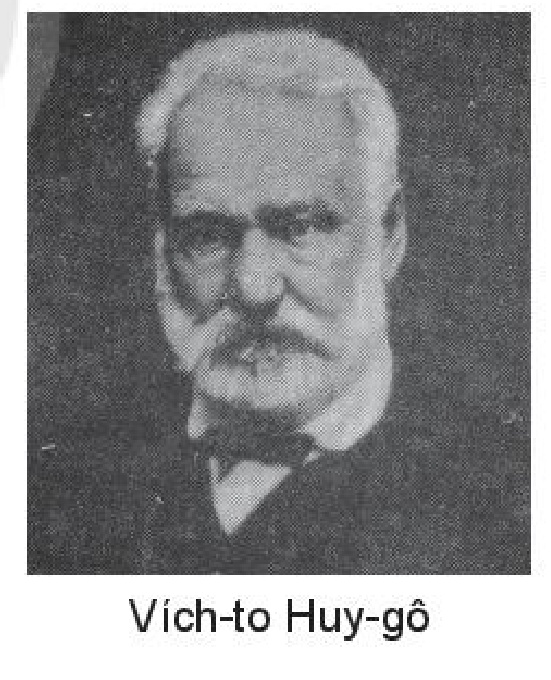
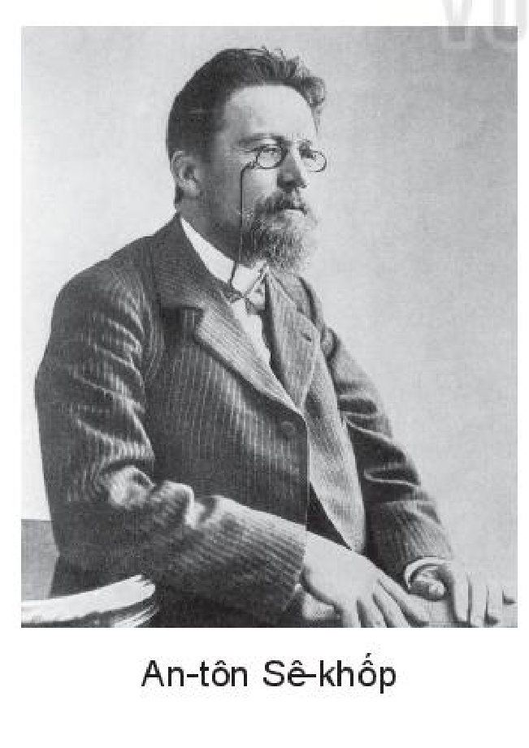

<!-- pdf:38 -->

# BÀI 7: QUYỀN NĂNG CỦA NGƯỜI KỂ CHUYỆN

## 🎯 Yêu cầu cần đạt

- Nhận biết và phân tích được một số yếu tố của truyện như: người kể chuyện ngôi thứ ba và người kể chuyện ngôi thứ nhất, điểm nhìn, lời người kể chuyện, lời nhân vật.
- Phân tích và đánh giá được tình cảm, cảm xúc, cảm hứng chủ đạo mà người viết thể hiện qua văn bản; phát hiện được các giá trị đạo đức, văn hoá từ văn bản.
- Hiểu tác dụng của biện pháp chêm xen, biện pháp liệt kê; biết cách vận dụng các biện pháp này vào việc tạo câu.
- Viết được một bài văn nghị luận phân tích, đánh giá chủ đề và những nét đặc sắc về nghệ thuật của một tác phẩm văn học.
- Biết thảo luận về một vấn đề có những ý kiến khác nhau; đưa ra được những căn cứ thuyết phục; tôn trọng người đối thoại.
- Yêu thương và có trách nhiệm đối với con người, cuộc sống.

## ĐỌC

### TRI THỨC NGỮ VĂN

**Người kể chuyện ngôi thứ nhất và ngôi thứ ba**

**Người kể chuyện ngôi thứ nhất** là người kể xưng “tôi” hoặc một hình thức tự xưng tương đương. Tuỳ theo mức độ tham gia vào mạch vận động cốt truyện, người kể chuyện ngôi thứ nhất có thể là nhân vật chính, nhân vật phụ, người chứng kiến, người kể lại câu chuyện được nghe từ người khác hay xuất hiện với vai trò tác giả “lộ diện”. Người kể chuyện ngôi thứ nhất thường là người kể chuyện hạn tri (không biết hết mọi chuyện), trừ trường hợp ở vai trò tác giả “lộ diện” vận dụng quyền năng “biết hết” của mình.

<!-- pdf:39 -->

**Người kể chuyện ngôi thứ ba** là người kể chuyện ẩn danh, không trực tiếp xuất hiện trong tác phẩm như một nhân vật, không tham gia vào mạch vận động của cốt truyện và chỉ được nhận biết qua lời kể. Người kể chuyện ngôi thứ ba có khả năng nắm bắt tất cả những gì diễn ra trong câu chuyện, kể cả những biểu hiện sâu kín trong nội tâm nhân vật, do vậy có khả năng trở thành người kể chuyện toàn tri (biết hết mọi chuyện), song người kể chuyện ngôi thứ ba có sử dụng quyền năng toàn tri hay không còn tuỳ thuộc vào nguyên tắc tổ chức truyện kể của từng tác phẩm.

Người kể chuyện, dù ở ngôi thứ nhất hay thứ ba, đều kể chuyện từ điểm nhìn nhất định, qua hệ thống lời kể. **Lời người kể chuyện** là lời kể, tả, bình luận của người kể chuyện, có chức năng khắc hoạ bối cảnh, thời gian, không gian, miêu tả sự việc, nhân vật, thể hiện cách nhìn nhận, thái độ đánh giá đối với sự việc, nhân vật. Lời của người kể chuyện phân biệt với **lời nhân vật** – thuật ngữ chỉ lời nói gắn với ý thức và cách thể hiện của nhân vật bằng hình thức lời nói trực tiếp hay gián tiếp.

<!-- term: quyền năng của người kể chuyện -->
Từ điểm nhìn và hệ thống lời người kể chuyện, lời nhân vật, các phương diện của bức tranh đời sống và nhân vật được hiển hiện để người đọc tri nhận. Quyền năng của người kể chuyện thể hiện ở phạm vi miêu tả, phân tích, lí giải và mức độ định hướng đọc trong việc cắt nghĩa, đánh giá sự kiện, nhân vật được khắc hoạ trong tác phẩm văn học.

**Cảm hứng chủ đạo**

**Cảm hứng chủ đạo** của một tác phẩm văn học là tình cảm, thái độ được thể hiện xuyên suốt tác phẩm đối với những vấn đề cuộc sống được nêu ra. Cảm hứng chủ đạo chi phối hình thức thể hiện, toát lên từ toàn bộ tác phẩm và có khả năng tác động mạnh vào cảm xúc của người tiếp nhận.

**Biện pháp chêm xen và biện pháp liệt kê**

**Chêm xen** là xen một từ, một cụm từ vào câu nhằm giải thích, thêm ý cho câu hoặc hướng tới mục đích tu từ.

**Liệt kê** là nêu một chuỗi yếu tố cùng loại nhằm cung cấp thông tin đầy đủ hơn về đối tượng cần nhấn mạnh trong câu, trong đoạn của văn bản hoặc hướng tới mục đích tu từ.

<!-- pdf:40 -->

### VĂN BẢN 1: Người cầm quyền khôi phục uy quyền

*(Trích Những người khốn khổ)*

**Vích-to Huy-gô (Victor Hugo)**

- Bạn hình dung như thế nào về một con người có uy quyền?
- Bạn đã từng đọc cuốn sách hay xem bộ phim nào mà trong đó có nhân vật thực sự là một người uy quyền? Bạn hãy chia sẻ ấn tượng của mình về nhân vật ấy.

Ma-đơ-len (Madeleine) là thị trưởng thị trấn Mông-tơ-rơi (Montreuil) và là ông chủ của một nhà máy đặt tại đây. Để cứu một người vô tội bị cảnh sát nhận nhầm là Giăng Van-giăng (Jean Valjean) – kẻ đang bị pháp luật truy nã, ông đã đến toà thú nhận chính mình mới là người toà cần tìm. Vì điều này, ông phải đối diện với tình huống đầy kịch tính: bị thanh tra Gia-ve (Javert) lập tức đem người đến bắt trong khi ông chưa kịp thực hiện lời hứa hệ trọng với Phăng-tin (Fantine), một nữ công nhân bất hạnh đang nằm trên giường bệnh. Cuộc chạm trán giữa ông với Gia-ve diễn ra tại bệnh xá, nơi Phăng-tin đang nóng lòng chờ gặp đứa con gái thân yêu mà chị ngỡ đã được ông thị trưởng giúp đưa về...

Từ ngày ông Ma-đơ-len gỡ cho Phăng-tin thoát khỏi bàn tay Gia-ve, chị không gặp lại hắn lần nào nữa. Lần này đầu óc ốm yếu của chị không hiểu được một cái gì cả, nhưng chị đinh ninh rằng hắn lại đến để bắt chị. Chị không thể chịu đựng bộ mặt gớm ghiếc ấy. Chị thấy như tắt thở. Chị lấy tay che mặt và kêu lên, giọng kinh hoàng:

> Hoàn cảnh và tình trạng của Phăng-tin được miêu tả như thế nào?

– Ông Ma-đơ-len, cứu tôi với!

Giăng Van-giăng – từ giờ chúng ta cứ cái tên này mà gọi – đứng dậy. Ông vẫn nhẹ nhàng, điềm tĩnh bảo Phăng-tin:

> Vì sao người kể chuyện lại lưu ý “từ giờ chúng ta cứ cái tên này mà gọi”?

– Cứ yên tâm. Không phải nó đến bắt chị đâu.

Rồi ông quay lại nói với Gia-ve:

– Tôi biết là anh muốn gì rồi.

Gia-ve đáp:

– Mau lên!

<!-- pdf:41 -->

Trong điệu hắn nói lên hai tiếng ấy có cái gì man rợ, điên cuồng. Gia-ve không nói: “Mau lên!”, hắn nói: “Mau-u lêênh!”. Không có vần nào ghi nổi giọng nói của hắn. Không phải là tiếng người nói mà là tiếng ác thú gầm.

> Chú ý cách miêu tả giọng nói của Gia-ve.

Hắn không làm như thường lệ. Hắn không mào đầu gì cả. Hắn không chìa tờ trát truy nã ra. Hắn coi Giăng Van-giăng như một kẻ đấu thủ bí hiểm và có tài lẩn tránh, một đô vật lạ lùng hắn đã ôm ghì được từ năm năm nay mà không đánh ngã nổi. Lần này bắt được không phải là bắt đầu mà là kết thúc vậy.

Hắn chỉ cần bảo: Mau lên!

Nói xong, hắn cứ đứng lì một chỗ. Cặp mắt hắn gắn chặt vào Giăng Van-giăng. Cái nhìn cứ như có móc, móc vào người Giăng Van-giăng. Chính với cái nhìn ấy hắn đã quen lôi vào tròng của hắn bao nhiêu kẻ khốn khổ!

Chính cái nhìn ấy hai tháng trước đây Phăng-tin đã thấy đi thấu vào đến tận xương tuỷ của chị.

Nghe thấy tiếng Gia-ve, Phăng-tin lại mở mắt ra. Nhưng ông thị trưởng vẫn đứng đó. Chị còn sợ gì nữa?

Gia-ve tiến vào giữa phòng và hét lên:

– Thế nào! Mày có đi không?

Người đàn bà khốn khổ nhìn chung quanh. Chỉ có bà xơ với ông thị trưởng thôi, ngoài ra không còn ai nữa. Thế thì nó mày tao thô bỉ với ai vậy? Tất cả là với chị thôi. Chị rùng mình.

Rồi chị còn trông thấy một sự vô lí, vô lí đến nỗi ngay trong những cơn sốt mê sảng hãi hùng nhất chị cũng không hề thấy có điều như vậy.

Chị trông thấy tên chó săn Gia-ve tóm cổ ông thị trưởng và chị thấy ông thị trưởng cúi đầu. Chị tưởng như cả thế giới đang tan biến. Quả vậy, Gia-ve đã túm cổ áo Giăng Van-giăng.

> Tại sao Phăng-tin cảm thấy “cả thế giới đang tan biến”?

Chị kêu:

– Ông thị trưởng ơi!

Gia-ve phá lên cười, cái cười làm hắn nhe cả hai hàm răng:

– Ở đây làm gì còn có ông thị trưởng nữa!

Giăng Van-giăng không giằng tay hắn ra, chỉ nói:

– Gia-ve...

<!-- pdf:42 -->

Gia-ve ngắt lời ngay:

– Gọi ta là ông thanh tra.

– Thưa ông, tôi muốn nói riêng với ông câu này.

– Nói to, nói to lên! Ai nói gì với ta thì phải nói to!

Giăng Van-giăng vẫn thì thầm:

– Tôi cầu xin ông có một điều...

– Ta bảo mày nói to lên cơ mà.

– Nhưng điều này phải một mình ông nghe mới được...

– Ta không cần, ta không nghe!

> Chú ý ngôn ngữ ra lệnh của Gia-ve và ngôn ngữ của Giăng Van-giăng qua lời đối thoại.

Giăng Van-giăng ghé gần hắn và hạ giọng nói thật nhanh:

– Xin ông thư cho ba ngày! Ba ngày để đi tìm đứa con cho người đàn bà đáng thương này! Phải hết bao nhiêu tiền tôi cũng trả. Nếu cần thì ông cứ đi kèm tôi cũng được.

Gia-ve quát:

– Mày đùa ư? Ồ thằng này, tao không ngờ mày lại ngu ngốc thế! Mày xin tao ba ngày để chuồn hả! Mày bảo mày đi tìm đứa con cho con này hử! Á à! Tốt, tốt! Tốt thật!

Phăng-tin run lên bần bật:

– Con tôi! Đi tìm con tôi! Thế ra nó chưa đến đây sao(1)! Bà xơ ơi! Cho tôi biết con Cô-dét (Cosette) đâu? Tôi cần gặp con tôi! Ông Ma-đơ-len ơi! Ông thị trưởng ơi!

> Phăng-tin có phản ứng và cảm xúc như thế nào khi nghe nhắc đến đứa con gái của mình?
<!-- ocr-ok: hộp chỉ dẫn đọc cột phải bị OCR gộp nhầm vào dòng văn bản và đọc sai dấu, đã đối chiếu ảnh trang PDF 42 -->

Gia-ve giậm chân:

– Giờ lại đến lượt con này nữa! Con khỉ, có câm họng không! Cái xứ chó đểu gì mà những thằng tù đi đày thì làm ông nọ ông kia, còn lũ gái điếm thì được chạy chữa như những bà hoàng! Nhưng mà rồi phải thay đổi lại hết: đã đến lúc rồi.

> Chú ý thái độ của Gia-ve khi nói về Giăng Van-giăng.

Hắn nhìn Phăng-tin trừng trừng, túm lấy cổ áo và ca-vát của Giăng Van-giăng và thêm:

– Tao đã bảo không có ông Ma-đơ-len, ông thị trưởng nào cả. Chỉ có một thằng ăn cắp, một thằng kẻ cướp, một thằng tù khổ sai tên là Giăng Van-giăng! Tao bắt được thằng ấy đây này! Chỉ có thế thôi!

Phăng-tin chống hai cánh tay gầy guộc vùng nhổm dậy. Chị nhìn Giăng Van-giăng, chị nhìn Gia-ve rồi lại nhìn bà xơ. Chị há miệng như muốn nói gì. Cổ họng có tiếng nấc lên, hai hàm răng đánh vào nhau cầm cập. Chị hoảng hốt giơ tay lên, hai bàn tay cố sức mở ra tìm lấy chỗ bám như người ngã xuống nước đương chới với. Bỗng chị ngã vật

> (1) Trước đó, để Phăng-tin yên tâm, Giăng Van-giăng đã nói dối chị rằng ông đã cho đón Cô-dét về.

<!-- pdf:43 -->

xuống gối. Đầu chị đập vào thành giường và gục xuống, miệng há hốc, hai mắt trợn ngược và hết thần.

Phăng-tin đã tắt thở.

Giăng Van-giăng để tay lên bàn tay Gia-ve đương nắm cổ áo ông ta, gỡ tay hắn ra như gỡ bàn tay trẻ con và bảo hắn:

– Anh đã giết chết người đàn bà này rồi đó.

Gia-ve phát khùng lên:

– Đừng có lôi thôi! Tao không đến đây để nghe lí sự. Dẹp những cái đó lại. Lính đứng sẵn cả dưới nhà rồi. Đi ngay, không thì ông cùm tay lại bây giờ!

Trong góc phòng có chiếc giường sắt cũ đã hư hỏng nhiều, để các bà xơ ngả lưng những đêm phải thức canh con bệnh. Giăng Van-giăng đến bên giường, trong chớp mắt giật gãy cái gióng chính cầm lăm lăm trong tay. Việc ấy đối với sức ông không khó, cái giường vốn đã long sẵn. Ông trợn mắt nhìn Gia-ve, Gia-ve lùi ra phía cửa. Giăng Van-giăng tay vẫn cầm thanh sắt, từ từ đến chỗ giường Phăng-tin. Đến nơi, ông quay lại nói với Gia-ve giọng rất khẽ, cố ý mới nghe rõ:

– Tôi khuyên anh đừng có quấy rầy tôi lúc này.

Sự thật Gia-ve run sợ.

> Tại sao Gia-ve lại thấy run sợ?

Hắn định đi gọi bọn lính, nhưng lại lo Giăng Van-giăng thừa cơ trốn mất. Hắn phải đứng yên đó, tay nắm lấy đầu gậy, lưng tựa vào khung cửa, mắt vẫn không rời Giăng Van-giăng.

Giăng Van-giăng tì khuỷu tay lên trụ đầu giường, bàn tay ôm trán, ngồi ngắm Phăng-tin nằm dài không nhúc nhích. Ông ngồi như thế, mải miết, yên lặng, tâm trí rõ ràng chẳng nghĩ đến một điều gì ở trên đời này nữa. Trong nét mặt và dáng điệu ông chỉ thấy có mỗi một nỗi xót thương vô hạn. Mơ màng một lúc lâu, ông mới ghé lại gần và thì thầm bên tai Phăng-tin.

Ông nói gì? Con người khổ sở ấy có thể nói gì với người đã chết? Những lời ấy là lời gì vậy? Người ở dương gian này không một ai được biết. Kẻ đã chết có nghe thấy không? Có những ảo tưởng rất cảm động, đồng thời lại có thể là những sự thực cao cả. Điều không ai nghi ngờ là bà xơ Xem-pơ-lít (Simplice), người độc nhất chứng kiến cảnh ấy, thường kể lại rằng lúc Giăng Van-giăng ghé vào tai Phăng-tin thì thầm như thế, thì bà trông thấy rõ ràng một nụ cười không sao tả được hiện trên đôi môi nhợt nhạt và trong đôi mắt đờ đẫn, ngạc nhiên của chị.

> Chú ý hình thức câu hỏi trong lời của người kể chuyện.
<!-- ocr-ok: hộp chỉ dẫn đọc cột phải bị OCR nhận dạng hỏng hoàn toàn, đã đối chiếu ảnh trang PDF 43 -->

Giăng Van-giăng lấy hai tay nâng đầu Phăng-tin lên, đặt ngay ngắn giữa gối như một người mẹ sửa soạn cho con. Ông thắt lại dây rút cổ áo chị, vén gọn mớ tóc vào trong chiếc mũ vải. Xong, ông vuốt mắt cho chị.

<!-- pdf:44 -->

Lúc ấy trông mặt Phăng-tin như sáng rỡ lên một cách lạ thường.

Chết tức là đi vào bầu ánh sáng vĩ đại của Chúa.

Tay Phăng-tin vẫn bỏ thõng ra ngoài giường. Giăng Van-giăng quỳ xuống khẽ nâng lên và đặt vào đấy một cái hôn.

Xong ông đứng dậy, quay về phía Gia-ve:

– Giờ anh muốn làm gì thì làm.

> Thái độ của Giăng Van-giăng đối với Gia-ve thể hiện ở câu nói sau cùng trong đoạn trích.
<!-- ocr-ok: hộp chỉ dẫn đọc cột phải bị OCR đọc hỏng dòng cuối, đã đối chiếu ảnh trang PDF 44 -->

(Vích-to Huy-gô, *Những người khốn khổ*, tập một, Huỳnh Lý, Vũ Đình Liên, Lê Trí Viễn, Đỗ Đức Hiểu dịch, NXB Văn học, Hà Nội, 1987, tr. 422 – 427)

Vích-to Huy-gô

**Vích-to Huy-gô** (1802 – 1885) là nhà thơ, nhà tiểu thuyết, nhà viết kịch người Pháp. Ông là nhà văn lãng mạn lớn nhất của văn học Pháp thế kỉ XIX. Các tác phẩm quan trọng trong sự nghiệp của Vích-to Huy-gô: *Nhà thờ Đức Bà Pa-ri* (Paris) (tiểu thuyết, 1831), *Những người khốn khổ* (tiểu thuyết, 1862), *Lao động biển cả* (tiểu thuyết, 1866), *Thằng cười* (tiểu thuyết, 1869), *Chín mươi ba* (tiểu thuyết, 1874); *Lá thu* (tập thơ, 1831), *Trầm tư* (tập thơ, 1856), *Truyền kì các thế kỉ* (tập thơ, 1859); *Éc-na-ni* (Hernani, kịch, 1830).

***Những người khốn khổ*** là tiểu thuyết nổi tiếng nhất của Vích-to Huy-gô. Bối cảnh của tác phẩm là nước Pháp những năm đầu thế kỉ XIX. Nhân vật trung tâm của cuốn tiểu thuyết là Giăng Van-giăng, một người lao động nghèo bị kết án tù khổ sai mười chín năm: năm năm vì tội ăn cắp bánh mì để nuôi đàn cháu đói khổ cộng mười bốn năm do nhiều lần tìm cách vượt ngục. Khi mãn hạn tù, Giăng Van-giăng mang tâm lí thù ghét xã hội bởi không một ai muốn chứa chấp kẻ có quá khứ là tù nhân. Nhờ tình thương vô điều kiện của giám mục Mi-ri-en (Myriel), người không chỉ cho ông một chỗ nghỉ, bỏ qua việc ông đã ăn cắp bộ đồ ăn bằng bạc mà còn tặng cho ông một bộ chân nến, Giăng Van-giăng được cảm hoá. Tuy nhiên, mới vừa ra khỏi tu viện của giám mục Mi-ri-en, Giăng Van-giăng đã lại phạm tội khi cướp bốn mươi xu của bé Giéc-ve (Gervais) trong tâm trạng rối bời. Ngay lúc đó, Giăng Van-giăng đã thấy vô cùng ân hận vì hành vi xuất phát từ thói quen này; ông muốn chuộc lại lỗi lầm nhưng không được vì cậu bé đã sợ hãi bỏ chạy. Do vụ việc đó, Giăng Van-giăng lại phải lần nữa tìm cách lẩn trốn sự truy bắt của cảnh sát.

<!-- pdf:45 -->

Sáu năm sau, Giăng Van-giăng đổi tên thành Ma-đơ-len và đến sống tại thị trấn Mông-tơ-rơi. Nhờ giỏi tổ chức, quản lí lao động, ông trở thành chủ nhà máy giàu có, luôn giúp đỡ mọi người và được bầu làm thị trưởng của thị trấn. Tuy nhiên, ông thường xuyên bị thanh tra Gia-ve (người luôn ngờ vực về nhân thân của ông) rình mò, theo dõi. Ở nhà máy của Giăng Van-giăng có một nữ công nhân tên là Phăng-tin. Trong quá khứ, chị là một người nhẹ dạ, bị một gã chơi bời lừa gạt, bỏ rơi, sau khi sinh một bé gái với hắn, là Cô-dét. Khi sự thật này bị phát hiện, Phăng-tin bị giám thị của nhà máy sa thải, chị đành phải gửi con cho hai vợ chồng gã chủ quán lưu manh là Tê-nác-đi-ê (Thenardie), chấp nhận làm gái điếm để có tiền nuôi con, rồi lâm bệnh do kiệt sức. Một lần, vì phản ứng lại sự trêu chọc tàn nhẫn của một gã tư sản, chị bị Gia-ve bắt giữ và phạt sáu tháng tù giam. Ma-đơ-len thấy có trách nhiệm trong việc này bởi nhà máy của ông đã sa thải Phăng-tin với lí do không chính đáng nên đã tìm cách can thiệp, buộc Gia-ve phải trả tự do cho chị. Ông đưa Phăng-tin khi đó đang ốm rất nặng vào bệnh xá và hứa sẽ đem Cô-dét về với chị. Gia-ve tìm đến Ma-đơ-len, thú nhận sau khi bị ép phải trả tự do cho Phăng-tin, hắn đã báo cáo với chính quyền về sự nghi ngờ của mình, rằng Ma-đơ-len chính là Giăng Van-giăng. Nhưng khi ấy, toà án lại xác nhận nhầm một người khác là Giăng Van-giăng và chuẩn bị đưa người đó ra xét xử. Ma-đơ-len đã trải qua một cuộc đấu tranh tư tưởng dữ dội và cuối cùng quyết định đến phiên toà, thú nhận gốc tích thực của mình để cứu người vô tội. Sau đó, ông trở về Mông-tơ-rơi để thăm Phăng-tin và giáp mặt Gia-ve – người thực thi việc bắt giữ ông – tại bệnh xá. Mặc dù Giăng Van-giăng đã cầu xin Gia-ve hoãn lệnh bắt ba ngày để ông có thể đem Cô-dét về với Phăng-tin nhưng hắn không chấp thuận, thậm chí còn nói toạc ra cho Phăng-tin biết nhân thân của Giăng Van-giăng. Phăng-tin đã qua đời ngay lúc ấy và Giăng Van-giăng bị bắt đi.

Giăng Van-giăng lại vào tù với án chung thân. Khi đang chịu án tại nhà tù Tu-lông (Toulon), ông đã không ngại hiểm nguy để cứu một thuỷ thủ bị nạn và nhân vụ việc này, ông nhảy xuống biển, tìm cách vượt ngục. Chính quyền xác nhận ông đã chết mất xác. Trên thực tế, Giăng Van-giăng không chết. Ông tìm đến quán trọ của vợ chồng Tê-nác-đi-ê để chuộc lại Cô-dét, nhận làm cha của cô bé. Để tránh sự rình mò của Gia-ve, hai cha con sống một đời sống ẩn dật tại một tu viện nhỏ ở Pa-ri, nơi ông nhận công việc làm vườn với cái tên giả Phô-sơ-lơ-văng (Fouchelevent).

Tháng Sáu năm 1832, một cuộc khởi nghĩa của người lao động nổ ra tại Pa-ri chống lại chính quyền tư sản. Một sinh viên tên là Ăng-giôn-rát (Enjolras) – thủ lĩnh của cuộc khởi nghĩa – đã thuyết phục nhiều bạn bè của mình sát cánh với những con người khốn khổ nhất trong xã hội dựng chiến luỹ để chiến đấu vì lí tưởng cộng hoà. Giăng Van-giăng cũng có mặt trong cuộc khởi nghĩa bị đàn áp đẫm máu này. Ông đã tìm cách cứu Ma-ri-uýt (Marius) – người yêu của Cô-dét – và tha mạng cho Gia-ve vốn bị những người khởi nghĩa bắt trước đó. Cách xử sự của ông khiến Gia-ve rơi vào mâu thuẫn, cảm thấy không xử lí được mối quan hệ giữa một bên là ơn cứu mạng của Giăng Van-giăng và một bên là niềm tin vào hệ thống luật pháp cứng rắn mà hắn luôn cố gắng trở thành con người công cụ để thực thi. Không thể giải quyết được xung đột nội tâm, Gia-ve đã tự sát. Giăng Van-giăng sau đó đã tìm cách vun đắp cho tình yêu của Cô-dét và Ma-ri-uýt. Tiểu thuyết kết thúc bằng cái chết trong cô đơn của Giăng Van-giăng.

<!-- pdf:46 -->

Tiểu thuyết ***Những người khốn khổ*** được xây dựng từ nhiều sự kiện và con người có thật trong thời đại của Vích-to Huy-gô. Không chỉ là một cuốn tiểu thuyết tôn vinh các giá trị nhân đạo, *Những người khốn khổ* còn thể hiện quan điểm phê phán sắc sảo của Vích-to Huy-gô đối với sự bất công của xã hội tư sản thể hiện qua hệ thống luật pháp và nhà tù. Tiểu thuyết đã được dịch ra nhiều thứ tiếng trên thế giới và được chuyển thể sang nhiều loại hình nghệ thuật khác như sân khấu, phim truyền hình, phim điện ảnh,...

Đoạn trích ***Người cầm quyền khôi phục uy quyền*** được rút ra từ chương 4, quyển 8, phần thứ nhất của tiểu thuyết *Những người khốn khổ*.

**Trả lời câu hỏi**

1. Có thể chia đoạn trích làm mấy phần? Hãy xác định mối liên hệ giữa các phần ấy.
2. Bạn cảm nhận như thế nào về thái độ và cách ứng xử của Giăng Van-giăng đối với Phăng-tin? Theo bạn, Giăng Van-giăng có thể đã “thì thầm bên tai Phăng-tin” điều gì ngay sau khi chị qua đời?
3. Qua lời của người kể chuyện, nhân vật Gia-ve hiện lên như thế nào? Hãy nhận xét về thái độ của người kể chuyện đối với nhân vật này.
4. Phân tích sự thay đổi trong ngôn ngữ và thái độ của Giăng Van-giăng đối với Gia-ve theo diễn biến của đoạn trích.
5. Quyền năng của người kể chuyện ngôi thứ ba có được thể hiện trong đoạn trích này không? Vì sao?
6. Trong đoạn trích *Người cầm quyền khôi phục uy quyền*, nhân vật nào thật sự có uy quyền? Do đâu bạn khẳng định như vậy?
7. Trong đoạn trích này, theo bạn, điều gì mới làm nên uy quyền của một con người?

#### Kết nối đọc – viết

Bạn có cảm thấy hứng thú khi đọc những tác phẩm tự sự được kể bởi người kể chuyện toàn tri hay không? Hãy viết đoạn văn (khoảng 150 chữ) trình bày ý kiến của mình về vấn đề này.

<!-- pdf:47 -->

### VĂN BẢN 2: Dưới bóng hoàng lan
<!-- ocr-ok: nhãn VĂN BẢN 2 trên nền màu xanh bị OCR bỏ sót, đã đối chiếu ảnh trang PDF 47 -->

**Thạch Lam**

- Với cảnh vật xung quanh và với những người thân yêu, kỉ niệm nào mỗi khi nhớ lại, bạn thấy thật ấm áp, dễ chịu? Nếu được yêu cầu kể lại, bạn sẽ kể như thế nào?
- Đã bao giờ bạn có nhu cầu được sống chậm lại để cảm nhận sâu sắc hơn ý nghĩa của những điều vốn rất bình dị hằng ngày?

Thanh lách cánh cửa gỗ để khép, nhẹ nhàng bước vào. Chàng thấy mát hẳn cả người; trên con đường gạch Bát Tràng rêu phủ, những vòng ánh sáng lọt qua vòm cây xuống nhảy múa theo chiều gió. Một mùi lá tươi non phảng phất trong không khí. Thanh rút khăn lau mồ hôi trên trán – bên ngoài trời nắng gắt – rồi thong thả đi bên bức tường hoa thấp chạy thẳng đến đầu nhà. Yên tĩnh quá, không một tiếng động nhỏ trong căn vườn, tựa như bao nhiêu sự ồn ào ở ngoài kia đều ngừng lại trên bực cửa.

> Chú ý dấu hiệu để nhận biết ngôi của người kể chuyện.
<!-- ocr-ok: hộp chỉ dẫn đọc cột phải bị OCR gộp vào dòng văn bản và sai dấu, đã đối chiếu ảnh trang PDF 47 -->

Thanh bước lên thềm, đặt va-li trên chiếc trường kỉ(1), rồi ngó đầu nhìn vào trong nhà: bóng tối dịu và man mát loáng qua những màu sắc rực rỡ chàng đem ở ngoài trời vào; Thanh chưa nhìn rõ thấy gì cả; một lát, quen bóng tối, chàng mới nhận thấy cảnh tượng gian nhà cũ không có gì thay đổi, cũng y nguyên như ngày chàng đi xưa. Sự yên lặng trầm tịch(2) đến nỗi Thanh trở nên nghẹn họng; mãi mãi chàng mới cất được tiếng lên gọi khẽ:

– Bà ơi!

Một cái bóng lẹ làng từ trong vụt ra, rơi xuống mặt bàn; Thanh định rõ nhìn: con mèo của bà chàng, con mèo già vẫn chơi đùa với chàng ngày trước. Con vật nép chân vào mình khẽ phe phẩy cái đuôi, rồi hai mắt ngọc thạch(3) xanh giương lên nhìn người. Thanh mỉm cười lại gần vuốt ve con mãn(4):

> (1) *Trường kỉ*: ghế dài, làm bằng gỗ hoặc tre, có thể dùng để ngồi hoặc nằm.
> (2) *Trầm tịch*: im lặng, lặng lẽ, hiu quạnh.
> (3) *Ngọc thạch*: đá ngọc thường được dùng để chế tác đồ trang sức.
> (4) *Mãn*: một cách gọi khác về loài mèo.
<!-- ocr-ok: cước chú chân trang cỡ chữ nhỏ bị OCR đọc nhầm dấu (ghê, đề ngôi, Trâm tịch, im lăng, đỏ), đã đối chiếu ảnh trang PDF 47 -->

<!-- pdf:48 -->

– Bà mày đâu?

Thanh bước xuống dưới giàn thiên lí. Có tiếng người đi, rồi bà chàng, mái tóc bạc phơ, chống gậy trúc, ở ngoài vườn vào. Thanh cảm động và mừng rỡ, chạy lại gần.

– Cháu đã về đấy ư?

Bà cụ thôi nhai trầu, đôi mắt hiền từ dưới làn tóc trắng đưa lên nhìn cháu, âu yếm và mến thương.

– Đi vào trong nhà không nắng cháu.

Thanh đi bên bà, người thẳng, mạnh, cạnh bà cụ gầy còng. Tuy vậy chàng cảm thấy chính bà che chở cho chàng, cũng như những ngày chàng còn nhỏ.

– Nhà không có ai ư bà?
<!-- ocr-ok: OCR đọc nhầm "ư" thành "ưr", đã đối chiếu ảnh trang PDF 48 -->

– Vẫn có thằng Nhân, hôm nay nó đi đong thóc bên kia xóm. Dễ chốc nó về. Con đã ăn cơm chưa?

– Dạ chưa. Con ở tầu về đây ngay. Nhưng con không thấy đói.

Bà nhìn cháu, giục:

– Con rửa mặt đi, rồi đi nghỉ không mệt. Trời nắng thế này mà con không đi xe ư?

Thanh cười:

– Có một tí đường đất, cần gì phải xe. Con đi bộ hàng ngày cũng được.

Nhưng Thanh cũng vẫn theo lời bà. Chàng đến bên bể múc nước vào thau rửa mặt. Nước mát rợi và Thanh cúi nhìn bóng chàng lay động trong lòng bể với những mảnh trời xanh tan tác.

Tất cả những ngày thuở nhỏ trở lại với chàng. Thanh vắng nhà đã gần hai năm nay, vậy mà chàng có cảm giác như vẫn ở nhà tự bao giờ. Phong cảnh vẫn y nguyên, gian nhà vẫn tịch mịch và bà chàng vẫn tóc bạc phơ và hiền từ.

Trên trường kỉ, ngọn đèn con và cái điếu cũ kĩ. Con mèo già tròn mình nằm bên cạnh, mắt lim dim trong sự bình yên và nhàn nhã. Thanh trông thấy cảnh ấy đã nhiều lần. Lần nào trở về với bà chàng, Thanh cũng thấy bình yên và thong thả như thế. Căn nhà với thửa vườn này đối với chàng như một nơi mát mẻ và hiền lành, ở đấy bà chàng lúc nào cũng sẵn sàng chờ đợi để mến yêu chàng.

> Tâm trạng của Thanh khi trở về với không gian thân thuộc.
<!-- ocr-ok: hộp chỉ dẫn đọc cột phải bị OCR gộp vào văn bản và đọc nhầm từ (nửa, gián thuộc), đã đối chiếu ảnh trang PDF 48 -->

– Ấy, bà làm gì thế? Bà để mặc cháu.

Bà cụ vẫn không thôi phẩy chiếc phất trần lên đầu giường:

– Đã lâu không có ai nằm nên bụi bám đầy khắp cả.

<!-- pdf:49 -->

Thanh phải để mặc cho bà sửa chiếu và xếp lại gối. Chàng thấy mình bé quá.

– Cháu đi nghỉ chẳng mệt. Để bà hái mấy lá rau nấu canh ăn cho mát.

Bà cụ đi ra. Thanh bỗng thấy mệt mỏi. Chàng lặng nằm xuống giường, ruỗi(1) chân tay, khoan khoái. Ngoài khung cửa sổ, trời xanh ngắt ánh sáng; lá cây rung động dưới làn gió nhẹ. Một thân cây vút cao lên trước mặt. Cùng một lúc, chàng lẩm bẩm: “cây hoàng lan!”(2), mùi hương thơm thoang thoảng đưa vào. Thanh nhắm mắt ngửi hương thơm và nhớ đến cái cây ấy chàng thường hay chơi dưới gốc nhặt hoa. Đã từ lâu lắm, ngày mới có căn nhà này, ngày cha mẹ chàng hãy còn. Rồi đến ngày một bà một cháu quấn quýt nhau. Thanh ra tỉnh làm rồi đi về hàng năm, các ngày nghỉ. Bây giờ cây đã lớn.

> Trạng thái tình cảm của Thanh khi nhận ra cây hoàng lan. Chú ý những chi tiết về cây hoàng lan trong toàn câu chuyện.

Thanh thấy tâm hồn nhẹ nhõm tươi mát như vừa tắm ở suối. Chàng tắm trong cái không khí tươi mát này. Những ngày bận rộn ở tỉnh giờ xa quá. Khu vườn với các cây quen đã nhận biết chàng rồi.

Nghe tiếng bà đi vào. Thanh nằm yên giả vờ ngủ. Bà lại gần săn sóc buông màn, nhìn cháu và xua đuổi muỗi. Gió quạt đưa nhẹ trên mái tóc chàng. Thanh vẫn nằm yên, nhắm mắt nhưng biết bà ở bên mình. Chàng không dám động đậy, yên lặng chờ cho bà lại đi ra. Bà xuống bếp làm cơm hẳn. Tiếng dép nhỏ dần.

Chàng cảm động gần ứa nước mắt. Bà yêu thương cháu quá, giờ chỉ có mình cháu, với mình bà. Mà bà làm bếp có một mình thôi ư? Không, hình như có tiếng người khác nữa, tiếng trong và mau hơn. Thanh lắng nghe: một tiếng cười sẽ đưa lên. Tiếng ai? Nghe quen quá mà Thanh không nhớ được.

> Lưu ý sự đan xen giữa lời của người kể chuyện và lời độc thoại nội tâm của nhân vật.
<!-- ocr-ok: hộp chỉ dẫn đọc cột phải bị OCR gộp vào văn bản và đọc nhầm từ (ưu ý, kế chuyện, gửa), đã đối chiếu ảnh trang PDF 49 -->

Chàng lẳng lặng ngồi dậy, tì trên cửa sổ, cúi mình nhìn ra phía ao. Bóng cây hoàng lan lay động cả một vùng. Chàng chợt nhớ, chạy vùng xuống nhà ngang(3), gọi vui vẻ:

– Cô Nga...

Người thiếu nữ đương nhặt rau nghe tiếng gọi vội ngửng đầu: một nụ cười, đôi mắt trong sáng lên; rồi tiếng nhẹ nhàng:

– Anh Thanh! Anh đã về đấy à?

Thanh đứng tựa bên cột, chưa trả lời. Chàng nhìn cô thiếu nữ xinh xắn trong tà áo trắng, mái tóc đen lánh buông trên cổ nhỏ, bên cạnh mái tóc bạc trắng của bà chàng.

> (1) *Ruỗi*: duỗi thẳng ra.
> (2) *Hoàng lan*: cây to cùng họ với na, có hoa thơm, màu vàng lục.
> (3) *Nhà ngang*: nhà nhỏ, vuông góc với nhà chính, là nơi nấu nướng và ăn uống thường ngày của gia đình (kiểu kiến trúc nhà ở truyền thống của nông thôn đồng bằng Bắc Bộ).

<!-- pdf:50 -->

Cô Nga, cô bé hàng xóm vẫn sang chơi với chàng trong vườn, và mỗi lần về, chàng lại gặp ở nhà như một người thân mật.

Một lát cô Nga nói:

– Anh Thanh độ này khác hẳn trước. Anh chóng nhớn(1) quá.
<!-- ocr-ok: OCR đọc nhầm "hẳn" thành "hắn" và "nhớn(1)" thành "nhớnt)", đã đối chiếu ảnh trang PDF 50 -->

– Tôi vẫn thế đấy chứ.
<!-- ocr-ok: OCR đọc nhầm "vẫn" thành "vân", đã đối chiếu ảnh trang PDF 50 -->

Bà cụ cúi trên rổ rau, không nhìn cháu đáp:

– Cô trông em có phải gầy đi không. Không bằng độ còn ở nhà.

Nga ngửng nhìn Thanh, cười:

– Đấy em có nói sai đâu. Anh trông lại đen đi nữa.

Lá rau tươi xanh ngắt bên bàn tay trắng hồng nhỏ nhắn. Thanh cũng ngồi ghé xuống. Thế là lại như lúc còn ở nhà, ngày ngày chàng cũng vẫn với Nga xuống bếp xem bà làm cơm. Câu chuyện vẫn vui và vẫn đậm, có lúc chàng lầm tưởng Nga chính là em gái ruột của mình.

\* \* \*

Lúc Nhân bưng cơm đặt lên bàn, bà cụ bảo cô thiếu nữ:

– Ở đây ăn cơm một thể, cháu ạ.

Thanh nhìn lên:

– Ăn cho vui, cô Nga.

– Xin phép cụ và anh thôi, em vừa mới ăn cơm xong ở nhà. Em đứng đây cũng được chứ gì.

Thanh ra vẻ không bằng lòng:

– Không, cô phải ngồi ăn cơ. Cô làm khách mãi.

Nga sợ, vén áo ngồi bên cạnh bà cụ, nhưng nàng chỉ ăn nhỏ nhẻ, cầm chừng, và buông đũa luôn để xới cơm cho Thanh. Bữa cơm vui quá. Thanh ăn rất ngon miệng, lòng thư thái và sung sướng. Thỉnh thoảng chàng nhìn đôi môi thắm của Nga, hai má hồng. Và nụ cười tươi nở, nàng nhìn lại Thanh, một chút thôi, nhưng biết bao nhiêu âu yếm.

Ngoài vườn, trời vẫn nắng. Giàn thiên lí pha xanh một bên tà áo trắng của Nga. Những búp hoa lí non và thơm rủ liền trong giàn, lẫn vào đám lá. Gạch mát và phủ rêu khiến Thanh nhớ lại hai bàn chân xinh xắn của Nga, ngày nào, đi trên đó. Hai bàn chân nhỏ, lấm tấm cát, để dấu tự ngoài ao trở về... Chàng đột nhiên mỉm cười, rồi hỏi:

– Cô Nga có còn hay đi nhặt hoàng lan rơi nữa không?

> (1) *Nhớn*: lớn.

<!-- pdf:51 -->

Nga cũng cười hơi thẹn:

– Vẫn nhặt đấy. Nhưng không có ai tranh nữa.

Nàng nhìn Thanh, mắt như tụ lại những hình ảnh tự bao giờ, và sẽ vuốt mấy sợi tóc mai ra một bên. Thanh thấy quả tim đập nhẹ nhàng.

Bà cụ thì mải nhìn cháu. Bác Nhân khoanh tay đứng dựa bên cột nghe; bác cũng vui mừng vì thấy cậu về, vẫn khoẻ mạnh và xinh trai như ngày trước. Còn cô Nga vẫn tươi đẹp và vui vẻ như thế. Có cô nhà cũng đỡ vắng, và bà cậu cũng đỡ buồn; hàng ngày cô chạy sang chơi giúp đỡ bà cụ giã cối trầu và nói chuyện đến người đi vắng ở trên tỉnh đã lâu không về thăm nhà.

Bữa ăn xong. Thanh với Nga đã trở lại thân mật như khi còn nhỏ. Thanh dắt nàng đi xem vườn; cây hoàng lan cao vút, cành lá rủ xuống như chào đón hai người. Có lúc gần nhau, Thanh thấy mái tóc Nga thoang thoảng thơm như có giắt hoàng lan. Nhưng hoa lan chưa rụng, vẫn còn tươi xanh ở trên cành. Nga bảo Thanh:

– Những ngày em đến đây hái hoa, em nhớ anh quá.

Thanh chẳng biết nói gì; chàng vít một cành lan xuống giữ ở trong tay để Nga tìm hoa, rồi nhẹ nhàng buông ra cho cành lại cong lên. Nắng soi vào vai hai người, nhưng dưới chân đất vẫn mát như xưa.

> Biểu hiện tình cảm của Nga và Thanh (qua lời nói, tâm trạng).

– Bao giờ anh lên tỉnh?

– Ngày mai thôi. Kì này được nghỉ ít. Nhưng mai kia, tôi sẽ về ở đây lâu hơn.

Lòng Thanh dịu lại. Nga đến bên bể múc nước rửa hoa, rồi xếp bầy trên quả(1) trầu. Bà cụ nhìn cô, âu yếm:

– Hoa hãy còn non lắm, sao hái sớm thế, con?

Nga thưa:

– “Anh con hái đấy ạ” và nàng nhìn Thanh mỉm cười.

> Ý nghĩa lời đối thoại giữa bà cụ và Nga về chuyện hái hoa hoàng lan.

Đêm ấy, một bà, một cháu với một cô láng giềng chuyện trò dưới bóng đèn mãi tới khuya, khi trăng lên. Qua vườn, Thanh tiễn Nga ra đến cổng, đi qua hai bên bờ lá đã ướt sương. Mùi hoàng lan thoang thoảng bay trong gió ngát. Không lưỡng lự, Thanh cầm lấy tay Nga, để yên trong tay mình. Nga cũng đứng yên lặng. Lâu lâu, Nga rút tay sẽ nói:

– Thôi em về.

> (1) *Quả*: dụng cụ làm bằng gỗ hoặc đan bằng tre, hình tròn, có nắp, dùng đựng đồ khô, bên ngoài phết sơn ta (một loại sơn chế biến từ nhựa của cây sơn).

<!-- pdf:52 -->

Thanh đi trở vào rất thong thả. Có cái gì dịu ngọt chăng tơ ở đâu đây, khiến chàng vương phải. Chàng đến trường kỉ ngồi ở bên đèn.

\* \* \*

Sáng hôm sau, Thanh đã phải lên tỉnh. Chiếc va-li chàng nặng những thức quà bà chàng đã ban cho. Thanh cầm mũ đứng nghe lời khuyên bảo ân cần của bà dưới giàn hoa lí. Chàng vẫn bé quá và lại đi xa.

Tới cổng, Thanh còn đứng lại nhìn cây hoàng lan và các cây khác trong vườn. Bác Nhân nhanh nhảu cầm đỡ va-li cho chàng, Thanh dặn khẽ:

– Bảo tôi có nhời(1) chào cô Nga nhé.

Rồi chàng bước ra đi nửa buồn mà lại nửa vui. Thanh nghĩ đến căn nhà như một nơi mát mẻ và sung sướng để chàng thường về nghỉ sau việc làm. Và Thanh biết rằng Nga sẽ vẫn đợi chàng, vẫn nhớ mong chàng như ngày trước. Mỗi mùa cô lại giắt hoàng lan trong mái tóc để tưởng nhớ mùi hương.

> Chi tiết nào ở phần kết giúp bạn dự đoán sự tiến triển tình cảm giữa Thanh và Nga?

(*Tuyển tập Thạch Lam*, NXB Văn học, Hà Nội, 1988, tr. 123 – 128)

**Thạch Lam** (1910 – 1942) tên khai sinh là Nguyễn Tường Vinh (sau đổi thành Nguyễn Tường Lân), quê gốc ở tỉnh Quảng Nam, nhưng sinh ra và lớn lên ở Hà Nội. Hồi nhỏ, ông từng sống tại huyện Cẩm Giàng, tỉnh Hải Dương. Ông viết văn, làm báo và là một trong những cây bút chủ chốt của Tự lực văn đoàn – một tổ chức văn học đóng vai trò quan trọng trong quá trình hiện đại hoá văn học Việt Nam thập niên 30 – 40 của thế kỉ XX.

Tác phẩm của Thạch Lam thuộc nhiều thể loại, tiêu biểu có: *Gió đầu mùa* (tập truyện ngắn, 1937), *Nắng trong vườn* (tập truyện ngắn, 1938), *Ngày mới* (truyện dài, 1939), *Theo giòng* (bình luận văn học, 1941), *Sợi tóc* (tập truyện ngắn, 1942), *Hà Nội băm sáu phố phường* (tập tuỳ bút, 1943),... Ngòi bút của Thạch Lam thường hướng về cuộc sống của những người dân nghèo nơi phố huyện, ở ngoại ô Hà Nội hay của những trí thức bình dân; thể hiện niềm cảm thương kín đáo mà sâu sắc. Truyện của ông có cốt truyện đơn giản, lời văn trong sáng, giản dị, giàu chất thơ.

> (1) *Nhời*: lời.

<!-- pdf:53 -->

**Trả lời câu hỏi**

1. Câu chuyện được kể bằng lời của người kể chuyện ngôi thứ mấy? Ngôi kể ấy có nhất quán từ đầu đến cuối câu chuyện không?
2. Hình ảnh thiên nhiên, con người, cảnh sinh hoạt,... hiện ra qua đôi mắt của nhân vật nào? Việc chọn điểm nhìn như vậy có ý nghĩa gì?
3. Lời đối thoại giữa bà và Thanh trong phần đầu của tác phẩm chủ yếu xoay quanh những chuyện gì? Tình cảm của các nhân vật bộc lộ như thế nào qua những lời đối thoại đó?
4. Phân tích những biểu hiện tình cảm giữa Nga và Thanh được khắc hoạ trong tác phẩm.
5. Trong *Dưới bóng hoàng lan*, nghệ thuật viết truyện của Thạch Lam biểu hiện rõ nhất qua cốt truyện, nhân vật hay lời kể? Hãy phân tích một trong ba yếu tố đó.
6. Theo bạn, nhan đề *Dưới bóng hoàng lan* có ý nghĩa gì?
7. Cảnh nào được miêu tả trong truyện gợi cho bạn nghĩ đến một bức tranh đẹp? Nếu cần chọn một cảnh để vẽ minh hoạ, bạn sẽ chọn cảnh nào? Vì sao?
8. Nhà thơ Thế Lữ cảm nhận: *Dưới bóng hoàng lan* là tác phẩm “nhân từ như một lời yên ủi(1)” (*Thạch Lam – Về tác gia và tác phẩm*, NXB Giáo dục, Hà Nội, 2003, tr. 147). Từ gợi ý đó, bạn hãy phân tích tình cảm của tác giả đối với con người và cuộc sống được thể hiện qua tác phẩm.

#### Kết nối đọc – viết

Viết đoạn văn (khoảng 150 chữ) phân tích tâm trạng nhân vật Thanh ở đoạn văn cuối của phần kết truyện.

> (1) *Yên ủi*: như *an ủi*.

<!-- pdf:54 -->

### VĂN BẢN 3: Một chuyện đùa nho nhỏ
<!-- ocr-ok: nhãn VĂN BẢN 3 trên nền màu xanh bị OCR bỏ sót, đã đối chiếu ảnh trang PDF 54 -->

**An-tôn Sê-khốp (Anton Chekhov)**
<!-- ocr-ok: OCR đọc nhầm "Sê-khốp" thành "Sê-khôp", đã đối chiếu ảnh trang PDF 54 -->

Đôi khi hồi ức về một kỉ niệm nhỏ bé trong quá khứ lại khiến ta phải suy ngẫm nhiều về cuộc sống của mình trong hiện tại và tương lai. Hãy kể lại kỉ niệm ấy với bạn bè.

Một buổi trưa mùa đông trong sáng... Trời giá lạnh, rét cóng. Na-đi-a (Nadia)(1) khoác tay tôi. Những hạt bụi tuyết nhỏ trắng xoá bám lên mấy món tóc xoắn vòng rủ hai bên thái dương nàng, lên hàng lông tơ mịn phía trên môi. Nàng và tôi đứng trên một ngọn đồi cao. Từ chỗ chúng tôi đứng, sườn đồi đổ dài thoai thoải xuống lấp loáng dưới ánh nắng, như một tấm gương. Bên cạnh chúng tôi là một chiếc xe trượt tuyết nhỏ bọc một lớp dạ màu đỏ tươi.

> Lưu ý về ngôi kể. Lời kể xuất phát chủ yếu từ điểm nhìn “lúc đó” hay “bây giờ”?
<!-- ocr-ok: hộp chỉ dẫn đọc cột phải bị OCR gộp vào dòng văn bản và đọc nhầm (F9U ý về ngôi kế, Tức đó), đã đối chiếu ảnh trang PDF 54 -->

– Chúng ta cùng trượt xuống dưới đi, Na-đe-giơ-đa Pê-tơ-rốp-na (Nadezhda Petrovna)(2)! – Tôi van nài nàng.

– Một lần thôi! Tôi cam đoan với cô là chúng ta sẽ chẳng hề gì đâu.

Nhưng Na-đi-a sợ. Cả khoảng không gian từ đôi giày cao su nhỏ nhắn của nàng đến chân quả đồi phủ băng này đối với nàng thật ghê sợ, tưởng như là một vực sâu vô tận. Đứng đây, nàng chỉ mới đưa mắt nhìn xuống dưới, hay tôi chỉ mới gợi ý bảo nàng ngồi vào xe trượt tuyết là nàng đã sợ hết hồn, không thở được nữa. Huống hồ nếu nàng liều mạng lao xuống cái vực sâu kia thì không biết rồi ra sao! Nàng sẽ chết mất, sẽ phát điên mất.

> Lưu ý sự đồng cảm của người kể chuyện với Na-đi-a.

– Ta trượt đi cô! – Tôi cố nài. – Việc gì mà sợ! Cô phải biết sợ thế là nhát gan, xoàng lắm cô ạ!

> (1), (2) *Na-đi-a*, *Na-đe-giơ-đa Pê-tơ-rốp-na*: hai cách gọi tên nhân vật nữ chính trong truyện, phân biệt với nhau về mức độ quan hệ và sắc thái cảm xúc. *Na-đe-giơ-đa Pê-tơ-rốp-na* là cách gọi tên đầy đủ, trang trọng; *Na-đi-a* là cách gọi tên thân mật, âu yếm. Trong tiếng Nga, từ *na-đe-giơ-đa* còn có nghĩa là niềm hi vọng.

<!-- pdf:55 -->

Cuối cùng, Na-đi-a cũng ưng thuận, nhưng qua nét mặt nàng, tôi biết rằng nàng liều mạng mà nghe lời tôi. Tôi đỡ nàng ngồi vào xe trượt; nàng run rẩy, gương mặt nàng tái nhợt. Tôi vòng tay qua giữ lấy Na-đi-a và cùng nhau lao xuống.

Chiếc xe lao đi vun vút như một viên đạn. Làn không khí bị xé ra quật vào mặt, gào rít bên tai dữ tợn đâm vào da buốt nhói, gió như muốn giật phăng đầu ra khỏi vai. Gió ép mạnh, đến nghẹt thở. Tưởng chừng như có một con quỷ nào đang giơ tay nắm lấy chúng tôi và vừa rú lên vừa kéo xuống địa ngục. Mọi vật chung quanh nhập lại thành một vệt dài vun vút lao về phía sau... Chỉ một giây lát nữa thôi có lẽ chúng tôi sẽ chết!

– Na-đi-a, anh yêu em! – Tôi thì thào nói.

Chiếc xe trượt dần dần chạy chậm lại, tiếng gió gào và tiếng càng xe trượt lúc này đã không rít lên ghê sợ, ngực đã thấy dễ thở, và thế là chúng tôi đã xuống đến chân đồi. Na-đi-a sợ tưởng chết đi được, gương mặt tái nhợt, nàng thở không ra hơi... Tôi đỡ nàng đứng dậy.

– Các vàng tôi cũng không trượt lần nữa đâu! – Nàng nói và đưa cặp mắt mở to đầy sợ hãi, nhìn tôi. – Các vàng tôi cũng chịu! Chỉ thiếu chút nữa là tôi chết!

Một lát sau, nàng dần dần hết sợ và bắt đầu nhìn vào mắt tôi với vẻ dò xét: có phải tôi đã nói bốn tiếng ấy, hay chỉ là trong tiếng gió gào rít nàng nghe thấy như vậy? Còn tôi, tôi đứng bên cạnh nàng, [...] chăm chú nhìn chiếc găng tay của mình.

Nàng khoác tay tôi và chúng tôi cùng nhau dạo chơi hồi lâu bên đồi tuyết. Hình như điều bí ẩn làm nàng thấy trong lòng băn khoăn. Có phải anh nói ra những lời đó không? Có những lời đó hay không? Có hay không? Đó là một câu hỏi của lòng tự trọng, của danh dự, của cuộc đời và niềm hạnh phúc – một câu hỏi rất hệ trọng, hệ trọng nhất trên đời này. Na-đi-a chăm chăm nhìn tôi bằng cặp mắt buồn rầu nôn nóng bồn chồn. Nàng chậm rãi do dự trả lời những câu hỏi của tôi như chờ mong tôi sẽ tự nói ra cái điều bí ẩn ấy. “Ôi, gương mặt đáng yêu của nàng mới ngộ nghĩnh làm sao!”. Tôi thấy rõ nàng đang tự day dứt với mình, nàng cần nói một điều gì, cần hỏi một điều gì, nhưng nàng không tìm được lời, nàng cảm thấy rụt rè kinh sợ, một niềm vui nào đang ngăn trở nàng nói...

> Lưu ý câu văn hé lộ ý đùa cợt của nhân vật “tôi”.
<!-- ocr-ok: hộp chỉ dẫn đọc cột phải bị OCR gộp vào dòng văn bản và đọc nhầm (đủa cợt, nhân vậi Tôi), đã đối chiếu ảnh trang PDF 55 -->

– Này anh... – Nàng nói, mắt không nhìn tôi.

– Cái gì vậy? – Tôi hỏi.

– Chúng ta cùng nhau... lao dốc lần nữa đi.

Chúng tôi lần theo những bậc thang trèo lên đồi. Tôi lại đỡ Na-đi-a lên xe, mặt nàng tái nhợt, và toàn thân run run. Chúng tôi lại lao xe về phía vực thẳm khủng khiếp và gió lại gào, tiếng xe lại rít lên. Và cũng đúng vào lúc chiếc xe lao nhanh nhất, tiếng gió gào rít ghê gớm nhất, tôi lại nói:

– Na-đi-a, anh yêu em!

<!-- pdf:56 -->

Khi chiếc xe dừng lại, Na-đi-a vội đưa mắt nhìn quanh quả đồi mà chúng tôi vừa trượt xuống, rồi nhìn đăm đăm vào mặt tôi, lắng nghe giọng nói thờ ơ lãnh đạm của tôi và toàn thân nàng, cả từ cái mũ, cái bao tay và dáng người nàng nữa, đều toát lên một vẻ hồ nghi khó hiểu. Trên gương mặt nàng như hiện lên các câu hỏi:

“Điều gì đã xảy ra? Ai nói những lời ấy? Anh ấy hay là chỉ do ta nghe được?”.

Điều bí ẩn ấy làm nàng không yên lòng chút nào, nàng không chịu được nữa. Cô bé đáng thương ấy không trả lời nổi những câu hỏi, nét mặt rầu rĩ như muốn khóc.

– Chúng ta về nhà thôi nhé? – Tôi hỏi.

– Không, không... tôi thích... trượt xe thế này, – nàng nói, mặt ửng đỏ lên. – Hay là chúng ta cùng nhau trượt lần nữa đi?

Na-đi-a nói rằng nàng “thích” cái trò trượt này, thế mà khi ngồi lên xe, nàng vẫn run, gương mặt nàng vẫn tái nhợt, hơi thở vẫn ngắt quãng vì sợ hãi như những lần trước.

Lần thứ ba chúng tôi trượt xuống. Tôi thấy nàng đăm đăm nhìn lên mặt tôi, theo dõi đôi môi tôi. Nhưng tôi lấy chiếc khăn tay che miệng đi rồi khẽ đằng hắng lên mấy tiếng, và khi xe lao xuống lưng chừng đồi, tôi còn kịp nói:

– Na-đi-a, anh yêu em!

Điều bí ẩn vẫn là điều bí ẩn! Na-đi-a im lặng, nàng đang nghĩ ngợi điều gì... Tôi tiễn nàng từ sân trượt về nhà. Nàng cố đi chậm lại, chờ xem tôi có nói với nàng những lời ấy không. Tôi cảm thấy tâm hồn nàng đang đau khổ, nàng đang cố dằn lòng để khỏi phải thốt lên:

– Không, gió không thể nói được những lời ấy! Mà mình cũng không muốn tin rằng gió đã nói những lời ấy!

> Vì sao Na-đi-a “không muốn tin rằng gió đã nói những lời ấy”?

Sáng hôm sau, tôi nhận được một mảnh giấy của nàng: “Nếu hôm nay anh có đi trượt tuyết, đến rủ tôi cùng đi nhé! N.”.

Từ hôm đó, ngày nào tôi và Na-đi-a cũng lên đồi và mỗi lần lao xe từ trên đồi xuống, tôi lại thì thào nhắc lại những lời đó:

– Na-đi-a, anh yêu em!

Chẳng bao lâu sau, Na-đi-a quen nghe những lời ấy [...]. Nàng không thể sống thiếu những lời đó nữa. Thực ra, lao xe từ trên đồi xuống vẫn đáng sợ như xưa, nhưng giờ đây chính cái nguy hiểm, cái kinh sợ đó lại đem đến một cái gì đặc biệt đắm say cho những lời yêu đương ấy, những lời vẫn là điều bí ẩn và dằn vặt lòng người như trước... Kẻ bị nghi ngờ vẫn là gió và tôi... Ai, gió hay là tôi, đã thổ lộ với nàng những lời yêu đương ấy, nàng không biết được. Nhưng với nàng giờ đây, ai nói, có lẽ, cũng như nhau cả thôi: “Uống rượu từ bình nào chả thế, cốt sao say là được”(1).

> (1) *Uống rượu từ bình nào chả thế, cốt sao say là được*: tục ngữ Nga.

<!-- pdf:57 -->

Có lần vào một buổi trưa, tôi đến sân trượt một mình; đi lẫn trong đám đông. Tôi bỗng thấy Na-đi-a đang đi về phía đồi và đưa mắt tìm tôi... Rồi nàng chậm chạp bước theo bậc thang lên đỉnh đồi... Trượt xe một mình thật ghê sợ biết bao, ôi, thật đáng ghê sợ! Mặt nàng tái nhợt, trắng như tuyết, toàn thân run rẩy, nàng bước đi hệt như đến nơi chịu án tử hình, nhưng nàng vẫn xăm xăm đi, đầu không ngoái lại.

> Lưu ý “độ vênh” giữa suy đoán của người kể chuyện với hành động tiếp theo của Na-đi-a.

Chắc là cuối cùng nàng quyết định thử xem có còn nghe thấy những lời ngọt ngào say đắm ấy nữa không, khi không có tôi bên cạnh? Tôi nhìn thấy nàng tái nhợt, miệng há ra vì sợ hãi; ngồi lên xe, nhắm mắt lại và, sau khi vĩnh biệt Trái Đất, bắt đầu lao xuống chân đồi... Tiếng càng trượt xe rít lên... Na-đi-a có nghe thấy những lời đó nữa không, tôi không biết... Tôi chỉ thấy nàng bước ra khỏi xe một cách mệt nhọc, gần như kiệt sức. Qua nét mặt nàng có thể thấy rằng chính nàng cũng không biết nàng có nghe được những lời đó hay không. Nỗi sợ hãi khi xe lao xuống đồi đã làm nàng không còn khả năng nghe được, phân biệt được các âm thanh, không còn khả năng hiểu nữa...

Thế rồi những ngày xuân tháng Ba đã tới... Mặt trời như trở nên dịu dàng hơn. Quả đồi tuyết của chúng tôi bắt đầu sẫm lại, dần dần mất đi cái vẻ óng ánh của nó, và cuối cùng thì tan đi. Chúng tôi thôi không trượt xe nữa. Na-đi-a đáng thương cũng không còn nơi nào để nghe những lời đó nữa, và cũng không có ai nói những lời đó nữa, bởi vì gió thì không còn thổi nữa, mà tôi thì sửa soạn đi Pê-téc-bua (Petersburg) – đi rất lâu, có lẽ là suốt đời.

Thế nào đó, khoảng hai ngày trước khi đi, vào một buổi chiều tà, tôi ngồi trong khu vườn nhỏ ngăn cách với sân nhà Na-đi-a bởi một hàng rào cao có đinh nhọn... Trời hãy còn lạnh. Tuyết hãy còn đọng lại dưới đống phân ủ hoai mục(1), cây cối hãy còn trơ trụi, nhưng hương vị mùa xuân đã đến, từng đàn quạ bay về tổ trú đêm, rộ lên quàng quạc. Tôi đến bên hàng rào và ghé nhìn qua khe hở. Tôi thấy Na-đi-a bước ra thềm và đưa mắt nhìn lên trời buồn bã... Làn gió xuân nhẹ thổi qua khuôn mặt nhợt nhạt rầu rĩ của nàng... Làn gió xuân gợi lại cho nàng cái tiếng gió rít trên đồi tuyết, khi nàng nghe thấy bốn tiếng ấy, và gương mặt nàng trở nên buồn bã lạ thường, nước mắt lặng lẽ chảy trên má... Nàng đáng thương đưa hai tay mình về phía trước như muốn cầu xin làn gió đem

> Lưu ý hình ảnh “hàng rào cao có đinh nhọn” ngăn cách hai nhân vật và hành động “ghé nhìn qua khe hở” của nhân vật “tôi”.

> (1) Tháng Ba ở nước Nga, người ta đánh đống phân ủ đã hoai mục qua đông để chuẩn bị bón cho cây trồng lúc sang xuân.

<!-- pdf:58 -->

đến cho nàng những lời yêu đương đó một lần nữa. Và tôi, chờ khi có làn gió đến, thì thào nói:

– Na-đi-a, anh yêu em!

Trời, điều gì đã xảy ra với nàng lúc ấy! Na-đi-a khẽ kêu lên và khuôn mặt nàng bỗng chan hoà một nụ cười rạng rỡ. Na-đi-a đưa hai tay lên đón lấy gió, trông nàng lúc ấy thật là mừng rỡ, đẹp xinh và hạnh phúc.

Còn tôi trở vào nhà thu xếp đồ đạc...

Chuyện ấy đã qua lâu rồi. Bây giờ Na-đi-a đã có chồng, gia đình gả nàng cho một viên thư kí hội đồng giám hộ quý tộc hay nàng tự nguyện lấy – cũng thế cả thôi. Nàng đã có ba con. Chút kỉ niệm cùng nhau trượt tuyết khi gió đem tới cho nàng bốn tiếng “Na-đi-a, anh yêu em!” không sao quên được. Đối với nàng, điều ấy đã trở thành kỉ niệm hạnh phúc nhất, xúc động nhất, đẹp đẽ nhất trong đời...

> Xác định tâm trạng của nhân vật “tôi” khi chuyển về thời điểm kể “bây giờ”.

Còn tôi, bây giờ đã đứng tuổi, tôi không hiểu nổi vì lẽ gì đã nói những lời đó, sao tôi lại đùa như thế...

1899

(An-tôn Sê-khốp, *Truyện ngắn Sê-khốp*, Phan Hồng Giang dịch(1), NXB Cầu Vồng, Mát-xcơ-va (Moskva), 1988, tr. 29 – 34)

An-tôn Sê-khốp

**An-tôn Sê-khốp** (1860 – 1904) sinh ra và lớn lên trong một gia đình buôn bán nhỏ tại thị trấn Ta-gan-rốc (Taganrog), miền nam nước Nga. Ông bắt đầu sáng tác truyện ngắn và kịch ngay khi theo học ngành Y tại Trường Đại học Tổng hợp Mát-xcơ-va từ năm 1879. Đến khoảng những năm 1890, Sê-khốp đã được thừa nhận là một trong những nhà văn lớn nhất của văn học Nga. Năm 1904, nhà văn qua đời vì bệnh lao phổi tại một khu điều dưỡng ở nước Đức.

> (1) Về văn bản dịch này, người biên soạn sách giáo khoa cùng dịch giả Phan Hồng Giang có tinh chỉnh lại nhan đề và một số câu chữ cho sát hơn với nguyên tác.

<!-- pdf:59 -->

Văn phong Sê-khốp hàm súc, cô đọng. Phần lớn truyện ngắn của ông là những “truyện không có chuyện”, mở đầu thường dẫn người đọc nhập thẳng vào khung cảnh câu chuyện, tâm trạng nhân vật, kết thúc thường gây cảm giác “chưa có chuyện gì xảy ra cả” như trong một sự đợi chờ khắc khoải. Nhà văn Lép Tôn-xtôi (Lev Tolstoy) khẳng định Sê-khốp đã “sáng tạo nên cách viết mới cho toàn thế giới”. Tầm ảnh hưởng và sức lan toả từ sáng tác của Sê-khốp cho đến ngày nay vẫn hết sức lớn lao.

Truyện ngắn ***Một chuyện đùa nho nhỏ*** của Sê-khốp in lần đầu tiên trên tạp chí *Dế mèn* của Nga, số 10, ra ngày 12/3/1886. Năm 1899, Sê-khốp chỉnh lí, bổ sung một số câu chữ, thay đổi phần kết truyện để đưa vào tuyển tập *Truyện ngắn Sê-khốp*. Dịch giả Phan Hồng Giang chuyển ngữ *Một chuyện đùa nho nhỏ* từ bản tiếng Nga thuộc tuyển tập này.

**Trả lời câu hỏi**

1. Câu chuyện trong *Một chuyện đùa nho nhỏ* được kể bằng lời người kể chuyện ngôi thứ mấy? Người kể chuyện là nhân vật phụ chứng kiến, người được nghe kể lại hay nhân vật tham gia hành động chính?
2. Dựa vào sự thay đổi thời gian, địa điểm, thành phần nhân vật trong mạch truyện kể, có thể xác định truyện ngắn gồm mấy phần? Tóm lược nội dung từng phần.
3. Căn cứ vào những gì được biểu hiện trong lời tả và kể của nhân vật “tôi” về lần trượt tuyết đầu tiên, hãy đoán định tình cảm thực sự của nhân vật với Na-đi-a.
4. Sau lần trượt tuyết đầu tiên, từ khi nảy sinh ý đùa với Na-đi-a, những hành động, cử chỉ, lời nói nào của nhân vật “tôi” cho thấy anh không còn khả năng đồng cảm với Na-đi-a nữa? Vì sao có thể nói nhân vật “tôi” cũng chính là người mất mát sau “một chuyện đùa nho nhỏ” của mình?
5. Câu nói “Na-đi-a, anh yêu em!” có ý nghĩa thế nào đối với Na-đi-a? Vì sao bất chấp nỗi sợ, cô quyết định ngồi vào xe trượt xuống “một mình” để “thử xem có còn nghe thấy những lời ngọt ngào say đắm ấy nữa không”?
6. Cảnh chia tay của hai nhân vật lúc xuân sang gợi lên cho bạn những cảm nghĩ gì về các nhân vật và cuộc đời? Nếu rơi vào hoàn cảnh tương tự, bạn ứng xử ra sao?
7. Trong phần kết, khi kể về tình trạng cuộc sống của Na-đi-a và của mình nhiều năm sau, người kể chuyện có tâm trạng thế nào? Hãy nêu nhận xét về cảm hứng chủ đạo của truyện ngắn.

#### Kết nối đọc – viết

Viết đoạn văn (khoảng 150 chữ) phân tích hình ảnh “hàng rào” trong truyện ngắn *Một chuyện đùa nho nhỏ*.

<!-- pdf:60 -->

### Thực hành tiếng Việt: Biện pháp chêm xen, biện pháp liệt kê
<!-- ocr-ok: tiêu đề Thực hành tiếng Việt và Biện pháp chêm xen, biện pháp liệt kê trên nền màu bị OCR bỏ sót, đã đối chiếu ảnh trang PDF 60 -->

**I. Biện pháp chêm xen**

**1.** Phân tích tác dụng của biện pháp chêm xen được sử dụng trong các câu sau:

a. *Thanh rút khăn lau mồ hôi trên trán – bên ngoài trời nắng gắt – rồi thong thả đi bên bức tường hoa thấp chạy thẳng đến đầu nhà.*

(Thạch Lam, *Dưới bóng hoàng lan*)

b. *Gạch mát và phủ rêu khiến Thanh nhớ lại hai bàn chân xinh xắn của Nga, ngày nào, đi trên đó.*

(Thạch Lam, *Dưới bóng hoàng lan*)

c. *Tuy nhiên, ông thường xuyên bị thanh tra Gia-ve (người luôn ngờ vực về nhân thân của ông) rình mò, theo dõi.*

(Phần tóm tắt tác phẩm *Những người khốn khổ*)

**2.** Viết ba câu có sử dụng biện pháp chêm xen, nội dung có liên quan đến các truyện đã đọc trong bài.

> **Nhận biết biện pháp chêm xen**
>
> - Biện pháp chêm xen thể hiện bằng một thành phần câu gọi là thành phần chêm xen, nhằm giải thích cho một đối tượng nào đó được nói đến trong câu hoặc bổ sung thông tin cho câu. Thành phần chêm xen có khi được đặt giữa câu, có khi được đặt cuối câu, được đánh dấu bằng dấu gạch ngang, dấu ngoặc đơn hoặc dấu phẩy. Ví dụ:
>   – *Sáng nay, thằng lớn của tôi – **mười lăm tuổi**, lúc cho nó ăn đã sơ ý mở hết cửa, thế là nó vù đi.*
>
>   (Nguyễn Quang Sáng, *Con khướu sổ lồng*)
>
>   – *Bởi vì... bởi vì... **(San cúi mặt và bỏ tiếng Nam dùng tiếng Pháp)**, người ta lừa dối anh.*
>
>   (Nam Cao, *Sống mòn*)
>
>   – *Thanh định rõ nhìn: con mèo của bà chàng, **con mèo già vẫn chơi đùa với chàng ngày trước**.*
>
>   (Thạch Lam, *Dưới bóng hoàng lan*)
>
> - Có nhiều trường hợp, nhờ thành phần chêm xen, lời thơ, lời văn trở nên giàu ý nghĩa và có tính thẩm mĩ. Ví dụ:
>   – *Cô bé nhà bên **(có ai ngờ)***
>   *Cũng vào du kích*
>   *Hôm gặp tôi vẫn cười khúc khích*
>   *Mắt đen tròn **(thương thương quá đi thôi)***
>
>   (Giang Nam, *Quê hương*)
>
>   – *Đã nhìn thấy cây đàn ấy thì phải đánh – **đánh cái cuộc đời mình vào đấy** – để rồi xem nó ra được thành tiếng gì.*
>
>   (Nguyễn Tuân, *Chùa Đàn*)

<!-- pdf:61 -->

**II. Biện pháp liệt kê**

**1.** Phân tích tác dụng của việc dùng biện pháp liệt kê ở các câu sau:

a. *– Ô, đấy là viên tướng bại trận của Bắc triều, cái hồn bơ vơ ở Nam quốc, tranh chiếm miếu đền của tôi, giả mạo họ tên của tôi, quen dùng chước dối lừa, thích làm trò thảm ngược, Thượng đế bị nó bưng bít, hạ dân bị nó quấy rầy, phàm những việc hưng yêu tác quái đều tự nó cả, chứ có phải tôi đâu.*

(Nguyễn Dữ, *Chuyện chức Phán sự đền Tản Viên*)

b. *Ngoài các món thường thấy ở cỗ Tết như gà luộc, giò, chả, nem, măng hầm chân giò, miến nấu lòng gà, xúp lơ xào thịt bò,... – món nào cũng mang dấu ấn tài hoa của người chế biến – là các món khác thường như gà quay ướp húng lìu, vịt tần hạt sen, chả chìa, mọc, vây,...*

(Ma Văn Kháng, *Mùa lá rụng trong vườn*)

c. *Ngày mười tám, trận Chi Lăng, Liễu Thăng thất thế,*

*Ngày hai mươi, trận Mã An, Liễu Thăng cụt đầu,*

*Ngày hăm lăm, Bá tước Lương Minh bại trận tử vong*

*Ngày hăm tám, Thượng thư Lý Khánh cùng kế tự vẫn.*

(Nguyễn Trãi, *Bình Ngô đại cáo*)

> **Nhận biết biện pháp liệt kê**
>
> - Biện pháp liệt kê thể hiện bằng cách kể ra một chuỗi các đối tượng nhằm cung cấp thông tin cụ thể hơn cho câu. Những từ ngữ chỉ chuỗi đối tượng được liệt kê có thể đặt ở giữa hoặc cuối câu. Ví dụ:
>   – *Con vẫn đinh ninh ghi khắc công ơn sinh thành dưỡng dục của **gia tộc, ông bà, cha mẹ, tổ tiên**, con như thấy từ trong tâm linh, huyết mạch sự sinh sôi nẩy nở, phúc thọ an khang của cháu con đời đời nối tiếp trong cộng đồng dân tộc yêu thương.*
>
>   (Ma Văn Kháng, *Mùa lá rụng trong vườn*)
>
>   – *Mùa xuân của tôi – mùa xuân Bắc Việt, mùa xuân của Hà Nội – là mùa xuân **có mưa riêu riêu, gió lành lạnh, có tiếng nhạn kêu trong đêm xanh, có tiếng trống chèo vọng lại từ những thôn xóm xa xa, có câu hát huê tình của cô gái đẹp như thơ mộng,...***
>
>   (Vũ Bằng, *Tháng Giêng, mơ về trăng non rét ngọt*)
>
> - Thành phần liệt kê ở cuối câu thường được đặt sau dấu hai chấm. Trường hợp liệt kê chưa hết các đối tượng, người ta dùng dấu ba chấm hoặc kí hiệu v.v. Ví dụ:
>   – *Người Huế có đủ cung bậc ngôn ngữ để diễn tả vị cay, bao gồm hết mọi giác quan, càng nói càng “sướng miệng”: **cay phỏng miệng, cay xé lưỡi, cay điếc mũi, cay chảy nước mắt, cay toát mồ hôi, cay điếc tai, cay điếc óc,...***
>
>   (Hoàng Phủ Ngọc Tường, *Chuyện cơm hến*)
>
>   – *Một số cây cối và động vật có tính cách tượng trưng: **con hạc và con nai thể hiện tuổi thọ, cây tre là đạo đức, cây mận là sức mạnh tinh thần và thể chất, cây cúc thể hiện hạnh phúc, v.v.***
>
>   (Nguyễn Văn Huyên, *Văn minh Việt Nam*)
>
> - Bên cạnh việc cung cấp thông tin, biện pháp liệt kê còn có tác dụng thể hiện cảm xúc, thái độ, cái nhìn của người viết. Trong những trường hợp như thế, liệt kê có đầy đủ tính chất của một biện pháp tu từ. Ví dụ:
>   *Nhưng một điều bố thấy: khi nghe đến chuyện tuổi thơ của bố thì Khánh **chớp chớp mắt, rồi mắt đỏ lên; đang nói nhiều, trở thành im lặng; đang nghịch ngợm rong chơi trở nên hiền hậu chuyên cần; bài tập nham nhở trở thành chỉn chu; đang ăn mặc lôi thôi, diêm dúa trở thành gọn gàng, giản dị...***
>
>   (Duy Khán, *Tuổi thơ im lặng*)

<!-- pdf:62 -->

**2.** Viết ba câu có sử dụng biện pháp liệt kê, nội dung liên quan đến các văn bản trong bài học.

> - Việc liệt kê nhiều khi không chỉ gói gọn trong một câu mà được triển khai trong nhiều câu của đoạn thơ hoặc đoạn văn. Ví dụ:
>   ***Gậy tre, chông tre chống lại sắt thép của quân thù. Tre xung phong vào xe tăng, đại bác. Tre giữ làng, giữ nước, giữ mái nhà tranh, giữ đồng lúa chín. Tre hi sinh để bảo vệ con người. Tre, anh hùng lao động! Tre, anh hùng chiến đấu!***
>
>   (Thép Mới, *Cây tre Việt Nam*)

## VIẾT

**Viết bài văn nghị luận phân tích, đánh giá một tác phẩm văn học (Chủ đề và nhân vật trong tác phẩm truyện)**

Bạn đã từng viết bài nghị luận phân tích, đánh giá một tác phẩm văn học, trong đó có tác phẩm truyện. Yêu cầu viết được đặt ra thật đa dạng, cho phép bạn phát biểu cảm nhận chung về tác phẩm hay đi vào phân tích một số yếu tố nổi bật nào đó của nó. Bạn cũng có thể trình bày nhận xét, đánh giá về giá trị của tác phẩm khi xem xét nó trong những tương quan khác nhau. Với bài học này, bạn sẽ tập trung tìm hiểu chủ đề của một tác phẩm truyện và mối quan hệ giữa chủ đề đó với các nhân vật được xây dựng trong tác phẩm.

**Yêu cầu**

- Giới thiệu được những thông tin khái quát về tác giả, tác phẩm.
- Nêu được nhận xét khái quát về giá trị của tác phẩm.
- Nêu được nét riêng về chủ đề của tác phẩm.
- Phân tích được mối quan hệ gắn kết giữa chủ đề và các nhân vật trong tác phẩm (chủ đề đã chi phối sự lựa chọn, miêu tả nhân vật như thế nào; nhân vật đã phát triển và khơi sâu chủ đề ra sao;...).
- Đánh giá khái quát về thành công hay hạn chế của tác phẩm nhìn từ mối quan hệ giữa chủ đề và nhân vật.
- Phát biểu được tác động của chủ đề tác phẩm, nhân vật trong tác phẩm đối với bản thân.

<!-- pdf:63 -->

### Bài viết tham khảo

**Lại đọc *Chữ người tử tù* của Nguyễn Tuân**

**Nguyễn Đăng Mạnh**

Những nhà văn có phong cách đều tạo ra cho mình một thế giới nhân vật riêng. Thế giới nhân vật của Nguyễn Tuân, nói chung, gồm hai loại người đối lập với nhau: loại người tài hoa nghệ sĩ, có nhân cách, có “thiên lương”, tự đặt mình lên trên; hạng người thứ hai gồm những kẻ tiểu nhân phàm tục bằng thái độ ngạo đời, khinh bạc. Loại người thứ nhất, theo Nguyễn Tuân, thường là những linh hồn đẹp còn sót lại của một thời đã qua, nay chỉ còn “vang bóng”. Loại người ấy cố nhiên là hiếm hoi. Còn kẻ tiểu nhân phàm tục thì đầy rẫy trong thiên hạ.

> Giới thiệu khái quát về thế giới nhân vật của Nguyễn Tuân.

> Định hướng nhìn nhận vai trò của nhân vật trong việc thể hiện chủ đề.
<!-- ocr-ok: hộp chỉ dẫn cột phải bị OCR gộp vào văn bản và đọc nhầm (vai rò, tong việp thế hiện), đã đối chiếu ảnh trang PDF 63 -->

*Chữ người tử tù* dựng lên một thế giới tăm tối, tù ngục, trong đó, kẻ tiểu nhân, bọn độc ác, bất lương làm chủ. Trên cái tăm tối ấy, hiện lên ba đốm sáng lẻ loi, cô đơn: Huấn Cao, người quản ngục và viên thơ lại – những con người có tài và biết trọng tài, có nghĩa khí và biết trọng nghĩa khí. Họ tình cờ gặp nhau trong một tình thế oái oăm, từ chỗ ngờ vực nhau, đối địch nhau, dần dần đi đến hiểu nhau và trở thành tri kỉ.

Ba đốm sáng cô đơn ấy cuối cùng tụ lại, tạo thành ngọn lửa ngùn ngụt rực sáng giữa chốn ngục tù – “một cảnh tượng xưa nay chưa từng có”. Cái đẹp, cái tài, sự trong sạch của tâm hồn đã tập hợp họ lại giữa cái nơi xưa nay chỉ có gian ác, thô bỉ và hôi hám: “ánh sáng đỏ rực của một bó đuốc tẩm dầu rọi trên ba cái đầu người đang chăm chú trên một tấm lụa bạch còn nguyên vẹn lần hồ”.

> Khái quát chủ đề của truyện.

Đấy là sự chiến thắng của ánh sáng đối với bóng tối, của cái tài, cái đẹp đối với cái nhem nhuốc, tục tằn, của thiên lương đối với tội ác.

Lâu nay, nói về những nhân cách cao thượng, người ta thường nhấn mạnh đến tinh thần gang thép, đến cái “vô uý”, cái không biết sợ trước những lực lượng thù địch. Thiên hướng ấy thực ra cũng dễ hiểu đối với một dân tộc luôn luôn phải đương đầu với bọn xâm lược, với bạo lực hung hãn nhất.

Nhân vật Huấn Cao, quản ngục và viên thơ lại đều có cái “vô uý” ấy. Ở Huấn Cao, con người “chọc trời khuấy nước” đến “chết chém ông còn chẳng sợ”, ta không cần nói cũng rõ. Nhưng người quản ngục và viên thơ lại cũng gan góc, ngang tàng lắm chứ! Đó là những con người dám thách thức với những đòn trừng phạt ghê gớm có thể giáng xuống đầu, nếu “âm mưu” của họ – bí mật biệt đãi “tên phiến loạn nguy hiểm” – bị cáo giác.

<!-- pdf:64 -->

Nhưng thử nghĩ mà xem, con người không biết sợ cái gì trên đời này cả, liệu có phải là con người không? Cái gì cũng “vô uý”, cũng tỏ thái độ sắt thép, nghĩa là không biết mềm lòng trước bất cứ một cái gì, đấy là loài quỷ sứ chứ đâu phải là người! *Chữ người tử tù* của Nguyễn Tuân dạy cho người ta hiểu rằng: muốn nên người, phải biết kính sợ ba điều này: cái tài, cái đẹp, cái thiên tính tốt đẹp của con người (thiên lương). Vậy kẻ nào không biết sợ cái gì hết, đó là loài quỷ sứ. Loại người này, thực ra, rất hiếm hoi, hay nói đúng hơn, không thể có được. Nhưng loại người sau đây thì chắc không ít: sợ rất nhiều thứ, nhất là quyền thế và đồng tiền, nhưng đối với cái tài, cái đẹp, cái thiên lương thì không biết sợ, thậm chí sẵn sàng lăng mạ, giày xéo. Đấy là hạng người hèn hạ nhất, thô bỉ nhất, đồi bại nhất.

Phân tích *Chữ người tử tù*, không những cần đề cao thái độ không biết sợ của Huấn Cao, người quản ngục và viên thơ lại, mà còn phải ca ngợi cái “biết sợ” của những nhân vật này nữa.

Khi ông Huấn còn coi viên quản ngục chỉ là viên quản ngục, ông đã có thái độ cố tình khinh bạc đến mức tàn nhẫn: “Ngươi hỏi ta muốn gì? Ta chỉ muốn có một điều. Là nhà ngươi đừng đặt chân vào đây”. Nhưng khi hiểu rằng, quản ngục chỉ là cái áo khoác, đấy thực chất là một tấm lòng biết quý cái tài, cái đẹp, biết trọng cái tốt lành, trong sạch, thì ông Huấn đâu có cứng rắn, lạnh lùng nữa: “Ta cảm cái tấm lòng biệt nhỡn liên tài của các người. Nào ta có biết đâu một người như thầy quản đây mà lại có những sở thích cao quý như vậy. Thiếu chút nữa, ta đã phụ mất một tấm lòng trong thiên hạ”.

Còn viên quản ngục? Cái cử chỉ đẹp nhất, cảm động nhất của nhân vật này lại chính là cái cử chỉ khúm núm trước người tử tù ở cái đêm Huấn Cao cho chữ trong nhà ngục. Sau khi cúi đầu nghe mấy lời khuyên răn của người tù: “Ngục quan cảm động, vái người tù một vái, chắp tay nói một câu mà dòng nước mắt rỉ vào kẽ miệng làm cho nghẹn ngào: “Kẻ mê muội này xin bái lĩnh””.

> Nhìn nhận sự chi phối mạnh mẽ của chủ đề đối với đặc điểm nhân vật.
<!-- ocr-ok: hộp chỉ dẫn cột phải bị OCR cắt mất dòng cuối và đọc nhầm dấu, đã đối chiếu ảnh trang PDF 64 -->

Có những cái cúi đầu làm cho con người trở nên hèn hạ, có những cái vái lạy làm cho con người đê tiện. Nhưng cũng có những cái cúi đầu làm cho con người bỗng trở nên cao cả hơn, lớn lao hơn, lẫm liệt hơn, sang trọng hơn. Đấy là cái cúi đầu trước cái tài, cái đẹp, cái thiên lương.

> Khẳng định ý nghĩa của chủ đề.

(Nguyễn Đăng Mạnh, *Tuyển tập phê bình văn học*, NXB Đà Nẵng, 2008, tr. 240 – 242)

1. Chủ đề của *Chữ người tử tù* đã được tác giả bài viết khái quát qua những câu nào?
2. Để tô đậm ý tưởng của bài viết, tác giả đã chọn cách dẫn dắt như thế nào?
3. Ý nghĩa của chủ đề và nhân vật được khẳng định như thế nào qua bài viết?

<!-- pdf:65 -->

### Thực hành viết

**Chuẩn bị viết**

Để thực hiện bài viết, cần soát lại trong trí nhớ, lựa chọn truyện có chủ đề nổi bật và các nhân vật gây được ấn tượng mạnh, để lại những bài học sâu sắc về thái độ sống.

Gợi ý: Bạn có thể viết về truyện *Con khướu sổ lồng* của Nguyễn Quang Sáng hoặc về một truyện trong các tập truyện ngắn sau:

– *Vang bóng một thời*, Nguyễn Tuân, NXB Hội Nhà văn, Hà Nội, 2014.

– *Gió đầu mùa*, Thạch Lam, NXB Hội Nhà văn, Hà Nội, 2014.

– *Ngọn đèn không tắt*, Nguyễn Ngọc Tư, NXB Trẻ, Thành phố Hồ Chí Minh, 2000.

**Tìm ý, lập dàn ý**

*Tìm ý*

Tìm hiểu bài viết tham khảo để học hỏi kinh nghiệm lập ý và triển khai ý. Dựa vào định hướng viết của bài học, đọc kĩ truyện đã chọn, nêu một số câu hỏi sau để tìm ý:

– Chủ đề của truyện là gì? Chủ đề đó có điểm đặc biệt nào không?

Bài viết cần khái quát được chủ đề của truyện. Có thể nêu chủ đề trước hoặc sau khi phân tích nhân vật. Ví dụ, ở bài viết tham khảo, sau khi giới thiệu chung về các nhân vật, người viết đã khái quát chủ đề: *Chữ người tử tù* là “sự chiến thắng của ánh sáng đối với bóng tối, của cái tài, cái đẹp đối với cái nhem nhuốc, tục tằn, của thiên lương đối với tội ác”. Qua chủ đề, bài viết cho thấy Nguyễn Tuân đã biểu dương sức mạnh của cái đẹp, cái tài ở những con người đầy khí phách và thiên lương.

– Các nhân vật trong truyện có đặc điểm gì nổi bật? Ngoại hình, lời nói, hành động, nội tâm của nhân vật hướng tới việc thể hiện chủ đề như thế nào?

Bài viết cần tập trung phân tích nét độc đáo của các nhân vật trong truyện cũng như mối quan hệ giữa các nhân vật, qua đó làm nổi bật chủ đề. Ví dụ, bài viết tham khảo có nêu một ý: Uy lực của cái đẹp, cái tài thể hiện rõ qua thái độ “vô uý” (không biết sợ) của những người gan góc, cứng cỏi. Ý này được làm sáng tỏ qua việc phân tích cái “không biết sợ” của Huấn Cao, quản ngục, viên thơ lại.

– Nhìn từ chủ đề và nhân vật, tác phẩm có gì đặc sắc?

Bài viết cần tập trung phân tích những nét đặc sắc của chủ đề, cách thể hiện chủ đề qua các nhân vật, vì những điều đó tạo nên giá trị của truyện. Chẳng hạn, bài viết tham khảo đã nêu một ý có tính chất phát hiện: “Phân tích *Chữ người tử tù*, không những cần đề cao

<!-- pdf:66 -->

thái độ không biết sợ của Huấn Cao, người quản ngục và viên thơ lại, mà còn phải ca ngợi cái “biết sợ” của những nhân vật này nữa”. Để làm rõ ý này, bài viết đã phân tích thái độ nể trọng của Huấn Cao trước thiên lương của quản ngục, đặc biệt chi tiết quản ngục cảm động vái người tử tù một vái để nhận lời khuyên.

*Lập dàn ý*

Sắp xếp lại các ý theo trật tự hợp lí. Dàn ý cần phản ánh bố cục và nội dung chính của bài viết.

*Mở bài*: Giới thiệu khái quát về tác giả, tác phẩm.

*Thân bài*:

– Khái quát chủ đề của truyện.

– Phân tích từng nhân vật tiêu biểu và mối quan hệ giữa các nhân vật.

– Phân tích vai trò của nhân vật trong việc thể hiện chủ đề của truyện.

– Đánh giá chủ đề và ý nghĩa của nhân vật trong việc thể hiện chủ đề, rút ra ý nghĩa đối với cuộc sống.

Lưu ý: Việc khái quát chủ đề và phân tích nhân vật có thể thay đổi trật tự, tuy nhiên cần đảm bảo tính chặt chẽ, hợp lí trong lập luận và bố cục bài viết.

*Kết bài*: Khẳng định ý nghĩa của vấn đề nghị luận.

**Viết**

Bám sát dàn ý đã lập để viết bài. Khi viết từng phần, cần chú ý:

– Lựa chọn những thông tin cơ bản để giới thiệu ngắn gọn về tác giả, tác phẩm, nhân vật bằng việc trả lời các câu hỏi: Tác giả là ai? Có những tác phẩm nào tiêu biểu? Tác phẩm được chọn phân tích ở đây có gì đặc sắc? Nhân vật nào đáng chú ý?

– Lựa chọn các khía cạnh nổi bật của nhân vật trong truyện để phân tích. Mỗi ý phải được trình bày sáng rõ trong một đoạn văn, các đoạn phải liên kết chặt chẽ với nhau. Qua phân tích nhân vật, phải nêu bật được chủ đề của tác phẩm.

– Khái quát được ý nghĩa của nhân vật, giá trị của tác phẩm và bài học về thái độ sống mà bản thân rút ra được.

<!-- pdf:67 -->

**Chỉnh sửa, hoàn thiện**

Đọc lại bài viết, đối chiếu với yêu cầu của kiểu bài và dàn ý để thực hiện việc chỉnh sửa, hoàn thiện.

Lưu ý:

– Bổ sung những phân tích cụ thể đối với các chi tiết, hình ảnh, sự việc trong truyện, tránh tình trạng nêu những nhận định chung chung, thiếu chứng cứ về nhân vật.

– Kiểm tra những ý phân tích về mối quan hệ giữa chủ đề truyện với hệ thống nhân vật, lược bớt những câu, đoạn phân tích không dẫn tới việc hiểu thấu đáo về chủ đề.

– Kiểm tra tính logic giữa các câu, đoạn; bổ sung bằng các phương tiện liên kết phù hợp hay đảo trật tự của các câu, đoạn ấy nếu thấy chưa đảm bảo.

– Rà soát, phát hiện các lỗi chính tả, lỗi về từ ngữ, ngữ pháp để chỉnh sửa.
<!-- ocr-ok: OCR đọc nhầm "lỗi" thành "lối" và "để" thành "đề", đã đối chiếu ảnh trang PDF 67 -->

## NÓI VÀ NGHE

**Thảo luận về một vấn đề văn học có ý kiến khác nhau**

**Yêu cầu**

- Nêu được vấn đề văn học có những ý kiến khác nhau.
- Phân tích được ưu điểm và nhược điểm của những ý kiến khác nhau về vấn đề.
- Trình bày được quan điểm của bản thân về vấn đề, làm rõ sự tương đồng và khác biệt giữa ý kiến của bản thân với các ý kiến đã có.
- Tạo được sự đồng thuận tích cực giữa bản thân với những người tham gia thảo luận.

**Chuẩn bị thảo luận**

**Chuẩn bị nói**

*Lựa chọn đề tài*

Trước một tác phẩm truyện, sự đánh giá của người đọc về các khía cạnh nội dung hoặc hình thức nghệ thuật thường khác nhau. Vì thế, có thể nêu vấn đề từ các văn bản đọc trong bài học này, hoặc đọc lại truyện ngắn *Chữ người tử tù* của Nguyễn Tuân (Bài 1: *Sức hấp dẫn của truyện kể*) và bài phân tích của Nguyễn Đăng Mạnh ở phần Viết để chọn đề tài thảo luận. Có thể tham khảo một số vấn đề có những ý kiến khác nhau sau:

– Truyện ngắn không có cốt truyện li kì, hấp dẫn có thể là một truyện hay được không?

– Để hiểu đúng nhân vật Huấn Cao, có nhất thiết phải biết tường tận về Cao Bá Quát – một nhân vật lịch sử được Nguyễn Tuân chọn làm nguyên mẫu?

<!-- pdf:68 -->

– Quản ngục trong *Chữ người tử tù* của Nguyễn Tuân có thực sự là một người quyền uy, tự do?

*Tìm ý và sắp xếp ý*

Trước một vấn đề văn học có những ý kiến khác nhau, phải tự xác định cho mình một cách hiểu, cách lí giải. Muốn tạo ra tiếng nói chung qua cuộc thảo luận, mỗi người nói cần nêu được các ý xác đáng, thuyết phục, có lí lẽ sắc bén và bằng chứng tiêu biểu. Để tìm ý, nên tự đặt ra các câu hỏi, chẳng hạn: Bản chất vấn đề là gì? Đâu là chỗ gây ra những cách hiểu khác nhau? Có những cách lí giải khác nhau như thế nào về vấn đề này? Cách hiểu nào là có cơ sở? Những lí lẽ và bằng chứng nào củng cố cho cách hiểu ấy? Khi đã có các ý, sắp xếp chúng lại thành hệ thống chặt chẽ.

*Xác định từ ngữ then chốt*

Để thảo luận về vấn đề văn học có những ý kiến khác nhau, có thể sử dụng một số từ ngữ sau: mặc dù... nhưng...; về vấn đề này, theo ý tôi; từ góc nhìn khác, ta có thể thấy; có thể khẳng định;...

**Chuẩn bị nghe**

– Tìm hiểu các thông tin cần thiết xung quanh vấn đề nêu ra để thảo luận.

– Ghi vắn tắt ý kiến của bản thân về vấn đề thảo luận.

– Sẵn sàng tham gia thảo luận để cùng đi đến cách hiểu thoả đáng về vấn đề.

**Thảo luận**

| Người nói | Người nghe |
| --- | --- |
| – Nêu sự hưởng ứng đối với đề tài của cuộc thảo luận. – Tóm tắt và đánh giá các ý kiến đã có về vấn đề; nêu cách nhìn nhận riêng của mình và làm rõ căn cứ của cách nhìn nhận đó. – Tóm tắt lại ý kiến của bản thân, nêu những điểm cần được đồng thuận, nhấn mạnh sự bổ ích của cuộc thảo luận,... | – Nghe trên tinh thần sẵn sàng đưa ra ý kiến hồi đáp của mình để thúc đẩy cuộc thảo luận đạt kết quả tích cực. – Ghi vắn tắt những điểm cần tranh luận với người nói. |

**Đánh giá**

– Với tư cách người nói, bạn hãy tự đánh giá về ý kiến tham gia thảo luận của mình và chia sẻ với người nghe về những thuận lợi, khó khăn khi nêu ý kiến đó.

– Với tư cách người nghe, bạn phải nêu và phân tích được ưu, nhược điểm của các ý kiến tham gia thảo luận.

<!-- pdf:69 -->

– Để có thể tự đánh giá và đánh giá một cách chính xác về ý kiến thảo luận, cần chú ý các nội dung được nêu trong bảng sau:

| STT | Nội dung đánh giá | Kết quả: Đạt | Kết quả: Chưa đạt |
| --- | --- | --- | --- |
| 1 | Nêu được vấn đề văn học có các ý kiến đánh giá khác nhau để thảo luận. | | |
| 2 | Thể hiện được quan điểm nhìn nhận về vấn đề văn học một cách rõ ràng. | | |
| 3 | Nắm bắt được chính xác những ý kiến đánh giá khác về vấn đề văn học. | | |
| 4 | Xác định được những điểm có sự đồng thuận giữa các ý kiến. | | |
| 5 | Gợi mở được những vấn đề mới cần tìm hiểu tiếp. | | |
| 6 | Tạo được không khí đối thoại thoải mái, bình đẳng. | | |

## CỦNG CỐ, MỞ RỘNG

**1.** Căn cứ vào ba văn bản đã đọc, lập bảng tổng hợp hoặc vẽ sơ đồ theo gợi ý sau:

| Nội dung | Tác phẩm: *Người cầm quyền khôi phục uy quyền* | Tác phẩm: *Dưới bóng hoàng lan* | Tác phẩm: *Một chuyện đùa nho nhỏ* |
| --- | --- | --- | --- |
| Ngôi của người kể chuyện | | | |
| Nhân vật chính | | | |
| Điểm nhìn | | | |
| Chủ đề | | | |

<!-- pdf:70 -->

**2.** Từ các văn bản đã học trong bài, lập bảng tổng hợp về đặc điểm của các ngôi kể theo gợi ý sau:

| Nội dung | Người kể chuyện ngôi thứ nhất | Người kể chuyện ngôi thứ ba |
| --- | --- | --- |
| Dấu hiệu để nhận biết | | |
| Chức năng của lời kể | | |
| Khả năng bao quát của điểm nhìn | | |
| Quan hệ với các nhân vật trong truyện | | |
| Khả năng tác động đến người đọc | | |

**3.** Nêu những dấu hiệu có thể giúp ta nhận biết lời nhân vật trong tác phẩm truyện. Lời nhân vật trong truyện thường tồn tại ở những dạng nào?

**4.** Cho đề bài: *Phân tích tâm trạng của nhân vật Thanh để làm nổi bật chủ đề truyện Dưới bóng hoàng lan.*

a. Tìm ý và lập dàn ý cho đề bài trên.

b. Viết đoạn văn mở bài và một đoạn văn thuộc phần thân bài.

**5.** Trên cơ sở dàn ý bài viết đã lập ở câu 4, hãy chuẩn bị dàn ý cho bài nói và tập luyện cách trình bày.

**6.** Tìm đọc thêm một số tác phẩm truyện được kể bằng lời của người kể chuyện ngôi thứ nhất, khái quát ngắn gọn chủ đề của tác phẩm đã đọc.

## THỰC HÀNH ĐỌC

**Một số điều cần lưu ý khi đọc văn bản:**

- Hiểu được mức độ bao quát các nhân vật, sự kiện của người kể chuyện ngôi thứ nhất.
- Nắm bắt được cảm xúc, suy nghĩ của các nhân vật về sự việc diễn ra trong câu chuyện.

<!-- pdf:71 -->

**Con khướu sổ lồng**

*(Trích)*

**Nguyễn Quang Sáng**(1)

Tạo hoá cho loài chim đôi cánh là để bay, nhưng trong trời đất này có biết bao nhiêu con chim không được bay.

Nhà tôi cũng có một con, con khướu, được nuôi trong lồng. Nó được nuôi trong một cái lồng tuyệt đẹp, cái lồng tre nổi tiếng của Lạng Sơn. Mái lồng như mái đình, quanh lồng được chạm trổ hình hoa văn, trong lồng có ba cái lọ sứ Tàu để đựng thức ăn thức uống. Cái lồng được treo dưới mái bên mảnh vườn treo trên nhà. Nếu những con chim khác biết được không thể không ganh tị với nó. Quanh nó là cây cảnh với phong lan, không mưa không nắng, nhưng vẫn nhìn thấy khoảng trời mênh mông qua mảnh vườn. Nó như sống trong cảnh thần tiên, thức ăn thức uống đủ đầy, chỉ có hót thôi.

Con khướu nhà tôi không đẹp như hoạ mi hay sơn ca, so với con cưỡng nó cũng không bằng. Lông một màu đen, trên đầu có một cái chóp trắng, trông nó như một lão già lụ khụ lúc nào cũng đội kết(2).

“Đừng thấy vậy mà chê. Nghe nó hót rồi biết!”. Ông bác tôi vốn là người chơi chim, mang nó từ quê lên cho, bảo vậy. “Tao chọn rồi, chim trong nhà, nó là con hót hay nhứt(3).”

Đúng như lời ông bác, tiếng hót của nó vừa vui vừa xao xuyến. Những buổi chiều mệt nhọc từ ngoài đồi trở về, ngồi trên mảnh vườn nghe nó hót, lòng bỗng thấy thanh thản, thấy gần với trời đất.

[...] Con khướu là niềm vui của cả nhà. Có lúc không còn nhớ nó xuất xứ từ đâu. Nó như có mặt cùng một lúc với mọi người, như một thành viên chính thức trong gia đình, không thể thiếu.

\* \* \*

Một buổi chiều tôi đi làm về, thằng út tôi tám tuổi đón tôi từ ngoài cổng, vừa thấy tôi, nó dang hai tay vừa chạy xô tới vừa la:

– Ba ơi! Chim bay rồi.

– Cái gì?

> (1) Nguyễn Quang Sáng (1932 – 2014) là nhà văn, nhà biên kịch, được trao tặng Giải thưởng Hồ Chí Minh về Văn học nghệ thuật năm 2000. Một số tác phẩm tiêu biểu: *Đất lửa* (tiểu thuyết, 1963), *Chiếc lược ngà* (tập truyện ngắn, 1966), *Mùa gió chướng* (tiểu thuyết, 1975), *Con mèo của Phu-gi-ta* (Foujita) (tập truyện ngắn, 1996),...
> (2) *Kết*: mũ lưỡi trai.
> (3) *Nhứt*: nhất.

<!-- pdf:72 -->

– Chim bay rồi.

– Chim nào bay?

– Con khướu nhà mình đó, nó sổ lồng, nó bay mất rồi!

– Thiệt(1) sao?

– Thiệt!

Tôi chạy vào nhà, bước một bước hai ba bậc thang, lên mảnh vườn treo. Thật vậy, chỉ còn có cái lồng không. Ngày ngày, mỗi lần tôi bước vào mảnh vườn, lần nào con khướu cũng cất tiếng hót chào tôi. Tôi ngồi phịch xuống ghế, nhìn cái lồng không. Cái lồng trống, lòng tôi cũng trống.

Sáng nay, thằng lớn của tôi – mười lăm tuổi, lúc cho nó ăn đã sơ ý mở hết cửa, thế là nó vù đi. Thằng lớn tôi vừa nghe “vù” qua tai là nó giơ tay ra chụp nhưng chỉ giữ lại trong tay một chiếc lông, còn con khướu thì dang cánh bay thẳng lên bầu trời như một mũi tên.

Suốt đêm hôm đó, cả nhà ai cũng thấy thiếu vắng. Không ai buồn lên mảnh vườn treo nữa. Nửa đêm thằng út tôi giật mình khi trời đổ mưa. Nó cứ trăn trở thao thức, rồi thì thầm:

– Ba ơi! Trời mưa lại có gió nữa, con khướu bay đi, nó có sao không ba?

– Chim thì phải bay. Chim bay thì có gì phải lo. Con ngủ đi.

Buổi chiều hôm sau, trời vừa chạng vạng, bỗng có tiếng hót của con khướu vang lên từ trên vòm lá cây sao trước nhà.

Con khướu về! Cả nhà reo lên, ngước cổ nhìn lên, không ai thấy, chỉ nghe tiếng hót. Nghe tiếng hót buồn thảm của nó tôi bỗng nghĩ đến những đứa con bỏ đi hoang, hối hận trở về nhưng không dám vào nhà, cứ thập thò trước cổng.

[...] Trên vòm lá, con khướu vẫn hót, hót rồi ngưng, ngưng lại hót. Khi tiếng hót vừa dứt, từ trên vòm lá con khướu buông cánh sà thẳng vào lồng. Cửa lồng sập xuống, từ các chỗ núp, cả nhà vừa lao ra vừa reo lên và giành nhau bưng cái lồng.

Cái lồng và con khướu lại được treo lên chỗ cũ. Cả nhà lại ngồi quanh nó, nghe nó hót, quên cả buổi cơm chiều. Một con chim sổ lồng bay đi rồi lại quay về là điều ít có, nên không thể không bàn cãi. Nhà tôi mỗi người có mỗi ý khác nhau.

[...] Có ý tán thêm:

– Nó ghiền(2) nước đường như người ta ghiền rượu, ghiền bia vậy. Phải không mày, khướu?

Riêng tôi, tôi nghĩ khác nhưng không nói. Nói đến tự do, người ta thường nghĩ đến đôi cánh. Khi nói đến đôi cánh, người ta nghĩ đến tự do. Đôi cánh với tự do như đồng nghĩa. Con khướu này, đôi cánh của nó đã dang ra mênh mông trên bầu trời tự do rồi sao nó lại khép cánh trở lại cái lồng nhỏ hẹp này. Có lẽ cái lồng này đã giam hãm đôi cánh nó quá lâu khiến cho đôi cánh nó chới với và cái lồng ngực của nó bị ngộp thở trước cảnh mênh mông của trời đất. Có lẽ nó bỗng thấy cô đơn, bỗng thấy mình quá nhỏ bé trước bầu trời?

Và nó trở về lồng, lại hót.

> (1) *Thiệt*: thật.
> (2) *Ghiền*: nghiện.
<!-- ocr-ok: cước chú chân trang bị OCR mất dấu hai chấm và đọc nhầm "Ghiền" thành "Ghiên", đã đối chiếu ảnh trang PDF 72 -->

<!-- pdf:73 -->

\* \* \*

Một lần thằng con tôi lại sơ ý. Con khướu lại vù bay. Nó bay đi lần này, cả nhà không lo buồn như lần trước bởi đoán thế nào nó cũng quay về. Và đúng như vậy, chiều hôm sau nó lại hót trên vòm lá cây sao, chỗ cũ.

Thằng lớn của tôi lại treo cái lồng ra ngoài trời, người trong nhà không còn ai phập phồng nữa, biết chắc là chốc nữa nó sẽ lại sà xuống chui vào lồng. Chỉ có thằng út là vẫn háo hức đi tìm chỗ núp rình xem, với nó như một trò chơi hồi hộp lí thú.

Trên vòm lá, con khướu lại hót. Nó hót một chuỗi dài như báo tin nó đã về và từ trên vòm lá nó lao xuống.

Khi nó lao xuống đến lưng chừng thì trên trời bỗng vang lên tiếng hót của một con chim trời. Tiếng hót của con chim lạ ấy tôi nghe thảnh thơi hơn và cũng dịu dàng hơn, chắc là con chim mái. Tiếng con chim trời ấy đã cứu con khướu nhà.

Đang lao thẳng xuống vực thẳm của chiếc lồng thì, nó bỗng ưỡn người, dựng ngược đôi cánh xiên thẳng lên cái nền xanh thẳm của bầu trời.
<!-- ocr-ok: OCR đọc nhầm dấu (thẳm -> thăm/thắm, lồng -> lông, bỗng -> bông, dựng -> dụng), đã đối chiếu ảnh trang PDF 73 -->

Thế là con trước con sau, như hai mũi tên đen đuổi nhau lượn vòng trên tán cây, vừa lượn đuổi vừa hót.

Rồi từ xa, hai con chim vụt bay đến nhau. Khi vừa đến bên nhau thì chúng dựng cánh, cùng vút thẳng lên trời cao. Rồi xoè cánh, cánh kề cánh nương nhau bay lượn, vừa bay vừa hót. Tiếng hót của đôi chim rộn rã quấn quýt như tiếng cười tiếng khóc trong giọng rối rít của đôi tình nhân hàng thế kỉ mới tìm gặp nhau, vừa xôn xao vừa vang động cả trời chiều. Cái vòng lượn của đôi chim mỗi lúc rộng ra, và tiếng hót mỗi lúc, mỗi lúc từ xa cho đến xa,...

\* \* \*

Chiều hôm sau, thằng con lớn của tôi lại treo cái lồng ra ngoài trời, đợi con khướu nhưng con khướu không về trên vòm lá. Thằng con tôi kiên nhẫn, chiều hôm sau lại mang cái lồng ra.

Tôi bảo:

– Thôi dẹp đi. Nó không về nữa đâu.

– Sao vậy ba? – Thằng út tôi hỏi.

– Thôi dẹp đi, ba biết nó không về. – Tôi nghĩ mà không nói. Lần này, nó có đôi cánh của tình yêu, đôi cánh tình yêu đã đưa nó về với cảnh thênh thang của đất trời. Và nó là chim – chim thì phải bay. Chim bay...

28/8/1988

(Nguyễn Quang Sáng, *Con mèo của Phu-gi-ta*, NXB Kim Đồng, Hà Nội, 2020, tr. 55 – 60)

## 📷 Danh sách hình trong bài

| Mã hình | Trang PDF | Vị trí trong bài | Chú thích gốc |
| --- | --- | --- | --- |
| H10-ngu_van-b07-01 | 44 | Văn bản 1 – Tiểu sử tác giả (trang 43) | Vích-to Huy-gô |
| H10-ngu_van-b07-02 | 58 | Văn bản 3 – Tiểu sử tác giả (trang 57) | An-tôn Sê-khốp |
