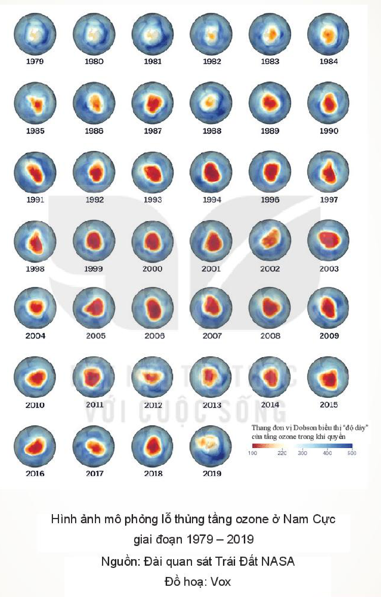
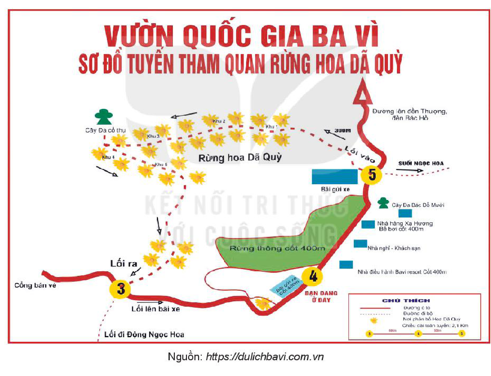

<!-- pdf:74 -->
# BÀI 8: THẾ GIỚI ĐA DẠNG CỦA THÔNG TIN

## 🎯 Yêu cầu cần đạt

- Phân tích và đánh giá được đề tài, thông tin cơ bản của văn bản thông tin, cách đặt nhan đề của tác giả; nhận biết được mục đích của người viết; biết suy luận và phân tích mối liên hệ giữa các chi tiết và vai trò của chúng trong việc thể hiện thông tin.
- Nhận biết được một số dạng văn bản thông tin có sự lồng ghép giữa thuyết minh với một hay nhiều yếu tố như miêu tả, tự sự, biểu cảm, nghị luận và giải thích được mục đích của sự lồng ghép đó; nhận biết và phân tích được sự kết hợp giữa phương tiện ngôn ngữ với phương tiện phi ngôn ngữ.
- Phân tích, đánh giá được cách đưa tin và quan điểm của người viết ở một bản tin.
- Viết được bản nội quy hoặc bản hướng dẫn nơi công cộng.
- Biết thảo luận về văn bản nội quy hay văn bản hướng dẫn nơi công cộng đã viết.
- Biết coi trọng giá trị của thông tin, không ngừng mở mang hiểu biết về đời sống xung quanh.

## ĐỌC

### TRI THỨC NGỮ VĂN

**Đặc trưng của văn bản thông tin**

**Văn bản thông tin** là loại văn bản chủ yếu dùng để cung cấp thông tin. Trong đời sống, có nhiều loại văn bản thông tin khác nhau như: báo cáo, bản tin, thông báo, thư từ, diễn văn, tiểu luận,...

Để đảm bảo tính chính xác, khách quan, văn bản thông tin thường dẫn tên người, địa điểm, thời gian, số liệu xác thực, có thể kiểm chứng được. Ngôn ngữ trong văn bản thông tin sáng rõ, đơn nghĩa. Việc sử dụng các phương tiện phi ngôn ngữ như hình ảnh, biểu đồ, sơ đồ,... góp phần giúp cho người đọc dễ tiếp nhận và ghi nhớ thông tin.

Để tăng thêm hiệu quả tác động đối với người đọc, đôi khi văn bản thông tin lồng ghép thông tin với một hay nhiều yếu tố như miêu tả, tự sự, biểu cảm, nghị luận. Tuy vậy, việc lồng ghép những yếu tố này phải đảm bảo không được làm mất đi tính chính xác, khách quan của văn bản thông tin.

<!-- pdf:75 -->
**Bản tin**

**Bản tin** là một loại văn bản thông tin. Nội dung của bản tin là các sự kiện cập nhật, có thể thu hút sự quan tâm, chú ý của nhiều người và tạo được sức tác động xã hội. Thông tin trong bản tin cần mang tính xác thực cao. Ngôn ngữ trong bản tin thường ngắn gọn, sáng rõ, đơn giản. Tuy nhiên, trong một số trường hợp nhất định, để gây ấn tượng mạnh với công chúng, người viết có thể sử dụng các biện pháp tu từ như ẩn dụ, so sánh, điệp ngữ,...

Tuy bản tin hướng đến việc cung cấp thông tin khách quan nhưng nó vẫn cho phép người viết thể hiện quan điểm của mình đối với sự kiện, con người, hiện tượng được đề cập, với điều kiện quan điểm của người viết không làm thay đổi bản chất của những thông tin được cung cấp.

<!-- term: cách đưa tin -->
Để đánh giá được cách đưa tin và quan điểm của người viết ở một bản tin, người đọc cần trả lời các câu hỏi: Tác giả bản tin là ai? Lập trường, thái độ của người viết là gì? Các nhân vật, sự kiện, số liệu,... trong bản tin được sắp xếp theo trình tự nào? Vì sao tác giả lại lựa chọn cách sắp xếp đó? Những thông tin được cung cấp trong văn bản có thể kiểm chứng được không, có đáng tin cậy không?... Những câu hỏi này sẽ giúp người đọc có thể tiếp nhận thông tin một cách chủ động, tỉnh táo, từ đó xác lập cho mình một quan điểm, cách nhìn nhận đúng đắn về thực tại đời sống.

**Văn bản nội quy, văn bản hướng dẫn nơi công cộng**

**Văn bản nội quy, văn bản hướng dẫn nơi công cộng** thường xuất hiện ở những không gian như bảo tàng, di tích, trường học, thư viện,... giúp người đọc có thể hiểu rõ các yêu cầu, quy định cần được tuân thủ, từ đó có những hành vi đúng đắn, phù hợp.

Văn bản nội quy, văn bản hướng dẫn nơi công cộng có cấu trúc chặt chẽ, mạch lạc; ngôn ngữ khách quan, chính xác, rõ ràng, dễ hiểu.

**Sử dụng phương tiện phi ngôn ngữ**

<!-- term: phương tiện phi ngôn ngữ -->
Mỗi loại phương tiện phi ngôn ngữ có chức năng biểu đạt nghĩa khác nhau. Các số liệu thường được sử dụng để cung cấp những thông tin cụ thể, chính xác. Các đường nối giữa các hình vẽ thường được dùng để biểu đạt mối quan hệ giữa các thông tin. Các biểu đồ, sơ đồ giúp trình bày thông tin một cách hệ thống. Các hình ảnh làm tăng tính hấp dẫn và trực quan của thông tin,... Tuỳ theo mục đích sử dụng mà người viết lựa chọn loại phương tiện phi ngôn ngữ phù hợp.

<!-- pdf:76 -->
### VĂN BẢN 1: Sự sống và cái chết
<!-- ocr-ok: ảnh p0076 có nhãn VĂN BẢN 1 trong băng rôn đồ hoạ làm OCR bỏ sót -->

(Trích *Từ điển yêu thích bầu trời và các vì sao*)

**Trịnh Xuân Thuận**

> Khi quan sát những biểu hiện cụ thể của sự sống trên Trái Đất, điều gì đã khiến bạn suy nghĩ, băn khoăn hoặc tò mò?

**1.** Lịch sử sự sống trên Trái Đất diễn ra đồng thời theo hai hướng dọc và ngang. Hướng dọc được thể hiện bằng sự phức tạp ngày càng tăng theo tuổi Trái Đất (cơ thể con người phức tạp hơn rất nhiều so với một vi khuẩn đơn bào). Hướng ngang được thể hiện bởi sự đa dạng đáng kinh ngạc của sự sống và sự đa dạng hoá ngày càng lớn của các loài theo thời gian.

> Dự đoán nội dung cụ thể sẽ được triển khai trong bài viết qua nhan đề và đoạn 1.

**2.** Chúng ta hãy về thăm Trái Đất cách đây 3 tỉ năm: các bạn sẽ chỉ gặp các vi khuẩn và vi khuẩn cổ sinh. Các sinh vật lúc đó chưa tiến hoá nhiều và cũng chưa đa dạng. Ngược trở lại 500 triệu năm: bạn vẫn thấy hai dạng vi khuẩn, nhưng bạn cũng còn thấy vô số tảo, bọt biển, rêu và nấm, một ít sâu bọ, bọ ba thuỳ, tôm, cua và động vật nhuyễn thể. Du hành ngược về 140 triệu năm, thì toàn bộ thế giới nhỏ bé này vẫn ở đó để đón tiếp bạn (trừ loài bọ ba thuỳ), nhưng hơn thế, các bạn còn được chiêm ngưỡng cảnh tượng đa sắc của hoa và những cánh bướm tung tăng, được nghe tiếng vo ve của ong, tiếng chim hót ru, thích thú với sự phát triển của các loại cá trong biển, và loáng thoáng thấy những động vật có vú nhỏ nhoi len lỏi trong rừng rậm. Nhưng khủng long ăn thịt và thằn lằn tiền sử lảng vảng trong khung cảnh sẽ làm bạn sợ cứng người.

> Việc tác giả tưởng tượng ra một chuyến “du hành” ngược thời gian có ý nghĩa gì?

**3.** Sự xuất hiện của các dạng động vật mới có khả năng thích nghi hơn không nhất thiết đồng nghĩa với sự đào thải các dạng kém tiến hoá hơn. Tất cả đều có chỗ cho mình. Bên cạnh các sinh vật đơn bào như trùng đế giày và các loại động vật nguyên sinh khác, còn có các động vật đa bào như nhím biển và sứa, chim đại bàng và chim hoạ mi, chuột và con người.

<!-- pdf:77 -->
Nhưng điều đó cũng không có nghĩa là một loài nào đó, khi đã sinh ra, sẽ tồn tại mãi mãi. Một số cành hoặc nhánh của cây đời sẽ bị cắt cụt, và có những loài bị tuyệt chủng hoàn toàn. Chẳng hạn, loài bọ ba thuỳ đã không chống chọi được cái lạnh khủng khiếp bao trùm Trái Đất vào cuối kỉ Péc-mi (Permi)(1), và một tiểu hành tinh điên rồ đến đâm vào Trái Đất cách đây 65 triệu năm đã kết liễu loài khủng long. Sự tuyệt chủng này đã giải phóng các ổ sinh thái để chúng nhanh chóng được các loài khác chiếm giữ.

> Chú ý những thuật ngữ chuyên ngành sinh học được sử dụng trong các đoạn 3, 4 và tác dụng của chúng.

**4.** Các loài tiến hoá và tự hoàn thiện dần bởi vì chúng phải đấu tranh để sinh tồn và bởi vì cái chết đang chờ chúng ở cuối con đường. Cái chết cho phép sự sống tiến lên. Nó là một phần không thể tách rời của sự sống. Nó nằm trong trật tự của vạn vật. Gần như lúc nào cũng vậy, trước cái chết và sự đe doạ tuyệt chủng, sự sống đã chứng tỏ một sức đề kháng mãnh liệt và bật dậy bằng cách thể hiện một sức sáng tạo mới để tìm lời giải cho các vấn đề gặp phải. Tình hình hoàn toàn khác với các vật vô sinh: sở dĩ các hạt cơ bản và các nguyên tử không tiến hoá, chính là bởi vì chúng không cần đấu tranh sinh tồn, vì chúng không bị đe doạ tuyệt chủng, và bởi vì chúng không phải tuân theo chọn lọc tự nhiên. Một hạt ánh sáng được tạo ra 300 000 năm sau Bích Beng (Big Bang)(2) có chính xác các đặc điểm của một hạt ánh sáng sinh ra ngày nay, 13,7 tỉ năm sau vụ nổ khởi thuỷ.

> Sự khác nhau giữa các vật vô sinh và các sinh vật là gì?
<!-- ocr-ok: ảnh p0077 hộp chỉ dẫn đọc cột phải bị OCR trộn vào văn bản chính và nhận dạng nhầm kí tự -->

(Trịnh Xuân Thuận, *Từ điển yêu thích bầu trời và các vì sao*, NXB Tri thức, Hà Nội, 2017, tr. 591 – 592)

> (1) *Kỉ Péc-mi*: một kỉ địa chất, kỉ cuối cùng của đại Cổ sinh.
>
> (2) *Bích Beng*: Vụ Nổ Lớn, được xem là dấu mốc cho sự hình thành vũ trụ.
<!-- ocr-ok: ảnh p0077 cước chú chân trang cỡ chữ nhỏ bị OCR nhận dạng nhầm dấu thanh -->

<!-- pdf:78 -->
**Trịnh Xuân Thuận** sinh năm 1948 tại Hà Nội, là nhà vật lí học thiên văn người Mỹ gốc Việt, hiện đang là giáo sư của Đại học Vơ-gin-ni-a (Virginia). Ông đồng thời là nhà văn, nhà triết học, nhà hoạt động vì môi trường và hoà bình. Những cuốn sách nổi tiếng về thiên văn học của ông đã được dịch ra nhiều ngôn ngữ trên thế giới như: *Số phận của vũ trụ – Bích Beng và sau đó* (1992), *Hỗn độn và hài hoà* (1998), *Những con đường của ánh sáng* (2007), *Vũ trụ và hoa sen* (2011),...

Văn bản ***Sự sống và cái chết*** được trích trong cuốn *Từ điển yêu thích bầu trời và các vì sao*, một cuốn từ điển đặc biệt không chỉ giải thích từ ngữ và cung cấp các thông tin khoa học về vũ trụ, mà còn giúp người đọc khám phá vẻ đẹp kì diệu của sự sống, suy ngẫm về nguồn gốc và vị trí của con người trong vũ trụ, phát hiện ra mối quan hệ giữa khoa học và cái đẹp, khoa học và thi ca. Bằng ngôn từ chính xác, giản dị mà trong sáng và đầy chất thơ, tác giả đã khiến cho những vấn đề khoa học trở nên gần gũi và hấp dẫn với người đọc.

**Trả lời câu hỏi**

1. Văn bản *Sự sống và cái chết* viết về đề tài gì? Từ việc liên hệ tới những văn bản khác cùng đề cập đề tài này mà bạn đã đọc, hãy cho biết góc độ tiếp cận vấn đề riêng của tác giả.

2. Tóm tắt những thông tin chính trong văn bản và chỉ ra cách tác giả sắp xếp, tổ chức các thông tin đó.

3. Dựa vào nội dung văn bản, vẽ sơ đồ mô tả quá trình phát triển của sự sống trên Trái Đất.

4. Văn bản đưa lại cho bạn hiểu biết gì về mối quan hệ giữa “đấu tranh sinh tồn” và “tiến hoá”, giữa “sự sống” và “cái chết”?

5. Ngoài việc biết thêm các thông tin khoa học về Trái Đất, bạn còn nhận được những thông điệp gì từ văn bản *Sự sống và cái chết*? Trình bày suy nghĩ của bạn về những thông điệp đó.

6. Những đặc trưng của loại văn bản thông tin đã được thể hiện như thế nào trong văn bản này? Các yếu tố miêu tả, tự sự, biểu cảm hoặc nghị luận đã được phối hợp sử dụng như thế nào và tạo được hiệu quả ra sao?

7. Có thể đổi nhan đề của văn bản thành *Sự sống và cái chết của các loài sinh vật trên Trái Đất* được không? Vì sao?

8. Vấn đề tác giả đặt ra trong văn bản này đã tác động như thế nào đến nhận thức của bạn về cuộc sống?

#### Kết nối đọc – viết

Thu thập thông tin về một loài sinh vật mà bạn muốn tìm hiểu. Trình bày thông tin đó bằng một đoạn văn (khoảng 150 chữ).

<!-- pdf:79 -->
### VĂN BẢN 2: Nghệ thuật truyền thống của người Việt(*)

(Trích *Văn minh Việt Nam*)

**Nguyễn Văn Huyên**

> - Bạn đã biết gì về nghệ thuật truyền thống của người Việt? Hãy nêu cảm nhận về một phương diện nào đó trong gia sản tinh thần vô giá này mà bạn thấy hứng thú.
> - Trong xu thế giao lưu quốc tế mở rộng hôm nay, bạn nghĩ như thế nào về sự tồn tại của những giá trị vốn được truyền lại từ bao đời?

Ở Việt Nam, nghệ thuật, hơn những lĩnh vực khác, là biểu hiện sâu sắc nhất của tâm tính nhân dân. Như ta đã thấy ở sự phát triển văn học, dân tộc này có khiếu thưởng thức cái thanh và cái đẹp, biết biểu lộ một thị hiếu vững vàng và không phải là không sâu sắc về phương diện nghệ thuật. Linh mục Ca-đi-e-rơ (Cadiere)(1) viết rằng: các ngôi chùa nhỏ bé của họ, những căn nhà thấp và tối của họ đều được trang trí cẩn thận. Nóc nhà, cột cổng, bình phong đều được trang trí với những màu sắc tươi tắn, nhiều khi sặc sỡ nhưng hài hoà với các màu sắc của phong cảnh, với sự rực rỡ của ánh sáng. Trong nhà, các cây cột được kiên trì đánh bóng, lóng lánh trong màu sắc tự nhiên của nó, hay rực sáng bởi sơn mài và vàng; vách, cửa, dầm nhà, đồ gỗ được chạm những đường lượn tinh vi, những cành lá nhẹ nhàng, hay được xoi lộng(2) cẩn thận; những món đồ mĩ nghệ nhỏ tinh tế và quý giá, được bày trên bàn hay được cất cẩn thận trong rương hòm của gia đình. Người Việt Nam biết tạo một dáng vẻ thẩm mĩ cho những đồ vật thông thường nhất bằng kim loại, gỗ hay tre, tô điểm cho chúng bằng những thứ trang trí, biến chúng thành một cái gì đó còn hơn là một đồ dùng. Đặc biệt đồ nữ trang được chế tác với một sự tinh tế và đa dạng vô song.

> Thông tin chính được nêu ở câu chủ đề của đoạn văn là gì?
>
> Chú ý những cứ liệu được sử dụng để đưa ra nhận định về khiếu thẩm mĩ của người Việt.

> (\*) Nhan đề đoạn trích do người biên soạn sách giáo khoa đặt.
>
> (1) *Linh mục Ca-đi-e-rơ*: tên đầy đủ là Lê-ô-pôn Mi-sen Ca-đi-e-rơ (Léopold Michel Cadiere, 1869 – 1955), giáo sĩ, nhà sử học, nhà dân tộc học, văn hoá học người Pháp, đồng tác giả của tập san *Đô thành hiếu cổ* – một trong số những tài liệu mà Nguyễn Văn Huyên đã khai thác để viết cuốn *Văn minh Việt Nam*.
>
> (2) *Xoi lộng*: một kĩ thuật chế tác đồ gỗ, dùng bào nhỏ hoặc đục để tạo đường rãnh trên mặt gỗ hay làm thủng nền gỗ nhằm làm nổi bật những hình khắc trang trí.

<!-- pdf:80 -->
Nghệ thuật Việt trước hết mang tính chất tôn giáo. Nó phản ánh rõ nét những tín ngưỡng đa dạng của dân tộc. Đạo Phật, đạo Lão, với đám rước vô tận những thần thánh và ma quỷ đủ loại, là những yếu tố lớn thúc đẩy sự sáng tạo nghệ thuật phong phú của người Việt Nam. Trong nhiều thế kỉ, từ thế kỉ VII đến XIV, Việt Nam chịu ảnh hưởng của đạo Phật đương lúc thắng thế, như ta thấy, đã vừa tạo ra nhiều tông phái cùng những tác phẩm văn học vô giá, vừa làm nảy ra từ lòng đất nước này vô số công trình kiến trúc. Sự pha trộn của ba học thuyết tôn giáo, gọi là *tam giáo*, được kiểm soát bởi các khoa thi do nhà nước tổ chức, đã là ngọn nguồn của hầu hết các mô típ trang trí.

> Những yếu tố nào đã ảnh hưởng đến nghệ thuật Việt?

Mặt khác, sự thống nhất văn hoá, do sự giảng dạy áp đặt lâu dài những kinh sách Nho giáo, đã tạo nên ở một mặt nào đó của nghệ thuật Việt, bên cạnh tính vĩnh cửu của hình thức và đề tài, là một vẻ uy nghi xứng đáng với địa vị đứng đầu của đấng thiên tử và của các bậc đại hiền túc nho, nguyên là những người đề xướng mọi quy tắc chính trị. Để thoả mãn sự kiêu hãnh của các vua chúa cùng những đại thần xuất thân từ hàng Nho sĩ, để làm cho tên tuổi họ thành bất tử, những cung điện đẹp đẽ, những lăng mộ xinh xắn, những vườn hoa phong phú cùng những tấm bia tinh tế đã được xây dựng. Vì nhu cầu thờ cúng chính thức, người ta đã xây cất những đền chùa uy nghiêm, chế tạo những vật dụng với một thị hiếu tinh vi.

Duy có một điều là các vật liệu sử dụng, gỗ, tre, đất nung, đều không bền do khí hậu nhiệt đới tàn hại và do mối mọt. Các thứ kim loại, sắt, đồng, kẽm, vàng, bạc, cũng không sống sót nổi sau các cơn hoả hoạn, bất ổn chính trị và chiến tranh. Chẳng còn lại gì cho chúng ta từ các cung điện nổi tiếng Cổ Loa, Hoa Lư, Thăng Long, Tây Đô, nếu không phải là những địa điểm mà trên đó những công trình khác đã được xây dựng bởi những bàn tay thành kính của nhân dân mà bấy nhiêu cuộc biển dâu đã làm cho điêu đứng.

> Điều gì đã ảnh hưởng đến việc bảo tồn các di sản nghệ thuật Việt?

Tuy nhiên, các cung điện lộng lẫy ở Huế, các đền thờ Khổng Tử uy nghi tại Hà Nội, đền thờ các vua Lý ở Đình Bảng(1) với nhiều đồ vật tại đấy, các tấm bia Lam Sơn, các lăng tẩm ở Huế, pho tượng Trấn Vũ lớn bằng đồng ở Hà Nội, các ngôi chùa Phật Tích, Bút Tháp(2) thanh tao,... là những chứng cứ đáng tin cậy về đỉnh cao mà kĩ thuật của các nghệ sĩ Việt Nam đã đạt đến.

> (1) *Đình Bảng*: nay là một phường thuộc thành phố Từ Sơn, tỉnh Bắc Ninh.
>
> (2) *Chùa Phật Tích, Bút Tháp*: hai ngôi chùa nổi tiếng ở tỉnh Bắc Ninh.

<!-- pdf:81 -->
Người nghệ sĩ không có xu hướng tái hiện chính xác và đầy đủ hiện thực. Họ loại bỏ tính chất nhục dục khỏi các tác phẩm của mình [...]. Họ chẳng nhằm ca ngợi vẻ đẹp mong manh của những hình hài dễ bị hư nát. Đối với họ, người luôn luôn thực hiện công trình của mình trong một không khí siêu phàm, thì tinh thần là tất cả. Họ tìm cách làm toát ra và biểu hiện trong mọi tác phẩm cái tinh thần vô hình của mọi vật.

> Theo tác giả, thiên hướng sáng tạo nổi bật của nghệ thuật Việt là gì?

Một số cây cối và động vật có tính cách tượng trưng: con hạc và con nai thể hiện tuổi thọ, cây tre là đạo đức, cây mận là sức mạnh tinh thần và thể chất, cây cúc thể hiện hạnh phúc, v.v.

Trong tranh dân gian, nghệ thuật được quan niệm là sự cổ vũ lao động, đạo hiếu, đức hạnh. Ở các chùa chiền, ta thấy tái hiện những cảnh tra tấn của âm phủ; trong nhiều nhà, người ta treo tranh diễn tả cảnh sinh hoạt của học trò, nhà nông, tiều phu và người đánh cá. Những gương con hiếu, tôi trung và bạn chung thuỷ được tái hiện dưới những hình thức cổ truyền.

Người Việt Nam không xử lí tất cả những mô típ này, như linh mục Ca-đi-e-rơ đã nói, với sự tự do của một nghệ sĩ đứng trước hiện thực, có thể nắm được hàng nghìn vẻ của sinh vật, và tận dụng được mọi lợi thế bất ngờ mà sự ngẫu nhiên hoặc việc chú trọng nghiên cứu mang lại cho họ. Tất cả những chủ đề mà họ làm nảy ra từ gỗ hay họ đổ khuôn đúc, đều được cách điệu hoá trong các tư thế, với những động tác ước lệ. Nhưng những nghệ sĩ có tài đã biết cách, trong những giới hạn đó, tạo cho các mô típ cổ truyền một sức mạnh bên trong và một chiều sâu làm cho tác phẩm của họ trở thành độc đáo.

* * *

Có thể nói, nghệ thuật Việt Nam tiêu biểu nhất vẫn là kiến trúc. Hoạ sĩ và nhà điêu khắc chỉ là người phụ trợ của kiến trúc sư. Nền kiến trúc này chủ yếu có tính chất tôn giáo. Đặc trưng của nó là hình khối và thể nằm ngang. Nó có xu hướng thể hiện cái vĩ đại, sự bí ẩn và không tách rời với sở thích về tính đều đặn, đối xứng.

> Kiến trúc Việt có những đặc trưng gì? Đặc trưng đó được thể hiện cụ thể như thế nào?

Sơ đồ các đền chùa được quyết định bởi nhu cầu xây dựng và thờ cúng. Người ta phải dành ở đó những không gian rộng lớn cho đám đông công chúng có thể triển khai, cho đám rước xếp hàng, và những bữa cỗ công cộng được bày trong các ngày Tết, lễ.

Sự nối tiếp nhau của các sân và cả toà nhà trước điện thờ thấp lè tè trong bóng râm, tạo ra cảm tưởng về con đường đưa tới nơi ở thiêng liêng của chư thần, hay con đường cứu nạn của chư Phật.

<!-- pdf:82 -->
Ngoài ra, đền chùa được phủ bằng một sườn gỗ, có thể có kích thước lớn mà không sợ sụp đổ. Để chống đỡ nóc chính và để có chỗ rộng hơn, người ta thường dựng thêm các chái(1). Mặt khác, để phòng những trận gió mạnh cũng như cơn mưa trút nước, người ta làm những mái hạ(2) thấp lè tè thành một khối chắc khoẻ, đè nặng lên các cột. Vì thế, những cột này là phần được làm cẩn thận nhất của đền, chùa. Những mái đó chỉ được làm thanh nhẹ bớt ở các góc uốn cong, tạo ra cảm tưởng về sự vững chắc, khoẻ khoắn và thoải mái.

Bằng hệ thống vì kèo và thanh giằng, người ta dễ tăng thêm các chỗ thờ các vị thần thứ cấp(3). Phải nói thêm rằng, để đáp ứng nhu cầu cần đặt cạnh nhau những tín ngưỡng khác nhau, người kiến trúc sư thường xây nhiều nhà song song.

Trong những đền, chùa này, gỗ và gạch tự “phi vật chất hoá”. Tất cả đều được tinh thần hoá. Từ trong đó, những bàn tay nghệ sĩ đã làm nảy ra, trên các đầu cột và vì kèo cũng như xung quanh điện thờ, những mô típ nhiều vẻ của cây cối và động vật tượng trưng.

[...] Kiến trúc mồ mả được đặc biệt làm cẩn thận ở xứ sở mà việc thờ cúng người chết rất được coi trọng. Mồ mả các quan to và người đứng đầu gia tộc lớn là những toà đền đài thật sự. Lăng mộ các vua bản triều, nối tiếp nhau trên hai bờ sông Hương, ở đông nam thành phố Huế, là những tổng thể xuất sắc các công trình xây dựng rải rác trong các vườn hoa được cách điệu hoá kiểu thẩm mĩ tuyệt vời.

* * *

Tất cả các nghệ thuật khác đều phụ thuộc vào kiến trúc. Môn nghệ thuật mà người Việt Nam thành công nhất là điêu khắc gỗ. Những pho tượng rất đẹp có từ thời Lê, như các tượng nhà sư ở Pháp Vũ tại Hà Đông(4), ở Thạch Lâm tại Thanh Hoá, được truyền lại đến chúng ta. Có những nghệ sĩ đã biết sáng tạo từ gỗ, ở chùa Tây Phương(5) tại tỉnh Sơn Tây, ở chùa Keo tại Thái Bình, ở chùa Bút Tháp tại Bắc Ninh, ở chùa Cói(6) tại Vĩnh Yên,... những kiệt tác với phong cách tao nhã.

> Nền điêu khắc Việt có những điểm gì đáng chú ý?
<!-- ocr-ok: ảnh p0082 hộp chỉ dẫn đọc cột phải bị OCR trộn vào văn bản chính và nhận dạng nhầm dấu -->

> (1) *Chái*: gian nhỏ lợp một mái tiếp vào đầu hồi, theo lối kiến trúc dân gian.
>
> (2) *Mái hạ*: mái nhà được thiết kế thấp xuống.
>
> (3) *Các vị thần thứ cấp*: các vị thần có vị trí ít quan trọng hơn so với những vị thần được thờ phụng chính trong một không gian tín ngưỡng nhất định (nghĩa trong văn bản).
>
> (4) *Hà Đông*: nay thuộc thành phố Hà Nội.
>
> (5) *Chùa Tây Phương*: nay thuộc địa phận huyện Thạch Thất, thành phố Hà Nội.
>
> (6) *Chùa Cói*: nay thuộc địa phận thành phố Vĩnh Yên, tỉnh Vĩnh Phúc.

<!-- pdf:83 -->
Đá, vì hiếm hoi ở Việt Nam, nên rất ít được người làm tượng sử dụng, và thường chỉ giới hạn ở một vài hình ảnh thể hiện. Chẳng hạn như những tượng quan lại đứng làm hàng rào trước mộ các nhân vật lớn. Đá chủ yếu được dùng làm bia, bậc đi và tay vịn cầu thang ở các đền, chùa hay dinh thự lớn.

Nghệ thuật đúc đồng phát triển ở một số vùng của Việt Nam, ngay từ những thế kỉ đầu Công lịch(1). Bên cạnh các trống đồng tìm thấy trong những cuộc khai quật tại Bắc Kì và bắc Trung Kì(2), chứng tỏ nền văn minh rất cổ, có từ thời nhà Hán, còn có vô số vật khác, trong đó một số là những vật rất lớn như bồn vạc ở Huế, tượng Trấn Vũ của đền Quán Thánh ở Hà Nội [...].

(Nguyễn Văn Huyên, *Văn minh Việt Nam*, Đỗ Trọng Quang dịch(*), NXB Hội Nhà văn – Công ti Văn hoá và Truyền thông Nhã Nam, Hà Nội, 2018, tr. 303 – 307)

**Nguyễn Văn Huyên** (1905 – 1975) quê ở huyện Hoài Đức, thành phố Hà Nội, là nhà sử học, dân tộc học, nhà giáo dục. Thời thanh niên, ông du học ở Pháp. Năm 1934, ông là người Việt Nam đầu tiên bảo vệ thành công luận án tiến sĩ văn khoa tại Đại học Xoóc-bon (Sorbonne), Pa-ri. Từ khi về nước vào năm 1935, ông dạy học, tham gia một số tổ chức nghiên cứu văn hoá và lịch sử, từng là Uỷ viên thường trực Trường Viễn Đông Bác cổ, Uỷ viên Hội đồng nghiên cứu khoa học Đông Dương, tham gia thành lập bộ môn Lịch sử văn minh Việt Nam tại Trường Đại học Luật Hà Nội,... Sau Cách mạng tháng Tám, ông được Chính phủ nước Việt Nam Dân chủ Cộng hoà cử giữ chức Bộ trưởng Bộ Giáo dục từ năm 1946 cho đến khi qua đời. Ông được Nhà nước truy tặng Giải thưởng Hồ Chí Minh về Khoa học xã hội năm 2000. Tác phẩm chính của ông: *Sự thờ phụng thần thánh ở nước Nam* (1944), *Văn minh Việt Nam* (1944), *Toàn tập Nguyễn Văn Huyên* (2000),...

***Văn minh Việt Nam*** là cuốn chuyên khảo viết bằng tiếng Pháp, hoàn thành từ năm 1939 nhưng phải đến năm 1944 mới được xuất bản tại Hà Nội, có thể xem là một phát ngôn đầy tinh thần tự tôn dân tộc của người Việt về văn hoá Việt trước cộng đồng thế giới. Tác phẩm được dịch ra tiếng Việt năm 1996.

Văn bản ***Nghệ thuật truyền thống của người Việt*** được trích từ phần 3, chương 12 của cuốn sách *Văn minh Việt Nam*, nguyên có nhan đề là *Nghệ thuật*.

> (\*) Nhóm biên soạn đã hiệu chỉnh một số chỗ về diễn đạt, căn cứ vào nguyên văn tiếng Pháp của tác giả Nguyễn Văn Huyên.
>
> (1) *Công lịch*: lịch được quốc tế dùng làm lịch chính thức, xác định năm bắt đầu là năm Chúa Giê-su (Jesus) ra đời.
>
> (2) *Bắc Kì, Trung Kì*: tên gọi cũ của miền Bắc và miền Trung Việt Nam có từ triều vua Minh Mạng (thời Nguyễn) và được duy trì suốt thời Pháp thuộc.

<!-- pdf:84 -->
**Trả lời câu hỏi**

1. Qua đọc văn bản và những thông tin được cung cấp ở phần giới thiệu tác phẩm, bạn hiểu như thế nào về mục đích viết của tác giả? Câu hay đoạn nào trong văn bản giúp bạn nhận rõ điều này?

2. Vẽ sơ đồ tóm tắt các thông tin chính của văn bản.

3. Chỉ ra và phân tích tác dụng của những yếu tố miêu tả, biểu cảm, nghị luận được sử dụng trong văn bản.

4. Việc đưa thông tin về từng đối tượng cụ thể trong văn bản có điểm gì đáng chú ý? Nêu điều bạn có thể rút ra về cách triển khai thông tin trong văn bản thông tin.

5. Hãy nêu và phân tích một nhận xét mà bạn tâm đắc nhất trong văn bản. Vì sao bạn tâm đắc với nhận xét đó?

6. Đối chiếu những thông tin được học giả Nguyễn Văn Huyên trình bày trong văn bản với một tác phẩm mĩ thuật hay một công trình kiến trúc của Việt Nam mà bạn biết, từ đó, rút ra nhận xét về sự bảo lưu hay đổi mới những đặc điểm và tinh thần truyền thống ở tác phẩm hay công trình ấy.

#### Kết nối đọc – viết

Viết đoạn văn (khoảng 150 chữ) tóm tắt những thông tin mà bạn cho là thú vị sau khi đọc văn bản *Nghệ thuật truyền thống của người Việt*.

<!-- pdf:85 -->
### VĂN BẢN 3: Phục hồi tầng ozone: Thành công hiếm hoi của nỗ lực toàn cầu

**Lê My**

> - Bạn có hay theo dõi tin tức không? Bạn thường theo dõi tin tức trên những kênh truyền thông nào và quan tâm đến những gì khi tiếp nhận tin tức?
> - Bạn biết gì về tầng ozone và đã bao giờ nghe về việc tầng ozone bị thủng?

***Nếu đã lâu rồi bạn không nghe thấy tin tức gì về tầng ozone, đó là vì tình hình đang khá sáng sủa. Câu chuyện phục hồi và bảo vệ tầng ozone đã chứng tỏ rằng khi khoa học và quyết tâm chính trị hợp lực, thế giới có thể thay đổi vận mệnh của mình.***

> Nhan đề và những thông tin trong phần sa-pô của văn bản có gì đáng chú ý?
<!-- ocr-ok: ảnh p0085 hộp chỉ dẫn đọc cột phải bị OCR trộn vào đoạn sa-pô -->

Năm 1985, các nhà khoa học khí quyển ở Nam Cực phát hiện một điều đáng lo ngại: tầng ozone đang trên đà biến mất trong vòng mấy mươi năm tới. Từ đây, cộng đồng quốc tế bắt đầu thảo luận và hành động – với một tốc độ chưa từng có.

Chỉ hai năm sau đó, vào ngày 16/9/1987, Nghị định thư(1) Mông-tơ-rê-an (Montreal) về các chất làm suy giảm tầng ozone được thông qua. Tua nhanh đến ngày hôm nay: tầng ozone đang trên đà hồi phục, trở thành phông nền xán lạn cho một câu chuyện đầy cảm hứng và nhiều bài học về nhân loại, gợi mở cho chúng ta những con đường để giải quyết các khủng hoảng môi trường khác.

**Khoa học vào vai thám tử**

Tầng ozone nằm ở độ cao khoảng 15 – 40 km so với bề mặt Trái Đất, thuộc tầng bình lưu(2) và có vai trò như một lớp “kem chống nắng” che chắn cho hành tinh khỏi tia cực tím (UV). Nếu không có lá chắn này, ánh nắng mặt trời sẽ trở nên cực kì nguy hiểm với con người và hầu hết các loài động, thực vật. Đặc biệt, tia UV-B (thứ làm cho da bị cháy nắng) ở cường độ cao có thể dẫn đến nhiều loại ung thư.

> Theo dõi thông tin về tầng ozone và vai trò của nó.

> (1) *Nghị định thư*: một loại điều ước quốc tế được kí kết giữa các quốc gia về một vấn đề nào đó liên quan đến kinh tế, chính trị, văn hoá,... Nghị định thư là văn kiện phụ của một hiệp định, cụ thể hoá những điểm chỉ được trình bày khái quát trong hiệp định và nêu lên phương thức và các biện pháp thi hành.
>
> (2) *Tầng bình lưu*: một tầng của bầu khí quyển trên Trái Đất, nằm ở độ cao vào khoảng 16 – 50 km.

<!-- pdf:86 -->
Vào những năm 1970, các nhà nghiên cứu nhận thấy tầng ozone dường như đang mỏng đi, đặc biệt là xung quanh hai cực. Hai nhà nghiên cứu Ma-ri-ô Mô-li-nơ (Mario Molino) và Se-ri Rao-lân (Sherry Rowland) xác định được “nghi phạm” chính: các hợp chất nhân tạo chlorofluorocarbon (viết tắt là CFC).

Hợp chất CFC đầu tiên ra mắt thế giới vào năm 1930, được xem là hoá chất hoàn hảo: rẻ tiền, nhiều ứng dụng (chất đẩy trong bình xịt sơn, chất làm lạnh trong máy lạnh, tủ lạnh) và không tham gia phản ứng hoá học.

> Chú ý thông tin về hợp chất CFC.
<!-- ocr-ok: ảnh p0086 hộp chỉ dẫn đọc cột phải bị OCR trộn vào văn bản chính và đọc nhầm CFC thành CFO -->

Dù biết CFC bay hơi và tích tụ trong bầu khí quyển nhưng người ta cho rằng chúng “trơ” về mặt hoá học nên có sao đâu! Mô-li-nơ và Rao-lân đã khám phá ra một sự thật hoàn toàn trái ngược. Ở thượng tầng khí quyển, các phân tử khí CFC bị phân huỷ dưới tia UV. Sau đó, mỗi nguyên tử Cl tự do sẽ “cướp lấy” một nguyên tử O, khiến O₃ (khí ozone) nay chỉ còn là O₂ (khí oxygen), tức là “bào” lớp ozone.

> Hai nhà khoa học Mô-li-nơ và Rao-lân đã phát hiện sự thật gì về chất CFC?

Nghiên cứu của Mô-li-nơ và Rao-lân được đăng trên tạp chí *Nature*(1) năm 1974, thúc đẩy nhiều tranh luận sôi nổi nhưng chưa thể thuyết phục các chính trị gia. Nhiều nhà nghiên cứu thì tin rằng sự suy giảm tầng ozone sẽ chỉ là vấn đề của lớp cháu chắt vài thế kỉ về sau.

Mãi đến năm 1985, thế giới mới giật mình hiểu ra rằng tầng ozone đang tan biến nhanh hơn họ tưởng. Kết quả đo đạc của nhà địa – vật lí Giô-dép Pha-mơn (Joseph Farman) và các đồng nghiệp đã xác nhận một lỗ thủng tầng ozone ở Nam Cực. Cần nhớ là về mặt kĩ thuật, tầng ozone không phải bị “thủng lỗ” như một mảnh vải – tại lỗ thủng vẫn tồn tại khí ozone nhưng nồng độ đã bị suy giảm đáng kể.

Trước đó, giới khoa học cho rằng quá trình phá vỡ ozone sẽ bị kìm hãm trong tự nhiên, bởi xét cho cùng CFC chỉ giải phóng một lượng ít nguyên tử Cl nếu so với sự bao la của cả bầu khí quyển.

Vậy điều gì đã khiến sự tổn hại thực tế lại lớn đến thế? Trong những năm tiếp theo, nhà hoá học khí quyển Xu-dân Xô-lơ-mơn (Susan Solomon) đã dẫn đầu các cuộc thám hiểm ở Nam Cực để tìm câu trả lời. Nhóm của bà khám phá ra rằng: ClO – hình thành từ sự tương tác giữa nguyên tử Cl và O₃ – sau đó sẽ bị phá vỡ, nguyên tử Cl trở lại trạng thái tự do để tiếp tục tổn hại tầng ozone.

> Những tổn hại to lớn mà chất CFC gây ra đối với tầng ozone đã được diễn giải như thế nào?

“Ta có thể phá huỷ hàng trăm nghìn phân tử ozone chỉ bằng một nguyên tử Cl từ một phân tử CFC, trong suốt khoảng thời gian chất này nằm ở tầng bình lưu” – Xu-dân Xô-lơ-mơn chia sẻ trong một chương trình podcast(2) của Viện Nghiên cứu Tương lai Sự sống.

> (1) *Nature*: tạp chí khoa học ra hằng tuần, có trụ sở tại Luân Đôn, Anh.
>
> (2) *Podcast*: tập tin âm thanh hoặc video số mà người dùng có thể tải về.

<!-- pdf:87 -->
Như vậy, tầng ozone có thể suy giảm nhanh chóng và vượt khỏi tầm kiểm soát. Giới khoa học đã nhanh chóng vào cuộc. Sau khi đã “chẩn bệnh” – xác định có một mối đe doạ hiện hữu và biết CFC là nguyên nhân, bước tiếp theo là “chữa bệnh” – thuyết phục thế giới hành động để giải quyết vấn đề này. May mắn là thế giới đã lắng nghe.

**Đồng lòng**

Năm 1986, Liên hợp quốc bắt đầu đàm phán về một hiệp ước xoá sổ các hoá chất có hại cho tầng ozone – chủ yếu là CFC. Một trong những tiếng nói chính trong các cuộc đàm phán là

> Liên hợp quốc đã có những nỗ lực gì nhằm xoá sổ các hoá chất có hại cho tầng ozone?

<!-- pdf:88 -->
Xti-phân An-đơ-sơn (Stephen Andersen), khi đó là chuyên gia của Cơ quan Bảo vệ môi trường Mỹ. Nhóm của ông đã vạch ra hàng trăm giải pháp – một cách có hệ thống – để loại bỏ dần CFC từ hàng trăm lĩnh vực công nghiệp, giúp việc chuyển đổi trở nên dễ dàng và khả thi trên toàn thế giới. Nghị định thư Mông-tơ-rê-an có hiệu lực từ năm 1989 và đến tận năm 2008 là hiệp định môi trường đầu tiên và duy nhất của Liên hợp quốc được mọi quốc gia trên thế giới phê chuẩn!

Nhờ sự tẩy chay của người tiêu dùng, sự quyết liệt của giới chính trị và nguồn đầu tư vào công nghệ mới để tìm giải pháp thay thế, phần lớn thế giới đã nhanh chóng ngừng sản xuất CFC trong thập niên 1990. Việc loại bỏ các thiết bị sử dụng CFC thì mất nhiều thời gian hơn.

Theo Chương trình Môi trường Liên hợp quốc (UNEP), khoảng 99% các chất làm suy giảm tầng ozone đã bị “khai tử”, và lá chắn “chống nắng” của Trái Đất đang dần hồi phục. Chúng ta có thể kì vọng lỗ thủng ozone ở Nam Cực sẽ “đóng lại” vào khoảng năm 2060. Đến năm 2030, ước tính khoảng 2 triệu người sẽ tránh được bệnh ung thư da mỗi năm. Đồng thời, tất cả nỗ lực này sẽ góp phần giảm thiểu biến đổi khí hậu.

Nhưng “bệnh” này của tầng ozone không phải điều trị một lần là xong. Mọi công việc vẫn phải tiếp diễn, trong đó các nhà khoa học là tuyến phòng thủ đầu tiên. Nghị định thư Mông-tơ-rê-an được hỗ trợ bởi ba hội đồng khoa học có nhiệm vụ thông tin cho các nhà hoạch định chính sách.

[...] Trong tháng Chín vừa qua, giải thưởng Tương lai Sự sống năm 2021 đã vinh danh ba nhân vật giữ vai trò quan trọng trong công cuộc khôi phục tầng ozone: Giô-dép Pha-mơn – người xác nhận lỗ thủng ozone, Xu-dân Xô-lơ-mơn – người lí giải tốc độ phá hoại của CFC và Xti-phân An-đơ-sơn – người thúc đẩy Nghị định thư Mông-tơ-rê-an. Giải thưởng thường niên này của Viện Nghiên cứu Tương lai Sự sống được trao cho những anh hùng thầm lặng đã giúp thế giới của chúng ta an toàn hơn, đáng sống hơn. Giáo sư Ma-ri-ô Mô-li-nơ và Se-ri Rao-lân cũng chia sẻ giải Nô-ben (Nobel) Hoá học năm 1995 (cùng một người nữa là Pôn Cờ-rớt-dân – Paul Crutzen) nhờ các khám phá trong hoá học khí quyển, đặc biệt là liên quan đến sự hình thành và phân huỷ của tầng ozone.

Câu chuyện thành công này cho thấy: có những cá nhân cụ thể đã “kích hoạt” quá trình thay đổi quỹ đạo của nhân loại, nhưng cần nhớ rằng chính công chúng, sự đồng thuận quốc tế và hành động nhất quán toàn cầu mới là năng lượng bền bỉ của cuộc chiến.

> Những nhân tố nào làm nên thành công của nỗ lực hồi phục tầng ozone?

(Theo báo *Tuổi trẻ cuối tuần*, ngày 30/10/2021)

<!-- pdf:89 -->
**Trả lời câu hỏi**

1. Thông tin chính của văn bản là gì? Đó là thông tin khoa học hay thông tin thời sự chính trị? Vì sao?

2. Hãy nhận xét về cách đặt nhan đề và cách triển khai nội dung của văn bản.

3. Theo bạn, ngôn ngữ của văn bản này đã đáp ứng được những yêu cầu nào của một bản tin? Bạn có đồng tình khi người đưa tin coi nhà nghiên cứu khoa học là “thám tử”, “tuyến phòng thủ”, và nỗ lực phục hồi tầng ozone là “cuộc chiến”?

4. Hãy đánh giá tính hiệu quả của việc đưa phương tiện phi ngôn ngữ vào văn bản.

5. Nêu quan điểm chính của tác giả bài viết. Hãy bàn luận về quan điểm ấy.

6. Hãy tìm hiểu một số vấn đề trên thế giới hiện nay cần đến những nỗ lực toàn cầu và chỉ ra những lí do dẫn đến sự thành công hay chưa thành công trong việc giải quyết những vấn đề ấy.

7. Từ hai văn bản *Phục hồi tầng ozone: Thành công hiếm hoi của nỗ lực toàn cầu* (Lê My) và *Sự sống và cái chết* (Trịnh Xuân Thuận), bạn suy nghĩ gì về sự tồn vong của nhân loại và Trái Đất?

8. Theo bạn, thế nào là một bản tin có giá trị?

#### Kết nối đọc – viết

Viết đoạn văn (khoảng 150 chữ) nêu suy nghĩ của bạn về giải pháp làm giảm rác thải nhựa trên toàn cầu.

<!-- pdf:90 -->
### Thực hành tiếng Việt: Sử dụng phương tiện phi ngôn ngữ

1. Quan sát hình ảnh (trang 86) trong văn bản *Phục hồi tầng ozone: Thành công hiếm hoi của nỗ lực toàn cầu* và cho biết:

a. Những thông tin gì được cung cấp trong hình ảnh?

b. Các thông tin đó được trình bày như thế nào?

c. Tác dụng của hình ảnh này là gì?

2. Quan sát sơ đồ và cho biết:

a. Ngoài các phương tiện ngôn ngữ, sơ đồ trên còn sử dụng những phương tiện nào khác?

b. Những phương tiện đó được trình bày như thế nào và biểu đạt thông tin gì?

c. Những phương tiện phi ngôn ngữ và những phương tiện ngôn ngữ trong sơ đồ có quan hệ với nhau như thế nào?

d. Những phương tiện phi ngôn ngữ được sử dụng trong sơ đồ có tác dụng gì?

<!-- pdf:91 -->
## VIẾT

**Viết một văn bản nội quy hoặc văn bản hướng dẫn nơi công cộng**

Trong cuộc sống, có rất nhiều tình huống đòi hỏi bạn phải viết các văn bản nội quy, hướng dẫn nơi công cộng, ví dụ: viết nội quy lớp học, nội quy câu lạc bộ, hướng dẫn tham gia các sự kiện hay hoạt động tập thể,... Việc xây dựng được văn bản nội quy, hướng dẫn chuẩn mực sẽ giúp bạn và những người xung quanh hiểu rõ quy tắc ứng xử trong những không gian công cộng, quyền và trách nhiệm của mỗi cá nhân để cùng hành động, nhằm tạo nên một môi trường an toàn, trật tự.

> **Yêu cầu**
>
> - Văn bản phải có cấu trúc chặt chẽ, phù hợp với mẫu cấu trúc chung của văn bản nội quy hoặc văn bản hướng dẫn nơi công cộng.
> - Nội dung văn bản thể hiện rõ những hành vi cần thực hiện hoặc không được thực hiện trong không gian công cộng, phù hợp với yêu cầu, quy định của cơ quan, tổ chức ban hành, phù hợp với quy định của pháp luật.
> - Ngôn ngữ khách quan, chính xác, rõ ràng, dễ hiểu.

### Bài viết tham khảo

SỞ VĂN HOÁ VÀ THỂ THAO TỈNH NINH BÌNH
**Trung tâm Bảo tồn di tích lịch sử – văn hoá cố đô Hoa Lư**

> Tên của tổ chức ban hành nội quy

**NỘI QUY KHU DI TÍCH LỊCH SỬ – VĂN HOÁ CỐ ĐÔ HOA LƯ**

> Tên nội quy

*Căn cứ Luật Di sản Văn hoá và các văn bản hướng dẫn thi hành,*
<!-- ocr-ok: ảnh p0091 dòng chữ in nghiêng bị OCR đọc nhầm dấu và chữ cái -->

Trung tâm Bảo tồn di tích lịch sử – văn hoá cố đô Hoa Lư yêu cầu quý khách đến tham quan, các tổ chức, cá nhân làm kinh doanh, dịch vụ trong khu vực di tích lịch sử – văn hoá cố đô Hoa Lư thực hiện nghiêm các quy định sau:

> Lời dẫn

<!-- pdf:92 -->
**I. Quy định chung:**

1. Mọi người đến tham quan, làm kinh doanh, dịch vụ phải có trách nhiệm giữ an ninh, trật tự, vệ sinh môi trường, bảo vệ cảnh quan, thực hiện nếp sống văn hoá, văn minh, chấp hành các quy định về phòng chống cháy nổ. Không mang các loại chất nổ, chất cháy, vũ khí vào trong khu vực di tích.

2. Trang phục lịch sự, giữ yên tĩnh, trật tự trong nội tự đền và những nơi tôn nghiêm. Không quay phim, chụp ảnh trong nội tự đền, trừ trường hợp được cấp có thẩm quyền cho phép.

3. Cấm mọi hình thức xâm phạm vào các hiện vật, hái hoa, bẻ cành, viết, vẽ lên các công trình kiến trúc.

4. Không hút thuốc lá nơi công cộng, tự ý thắp hương trong nội tự đền và những nơi dễ xảy ra cháy nổ.

5. Cấm sử dụng mọi loại xe đi lại trong khuôn viên đền và những nơi quy định.

**II. Đối với khách tham quan:**

1. Quý khách tham quan khu di tích phải mua vé theo quy định, giữ vé để xuất trình khi có yêu cầu kiểm tra của nhân viên công vụ.

2. Quý khách có nhu cầu thuyết minh xin liên hệ với Trung tâm Bảo tồn di tích lịch sử – văn hoá cố đô Hoa Lư theo số điện thoại: 02293620099.

**III. Đối với các tổ chức, cá nhân làm kinh doanh, dịch vụ:**

1. Phải đăng kí hành nghề với cơ quan có thẩm quyền và cam kết chấp hành nội quy khu di tích.

2. Làm kinh doanh, dịch vụ đúng nơi quy định, chấp hành sự sắp xếp, điều hành của cơ quan quản lí di tích và chính quyền địa phương.

3. Người hành nghề đã được cấp có thẩm quyền cấp phép, cấp thẻ, khi hành nghề phải đeo thẻ và chấp hành việc kiểm tra của nhân viên công vụ.

4. Phải có thái độ cư xử văn minh, lịch sự đối với du khách, không tranh giành, chèo kéo, nài ép, đeo bám và có các hành vi thiếu văn hoá khác đối với du khách để bán hàng, chụp ảnh, đổi tiền, xin tiền,...

**IV. Giờ mở cửa đền:**

- Mùa hè: Từ 6h00 đến 18h30.
- Mùa đông: Từ 6h30 đến 18h00.

*Trung tâm Bảo tồn di tích lịch sử – văn hoá cố đô Hoa Lư*

(Nguồn: *http://codohoalu.vn*)

> Nội dung của các quy định

<!-- pdf:93 -->
1. Vì sao văn bản trên được xem là văn bản nội quy, hướng dẫn nơi công cộng?

2. Khi soạn văn bản nội quy hoặc văn bản hướng dẫn, việc dự tính được những hành vi không mong muốn có thể xảy ra nơi công cộng có ý nghĩa như thế nào?

### Thực hành viết

**Chuẩn bị viết**

- Xác định cơ quan, tổ chức chịu trách nhiệm viết nội quy, hướng dẫn.

- Xác định đối tượng người đọc và thực hiện nội quy, hướng dẫn: Mỗi văn bản nội quy, hướng dẫn đều hướng tới đối tượng người đọc nhất định. Ví dụ: Nội quy sử dụng thư viện trong trường học hướng tới đối tượng người đọc là giáo viên, học sinh; nội quy của bảo tàng, di tích hướng tới đối tượng người đọc là khách tham quan thuộc nhiều độ tuổi, nhiều quốc tịch, với nhiều trình độ văn hoá khác nhau,... Việc xác định đúng đối tượng sẽ giúp người viết lựa chọn được hình thức trình bày văn bản và ngôn ngữ phù hợp với người đọc.

- Xác định mục đích của văn bản nội quy, hướng dẫn: Mỗi văn bản nội quy, hướng dẫn thường định hướng một số nhóm hành vi nhất định. Ví dụ: hướng dẫn quy trình trả và mượn sách trong thư viện, hướng dẫn tham quan bảo tàng,...

- Liệt kê tất cả yêu cầu, quy định đối với người đọc (cũng là người đến và tham gia sinh hoạt nơi công cộng) và sắp xếp các yêu cầu, quy định đó theo trật tự logic.

**Tìm ý, lập dàn ý**

Tuân thủ cấu trúc của văn bản nội quy, hướng dẫn:

- Tên của tổ chức ra thông báo: Được viết ở góc trái, phía trên của văn bản.

- Tên của bản nội quy: Nêu rõ không gian công cộng và nhóm hành vi được yêu cầu (nội quy sử dụng thư viện, nội quy tham quan bảo tàng,...) được viết bằng chữ in hoa, khổ lớn.

- Lời dẫn: Là câu dẫn dắt vào nội dung cụ thể của nội quy, hướng dẫn.

- Các mục: Nêu rõ các yêu cầu, quy định của tổ chức, các hành vi cần được thực hiện hoặc không được phép thực hiện. Mỗi mục thường được đánh dấu bằng các kí hiệu như số thứ tự, gạch đầu dòng,...

**Viết**

- Sử dụng các câu mệnh lệnh với những động từ chỉ rõ hoạt động cần thực hiện hoặc không được thực hiện.

- Tách các đoạn văn dài thành các câu ngắn, có cấu trúc đơn giản.

<!-- pdf:94 -->
- Sử dụng các kí hiệu như số thứ tự, gạch đầu dòng để giúp người đọc dễ theo dõi.

- Sử dụng các phương tiện phi ngôn ngữ như hình ảnh, biểu tượng, sơ đồ,... để hỗ trợ việc nắm bắt thông tin của người đọc.

**Chỉnh sửa, hoàn thiện**

Chỉnh sửa, hoàn thiện bài viết theo các tiêu chí sau:

- Tuân thủ cấu trúc của văn bản nội quy, hướng dẫn.

- Sử dụng ngôn ngữ phù hợp, đúng quy cách.

- Sắp xếp các nội dung theo trình tự hợp lí.

## NÓI VÀ NGHE

**Thảo luận về văn bản nội quy hoặc văn bản hướng dẫn nơi công cộng**

> **Yêu cầu**
>
> - Làm rõ sự cần thiết và ý nghĩa của văn bản nội quy hoặc văn bản hướng dẫn nơi công cộng.
> - Đánh giá được văn bản trên các tiêu chí: tính mạch lạc, logic của bố cục; sự tường minh của các điều khoản; tính chuẩn mực của ngôn ngữ diễn đạt và chính tả; sự hợp lí của các hình ảnh, logo được sử dụng; hiệu quả tác động vào thị giác của phông chữ, màu chữ;...
> - Nêu được phương án chỉnh sửa cụ thể để có văn bản hoàn thiện.

**Chuẩn bị thảo luận**

**Chuẩn bị nói**

***Lựa chọn đề tài***

Nhóm học tập hoặc cả lớp lựa chọn một văn bản nội quy hoặc một văn bản hướng dẫn nơi công cộng để thảo luận (văn bản được chọn có thể là sản phẩm của hoạt động viết, văn bản tự sưu tầm hay văn bản mới mà cả nhóm, lớp dự định cùng nhau xây dựng).

<!-- pdf:95 -->
***Tìm ý và sắp xếp ý***

Để ý kiến thảo luận có chất lượng, bạn cần chú ý nhận xét chung về văn bản hay nhận xét về từng phương diện của văn bản: tiêu đề, bố cục, các điều khoản hoặc các ý hướng dẫn, cách trình bày văn bản về mặt hình thức,... Chú ý phác thảo một văn bản hoàn thiện hơn theo ý kiến cá nhân.

***Xác định từ ngữ then chốt***

Đối với dạng hoạt động thảo luận về một văn bản nội quy hoặc văn bản hướng dẫn nơi công cộng, cần chú ý sử dụng các từ ngữ then chốt như: theo tôi, theo ý kiến của tôi, văn bản này đã quy định, những điều khoản trong văn bản,...

***Phương tiện hỗ trợ***

Chuẩn bị phần trình chiếu và văn bản được đưa ra thảo luận (hoặc văn bản đang được phác thảo, cần trưng cầu ý kiến tập thể để hoàn thiện).

**Chuẩn bị nghe**

Người nghe đọc lại các yêu cầu đối với văn bản nội quy, văn bản hướng dẫn nơi công cộng, ghi chép một cách vắn tắt các tiêu chí để làm cơ sở cho việc đánh giá, góp ý về ý kiến thảo luận. Nếu người nói cung cấp trước văn bản, bạn có thể phác thảo các ý tưởng thảo luận để góp phần xây dựng được một văn bản hoàn thiện hơn.

**Thảo luận**

| Người nói | Người nghe |
| --- | --- |
| • Trình bày ý kiến: – *Mở đầu*: Trước khi trình bày nội dung chính, cần thuyết minh cụ thể mục đích và bối cảnh sử dụng của văn bản nội quy hoặc văn bản hướng dẫn nơi công cộng. – *Triển khai*: Kết hợp nhịp nhàng giữa phần nói và phần trình chiếu văn bản, bảng biểu, sơ đồ, hình ảnh,... – *Kết luận*: Nhấn mạnh các điểm mấu chốt cần được trao đổi, thảo luận thêm trong văn bản nội quy hoặc văn bản hướng dẫn nơi công cộng. • Tiếp thu trao đổi: – Thể hiện được tinh thần cầu thị. – Bảo vệ ý kiến của mình, làm rõ thêm những điều còn khiến người nghe băn khoăn. | – Nắm bắt đúng nội dung ý kiến của người nói. – Nêu nhận xét về ý kiến tham gia thảo luận. – Đặt câu hỏi để người nói làm rõ thêm về ý kiến đã phát biểu. |

<!-- pdf:96 -->
Để cuộc thảo luận đạt hiệu quả mong muốn, người nói, người nghe cần tự đánh giá và đánh giá về ý kiến thảo luận theo các nội dung trong bảng sau:

| STT | Nội dung đánh giá | Kết quả: Đạt | Kết quả: Chưa đạt |
| --- | --- | --- | --- |
| 1 | Nêu được những yêu cầu về thể thức đối với một văn bản nội quy hoặc văn bản hướng dẫn nơi công cộng. | | |
| 2 | Nêu được nhận xét xác đáng về ưu điểm, nhược điểm của văn bản đưa ra thảo luận. | | |
| 3 | Các ý tưởng được trình bày một cách rõ ràng và thuyết phục. | | |
| 4 | Các phương tiện phi ngôn ngữ được sử dụng hợp lí. | | |
| 5 | Thực hiện việc đối thoại trên tinh thần hợp tác, tạo ra không khí thảo luận cởi mở, có tính xây dựng. | | |
| 6 | Thống nhất được với những người tham gia thảo luận về phương án sửa chữa, hoàn thiện văn bản. | | |

## CỦNG CỐ, MỞ RỘNG

1. Tổng hợp thông tin về các văn bản đã học trong bài theo gợi ý sau:

| Tên văn bản | Tên tác giả | Thông tin chính | Các bằng chứng, số liệu |
| --- | --- | --- | --- |
| ... | ... | ... | ... |

2. Tìm đọc thêm một số văn bản thông tin về sự sống trên Trái Đất và hoạt động bảo vệ môi trường. So sánh các thông tin đó với thông tin mà bạn đã học trong các văn bản trên.

3. Sưu tầm một số nội quy, văn bản hướng dẫn ở trường học hoặc địa phương nơi bạn sinh sống để tham khảo cách viết loại văn bản này.

4. Soạn thảo một bản nội quy về việc sử dụng thư viện của lớp hoặc trường và đưa ra trao đổi cùng các bạn.

<!-- pdf:97 -->
## THỰC HÀNH ĐỌC

**Một số điều cần lưu ý khi đọc văn bản:**

- Xác định thông tin chính của văn bản.
- Tìm hiểu điểm nhìn của tác giả khi quan sát và phân tích tính cách của cây.
- Đánh giá ý nghĩa của yếu tố miêu tả được sử dụng trong văn bản.
- Rút ra được thông điệp của văn bản và bài học ứng xử cần thiết đối với cây cối.

**Tính cách của cây(*)**

(Trích *Đời sống bí ẩn của cây*)

**Pê-tơ Vô-lơ-lê-ben (Peter Wohlleben)(1)**

Trên con đường thôn dã nằm giữa làng Hum-men (Hummel) quê tôi và thị trấn nhỏ kế bên trong thung lũng A-hơ (Ahr) có ba cây sồi. Dáng chúng uy nghi nổi bật giữa đồng không mông quạnh, và tên khu vực đó được đặt theo chúng. Chúng mọc gần nhau đến bất thường: những thân cây đã một trăm năm tuổi này cách nhau chỉ vài inch(2). Điều đó khiến chúng trở thành vật nghiên cứu lí tưởng của tôi, vì điều kiện môi trường của cả ba cây đều giống hệt nhau. Đất, nước, vi khí hậu địa phương – trong khu vực chỉ vài yard(3), bộ ba yếu tố này ở mỗi cây sẽ không thể khác nhau được. Điều này có nghĩa là nếu những cây sồi ấy có hành vi khác nhau, thì chắc chắn là do chúng có tính cách bẩm sinh riêng của mình. Và thực sự, chúng có hành vi khác nhau!

Vào mùa đông, khi cây trụi lá, hoặc vào mùa hè, khi chúng đầy lá xanh, một người tài xế lái xe vụt qua nơi đó thường thậm chí không nhận ra đó là ba cây riêng biệt. Tán cây của chúng liên kết lại, hình thành nên một vòm lá to lớn. Những thân cây có

> (\*) Nhan đề đoạn trích do người biên soạn sách giáo khoa đặt.
>
> (1) *Pê-tơ Vô-lơ-lê-ben*: người Đức, sinh năm 1964, chuyên viết về các chủ đề sinh thái, tham gia nhiều hoạt động nhằm phục hồi những khu rừng cổ đại và quản lí rừng một cách bền vững, là tác giả của các cuốn sách gây được nhiều tiếng vang như: *Đời sống bí ẩn của cây* (2015), *Đời sống nội tâm của loài vật* (2016), *Trí tuệ bí ẩn của tự nhiên* (2017), *Bạn có nghe tiếng cây trò chuyện* (2019),...
>
> (2) *Inch*: đơn vị đo chiều dài của Anh, kí hiệu là in, 1 in = 2,54 cm.
>
> (3) *Yard*: đơn vị đo chiều dài, kí hiệu là yd, được sử dụng trong hệ thống đo lường Anh và Mỹ, 1 yd = 0,91 m.

<!-- pdf:98 -->
khoảng cách gần nhau này có thể mọc lên từ cùng một bộ rễ, chuyện này vẫn thỉnh thoảng xảy ra khi những cây gãy đổ bắt đầu mọc trở lại. Tuy nhiên, màu sắc mùa thu của bộ ba này cho thấy một câu chuyện rất khác. Trong khi cây sồi nằm bên phải đã sẵn sàng chuyển màu, thì cây nằm ở giữa và cây nằm bên trái vẫn hoàn toàn xanh mướt. Mất vài tuần thì hai kẻ chậm chạp này mới theo bước người hàng xóm của mình đi ngủ đông. Nhưng nếu điều kiện sinh trưởng của chúng là giống hệt nhau, thì điều gì đã dẫn đến sự khác biệt trong hành vi của chúng? Có vẻ như thời điểm rụng lá thực ra phụ thuộc vào vấn đề tính cách của cây.

Như chúng ta đã biết trong những chương trước, một cây rụng lá phải rơi đi những chiếc lá của mình. Nhưng khi nào là thời khắc tốt nhất? Cây không thể hình dung trước được mùa đông sắp đến sẽ như thế nào. Chúng không biết được lúc ấy thời tiết sẽ khắc nghiệt hay ôn hoà. Tất cả những gì cây nhận biết được là ngày đang ngắn dần và nhiệt độ đang thấp xuống. Nếu nhiệt độ đang hạ thấp, vậy đúng là mùa đông rồi. Trong mùa thu, thường có những ngày ấm lên trái tiết và lập tức ba cây sồi rớt vào thế tiến thoái lưỡng nan. Chúng có nên tận dụng những ngày ôn hoà ấy để quang hợp lâu hơn một chút và nhanh chóng cất trữ đi ít calo từ đường kiếm thêm được này không? Hay chúng nên thận trọng và rụng lá đi để phòng khi đông giá bất chợt ập đến buộc chúng phải ngủ đông? Rõ ràng là mỗi cây trong ba cây ấy quyết định mỗi khác.

Cây nằm bên phải căng thẳng hơn hai cây kia một chút, hoặc nói một cách tích cực hơn, nó khôn ngoan hơn hai cây kia. Lương thực dự trữ thêm thì có ích lợi gì nếu bạn không kịp rụng lá và phải trải qua đông với hiểm hoạ chết chóc chứ? Vì thế, tống khứ mớ lá đúng lúc và tiếp tục tiến vào cõi mộng đi! Hai cây sồi còn lại thì có phần bạo gan hơn. Ai biết được mùa xuân kế tiếp sẽ mang đến những gì chứ, hoặc đợt tấn công bất thình lình của lũ côn trùng sẽ lấy đi bao nhiêu năng lượng và lượng dự trữ sẽ còn thừa được bao nhiêu sau đấy chứ? Do đó, chúng đơn giản giữ màu xanh của mình lâu hơn và đổ đầy ắp những thùng chứa nằm dưới vỏ và rễ của chúng. Cho đến bây giờ, hành vi này vẫn luôn đem đến phần thưởng tốt đẹp cho chúng, nhưng ai biết được sẽ còn ổn thoả trong bao lâu? Do thay đổi khí hậu, khí hậu mùa thu sẽ giữ ở mức cao trong thời gian lâu hơn, và lâu hơn nữa, và canh bạc giữ lại lá sẽ kéo dài đến tháng Mười Một. Suốt thời gian đó, những cơn bão mùa thu sẽ bắt đầu đúng giờ vào tháng Mười như trước đây, vì vậy nguy cơ bị thổi ngã trong khi vẫn còn nguyên lá trên cây sẽ xuất hiện. Theo ước tính của tôi, những cây thận trọng hơn sẽ có cơ hội sống sót tốt hơn trong tương lai.

Bạn có thể thấy điều tương tự ở thân của những cây rụng lá và những cây lãnh sam bạc(1). Theo sổ tay quy ước mặc nhận(2) của cây cối, thân cây nên cao và nhẵn nhụi,

> (1) *Lãnh sam bạc*: một loại cây thuộc họ thông, có thân gỗ, lá thường xanh, chủ yếu phân bố ở vùng khí hậu ôn đới.
>
> (2) *Mặc nhận*: chấp nhận như một điều tất yếu, không cần phải tranh cãi.

<!-- pdf:99 -->
tức là không có cành mọc ra ở nửa thân dưới của cây. Điều đó hợp lí vì không có nhiều ánh sáng chiếu đến phần dưới. Vì không cần xử lí ánh sáng mặt trời, nên những phần cơ thể không cần thiết – những phần chỉ biết dùng sạch thức ăn, đơn giản sẽ bị ngừng hoạt động. Điều này khá giống với cơ bắp của chúng ta – thứ sẽ bị cơ thể chúng ta giảm kích thước khi không được sử dụng đến nhằm tiết kiệm calo. Nhưng cây không thể tự tháo cành của mình ra; chúng chỉ cần để cành chết đi là được. Phần còn lại sẽ được nấm lo tất – nấm sẽ tấn công gỗ ngay khi gỗ chết đi. Đến thời điểm nào đó, cành sẽ mục nát, gãy rời và cuối cùng được “tái chế” thành đất mùn.

Lúc này thì cây gặp rắc rối ngay chỗ cành cây gãy xuống. Nấm có thể dễ dàng phát triển sâu hơn vào trong thân vì chỗ ấy không có lớp vỏ cây bảo vệ – ít nhất là giờ thì chưa kịp có. Nhưng cây có thể thay đổi điều này. Nếu cành không quá to (bề ngang tối đa một inch), thì cây chỉ cần vài năm để khép chỗ hở ấy lại. Sau đó, cây có thể làm khu vực đó đẫm nước từ bên trong, nhờ đấy giết chết nấm. Nhưng nếu cành cây quá to, thì quy trình này sẽ diễn ra rất lâu. Vết thương hở miệng trong hàng thập kỉ, mở ra cánh cổng để bọn nấm tiến đến và xâm nhập sâu vào trong gỗ. Thân cây sẽ mục dần và trong tình huống xấu nhất, sẽ trở nên ít vững chắc hơn. Và đó chính là lí do sổ tay quy ước mặc nhận yêu cầu phần thân thấp bên dưới chỉ được mọc những cành mảnh khảnh. Một khi những cành này rơi xuống lúc cây lớn lên, thì chúng cần được thay thế dù trong bất cứ hoàn cảnh nào. Thế nhưng đó lại chính là điều mà chỉ có một vài cây chịu làm.

Khi một hàng xóm lân cận chết đi, một số cây sử dụng ánh sáng lọt xuống để mọc ra những chồi non phía dưới. Chúng mọc ra những cành to – thứ ban đầu sẽ mang lại rất nhiều lợi ích. Những cây này giờ có thể tận dụng cơ hội quang hợp ở hai nơi cùng một lúc: trên tán và phần thân bên dưới. Nhưng một ngày nào đó, có lẽ là hai mươi năm sau, những cây khác mọc xung quanh đó sẽ tăng kích thước tán lá nhiều đến nỗi khép kín khoảng trống trên vòm rừng. Một lần nữa, những tầng bên dưới sẽ tối om, và những cành cây to đấy sẽ chết. Lúc ấy, những cây này sẽ trả giá đắt cho thói thèm khát ánh mặt trời. Như tôi vừa mô tả, nấm khi đó sẽ “hành quân” sâu vào trong thân của những cây ngu ngốc này và khiến chúng gặp nguy hiểm. Vào lần kế tiếp bạn dạo bước trong rừng, bạn có thể tự mình kiểm tra để thấy rằng hành vi này thật ra là lựa chọn cá nhân, do đó, thật ra cũng là vấn đề tính cách ở mỗi cây. Hãy nhìn những cây mọc xung quanh một khoảng rừng trống nhỏ. Tất cả đều bị dụ dỗ làm điều ngu ngốc như mọc ra những cành mới trên thân, nhưng chỉ một vài cây đầu hàng trước sự mê hoặc này. Những cây còn lại vẫn giữ thân của chúng thật nhẵn nhụi và tránh xa mối nguy có thể đoán trước.

(Pê-tơ Vô-lơ-lê-ben, Thanh Vy dịch, *Đời sống bí ẩn của cây*, NXB Thế giới – Công ti TNHH MTV Sách Phương Nam, Hà Nội, 2019, tr. 149 – 152)

## 📷 Danh sách hình trong bài

| Mã hình | Trang PDF | Vị trí trong bài | Chú thích gốc |
| --- | --- | --- | --- |
| H10-ngu_van-b08-01 | 87 | Văn bản 3: Phục hồi tầng ozone: Thành công hiếm hoi của nỗ lực toàn cầu | Hình ảnh mô phỏng lỗ thủng tầng ozone ở Nam Cực giai đoạn 1979 – 2019 (Nguồn: Đài quan sát Trái Đất NASA, Đồ hoạ: Vox) (trang 86) |
| H10-ngu_van-b08-02 | 90 | Thực hành tiếng Việt: Sử dụng phương tiện phi ngôn ngữ, Bài tập 2 | Vườn Quốc gia Ba Vì – Sơ đồ tuyến tham quan rừng hoa dã quỳ (Nguồn: https://dulichbavi.com.vn) (trang 89) |
