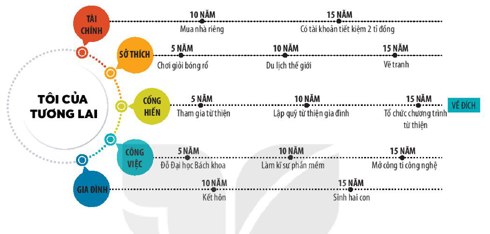
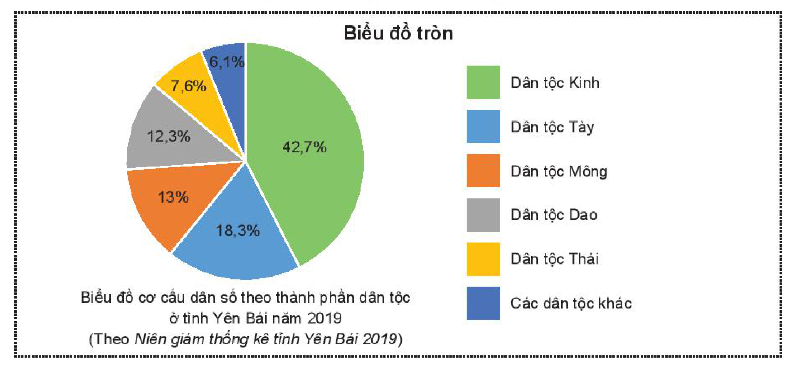
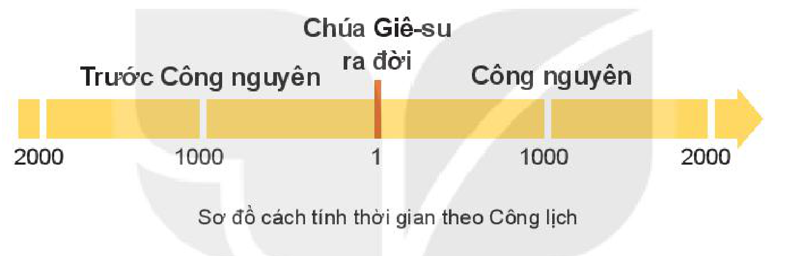
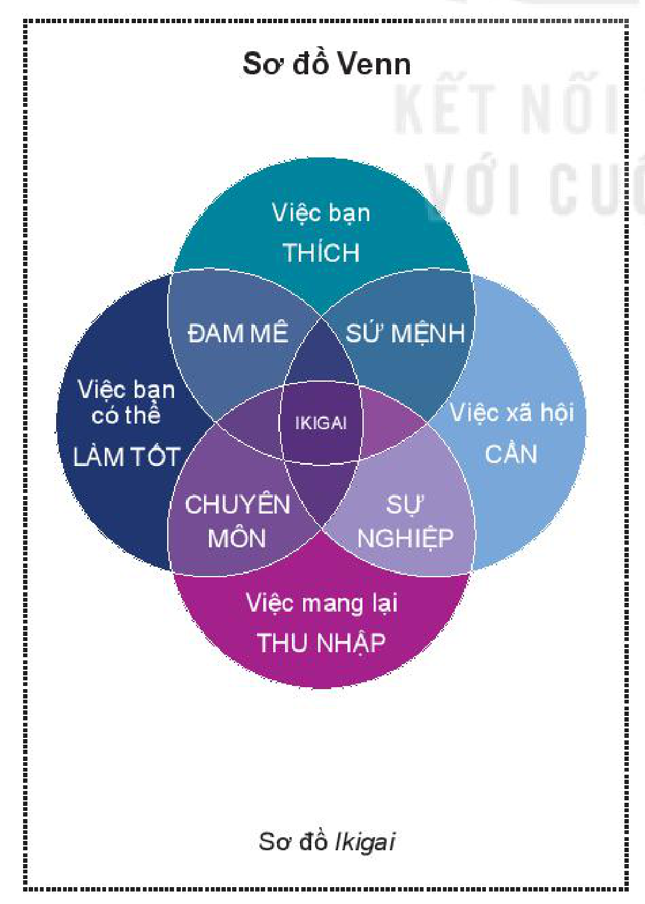
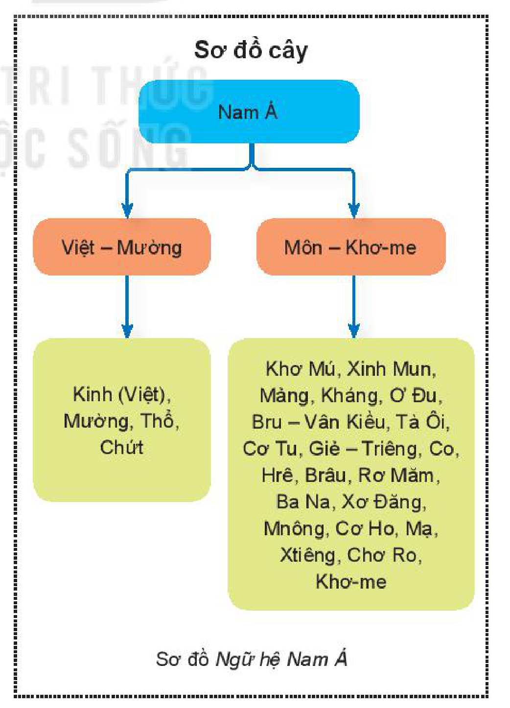
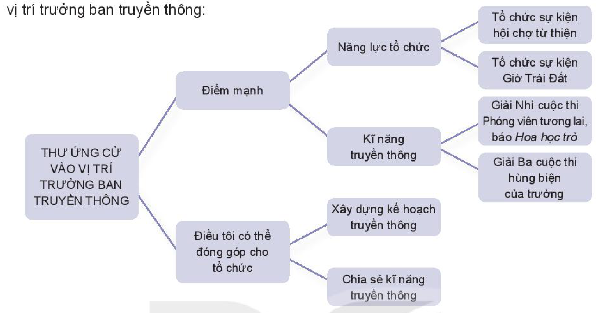

<!-- pdf:100 -->

# BÀI 9: HÀNH TRANG CUỘC SỐNG

## 🎯 Yêu cầu cần đạt

- Nhận biết và phân tích được bối cảnh lịch sử hoặc bối cảnh văn hoá, xã hội của văn bản; nêu được ý nghĩa của văn bản đối với quan niệm sống của bản thân.
- Nhận biết và đánh giá được tác dụng của các phương tiện phi ngôn ngữ trong văn bản.
- Viết được một bài luận về bản thân.
- Biết thuyết trình về một vấn đề xã hội có sử dụng kết hợp phương tiện ngôn ngữ với phương tiện phi ngôn ngữ.
- Có ý thức làm chủ bản thân, phát triển hài hoà các mối quan hệ xã hội và có đóng góp tích cực cho đời sống của cộng đồng.

## ĐỌC

### TRI THỨC NGỮ VĂN

**Biểu đồ, sơ đồ trong văn bản thông tin**

Các biểu đồ, sơ đồ giúp các thông tin trong văn bản trở nên cụ thể, trực quan, đồng thời cho thấy mối quan hệ logic giữa các thông tin. Có rất nhiều dạng biểu đồ, sơ đồ: biểu đồ tròn thể hiện vòng tuần hoàn của các sự vật, hiện tượng; sơ đồ Venn dùng để so sánh; biểu đồ thời gian dùng để biểu đạt sự phát triển; sơ đồ cây thể hiện hệ thống cấp bậc của thông tin;...

**Bài luận về bản thân**

Những tri thức học được qua sách vở và những trải nghiệm trong cuộc sống không chỉ giúp bạn hiểu biết thêm về con người và thế giới rộng lớn xung quanh, mà còn gợi cho bạn những suy ngẫm về bản thân: bạn là ai; mong muốn, ước mơ, niềm tin, giá trị sống của bạn là gì; đâu là thế mạnh của bạn; với tư cách là một cá nhân, bạn có mối quan hệ như thế nào với người khác, với thế giới tự nhiên; mỗi lựa chọn của bạn có tác động gì tới cuộc sống của chính bạn và của người khác,... Những suy nghĩ, quan điểm, kiến giải đó có thể được trình bày dưới dạng một bài luận về bản thân.

**Bài luận về bản thân** là một loại văn bản nghị luận, thể hiện quan điểm, chủ kiến của người viết, có lập luận chặt chẽ và bằng chứng đáng tin cậy. Tuy nhiên, khác với

<!-- pdf:101 -->

bài nghị luận thông thường, bài luận về bản thân hướng vào việc tự bày tỏ, tự soi xét và chia sẻ những trải nghiệm, suy nghĩ,... của chính người viết. Sự chân thành, sâu sắc trong suy ngẫm của người viết là yếu tố quan trọng nhất làm nên sức hấp dẫn của kiểu văn bản này. Viết một bài luận về bản thân là thực hành việc nhìn lại chính mình, tự ý thức về giá trị của chính mình – điều có ý nghĩa vô cùng quan trọng trong việc chuẩn bị hành trang cuộc sống.

### VĂN BẢN 1: Về chính chúng ta

*(Trích 7 bài học hay nhất về vật lí)*
<!-- ocr-ok: chữ in nghiêng "hay nhất về vật lí" bị OCR đọc nhầm thành "hau nhất nề uật If", đã đối chiếu ảnh trang PDF 101 -->

**Các-lô Rô-ve-li (Carlo Rovelli)**

- Bạn suy nghĩ như thế nào về quan niệm cho rằng con người là chúa tể của tự nhiên?

[...] Chúng ta có vai trò gì không với tư cách là những con người biết nhận thức, ra quyết định, cười và khóc, trong toàn cảnh thế giới vĩ đại mà vật lí đương đại mô tả? Nếu thế giới là một(1) đám lượng tử phù du của không gian và vật chất, một trò chơi ghép hình mênh mông của không gian và các hạt cơ bản, thì chúng ta là gì đây? Phải chăng chúng ta cũng chỉ gồm các lượng tử và hạt? Nếu vậy thì từ đâu chúng ta có được cảm nhận về sự tồn tại của chính mình và cá tính độc nhất mà ta luôn có thể xác nhận? Và khi đó giá trị của chúng ta, những mơ ước, cảm xúc và tri thức cá nhân của chúng ta... là gì đây? Chúng ta là gì trong cái thế giới vô tận và sinh động này?

> Suy đoán về dụng ý của tác giả khi đặt vấn đề bằng hàng loạt câu hỏi.

Tôi không thể, dù chỉ tưởng tượng, làm sao có thể trả lời một câu hỏi như thế trong vài trang giấy. Đó là một câu hỏi rất khó. Trong bức tranh khoa học rộng lớn ngày nay, có nhiều thứ chúng ta không hiểu nổi, và một trong những thứ mà ta hiểu ít nhất là chính chúng ta. Nhưng nếu né tránh hay phớt lờ

> Câu nào trong đoạn văn thể hiện quan điểm của tác giả?
<!-- ocr-ok: thẻ chỉ dẫn đọc ở cột phải bị OCR đọc ghép dòng với văn bản chính, đã đối chiếu ảnh trang PDF 101 -->

> (1) Dịch giả dịch là *quần tụ*.

<!-- pdf:102 -->

câu hỏi ấy, thì theo tôi sẽ là bỏ sót những điều rất cốt lõi. Tôi đã trình bày thế giới trông như thế nào dưới ánh sáng khoa học, và chúng ta cũng là một phần của cái thế giới ấy.

“Chúng ta”, con người, trước hết là những chủ thể(1) biết quan sát thế giới này; những nhà sáng lập tập thể của bức tranh về thực tại mà tôi đã cố gắng mô tả lại. Chúng ta là các nút trong một mạng lưới những sự trao đổi, nhờ nó chúng ta truyền đi các hình ảnh, các công cụ, thông tin và kiến thức.

> Xác định hai từ khoá nói lên mối quan hệ giữa con người và thế giới trong đoạn văn.

Nhưng chúng ta còn là một bộ phận hữu cơ của thế giới mà ta cảm nhận được; chúng ta không phải người quan sát đứng ngoài cuộc. Chúng ta nằm trong nó. Cái nhìn của chúng ta về nó là nhìn từ trong lòng nó. Chúng ta được làm ra từ cùng những nguyên tử, cùng những tín hiệu ánh sáng giống như nguyên tử hay ánh sáng qua lại giữa những cây thông trên núi hay những ngôi sao trong các thiên hà.

Khi hiểu biết của chúng ta tăng lên, chúng ta đã biết rằng sự tồn tại của chúng ta chỉ là một phần của vũ trụ, và là phần rất nhỏ bé trong đó.

Điều này ngày càng rõ ràng qua nhiều thế kỉ, nhưng đặc biệt sáng rõ trong thế kỉ vừa qua. Chúng ta từng tin rằng mình ở trên một hành tinh nằm tại trung tâm vũ trụ, rồi hoá ra không phải vậy. Chúng ta từng nghĩ rằng mình là thứ tồn tại duy nhất, một chủng loài tách biệt hẳn với họ các động vật và thực vật, rồi phát hiện ra rằng mình là hậu duệ có cùng các tổ tiên với mọi sinh thể quanh ta. Chúng ta có cùng tổ tiên xa xôi với con bướm và cây thông. Chúng ta giống như đứa trẻ, khi lớn lên nhận ra rằng thế giới không chỉ vẻn vẹn là những gì ở quanh mình như nó tưởng khi còn bé. Nó cần học hỏi để làm một người giữa những người khác. Noi gương những người khác và những thứ khác nữa, chúng ta học được mình là ai.

> Chú ý biện pháp tu từ điệp ngữ trong văn bản.
<!-- ocr-ok: thẻ chỉ dẫn đọc ở cột phải bị OCR đọc ghép dòng với văn bản chính, đã đối chiếu ảnh trang PDF 102 -->

[...] Tri thức của chúng ta chung quy đều phản ánh thế giới. Chỉ là phản ánh được ít hay nhiều mà thôi, nhưng quả thực nó phản ánh thế giới mà chúng ta sống trong đó. Cách kết nối giữa chúng ta và thế giới không phải là cái làm chúng ta đặc biệt hơn phần còn lại của tự nhiên. Mọi vật đều không ngừng tương tác với nhau, và khi làm thế, mỗi người trong chúng ta đều mang theo dấu vết của cái mà ta đã tương tác: và theo nghĩa ấy, mọi vật không ngừng trao đổi thông tin về nhau.

Thông tin mà một hệ vật lí này có về hệ vật lí khác không có gì thuộc về ý thức hay chủ quan hết: nó chỉ là mối liên quan mà vật lí định ra giữa trạng thái của vật này với trạng thái của vật khác. Một giọt mưa chứa thông tin về sự hiện diện của một đám mây trên trời; một tia sáng chứa thông tin về màu sắc của chất đã gửi nó đến mắt ta; một cái đồng hồ có

> Chú ý các lí lẽ, bằng chứng được sử dụng để chứng minh luận điểm: “Tri thức của chúng ta chung quy đều phản ánh thế giới.”

> (1) *Chủ thể*: con người với tư cách là một sinh vật có ý thức và ý chí, trong mối quan hệ đối lập với thế giới bên ngoài (gọi là *khách thể*).

<!-- pdf:103 -->

thông tin về thời gian trong ngày; gió mang thông tin về một trận bão đang ập đến; virus cảm lạnh có thông tin về tính dễ tổn thương của cái mũi tôi; DNA trong tế bào chúng ta chứa tất cả thông tin về mã di truyền của chúng ta (về cái đã làm cho tôi giống với cha của mình); và não của tôi tràn ngập những thông tin được tích luỹ từ trải nghiệm của tôi. Chất liệu căn bản làm nên tư duy của chúng ta là tập hợp vô cùng phong phú các thông tin được tích luỹ, trao đổi và không ngừng được xây dựng kĩ lưỡng.

[...] Các giá trị đạo đức của chúng ta, cảm xúc của chúng ta, tình yêu của chúng ta cũng mang tính hiện thực không kém vì là một phần của tự nhiên, vì được chia sẻ với thế giới động vật, hay vì được quyết định bởi sự tiến hoá mà loài chúng ta đã trải qua suốt hàng triệu năm. Vì thế, chúng còn có giá trị hơn nữa: chúng có thực. Chúng là cái hiện thực phức tạp đã tạo nên chúng ta. Thực tại của chúng ta là những giọt nước mắt và nụ cười, lòng biết ơn và vị tha, sự trung thành và phản bội, là quá khứ luôn ám ảnh chúng ta và sự thanh thản. Thực tại của chúng ta được làm nên từ xã hội của chúng ta, từ cảm xúc nhờ âm nhạc đem lại, từ các mạng lưới kiến thức chung đan dệt phong phú mà chúng ta cùng nhau xây đắp. Tất cả là một phần của chính cái “tự nhiên” đồng nhất mà chúng ta đang mô tả. Chúng ta là một bộ phận hữu cơ của tự nhiên; chúng ta là tự nhiên, là một trong vô số các biểu hiện biến thiên vô cùng vô tận của nó. Đó là những gì chúng ta đã học hỏi được từ hiểu biết không ngừng tăng lên về mọi sự vật của thế giới này.

> Xác định câu văn khái quát ý tưởng chính của đoạn văn.

Chính là vì cái tự nhiên đồng nhất, nên điều khiến cho chúng ta thật sự trở thành người không có nghĩa là chúng ta tách khỏi tự nhiên. Đó là một dạng thức mà tự nhiên đã thể hiện tại hành tinh của chúng ta, trong tương tác vô tận các kết hợp của nó, thông qua các tác động qua lại và trao đổi các tương quan và thông tin giữa các bộ phận của nó. Ai mà biết rằng còn tồn tại bao nhiêu những điều phức tạp phi thường gì khác, dưới các dạng thức mà có lẽ chúng ta không thể hình dung nổi, trong những khoảng không vô tận của vũ trụ,... Hẳn nhiều đến nỗi sẽ là ngây ngô khi cho rằng ở một góc ngoại vi của một thiên hà bình thường nào đó lại có cái gì đó là đặc biệt và duy nhất. Sự sống trên Trái Đất chỉ mang lại một dư vị thoảng qua của những gì có thể xảy ra trong vũ trụ. Ngay chính linh hồn chúng ta cũng chỉ là một ví dụ bé nhỏ.

[...] Tự nhiên là nhà của chúng ta, và sống trong tự nhiên nghĩa là chúng ta đang ở nhà của mình. [...]

> Hình ảnh nào được sử dụng để nói về mối quan hệ giữa con người và tự nhiên?

[...] Một phần bản tính của chúng ta là yêu thương và lương thiện. Một phần bản tính của chúng ta là khao khát được hiểu biết nhiều hơn nữa và luôn học hỏi. Tri thức của chúng ta về thế giới không ngừng tăng lên.

[...] Tại đấy, bên bờ của những gì chúng ta đã biết, tiếp giáp với cả đại dương mênh mông những gì chưa biết, rực sáng lên vầng hào quang của sự huyền bí và vẻ đẹp của thế giới. Thật là quyến rũ đến mê hồn.

(Các-lô Rô-ve-li, Nguyễn Nguyên Hy dịch, *7 bài học hay nhất về vật lí*, NXB Thế giới – Công ti cổ phần Sách Omega Việt Nam, Hà Nội, 2018, tr. 119 – 142)

<!-- pdf:104 -->

**Các-lô Rô-ve-li** sinh năm 1956, là nhà vật lí học lí thuyết, nhà văn, sinh ra ở I-ta-li-a (Italia), chủ yếu làm việc ở Mỹ và Pháp. Các nghiên cứu của ông tập trung vào lĩnh vực lực hấp dẫn lượng tử. Ông cũng nghiên cứu sâu về lịch sử và khoa học triết học. Những công việc này đã giúp ông có một tri thức tổng hợp rộng lớn và cái nhìn toàn diện, sâu sắc về vũ trụ và đời sống.

Cuốn sách nổi tiếng của ông – ***7 bài học hay nhất về vật lí*** được xuất bản lần đầu tiên vào năm 2014, đã được dịch sang 41 thứ tiếng và bán hàng triệu bản khắp thế giới. Không chỉ là một cuốn cẩm nang súc tích về vật lí học hiện đại, cuốn sách còn chứa đựng những suy tư mang tính chất triết học về thế giới và con người. Ở đó, khoa học, triết học, văn chương và tôn giáo đã được kết hợp một cách hài hoà, cho người đọc thấy được vẻ đẹp huyền bí của thế giới này.

**Trả lời câu hỏi**

1. Trong văn bản, tác giả đã trình bày quan điểm về vấn đề gì? Quan điểm ấy đã được triển khai thành những luận điểm chính nào?
2. Để làm sáng tỏ các luận điểm chính, tác giả đã sử dụng những lí lẽ, bằng chứng nào? Những thông tin khoa học trong văn bản có ý nghĩa gì trong việc làm sáng tỏ những luận điểm chính?
3. Chỉ ra và phân tích tác dụng của các yếu tố miêu tả, biểu cảm, các biện pháp tu từ trong văn bản.
4. Tác giả đã trình bày quan điểm về mối quan hệ giữa con người và thực tại từ góc nhìn nào, với một thái độ như thế nào?
5. Tác giả nghĩ gì về khả năng nhận thức thế giới của con người?
6. “Tự nhiên là nhà của chúng ta, và sống trong tự nhiên nghĩa là chúng ta đang ở nhà của mình”. Bạn nghĩ gì về nhận định của tác giả?

#### Kết nối đọc – viết

Nhận thức nào từ văn bản *Về chính chúng ta* mà bạn muốn mang theo trong hành trang cuộc sống của mình? Hãy viết đoạn văn (khoảng 150 chữ) để chia sẻ về điều này.

<!-- pdf:105 -->

### VĂN BẢN 2: Con đường không chọn
<!-- ocr-ok: nhãn VĂN BẢN 2 trên băng màu xanh bị OCR bỏ sót, đã đối chiếu ảnh trang PDF 105 -->

**Rô-bớt Phờ-rót (Robert Frost)**

- Bạn đã bao giờ cảm thấy khó khăn khi phải đứng trước nhiều khả năng lựa chọn?
- Điều gì đã khiến bạn đưa ra quyết định lựa chọn của mình khi ấy? Bạn thấy may mắn hay tiếc nuối vì lựa chọn đó của bản thân?

**Bản dịch 1**

Con đường rẽ làm đôi giữa rừng lá vàng,
Biết làm sao, tôi chỉ có thể chọn một mà thôi
Thân phận lữ hành, tôi đứng mãi
Nhìn theo một lối rẽ bên này
Đến tận nơi vệt đường khuất dạng sau bụi cây;

> Nhân vật trữ tình trong bài thơ là ai và đang đứng trước tình huống nào?

Thế rồi tôi lại bước vào lối rẽ bên kia,
Có khác gì đâu, mà có khi lại có lí hơn kìa,
Vì cỏ rậm trên mặt đường như thèm muốn người đi;
Nhưng thật ra có đôi chỗ đây kia
Cũng đã thấy dấu mòn như con đường nọ,

> Trong ba khổ đầu của bài thơ, hai lối rẽ được miêu tả như thế nào?

Và thế là buổi mai hôm đó
Trước hai con đường lá rơi đầy chưa đen vết chân ai.
Tôi đành hẹn sẽ quay lại con đường không đi một ngày nào đó!
Nhưng lòng thừa hiểu nào biết đến bao giờ,
Đường lại đưa đường làm sao biết trước.

Tôi sẽ kể chuyện này trong một tiếng thở dài
Rằng đâu đó ngày xưa đã lâu lắm rồi:
Con đường rẽ làm đôi giữa một khu rừng, và tôi –
Tôi đã chọn lối mòn ít có ai đi,
Và điều đó đã làm đổi thay tất cả.

> Nhân vật trữ tình đã lựa chọn lối rẽ nào?

(Trịnh Lữ dịch, *http://thivien.net*)
<!-- ocr-ok: đường dẫn http://thivien.net in nghiêng bị OCR đọc nhầm thành htfp:/thivien.net, đã đối chiếu ảnh trang PDF 105 -->

<!-- pdf:106 -->

**Bản dịch 2**

Hai lối rẽ trong rừng vàng rực lá,
Buồn thay biết làm sao chọn cả
Là kẻ lữ hành, tôi đứng đó hồi lâu
Dõi mút tầm lối nọ về đâu
Tới tận khúc quanh giữa bụi bờ chìm khuất;

Rồi tôi chọn lối này, như chẳng khác,
Nhưng xem chừng theo thôi thúc mạnh hơn,
Vì cỏ rậm muốn mời chân bước;
Dù qua đây đi về phía trước
Hai lối như nhau đều có vết mòn,

Hai nẻo đường sáng ấy trải ra
Trên thảm lá chưa chân ai hằn dấu thẫm.
Sẽ đi lối đầu tiên, một ngày nào, muốn lắm!
Nhưng đường nối đường, lòng thao thức mai đây,
Chắc gì tôi được trở lại chốn này.

Rồi với tiếng thở dài tôi sẽ nói
Ngày nào kia trong tháng năm vời vợi:
Hai lối xuyên rừng, đứng đó một tôi –
Tôi đã chọn lối đi ít dấu chân người,
Và điều đó làm nên bao khác biệt.

(Phan Huy Dũng dịch, tạp chí *Sông Lam*, số 11, tháng 3/2021, tr. 96)

<!-- pdf:107 -->

**Rô-bớt Phờ-rót** (1874 – 1963) là nhà thơ Mỹ có tầm ảnh hưởng lớn trong văn học hiện đại. Cho đến nay, ông là nhà thơ duy nhất từng được bốn lần nhận giải thưởng Pu-lít-dơ (Pulitzer) – giải thưởng thường niên uy tín của Mỹ trao cho các lĩnh vực như báo chí, văn chương, âm nhạc,...

***Con đường không chọn*** là một trong những bài thơ được đọc nhiều nhất của Rô-bớt Phờ-rót. Tác phẩm được sáng tác vào năm 1915, lấy cảm hứng từ những cuộc đi dạo trong rừng với người bạn của ông – nhà thơ Ét-uốt Thô-mớt-xơ (Edward Thomas, 1878 – 1917). Theo lời của Phờ-rót, trong những cuộc đi dạo ấy, Thô-mớt-xơ thường băn khoăn không biết nên chọn lối nào để đi, rồi sau khi đã lựa chọn, ông lại nuối tiếc, đáng lẽ nên chọn một lối khác.

Bài thơ của Phờ-rót ra đời vào thời điểm nhiều người hoài nghi về lựa chọn của bản thân và thường nghĩ rằng họ nên quay lại con đường mình từng từ bỏ. Không lâu sau khi nhận được bài thơ của Phờ-rót trong một lá thư, Thô-mớt-xơ tham gia vào Chiến tranh thế giới thứ nhất (1914 – 1918) và đã tử trận tại A-rát-xơ (Arras)(1) vào năm 1917.

**Trả lời câu hỏi**

1. “Con đường” và “lối rẽ” trong bài thơ có thể xem là những ẩn dụ. Những ẩn dụ đó gợi cho bạn nghĩ đến điều gì?
2. Theo bạn, tại sao Rô-bớt Phờ-rót lại đặt nhan đề bài thơ là *Con đường không chọn* mà không phải là *Con đường tôi chọn* hay *Con đường ít người đi*?
3. Hai lối rẽ trong rừng khác nhau hay giống nhau nhiều hơn? Phải chăng vì điều ấy mà nhân vật trữ tình trong bài thơ cảm thấy khó khăn khi phải chọn lựa một trong hai lối rẽ?
4. Nếu như nhân vật trữ tình không thể chọn cả hai lối rẽ cùng lúc thì anh ta có thể không lựa chọn bất cứ lối rẽ nào được chăng? Vì sao?
5. Trong bài thơ, cuối cùng nhân vật trữ tình cũng vẫn phải đưa ra lựa chọn của mình. Theo bạn, anh ta có thật sự tin rằng lối rẽ mình chọn là con đường tốt hơn?
6. Bạn có đồng cảm với trạng thái do dự, phân vân của nhân vật trữ tình xuyên suốt bài thơ không? Vì sao?
7. Hãy nêu một thông điệp từ bài thơ có ý nghĩa đối với cá nhân bạn.

#### Kết nối đọc – viết

Từ bài thơ này, theo bạn, làm thế nào để chúng ta can đảm hơn trong những lựa chọn của mình trên hành trình trưởng thành? Hãy viết đoạn văn (khoảng 150 chữ) để trả lời câu hỏi trên.

> (1) *A-rát-xơ*: tên một thành phố của nước Pháp, nơi diễn ra trận tấn công của quân đội Anh nhằm vào quân đội Đức, từ ngày 9/4/1917 đến ngày 16/5/1917.

<!-- pdf:108 -->

### VĂN BẢN 3: Một đời như kẻ tìm đường

*(Trích)*

**Phan Văn Trường**

- Mỗi lựa chọn của chúng ta ngày hôm nay có ảnh hưởng như thế nào tới cuộc sống của chúng ta trong tương lai? Làm thế nào để đưa ra những lựa chọn đúng trong cuộc đời?

Năm mười bốn tuổi là năm đầu tiên tôi phải suy nghĩ để đưa ra những lựa chọn cho cuộc đời mình. Trước đó, chưa bao giờ tôi phải làm việc này. Thuở ấy, nhà trường viết thư gửi cho các phụ huynh với đôi lời nhắn nhủ về việc chọn một trong hai ngoại ngữ, và nhất là chọn giữa hai chương trình học – cổ điển hay hiện đại. Đó là giai đoạn những năm 50 – 60 của thế kỉ trước.

> Dự đoán về nội dung sẽ được trình bày trong văn bản.
<!-- ocr-ok: thẻ chỉ dẫn đọc ở cột phải bị OCR đọc ghép dòng với văn bản chính, đã đối chiếu ảnh trang PDF 108 -->

Vào thời đó, ngay cả cha mẹ tôi cũng bối rối, bởi lẽ không ai trong gia đình tôi có ý niệm gì về ngôn ngữ thịnh hành trên thế giới. Còn về chương trình cổ điển thì nghe khá lạ tai, vì sẽ đặt trọng tâm vào tiếng La-tinh, tiếng Hy Lạp cổ. Ông hiệu trưởng thì hết lời khuyến khích học sinh đi theo lộ trình cổ điển. Ông giải thích rằng các Kinh Thánh cần được hiểu tận gốc, các nền văn hoá Tây Âu cần được thấu triệt qua việc tham khảo và nghiên cứu các bài viết của những tác giả ngàn xưa, như Xô-cơ-rát (Socrates)(1) hay Pla-tông (Platon)(2), được cho là những tiền đề của nền triết học nhân loại.

> Người viết đã nêu lên những tình huống lựa chọn nào?

Cha mẹ tôi vừa nghe thấy “hiểu tận gốc nền triết lí của nhân loại” thì thích lắm. Nhưng may mà cả hai đều không có tư duy áp đặt. Tôi thì không hiểu sao cứ nghe chữ “cổ” thì lại thấy chối tai. Ngoài ra, còn có một yếu tố giúp tôi lấy định hướng cho đời mình. Đó là tôi có ba người bạn thân học cùng lớp cứ rủ tôi nghe nhạc Mỹ của En-vít-xờ Prét-xờ-li (Elvis Presley)(3) và Pôn An-ka (Paul Anka)(4). Ba anh nghe loại nhạc này vừa nháy mắt

> (1), (2) *Xô-cơ-rát* (470 – 399 trước Công nguyên), *Pla-tông* (427 – 347 trước Công nguyên): hai triết gia nổi tiếng thời Hy Lạp cổ đại, được coi là những người đặt nền móng cho triết học phương Tây.
> (3) *En-vít-xờ Prét-xờ-li* (1935 – 1977): ca sĩ nhạc rốc (rock) nổi tiếng người Mỹ, được coi là một trong những biểu tượng âm nhạc của thế kỉ XX.
> (4) *Pôn An-ka*: sinh năm 1941, là ca sĩ, diễn viên nổi tiếng người Ca-na-đa (Canada).

<!-- pdf:109 -->

thưởng thức, vừa đứng ngồi không yên. Chỉ có chút ngôn ngữ cơ thể thế thôi đã làm trái tim của tôi nghiêng hẳn sang phía hiện đại. Nhiều khi chuyện đời nào cũng nghiêng sang một bên do ảnh hưởng của những yếu tố kì lạ, nhẹ nhõm và khó giải thích. Và đó là trường hợp của tôi, thời thiếu niên.

Trong cuộc thương thuyết với cha mẹ, đề tài chọn nghề cũng xuất hiện đột ngột vào đúng lúc tôi chưa được cầm một xu tiền mặt nào. Hơn nữa, tôi cũng chưa có ý niệm sau này phải đi làm để có tiền trang trải cuộc sống, nói chi đến chọn nghề. Cha tôi thì thích ngành kiến trúc. Mẹ tôi thì thích nghề bác sĩ. Và cuối cùng hai người đã hướng ý thích của tôi vào lộ trình công chức, một hướng đi quá an toàn cho tôi, và cả cho mẹ tôi, bởi vì bà nghĩ như thế thì con trai bà sẽ không bao giờ ra khỏi vòng tay mình. Còn đối với cha tôi, chữ “công chức” có lẽ còn hàm nghĩa, con trai ông sẽ tham gia vào các hoạt động xã hội nhiều hơn.

[...] Đó là những lựa chọn đầu tiên trong cuộc đời tôi. Nó khởi đầu cho một chuỗi dài những quyết định sau này, đôi khi còn khó đưa ra hơn rất nhiều.

[...] Cuộc đời của mỗi chúng ta có thể ví như một con đường với hàng ngàn khúc quanh, đến khúc quanh nào chúng ta cũng bắt buộc phải có những lựa chọn. Chọn hướng đi, chọn phương án, chọn kẻ đồng hành, chọn những trang bị, chọn thời điểm hành động. Rất nhiều khi chúng ta không có quyền lựa chọn, hoặc không biết lựa chọn. Nhưng rồi cuối cùng chúng ta cũng bắt buộc phải bước tiếp. Đôi khi không biết đi đâu nhưng cũng vẫn đi, giấc mơ tiến tới tương lai mạnh đến mức trở thành ám ảnh, cho dù tương lai còn mù mờ. Cuộc đời dù là tiến hay lùi, vẫn phải tiếp tục bước đi.

> Chú ý những suy ngẫm, đúc rút của người viết.

\* \* \*

Cá nhân tôi trong suốt bấy nhiêu năm toàn gặp những tình huống lạ kì. Nhiều lần như thế, lần nào cũng vậy: phải đưa ra một quyết định, phải lựa chọn, và sau đó mọi việc tiếp diễn như không cần tới mình. Mỗi lần mình tìm giải pháp, tìm hướng đi là một lần số mệnh đẩy mình đi vào một lộ trình không muốn, mà mình chẳng biết trước tốt hay xấu.

Tôi sang Pháp năm mười bảy tuổi, chẳng chọn đi, mà cũng chẳng chọn Pháp. Tôi tốt nghiệp kĩ sư, mà nghĩ lại cho cùng thì mình chưa bao giờ mơ làm kĩ sư, hoạ may làm bác sĩ hay kiến trúc sư như bố mẹ tôi từng mong mỏi. [...] Tôi cũng chưa bao giờ mơ đến quyền lực, nhưng rồi cuộc đời nghề nghiệp đã đưa tôi vào những vị trí quyền lực trên cả năm châu. Một chuyện lạ khác, tuy tôi là kĩ sư cầu đường, nhưng chưa bao giờ tôi thiết kế cây cầu hay xây dựng một con đường nào cho ai đi. Tôi đã làm tư vấn về kinh tế và đã dạy kinh tế trong trường đại học nhưng

> Chú ý cách lí giải về mối quan hệ giữa lựa chọn và số phận.

<!-- pdf:110 -->

chưa bao giờ học kinh tế. Tôi đã làm chuyên gia quy hoạch vùng và chỉnh trang lãnh thổ, một môn hoàn toàn xa lạ. Tôi đã làm nghề buôn bán những nhà máy điện khổng lồ tuy chưa bao giờ học về điện lực. Tôi đã lãnh đạo doanh nghiệp đường sắt, mê-trô và cao tốc trong khi trước đó tôi chưa có chút ý niệm gì về kĩ nghệ giao thông. Tôi đã chủ trì một tập đoàn làm nghề lọc nước và phân phối nước lọc cho các đô thị từ nước sông, trong khi tôi chưa bao giờ bước chân vào môn hoá. Chưa hết, tôi sinh ra làm người Việt nhưng suốt cuộc đời nghề nghiệp lại tại vị ở nước ngoài. Nắm vững tiếng Pháp thì cuộc đời lại đưa đẩy tôi sang làm việc ở xứ nói tiếng Anh, thậm chí tiếng Bồ Đào Nha.

\* \* \*

[...] Vào mỗi khúc quanh của cuộc đời mình, tôi đã tìm đường để rồi chẳng thấy. Suốt cuộc đời tôi đã mày mò, giống như người khiếm thị lại phải đi trong cảnh sương mù. Nhưng rồi mãi tới lúc cao tuổi, tôi mới hiểu được rằng chẳng bao giờ mình sẽ tới, vì cuộc đời, trên bản chất, phải là một hành trình dài vô tận. Đi đường nào rồi cũng có thể thành công, chọn lối nào rồi cũng có khả năng đạt hạnh phúc, vì hạnh phúc và thành công không tuỳ thuộc vào con đường chúng ta đi, mà vào tâm trạng tự tại của chúng ta, cũng như vào những giá trị mà chúng ta gieo ngay trên những nẻo đường đã đi qua.

> Chú ý những đúc rút, suy ngẫm của người viết.

\* \* \*

[...] Cả cuộc đời tìm đường để rồi mãi tới lúc xế chiều tôi mới khám phá ra chẳng có đường để tìm. Làm việc gì cũng được, đi đâu cũng đặng nếu mỗi chúng ta không quên mình là một thành phần của xã hội, đóng góp nhiều thì xã hội sẽ cho lại chúng ta nhiều. Và “nhiều” không có nghĩa là số lượng, mà là tình cảm đậm đà, giá trị bền vững. Hạnh phúc ở đâu, nay tôi đã biết. Những hạnh phúc nhỏ thì nằm trên mỗi bước đi, nhưng hạnh phúc bền vững là thứ hạnh phúc lấy gốc từ sự trải nghiệm, từ sự từ bi chấp nhận, từ tinh thần tích cực mà mình luôn luôn có.

Suốt cuộc đời tìm đường, tôi đã tìm thấy sức mạnh của mình trong những thử thách vô cùng gian nan. Tôi đã tìm thấy tình yêu khi trao trọn trái tim. Tôi đã tìm được quyền thế bằng cách sống mẫu mực, khiêm tốn. Tôi đã tìm thấy hạnh phúc khi tạo ra hạnh phúc cho mỗi người xung quanh. Tôi đã tìm được sự no ấm khi miệt mài tạo ra giá trị cho xã hội. Và may mắn thay, tôi đã tìm được chính mình bằng cách tặng trọn bản thân cho xã hội. Cứ cho đi thì mới thấy được thứ mình đi tìm.

> Chú ý giọng điệu của người viết.

(Theo Phan Văn Trường, *Một đời như kẻ tìm đường*, NXB Trẻ, Thành phố Hồ Chí Minh, 2020, tr. 19 – 23, 34, 406)

<!-- pdf:111 -->

**Phan Văn Trường** sinh năm 1946, quê ở tỉnh Hải Dương, từng là lãnh đạo cao cấp của nhiều tập đoàn hàng đầu thế giới, cố vấn thường trực của Chính phủ Pháp về thương mại quốc tế, hai lần được Tổng thống Pháp phong tước Hiệp sĩ. Năm 2009, ông được Chủ tịch nước Việt Nam trao tặng kỉ niệm chương *Vì sự nghiệp giáo dục*. Các cuốn sách đã xuất bản của ông gồm có: *Một đời thương thuyết* (2014), *Một đời quản trị* (2017), *Một đời như kẻ tìm đường* (2019).

***Một đời như kẻ tìm đường*** được trích trong cuốn sách cùng tên của tác giả Phan Văn Trường. Cuốn sách là sự đúc kết những trải nghiệm phong phú của một người đã đi khắp thế giới, kinh qua rất nhiều vị trí nghề nghiệp, am hiểu cả văn hoá phương Đông và phương Tây và đặc biệt luôn có tinh thần tận hiến. Cuốn sách cũng là lời nhắn nhủ tha thiết và đầy tin yêu của ông dành cho thế hệ trẻ Việt Nam.

**Trả lời câu hỏi**

1. Theo bạn, mục đích của bài viết này là gì?
2. Xác định quan điểm chính của tác giả trong bài viết này. Quan điểm ấy đã được triển khai qua hệ thống lí lẽ và bằng chứng như thế nào?
3. Chỉ ra các yếu tố tự sự, biểu cảm và phân tích tác dụng của chúng trong văn bản.
4. Nhan đề của bài viết là *Một đời như kẻ tìm đường*. Nhưng trong bài viết, tác giả lại nói: “Cả cuộc đời tìm đường để rồi mãi tới lúc xế chiều tôi mới khám phá ra chẳng có đường để tìm”. Liệu tác giả có tự mâu thuẫn với chính mình hay không? Phải chăng việc tìm đường là một việc không có nhiều ý nghĩa?
5. Hãy nêu một luận điểm trong bài viết trên mà bạn thấy tâm đắc hoặc còn băn khoăn. Lí do nào khiến bạn thấy luận điểm ấy thuyết phục mình hay làm bạn muốn đối thoại với tác giả?
6. Từ bài thơ *Con đường không chọn* và bài viết *Một đời như kẻ tìm đường*, bạn suy nghĩ gì về những lựa chọn của mỗi người trong cuộc sống?

#### Kết nối đọc – viết

Theo bạn, thành công và hạnh phúc phụ thuộc vào lựa chọn của chúng ta hay vào những may rủi ngẫu nhiên trong cuộc đời? Viết đoạn văn (khoảng 150 chữ) thể hiện quan điểm của bạn về vấn đề này.

<!-- pdf:112 -->

### Thực hành tiếng Việt: Sử dụng phương tiện phi ngôn ngữ (tiếp theo)

1. Quan sát sơ đồ sau và chỉ ra tác dụng của các phương tiện phi ngôn ngữ được sử dụng trong sơ đồ:

> **Sơ đồ: TÔI CỦA TƯƠNG LAI (VỀ ĐÍCH)**
> - **TÀI CHÍNH**: 10 NĂM (Mua nhà riêng) $\rightarrow$ 15 NĂM (Có tài khoản tiết kiệm 2 tỉ đồng)
> - **SỞ THÍCH**: 5 NĂM (Chơi giỏi bóng rổ) $\rightarrow$ 10 NĂM (Du lịch thế giới) $\rightarrow$ 15 NĂM (Vẽ tranh)
> - **CỐNG HIẾN**: 5 NĂM (Tham gia từ thiện) $\rightarrow$ 10 NĂM (Lập quỹ từ thiện gia đình) $\rightarrow$ 15 NĂM (Tổ chức chương trình từ thiện)
> - **CÔNG VIỆC**: 5 NĂM (Đỗ Đại học Bách khoa) $\rightarrow$ 10 NĂM (Làm kĩ sư phần mềm) $\rightarrow$ 15 NĂM (Mở công ti công nghệ)
> - **GIA ĐÌNH**: 10 NĂM (Kết hôn) $\rightarrow$ 15 NĂM (Sinh hai con)
<!-- ocr-ok: chữ trong các nhánh của sơ đồ TÔI CỦA TƯƠNG LAI bị OCR đọc rời rạc, đã đối chiếu ảnh trang PDF 112 -->

2. Tưởng tượng về cuộc sống của bạn trong 30 – 40 năm tới và trực quan hoá những tưởng tượng đó bằng các phương tiện phi ngôn ngữ.

Gợi ý:
– Xác định các thông tin cần trình bày (mục đích của bạn trong cuộc đời, những thời điểm quan trọng và những điều bạn đạt được ở mỗi thời điểm, những lựa chọn và ngả rẽ,...).
– Xác định loại biểu đồ, sơ đồ phù hợp để biểu đạt thông tin.
– Sử dụng các hình ảnh, màu sắc, đường nét, số liệu,... để cụ thể hoá, trực quan hoá các thông tin.

3. Thiết kế một biểu đồ hoặc sơ đồ dựa trên các thông tin trong đoạn trích sau:

*Một giọt mưa chứa thông tin về sự hiện diện của một đám mây trên trời; một tia sáng chứa thông tin về màu sắc của chất đã gửi nó đến mắt ta; một cái đồng hồ có thông tin về thời gian trong ngày; gió mang thông tin về một trận bão đang ập đến; virus cảm lạnh có thông tin về tính dễ tổn thương của cái mũi tôi; DNA trong tế bào chúng ta chứa tất cả thông tin về mã di truyền của chúng ta (về cái đã làm cho tôi giống với cha của mình); và não của tôi tràn ngập những thông tin được tích luỹ từ trải nghiệm của tôi.*

(Các-lô Rô-ve-li, *Về chính chúng ta*)

Gợi ý:
– Xác định mục đích giao tiếp.
– Lựa chọn các thông tin cần trực quan hoá thành biểu đồ, sơ đồ.
– Lựa chọn loại biểu đồ, sơ đồ phù hợp.

<!-- pdf:113 -->

**Một số loại biểu đồ, sơ đồ**

> **Biểu đồ tròn**: Biểu đồ cơ cấu dân số theo thành phần dân tộc ở tỉnh Yên Bái năm 2019 (Theo *Niên giám thống kê tỉnh Yên Bái 2019*): Dân tộc Kinh (42,7%), Dân tộc Tày (18,3%), Dân tộc Mông (13%), Dân tộc Dao (12,3%), Dân tộc Thái (7,6%), Các dân tộc khác (6,1%).
<!-- ocr-ok: số liệu trong biểu đồ tròn bị OCR đọc rời rạc, đã đối chiếu ảnh trang PDF 113 -->

> **Sơ đồ cách tính thời gian theo Công lịch**: Trước Công nguyên (2000 – 1000) $\rightarrow$ Chúa Giê-su ra đời (1) $\rightarrow$ Công nguyên (1000 – 2000).
<!-- ocr-ok: chữ và số trên trục thời gian bị OCR đọc rời rạc, đã đối chiếu ảnh trang PDF 113 -->

> **Sơ đồ Venn (*Sơ đồ Ikigai*)**: Giao thoa giữa 4 vòng tròn: Việc bạn THÍCH, Việc bạn có thể LÀM TỐT, Việc mang lại THU NHẬP, Việc xã hội CẦN (ĐAM MÊ, SỨ MỆNH, CHUYÊN MÔN, SỰ NGHIỆP $\rightarrow$ IKIGAI).
<!-- ocr-ok: chữ trong các vòng tròn giao nhau của sơ đồ Venn bị OCR đọc rời rạc, đã đối chiếu ảnh trang PDF 113 -->

> **Sơ đồ cây (*Sơ đồ Ngữ hệ Nam Á*)**: Nam Á gồm hai nhánh:
> - Việt – Mường: Kinh (Việt), Mường, Thổ, Chứt.
> - Môn – Khơ-me: Khơ Mú, Xinh Mun, Mảng, Kháng, Ơ Đu, Bru – Vân Kiều, Tà Ôi, Cơ Tu, Giẻ – Triêng, Co, Hrê, Brâu, Rơ Măm, Ba Na, Xơ Đăng, Mnông, Cơ Ho, Mạ, Xtiêng, Chơ Ro, Khơ-me.
<!-- ocr-ok: chữ trong sơ đồ cây đặt song song với sơ đồ Venn bị OCR đọc trộn dòng, đã đối chiếu ảnh trang PDF 113 -->

<!-- pdf:114 -->

## VIẾT

**Viết bài luận về bản thân**

Trong cuộc sống, có những tình huống bạn phải viết một bài luận về bản thân để chia sẻ trải nghiệm và thể hiện quan niệm của mình về cuộc sống. Một bài viết như vậy có thể chỉ để thoả mãn nhu cầu nhìn lại chính mình và giãi bày với người khác, nhưng cũng có thể được đưa vào hồ sơ để xin học bổng hay dự tuyển vào một trường đại học;... Ngoài ra, khi xin việc hay ứng cử vào một vị trí trong câu lạc bộ, bạn cũng cần viết văn bản để tự giới thiệu về mình và thuyết phục người đọc theo cách gần với viết bài luận về bản thân.

**Yêu cầu**

- Xác định rõ luận đề của bài viết.
- Thể hiện được cá tính, thiên hướng, lựa chọn, niềm tin, quan điểm riêng của bản thân.
- Sử dụng bằng chứng là những sự kiện, kinh nghiệm mà người viết đã trải qua.
- Có giọng điệu riêng nhưng phù hợp với đối tượng tiếp nhận, thể hiện cảm xúc chân thành của người viết; thuyết phục, truyền cảm hứng và gợi suy ngẫm cho người đọc.

### Bài viết tham khảo

**Hãy đam mê, hãy dại khờ**
<!-- ocr-ok: tiêu đề chữ màu cam trên nền logo chìm bị OCR đọc nhầm, đã đối chiếu ảnh trang PDF 114 -->

*(Trích)*

**Sti-vơ Gióp (Steve Jobs)**(1)

Khi tôi mười bảy tuổi, tôi đọc một trích dẫn như thế này: “Nếu bạn sống mỗi ngày như thể đó là ngày cuối cùng của bạn, một ngày nào đó bạn sẽ đúng”. Câu nói đó gây ấn tượng với tôi, và từ đó, trong suốt ba mươi ba năm qua, mỗi sáng tôi đều soi gương và tự hỏi: “Nếu hôm nay là ngày cuối cùng của cuộc đời mình, liệu tôi có muốn làm điều mà hôm nay tôi sắp làm không?”. Và bất cứ khi nào câu trả lời là “Không” trong nhiều ngày liên tiếp, tôi biết là tôi cần thay đổi.

> Mở đầu bằng một trích dẫn để thu hút sự chú ý của người đọc.
<!-- ocr-ok: thẻ chỉ dẫn ở cột phải bị OCR đọc ghép dòng với văn bản chính, đã đối chiếu ảnh trang PDF 114 -->

> Thể hiện quan điểm riêng của người viết.

> (1) *Sti-vơ Gióp* (1955 – 2011): doanh nhân, nhà sáng chế người Mỹ – một trong những nhân vật có ảnh hưởng lớn nhất trong lĩnh vực công nghiệp máy tính.

<!-- pdf:115 -->

Nhớ rằng tôi sẽ sớm chết là công cụ quan trọng nhất mà tôi từng biết để giúp tôi đưa ra những lựa chọn lớn trong cuộc đời. Bởi vì hầu hết mọi thứ – tất cả những kì vọng, tự hào, nỗi sợ hãi, xấu hổ hay thất bại – tất cả sẽ biến mất khi bạn đối diện với cái chết, chỉ còn lại những gì thực sự quan trọng. Nhớ rằng mình sẽ chết là cách tốt nhất để tránh rơi vào cạm bẫy của suy nghĩ rằng bạn sẽ mất cái gì đó. Khi chẳng còn gì trong tay, chẳng có lí do gì để không nghe theo sự mách bảo của trái tim.

> Trình bày thông điệp chính của văn bản.
<!-- ocr-ok: thẻ chỉ dẫn ở cột phải bị OCR đọc ghép dòng với văn bản chính, đã đối chiếu ảnh trang PDF 115 -->

Khoảng một năm trước, tôi được chẩn đoán mắc bệnh ung thư. Tôi đã chụp cắt lớp vào 7 giờ 30 sáng, thấy rõ có một khối u ở tuyến tuỵ. Tôi thậm chí còn không biết tuyến tuỵ là gì. Bác sĩ nói với tôi đây một loại ung thư không thể chữa khỏi, và rằng tôi chỉ có thể sống thêm ba đến sáu tháng nữa. Ông khuyên tôi về nhà và thu xếp công việc của mình, theo ngôn ngữ của các bác sĩ thì có nghĩa là chuẩn bị cho cái chết. Điều đó có nghĩa là hãy cố gắng để nói với bọn trẻ, trong vòng một vài tháng, tất cả những gì mà bạn muốn nói với chúng trong vòng mười năm. Điều đó có nghĩa là phải đảm bảo mọi thứ được chuẩn bị sẵn sàng sao cho gia đình bạn có thể dễ dàng chấp nhận. Điều đó có nghĩa là bạn sẽ nói lời tạm biệt.

> Sử dụng yếu tố tự sự để nói về một trải nghiệm của bản thân.
<!-- ocr-ok: thẻ chỉ dẫn ở cột phải bị OCR đọc ghép dòng với văn bản chính, đã đối chiếu ảnh trang PDF 115 -->

Chẩn đoán đó ám ảnh tôi cả ngày. Cuối buổi tối hôm đó, tôi được làm sinh thiết. Họ đưa một ống nội soi xuống cổ họng, xuyên qua dạ dày và vào ruột tôi, đưa một cây kim vào tuyến tuỵ của tôi và lấy mẫu tế bào từ khối u. Tôi đã được dùng thuốc an thần, nhưng vợ tôi, người có mặt ở đó, thì nói rằng khi họ quan sát các tế bào dưới kính hiển vi, các bác sĩ đã bật khóc vì hoá ra đây là một dạng ung thư tuyến tuỵ có thể chữa khỏi bằng phẫu thuật. Tôi đã phẫu thuật, và may sao, hiện giờ tôi đang ổn.

> Thể hiện tình cảm, cảm xúc của người viết về trải nghiệm.

Đây là lần gần nhất tôi đối diện với cái chết, và tôi hi vọng lần kế tiếp sẽ là vài thập kỉ nữa. Sống qua những thời khắc đó, giờ đây tôi có thể nói điều này với bạn, một cách chắc chắn hơn là khi cái chết chỉ là một khái niệm thuần tuý lí thuyết.

> Suy ngẫm, bàn luận về trải nghiệm.
<!-- ocr-ok: thẻ chỉ dẫn ở cột phải bị OCR đọc ghép dòng với văn bản chính, đã đối chiếu ảnh trang PDF 115 -->

Không ai muốn chết. Ngay cả những người mong được lên thiên đường cũng không muốn chết để lên trên đó. Thế nhưng cái chết lại là điểm đến của tất cả chúng ta. Không ai có thể thoát khỏi nó. Cái chết chính là phát minh vĩ đại nhất của Sự sống. Đó là một tác nhân thay đổi của Sự sống. Nó xoá bỏ cái cũ để dọn đường cho cái mới. Giờ đây, bạn chính là lớp trẻ, nhưng một ngày nào đó bạn sẽ già đi và rời bỏ cuộc sống. Xin lỗi vì điều này có thể làm cho bạn cảm thấy hoang mang, nhưng đó hoàn toàn là sự thật.

<!-- pdf:116 -->

Thời gian của bạn là hữu hạn, vì vậy đừng lãng phí nó để sống cuộc đời của người khác. Đừng bị mắc kẹt bởi giáo điều, đừng dựa dẫm vào suy nghĩ của kẻ khác. Đừng để tiếng ồn ào của kẻ khác lấn át đi tiếng nói bên trong của chính bạn. Và quan trọng nhất, hãy can đảm đi theo sự mách bảo của trái tim và trực giác. Bằng cách nào đó, chúng biết bạn thật sự muốn trở thành cái gì. Mọi thứ khác chỉ là thứ yếu.

> Thể hiện quan điểm về cuộc sống và kêu gọi hành động.

Khi tôi còn trẻ, có một ấn phẩm tuyệt vời có tên là *Cẩm nang về Trái Đất* của tác giả Stiu-uốt Bren-đờ (Steward Brend)(1). Đó là một trong những cuốn sách gối đầu giường của thế hệ chúng tôi, ra đời vào thập niên 60, trước khi có máy tính. Ở bìa sau của cuốn sách có một bức ảnh chụp con đường trong ánh bình minh, bên dưới là dòng chữ: “Hãy đam mê. Hãy dại khờ”. Tôi luôn chúc điều đó cho chính mình. Và giờ đây, khi các bạn sắp bắt đầu một hành trình mới, tôi cũng chúc điều đó cho các bạn.

Hãy đam mê, hãy dại khờ.

(Ngọc Minh dịch, Diễn văn của Sti-vơ Gióp trong lễ tốt nghiệp của Đại học Sten-phớt (Stanford), *http://news.stanford.edu*)

1. Thông điệp của bài viết là gì?
2. Những yếu tố nào tạo nên sức thuyết phục của bài viết?
3. Những lời kể về các trải nghiệm cá nhân của tác giả đóng vai trò gì trong bài viết?

### Thực hành viết

**Chuẩn bị viết**

Để viết bài luận về bản thân, bạn cần:

– Huy động trải nghiệm: Trải nghiệm nào trong cuộc sống là đáng nhớ và có ý nghĩa đối với bạn? Trải nghiệm đó giúp bạn nhận ra điều gì về bản thân và cuộc sống? Bạn đã thay đổi như thế nào sau trải nghiệm đó? (Có thể bài luận không kể lại cụ thể những trải nghiệm nhưng những câu hỏi này sẽ gợi ý cho bạn cách lựa chọn giọng điệu và hướng triển khai thích hợp.)

– Suy nghĩ về bản thân: Quan niệm sống của bạn là gì, đâu là giá trị mà bạn muốn theo đuổi, thế mạnh và điểm yếu của bạn là gì? Hãy tóm tắt những thông tin đó dưới dạng các từ khoá.

> (1) *Stiu-uốt Bren-đờ*: nhà văn người Mỹ, sinh năm 1938.

<!-- pdf:117 -->

– Từ những ý tưởng đã phác thảo, hãy chọn một ý tưởng mà bạn tâm đắc và hứng thú nhất làm chủ đề cho bài viết của mình. Chủ đề bài viết thường được cô đọng thành một thông điệp ngắn, thể hiện rõ quan điểm, góc nhìn, phát hiện của riêng người viết về bản thân và cuộc sống, ví dụ: *Lựa chọn để trở thành chính mình* (Dương Thụ), *Triết lí của tôi về một cuộc sống hạnh phúc* (Sam Bơn – Sam Bern),...

Khi bạn muốn viết một văn bản tự giới thiệu mình để xin việc làm hoặc ứng cử vào một vị trí trong câu lạc bộ,... thì việc tìm ý có thể theo hướng khác. Cụ thể, bạn cần:

– Xác định người đọc duyệt hồ sơ (trong đó có bài luận) là ai và nguyện vọng của bạn là gì khi viết bài luận này.

– Suy nghĩ về những phẩm chất, năng lực mà bạn có để xứng đáng được người đọc duyệt đáp ứng nguyện vọng của bạn.

Lưu ý: Cần tập trung vào những phẩm chất, năng lực quan yếu đối với công việc, vị trí mà bạn đang muốn nhắm đến. Bạn có thể nêu một số điểm yếu mà bạn cần khắc phục và có thể khắc phục.

– Có thể có những cam kết mà bạn muốn gửi đến người đọc duyệt hồ sơ nếu nguyện vọng của bạn được đáp ứng.

**Tìm ý, lập dàn ý**

Từ những gợi ý ở phần Chuẩn bị viết, hãy xác định những ý cơ bản sẽ sử dụng. Mặc dù bài luận về bản thân có một kết cấu uyển chuyển và linh hoạt, song bạn vẫn cần sắp xếp các nội dung theo một trật tự nhất định để giúp người đọc dễ dàng nắm bắt những ý tưởng, thông điệp chính. Một bài luận về bản thân thường có ba phần với cấu trúc phổ biến như sau:

*Mở bài*: Trình bày trực tiếp mục đích của bài luận hoặc nêu thông điệp chính của bản thân.

*Thân bài*: Tuỳ vào mục đích của bài luận về bản thân, bạn có thể triển khai phần thân bài theo nhiều cách khác nhau. Ví dụ:

– Thể hiện suy nghĩ, đúc rút về cuộc sống từ những sự kiện có thực mà mình đã trải qua: Bạn có thể sắp xếp các sự kiện theo trật tự thời gian hoặc theo mạch suy ngẫm. (Trong đoạn trích *Hãy đam mê, hãy dại khờ*, Sti-vơ Gióp đã sắp xếp các sự kiện theo trật tự thời gian; trong *Một đời như kẻ tìm đường*, tác giả Phan Văn Trường đã chọn lọc, tổ chức các sự kiện xoay quanh mạch suy ngẫm về hành trình lựa chọn của mình trong cuộc sống.)

– Làm rõ những điểm mạnh, điểm yếu cần nói đến nhất của bản thân dựa trên những bằng chứng xác thực, đáng tin cậy. Bạn có thể sắp xếp các ý theo trình tự logic và

<!-- pdf:118 -->

trình bày dàn ý dưới dạng một sơ đồ. Có thể tham khảo dàn ý sau cho thư ứng cử vào vị trí trưởng ban truyền thông:

> **Sơ đồ: THƯ ỨNG CỬ VÀO VỊ TRÍ TRƯỞNG BAN TRUYỀN THÔNG**
> - **Điểm mạnh**:
>   - Năng lực tổ chức: Tổ chức sự kiện hội chợ từ thiện; Tổ chức sự kiện Giờ Trái Đất.
>   - Kĩ năng truyền thông: Giải Nhì cuộc thi Phóng viên tương lai, báo *Hoa học trò*; Giải Ba cuộc thi hùng biện của trường.
> - **Điều tôi có thể đóng góp cho tổ chức**: Xây dựng kế hoạch truyền thông; Chia sẻ kĩ năng truyền thông.
<!-- ocr-ok: chữ trong các ô của sơ đồ dàn ý bị OCR đọc rời rạc theo hàng ngang, đã đối chiếu ảnh trang PDF 118 -->

*Kết bài*: Nhắc lại những điểm chính trong bài viết, nêu lên suy ngẫm, bài học từ những trải nghiệm của bản thân, kêu gọi hành động, gợi mở suy nghĩ cho người đọc.

**Viết**

– Lựa chọn văn phong: Một bài luận về bản thân cần phải thể hiện rõ nét cá tính của người viết và gây ấn tượng với người đọc. Vì thế, hãy hình dung bạn đang đối thoại với độc giả, suy nghĩ về cảm xúc bạn muốn truyền tải để lựa chọn văn phong cho phù hợp (bay bổng hay giản dị, nghiêm trang hay hài hước, chú trọng tính logic hay ưu tiên cho tình cảm,...). Ví dụ: Trong đoạn trích *Hãy đam mê, hãy dại khờ*, Sti-vơ Gióp đã sử dụng văn phong dí dỏm, hài hước, trong khi đó ở bài viết *Một đời như kẻ tìm đường*, Phan Văn Trường lại lựa chọn giọng điệu tâm tình, thân mật. Bài luận của bạn cần có giọng điệu phù hợp với mục đích viết nhưng vẫn phải chứng tỏ được phong cách và cá tính riêng của bạn.

– Sử dụng các yếu tố miêu tả, tự sự, biểu cảm để tác động mạnh mẽ đến tưởng tượng, cảm xúc của người đọc.

– Có thể sử dụng linh hoạt các biện pháp tu từ như so sánh, ẩn dụ, điệp ngữ,... để gia tăng sức hấp dẫn của bài viết.

**Chỉnh sửa, hoàn thiện**

Đọc lại bài viết, đối chiếu với yêu cầu của kiểu bài và dàn ý đã lập để chỉnh sửa, hoàn thiện bài viết theo các tiêu chí sau:

– Bài viết thể hiện rõ quan điểm, phát hiện riêng của bạn về cuộc sống.
– Qua bài viết, người đọc có thể hình dung ra cụ thể câu chuyện của bạn, những quan điểm, giá trị riêng của bạn.
– Bài viết đã được tổ chức một cách chặt chẽ, mạch lạc.
– Bài viết đảm bảo tuân thủ các quy định về chính tả, không mắc lỗi dùng từ và đặt câu.

<!-- pdf:119 -->

## NÓI VÀ NGHE

**Thuyết trình về một vấn đề xã hội có sử dụng kết hợp phương tiện ngôn ngữ và phương tiện phi ngôn ngữ**

**Yêu cầu**

- Xác định rõ vấn đề xã hội cần thuyết trình.
- Nêu được lí do lựa chọn vấn đề xã hội để thuyết trình (từ phía cá nhân người nói và nhu cầu thực sự của người nghe).
- Làm sáng tỏ các phương diện (khía cạnh) chủ yếu của vấn đề xã hội được thuyết trình với lí lẽ và bằng chứng đầy đủ, thể hiện được quan điểm riêng của người nói.
- Chọn được ngôn ngữ và giọng điệu thích hợp (sinh động, giàu sắc thái biểu cảm, có điểm nhấn,...), kết hợp hài hoà với việc sử dụng các phương tiện phi ngôn ngữ (điệu bộ, cử chỉ, hình ảnh minh hoạ,...).

**Chuẩn bị nói và nghe**

**Chuẩn bị nói**

*Lựa chọn đề tài*

– Với đề tài đã được lớp hoặc nhóm học tập xác định trước thì người nói chỉ cần tìm tư liệu phù hợp để tổ chức bài nói của mình. Cái riêng của bài nói cũng như cách thực hiện bài nói lúc đó thể hiện ở những phát hiện và kiến giải mang tính cá nhân về vấn đề, cùng với khả năng diễn đạt và thu hút sự chú ý của người nghe.

– Với đề tài được tuỳ ý lựa chọn, người nói có thể tham khảo các đề tài xã hội đã được đề cập trong phần Đọc của bài học này. Ngoài ra, người nói nên chú ý đến đặc điểm nhận thức, tâm lí, thị hiếu,... của người nghe để từ đó lựa chọn những đề tài xã hội gần gũi hoặc đang được quan tâm, gợi cảm hứng (đối với người nghe).

Gợi ý: Người nói có thể sử dụng hình thức khảo sát người nghe trước khi lựa chọn đề tài để có thêm căn cứ cho việc lựa chọn của mình.

*Tìm ý và sắp xếp ý*

– Nên dựa vào việc giải đáp cụ thể đối với các câu hỏi sau để tìm ý, xây dựng luận điểm: Vấn đề xã hội sẽ được trình bày ở đây là gì? Vì sao tôi muốn nói về vấn đề này? Vấn đề xã hội được trình bày có những khía cạnh nào cần đặc biệt lưu ý? Có điều gì cần điều chỉnh trong nhận thức của chúng ta về vấn đề xã hội đang được nói tới? Chúng ta nên có thái độ và hành động như thế nào trước vấn đề xã hội đó?...

– Bài thuyết trình cần trình bày được vấn đề xã hội đã lựa chọn, đồng thời nêu lên quan điểm của người thuyết trình; quan điểm sẽ được cụ thể hoá bằng các luận điểm.

<!-- pdf:120 -->

Hai nội dung cơ bản trên có thể được trình bày lần lượt hoặc xen kẽ nhau tuỳ theo lựa chọn của người thuyết trình.

*Xác định từ ngữ then chốt*

Với dạng bài nghị luận thuyết trình về một vấn đề xã hội, các từ ngữ then chốt một mặt có tính khách quan (liên quan đến việc trình bày các thông tin về vấn đề xã hội), một mặt có tính chủ quan (liên quan đến việc thể hiện và bảo vệ quan điểm của người thuyết trình về vấn đề xã hội). Các từ ngữ có tính khách quan: theo... thì..., căn cứ vào..., theo tường thuật của...; các từ ngữ có tính chủ quan: tôi cho rằng..., tôi khám phá ra rằng..., điều tôi thấy đáng chú ý là..., từ góc nhìn của tôi..., theo quan điểm của tôi...;...

*Phương tiện hỗ trợ*

Chuẩn bị các phương tiện như PowerPoint (nếu có) kết hợp tranh ảnh, sơ đồ, bảng biểu, video,... Với bài thiên về khái quát, cần có những sơ đồ, bảng biểu tổng hợp; với bài thiên về cung cấp dẫn chứng cụ thể, xác thực thì việc sử dụng các hình ảnh trực quan, video,... nên được ưu tiên lựa chọn.

**Chuẩn bị nghe**

Tìm hiểu trước về đề tài thuyết trình. Nếu đó là đề tài được lớp hoặc nhóm học tập xác định sẵn, bạn cần tìm kiếm các tư liệu bàn về vấn đề xã hội đó, đồng thời phác thảo sơ lược những kiến giải của mình để trao đổi với người nói. Nếu người nói có sử dụng hình thức khảo sát trước buổi thuyết trình, bạn nên hưởng ứng việc khảo sát đó một cách nghiêm túc, cẩn thận, góp phần giúp người nói lựa chọn đúng vấn đề xã hội mà mọi người cùng quan tâm hoặc muốn tìm hiểu.

**Thực hành nói và nghe**

| Người nói | Người nghe |
| --- | --- |
| – *Mở đầu*: Nêu vấn đề xã hội và lí do lựa chọn. – *Triển khai*: Trình bày các luận điểm trong bài thuyết trình theo trình tự đã chuẩn bị, kết hợp hài hoà với việc trình chiếu PowerPoint (nếu có) và các phương tiện hỗ trợ khác. – *Kết luận*: Khái quát lại những luận điểm chính, gợi ra hướng suy nghĩ tiếp về vấn đề; bày tỏ mong muốn nhận được sự trao đổi từ người nghe. Lưu ý: – Người nói cần kết hợp các phương tiện phi ngôn ngữ đã chuẩn bị với các phần nội dung cụ thể của bài nói (nhất là các phần cần nhấn mạnh hay thể hiện quan điểm riêng). – Sử dụng ngữ điệu (lên giọng, ngừng, nghỉ,...) và ngôn ngữ cơ thể (ánh mắt, cử chỉ, điệu bộ,...) một cách linh hoạt để gia tăng sức biểu đạt của bài nói, tạo ra sự tương tác tốt nhất với người nghe. | – Theo dõi phần trình bày mà người nói thể hiện bằng ngôn ngữ và bằng các phương tiện phi ngôn ngữ. – Nghe trên tinh thần cởi mở, sẵn sàng tiếp nhận quan điểm của người nói và chuẩn bị thể hiện quan điểm của mình ở hoạt động Trao đổi. |

<!-- pdf:121 -->

**Trao đổi**

– Người nghe phát huy vai trò chủ động bằng cách nêu vấn đề để trao đổi, tranh luận,...

– Người nói cần tự tin thể hiện quan điểm của mình, có thái độ tiếp nhận và phản hồi thích hợp trước những nhận xét, trao đổi của người nghe để phát triển và hoàn chỉnh ý tưởng, quan điểm của mình.

– Việc tự đánh giá và đánh giá về bài thuyết trình cần được thực hiện dựa theo các gợi ý trong bảng sau:

| STT | Nội dung đánh giá | Kết quả: Đạt | Kết quả: Chưa đạt |
| --- | --- | --- | --- |
| 1 | Chọn được vấn đề xã hội có ý nghĩa, đang được quan tâm rộng rãi, khơi gợi được hứng thú của người nghe. | | |
| 2 | Có đủ ba phần: *Mở đầu*, *Triển khai*, *Kết luận*. | | |
| 3 | Thông tin về vấn đề xã hội và quan điểm về vấn đề đó được trình bày rõ ràng, sinh động. | | |
| 4 | Các phương tiện phi ngôn ngữ được sử dụng một cách hiệu quả: kết hợp hài hoà với phương tiện ngôn ngữ, phù hợp với tính chất của bài trình bày. | | |
| 5 | Có phong thái tự tin, có sự tương tác khi trình bày. | | |
| 6 | Có tinh thần cầu thị, cởi mở, sẵn sàng tiếp nhận và đối thoại với các quan điểm khác nhau về vấn đề được trình bày. | | |

## CỦNG CỐ, MỞ RỘNG

1. Các văn bản *Về chính chúng ta*, *Con đường không chọn*, *Một đời như kẻ tìm đường* gợi cho bạn suy nghĩ gì về cuộc sống?

2. So sánh đặc trưng của bài luận về bản thân và văn bản nghị luận thông thường dựa theo gợi ý sau:

| Tác phẩm | Bài luận về bản thân | Văn bản nghị luận thông thường |
| --- | --- | --- |
| Nội dung | | |
| Cấu trúc | | |
| Ngôn ngữ | | |

3. Tìm đọc thêm các văn bản về những nhân vật, sự kiện có ảnh hưởng lớn trong cuộc sống đương đại. Tổng hợp lại những thông tin đó dưới dạng biểu đồ, sơ đồ.

4. Thuyết trình về một vấn đề xã hội trong các văn bản đã đọc mà bạn thấy hứng thú, trong đó có sử dụng các phương tiện phi ngôn ngữ.

<!-- pdf:122 -->

5. Viết bài văn về một sự lựa chọn có ý nghĩa mà bạn đã trải qua.

6. Phỏng vấn một người thân hoặc một người bạn về lựa chọn của họ trong cuộc sống (Tình huống họ phải lựa chọn là gì? Họ đã lựa chọn như thế nào? Vì sao họ lại có lựa chọn đó? Lựa chọn đó ảnh hưởng như thế nào đến cuộc đời của họ?...). Ghi chép lại nội dung cuộc phỏng vấn đó.

## THỰC HÀNH ĐỌC

**Một số điều cần lưu ý khi đọc văn bản:**

- Hình dung về hoàn cảnh ra đời của văn bản (tình hình đất nước, cuộc sống và sự lựa chọn của tác giả, điều kiện viết – sáng tác,...).
- Tìm hiểu quan điểm nhìn nhận đời sống, cảm xúc, tâm trạng của người viết.
- Phân tích giọng điệu trần thuật và mạch liên kết các sự kiện, cảm xúc, liên tưởng,... trong văn bản.
- Nhận ra thông điệp từ văn bản và nêu được tác động của nó đối với những lựa chọn của bản thân.

**Mãi mãi tuổi hai mươi**(*)

*(Trích)*

**Nguyễn Văn Thạc**

*2/10/1971*

Nhiều lúc mình cũng không ngờ nổi rằng mình đã đến đây. Không ngờ rằng trên mũ là một ngôi sao. Trên cổ áo là quân hàm đỏ. Cuộc đời bộ đội đến với mình tự nhiên quá, bình thản quá và cũng đột ngột quá.

Thế là thế nào? Cách đây ít lâu, mình còn là sinh viên. Bây giờ thì xa vời lắm rồi những ngày cắp sách lên giảng đường, nghe thầy Đường, thầy Đạo,... Không biết bao giờ mình sẽ trở lại những ngày như thế. Hay chẳng còn bao giờ nữa! Có thể lắm. Mình đã lớn rồi. Học bao lâu mà đã làm được gì đâu, đã sống được gì đâu? Chỉ còm cõi vì trang sách, gầy xác đi vì mộng mị hão huyền.

> (\*) Cuốn sách được tổ chức từ những trang nhật kí của liệt sĩ Quân đội nhân dân Việt Nam Nguyễn Văn Thạc (1952 – 1972), do NXB Thanh niên ấn hành năm 2005. *Mãi mãi tuổi hai mươi* cùng *Nhật kí Đặng Thuỳ Trâm* được xếp vào một trong mười sự kiện văn hoá tiêu biểu năm 2005, được tái bản nhiều lần với số lượng phát hành lớn.

<!-- pdf:123 -->

Hai mươi tám ngày trong quân ngũ mình hiểu được nhiều điều có ích. Sống được nhiều ngày có ý nghĩa. Dọc đường hành quân, có dịp xem lại lòng mình, soát lại lòng mình.

Mình bắt đầu sống có trách nhiệm từ đâu, từ lúc nào? Có lẽ từ 9/3/1971, tháng Ba của hoa nhãn ban trưa, của hoa sấu và hoa bằng lăng nước.

Những người bạn thân yêu của mình đã lần lượt đi học xa hết cả rồi. Mỗi người một phương. Các bạn đã đi lên phương Bắc. Còn mình, sẽ đi về phương Nam...

Đêm Hà Bắc thật thanh bình. Thèm quá, nghe một tiếng thì thào của cánh gió trên đồi bạch đàn... Mình đã sống trên hai mươi ngày bên hồ cá Yên Duyên, Yên Sở. Ở đó có những đường cây đẹp tuyệt. Mình đã chụp tấm ảnh bộ đội đầu tiên dưới một gốc dừa, sau lưng là hồ cá. Hoàng hôn thong thả thay màu nước. Và ngôi sao Hôm trầm tư, kiêu hãnh đã mọc trên trời. Cuộc đời bộ đội đâu dễ dàng như thế. Mình đã khóc, nước mắt giàn giụa, khi các bạn tiễn mình đi, khi buổi lễ kết thúc, khi bài *Quốc ca* rung bầu không khí trong lành trên Trường Tổng hợp(1). Bản nhạc này đây, bao lần mình đã nghe, đã cúi đầu suy nghĩ. Nhưng hôm nay mới thực hiểu, thực cảm một điều giản dị: Bài *Quốc ca* của ta, của ta!

Khóc, không phải vì hèn yếu, không phải vì buồn bã, mà vì xúc động. Vì buổi chia tay này thiêng liêng quá. Những người bạn thân yêu nhất của mình không thể tiễn mình đi được. Và bàn tay ấy, và đôi mắt ấy, giọng nói ấy,... Lên xe rồi, xe nổ máy. Xe Việt Nam sản xuất, tiếng động cơ như tiếng tim mình vậy. Nghẹn thắt vì một cảm giác khó tả, mình ngước nhìn lần cuối cùng cánh cửa sổ, nơi hằng ngày mình bò ra, nhìn xuống lòng đường. Khoảng trời nhỏ của riêng mình đó. Một hôm nào, những hôm nào mình mong chờ nhìn thấy bạn của mình đạp xe qua, để mình gọi... Bây giờ, là chia tay, xe lăn bánh, êm ru, xe đi êm, mà bọn mình xô vào nhau, chen nhau thò tay ra cửa. Ngoài kia, là những khuôn mặt gần gũi, tuy có người chẳng bao giờ mình trò chuyện, chẳng bao giờ mình nghĩ rằng có họ sống trên đời... ở đâu, khuôn mặt thân yêu ấy? Bạn đi, mình không gặp được.

Đêm 26/7 chỉ là những gương mặt xa lạ, đầy vẻ háo hức và tự mãn. Rối loạn, và thoảng một thứ mùi khó chịu. Mình không dám đứng lâu và đành chịu một nỗi ân hận giày vò... Mình đi, khi bạn đang bước vào năm học mới. Bước lên giảng đường, bạn có nhớ tới mình không?... Đừng, hãy để tâm hồn trọn vẹn thanh thản, mà đón một mùa xuân của lòng mình. Trang đầu của cuộc đời sinh viên, đừng để rơi một giọt mực, đừng để loang lổ một vết ố vàng...

Xe ơi, lao nhanh hơn, cho ta chóng tới gia đình lớn. Nơi ta gửi gắm cả thời thanh xuân của mình...

Hơn cả khi trên tay phập phồng tờ quyết định. Vui sướng, tự hào, cảm động làm sao khi trên người ta là bộ quân phục xanh màu lá. Anh sinh viên quen màu trắng áo của

> (1) *Trường Tổng hợp*: Trường Đại học Tổng hợp Hà Nội, nay là Trường Đại học Khoa học Xã hội và Nhân văn, Trường Đại học Khoa học Tự nhiên – Đại học Quốc gia Hà Nội.

<!-- pdf:124 -->

cánh cò, quen màu xanh da trời tháng nắng... Mình trút bỏ không thương tiếc, và trìu mến khoác lên mình màu xanh ấy. Màu xanh của núi đồi và thảo nguyên, của ước mơ và hi vọng. Màu xanh bất diệt của sự sống.

Trên mũ là ngôi sao. Ta lặng ngắm ngôi sao, như hồi nào ta chỉ cho bạn: Kia là sao Hôm yêu dấu... Nhưng khác hơn một chút. Bây giờ, ta đọc trong ngôi sao ấy, ánh lửa cầu vồng của trận công đồn, màu đỏ của lửa, của máu,...

Ta như thấy trong màu kì diệu ấy, có cả hồng cầu của trái tim ta...

Ai ra đi cũng với lòng say lí tưởng, và nhẹ nhẹ bên trong là chút ước mơ. Buổi gác đầu tiên là đêm trăng sáng, là bài thơ, là một trang nhật kí,... Sung sướng và hãnh diện biết bao, ơi xóm làng yêu quý, ngủ yên, ngủ yên, có anh bộ đội thức canh trời. Những mái nhà nghiêng như mi mắt thân thương, nhắm ngủ ngon lành... Ta bước nhẹ, lâng lâng một mùi hương quen thuộc. Bưởi đã cuối mùa, ổi đã cuối mùa,... Cây lá đang dồn nhựa để trổ ra một mùa quả chín...

[...] Hành quân từ 5 giờ chiều đến 9 giờ đêm, đẹp lắm. Trăng đầu tháng còn đỏ quạch, cứ gợi cho ta nhớ một cánh buồm. Đấy, cánh buồm đỏ thắm, đựng đầy gió, gió cuốn những ngôi sao đêm, ùa vào lòng thuyền và đẩy thuyền trôi trong tâm tưởng... Ngủ bên bờ một dòng sông, có những đường dừa thật đẹp.

Trời trong quá, dây điện chăng như những dòng kẻ của một trang vở học trò. Đừng bấm đèn trêu họ, cứ để họ nói chuyện với nhau. Anh con trai sắp xa người bạn của mình. Cô ta lại về trường học tiếp. Chỉ còn vài tiếng nữa thôi là còi tàu, là chuyển bánh. Anh dặn gì cô ấy, có lẽ chẳng dặn gì đâu, và chỉ mỉm cười... Cậu nào đã cất tiếng hò:

*Tiếng ai như tiếng chuông vàng*
*Tiếng ai như tiếng cô nàng của anh...*

Còn tiếng này thì đúng là giọng anh Châu rồi, anh “Mộng Châu”:

*Anh yêu em lắm em ơi,*
*Nhưng anh chẳng dám ngỏ lời với em...*
<!-- ocr-ok: hai câu thơ in nghiêng bị OCR đọc nhầm "Anh" thành "AnhI", "chẳng" thành "chắng", đã đối chiếu ảnh trang PDF 124 -->

Lính khoái, cười khúc khích... Những vì sao dưới sông cũng va vào nhau... Những cành dừa cũng nắm tay nhau tinh nghịch bay qua bầu trời thanh bình. Tiếng động cơ như xay lúa.

Đêm đẹp vô cùng, ta lắng nghe đất thở. Anh bạn nằm bên rọi đèn pin tìm gì, có phải anh tìm con dế đang cần cù dạo bản nhạc đêm của Mi-khai-in Pri-sơ-vin (Mikhail Prishvin)(1)? Không cưỡng nổi, ta lấy giấy và viết thư cho Như Anh...

(Nguyễn Văn Thạc, *Mãi mãi tuổi hai mươi*, NXB Thanh niên, 2005, tr. 30 – 36)

> (1) *Mi-khai-in Pri-sơ-vin* (1873 – 1954): nhà văn Nga nổi tiếng với những tác phẩm viết về đề tài thiên nhiên bằng bút pháp thơ mộng, trữ tình: *Bốn mùa*, *Lịch thiên nhiên* (1935); *Giọt rừng* (1940);...

## 📷 Danh sách hình trong bài

| Mã hình | Trang PDF | Vị trí trong bài | Chú thích gốc |
| --- | --- | --- | --- |
| H10-ngu_van-b09-01 | 112 | Thực hành tiếng Việt, Câu 1 | Sơ đồ Tôi của tương lai |
| H10-ngu_van-b09-02 | 113 | Thực hành tiếng Việt – Một số loại biểu đồ, sơ đồ | Biểu đồ tròn: Biểu đồ cơ cấu dân số theo thành phần dân tộc ở tỉnh Yên Bái năm 2019 |
| H10-ngu_van-b09-03 | 113 | Thực hành tiếng Việt – Một số loại biểu đồ, sơ đồ | Sơ đồ cách tính thời gian theo Công lịch |
| H10-ngu_van-b09-04 | 113 | Thực hành tiếng Việt – Một số loại biểu đồ, sơ đồ | Sơ đồ Venn: Sơ đồ Ikigai |
| H10-ngu_van-b09-05 | 113 | Thực hành tiếng Việt – Một số loại biểu đồ, sơ đồ | Sơ đồ cây: Sơ đồ Ngữ hệ Nam Á |
| H10-ngu_van-b09-06 | 118 | Viết – Thực hành viết (Tìm ý, lập dàn ý) | Sơ đồ dàn ý thư ứng cử vào vị trí trưởng ban truyền thông |
