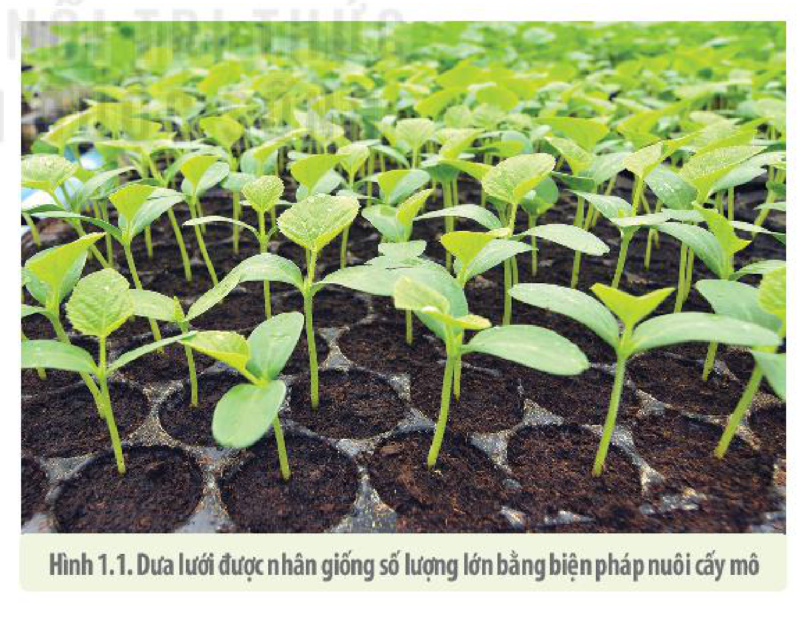
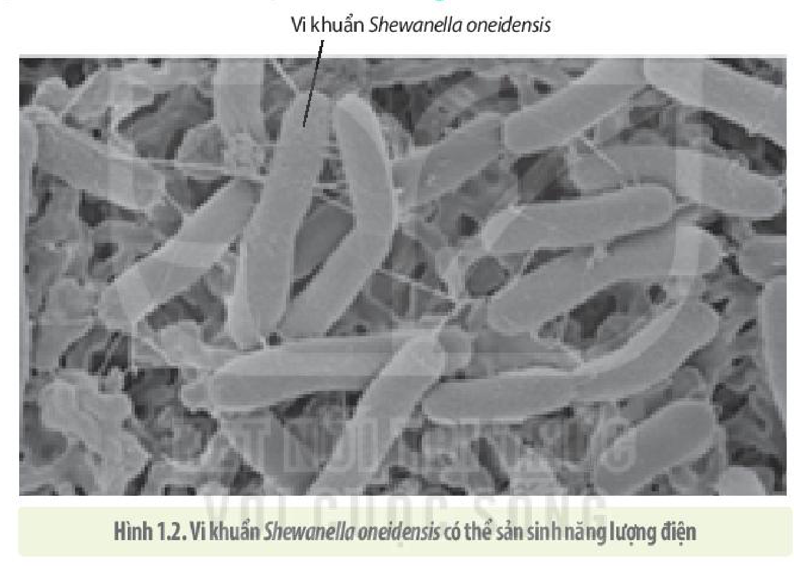
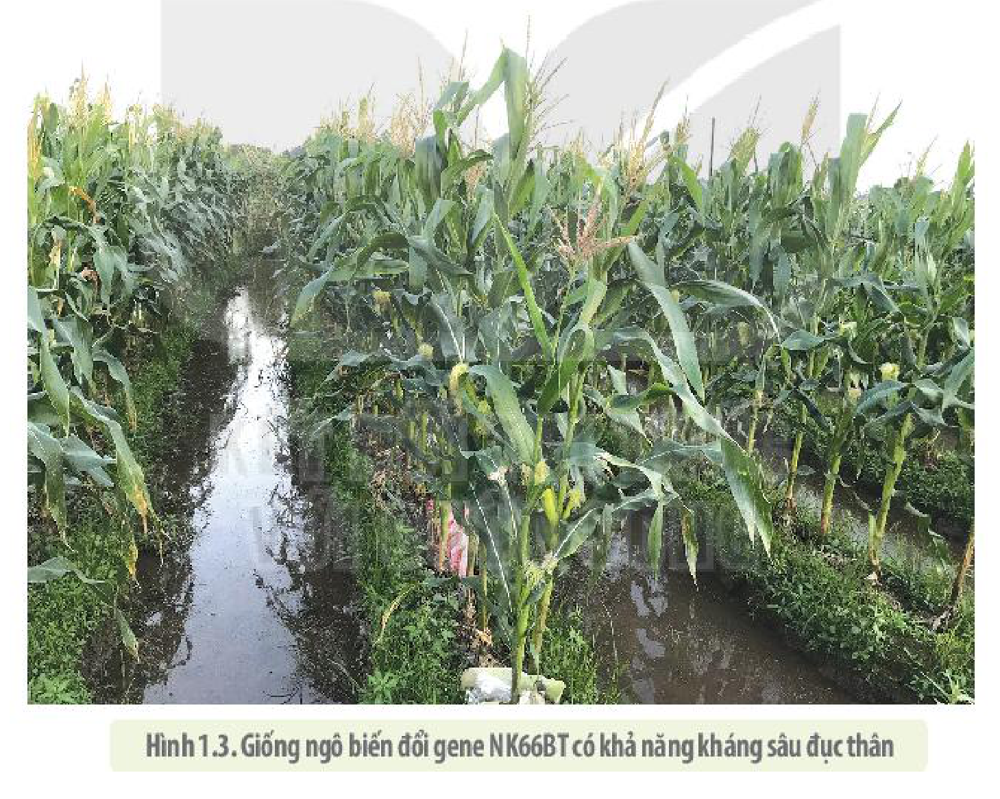

<!-- pdf:6 -->

# BÀI 1: GIỚI THIỆU KHÁI QUÁT MÔN SINH HỌC

## 🎯 Yêu cầu cần đạt

- Nêu được đối tượng và các lĩnh vực nghiên cứu của sinh học.
- Trình bày được mục tiêu môn Sinh học.
- Phân tích được vai trò của sinh học với cuộc sống hằng ngày, với sự phát triển kinh tế – xã hội và những vấn đề toàn cầu; mối quan hệ giữa sinh học với các vấn đề xã hội.
- Trình bày được định nghĩa về phát triển bền vững, vai trò của sinh học với sự phát triển bền vững môi trường sống.
- Nêu được triển vọng phát triển sinh học trong tương lai, tên các ngành nghề liên quan đến sinh học và các thành tựu công nghệ của một số ngành nghề chủ chốt.

## 🔴 Mở đầu

Không chỉ đồ ăn thức uống, quần áo và nhiều vật dụng chúng ta sử dụng hằng ngày là sản phẩm trực tiếp có liên quan đến sinh học, mà ngay cả một trí nhớ tuyệt vời, một giọng ca để đời hay một khả năng hội hoạ xuất chúng bạn có được cũng do tổ hợp gene đặc biệt của bạn tương tác với một môi trường học tập phù hợp. Vậy sinh học nghiên cứu những gì và có vai trò như thế nào với đời sống xã hội?

## I. SINH HỌC VÀ CÁC LĨNH VỰC CỦA SINH HỌC

### 1. Khái niệm và đối tượng của sinh học

**Sinh học** là ngành khoa học nghiên cứu về sự sống. Vì vậy, đối tượng của sinh học chính là các sinh vật cùng các cấp độ tổ chức của thế giới sống.

### 2. Mục tiêu của sinh học

Mục tiêu của sinh học là tìm hiểu cấu trúc và sự vận hành của các quá trình sống ở các cấp độ tổ chức của sự sống, qua đó, con người có thể điều khiển, tối ưu hoá được nguồn tài nguyên sinh học cũng như phi sinh học, phục vụ cho sự phát triển của xã hội loài người một cách bền vững.

### 3. Các lĩnh vực nghiên cứu của sinh học

Các lĩnh vực nghiên cứu sinh học có thể chia thành hai loại chính là **nghiên cứu cơ bản** và **nghiên cứu ứng dụng**. Lĩnh vực nghiên cứu cơ bản tập trung vào tìm hiểu cấu trúc của các cấp độ tổ chức sống, phân loại, cách thức vận hành và tiến hoá của thế giới sống.

<!-- pdf:7 -->

Lĩnh vực **nghiên cứu ứng dụng** khám phá thế giới sống tìm cách đưa những phát kiến mới về sinh học ứng dụng vào thực tiễn đời sống. Hai lĩnh vực này ngày càng giao thoa với nhau, nhiều nghiên cứu cơ bản trong sinh học kết hợp với các ngành khoa học khác nhau và với sự phát triển của các ngành công nghệ đã và đang đưa các thành tựu sinh học vào thực tiễn đời sống. Ở góc độ môn học trong Chương trình Giáo dục phổ thông, chúng ta sẽ lần lượt nghiên cứu sinh học theo các lĩnh vực phân chia dựa trên các cấp độ tổ chức của thế giới sống. Lớp 10 tìm hiểu về sinh học tế bào và thế giới vi sinh vật; lớp 11 nghiên cứu sinh học cơ thể; lớp 12 nghiên cứu di truyền học, tiến hoá và sinh thái học.

### 4. Vai trò của sinh học

Có lẽ không có ngành khoa học nào lại liên quan đến mọi mặt đời sống xã hội của con người như sinh học. Những hiểu biết về sinh học, đặc biệt về thế giới vi sinh vật trong nhiều thập kỉ qua đã giúp giảm tỉ lệ bệnh tật, gia tăng đáng kể tuổi thọ của con người qua sự cải thiện điều kiện vệ sinh, chăm sóc sức khoẻ và điều trị bệnh tật. Những phát hiện về giá trị dinh dưỡng của các loại thực phẩm, các hoạt chất có khả năng chữa bệnh từ các sinh vật trong tự nhiên, không chỉ giúp chúng ta có cuộc sống mạnh khoẻ hơn mà còn biết tôn trọng, yêu quý và gìn giữ sự đa dạng của sinh giới.

Vai trò của sinh học vô cùng đa dạng và to lớn, nó không chỉ giúp con người khoẻ mạnh hơn, sống lâu hơn mà còn tác động vào đời sống học tập, đời sống tinh thần hằng ngày của con người. Hãy thử tưởng tượng xem, kết quả học tập của chúng ta có sự đóng góp của sinh học hay không? Nếu có sự hiểu biết về sinh lí học của trí nhớ, chúng ta có thể cải thiện kết quả học tập của mình một cách đáng kể. Bạn có sự hưng phấn trong trí óc, biết tuân thủ các nguyên lí lưu trữ thông tin của bộ não và với sự quyết tâm cao thì kết quả học tập chắc chắn sẽ có sự tiến bộ đáng kể. Các em hãy khám phá thêm sinh học còn có những vai trò gì trong cuộc sống của chúng ta.

### 5. Sinh học trong tương lai

Sự kết hợp của ngành sinh học với hoá học, tin học, toán học và vật lí đang hình thành nên một ngành mới được gọi là **sinh học hệ thống**. Một trong những ứng dụng của sinh học hệ thống trong nghiên cứu sinh học phân tử đem lại giá trị ứng dụng cao trong y – dược là sản xuất thuốc chữa bệnh. Ví dụ: Hàng nghìn loại protein trong tế bào tương tác với nhau duy trì sự sống theo cách vô cùng phức tạp, các nhà khoa học cùng phối hợp dùng phần mềm tin học chuyên dụng để mô tả kiểu tương tác giữa các protein, từ đó có thể dự đoán được nếu một protein nào bị đột biến, mất chức năng thì hậu quả sẽ ra sao, đặc điểm bệnh lí nào sẽ xuất hiện. Nhờ vậy, việc thử một loại thuốc sẽ được kiểm nghiệm nhanh chóng trên mô hình máy tính trước khi đưa vào thử nghiệm trên động vật.

<!-- term: Vaccine mRNA -->
Kết quả thử nghiệm thuốc trên động vật lại được đưa vào cơ sở dữ liệu để điều chỉnh cho đến khi tìm được mô hình tối ưu. Nhờ đó, có thể sản xuất được thuốc đặc hiệu ức chế các protein gây bệnh (được gọi là **thuốc hướng đích**). Việc sản xuất thuốc hướng đích sẽ diễn ra nhanh hơn. Thành tựu mới nhất trong việc sản xuất vaccine mRNA là một ví dụ. Giải trình tự hệ gene của SARS – CoV – 2 giúp các nhà khoa học tìm ra trình tự nucleotide của gene quy định gai protein của virus. Từ đó có thể tổng hợp nên mRNA nhân tạo quy định trình tự gai protein của virus, sau đó bao bọc chúng trong màng phospholipids rồi tiêm vào người để tế bào người tạo ra protein gai của virus. Nhờ vậy, hệ thống miễn dịch được kích hoạt tạo ra kháng thể chống lại virus. Loại vaccine mới này đã được sản xuất thành công trong một thời gian ngắn.

<!-- pdf:8 -->

## II. CÁC NGÀNH NGHỀ LIÊN QUAN ĐẾN SINH HỌC
<!-- ocr-ok: tiêu đề mục chữ in hoa trang trí, OCR đọc sai ký tự; đã đối chiếu ảnh -->

### 1. Sinh học và các ngành y – dược học

Thành tựu trong giải trình tự hệ gene người và nhiều loài sinh vật khác nhau trong thời gian gần đây đã giúp con người sản xuất ra nhiều loại thuốc được gọi là thuốc hướng đích, các loại thuốc này tác động tới những loại protein riêng biệt để chữa các bệnh hiểm nghèo như ung thư.

Y học đang hướng đến cá thể hoá việc chăm sóc sức khoẻ và chữa trị bệnh tật. Các loại thuốc hướng đích ở cấp độ nano có thể tự tìm đến các tế bào đích, tương tác đặc hiệu với các phân tử trong tế bào bị bệnh, giúp giảm đáng kể tác động không mong muốn ở nhiều loại thuốc.

### 2. Sinh học và ngành pháp y

Từ sợi tóc, vết máu hay các tế bào khác nhau để lại trên hiện trường của vụ án, các nhân viên điều tra có thể truy tìm ra chủ nhân của chúng thông qua việc giải trình tự DNA. Những trình tự nucleotide đặc biệt có thể giúp nhận diện từng cá thể cũng như dấu vân tay của mỗi người nên được gọi là **dấu vân tay DNA**. Nhờ dấu vân tay DNA chúng ta có thể xác định được nhân thân của những nạn nhân trong các vụ tai nạn và xác định được quan hệ huyết thống. Trong tương lai, dấu vân tay DNA cũng có thể được dùng thay dấu vân tay trong thẻ căn cước công dân hiện nay.

### 3. Sinh học và các ngành nông – lâm – ngư nghiệp

Từ xa xưa, những hiểu biết về các đặc điểm sinh học của vật nuôi, cây trồng đã giúp con người tạo ra những giống vật nuôi, cây trồng có năng suất, chất lượng cao, giúp hiệu quả chăn nuôi và trồng trọt tăng lên rõ rệt.

<!-- term: Nuôi cấy mô -->
Công nghệ di truyền trong thời gian gần đây và trong tương lai còn giúp các nhà sinh học có thể chuyển gene từ loài này sang loài khác hoặc biến đổi gene của một loài sinh vật, tạo ra những **sinh vật chuyển gene** hay còn gọi là **biến đổi gene** theo nhu cầu của con người. **Sinh vật biến đổi gene** có thể đem lại năng suất cao, chất lượng tốt hoặc giá trị chữa bệnh với giá thành rẻ. Trong lâm nghiệp, những giống cây lâu năm có giá trị cao có thể được nhân giống vô tính mà không cần phải mất nhiều thời gian chờ cây sinh trưởng, ra hoa, kết trái. Các giống cây chống chịu virus cũng có thể được nhân giống bằng biện pháp nuôi cấy mô (H 1.1).

Hình 1.1. Dưa lưới được nhân giống số lượng lớn bằng biện pháp nuôi cấy mô

<!-- pdf:9 -->

Nhiều loài động vật đã được nhân bản thành công như cừu, bò, mèo, khỉ, lợn,... Những sinh vật biến đổi gene tạo ra các sản phẩm protein chữa bệnh cho con người có thể được nhân bản để gia tăng số lượng. Các nhà khoa học hi vọng trong tương lai có thể hồi sinh được những sinh vật đã bị tuyệt chủng.

### 4. Sinh học và công nghệ thực phẩm

Không chỉ giúp tạo ra sản phẩm làm thức ăn, thuốc chữa bệnh, nghiên cứu sinh học còn giúp ngành công nghệ chế biến thực phẩm sản xuất ra nhiều loại thức ăn, nước uống có giá trị dinh dưỡng cao như sữa chua và các sản phẩm của quá trình **lên men** khác, đáp ứng được nhu cầu rất đa dạng của con người ở mọi lứa tuổi.

Những hiểu biết về vi sinh vật, hô hấp tế bào còn giúp con người có được các biện pháp bảo quản thực phẩm lâu dài mà vẫn đảm bảo chất lượng.

### 5. Sinh học và vấn đề bảo vệ môi trường

Hình 1.2. Vi khuẩn *Shewanella oneidensis* có thể sản sinh năng lượng điện

Việc giải trình tự hệ gene của nhiều loài vi sinh vật đã mở ra những tiềm năng ứng dụng vi sinh vật trong giải quyết các vấn đề về môi trường và năng lượng. Ví dụ: Loài *Deinococcus radiodurans* là vi khuẩn chống chịu được phóng xạ tốt nhất được biết đến. Sinh vật này có thể giúp chúng ta làm sạch các địa điểm bị ô nhiễm phóng xạ và các hoá chất độc hại. Nghiên cứu hệ gene của các loài vi sinh vật sử dụng $\text{CO}_2$ làm nguồn carbon duy nhất có thể giúp làm giảm lượng $\text{CO}_2$ trong khí quyển. Vi khuẩn *Chlorobium tepidum* có khả năng sản sinh ra năng lượng từ ánh sáng. Một số vi khuẩn khác như *Shewanella oneidensis* (H 1.2) không chỉ hữu ích trong việc làm sạch nước nhiễm thuỷ ngân, chì và sắt mà còn có khả năng sản sinh năng lượng điện. Nghiên cứu sử dụng các loài sinh vật như vậy góp phần tạo ra nguồn năng lượng sạch trong tương lai.

Kết quả nghiên cứu trên nhiều đối tượng sinh vật còn làm xuất hiện những ngành nghề mới như **phỏng sinh học** hay **bắt chước sinh học**. Nhiều robot và vật dụng được sản xuất dựa trên những nguyên lí vận hành của các sinh vật đã và đang đem lại những lợi ích to lớn cho xã hội.

<!-- pdf:10 -->

## ❓ Dừng lại và suy ngẫm

1. Hãy nêu các lĩnh vực nghiên cứu sinh học được tìm hiểu trong cấp Trung học phổ thông.
2. Hãy nêu một số thành tựu ứng dụng sinh học trong đời sống.
3. Lĩnh vực và ngành nghề nào của sinh học mà em muốn theo đuổi? Theo em, triển vọng tương lai của ngành nghề đó như thế nào?

## III. SINH HỌC VỚI SỰ PHÁT TRIỂN BỀN VỮNG VÀ NHỮNG VẤN ĐỀ XÃ HỘI

### 1. Khái niệm phát triển bền vững

Theo định nghĩa của Uỷ ban Môi trường và Phát triển Thế giới (WCED) của Liên Hợp quốc (1987), **phát triển bền vững** được hiểu là sự phát triển đáp ứng được nhu cầu của xã hội hiện tại, nhưng không làm tổn hại đến khả năng tiếp cận với nhu cầu phát triển của các thế hệ tương lai.

Khoa học phát triển đem lại những ứng dụng thực tiễn to lớn không thể phủ nhận, tuy nhiên cũng mang đến nhiều thách thức đối với đời sống xã hội. Sự gia tăng dân số đã và đang làm cạn kiệt nguồn tài nguyên thiên nhiên, giảm đa dạng sinh vật, gia tăng ô nhiễm môi trường và các vấn đề liên quan như sự ấm lên toàn cầu, nước biển dâng,... không chỉ đe doạ đến sự tồn vong của loài người mà cả hàng triệu loài sinh vật khác trên Trái Đất. Đương đầu với những thách thức như vậy, đòi hỏi sự nỗ lực của các nhà sinh học và các nhà khoa học khác, các chuyên gia y tế, các nhà giáo dục học, các nhà chính trị và cả các công dân có sự hiểu biết nhất định về sinh học.

### 2. Vai trò của sinh học trong phát triển bền vững

Việc phổ biến kiến thức sinh học cơ bản liên quan đến bảo vệ sự đa dạng sinh vật, khai thác tài nguyên thiên nhiên hợp lí,... không chỉ cần thiết ở trong nhà trường mà phải qua mọi phương tiện thông tin đại chúng đến mọi người trong xã hội.

Mọi nghiên cứu sinh học cũng cần tính đến việc có tác động như thế nào đến môi trường, xã hội và phải hướng tới sự phát triển bền vững. Ví dụ: Nghiên cứu tạo giống mới không chỉ chú trọng đến năng suất cao, chất lượng tốt, mà còn phải xem xét giống mới ảnh hưởng như thế nào đến các loài sinh vật trong tự nhiên và liệu có tác động tiêu cực đến sức khoẻ con người hay không?

Nghiên cứu sinh học góp phần cung cấp cơ sở khoa học giúp cho chính phủ có những chiến lược phát triển kinh tế phù hợp với sự phát triển bền vững. Ví dụ: Nghiên cứu về hệ sinh thái và sự ấm lên toàn cầu giúp cho việc quy hoạch xây dựng các đập thuỷ điện, đường sá, nhà máy,...

Phát triển bền vững đòi hỏi mỗi người trong xã hội cần có ý thức trách nhiệm bảo vệ nguồn tài nguyên thiên nhiên, bảo vệ môi trường. Việc trang bị kiến thức tối thiểu về sinh học không những giúp chúng ta trở thành nhà tiêu dùng thông thái, biết cách bảo vệ sức khoẻ bản thân mà còn xây dựng xã hội phát triển bền vững cho các thế hệ mai sau.

<!-- pdf:11 -->

### 3. Sinh học và những vấn đề xã hội

**a) Sinh học và vấn đề đạo đức**

Xét ở góc độ đạo đức của xã hội loài người, nghiên cứu sinh học cũng làm nảy sinh vấn đề đạo đức và được gọi là **đạo đức sinh học**. Ví dụ: Việc giải trình tự hệ gene của một người có thể giúp cho công tác chữa bệnh được hiệu quả, nhưng những ai có quyền biết thông tin này? Liệu các công ty bảo hiểm có sẵn sàng bảo hiểm cho một người khi biết rằng người đó mang gene quy định một bệnh hiểm nghèo? Liệu kĩ thuật chỉnh sửa gene hiện đang phát triển có nên áp dụng để chỉnh sửa gene của người? Liệu xã hội có cho phép nhân bản vô tính con người? Liệu các giống cây trồng biến đổi gene có thực sự an toàn với con người?

**b) Sinh học và kinh tế**

<!-- term: Nuôi cấy mô -->
Những ứng dụng của sinh học đã đem lại giá trị kinh tế vô cùng to lớn cho con người. Ví dụ: Những giống vật nuôi, cây trồng có năng suất, chất lượng cao, khả năng chống chịu tốt được tạo ra bằng phương pháp gây đột biến nhân tạo và lai hữu tính hay những giống cây trồng biến đổi gene mang những đặc tính đặc biệt hữu ích được nhân nhanh bằng kĩ thuật nuôi cấy mô tế bào đã giúp nâng cao hiệu quả kinh tế.

Hình 1.3. Giống ngô biến đổi gene NK66BT có khả năng kháng sâu đục thân

Tuy nhiên, bên cạnh những lợi ích cũng có nhiều vấn đề phát sinh khi áp dụng công nghệ sinh học vào thực tiễn. Ví dụ: Khi trồng cây giống tạo ra từ phương pháp nuôi cấy mô tế bào trên diện tích lớn sẽ tiềm ẩn rủi ro mất mùa nếu điều kiện môi trường bất lợi với cây trồng,...

**c) Sinh học và công nghệ**

Nghiên cứu sinh học cơ bản còn giúp phát triển các công nghệ bắt chước các sinh vật (**công nghệ phỏng sinh học**) áp dụng trong cải tiến, tối ưu hoá các công cụ máy móc. Ví dụ: Nghiên cứu tập tính của các loài côn trùng như kiến, người ta có thể chế tạo ra robot hoạt động độc lập nhưng có thể "giao tiếp" với nhau để thực hiện một nhiệm vụ nhất định đã được lập trình.

<!-- pdf:12 -->

## ❓ Dừng lại và suy ngẫm

1. Thế nào là phát triển bền vững?
2. Liệt kê một số hoạt động hằng ngày của chúng ta có thể ảnh hưởng đến sự phát triển bền vững.
3. Xét ở góc độ nhà sinh học, em hãy giải thích xem sinh học đóng vai trò như thế nào trong sự phát triển bền vững môi trường sống và những vấn đề toàn cầu.
4. Hãy giải thích mối quan hệ của sinh học với kinh tế, công nghệ và vấn đề đạo đức xã hội.

## 📌 Kiến thức cốt lõi

- Sinh học nghiên cứu sự sống ở tất cả các cấp độ từ phân tử, tế bào, cơ thể đa bào, quần thể, quần xã và hệ sinh thái nhằm tìm hiểu cơ chế vận hành sự sống ở tất cả các cấp độ.
- Nghiên cứu sinh học đem lại nhiều ứng dụng trong mọi mặt của đời sống xã hội con người như y – dược học, công nghệ thực phẩm, bảo vệ môi trường, nông – lâm – ngư nghiệp,...
- Nghiên cứu sinh học cần hướng tới sự phát triển bền vững, khi mọi nhu cầu của đời sống xã hội được thoả mãn nhưng không làm tổn hại đến khả năng tiếp cận với nhu cầu phát triển của các thế hệ tương lai.
- Nghiên cứu sinh học cũng cần tính tới vấn đề đạo đức xã hội. Mọi tiến bộ của sinh học áp dụng vào đời sống không được vi phạm những chuẩn mực đạo đức xã hội.
- Tương lai của sinh học vô cùng to lớn nhờ sự kết hợp của sinh học với nhiều ngành khoa học tự nhiên khác nhau cũng như nhờ sự phát triển vượt bậc của công nghệ, đặc biệt là công nghệ tin học.

## ✏️ Luyện tập và vận dụng

1. Nếu trở thành một nhà sinh học, em chọn đối tượng và mục tiêu nghiên cứu là gì?
2. Hãy cho biết một vài vật dụng mà em dùng hằng ngày là sản phẩm có liên quan trực tiếp đến các ứng dụng sinh học.
3. Em cùng gia đình nên sử dụng những loại vật dụng gì để có thể góp phần giảm thiểu ô nhiễm môi trường? Tại sao chúng ta cần phân loại rác thải và hạn chế sử dụng sản phẩm làm phát sinh rác thải nhựa?
4. Nêu một ví dụ về nghiên cứu sinh học có thể gây nên mối lo ngại của xã hội về đạo đức sinh học.

## 📷 Danh sách hình trong bài

| Mã hình | Trang PDF | Vị trí | Chú thích gốc |
|---|---|---|---|
| H10-sinh-b01-01 | 8 | Mục II.3 | Hình 1.1. Dưa lưới được nhân giống số lượng lớn bằng biện pháp nuôi cấy mô |
| H10-sinh-b01-02 | 9 | Mục II.5 | Hình 1.2. Vi khuẩn *Shewanella oneidensis* có thể sản sinh năng lượng điện |
| H10-sinh-b01-03 | 11 | Mục III.3.b | Hình 1.3. Giống ngô biến đổi gene NK66BT có khả năng kháng sâu đục thân |
