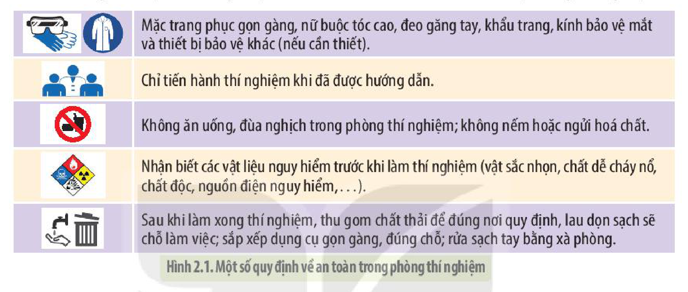
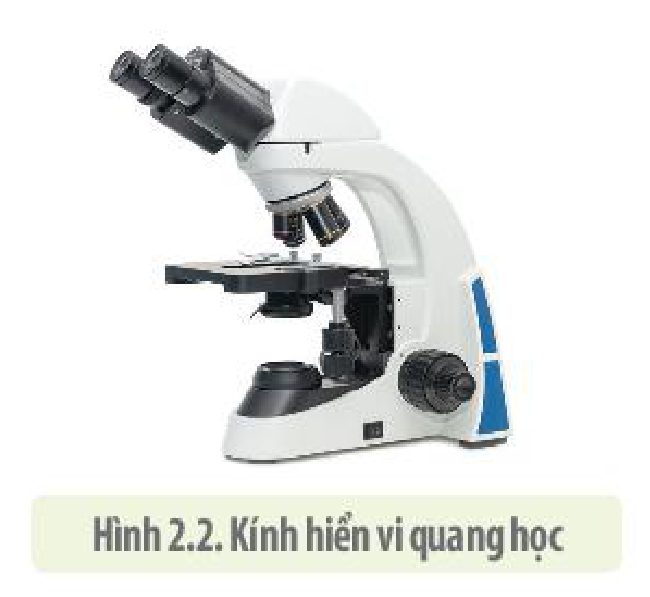
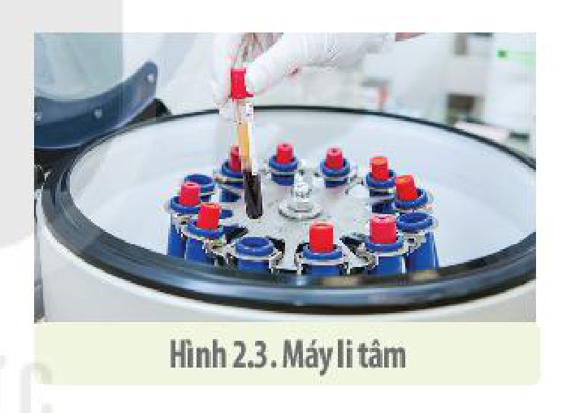
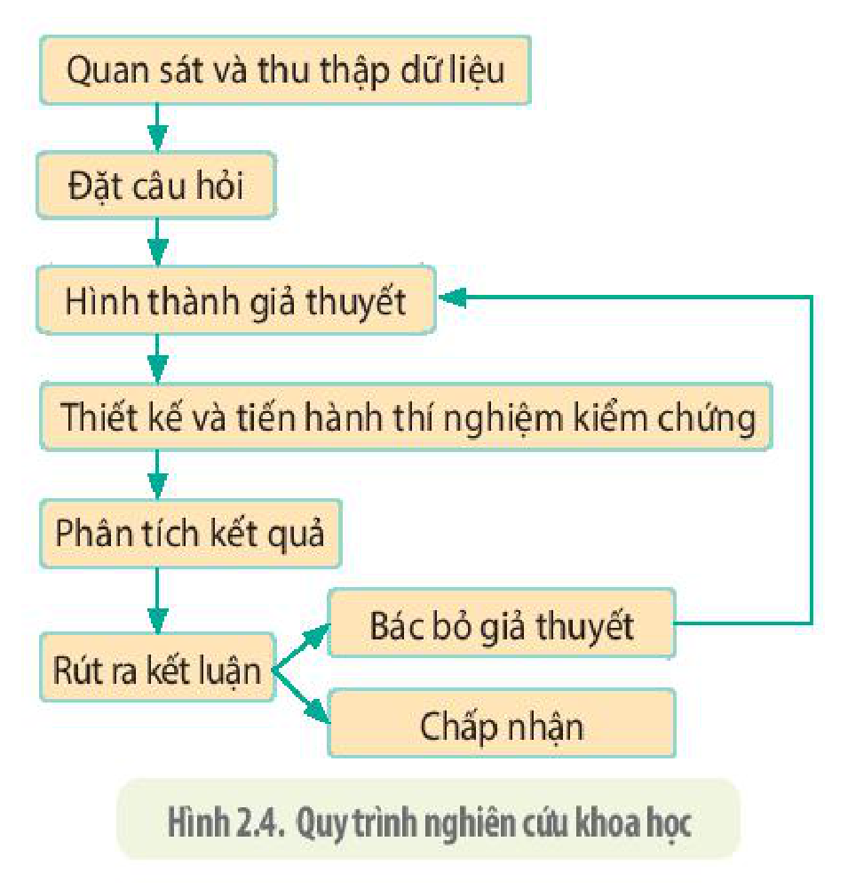
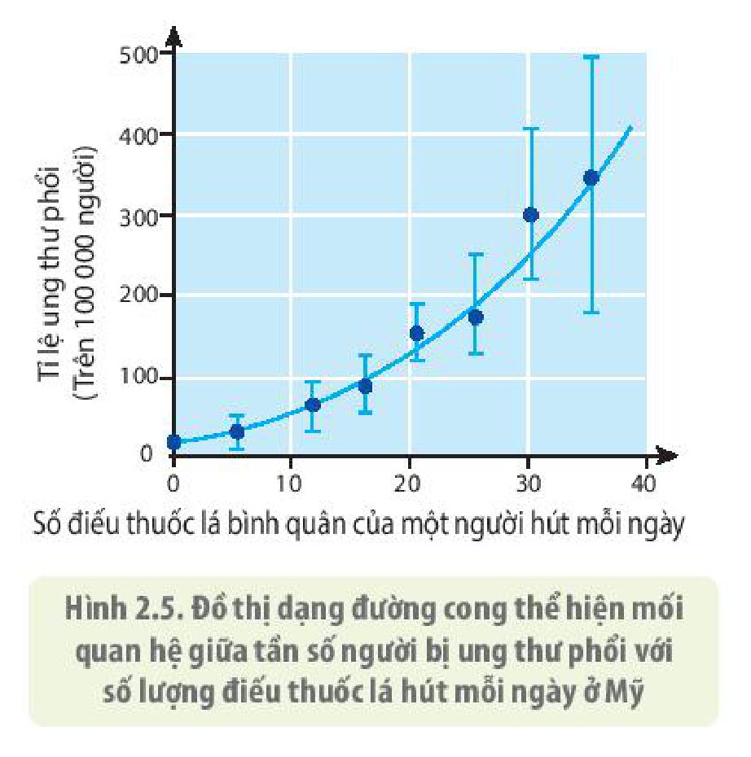

<!-- pdf:13 -->

# BÀI 2: PHƯƠNG PHÁP NGHIÊN CỨU VÀ HỌC TẬP MÔN SINH HỌC

## 🎯 Yêu cầu cần đạt

- Trình bày và vận dụng được một số phương pháp nghiên cứu sinh học: quan sát, một số phương pháp làm việc phòng thí nghiệm và phương pháp thực nghiệm khoa học.
- Nêu được một số thiết bị nghiên cứu và học tập môn Sinh học.
- Trình bày, vận dụng được quy trình và các kĩ năng trong tiến trình nghiên cứu khoa học.
- Giới thiệu được phương pháp tin sinh học như là công cụ hữu ích trong nghiên cứu và học tập sinh học.

## 🔴 Mở đầu

Để nghiên cứu các đối tượng của sinh học cần có phương pháp và thiết bị phù hợp. Các thiết bị và phương pháp nào thường được dùng trong nghiên cứu và học tập môn Sinh học?

## I. PHƯƠNG PHÁP NGHIÊN CỨU SINH HỌC

### 1. Phương pháp quan sát

<!-- term: Phương pháp quan sát -->
Bất cứ công trình nghiên cứu sinh học nào cũng được bắt đầu từ các quan sát và được thực hiện qua các bước:

<!-- term: Phương pháp quan sát -->
- Lựa chọn đối tượng và phạm vi quan sát: Đối tượng quan sát là những sinh vật và các quá trình sống diễn ra trong tự nhiên cũng như ở trong phòng thí nghiệm (với các điều kiện được kiểm soát chặt chẽ).
- Lựa chọn công cụ quan sát: Việc quan sát có thể được thực hiện bằng các giác quan hay thông qua sự hỗ trợ của các công cụ đơn giản hoặc các thiết bị tinh xảo.
- Ghi chép số liệu: Số liệu quan sát có thể được thu nhận bởi giác quan hoặc thông qua các thiết bị quan sát như máy ghi âm, ghi hình. Các số liệu ghi chép được phải đủ lớn (được lặp đi lặp lại nhiều lần) và phải khách quan để có thể xử lí bằng phương pháp toán thống kê và xác suất.

### 2. Phương pháp làm việc trong phòng thí nghiệm

**a) Phương pháp đảm bảo an toàn khi làm việc trong phòng thí nghiệm**

Người nghiên cứu cần tuân thủ các quy định để giữ an toàn cho bản thân và các thiết bị, tài sản của phòng thí nghiệm.

- Các lưu ý về an toàn cháy nổ, an toàn về hoá chất: Khi làm việc với những hoá chất độc hại dễ bay hơi cần phải thực hiện ở nơi có tủ hút khí độc hoặc ở nơi thoáng khí. Tuân thủ các quy tắc pha hoá chất để tránh xảy ra cháy nổ, đặc biệt khi sử dụng acid hoặc những chất dễ cháy nổ như cồn. Kiểm tra sự vận hành của các thiết bị phòng chống cháy nổ, các máy móc hút mùi, chống độc, các trang thiết bị cấp cứu khi có sự cố.
- Vận hành thiết bị: Trước khi sử dụng bất cứ thiết bị nào trong phòng thí nghiệm, người nghiên cứu cần phải nắm được quy tắc vận hành máy móc, thiết bị để có thể thu được kết quả chính xác nhất và không làm hư hại máy móc, thiết bị. Cần ghi lại nhật kí làm việc và tình trạng hoạt động vận hành của máy móc.

<!-- pdf:14 -->

- Trang bị cá nhân: Tuỳ theo từng yêu cầu của nghiên cứu mà mỗi người khi làm việc trong phòng thí nghiệm cần phải có các trang thiết bị riêng biệt. Thông thường, để đảm bảo an toàn, người thực hiện nghiên cứu phải mặc áo choàng, đeo găng tay, kính bảo hộ hoặc mặt nạ để tránh tiếp xúc với hoá chất độc hại, vi sinh vật gây bệnh.

Quy tắc làm việc trong phòng thí nghiệm thường được ghi trong nội quy phòng thí nghiệm của mỗi trường và được các thầy cô phổ biến mỗi khi các em bước vào phòng thí nghiệm.

- Mặc trang phục gọn gàng, nữ buộc tóc cao, đeo găng tay, khẩu trang, kính bảo vệ mắt và thiết bị bảo vệ khác (nếu cần thiết).
- Chỉ tiến hành thí nghiệm khi đã được hướng dẫn.
- Không ăn uống, đùa nghịch trong phòng thí nghiệm; không nếm hoặc ngửi hoá chất.
- Nhận biết các vật liệu nguy hiểm trước khi làm thí nghiệm (vật sắc nhọn, chất dễ cháy nổ, chất độc, nguồn điện nguy hiểm,...).
- Sau khi làm xong thí nghiệm, thu gom chất thải để đúng nơi quy định, lau dọn sạch sẽ chỗ làm việc; sắp xếp dụng cụ gọn gàng, đúng chỗ; rửa sạch tay bằng xà phòng.

Hình 2.1. Một số quy định về an toàn trong phòng thí nghiệm

**b) Một số kĩ thuật phòng thí nghiệm**

Chúng ta sẽ xem xét một số kĩ thuật phòng thí nghiệm đơn giản có thể thực hiện tại phòng thí nghiệm sinh học của trường Trung học phổ thông.

- **Phương pháp giải phẫu**: Để tìm hiểu cấu trúc của cơ thể hay các bộ phận của tế bào, người ta thường phải tiến hành giải phẫu để quan sát các bộ phận cấu thành. Ví dụ: giải phẫu các bộ phận rễ, thân, lá của cây hay các bộ phận của cơ thể động vật.
- **Phương pháp làm tiêu bản tế bào/nhiễm sắc thể** (NST): Có nhiều cách khác nhau để có thể quan sát được các tế bào hay các cấu trúc bên trong tế bào như NST. Để quan sát tế bào, mẫu mô cần cắt thành lát đủ mỏng để có thể quan sát tế bào hoặc cấu trúc của tế bào dưới kính hiển vi.

Để quan sát NST của tế bào, có thể quan sát bằng **phương pháp làm tiêu bản tươi** theo các bước: mẫu vật sống được cố định bằng hoá chất và nhuộm màu, chia nhỏ mẫu, dầm ép để phá vỡ tế bào giải phóng các NST.

### 3. Phương pháp thực nghiệm khoa học

<!-- term: Phương pháp thực nghiệm khoa học -->
Các phương pháp nghiên cứu thực nghiệm sinh học có thể tiến hành ngay tại thực địa hoặc trong phòng thí nghiệm với các điều kiện môi trường được kiểm soát một cách chặt chẽ. Sinh học là môn khoa học thực nghiệm, vì vậy, có nhiều phương pháp thực nghiệm được sử dụng trong nghiên cứu sinh học, một số phương pháp thường được sử dụng như:

- **Phương pháp nghiên cứu, phân loại sinh vật**: định danh dựa trên hình thái của sinh vật, phân tích gene, phân lập (đối với vi khuẩn).
- **Phương pháp tách chiết**: tách enzyme, gene, các chất có hoạt tính sinh học.
- **Phương pháp nuôi cấy**: nuôi cấy vi khuẩn; nuôi cấy mô tế bào động vật, thực vật; nuôi động vật, thực vật trong phòng thí nghiệm và ngoài thực địa;...

<!-- pdf:15 -->

## II. CÁC THIẾT BỊ NGHIÊN CỨU VÀ HỌC TẬP MÔN SINH HỌC

Có rất nhiều thiết bị khác nhau từ đơn giản đến phức tạp và tinh vi được sử dụng trong nghiên cứu sinh học. Dưới đây là một số thiết bị chính liên quan đến nghiên cứu sinh học ở cấp độ tế bào.

### 1. Kính hiển vi

Dựa trên nguồn sáng được sử dụng, kính hiển vi được chia thành hai loại: **kính hiển vi quang học** và **kính hiển vi điện tử**. Kính hiển vi quang học (H 2.2) sử dụng nguồn sáng điện hay ánh sáng mặt trời chiếu lên mẫu vật, còn kính hiển vi điện tử sử dụng nguồn sáng là các chùm electron chiếu qua hoặc lên bề mặt của mẫu vật.

Hình 2.2. Kính hiển vi quang học

Ba thông số quan trọng của kính hiển vi là độ phóng đại, độ phân giải và độ tương phản. Độ phóng đại của kính hiển vi quang học tối đa là 1 500 lần và độ phân giải chỉ khoảng 200 nm. Trong khi đó, độ phóng đại của kính hiển vi điện tử (TEM) có thể lên tới 50 triệu lần và độ phân giải nhỏ hơn 1 Å. Kính hiển vi điện tử giúp con người nghiên cứu cấu trúc siêu hiển vi của tế bào cũng như cấu trúc phân tử.

### 2. Máy li tâm

**Máy li tâm** được sử dụng trong **kĩ thuật phân đoạn tế bào**. Đây là kĩ thuật tách các loại bào quan dựa trên khối lượng của chúng. Để tách và phân lập các bào quan, chúng ta cần phá vỡ các tế bào, sau đó cho vào ống nghiệm đem li tâm trong máy li tâm. Lực li tâm ở các tốc độ vòng quay khác nhau làm cho các bộ phận tế bào có khối lượng khác nhau được tách riêng và nằm ở các vùng khác nhau của ống li tâm (H 2.3).

Hình 2.3. Máy li tâm

### 3. Các thiết bị khác

Ở môn Sinh học bậc Trung học phổ thông, các thiết bị đơn giản khác mà chúng ta hay sử dụng là các loại kính lúp, ống hút đơn giản hay pipet, một số loại ống hút có thể điều chỉnh định lượng dung dịch cần lấy một cách rất chính xác.

Khi sử dụng bất cứ loại thiết bị thí nghiệm nào dù đơn giản hay phức tạp, chúng ta cần hiểu rõ cấu trúc, cách vận hành và sử dụng thiết bị để tránh làm hư hỏng dụng cụ, máy móc thiết bị cũng như thu được kết quả chính xác và đảm bảo an toàn.

## ❓ Dừng lại và suy ngẫm

1. Trình bày phương pháp đảm bảo an toàn khi làm việc trong phòng thí nghiệm.
2. Hãy kể tên một số thiết bị nghiên cứu trong phòng thí nghiệm của trường em và cho biết những thiết bị này dùng để nghiên cứu lĩnh vực nào của sinh học.
3. So sánh đặc điểm của kính hiển vi quang học và kính hiển vi điện tử.

## III. CÁC KĨ NĂNG TRONG TIẾN TRÌNH NGHIÊN CỨU KHOA HỌC

Tiến trình nghiên cứu khoa học có thể tóm lược qua quy trình khái quát như hình 2.4.

<!-- pdf:16 -->

Hình 2.4. Quy trình nghiên cứu khoa học

### 1. Quan sát, thu thập dữ liệu

Mọi nghiên cứu đều bắt đầu từ những quan sát để thu thập dữ liệu. Điều quan trọng trong khi quan sát là cần rèn luyện đức tính kiên trì, thận trọng. Việc sử dụng các công cụ nghiên cứu thích hợp cũng giúp các nhà khoa học thu được các số liệu chính xác và nhanh chóng. Dữ liệu thu được sau khi quan sát được dùng để hình thành nên các giả thuyết khoa học.

### 2. Đặt câu hỏi

Sau khi thu được số liệu, các nhà khoa học thường đặt ra các câu hỏi và tìm cách lí giải (đưa ra giả thuyết).

### 3. Hình thành giả thuyết

Những cách giải thích có thể kiểm chứng được bằng thực nghiệm cho các câu hỏi đề ra được gọi là **giả thuyết khoa học**.

Một giả thuyết chỉ được gọi là khoa học khi nó có thể được kiểm chứng bằng thực nghiệm. Để có thể kiểm chứng được giả thuyết, các nhà khoa học sử dụng cách suy luận logic ngược lại với quy nạp, đi từ cái chung tới cái riêng, được gọi là **diễn giải**. **Suy luận diễn giải** giúp chúng ta suy diễn từ giả thuyết hay nguyên lí chung ra những điều tất yếu sẽ xảy ra nếu giả thuyết hay nguyên lí đó là đúng. Những điều tất yếu sẽ xảy ra mà chúng ta có thể suy ra từ giả thuyết hay nguyên lí chung được gọi là các **dự đoán**. Dự đoán được diễn đạt dưới dạng "nếu ... thì".

### 4. Thiết kế và tiến hành thí nghiệm kiểm chứng

Thí nghiệm kiểm chứng thường được thiết kế thành hai lô: Một lô được gọi là **lô đối chứng**, một lô được gọi là **lô thí nghiệm**. Đối tượng nghiên cứu trong hai lô phải giống nhau về số lượng cũng như mọi đặc điểm sinh học. Môi trường nuôi dưỡng và mọi yếu tố của môi trường ở hai lô đều giống nhau ngoại trừ yếu tố cần nghiên cứu.

Ví dụ: Để nghiên cứu sự tác động của một loại nguyên tố khoáng lên sự sinh trưởng của cây trồng cần thiết kế hai lô thí nghiệm, trong đó cả hai lô cùng trồng một loài cây, các cây có cùng độ tuổi sinh lí với số lượng cây như nhau và được đặt trong cùng một điều kiện môi trường. Ở lô thí nghiệm, bón cho cây đầy đủ các nguyên tố khoáng thiết yếu, còn lô đối chứng vẫn bón đầy đủ các nguyên tố khoáng như lô thí nghiệm, ngoại trừ nguyên tố khoáng cần nghiên cứu. So sánh sự khác biệt của cây ở hai lô sẽ cho thấy ảnh hưởng của nguyên tố khoáng nghiên cứu lên cây.

### 5. Phân tích kết quả nghiên cứu và xử lí dữ liệu

Dữ liệu thu được từ các quan sát thực địa hay từ các thí nghiệm trong phòng thí nghiệm cần phải được xử lí thận trọng để có thể rút ra được những kết luận phù hợp. Dữ liệu thường được các nhà khoa học trình bày dưới dạng bảng biểu, đồ thị khác nhau (đường thẳng, đường cong, dạng cột,...). Đồ thị có hai thông số được ghi trên trục tung và trục hoành được gọi là các **biến**. Trục hoành thường thể hiện sự thay đổi của **biến độc lập**, loại thông số mà nhà nghiên cứu có thể chủ động thay đổi. Trục tung thường thể hiện sự thay đổi của **biến phụ thuộc**. Ví dụ: đồ thị trong hình 2.5, ở trục hoành biểu diễn số lượng điếu thuốc lá hút mỗi ngày là biến độc lập, còn ở trục tung là tần suất bị ung thư phổi trên 100 000 người là biến phụ thuộc. Giá trị của biến phụ thuộc thay đổi theo biến độc lập. Biến phụ thuộc thay đổi như thế nào khi biến độc lập thay đổi là điều mà nhà nghiên cứu muốn tìm hiểu.

<!-- pdf:17 -->

Để giải thích số liệu trên đồ thị cần phải trải qua các bước phân tích đồ thị chung như sau:

- Xác định biến nào là biến độc lập, biến nào là biến phụ thuộc và các đơn vị trên trục tung và trục hoành tương ứng là gì.
- Giải thích sự thay đổi của các biến thế nào? Nhanh hay chậm? Có tuyến tính hay không?
- Rút ra kết luận, kết quả thí nghiệm ủng hộ hoặc bác bỏ giả thuyết.

Hình 2.5. Đồ thị dạng đường cong thể hiện mối quan hệ giữa tần số người bị ung thư phổi với số lượng điếu thuốc lá hút mỗi ngày ở Mỹ

Một việc quan trọng trong xử lí số liệu nghiên cứu là sử dụng các công cụ của phân tích thống kê. Sử dụng toán thống kê không chỉ giúp các nhà nghiên cứu xác định được cỡ mẫu thích hợp mà còn giúp khẳng định được kết quả sai khác giữa nhóm đối chứng và nhóm thực nghiệm có thực sự có ý nghĩa thống kê hay chỉ là sự sai khác ngẫu nhiên. Nếu sai khác là ngẫu nhiên thì giả thuyết bị bác bỏ.

### 6. Rút ra kết luận

Kết quả nghiên cứu thường được thẩm định và công bố trên các tạp chí khoa học và các nhà khoa học khác có thể tiến hành các thí nghiệm tương tự trên các đối tượng sinh vật khác nhau nhằm tìm kiếm thêm các bằng chứng ủng hộ giả thuyết. Một giả thuyết được kiểm nghiệm ở nhiều đối tượng khác nhau bởi các nhà khoa học khác nhau trên thế giới và được giới khoa học thừa nhận thì sẽ trở thành **học thuyết khoa học**.

## ❓ Dừng lại và suy ngẫm

1. Quan sát hình 2.4, nêu trình tự các bước trong tiến trình nghiên cứu khoa học.
2. Để hình thành nên một giả thuyết khoa học và kiểm chứng một giả thuyết, chúng ta cần sử dụng cách tư duy khoa học nào? Giải thích.
3. Nhóm đối chứng và nhóm thực nghiệm trong một thí nghiệm có gì khác nhau? Cho ví dụ minh hoạ.

## IV. TIN SINH HỌC – CÔNG CỤ NGHIÊN CỨU VÀ HỌC TẬP MÔN SINH HỌC

**Tin sinh học** (Bioinformatics) là ngành khoa học sử dụng các phần mềm máy tính chuyên dụng, các thuật toán, mô hình để lưu trữ, phân loại, phân tích các bộ dữ liệu sinh học ở quy mô lớn nhằm sử dụng chúng một cách có hiệu quả trong nghiên cứu khoa học và trong cuộc sống.

Tin sinh học đòi hỏi có sự cộng tác của các chuyên gia từ nhiều ngành khoa học khác nhau như các nhà sinh học phân tử, hoá học, vật lí, toán học và chuyên gia về công nghệ thông tin. Một trong số những ứng dụng của tin sinh học là dùng phần mềm máy tính tìm kiếm các gene trong hệ gene và so sánh các hệ gene của các loài với nhau để tìm hiểu mối quan hệ tiến hoá giữa các loài sinh vật. Tin sinh học hỗ trợ rất nhiều cho các nghiên cứu sinh học và làm xuất hiện chuyên ngành mới như sinh học hệ thống mà ta đã đề cập ở trên.

<!-- pdf:18 -->

Việc áp dụng trí tuệ nhân tạo trong nghiên cứu y sinh học còn đem lại nhiều ứng dụng tuyệt vời khác mà trước đây chúng ta khó có thể hình dung được. Ví dụ: Sử dụng trí tuệ nhân tạo để xử lí thông tin của bệnh nhân giúp các bác sĩ đưa ra được biện pháp chữa bệnh hiệu quả nhất cho từng bệnh nhân.

Để học tập môn Sinh học một cách có hiệu quả, chúng ta cũng có thể sử dụng các công cụ tin học đơn giản trong việc tìm kiếm, khai thác thông tin trên internet, sử dụng các chương trình tin học hay tự lập trình phần mềm mô tả các quá trình sinh học phức tạp. Ví dụ: Học sinh cũng có thể học và tự lập trình các phần mềm mô tả quá trình tái bản DNA, phiên mã và dịch mã. Sử dụng phần mềm xây dựng sơ đồ tư duy để hệ thống kiến thức cũng là một cách tiếp thu kiến thức hiệu quả. Sinh học là một ngành khoa học thực nghiệm. Nghiên cứu sinh học chính là tìm hiểu các quy luật vật lí và hoá học vận hành như thế nào để tạo nên các đặc điểm kì diệu của sự sống. Vì vậy, để học giỏi môn Sinh học, các em cần trang bị một nền tảng kiến thức vững chắc về khoa học tự nhiên như toán học, vật lí học và hoá học.

## ❓ Dừng lại và suy ngẫm

1. Nêu một số vai trò và thành tựu của tin sinh học.
2. Chúng ta có thể sử dụng các công cụ tin học trong học tập môn Sinh học như thế nào?

## 📌 Kiến thức cốt lõi

- Một số phương pháp thường được áp dụng trong nghiên cứu sinh học là: phương pháp quan sát, phương pháp làm việc trong phòng thí nghiệm, phương pháp thực nghiệm khoa học.
- Các nhà sinh học luôn tuân theo một **quy trình nghiên cứu khoa học** bao gồm các bước theo trình tự: Quan sát → Đặt câu hỏi → Hình thành giả thuyết → Thiết kế và tiến hành thí nghiệm kiểm chứng → Phân tích kết quả thí nghiệm → Rút ra kết luận (chấp nhận hoặc bác bỏ giả thuyết).
- Tin sinh học là ngành khoa học sử dụng các phẩm mềm máy tính chuyên dụng, các thuật toán, mô hình để lưu trữ, phân loại, phân tích các bộ dữ liệu sinh học ở quy mô lớn nhằm sử dụng chúng một cách có hiệu quả trong nghiên cứu khoa học và trong cuộc sống.

## ✏️ Luyện tập và vận dụng

1. Tin sinh học là gì?
2. Để quan sát được hình dạng, kích thước của các tế bào thực vật, chúng ta cần dụng cụ gì? Cần phải dùng những kĩ thuật gì để có thể quan sát được nhiễm sắc thể (NST)?
3. Để kiểm chứng nhân tế bào có vai trò quyết định sự sống của tế bào, một nhà khoa học đã dùng móc nhỏ để loại bỏ nhân tế bào của trùng giày (một sinh vật nhân thực đơn bào). Kết quả tế bào mất nhân bị chết. Nhà khoa học này cũng làm một thí nghiệm đối chứng theo cách dùng móc nhỏ lấy nhân tế bào của trùng giày nhưng sau đó lại đặt lại vào vị trí cũ. Hãy cho biết:
   a) Nếu trong thí nghiệm đối chứng tế bào sau khi được đặt nhân trở lại vẫn chết thì kết luận rút ra là gì?
   b) Nếu tế bào ở thí nghiệm đối chứng không bị chết thì kết luận rút ra là gì?

## 📷 Danh sách hình trong bài

| Mã hình | Trang PDF | Vị trí | Chú thích gốc |
|---|---|---|---|
| H10-sinh-b02-01 | 14 | Mục I.2.a | Hình 2.1. Một số quy định về an toàn trong phòng thí nghiệm |
| H10-sinh-b02-02 | 15 | Mục II.1 | Hình 2.2. Kính hiển vi quang học |
| H10-sinh-b02-03 | 15 | Mục II.2 | Hình 2.3. Máy li tâm |
| H10-sinh-b02-04 | 16 | Mục III | Hình 2.4. Quy trình nghiên cứu khoa học |
| H10-sinh-b02-05 | 17 | Mục III.5 | Hình 2.5. Đồ thị dạng đường cong thể hiện mối quan hệ giữa tần số người bị ung thư phổi với số lượng điếu thuốc lá hút mỗi ngày ở Mỹ |
