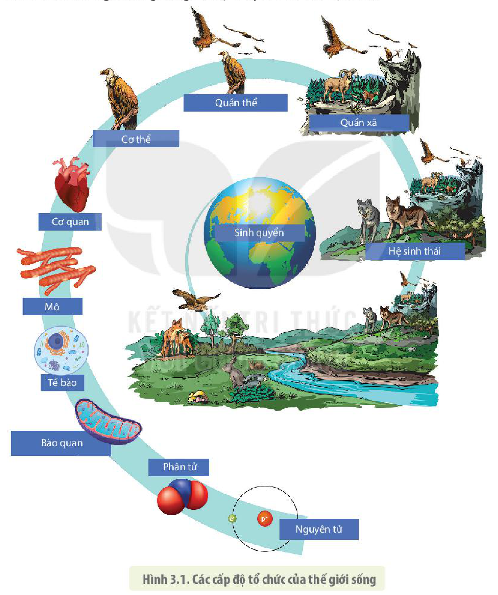

<!-- pdf:19 -->

# BÀI 3: CÁC CẤP ĐỘ TỔ CHỨC CỦA THẾ GIỚI SỐNG

## 🎯 Yêu cầu cần đạt

- Phát biểu được khái niệm cấp độ tổ chức sống.
- Trình bày được các đặc điểm chung của các cấp độ tổ chức sống.
- Dựa vào sơ đồ, phân biệt được cấp độ tổ chức sống.
- Giải thích được mối quan hệ giữa các cấp độ tổ chức sống.

## 🔴 Mở đầu

Vật sống hay không sống đều được cấu tạo từ các nguyên tố hoá học, có thể được tổ chức theo các cấp độ khác nhau và có chung nhiều đặc điểm. Tuy vậy, thế giới sống được tổ chức một cách đặc biệt tạo nên các sinh vật có những đặc điểm mà vật không sống không có được. Vậy thế giới sống được tổ chức như thế nào và có các đặc điểm chung gì?

## I. CÁC CẤP ĐỘ TỔ CHỨC CỦA THẾ GIỚI SỐNG

### 1. Khái niệm cấp độ tổ chức sống

**Cấp độ tổ chức sống** là cấp độ tổ chức của vật chất có biểu hiện đầy đủ đặc tính của sự sống. Thế giới sống được tổ chức thành nhiều cấp bậc từ nhỏ đến lớn gồm các **cấp tổ chức trung gian** như: nguyên tử, phân tử, bào quan, mô và các **cấp tổ chức cơ bản** như: tế bào, cơ thể, quần thể, quần xã và hệ sinh thái. Tất cả cấp độ tổ chức cơ bản của thế giới sống đều được cấu tạo từ một hoặc nhiều tế bào.

## ❓ Dừng lại và suy ngẫm

1. Nêu khái niệm cấp độ tổ chức sống.
2. Quan sát hình 3.1, hãy cho biết những cấp độ tổ chức nào có đầy đủ các đặc điểm của sự sống.

### 2. Mối quan hệ giữa các cấp độ tổ chức của thế giới sống

**Tế bào** là đơn vị tổ chức nhỏ nhất có đầy đủ các đặc điểm của sự sống, được tổ chức từ bậc cấu trúc nhỏ hơn là các bào quan, phân tử, nguyên tử. Tiếp đến là cấp độ tổ chức ở bậc **cơ thể**, đây là cấp độ tổ chức sống có các bậc cấu trúc trung gian là mô, cơ quan, hệ cơ quan. Tập hợp các cá thể của cùng một loài sống trong một khu vực địa lí nhất định và vào thời điểm nhất định tạo nên một cấp độ tổ chức cao hơn là **quần thể**. Các quần thể của nhiều loài khác nhau cùng tồn tại trong một khu vực địa lí ở cùng một thời điểm tạo nên cấp tổ chức được gọi là **quần xã**. Các quần xã tương tác với nhau và với môi trường tạo nên cấp tổ chức **hệ sinh thái** (H 3.1).

<!-- pdf:20 -->

Mối quan hệ hữu cơ giữa các cấp độ tổ chức dựa trên các hoạt động sống ở cấp độ tế bào. Ví dụ: Các cá thể tương tác với cá thể khác và với môi trường vật lí dựa trên cơ sở các hoạt động truyền tin ở cấp độ tế bào. Các cấp độ tổ chức sống còn liên hệ với nhau bởi quá trình chuyển hoá vật chất và năng lượng trong thế giới sống. Nguồn năng lượng cung cấp cho thế giới sống chủ yếu đến từ Mặt Trời và được truyền từ cấp độ tổ chức này sang cấp độ tổ chức khác của thế giới sống cùng với sự chuyển hoá của vật chất.

Hình 3.1. Các cấp độ tổ chức của thế giới sống

## ❓ Dừng lại và suy ngẫm

Giải thích mối quan hệ giữa các cấp độ tổ chức sống.

<!-- pdf:21 -->

## II. ĐẶC ĐIỂM CHUNG CỦA THẾ GIỚI SỐNG

### 1. Thế giới sống được tổ chức theo nguyên tắc thứ bậc

<!-- term: Nguyên tắc thứ bậc -->
Thế giới sống gồm nhiều cấp độ khác nhau được tổ chức theo nguyên tắc từ thấp đến cao, từ đơn giản đến phức tạp, cấp tổ chức thấp (nhỏ) làm nền tảng cấu thành nên cấp cao hơn. Cấp độ tổ chức nhỏ nhất hay cơ bản nhất cấu tạo nên các cấp bậc cao hơn chính là tế bào.

Mỗi cấp tổ chức sống đều được cấu thành từ những bộ phận nhỏ hơn tương tác với nhau tạo nên những đặc điểm mới mà cấp tổ chức nhỏ hơn không có (gọi là **đặc tính nổi trội**). Ví dụ: Các phân tử sinh học chỉ tạo ra được các đặc tính của sự sống khi được bao gói và tổ chức tinh vi trong một cấu trúc là tế bào. Các tế bào thần kinh riêng biệt không giúp sinh vật có "tư duy" mà chỉ khi chúng được tổ chức trong một cấu trúc như bộ não của người mới cho chúng ta năng lực tư duy sáng tạo mà khó sinh vật nào có được.

Vật không sống cũng có thể được tổ chức theo các cấp độ và có chung một số đặc điểm với cấp độ tổ chức sống nhưng không thể tự sinh trưởng, sinh sản, chuyển hoá vật chất và năng lượng.

### 2. Các cấp độ tổ chức sống là những hệ mở và tự điều chỉnh

Các cấp tổ chức sống đều là những **hệ thống mở** (không ngừng trao đổi vật chất và năng lượng với môi trường). Đây là đặc điểm cơ bản, đảm bảo sự tồn tại và phát triển của các cấp tổ chức sống. Nếu như ở thế giới vô cơ, các vật chất ban đầu có tổ chức cấu tạo phức tạp thế nào đi chăng nữa thì theo quy luật nhiệt động học nó sẽ dần dần trở về trạng thái hỗn độn, vô tổ chức. Ngược lại, thế giới sống với cơ cấu tổ chức đặc biệt luôn trao đổi vật chất và năng lượng với môi trường bên ngoài và tự điều chỉnh sao cho phù hợp với điều kiện môi trường, nên các sinh vật có khả năng sinh trưởng, sinh sản cùng những đặc điểm khác mà thế giới vô cơ không có được. Sinh vật không chỉ chịu sự tác động của môi trường mà còn góp phần làm biến đổi môi trường.

Ví dụ: Tế bào chỉ có thể tồn tại, lớn lên và phân chia khi nó thường xuyên thu nhận các chất hoá học từ bên ngoài, biến đổi chúng để tạo nên các chất sống, đồng thời loại bỏ các chất thải ra khỏi tế bào. Cơ thể cũng không ngừng trao đổi khí, trao đổi nước, lấy thức ăn và thải chất thải ra ngoài môi trường trong quá trình sống.

Hệ thống mở cũng là hệ thống luôn tiếp nhận và xử lí thông tin từ môi trường, đồng thời truyền thông tin trong hệ thống cũng như giữa các hệ thống sống. Ví dụ: Tế bào nhận biết các thông tin bên ngoài nhờ hệ thống các protein trên màng tế bào rồi truyền tín hiệu qua hệ thống các protein trung gian, sau đó đưa ra các đáp ứng cần thiết. Các cá thể sinh vật trong một quần thể cũng tiếp nhận và truyền đạt thông tin cho nhau và truyền cho các cá thể của loài khác.

Mặc dù các hệ thống sống đều là các hệ mở nhưng chúng lại có khả năng **tự điều chỉnh**, duy trì các thông số bên trong hệ thống một cách ổn định cho dù điều kiện môi trường luôn thay đổi. Khả năng duy trì môi trường nội môi một cách ổn định như vậy được gọi là **sự cân bằng nội môi**. Ví dụ: Cơ thể con người có các cơ chế duy trì thân nhiệt, pH, đường huyết, nồng độ các ion quan trọng,... ở một mức độ tương đối ổn định. Nếu khả năng tự điều chỉnh bị trục trặc, chúng ta có thể bị bệnh, thậm chí là tử vong.

<!-- pdf:22 -->

### 3. Thế giới sống liên tục tiến hoá

<!-- term: Liên tục tiến hoá -->
Nhờ khả năng tiến hoá của sinh giới, sự sống trên hành tinh của chúng ta được sinh sôi và tiếp diễn liên tục qua hàng tỉ năm tạo ra thế giới sống vô cùng đa dạng nhưng cũng có nhiều đặc điểm chung. Sở dĩ, tiến hoá xảy ra được là nhờ thông tin di truyền trong các phân tử DNA được truyền từ tế bào này sang tế bào khác, từ thế hệ này sang thế hệ khác một cách tương đối chính xác nhưng cũng luôn phát sinh những đột biến. Điều kiện môi trường sống khác nhau làm nhiệm vụ lựa chọn những thể đột biến có kiểu hình thích nghi nhất với môi trường.

## ❓ Dừng lại và suy ngẫm

1. Nêu đặc điểm chung của các cấp độ tổ chức sống. Tại sao nói các cấp độ tổ chức sống là những hệ mở, tự điều chỉnh?
2. Phân tích đặc điểm cho thấy cơ thể người là một hệ mở, tự điều chỉnh.
3. Thế giới sống liên tục tiến hoá dựa trên cơ sở nào?

## 📌 Kiến thức cốt lõi

- Cấp độ tổ chức sống được hiểu là cấp độ tổ chức có biểu hiện đầy đủ chức năng của sự sống như sinh trưởng, phát triển, sinh sản, cảm ứng, chuyển hoá vật chất và năng lượng,...
- Các cấp độ cơ bản của thế giới sống bao gồm: tế bào, cơ thể, quần thể, quần xã và hệ sinh thái.
- Thế giới sống được tổ chức theo thứ bậc, bậc dưới làm đơn vị cấu tạo nên bậc cao hơn. Các bộ phận cấu thành của một cấp bậc tương tác với nhau tạo nên những đặc tính nổi trội mà các thành phần riêng biệt không thể có được.
- Mối quan hệ hữu cơ giữa các cấp độ tổ chức sống dựa trên hoạt động sống ở cấp độ tế bào, sự truyền năng lượng và vật chất giữa các cấp độ.

## ✏️ Luyện tập và vận dụng

1. Phân biệt các cấp độ tổ chức sống.
2. Một con robot cũng có khả năng di chuyển, tương tác với môi trường xung quanh, thậm chí trả lời các câu hỏi và đưa ra lời khuyên hữu ích cho các bác sĩ trong việc điều trị bệnh. Con robot có đặc điểm nào giống và khác với vật sống?
3. Tại sao nói "Nếu Mặt Trời không còn tồn tại thì Trái Đất sẽ bị huỷ diệt"?

## 📷 Danh sách hình trong bài

| Mã hình | Trang PDF | Vị trí | Chú thích gốc |
|---|---|---|---|
| H10-sinh-b03-01 | 20 | Mục I.2 | Hình 3.1. Các cấp độ tổ chức của thế giới sống |
