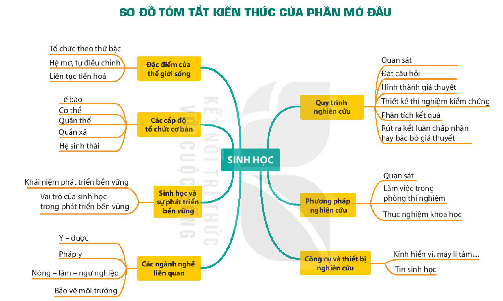

<!-- pdf:23 -->

# SƠ ĐỒ TÓM TẮT KIẾN THỨC PHẦN MỞ ĐẦU

<!-- Trang in xoay ngang; ảnh đã xoay lại. Dưới đây chép các nhánh của sơ đồ thành danh sách, giữ nguyên chữ trong các ô và trên các nhánh. -->

- SINH HỌC
  - Đặc điểm của thế giới sống
    - Tổ chức theo thứ bậc
    - Hệ mở, tự điều chỉnh
    - Liên tục tiến hoá
  - Các cấp độ tổ chức cơ bản
    - Tế bào
    - Cơ thể
    - Quần thể
    - Quần xã
    - Hệ sinh thái
  - Sinh học và sự phát triển bền vững
    - Khái niệm phát triển bền vững
    - Vai trò của sinh học trong phát triển bền vững
  - Các ngành nghề liên quan
    - Y – dược
    - Pháp y
    - Nông – lâm – ngư nghiệp
    - Bảo vệ môi trường
  - Quy trình nghiên cứu
    - Quan sát
    - Đặt câu hỏi
    - Hình thành giả thuyết
    - Thiết kế thí nghiệm kiểm chứng
    - Phân tích kết quả
    - Rút ra kết luận chấp nhận hay bác bỏ giả thuyết
  - Phương pháp nghiên cứu
    - Quan sát
    - Làm việc trong phòng thí nghiệm
    - Thực nghiệm khoa học
  - Công cụ và thiết bị nghiên cứu
    - Kính hiển vi, máy li tâm,...
    - Tin sinh học
<!-- ocr-ok: chữ trong các ô sơ đồ, OCR đọc không theo thứ tự; đã đối chiếu ảnh đã xoay -->

## 📷 Danh sách hình trong bài

| Mã hình | Trang PDF | Vị trí | Chú thích gốc |
|---|---|---|---|
| H10-sinh-so-do-tom-tat-p00-01 | 23 | Cả trang (in xoay ngang) | Sơ đồ tóm tắt kiến thức của phần Mở đầu |
