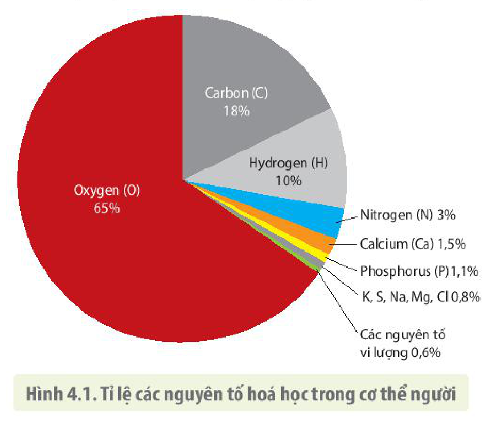
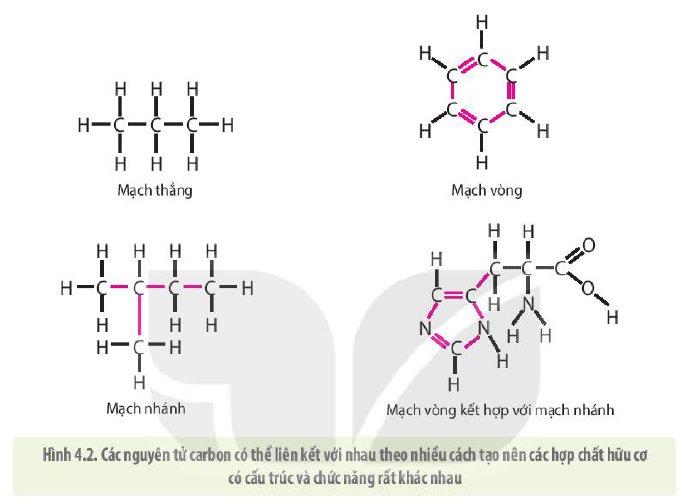
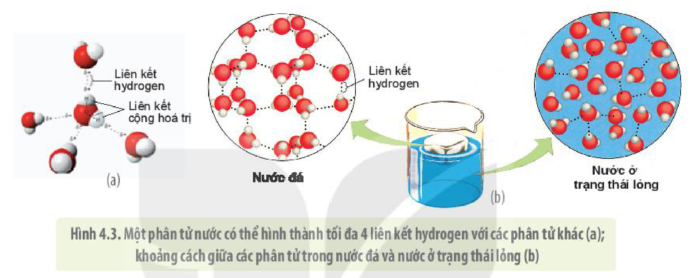

<!-- pdf:24 -->

# BÀI 4: CÁC NGUYÊN TỐ HOÁ HỌC VÀ NƯỚC

## 🎯 Yêu cầu cần đạt

- Nêu được khái quát học thuyết tế bào. Giải thích được tế bào là đơn vị cấu trúc và chức năng của cơ thể sống.
- Liệt kê được một số nguyên tố hoá học chính có trong tế bào (C, H, O, N, S, P). Nêu được vai trò của các nguyên tố vi lượng, đa lượng trong tế bào.
- Trình bày được vai trò quan trọng của nguyên tố carbon trong tế bào (cấu trúc nguyên tử C có thể liên kết với chính nó và nhiều nhóm chức khác nhau).
- Trình bày được đặc điểm cấu tạo phân tử nước quy định tính chất vật lí, hoá học, sinh học của nước, từ đó quy định vai trò sinh học của nước trong tế bào.

## 🔴 Mở đầu

Tìm hiểu sự tương tác giữa các thành phần hoá học của tế bào tạo nên sự sống không chỉ đáp ứng sự tò mò ham hiểu biết của con người mà còn đem lại nhiều ứng dụng thiết thực. Vậy các loại nguyên tố hoá học cấu tạo nên tế bào có gì đặc biệt?

## I. KHÁI QUÁT VỀ HỌC THUYẾT TẾ BÀO

Năm 1839, hai nhà sinh học người Đức là Matthias Jakob Schleiden và Theodor Schwann sau khi quan sát cấu tạo của nhiều loại tế bào thực vật và động vật đã nhận thấy các sinh vật đều có cấu trúc tế bào giống nhau và họ đã đưa ra học thuyết tế bào đầu tiên.

Học thuyết tế bào hiện đại bao gồm ba nội dung sau:

- Tất cả mọi sinh vật đều được cấu tạo từ một hoặc nhiều tế bào. Sự sống được tiếp diễn do có sự chuyển hoá và sự di truyền xảy ra bên trong các tế bào.
- Tế bào là đơn vị nhỏ nhất, đơn vị cấu trúc và đơn vị chức năng cấu tạo nên mọi cơ thể sinh vật.
- Tế bào chỉ được sinh ra từ sự phân chia các tế bào có trước.

<!-- pdf:25 -->

Làm thế nào mà tế bào với kích thước hiển vi lại có được các đặc tính của vật sống? Câu trả lời nằm ở chính thành phần hoá học của tế bào. Sự tương tác đặc biệt của các phân tử hoá học trong tế bào đã làm xuất hiện các đặc tính nổi trội như khả năng sinh trưởng, sinh sản, cảm ứng,... Vậy, tế bào được cấu tạo từ những nguyên tố hoá học nào? Các phân tử trong tế bào có cấu trúc và chức năng ra sao?

## ❓ Dừng lại và suy ngẫm

1. Học thuyết tế bào hiện đại có những nội dung gì?
2. Vì sao tế bào được xem là đơn vị cấu trúc và chức năng của cơ thể sống?

## II. CÁC NGUYÊN TỐ HOÁ HỌC TRONG TẾ BÀO

Trong số 92 nguyên tố hoá học có trong tự nhiên, chỉ có khoảng 20% đến 25% nguyên tố hoá học cần thiết cho sự tồn tại, sinh trưởng và phát triển của các sinh vật, được gọi là các **nguyên tố thiết yếu**. Các nguyên tố hoá học mà hầu hết các loại tế bào đều cần với một lượng lớn gọi là **nguyên tố đa lượng**. Chỉ riêng 4 nguyên tố đa lượng là C, H, O và N đã chiếm khoảng 96% khối lượng vật chất sống ở hầu hết các cơ thể sinh vật. Các nguyên tố như Ca, P, K, S và một số nguyên tố đa lượng còn lại chiếm khoảng 3,4%. Nguyên tố đa lượng có vai trò chủ chốt cấu tạo nên mọi phân tử sinh học cũng như mọi thành phần hoá học của tế bào.

**Nguyên tố vi lượng** là nguyên tố mà sinh vật chỉ cần một lượng rất nhỏ. Ví dụ: Để tuyến giáp hoạt động bình thường, mỗi ngày một người chỉ cần hấp thụ từ thức ăn 0,15 mg iodine. Nguyên tố vi lượng thường cấu tạo nên các enzyme cũng như nhiều hợp chất quan trọng khác tham gia vào các hoạt động sống của tế bào và cơ thể. Vì vậy, dù chỉ chiếm một lượng rất nhỏ trong cơ thể nhưng nếu thiếu chúng, các hoạt động sống sẽ bị rối loạn. Ví dụ: Ở người, nếu thiếu iodine, tuyến giáp sẽ phát triển bất thường và dẫn đến bị bệnh bướu cổ.

Một điều thú vị là tế bào của các loài sinh vật khác nhau đều có thành phần các nguyên tố hoá học cơ bản giống nhau. Tuy nhiên, hàm lượng, thành phần các nguyên tố hoá học ở các tế bào cũng có sự khác biệt nhất định. Ví dụ: Cơ thể người cần tới 25 loại nguyên tố hoá học khác nhau (H 4.1), trong khi các loài thực vật chỉ cần 17 loại nguyên tố thiết yếu.

Hình 4.1. Tỉ lệ các nguyên tố hoá học trong cơ thể người

<!-- term: Bộ khung hydrocarbon -->
Trong số các nguyên tố cấu tạo nên tế bào, carbon có vai trò đặc biệt quan trọng vì:

- Nguyên tử carbon có 4 electron hoá trị ở vòng ngoài nên có thể đồng thời tạo bốn liên kết cộng hoá trị với các nguyên tử carbon khác, hình thành nên **bộ khung carbon** đa dạng với kích thước lớn và cấu hình không gian đa dạng.
- Bộ khung carbon liên kết với các nguyên tử hydrogen tạo khung

<!-- pdf:26 -->

<!-- term: Bộ khung hydrocarbon -->
hydrocarbon có dạng mạch thẳng hoặc mạch vòng, phân nhánh hoặc không phân nhánh (H 4.2). Từ bộ khung hydrocarbon liên kết với các nhóm chức khác nhau tạo nên các hợp chất hữu cơ chủ yếu của tế bào như carbohydrate, lipid, protein và nucleic acid.

- Nguyên tử carbon linh hoạt có thể tạo nên các phân tử có cấu trúc và tính chất hoá học khác nhau từ cùng một số lượng nguyên tử (cùng công thức hoá học).

Hình 4.2. Các nguyên tử carbon có thể liên kết với nhau theo nhiều cách tạo nên các hợp chất hữu cơ có cấu trúc và chức năng rất khác nhau

## ❓ Dừng lại và suy ngẫm

1. Hoàn thành bảng theo mẫu sau:

| Nhóm nguyên tố | Hàm lượng trong cơ thể người | Vai trò | Đại diện |
|---|---|---|---|
| Đa lượng | ? | ? | ? |
| Vi lượng | ? | ? | ? |

2. Tại sao các phân tử có cùng số lượng nguyên tử carbon nhưng lại có đặc tính hoá học khác nhau?

## III. NƯỚC VÀ VAI TRÒ CỦA NƯỚC ĐỐI VỚI SỰ SỐNG

Nước chiếm khoảng 70% khối lượng cơ thể người và có vai trò đặc biệt quan trọng đối với sự sống. Có thể nói, không có nước sẽ không có sự sống. Các nhà thiên văn học tìm kiếm sự sống ngoài hành tinh cũng bắt đầu bằng việc tìm kiếm nước. Điều gì khiến nước có vai trò quan trọng như vậy? Hãy xem cấu trúc của nước quyết định các đặc tính của nó như thế nào.

<!-- pdf:27 -->

### 1. Cấu trúc và tính chất vật lí, hoá học của nước

<!-- term: Tính phân cực của nước -->
Nước tinh khiết chỉ bao gồm các phân tử $\text{H}_2\text{O}$, mỗi phân tử nước có một nguyên tử oxygen liên kết với hai nguyên tử hydrogen bằng hai **liên kết cộng hoá trị**. Nguyên tử oxygen có khả năng hút điện tử cao hơn nhiều so với hydrogen nên các electron trong liên kết lệch về phía oxygen. Do vậy, trong phân tử nước, phía các nguyên tử hydrogen tích điện dương ($\delta+$), còn phía nguyên tử oxygen tích điện âm ($\delta-$). Với cấu trúc như vậy, phân tử nước là phân tử phân cực (giống như thanh nam châm). Khi các phân tử nước tiếp xúc gần với nhau hay với phân tử phân cực khác, lực hút giữa các phần mang điện tích trái dấu của các phân tử hình thành nên các **liên kết hydrogen** (H 4.3).

Hình 4.3. Một phân tử nước có thể hình thành tối đa 4 liên kết hydrogen với các phân tử khác (a); khoảng cách giữa các phân tử trong nước đá và nước ở trạng thái lỏng (b)

<!-- term: Nhiệt bay hơi -->
<!-- term: Nhiệt dung đặc trưng -->
<!-- term: Sức căng bề mặt -->
Cấu trúc hoá học của nước làm cho nước có các đặc tính vật lí rất đặc biệt. Các phân tử nước ở nơi bề mặt tiếp xúc với không khí liên kết chặt với nhau tạo nên sức căng bề mặt. Nhờ vậy, nhiều sinh vật nhỏ có thể đi lại trên mặt nước. Các phân tử nước liên kết với nhau bằng rất nhiều liên kết hydrogen nên phải được cung cấp một nhiệt lượng lớn mới có thể làm tăng nhiệt độ của nước. Vì nước có nhiệt dung đặc trưng cao nên các sinh vật trên cạn có thể dễ dàng điều chỉnh nhiệt độ tế bào và cơ thể cũng như tránh được sự thay đổi đột ngột của nhiệt độ môi trường sống. Nhờ có nhiệt bay hơi cao nên nước bay hơi sẽ lấy một lượng lớn nhiệt độ từ cơ thể sinh vật giúp làm giảm nhiệt độ cơ thể cũng như nhiệt độ của môi trường.

### 2. Vai trò sinh học của nước đối với tế bào

Nước có vai trò đặc biệt quan trọng đối với tế bào do:

- Nước là thành phần chủ yếu cấu tạo nên các tế bào và cơ thể.
- Nhờ có tính phân cực nên nước khả năng hoà tan nhiều chất cần thiết cho các hoạt động sống của tế bào.
- Nước là nguyên liệu của nhiều phản ứng và là môi trường cho các phản ứng sinh hoá diễn ra trong tế bào.
- Nước góp phần định hình cấu trúc không gian đặc trưng của nhiều phân tử hữu cơ trong tế bào, đảm bảo cho chúng thực hiện được các chức năng sinh học, góp phần điều hoà nhiệt độ tế bào và cơ thể.

<!-- pdf:28 -->

## ❓ Dừng lại và suy ngẫm

1. Cấu trúc hoá học của nước quy định các tính chất vật lí nào?
2. Nước có vai trò như thế nào trong tế bào?
3. Tại sao hằng ngày chúng ta cần phải uống đủ nước?

## 📌 Kiến thức cốt lõi

- Nội dung chính của **học thuyết tế bào hiện đại** là: (1) Mọi sinh vật đều được cấu tạo từ một hoặc nhiều tế bào. Sự sống được tiếp diễn do có sự chuyển hoá và sự di truyền xảy ra bên trong các tế bào; (2) Tế bào là đơn vị nhỏ nhất, đơn vị cơ bản cấu tạo nên tất cả các sinh vật; (3) Tế bào chỉ được sinh ra từ sự phân chia của các tế bào có trước.
- Tế bào được cấu tạo từ các nguyên tố vi lượng và đa lượng. Nguyên tố đa lượng chiếm tỉ lệ lớn, giữ vai trò cấu trúc nên mọi phân tử trong tế bào. Nguyên tố vi lượng chiếm tỉ lệ rất nhỏ nhưng cũng đóng vai trò quan trọng trong việc điều hoà các hoạt động sống của tế bào.
- Nước được cấu tạo từ 2 nguyên tử H và 1 nguyên tử O. Do đặc tính phân cực nên nước có các tính chất vật lí, hoá học quan trọng quy định vai trò của nước với tế bào như: là thành phần chính cấu tạo nên tế bào, dung môi hoà tan các chất cần thiết cho tế bào, nguyên liệu và môi trường của các phản ứng chuyển hoá vật chất trong tế bào. Không có nước sẽ không có sự sống.

## ✏️ Luyện tập và vận dụng

1. Nguồn carbon cung cấp cho các tế bào trong cơ thể chúng ta được lấy từ đâu? Giải thích.
2. Mọi sinh vật đều có thành phần các nguyên tố hoá học trong tế bào về cơ bản giống nhau. Điều này nói lên điều gì về mối quan hệ tiến hoá giữa các sinh vật trên Trái Đất?
3. Tại sao khi tìm kiếm sự sống trong vũ trụ, các nhà thiên văn học lại tìm kiếm ở những hành tinh có dấu vết của nước?

## 📷 Danh sách hình trong bài

| Mã hình | Trang PDF | Vị trí | Chú thích gốc |
|---|---|---|---|
| H10-sinh-b04-01 | 25 | Mục II | Hình 4.1. Tỉ lệ các nguyên tố hoá học trong cơ thể người |
| H10-sinh-b04-02 | 26 | Mục II | Hình 4.2. Các nguyên tử carbon có thể liên kết với nhau theo nhiều cách tạo nên các hợp chất hữu cơ có cấu trúc và chức năng rất khác nhau |
| H10-sinh-b04-03 | 27 | Mục III.1 | Hình 4.3. Một phân tử nước có thể hình thành tối đa 4 liên kết hydrogen với các phân tử khác (a); khoảng cách giữa các phân tử trong nước đá và nước ở trạng thái lỏng (b) |
