<!-- pdf:29 -->

# BÀI 5: CÁC PHÂN TỬ SINH HỌC

## 🎯 Yêu cầu cần đạt

- Nêu được khái niệm phân tử sinh học.
- Trình bày được thành phần cấu tạo và vai trò của các phân tử sinh học.
- Phân tích được mối quan hệ giữa cấu tạo và chức năng của các phân tử sinh học.
- Nêu được một số nguồn thực phẩm cung cấp các phân tử sinh học cho cơ thể.
- Vận dụng được kiến thức về các phân tử sinh học để giải thích các hiện tượng và ứng dụng trong thực tiễn (giải thích vai trò của DNA trong việc xác định huyết thống và truy tìm tội phạm,...).

## 🔴 Mở đầu

Thừa cân, béo phì là nguyên nhân chủ yếu dẫn đến bệnh tiểu đường, tim mạch cùng nhiều bệnh nguy hiểm khác cho con người. Vậy làm thế nào có thể giảm thiểu nguy cơ này để có được cuộc sống khoẻ mạnh?

## I. KHÁI NIỆM VÀ THÀNH PHẦN CẤU TẠO CỦA CÁC PHÂN TỬ SINH HỌC TRONG TẾ BÀO

**Phân tử sinh học** là những phân tử hữu cơ được tổng hợp và tồn tại trong các tế bào sống. Các phân tử sinh học chính bao gồm protein, lipid, carbohydrate, nucleic acid. Trong đó, protein, carbohydrate và nucleic acid là những **đại phân tử** được cấu tạo theo nguyên tắc **đa phân** gồm nhiều **đơn phân** hợp thành. Vì vậy, những loại phân tử sinh học này có kích thước rất lớn và được gọi là các **polymer**.

Thành phần hoá học chủ yếu của các phân tử sinh học là các nguyên tử carbon và các nguyên tử hydrogen, chúng liên kết với nhau hình thành nên bộ khung hydrocarbon rất đa dạng. Bộ khung hydrocarbon có khả năng liên kết với các nhóm chức khác nhau (như nhóm amino, carboxyl,...) tạo ra vô số các hợp chất với các đặc tính hoá học khác nhau.

## ❓ Dừng lại và suy ngẫm

1. Phân tử sinh học là gì?
2. Nêu những đặc điểm chung của các phân tử sinh học.

<!-- pdf:30 -->

## II. CÁC PHÂN TỬ SINH HỌC

### 1. Carbohydrate – chất đường bột
<!-- ocr-ok: tiêu đề màu xanh, đã đối chiếu ảnh PDF 30 -->

**Carbohydrate** được cấu tạo từ ba loại nguyên tố C, H và O với tỉ lệ 1 : 2 : 1 và công thức cấu tạo chung là $\text{C}_n(\text{H}_2\text{O})_m$. Carbohydrate được chia thành ba nhóm: đường đơn (monosaccharide), đường đôi (disaccharide) và đường đa (polysaccharide). Nguồn thực phẩm cung cấp đường và tinh bột cho con người và động vật đều bắt nguồn từ các bộ phận dự trữ đường và tinh bột của thực vật như củ, quả, hạt, thân cây (ví dụ: củ cải đường, mía,...).

**a) Đường đơn**

Đường đơn có 6 nguyên tử carbon, gồm ba loại chính là **glucose**, **fructose** và **galactose** (H 5.1). Các loại đường đơn này có hai chức năng chính: (1) dùng làm nguồn cung cấp năng lượng cho các hoạt động sống của tế bào; (2) dùng làm nguyên liệu để cấu tạo nên các loại phân tử sinh học khác.

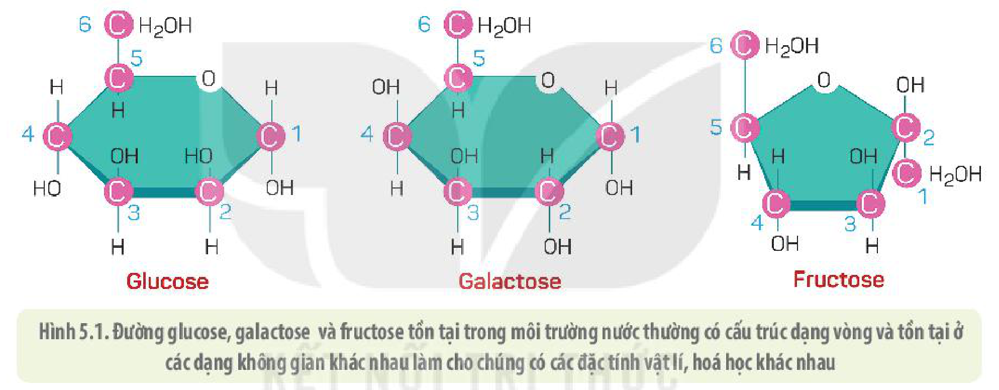

Hình 5.1. Đường glucose, galactose và fructose tồn tại trong môi trường nước thường có cấu trúc dạng vòng và tồn tại ở các dạng không gian khác nhau làm cho chúng có các đặc tính vật lí, hoá học khác nhau

**b) Đường đôi**

Đường đôi được hình thành do hai phân tử đường đơn liên kết với nhau (sau khi loại đi một phân tử nước) bằng một liên kết cộng hoá trị (được gọi là **liên kết glycosidic**). Hai phân tử glucose liên kết với nhau tạo nên đường đôi **maltose**, trong khi một phân tử glucose liên kết với một phân tử galactose thành đường **lactose**. Đường đôi **sucrose** được cấu tạo từ một phân tử glucose và một phân tử fructose (H 5.2).

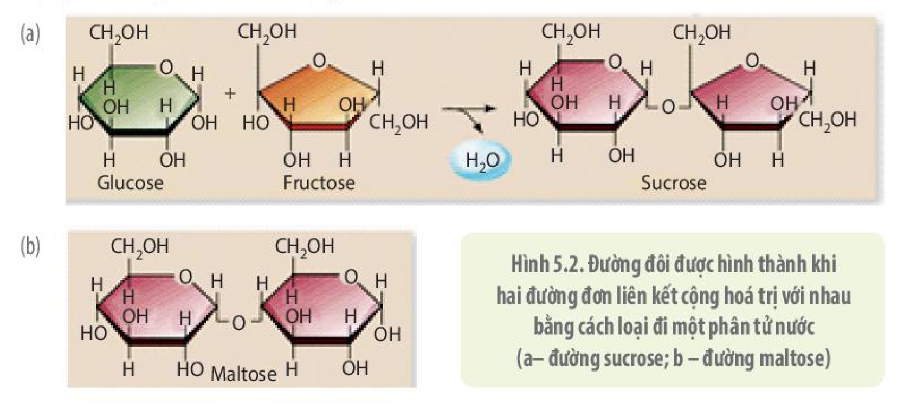

Hình 5.2. Đường đôi được hình thành khi hai đường đơn liên kết cộng hoá trị với nhau bằng cách loại đi một phân tử nước (a – đường sucrose; b – đường maltose)

<!-- pdf:31 -->

Đường đôi còn được gọi là **đường vận chuyển** vì các sinh vật vận chuyển nguồn năng lượng là glucose đến các bộ phận khác nhau của cơ thể hoặc nuôi dưỡng con non dưới dạng đường đôi (do đường đôi sẽ không bị phân giải trong quá trình vận chuyển). Ví dụ: Glucose được tổng hợp từ lá cây, sau đó liên kết với nhau thành đường đôi sucrose rồi vận chuyển đến các bộ phận khác nhau của cây. Đường lactose là đường sữa, được sản xuất để cung cấp cho các con non.

**c) Đường đa**

Đường đa là loại polymer được cấu tạo từ hàng trăm tới hàng nghìn phân tử đường đơn (phần lớn là glucose). Đường đa hay còn gọi là **đường phức**, bao gồm các loại: tinh bột, glycogen, cellulose, chitin. Đường đa có chức năng chính là dự trữ năng lượng và làm nguyên liệu cấu trúc nên một số thành phần của tế bào.

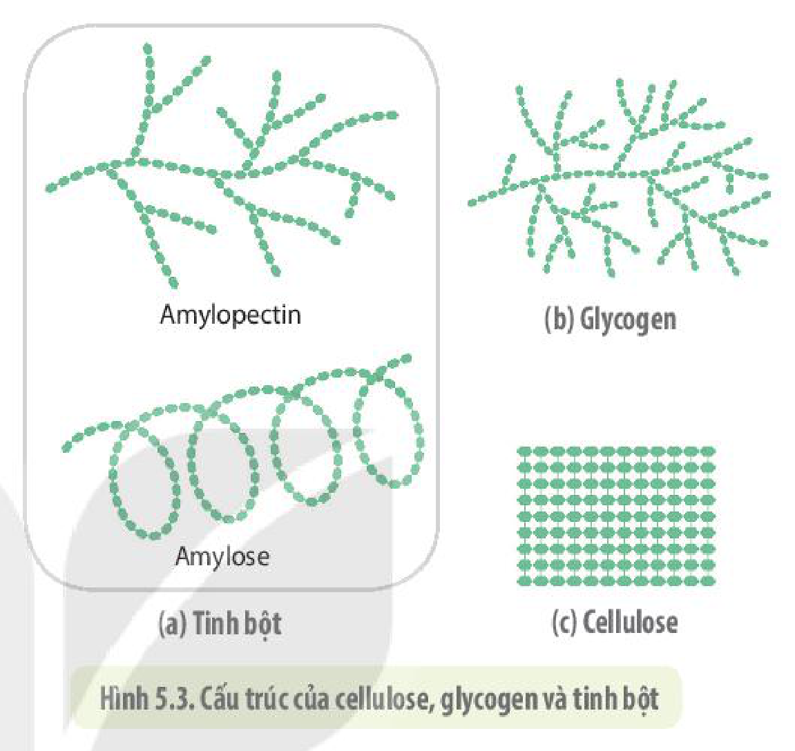

Hình 5.3. Cấu trúc của cellulose, glycogen và tinh bột

- *Tinh bột:* **Tinh bột** là loại carbohydrate được dùng làm năng lượng dự trữ ở các loài thực vật. Tinh bột được cấu tạo từ hàng trăm đến hàng nghìn đơn phân là glucose (H 5.3a). Nhìn chung, các loại tinh bột có cấu trúc ít phân nhánh.
- *Glycogen:* **Glycogen** được cấu tạo từ nhiều phân tử glucose kết hợp lại nhưng phân tử này phân nhánh rất mạnh (H 5.3b) và tan trong nước tốt hơn so với tinh bột. Glycogen có chức năng dự trữ năng lượng trong cơ thể động vật và một số loài nấm. Ở người và các loài động vật, glycogen được tổng hợp chủ yếu ở gan, cơ và được dùng làm nguồn năng lượng dự trữ ngắn hạn (trong ngày).
- *Cellulose:* Phân tử **cellulose** được cấu tạo từ các phân tử đường glucose liên kết với nhau tạo thành mạch thẳng, không phân nhánh. Nhiều phân tử cellulose liên kết với nhau tạo thành bó sợi dài nằm song song có cấu trúc vững chắc (H 5.3c). Cellulose là thành phần chính cấu tạo nên thành tế bào của thực vật.

  Con người không tiêu hoá được cellulose nhưng cellulose lại giúp ích trong tiêu hoá thức ăn. Cellulose kích thích các tế bào niêm mạc ruột tiết ra dịch nhầy làm cho thức ăn được di chuyển trơn tru trong đường ruột, đồng thời cellulose cũng cuốn trôi những chất cặn bã bám vào thành ruột ra ngoài. Vì thế, nếu trong khẩu phần ăn có quá ít cellulose sẽ rất dễ bị táo bón.

- *Chitin:* **Chitin** là một loại đường được cấu tạo từ nhiều đơn phân là phân tử glucose hoặc galactose đã được gắn thêm nhóm chức amino thành glucosamine hoặc galactosamine. Chitin là loại đường cấu tạo nên bộ khung xương ngoài của nhiều loài như tôm, cua, nhện và thành tế bào của nhiều loài nấm.

Mặc dù carbohydrate có vai trò quan trọng trong tế bào và cơ thể nhưng nếu chúng ta ăn quá nhiều có thể dẫn đến mắc các bệnh như béo phì, tiểu đường, gan nhiễm mỡ,...

<!-- pdf:32 -->

## ❓ Dừng lại và suy ngẫm

1. Nêu đặc điểm cấu trúc và chức năng chính của các loại carbohydrate.
2. Con người thường ăn những bộ phận nào của thực vật để lấy tinh bột?
3. Tại sao nên ăn nhiều loại rau xanh khác nhau trong khi thành phần chính của các loại rau là cellulose – chất mà con người không thể tiêu hoá được?

### 2. Lipid – Chất béo

**Lipid** là một nhóm chất rất đa dạng về cấu trúc nhưng có đặc tính chung là kị nước. Các loại mỡ động vật, hormone sinh dục (như testosterone, estrogen), dầu thực vật, phospholipid, một số sắc tố, sáp và một số loại vitamin đều là lipid. Sở dĩ lipid không hoặc rất ít tan trong nước vì chúng chứa một lượng lớn các liên kết C–H không phân cực, tạo nên các sợi dài và chứa ít nguyên tử oxygen. Vì rất đa dạng về cấu trúc nên chức năng của các loại lipid cũng rất khác nhau.

Nguồn chất béo cung cấp cho con người rất đa dạng, có thể từ mô mỡ của các loài động vật, dầu thực vật lấy từ nhiều loại hạt, quả khác nhau như lạc, vừng,... Việc sử dụng đa dạng các nguồn thực phẩm là rất quan trọng với sức khoẻ, khi ăn uống mất cân đối giữa các thành phần chất béo có thể gây ra nhiều bệnh tật.

**a) Mỡ và dầu**

Loại lipid thường gặp là dầu và mỡ, được cấu tạo gồm một phân tử glycerol liên kết với ba phân tử acid béo (H 5.4).

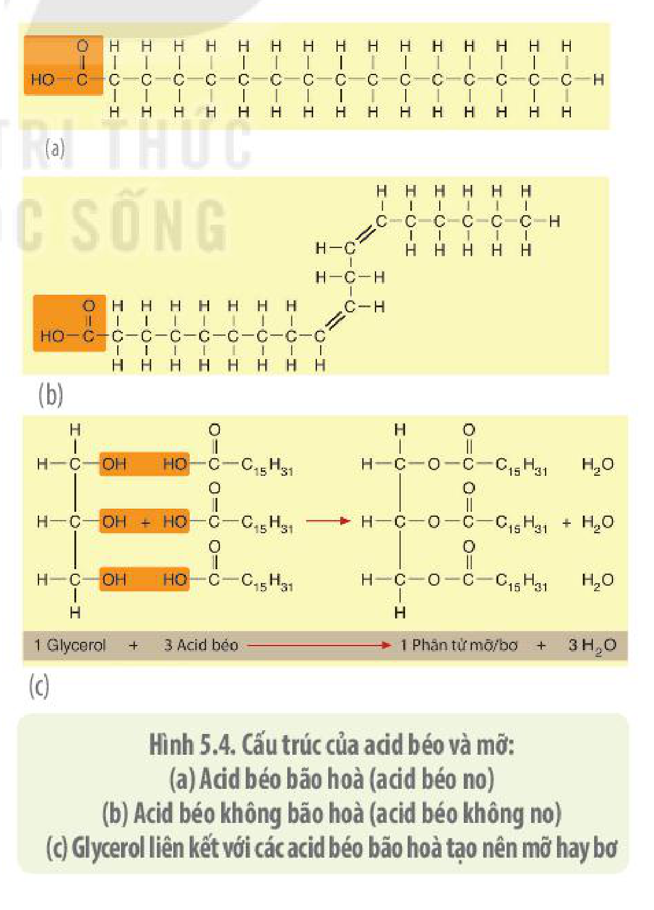

Hình 5.4. Cấu trúc của acid béo và mỡ: (a) Acid béo bão hoà (acid béo no) (b) Acid béo không bão hoà (acid béo không no) (c) Glycerol liên kết với các acid béo bão hoà tạo nên mỡ hay bơ

Các phân tử acid béo trong cùng một phân tử **triglyceride** có thể khác nhau, vì thế đặc tính hoá học của các loại triglyceride cũng khác nhau. Ở nhiệt độ phòng, dầu tồn tại ở dạng lỏng do chúng chứa các **acid béo không no**, còn mỡ ở trạng thái rắn do chúng chứa các **acid béo no**.

Dầu và mỡ là chất dự trữ năng lượng của tế bào và cơ thể. Cơ thể người và động vật dự trữ mỡ trong các tế bào, mỡ phân bố dưới da và nhiều vùng khác trong cơ thể. Lớp mỡ dưới da cũng là lớp cách nhiệt giữ ấm cho cơ thể người và nhiều loài động vật xứ lạnh. Những động vật sống ở sa mạc như lạc đà sử dụng mỡ ở các bướu làm nguồn cung cấp nước nên chúng có thể đi trong sa mạc nhiều ngày mà không cần uống nước. Trong tế bào,

<!-- pdf:33 -->

các phân tử lipid cũng là thành phần cấu tạo nên các phân tử như lipoprotein đảm nhận nhiều chức năng khác nhau. Ngoài ra, dầu và mỡ còn là dung môi hoà tan nhiều loại vitamin quan trọng với cơ thể như vitamin A, D, E, K,...

Mặc dù có vai trò rất quan trọng với tế bào và cơ thể nhưng ăn quá nhiều dầu, mỡ với các thành phần acid béo không có lợi sẽ làm tăng nguy cơ mắc bệnh béo phì, máu nhiễm mỡ, gây xơ vữa động mạch dẫn đến bệnh tim mạch và các bệnh khác có hại cho sức khoẻ.

Vì vậy, cần có chế độ ăn vừa đủ chất béo, phối hợp cân đối giữa mỡ động vật và dầu thực vật sẽ giúp con người giảm được những nguy cơ trên.

**b) Phospholipid**

**Phospholipid** là một loại chất béo phức tạp, được cấu tạo từ một phân tử glycerol liên kết với hai acid béo ở một đầu, đầu còn lại liên kết với nhóm phosphate ($-\text{PO}_4^{3-}$). Nhóm phosphate thường liên kết với một nhóm, được gọi là **choline**, tạo thành **phosphatidylcholine** (H 5.5a).

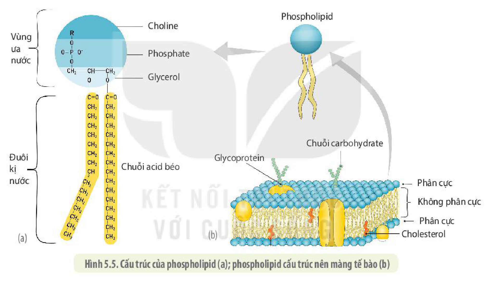

Hình 5.5. Cấu trúc của phospholipid (a); phospholipid cấu trúc nên màng tế bào (b)

Với cấu trúc như vậy, phospholipid được xem là một **phân tử lưỡng cực**, một đầu có phosphatidylcholine có tính ưa nước và hai đuôi acid béo kị nước. Nhờ có cấu trúc đặc biệt như vậy, phospholipid có vai trò quan trọng trong việc tạo nên cấu trúc màng của các loại tế bào (H 5.5b).

**c) Steroid**

**Steroid** là một loại lipid đặc biệt, không chứa phân tử acid béo, các nguyên tử carbon của chúng liên kết với nhau tạo nên 4 vòng (H 5.6).

<!-- pdf:34 -->

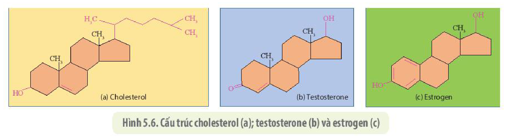

Hình 5.6. Cấu trúc cholesterol (a); testosterone (b) và estrogen (c)

Steroid bao gồm nhiều loại như cholesterol, testosterone, estrogen, vitamin D và cortisone,... **Cholesterol** là thành phần quan trọng của màng tế bào, đồng thời cũng là chất tiền thân để tạo nên testosterone và estrogen là những hormone phát triển các đặc điểm khác biệt giữa nam và nữ. Cholesterol không tan trong nước nên để vận chuyển trong máu, chúng phải liên kết với các loại protein nhất định tạo nên các phân tử **lipoprotein**.

Có hai loại lipoprotein trong máu mà chúng ta quan tâm khi đi khám sức khoẻ là **HDL** (high-density lipoprotein) và **LDL** (low-density lipoprotein). HDL là loại lipoprotein mật độ cao, có chức năng vận chuyển cholesterol tới gan, làm giảm lượng cholesterol trong máu nên được gọi là cholesterol "tốt". LDL là loại lipoprotein mật độ thấp, mang cholesterol tới các mạch máu. Khi lượng LDL trong máu cao, chúng sẽ không xâm nhập hết vào các tế bào mà tích tụ lại trong mạch máu tạo ra các mảng bám làm hẹp mạch máu, dẫn đến tăng nguy cơ mắc các bệnh tim mạch và đột quỵ. Do đó, LDL thường được gọi là cholesterol "xấu". Vì vậy, nếu ăn quá nhiều thức ăn chứa cholesterol (đồ chiên rán, nội tạng động vật,...) khiến lượng LDL vượt ngưỡng cho phép sẽ làm gia tăng nguy cơ mắc các bệnh nói trên, gây nguy hiểm tới tính mạng.

**d) Carotenoid**

**Carotenoid** là nhóm sắc tố màu vàng cam ở thực vật có bản chất là một loại lipid. Con người và động vật khi ăn carotenoid sẽ chuyển hoá nó thành vitamin A, chất này sau đó được chuyển đổi thành sắc tố võng mạc, rất có lợi cho thị giác.

## ❓ Dừng lại và suy ngẫm

1. Chất béo là gì? Nêu một số chức năng của dầu, mỡ, phospholipid và steroid.
2. Đặc điểm nào về mặt cấu trúc hoá học khiến phospholipid là một chất lưỡng cực?
3. Khi ăn cà chua hoặc hành chưng trong mỡ, cơ thể người có thể hấp thụ được những loại vitamin gì? Giải thích.

## 💡 Em có biết

**Tại sao thức ăn nhanh và nước ngọt chế biến sẵn lại có hại cho sức khoẻ?**

Những đồ ăn nhanh đóng gói sẵn như bánh ngọt, kẹo, đồ chiên, nướng rất hấp dẫn bởi mùi vị, màu sắc, độ ngọt, vị béo ngậy đặc biệt của chúng. Trong quá trình sản xuất các loại thực phẩm này, người ta thường cho thêm phẩm màu nhân tạo, chất làm tăng hương vị để tăng độ hấp dẫn và thời gian bảo quản.

Giá trị dinh dưỡng của thức ăn nhanh lại rất thấp vì chứa nhiều carbohydrate, chất béo, ít protein, ít vitamin và khoáng chất cần thiết cho cơ thể. Không những thế, nhiều loại thực

<!-- pdf:35 -->

phẩm chế biến sẵn còn chứa **chất béo trans**, một loại chất béo được các nhà sản xuất tạo ra bằng cách hydrogen hoá một phần các acid béo không bão hoà, làm biến đổi tính chất hoá học giống như các acid béo bão hoà để bảo quản thực phẩm được lâu hơn.

Ăn nhiều chất béo trans sẽ dễ dẫn đến xơ vữa động mạch, làm tăng nguy cơ bị các bệnh tim mạch. Đồ uống chế biến sẵn có nhiều đường fructose để tăng độ ngọt. Ăn nhiều fructose cũng như glucose không những làm tăng nguy cơ gan nhiễm mỡ, tiểu đường, béo phì mà quá trình phân giải fructose ở gan còn tạo ra nhiều uric acid rất có hại cho cơ thể.

### 3. Protein – chất đạm

**a) Chức năng của protein**

Trong cơ thể, protein có rất nhiều chức năng, có thể nói protein tham gia vào hầu hết tất cả các hoạt động sống của tế bào. Một số chức năng của protein được trình bày dưới đây:

- Cấu trúc: Nhiều loại protein tham gia cấu trúc nên các bào quan, bộ khung tế bào.
- Xúc tác: Protein cấu tạo nên các **enzyme** xúc tác cho các phản ứng hoá học trong tế bào.
- Bảo vệ: Các **kháng thể** có bản chất là protein giữ chức năng chống lại các phân tử kháng nguyên từ môi trường ngoài xâm nhập vào cơ thể qua các tác nhân như vi khuẩn, virus,...
- Vận động: Protein giúp tế bào thay đổi hình dạng cũng như di chuyển.
- Tiếp nhận thông tin: Protein cấu tạo nên **thụ thể** của tế bào, giúp tiếp nhận thông tin từ bên trong cũng như bên ngoài tế bào.
- Điều hoà: Nhiều **hormone** có bản chất là protein đóng vai trò điều hoà hoạt động của gene trong tế bào, điều hoà các chức năng sinh lí của cơ thể.

Với các chức năng trên, protein có vai trò đặc biệt quan trọng đối với cơ thể người và các loài động vật. Nguồn nguyên liệu để xây dựng các loại protein trong cơ thể người được lấy từ các sản phẩm thịt, sữa của các loài động vật và từ hạt cũng như một số bộ phận khác của nhiều loài thực vật. Sử dụng đa dạng các nguồn thực phẩm giàu protein sẽ cung cấp đủ cho cơ thể nguồn amino acid dùng làm nguyên liệu để tổng hợp protein.

Vậy, cấu trúc của protein có gì đặc biệt khiến chúng có thể đảm nhận nhiều chức năng như vậy?

**b) Cấu trúc của protein**

**Protein** được cấu tạo từ các đơn phân là **amino acid**. Các amino acid đều được cấu tạo từ một nguyên tử carbon trung tâm liên kết với một nhóm amino ($-\text{NH}_2$), một nhóm carboxyl ($-\text{COOH}$), một nguyên tử H và một chuỗi bên còn gọi là **nhóm R** (H 5.7).

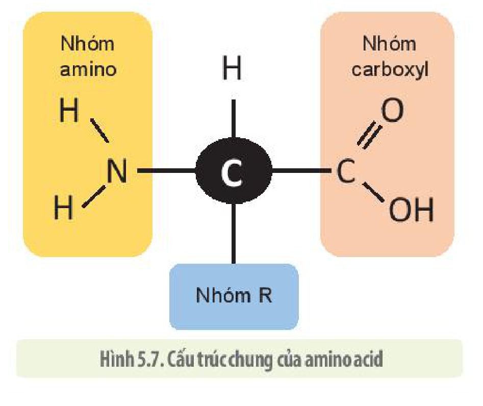

Hình 5.7. Cấu trúc chung của amino acid
<!-- ocr-ok: OCR dính chữ "trúcchung", đã đối chiếu ảnh PDF 35 -->

Hai amino acid liên kết với nhau bằng liên kết cộng hoá trị, được gọi là **liên kết peptide** nhờ phản ứng loại đi một phân tử nước.

<!-- pdf:36 -->

Nhiều amino acid liên kết với nhau tạo nên một chuỗi các amino acid được gọi là **chuỗi polypeptide**.

Có 20 loại amino acid tham gia cấu tạo nên các protein. Trong số này có 9 loại **amino acid không thay thế** vì cơ thể người không tự tổng hợp được mà phải lấy từ thức ăn. Từ 20 loại amino acid có thể tạo ra vô số loại chuỗi polypeptide khác nhau về số lượng, thành phần và trình tự sắp xếp các amino acid. Trình tự các amino acid của protein có tính đặc thù và quyết định chức năng của protein.

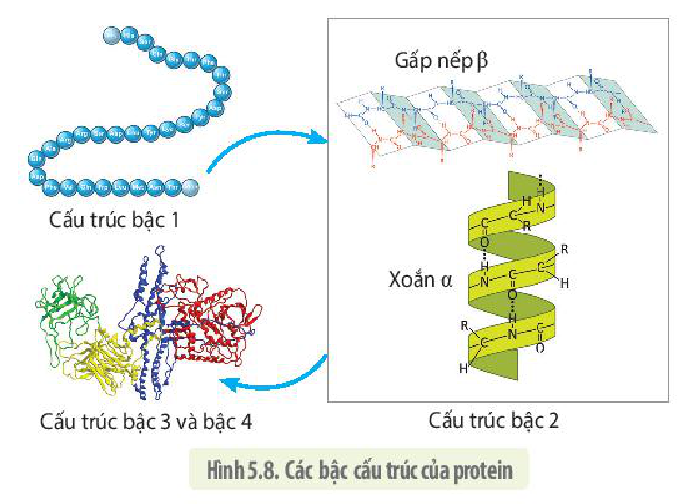

Hình 5.8. Các bậc cấu trúc của protein

Chức năng của protein còn phụ thuộc vào các bậc cấu trúc của nó. Protein có 4 bậc cấu trúc (H 5.8):

- **Cấu trúc bậc 1**: Trình tự các amino acid trong một chuỗi polypeptid.
- **Cấu trúc bậc 2**: Chuỗi polypeptid cuộn xoắn lại hoặc gấp nếp.
- **Cấu trúc bậc 3**: Chuỗi polypeptid cuộn xoắn lại hoặc gấp nếp tạo nên cấu trúc không gian ba chiều đặc trưng do có sự tương tác đặc thù giữa các nhóm chức R của các amino acid trong chuỗi polypeptid.
- Hai hay nhiều chuỗi polypeptid liên kết với nhau tạo nên **cấu trúc bậc 4**.

Cấu trúc không gian của protein (bậc 3 và bậc 4) được duy trì nhờ các liên kết yếu như liên kết hydrogen, tương tác kị nước, tương tác Van der Waals và liên kết cộng hoá trị S–S (disulphide) cũng như liên kết ion (H 5.9).

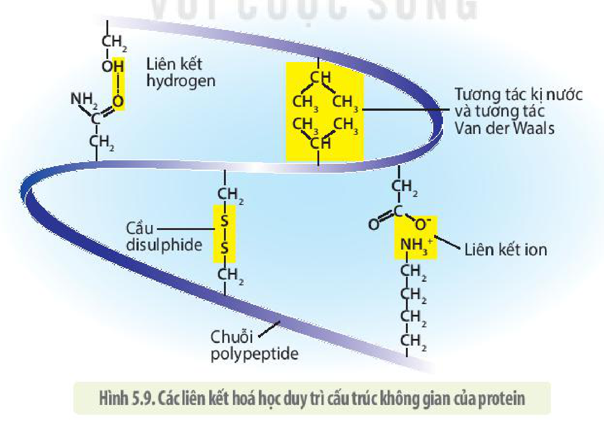

Hình 5.9. Các liên kết hoá học duy trì cấu trúc không gian của protein

Cấu trúc không gian của protein bị ảnh hưởng bởi các yếu tố môi trường. Khi điều kiện môi trường như pH, nhiệt độ, áp suất, nồng độ ion trong dung dịch thay đổi đến một mức độ

<!-- pdf:37 -->

nào đó sẽ làm đứt gãy các liên kết yếu khiến cấu trúc không gian ba chiều của protein bị thay đổi, khi đó, người ta nói **protein bị biến tính** và mất chức năng sinh học. Dựa vào đặc điểm biến tính của protein, chúng ta có thể điều chỉnh một số yếu tố môi trường để tiêu diệt các loại vi sinh vật làm hỏng thức ăn bằng cách đun chín, ướp muối, nhúng giấm thực phẩm, khử trùng bằng cồn $70^\circ$,...

## ❓ Dừng lại và suy ngẫm

1. Các amino acid khác nhau ở những đặc điểm nào?
2. Protein có những chức năng gì? Đặc điểm cấu trúc nào giúp protein có chức năng rất đa dạng?
3. Bậc cấu trúc nào đảm bảo protein có được chức năng sinh học? Các liên kết yếu trong phân tử protein có liên quan gì đến chức năng sinh học của nó?
4. Tại sao chúng ta nên bổ sung protein cho cơ thể từ nhiều loại thức ăn khác nhau mà không nên chỉ ăn một vài loại thức ăn dù những loại đó rất bổ dưỡng?

### 4. Nucleic acid

**Nucleic acid** hay còn gọi là **acid nhân** vì ban đầu được phát hiện chủ yếu ở trong nhân tế bào. Có hai loại acid nhân là DNA và RNA.

**a) Deoxyribonucleic acid – DNA**

*Chức năng*

DNA có chức năng mang, bảo quản và truyền đạt thông tin di truyền – những chỉ dẫn cho tế bào sản sinh ra các loại protein và từ protein tạo nên mọi phân tử cần thiết cấu tạo nên tế bào. Nhờ có cấu trúc hoá học đặc biệt mà các phân tử DNA được nhân lên và truyền lại cho các tế bào con gần như nguyên vẹn cả về số lượng lẫn chất lượng. Quá trình truyền đạt thông tin di truyền bên trong tế bào cũng như giữa các thế hệ tế bào được thể hiện qua sơ đồ:

$\text{DNA (Tái bản)} \xrightarrow{\text{Phiên mã}} \text{mRNA} \xrightarrow{\text{Dịch mã}} \text{Protein}$

So với protein, DNA có ít chức năng hơn nhiều. Nguyên nhân là do cấu trúc của các phân tử DNA.

*Cấu trúc*

DNA được cấu tạo từ hai chuỗi **polynucleotide** song song, ngược chiều nhau (H 5.10a). Mỗi chuỗi polynucleotide được cấu tạo từ bốn loại đơn phân là các **nucleotide** (H 5.10b), liên kết với nhau bằng **liên kết phosphodiester**. Mỗi nucleotide gồm 3 thành phần: gốc phosphate ($-\text{PO}_4^{3-}$), đường deoxyribose (đường 5 carbon) và một **nitrogenous base** (base). Có bốn loại base là adenine (A), guanine (G), cytosine (C) và thymine (T) (H 5.10c). Các nucleotide chỉ khác nhau ở thành phần base.

Hai chuỗi polynucleotide liên kết ngược chiều nhau (3'– 5' và 5'– 3') bằng các liên kết hydrogen theo **nguyên tắc bổ sung**, A của mạch này luôn liên kết với T của mạch kia bằng 2 liên kết hydrogen, C của mạch này liên kết với G của mạch kia bằng 3 liên kết hydrogen.

<!-- pdf:38 -->

Mô hình cấu trúc xoắn kép của DNA lần đầu tiên được hai nhà khoa học James Watson và Francis Crick công bố vào năm 1953 và đã được giải thưởng Nobel Y học. Một số phân tử DNA của virus có thể có cấu trúc mạch đơn (một chuỗi polynucleotide).

Các phân tử DNA mạch kép ở sinh vật nhân thực hầu hết có cấu trúc dạng mạch không vòng, một số ít có cấu trúc dạng mạch vòng nhỏ. Ở sinh vật nhân sơ, hệ gene mỗi tế bào chỉ gồm một phân tử DNA có cấu trúc mạch vòng, dạng kép có kích thước lớn ở vùng nhân và một số phân tử DNA mạch vòng, dạng kép có kích thước nhỏ ở tế bào chất (gọi là **plasmid**). Plasmid không có vai trò sống còn đối với tế bào, số lượng của chúng trong tế bào vi khuẩn vì thế cũng rất khác nhau. Nhiều plasmid của vi khuẩn có chứa các gene kháng lại một số loại thuốc kháng sinh.

Do được cấu tạo từ 2 mạch đơn liên kết bổ sung với nhau bằng các liên kết hydrogen nên phân tử DNA có cấu trúc khá bền vững và từ một mạch làm khuôn có thể tổng hợp nên mạch bổ sung giúp tế bào có thể nhân đôi các phân tử DNA một cách chính xác trước mỗi lần phân bào.

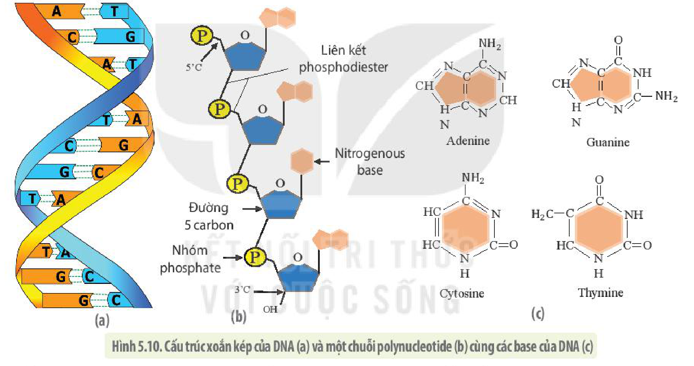

Hình 5.10. Cấu trúc xoắn kép của DNA (a) và một chuỗi polynucleotide (b) cùng các base của DNA (c)

Số lượng các phân tử DNA trong tế bào cũng như trình tự sắp xếp các nucleotide trong mỗi phân tử DNA là đặc trưng cho từng loài và có những trình tự còn đặc trưng cho từng cá thể. Số lượng nucleotide loại A luôn bằng số lượng nucleotide loại T và số lượng nucleotide loại C luôn bằng số lượng nucleotide loại G.

Các trình tự nucleotide trong DNA được sắp xếp thành các đơn vị được gọi là các **gene**, từ các gene, enzyme của tế bào sẽ tổng hợp (phiên mã) thành các trình tự nucleotide trên các phân tử mRNA để rồi từ đó tổng hợp nên các protein.

## ❓ Dừng lại và suy ngẫm

1. Quan sát hình 5.10, nêu và giải thích các đặc điểm cấu trúc khiến DNA đảm nhận được chức năng mang, bảo quản và truyền đạt thông tin di truyền.
2. Những thông số nào về DNA là đặc trưng cho mỗi loài?

<!-- pdf:39 -->

## 💡 Khoa học và đời sống

**Dấu vân tay DNA (DNA fingerprinting)**

Trong hệ gene người có các trình tự nucleotide ngắn, được lặp lại nhiều lần. Các trình tự này là đặc trưng cho từng cá thể (trừ trường hợp sinh đôi cùng trứng) giống như dấu vân tay của mỗi người nên được gọi là **dấu vân tay DNA**. Bằng các biện pháp đặc biệt, người ta có thể tách chiết các trình tự ngắn lặp ở nhiều vị trí khác nhau trong hệ gene của một người rồi nhân bản thành hàng triệu bản sao. DNA sau đó được tách các trình tự có kích thước khác nhau, có thể nhìn thấy được như các băng trên bản điện di. Dấu vân tay DNA rất hữu ích trong việc nhận dạng cá thể, giúp ích trong công tác điều tra tội phạm, xác định nhân thân và quan hệ họ hàng. Bảng điện di dấu vân tay DNA ở hình bên là của bốn người, chúng ta hãy thử tìm xem ai là cha của cô gái (2). Biết mẹ của cô là (1) còn hai người có thể là cha (3 và 4).

*(Nguồn: Genetics from gene to genome 4th – Hardwell 2011)*

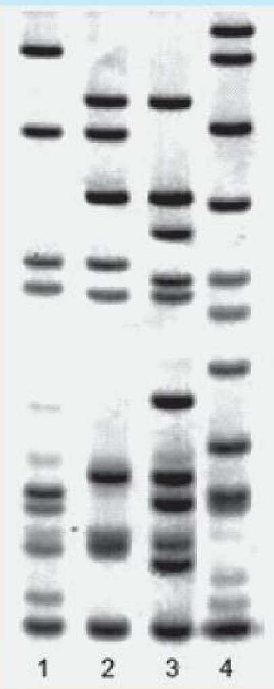

**b) Ribonucleic acid – RNA**

*Cấu trúc*

Khác với DNA, các loại RNA được cấu tạo từ một chuỗi polynucleotide. Mỗi nucleotide trong RNA được cấu tạo từ một nitrogenous base liên kết với đường ribose (đường 5 carbon) và gốc phosphate ($-\text{PO}_4^{3-}$). Tuy nhiên, base trong RNA gồm adenine, guanine, cytosine và uracil (U) mà không có thymine.

Có nhiều loại phân tử RNA khác nhau và do vậy chúng cũng khác nhau về đặc điểm cấu trúc.

**mRNA** (RNA thông tin), chỉ gồm một chuỗi polynucleotide dạng mạch thẳng, trong khi **tRNA** (RNA vận chuyển), mặc dù được cấu trúc từ một mạch nhưng các vùng khác nhau trong một mạch lại tự bắt đôi bổ sung với nhau bằng các liên kết hydrogen theo kiểu $\text{A} = \text{U}$, $\text{G} \equiv \text{C}$ tạo nên cấu trúc không gian ba chiều đặc trưng rất phức tạp phù hợp với chức năng của chúng (H 5.11). Trong tế bào còn rất nhiều loại phân tử RNA nhỏ khác nhau, một số thậm chí có cấu trúc mạch kép.

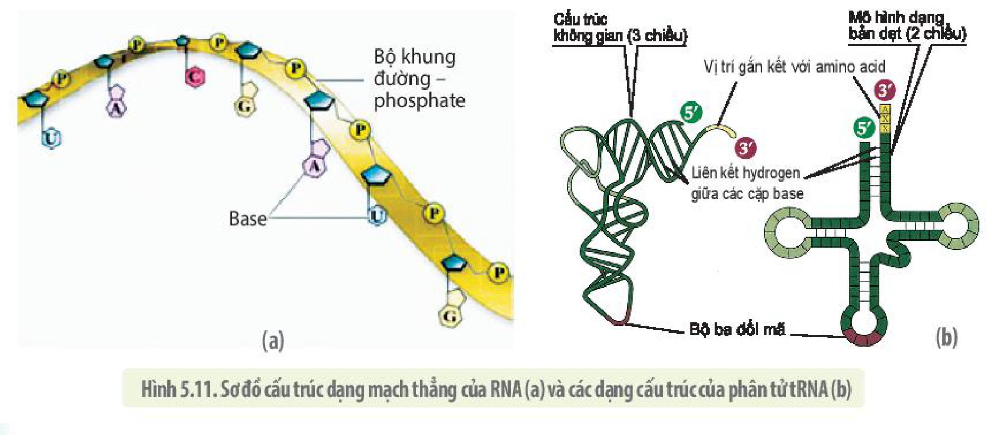

Hình 5.11. Sơ đồ cấu trúc dạng mạch thẳng của RNA (a) và các dạng cấu trúc của phân tử tRNA (b)

<!-- pdf:40 -->

*Chức năng*

Mỗi loại RNA thực hiện một chức năng riêng phù hợp với cấu trúc của nó.

- **RNA thông tin** (mRNA) được dùng làm khuôn để tổng hợp protein ở ribosome.
- **RNA vận chuyển** (tRNA) làm nhiệm vụ vận chuyển amino acid đến ribosome và tiến hành dịch mã.
- **RNA ribosome** (**rRNA**) tham gia cấu tạo nên ribosome, nơi tiến hành tổng hợp protein.
- Các loại RNA nhỏ khác tham gia vào quá trình điều hoà hoạt động của gene.
- Một số loại RNA còn có chức năng xúc tác cho các phản ứng hoá học như các enzyme và vì vậy chúng được gọi là các **ribozyme**.

Nguồn cung cấp các loại nguyên liệu để tổng hợp các nucleic acid cho cơ thể người là từ tất cả các loại thực phẩm. Tuy vậy, có những loại thực phẩm chứa nhiều nucleic acid hơn các loại khác. Ví dụ: Các mô như gan động vật chứa rất nhiều DNA nên chúng ta có thể làm thí nghiệm tách chiết DNA từ gan của gà hoặc lợn khá dễ dàng. Khi bị rối loạn chuyển hoá uric acid, nếu ăn nhiều thực phẩm giàu nucleic acid như tôm, cua, nội tạng động vật và nhiều loại thịt đỏ khác, nhân purin trong nucleic acid sẽ dễ bị chuyển hoá thành uric acid tích luỹ lại trong các khớp xương gây nên bệnh goute.

## ❓ Dừng lại và suy ngẫm

1. Quan sát hình trong mục II. 4b, phân biệt các loại RNA về cấu trúc và chức năng.
2. Trình bày sự khác biệt về mặt cấu trúc giữa DNA và RNA.

## 📌 Kiến thức cốt lõi

- Các phân tử sinh học chính bao gồm carbohydrate, lipid, protein và các nucleic acid.
- Carbohydrate được cấu tạo từ các nguyên tử C, H và O theo tỉ lệ 1: 2: 1 và công thức tổng quát là $\text{C}_n(\text{H}_2\text{O})_m$ bao gồm các loại đường đơn, đường đôi và đường đa với chức năng chính là dự trữ năng lượng và cấu trúc nên các phân tử sinh học khác nhau.
- Lipid là những phân tử kị nước có cấu trúc và chức năng rất đa dạng. Các loại lipid chủ yếu là triglycerid, phospholipid, steroid, carotenoid và một số loại vitamin như A, E, D, K. Chức năng chủ yếu của lipid là dự trữ năng lượng dài hạn và cấu trúc nên màng tế bào và nhiều bộ phận khác của tế bào.
- **Protein** được cấu tạo theo nguyên tắc đa phân gồm nhiều đơn phân là amino acid. Tính đa dạng và đặc thù của protein được quy định bởi số lượng, thành phần, trình tự sắp xếp các amino acid và các bậc cấu trúc của nó. Cấu hình không gian ba chiều của protein quy định chức năng của chúng. Protein có rất nhiều chức năng như cấu trúc, vận chuyển, xúc tác, miễn dịch, truyền tin,...

<!-- pdf:41 -->

- DNA được cấu tạo bởi hai chuỗi polynucleotide liên kết với nhau bằng các liên kết hydrogen ($\text{A}=\text{T}$, $\text{G}\equiv\text{C}$). Mỗi nucleotide được cấu tạo từ ba thành phần: base (gồm 4 loại A, T, G, C), đường deoxyribose và gốc phosphat. Chức năng của DNA là mang, bảo quản và truyền đạt thông tin di truyền.
- RNA có cấu trúc chủ yếu từ một chuỗi polynucleotide. Mỗi nucleotide được cấu tạo từ base, đường ribose và nhóm phosphat. Có bốn loại base là A, U, G và C. Chức năng của RNA rất đa dạng: làm khuôn để tổng hợp protein, vận chuyển amino acid, cấu tạo nên ribosome, điều hoà hoạt động gene, xúc tác cho một số loại phản ứng hoá học.

## ✏️ Luyện tập và vận dụng

1. Phân tử glucose có công thức cấu tạo là $\text{C}_6\text{H}_{12}\text{O}_6$. Nếu 10 phân tử glucose liên kết với nhau tạo nên một phân tử đường đa thì phân tử này sẽ có công thức cấu tạo như thế nào? Giải thích.
2. Tại sao cùng có chung công thức cấu tạo là $\text{C}_6\text{H}_{12}\text{O}_6$ nhưng glucose và fructose lại có vị ngọt khác nhau?
3. Tại sao cùng được cấu tạo từ các phân tử đường glucose nhưng tinh bột và cellulose lại có đặc tính vật lí và chức năng sinh học khác nhau?
4. Trong số các phân tử sinh học, protein là loại có nhiều chức năng nhất. Tại sao?
5. Để giảm béo, nhiều người đã cắt bỏ hoàn toàn chất béo trong khẩu phần ăn. Theo em, điều này là nên hay không nên? Dưới góc độ sinh học, chúng ta cần làm gì để duy trì cân nặng với một cơ thể khoẻ mạnh?
6. Tại sao khi luộc trứng thì protein của trứng lại bị đông đặc lại?
7. Giải thích vì sao khi khẩu phần ăn thiếu protein thì cơ thể, đặc biệt là trẻ em, thường gầy yếu, chậm lớn, hay bị phù nề và dễ mắc bệnh truyền nhiễm?

## 📷 Danh sách hình trong bài

| Mã hình | Trang PDF | Vị trí | Chú thích gốc |
|---|---|---|---|
| H10-sinh-b05-01 | 30 | Mục II.1.a | Hình 5.1. Đường glucose, galactose và fructose tồn tại trong môi trường nước thường có cấu trúc dạng vòng và tồn tại ở các dạng không gian khác nhau làm cho chúng có các đặc tính vật lí, hoá học khác nhau |
| H10-sinh-b05-02 | 30 | Mục II.1.b | Hình 5.2. Đường đôi được hình thành khi hai đường đơn liên kết cộng hoá trị với nhau bằng cách loại đi một phân tử nước (a – đường sucrose; b – đường maltose) |
| H10-sinh-b05-03 | 31 | Mục II.1.c | Hình 5.3. Cấu trúc của cellulose, glycogen và tinh bột |
| H10-sinh-b05-04 | 32 | Mục II.2.a | Hình 5.4. Cấu trúc của acid béo và mỡ: (a) Acid béo bão hoà (acid béo no) (b) Acid béo không bão hoà (acid béo không no) (c) Glycerol liên kết với các acid béo bão hoà tạo nên mỡ hay bơ |
| H10-sinh-b05-05 | 33 | Mục II.2.b | Hình 5.5. Cấu trúc của phospholipid (a); phospholipid cấu trúc nên màng tế bào (b) |
| H10-sinh-b05-06 | 34 | Mục II.2.c | Hình 5.6. Cấu trúc cholesterol (a); testosterone (b) và estrogen (c) |
| H10-sinh-b05-07 | 35 | Mục II.3.b | Hình 5.7. Cấu trúc chung của amino acid |
| H10-sinh-b05-08 | 36 | Mục II.3.b | Hình 5.8. Các bậc cấu trúc của protein |
| H10-sinh-b05-09 | 36 | Mục II.3.b | Hình 5.9. Các liên kết hoá học duy trì cấu trúc không gian của protein |
| H10-sinh-b05-10 | 38 | Mục II.4.a | Hình 5.10. Cấu trúc xoắn kép của DNA (a) và một chuỗi polynucleotide (b) cùng các base của DNA (c) |
| H10-sinh-b05-11 | 39 | Mục Khoa học và đời sống | Bảng điện di dấu vân tay DNA (Nguồn: Genetics from gene to genome 4th – Hardwell 2011) |
| H10-sinh-b05-12 | 39 | Mục II.4.b | Hình 5.11. Sơ đồ cấu trúc dạng mạch thẳng của RNA (a) và các dạng cấu trúc của phân tử tRNA (b) |
