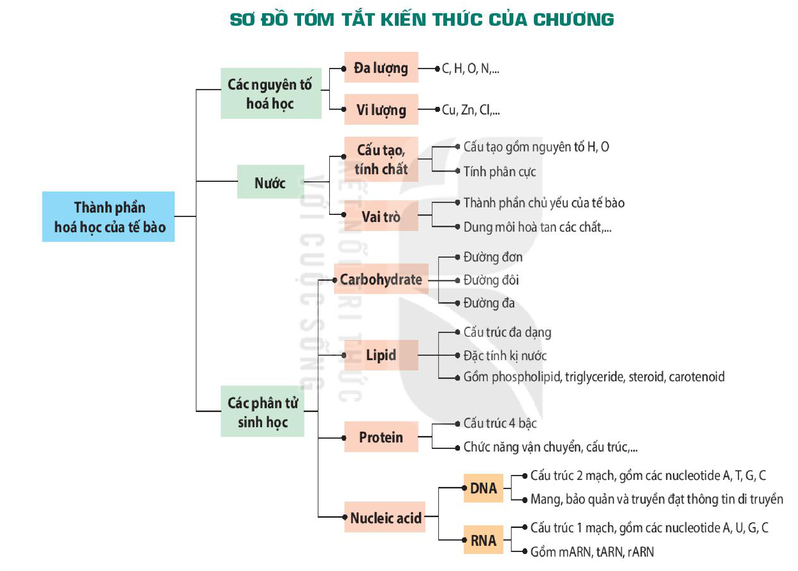

<!-- pdf:44 -->

# SƠ ĐỒ TÓM TẮT KIẾN THỨC CHƯƠNG 1

<!-- Trang in xoay ngang; ảnh đã xoay lại. Dưới đây chép các nhánh của sơ đồ thành danh sách, giữ nguyên chữ trong các ô. -->

- Thành phần hoá học của tế bào
  - Các nguyên tố hoá học
    - Đa lượng: C, H, O, N,...
    - Vi lượng: Cu, Zn, Cl,...
  - Nước
    - Cấu tạo, tính chất: Cấu tạo gồm nguyên tố H, O; Tính phân cực
    - Vai trò: Thành phần chủ yếu của tế bào; Dung môi hoà tan các chất,...
  - Các phân tử sinh học
    - Carbohydrate: Đường đơn; Đường đôi; Đường đa
    - Lipid: Cấu trúc đa dạng; Đặc tính kị nước; Gồm phospholipid, triglyceride, steroid, carotenoid
    - Protein: Cấu trúc 4 bậc; Chức năng vận chuyển, cấu trúc,...
    - Nucleic acid
      - DNA: Cấu trúc 2 mạch, gồm các nucleotide A, T, G, C; Mang, bảo quản và truyền đạt thông tin di truyền
      - RNA: Cấu trúc 1 mạch, gồm các nucleotide A, U, G, C; Gồm mARN, tARN, rARN
<!-- ocr-ok: chữ trong các ô sơ đồ in xoay ngang, OCR đọc không theo thứ tự; đã đối chiếu ảnh đã xoay -->

## 📷 Danh sách hình trong bài

| Mã hình | Trang PDF | Vị trí | Chú thích gốc |
|---|---|---|---|
| H10-sinh-so-do-tom-tat-c01-01 | 44 | Cả trang (in xoay ngang) | Sơ đồ tóm tắt kiến thức của chương |
