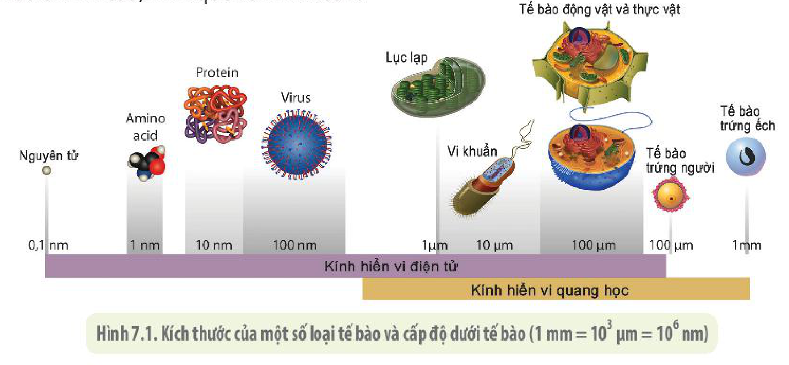
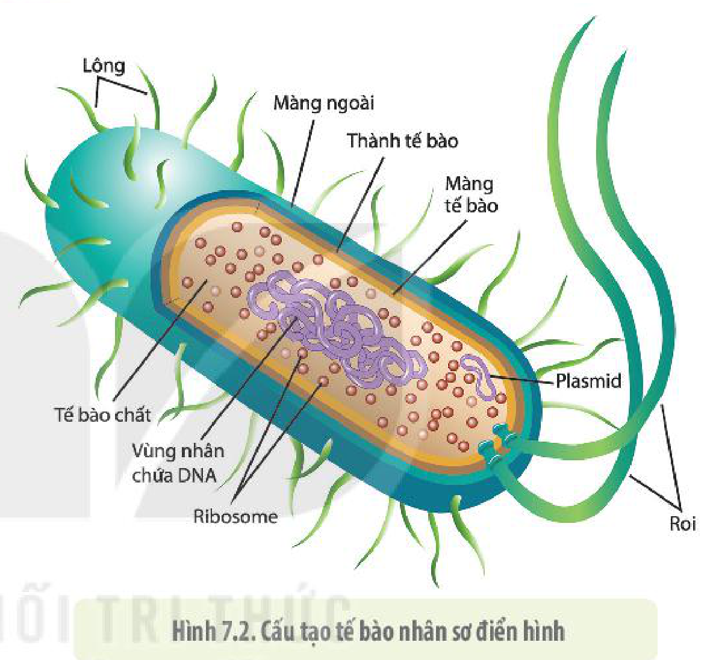
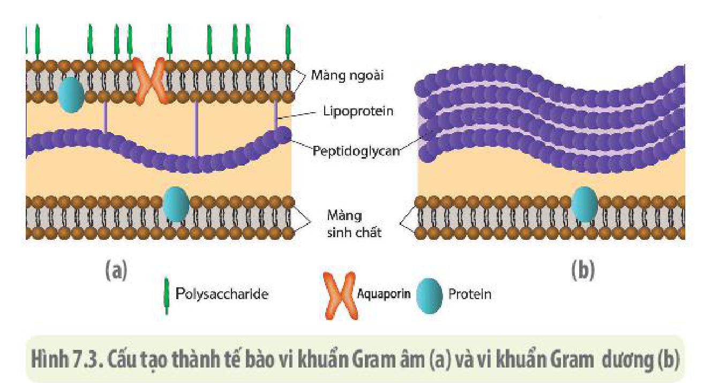
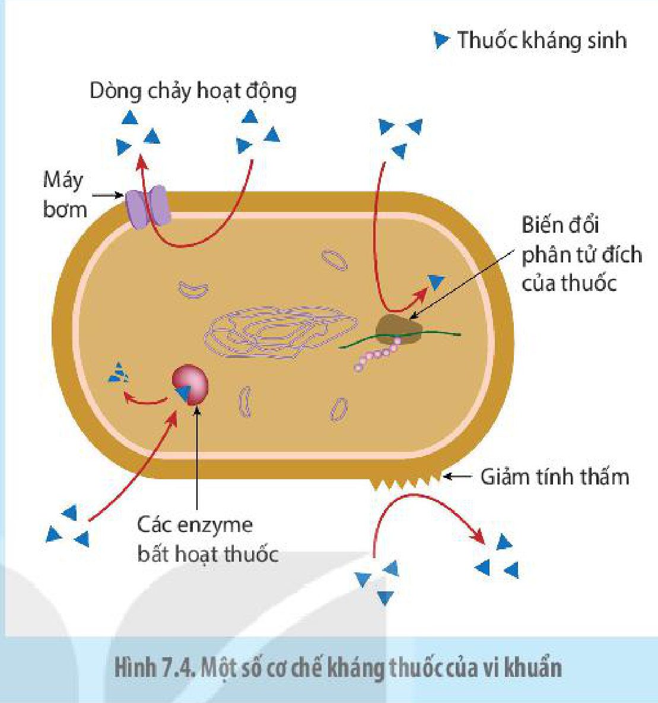

<!-- pdf:45 -->

# BÀI 7: TẾ BÀO NHÂN SƠ

## 🎯 Yêu cầu cần đạt

- Mô tả được kích thước, cấu tạo và chức năng các thành phần của tế bào nhân sơ.

## 🔴 Mở đầu

Mọi sinh vật đều được cấu tạo từ tế bào. Có hai loại tế bào: tế bào nhân sơ và tế bào nhân thực. Sinh vật nhân sơ có thể phân bố hầu như mọi nơi trên Trái Đất. Số lượng sinh vật nhân sơ có trên cơ thể người gấp hàng chục lần số lượng tế bào của cơ thể người. Tại sao các sinh vật nhân sơ lại có các đặc điểm thích nghi kì lạ đến như vậy?

## I. ĐẶC ĐIỂM CHUNG CỦA TẾ BÀO NHÂN SƠ

Hầu hết các loại tế bào, kể cả nhân sơ và nhân thực, đều có kích thước rất nhỏ, thường chỉ quan sát được dưới kính hiển vi (H 7.1). **Tế bào nhân sơ** điển hình có kích thước dao động từ 1 μm đến 5 μm, bằng khoảng 1/10 tế bào nhân thực. Kích thước nhỏ đem lại ưu thế cho tế bào nhân sơ: **Tỉ lệ S/V** (diện tích bề mặt tế bào/thể tích tế bào) lớn dẫn đến tốc độ trao đổi chất với môi trường nhanh, nhờ đó tốc độ chuyển hoá vật chất, năng lượng và sinh sản nhanh nên chúng là loại sinh vật thích nghi nhất trên Trái Đất. So với tế bào nhân thực, tế bào nhân sơ chưa có nhân hoàn chỉnh, chưa có màng nhân ngăn cách giữa chất nhân và tế bào chất, chưa có hệ thống nội màng, chưa có các bào quan có màng bao bọc và bộ khung xương tế bào. Tế bào nhân sơ cấu trúc đơn giản, có nhiều hình dạng khác nhau, phổ biến nhất là hình cầu, hình que và hình xoắn.

Hình 7.1. Kích thước của một số loại tế bào và cấp độ dưới tế bào (1 mm = $10^3$ μm = $10^6$ nm)

<!-- pdf:46 -->

## ❓ Dừng lại và suy ngẫm

1. Nêu các đặc điểm chung của tế bào nhân sơ. Vì sao loại tế bào này được gọi là tế bào nhân sơ?
2. Loại vi khuẩn A có kích thước trung bình là 1 μm, loại vi khuẩn B có kích thước trung bình là 5 μm. Theo lí thuyết, loại nào sẽ có tốc độ sinh sản nhanh hơn? Giải thích.

## II. CẤU TẠO TẾ BÀO NHÂN SƠ

Hầu hết các tế bào nhân sơ đều là những sinh vật đơn bào. Đa số chúng là vi khuẩn và **Archaea** (đọc là a-ki-a còn gọi là cổ khuẩn hay vi khuẩn cổ). Dưới đây chúng ta sẽ xem xét cấu trúc của một tế bào nhân sơ điển hình là vi khuẩn (H 7.2).

### 1. Lông, roi và màng ngoài

**Lông** và **roi** là những cấu trúc dạng sợi dài, nhô ra khỏi màng và thành tế bào.

Roi được cấu tạo từ bó sợi protein, là cơ quan vận động của tế bào. Các tế bào vi khuẩn có thể có một hoặc một vài roi.

Hình 7.2. Cấu tạo tế bào nhân sơ điển hình

Lông ngắn hơn nhưng có số lượng nhiều hơn roi. Lông là bộ phận giúp các tế bào vi khuẩn bám dính, tiếp hợp với nhau hoặc bám vào bề mặt tế bào của sinh vật khác. Ví dụ: Vi khuẩn *Helicobacter pylori* dùng lông bám dính vào tế bào niêm mạc dạ dày người, gây bệnh viêm loét dạ dày.

Ở một số loại vi khuẩn, thành tế bào được bao phủ bởi một lớp **màng ngoài** có cấu tạo chủ yếu từ lipopolysaccharide. Màng ngoài của một số vi khuẩn gây bệnh giúp bảo vệ chúng tránh khỏi sự tấn công của các tế bào bạch cầu.

### 2. Thành tế bào và màng tế bào

Hầu hết vi khuẩn đều có thành tế bào. **Thành tế bào vi khuẩn** có độ dày từ 10 nm đến 20 nm, được cấu tạo bởi **peptidoglycan**. Dựa vào cấu tạo của thành tế bào (H 7.3), vi khuẩn được chia làm 2 nhóm: **vi khuẩn Gram dương** (Gr+), có thành dày bắt màu tím khi nhuộm Gram và **vi khuẩn Gram âm** (Gr–), có thành mỏng bắt màu đỏ khi nhuộm Gram.

Thành tế bào như một cái khung bên ngoài, có tác dụng giữ ổn định hình dạng và bảo vệ tế bào. Một số loại thuốc kháng sinh như penicillin diệt vi khuẩn bằng cách ngăn không cho vi khuẩn tạo được thành tế bào (H 7.3), đặc biệt là đối với vi khuẩn Gr+.

<!-- pdf:47 -->

Ở một số loại vi khuẩn Gr–, bên ngoài lớp peptidoglycan của thành tế bào còn có lớp màng ngoài được cấu tạo từ lớp kép phospholipid như màng tế bào nhưng giàu lipopolysaccharide. Lớp màng ngoài không có chức năng cho các chất ra vào tế bào một cách có chọn lọc như màng tế bào (H 7.3). Một số loại lipopolysaccharide của lớp màng này bị phân huỷ khi tế bào chết sinh ra các **nội độc tố** có thể gây chết người.

Hình 7.3. Cấu tạo thành tế bào vi khuẩn Gram âm (a) và vi khuẩn Gram dương (b)

Bên trong thành tế bào là lớp màng tế bào hay còn gọi là màng sinh chất. Màng tế bào nhân sơ cũng như tế bào nhân thực đều được cấu tạo bởi hai thành phần chủ yếu là lớp kép phospholipid và protein. Ngoài chức năng trao đổi chất có chọn lọc thì màng tế bào còn là nơi diễn ra các quá trình chuyển hoá vật chất và năng lượng của tế bào.

## ❓ Dừng lại và suy ngẫm

1. Phân biệt lông và roi ở tế bào vi khuẩn.
2. Nêu cấu tạo và chức năng của thành tế bào và màng tế bào ở tế bào nhân sơ.

### 3. Tế bào chất

Nằm giữa màng tế bào và vùng nhân là khối tế bào chất. Thành phần chính của tế bào chất là bào tương. Bào tương là dạng keo lỏng có thành phần chủ yếu là nước, các hợp chất hữu cơ và vô cơ khác nhau. Ngoài ra, trong bào tương có các hạt dự trữ (đường, lipid) và nhiều ribosome (10 000 đến 100 000) là nơi xảy ra quá trình tổng hợp protein của tế bào.

Tế bào chất là nơi diễn ra các phản ứng hoá sinh, đảm bảo duy trì các hoạt động sống của tế bào.

### 4. Vùng nhân

**Vùng nhân** của tế bào vi khuẩn không có màng bao bọc và hầu hết chỉ chứa một phân tử DNA dạng vòng, mạch kép (H 7.2). Phân tử DNA này mang thông tin di truyền điều khiển mọi hoạt động sống của tế bào vi khuẩn.

Ngoài DNA ở vùng nhân, một số tế bào vi khuẩn còn có thêm các phân tử DNA nhỏ, dạng vòng, mạch kép khác được gọi là các **plasmid**. Trên các plasmid thường chứa nhiều gene kháng thuốc kháng sinh. Các plasmid mang gene kháng thuốc kháng sinh có thể được truyền từ tế bào vi khuẩn này sang tế bào vi khuẩn khác bằng con đường tiếp hợp. Trong kĩ thuật chuyển gene, các plasmid thường được sử dụng làm vector để biến nạp gene tái tổ hợp từ tế bào này sang tế bào khác. Tuy nhiên, nếu thiếu plasmid thì vi khuẩn vẫn sinh trưởng bình thường.

## ❓ Dừng lại và suy ngẫm

1. Tế bào chất và vùng nhân của tế bào nhân sơ có cấu trúc và chức năng như thế nào?
2. Tại sao lại gọi là vùng nhân mà không phải là nhân tế bào?
3. Phân biệt DNA vùng nhân và plasmid.

<!-- pdf:48 -->

## 💡 Khoa học và đời sống

**Một số cơ chế kháng thuốc của vi khuẩn**

<!-- term: Thuốc kháng sinh -->
Các loại thuốc kháng sinh có thể tác động ngăn cản quá trình tổng hợp thành tế bào, ức chế enzyme hay tác động vào ribosome để ức chế quá trình tổng hợp protein của vi khuẩn. Tuy vậy, vi khuẩn có thể kháng lại thuốc kháng sinh bằng nhiều cách khác nhau như bơm thuốc ra khỏi tế bào hay giảm độ thẩm thấu của thuốc vào trong tế bào, biến đổi phân tử đích của thuốc, tăng cường các enzyme bất hoạt thuốc (H 7.4).

Hình 7.4. Một số cơ chế kháng thuốc của vi khuẩn

## 📌 Kiến thức cốt lõi

- Tế bào nhân sơ có đặc điểm chung là kích thước nhỏ, chưa có màng nhân, trong tế bào chất chỉ có ribosome, không có các bào quan có màng bọc.
- Tế bào nhân sơ được cấu tạo từ các thành phần chính là thành tế bào, màng tế bào, tế bào chất và vùng nhân. Một số tế bào có thể có thêm các thành phần như lông, roi và màng ngoài.
- Tế bào nhân sơ sinh trưởng, phát triển nhanh, thích nghi với nhiều loại môi trường.

## ✏️ Luyện tập và vận dụng

1. Hoàn thành bảng cấu trúc và chức năng các thành phần của tế bào nhân sơ theo mẫu sau:

| Thành phần | Cấu trúc | Chức năng |
|---|---|---|
| Thành tế bào | ? | ? |
| ... | ? | ? |

2. Đặc điểm cấu trúc nào của tế bào vi khuẩn được ứng dụng trong kĩ thuật di truyền để biến nạp gene mong muốn từ tế bào này sang tế bào khác?
3. Dựa vào thành phần nào của tế bào vi khuẩn, người ta có thể phân biệt được 2 nhóm vi khuẩn Gr–, Gr+? Điều này có ý nghĩa gì đối với y học?

## 📷 Danh sách hình trong bài

| Mã hình | Trang PDF | Vị trí | Chú thích gốc |
|---|---|---|---|
| H10-sinh-b07-01 | 45 | Mục I (cạnh trên khung sát hàng chữ cuối đoạn văn phía trên) | Hình 7.1. Kích thước của một số loại tế bào và cấp độ dưới tế bào (1 mm = 10³ μm = 10⁶ nm) |
| H10-sinh-b07-02 | 46 | Mục II.1 | Hình 7.2. Cấu tạo tế bào nhân sơ điển hình |
| H10-sinh-b07-03 | 47 | Mục II.2 | Hình 7.3. Cấu tạo thành tế bào vi khuẩn Gram âm (a) và vi khuẩn Gram dương (b) |
| H10-sinh-b07-04 | 48 | Mục Khoa học và đời sống (nằm trong hộp nền xanh) | Hình 7.4. Một số cơ chế kháng thuốc của vi khuẩn |
