<!-- pdf:49 -->
# BÀI 8: TẾ BÀO NHÂN THỰC

## 🎯 Yêu cầu cần đạt

- Nêu được cấu tạo và chức năng của tế bào chất.
- Trình bày được cấu trúc của nhân tế bào và chức năng quan trọng của nhân.
- Phân tích được mối quan hệ giữa cấu tạo và chức năng của các bào quan trong tế bào.
- Phân tích được mối quan hệ phù hợp giữa cấu tạo và chức năng của màng sinh chất và thành tế bào thực vật.
- Trình bày được cấu trúc và chức năng của các thành phần: lông, roi, chất nền ngoại bào và bộ phận kết nối các tế bào.
- Lập được bảng so sánh tế bào nhân sơ và tế bào nhân thực, tế bào động vật và thực vật.

## 🔴 Mở đầu

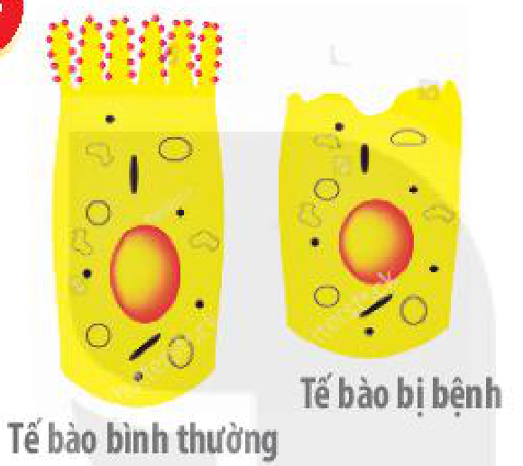

Hình bên cho thấy màng tế bào niêm mạc ruột non bình thường có diện tích lớn hơn nhiều so với màng tế bào của tế bào niêm mạc ruột bất thường bên cạnh. Người có các tế bào niêm mạc ruột bất thường dù ăn nhiều đến mấy cũng khó béo được vì bị giảm khả năng hấp thụ thức ăn. Vậy, màng tế bào và những bộ phận còn lại của tế bào nhân thực có cấu trúc và chức năng như thế nào?

## I. ĐẶC ĐIỂM CHUNG CỦA TẾ BÀO NHÂN THỰC

**Tế bào nhân thực** có kích thước lớn và có cấu tạo phức tạp. Tế bào nhân thực đã có nhân chính thức với màng nhân ngăn cách chất nhân và tế bào chất, bộ khung xương tế bào cùng với hệ thống nội màng và hàng loạt các bào quan có màng bao bọc. Ngoài các đặc điểm chung, các loài sinh vật nhân thực khác nhau cũng có tế bào với các đặc điểm cấu trúc thích nghi riêng như **tế bào thực vật** và **tế bào động vật** ở hình 8.1.

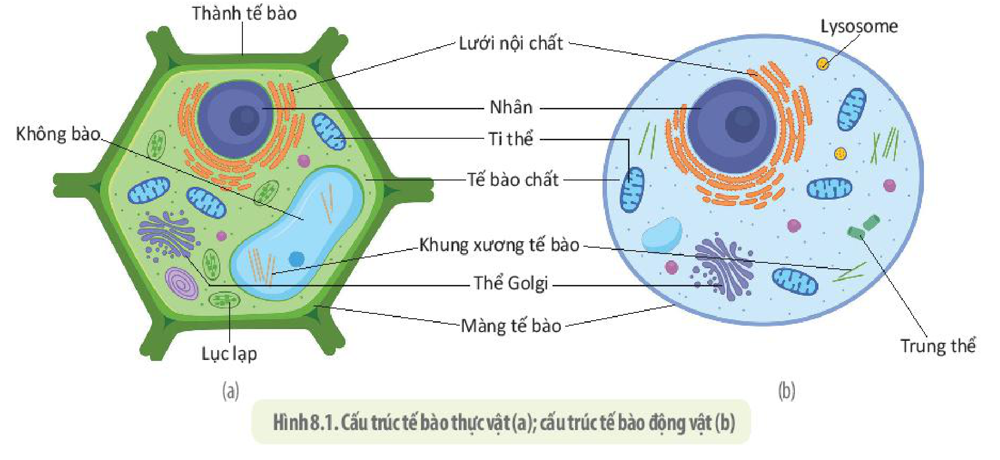

*Hình 8.1. Cấu trúc tế bào thực vật (a); cấu trúc tế bào động vật (b)*

<!-- pdf:50 -->
## II. CẤU TẠO TẾ BÀO NHÂN THỰC

### 1. Nhân – trung tâm thông tin của tế bào

**Nhân tế bào** là cấu trúc lớn nhất có màng bao bọc. Mỗi tế bào nhân thực thường chỉ có một nhân. Tuy nhiên, ở một số tế bào nấm và sinh vật khác, mỗi tế bào có thể có một vài nhân. Phần lớn nhân tế bào có dạng hình cầu, với đường kính khoảng $5\ \mu\text{m}$ và được bao bọc bởi lớp kép phospholipid và protein. Trên **màng nhân** có rất nhiều lỗ nhỏ đảm bảo cho các chất có thể ra vào nhân (H 8.2).

Trong nhân có **chất nhiễm sắc** chứa DNA. Những thông tin trên DNA sẽ được phiên mã thành các phân tử RNA và được đưa ra khỏi nhân để tham gia tổng hợp protein – phân tử giữ chức năng cấu trúc và vận hành các hoạt động sống của tế bào. Vì vậy, nhân là trung tâm điều khiển các hoạt động sống của tế bào. Trong nhân còn có một hoặc một vài **hạch nhân** (**nhân con**), là nơi diễn ra quá trình tổng hợp các phân tử rRNA.

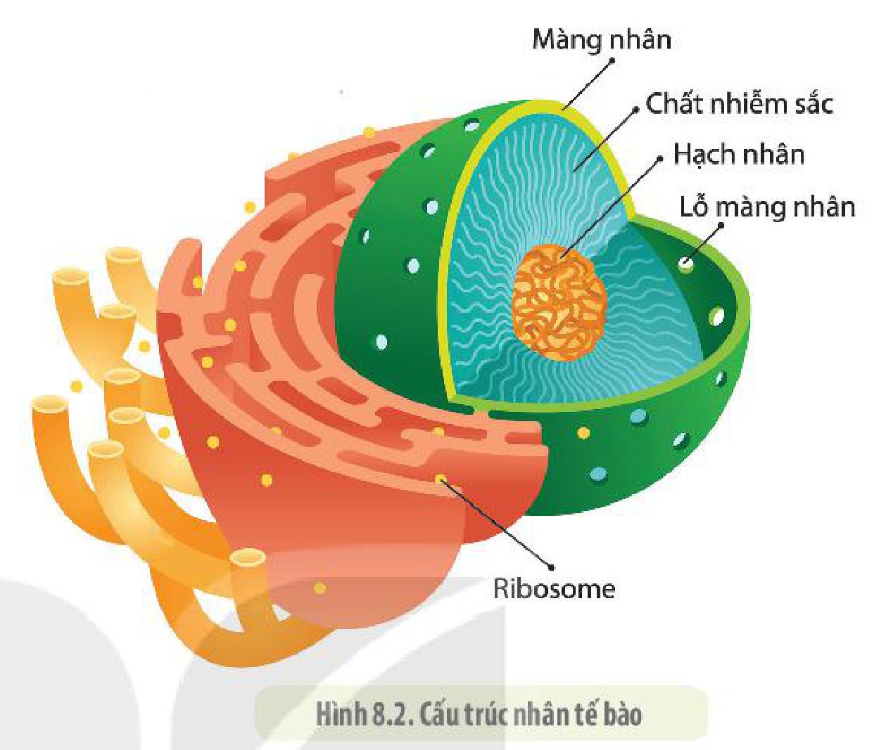

*Hình 8.2. Cấu trúc nhân tế bào*

## ❓ Dừng lại và suy ngẫm

1. Trình bày cấu trúc và chức năng của nhân tế bào.
2. Vì sao nói nhân là trung tâm điều khiển mọi hoạt động sống của tế bào?

### 2. Ribosome – "nhà máy" tổng hợp protein của tế bào
<!-- ocr-ok: OCR đọc nhầm "2©. Ribupsome - nhà máV", đã đối chiếu ảnh trang 50 -->

**Ribosome** là bào quan không có màng bao bọc, có dạng hình cầu, đường kính khoảng $150\ \text{\AA}$. Thành phần hoá học của ribosome gồm rRNA (khoảng 80 % – 90 %) và protein. Mỗi ribosome được tạo bởi hai tiểu đơn vị có kích thước khác nhau: tiểu đơn vị lớn và tiểu đơn vị nhỏ (H 8.3). Ribosome là nơi diễn ra quá trình tổng hợp protein. Ở các tế bào có tốc độ tổng hợp protein cao, số lượng ribosome trong một tế bào khá lớn, có thể lên tới vài triệu như tế bào tuyến tuỵ ở người.

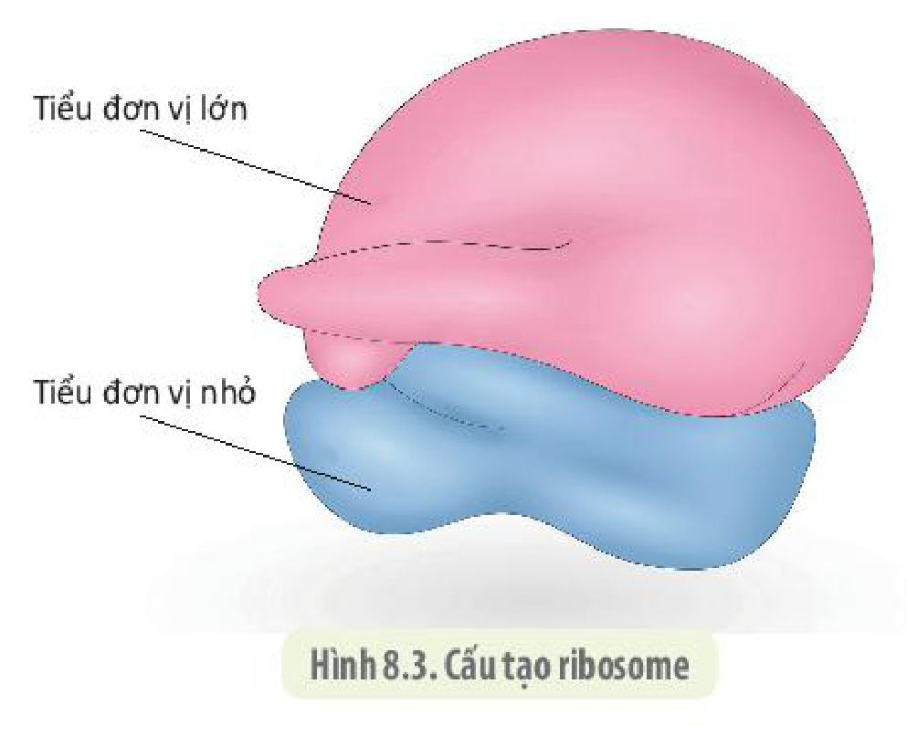

*Hình 8.3. Cấu trúc của ribosome*

<!-- pdf:51 -->
### 3. Lưới nội chất – "bến cảng" và "nhà máy" tổng hợp sinh học

**Lưới nội chất** là một hệ thống gồm các ống và các túi dẹp chứa dịch nối thông nhau thành một mạng lưới, gồm lưới nội chất hạt và lưới nội chất trơn.

**Lưới nội chất hạt** gồm hệ thống các đường ống tạo nên bởi lớp kép phospholipid, một đầu liên kết với màng nhân, đầu kia liên kết với lưới nội chất trơn (H 8.4). Trên màng lưới nội chất hạt có các hạt ribosome. Protein tổng hợp được ở ribosome sẽ được đưa vào trong lưới nội chất để chuyển qua **túi vận chuyển** (**túi tiết**) và vận chuyển tới bộ máy Golgi.

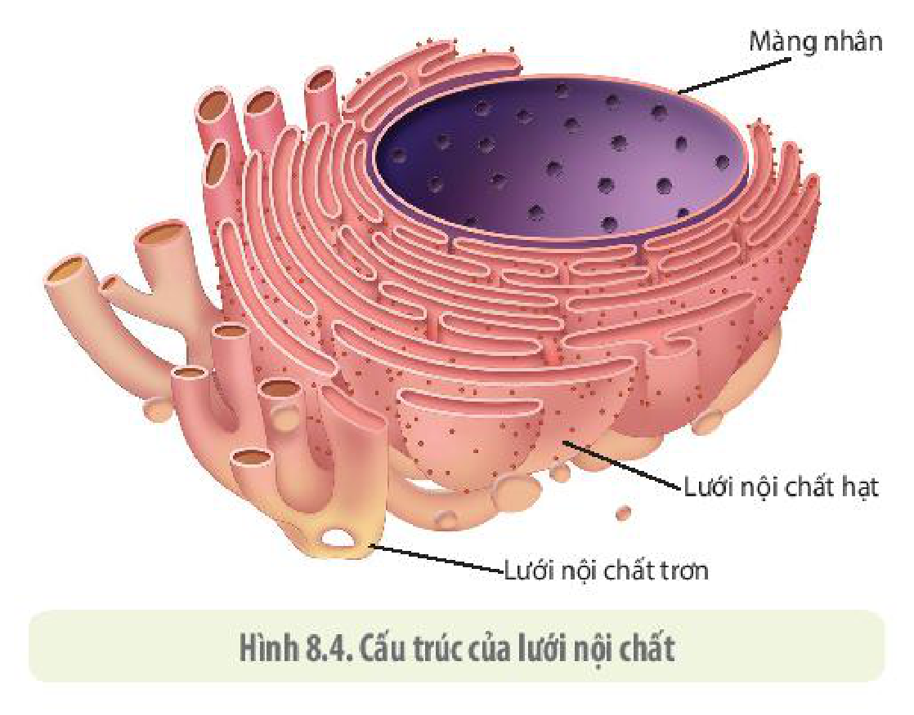

*Hình 8.4. Cấu trúc của lưới nội chất*

**Lưới nội chất trơn** là hệ thống màng dạng ống dẹp thông với lưới nội chất hạt, có ít hoặc không có ribosome. Lưới nội chất trơn chứa các enzyme tham gia tổng hợp nhiều loại lipid, chuyển hoá đường, khử độc và là kho dự trữ $\text{Ca}^{2+}$ để thực hiện nhiều chức năng khác nhau như co cơ và truyền tin tế bào,... Lưới nội chất trơn còn là nơi tổng hợp nên các sterol và phospholipid cấu tạo nên các loại màng của tế bào và các hormone sinh dục, tổng hợp và dự trữ triglyceride, tổng hợp và phân giải glycogen giúp điều hoà đường huyết.

Các tế bào gan có lưới nội chất phát triển mạnh chứa các enzyme tham gia vào quá trình khử độc các chất như rượu và nhiều loại hoá chất độc hại khác. Người uống nhiều rượu, bia, trong tế bào gan của họ có lưới nội chất trơn phát triển hơn nhiều so với ở người không uống rượu và nguy cơ tổn thương gan dẫn đến ung thư gan cũng tăng cao.

### 4. Bộ máy Golgi – nơi phân loại, đóng gói và phân phối sản phẩm của tế bào

**Bộ máy Golgi** gồm các túi dẹp nằm song song với nhau nhưng tách rời nhau (H 8.5). Bộ máy Golgi là nơi tập trung chế biến, lắp ráp, đóng gói các phân tử protein, lipid rồi phân phối chúng đến những nơi cần thiết. Ví dụ: Protein được tổng hợp từ ribosome trên lưới nội chất hạt được gửi đến bộ máy Golgi bằng các túi vận chuyển. Tại đây, chúng được gắn thêm các chất khác, như chuỗi đường ngắn tạo nên glycoprotein rồi bao gói vào trong các túi vận chuyển để chuyển đến các vị trí khác nhau trong tế bào hoặc xuất ra ngoài qua màng tế bào.

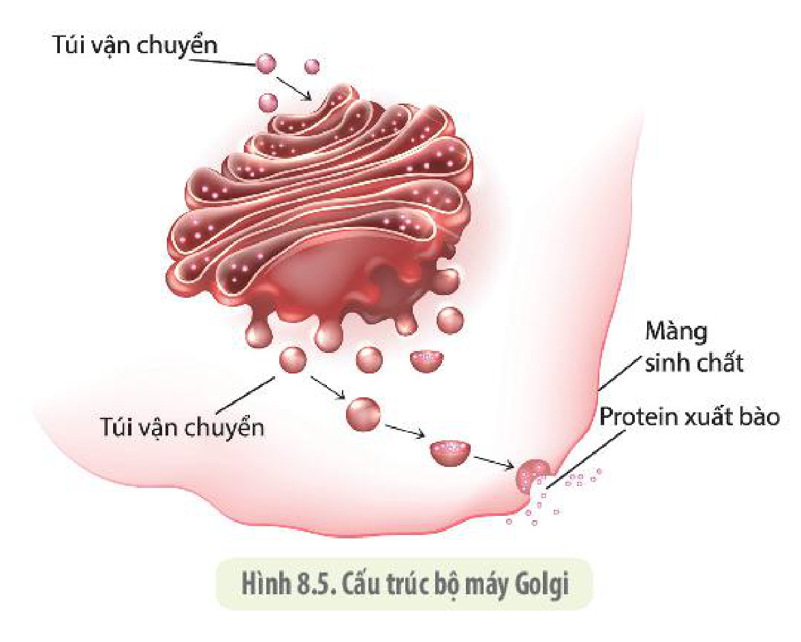

*Hình 8.5. Cấu trúc bộ máy Golgi*

<!-- pdf:52 -->
## ❓ Dừng lại và suy ngẫm

1. Nêu cấu trúc và chức năng của ribosome. Trong các loại tế bào của cùng một cơ thể: tế bào bạch cầu, tế bào cơ, tế bào gan, tế bào nào có xu hướng tổng hợp nhiều protein nhất? Giải thích.
2. Lưới nội chất có cấu tạo phù hợp với chức năng như thế nào? Trong các tế bào: tế bào thần kinh, tế bào tinh hoàn, tế bào gan, tế bào cơ, tế bào bạch cầu, tế bào nào có lưới nội chất trơn phát triển, tế bào nào có lưới nội chất hạt phát triển? Giải thích.
3. Mô tả cấu trúc và chức năng của bộ máy Golgi.
4. Ribosome, lưới nội chất và bộ máy Golgi có liên quan như thế nào về mặt chức năng?

### 5. Lysosome – "nhà máy" tái chế rác thải và chế biến thức ăn của tế bào

**Lysosome** là bào quan dạng túi có màng đơn, chứa các loại enzyme thuỷ phân protein, nucleic acid, carbohydrate, lipid, các bào quan và thậm chí cả các tế bào cần thay thế,... Lysosome được hình thành từ bộ máy Golgi và có ở các tế bào động vật. Những tế bào bị tổn thương, các tế bào và bào quan quá hạn sử dụng được enzyme của lysosome phân giải, lấy những gì có thể tái sử dụng, còn chất thải được xuất ra ngoài tế bào. Lysosome không chỉ làm nhiệm vụ tái chế mà còn hỗ trợ tế bào tiêu hoá thức ăn theo con đường thực bào.

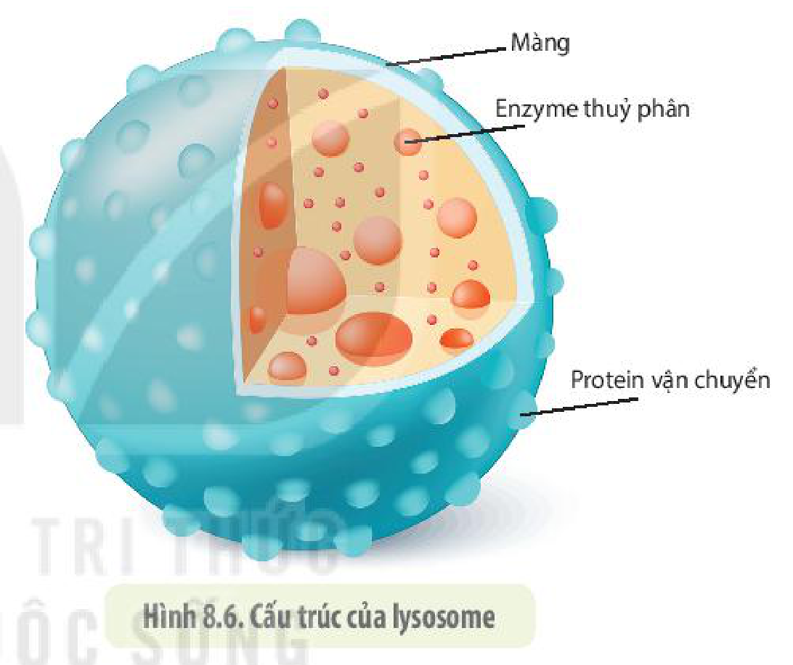

*Hình 8.6. Cấu trúc của lysosome*

### 6. Không bào – "túi bảo dưỡng" đa năng của tế bào

Ở tế bào thực vật, **không bào** là bào quan có một lớp màng bao bọc. Không bào lớn nằm giữa tế bào được gọi là **không bào trung tâm** (H 8.7a) giúp điều hoà áp suất thẩm thấu trong tế bào. Các không bào thường được bắt nguồn từ lưới nội chất và bộ máy Golgi.

Một số không bào ở tế bào của nhiều loại lá, hoa và quả có chứa các sắc tố nhằm thu hút côn trùng đến thụ phấn, các động vật đến ăn và phát tán hạt. Số khác được dùng làm kho chứa các chất như carbohydrate, ion, các loại muối, chất phế thải, các enzyme thuỷ phân các đại phân tử sinh học cũng như các enzyme khử các chất độc từ bên ngoài xâm nhập vào tế bào. Ví dụ: quả chanh có vị chua vì không bào của chúng chứa acid chanh (citric acid).

Một số loài động vật nguyên sinh như trùng giày có các **không bào co bóp** làm nhiệm vụ như những chiếc bơm, bơm nước ra khỏi tế bào khi tế bào bị hấp thụ quá nhiều nước; **không bào tiêu hoá** chứa các enzyme giúp chúng tiêu hoá thức ăn (H 8.7b).

<!-- pdf:53 -->
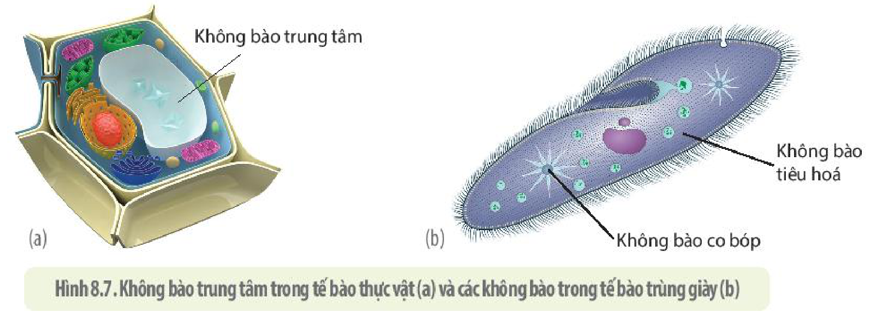

*Hình 8.7. Không bào trung tâm trong tế bào thực vật (a) và các không bào trong tế bào trùng giày (b)*

Những bào quan như lưới nội chất, màng nhân, lysosome, bộ máy Golgi, không bào và màng tế bào đều được xếp vào **hệ thống nội màng** vì các bộ phận này có thể kết nối trực tiếp với nhau hoặc có thể chuyển đổi các đoạn màng cho nhau.

### 7. Peroxysome – bào quan giải độc và chuyển hoá lipid

**Peroxysome** là bào quan có dạng hình cầu, được bao bọc bởi một màng đơn mỏng, thường nằm gần lưới nội chất. Tuy nhiên, peroxysome không có nguồn gốc từ hệ thống màng nội bào. Vì chứa enzyme phân giải $\text{H}_2\text{O}_2$ (peroxide) nên bào quan này có tên là peroxysome. $\text{H}_2\text{O}_2$ là một loại chất dễ phân giải thành các gốc oxy tự do làm tổn thương tế bào được sản sinh một số phản ứng hoá học trong tế bào. Các tế bào gan, thận của người có peroxysome chứa các enzyme khử các chất độc từ máu đưa tới. Một số peroxysome có enzyme phân giải các chất béo thành cholesterol và các dạng lipid khác. Khi một số enzyme phân giải chất béo trong peroxysome ở tế bào não bị mất chức năng, lipid bị tích tụ trong não làm tổn thương não và có thể dẫn đến tử vong.

Ở thực vật, một loại peroxysome đặc biệt gọi là **glioxysome**, chứa enzyme xúc tác cho phản ứng phân tách các acid béo thành acetyl – CoA, chất này được đưa đến ti thể tham gia vào quá trình hô hấp tế bào.

## ❓ Dừng lại và suy ngẫm

1. Lysosome có cấu tạo phù hợp với chức năng như thế nào? Trong các loại tế bào sau: tế bào cơ, tế bào hồng cầu, tế bào bạch cầu và tế bào thần kinh, loại tế bào nào có nhiều lysosome nhất? Giải thích.
2. Vì sao peroxysome lại được xem là bào quan giúp bảo vệ tế bào?
3. So sánh chức năng của các bào quan: lysosome, peroxysome và không bào.

### 8. Ti thể – "nhà máy điện" của tế bào

**Ti thể** là một loại bào quan có màng kép. Lớp màng ngoài trơn nhẵn, màng trong gấp nếp hình răng lược tạo nhiều **mào** (**cristae**) ngăn ti thể thành hai khoang. Khoang ngoài là khoảng không gian giữa hai màng chứa ion $\text{H}^+$ có vai trò quan trọng trong quá trình tổng hợp ATP. Khoang trong là chất nền chứa nhiều loại enzyme tham gia vào quá trình hô hấp tế bào. Màng trong chứa các phức hệ enzyme tham gia tổng hợp ATP. Ngoài ra, trong chất nền còn chứa nhiều phân tử DNA nhỏ, dạng vòng và ribosome. Do đó, ti thể có khả năng tự nhân đôi và tổng hợp protein cho riêng mình.

<!-- pdf:54 -->
Ti thể là nơi diễn ra quá trình phân giải carbohydrate giải phóng năng lượng cung cấp cho mọi hoạt động sống, đồng thời tạo nhiều sản phẩm trung gian cho quá trình chuyển hoá vật chất của tế bào.

Ti thể có nhiều hình dạng khác nhau. Hình dạng, kích thước và số lượng của ti thể phụ thuộc vào loại tế bào. Tế bào hoạt động càng nhiều thì càng có nhiều ti thể. Một tế bào có thể có tới hàng nghìn ti thể.

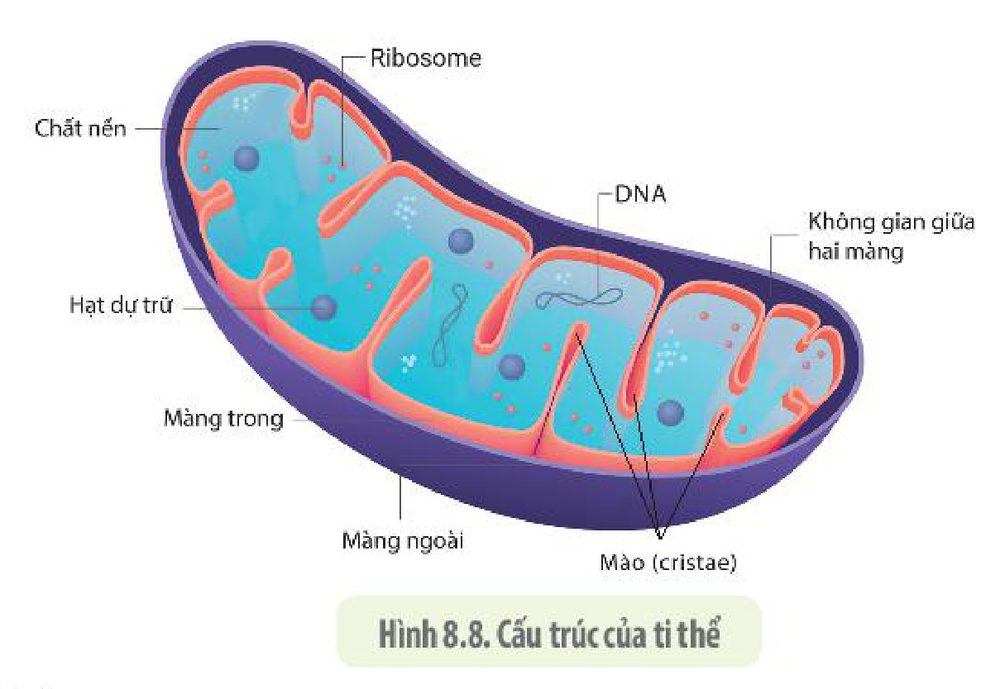

*Hình 8.8. Cấu trúc của ti thể*

### 9. Lục lạp – bào quan hấp thụ năng lượng ánh sáng

Trong các tế bào của thực vật và nhiều loài sinh vật nhân thực khác như tảo lục có loại bào quan với hai lớp màng được gọi là **lục lạp**. Bào quan này có khả năng thu nhận ánh sáng mặt trời thông qua quá trình quang hợp để tạo ra nguồn carbohydrate không chỉ cho riêng mình mà cho hầu hết các loài sinh vật. Lục lạp thường có hình bầu dục. Mỗi tế bào thường có nhiều lục lạp.

Lớp màng ngoài của lục lạp tạo khoảng không hẹp với lớp màng trong, màng trong không gấp khúc. Bên trong lục lạp có thêm một hệ thống màng ở dạng các túi dẹp, được gọi là **thylakoid**. Trên bề mặt của màng thylakoid chứa chất diệp lục cùng các enzyme và protein tham gia vào quá trình quang hợp (H 8.9a). Các túi này xếp chồng và nối thông với nhau bằng các phiến màng tạo nên cấu trúc được gọi là **granum**. Mỗi lục lạp có nhiều granum. Bao quanh các granum là vật chất dạng lỏng được gọi là **chất nền** (**stroma**).

Stroma chứa hệ enzyme tham gia vào quá trình cố định $\text{CO}_2$ trong quang hợp, ngoài ra, còn chứa nhiều phân tử DNA dạng vòng và ribosome. Giống như ti thể, lục lạp cũng có khả năng tự nhân đôi và một số gene của chúng tổng hợp được các protein tham gia vào quá trình quang hợp.

Ở tế bào thực vật, lục lạp và ti thể có mối quan hệ mật thiết với nhau trong quá trình chuyển hoá nội bào (H 8.9b).

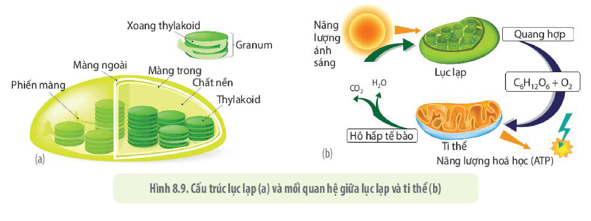

*Hình 8.9. Cấu trúc lục lạp (a) và mối quan hệ giữa lục lạp và ti thể (b)*

<!-- pdf:55 -->
## ❓ Dừng lại và suy ngẫm

1. Cấu trúc của ti thể và lục lạp phù hợp với chức năng của chúng như thế nào?
2. So sánh cấu trúc của ti thể và lục lạp. Hai bào quan này có mối quan hệ như thế nào trong quá trình chuyển hoá năng lượng ở tế bào thực vật?
3. Trong tế bào, ti thể và lục lạp mới được tạo ra bằng cách nào? Vì sao ti thể và lục lạp có khả năng tổng hợp protein cho riêng mình?
4. Trong các tế bào sau, tế bào nào có nhiều ti thể hơn? Vì sao?
   a) Tế bào lông hút của rễ cây và tế bào biểu bì lá cây.
   b) Tế bào cơ tim, tế bào gan, tế bào thận, tế bào dạ dày.

### 10. Tế bào chất và bộ khung xương tế bào

**a) Tế bào chất**

**Tế bào chất** là nơi diễn ra các hoạt động sống của tế bào. Tế bào chất gồm bào tương và các bào quan khác. **Bào tương** là vật chất dạng keo có thành phần chủ yếu là nước và các phân tử sinh học. Ngoài các bào quan, trong bào tương còn có mạng lưới các protein liên kết với nhau hình thành nên bộ khung của tế bào giống như bộ xương của cơ thể người.

**b) Bộ khung xương tế bào**

**Bộ khung xương tế bào** là hệ thống mạng **vi sợi**, **sợi trung gian** và **vi ống** kết nối với nhau (H 8.10).

Vai trò chính của bộ khung xương tế bào là nâng đỡ, duy trì hình dạng tế bào, neo giữ bào quan và các enzyme, hình thành nên trung thể có vai trò trong quá trình phân bào, hỗ trợ các bộ phận hay cả tế bào di chuyển.

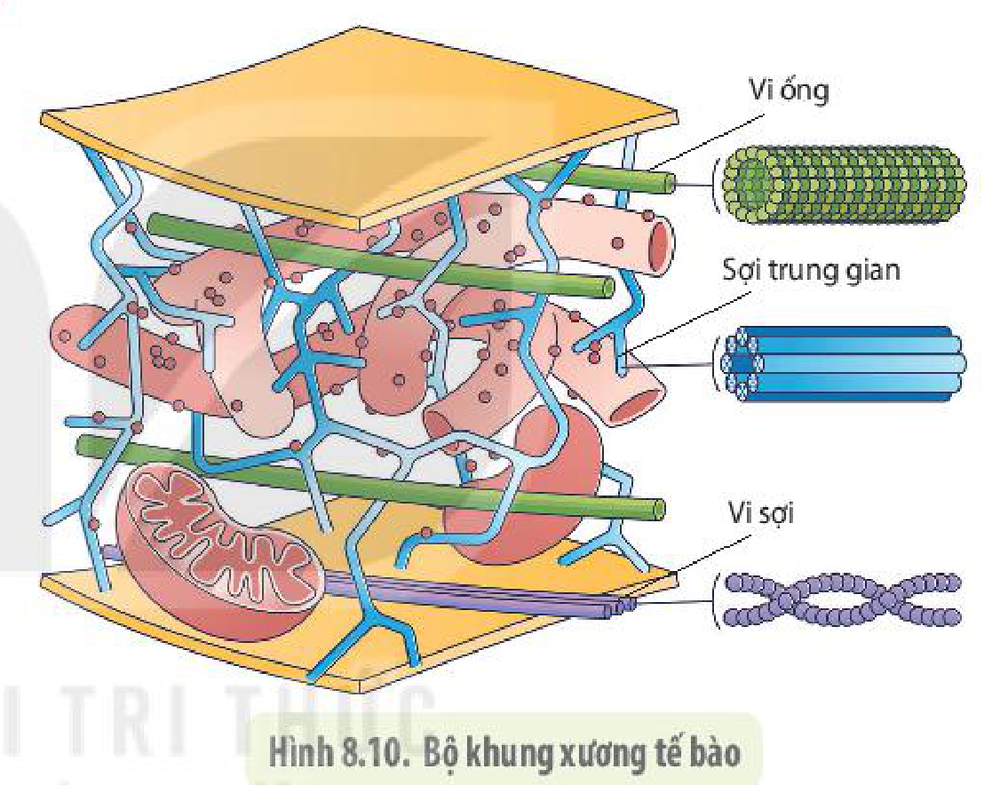

*Hình 8.10. Bộ khung xương tế bào*

Nếu bộ khung xương tế bào bị tổn thương sẽ dẫn đến nhiều bệnh nguy hiểm. Ví dụ: Nếu các tế bào xương, cơ tim thiếu một loại protein của bộ khung xương tế bào, chúng sẽ bị thoái hoá và có thể gây ra các bệnh hiểm nghèo. Các tế bào hồng cầu, nếu bị tổn thương bộ khung xương tế bào sẽ không còn giữ được hình dạng tối ưu, dẫn đến giảm khả năng vận chuyển oxygen.

**c) Trung thể**

**Trung thể** là nơi lắp ráp và tổ chức của các vi ống trong tế bào động vật. Trung thể gồm hai **trung tử** nằm vuông góc với nhau. Trung tử gồm nhiều bộ ba vi ống xếp thành vòng. Trung thể là bào quan hình thành nên thoi phân bào giúp NST di chuyển khi tế bào phân chia. Tế bào thực vật và nấm không có trung thể nhưng vẫn có tổ chức vi ống tạo thoi phân bào.

<!-- pdf:56 -->
### 11. Cấu trúc và chức năng của màng tế bào

**a) Cấu trúc**

Năm 1972, hai nhà khoa học là Seymour Jonathan Singer và Garth Nicolson đã đưa ra mô hình cấu trúc màng tế bào được gọi là **mô hình khảm lỏng** (**khảm động**). Theo mô hình này, **màng tế bào** (**màng sinh chất**) được cấu tạo từ thành phần chính là **lớp kép phospholipid** và các loại **protein màng** (H 8.11).

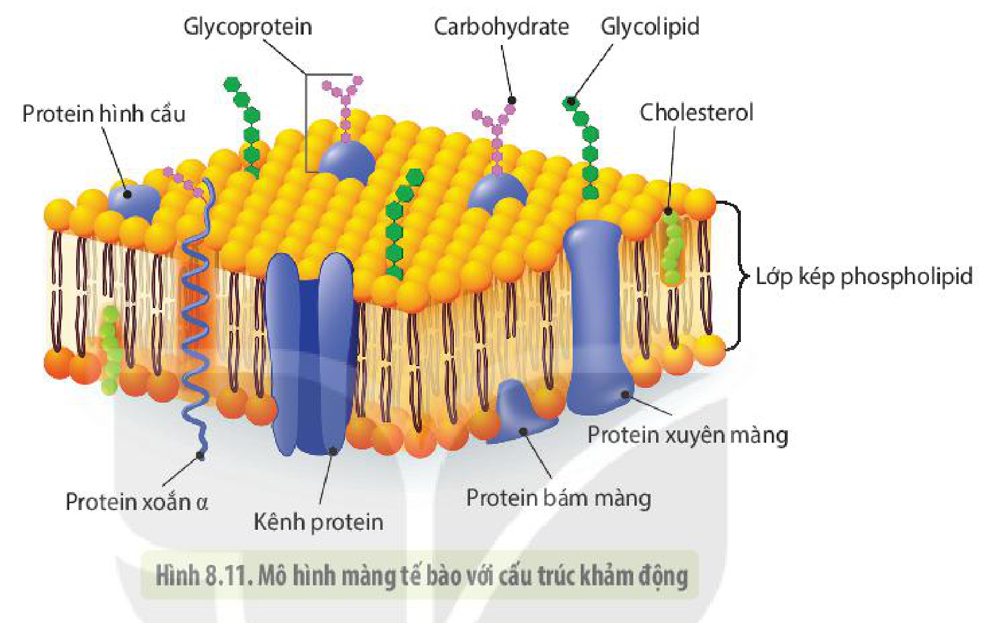

*Hình 8.11. Mô hình màng tế bào với cấu trúc khảm động*

*Lớp kép phospholipid*

Các phân tử phospholipid được giữ với nhau tạo nên lớp màng nhờ các tương tác kị nước giữa các phân tử. Do vậy, phân tử phospholipid trong cùng lớp không cố định tại một vị trí mà luôn di chuyển. Ước tính một phân tử phospholipid di chuyển từ đầu này tới đầu kia của một tế bào mất khoảng 1 giây.

**Lớp kép phospholipid** có cấu trúc lỏng lẻo. Nhờ đó, các phân tử protein màng dễ dàng di chuyển và tế bào cũng dễ dàng biến đổi hình dạng khi cần.

Tế bào có thể điều chỉnh độ linh hoạt của màng sinh chất bằng cách chèn thêm các phân tử cholesterol (ở tế bào động vật) và sterol (ở tế bào thực vật) vào giữa lớp kép phospholipid cũng như thay đổi thành phần của các acid béo trong phân tử phospholipid. Nhiệt độ cũng ảnh hưởng tới mức độ ổn định của màng tế bào. Vì vậy, nhiều sinh vật thay đổi thành phần lipid của màng nhằm đảm bảo cho màng tế bào vẫn hoạt động bình thường trong điều kiện nhiệt độ môi trường bị thay đổi.

*Các protein màng*

Độ linh hoạt của màng tế bào còn phụ thuộc vào các thành phần cấu tạo như protein và carbohydrate. Nhiều protein xuyên màng và protein bám màng liên kết với các loại sợi của bộ khung tế bào nằm bên trong tế bào hay các protein ở mạng lưới ngoại bào giúp ổn định cấu trúc màng.

Các protein của màng sinh chất được chia thành hai loại. Protein xuyên qua lớp kép phospholipid được gọi là **protein xuyên màng**. Những protein liên kết với phía ngoài của

<!-- pdf:57 -->
một lớp phospholipid được gọi là **protein bám màng** (ngoại vi). Các protein màng thường liên kết với các phân tử đường ngắn tạo nên các phân tử **glycoprotein** hay liên kết với lipid tạo nên **lipoprotein**.

**Protein màng** có các chức năng: vận chuyển các chất qua màng; xúc tác (enzyme); cấu tạo nên thụ thể tiếp nhận các tín hiệu và truyền tin tế bào; tạo nên các đặc điểm nhận diện đặc trưng cho từng loại tế bào; một số có chức năng tạo nên các mối nối gắn kết giữa các tế bào với nhau và số khác có chức năng neo giữ, kết nối protein màng với bộ khung bên trong tế bào hay với mạng lưới protein bên ngoài tế bào (chất nền ngoại bào). Hình 8.12 cho thấy một số chức năng của các protein màng tế bào.

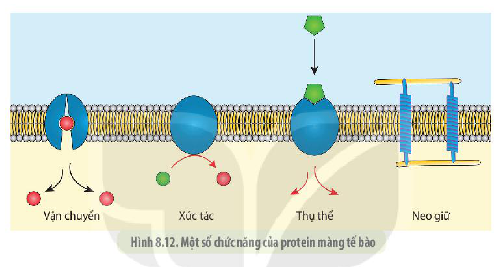

*Hình 8.12. Một số chức năng của protein màng tế bào*

**b) Chức năng**

Màng tế bào có chức năng quan trọng trong việc duy trì sự sống ở cấp độ tế bào. Có thể kể ra một số chức năng chính của màng như sau:

- Ngăn cách phần tế bào chất với môi trường bên ngoài, đảm bảo cho các cấu trúc tế bào cũng như môi trường bên trong tế bào không bị ảnh hưởng bởi các yếu tố bất lợi của môi trường.
- Kiểm soát các chất ra vào tế bào theo cách có thể điều chỉnh số lượng, tốc độ các chất ra vào tế bào theo nhu cầu (cho phép những chất cần thiết đi vào tế bào và loại bỏ những sản phẩm trao đổi chất không sử dụng ra khỏi tế bào). Nói một cách khác, màng tế bào có **tính thấm chọn lọc**, chỉ cho những chất nhất định ra vào tế bào.
- Tiếp nhận thông tin từ môi trường và truyền tín hiệu vào trong tế bào, nhờ đó tế bào có thể đưa ra các đáp ứng thích nghi với điều kiện môi trường.
- Quy định hình dạng tế bào phù hợp với chức năng của chúng.

## ❓ Dừng lại và suy ngẫm

1. Nêu cấu tạo và chức năng của màng tế bào.
2. Cá sống ở châu Nam Cực so với cá sống ở vùng nhiệt đới thì thành phần các acid béo của màng sinh chất có gì khác biệt nhau? Giải thích.

<!-- pdf:58 -->
### 12. Thành tế bào

Khác với tế bào động vật, bên ngoài tế bào thực vật và nấm được bao bọc bởi một cấu trúc vững chắc được gọi là **thành tế bào**. Thành tế bào thực vật được cấu tạo từ các phân tử cellulose tạo nên các sợi vững chắc, được gia cố thêm bởi nhiều chất khác như lignin do tế bào tiết ra (H 8.13). Thành tế bào của nấm được cấu tạo từ chitin. Thành tế bào có chức năng bảo vệ, định hình tế bào.

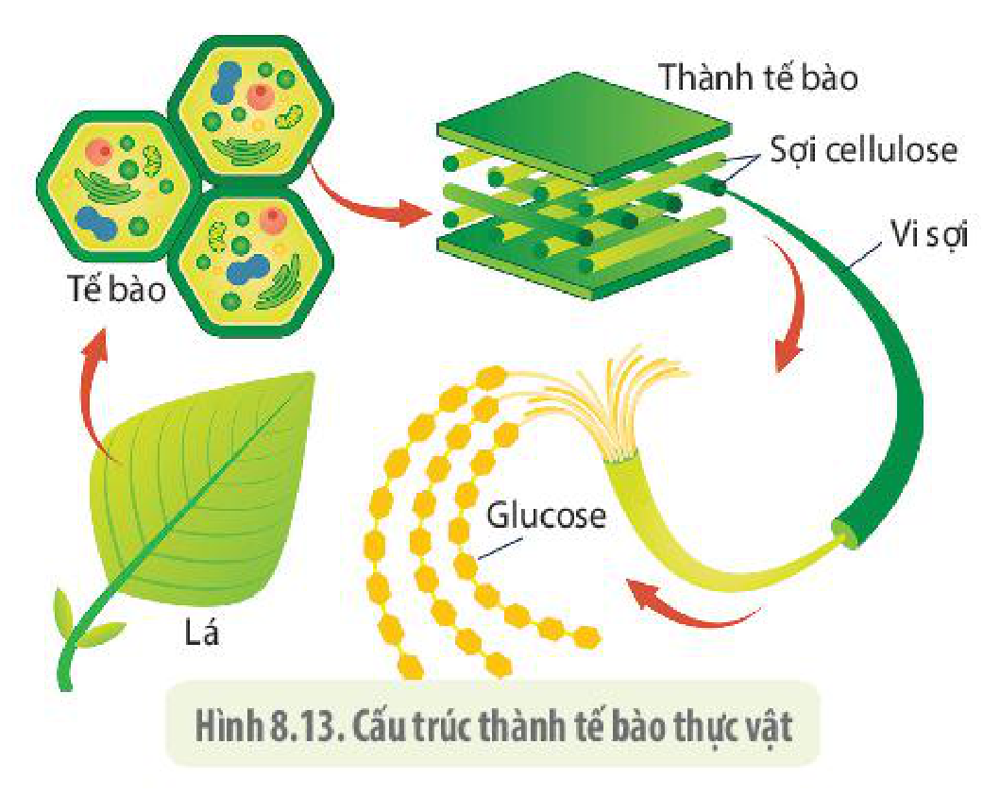

*Hình 8.13. Cấu trúc thành tế bào thực vật*

### 13. Lông và roi

Một số tế bào nhân thực cũng có lông và roi. **Lông** và **roi** là những cấu trúc dạng sợi nhô ra khỏi màng tế bào. Roi thường dài và lớn hơn lông nhưng chúng đều được cấu tạo từ các vi ống. Trên một tế bào, lông vận động thường có nhiều, còn roi chỉ có một hoặc vài chiếc.

Động vật đơn bào bơi được trong nước nhờ lông hoặc roi. Các tế bào niêm mạc khí quản, niêm mạc mũi đẩy được dịch nhầy ra khỏi đường hô hấp là nhờ hoạt động của lông rung. Tinh trùng động vật và người có roi bơi đến thụ tinh cho trứng (H 8.14). Trứng đã thụ tinh di chuyển đến tử cung là nhờ hoạt động của lông trên tế bào niêm mạc ống dẫn trứng. Các tế bào phôi của động vật và người trong quá trình phát triển thường phải di chuyển từ vị trí này sang vị trí khác mới có thể biệt hoá thành các tế bào chuyên hoá. Nếu có sự bất thường về roi của các tế bào phôi, khiến chúng không di chuyển được đến vị trí thích hợp sẽ gây ra những dị dạng và bệnh tật.

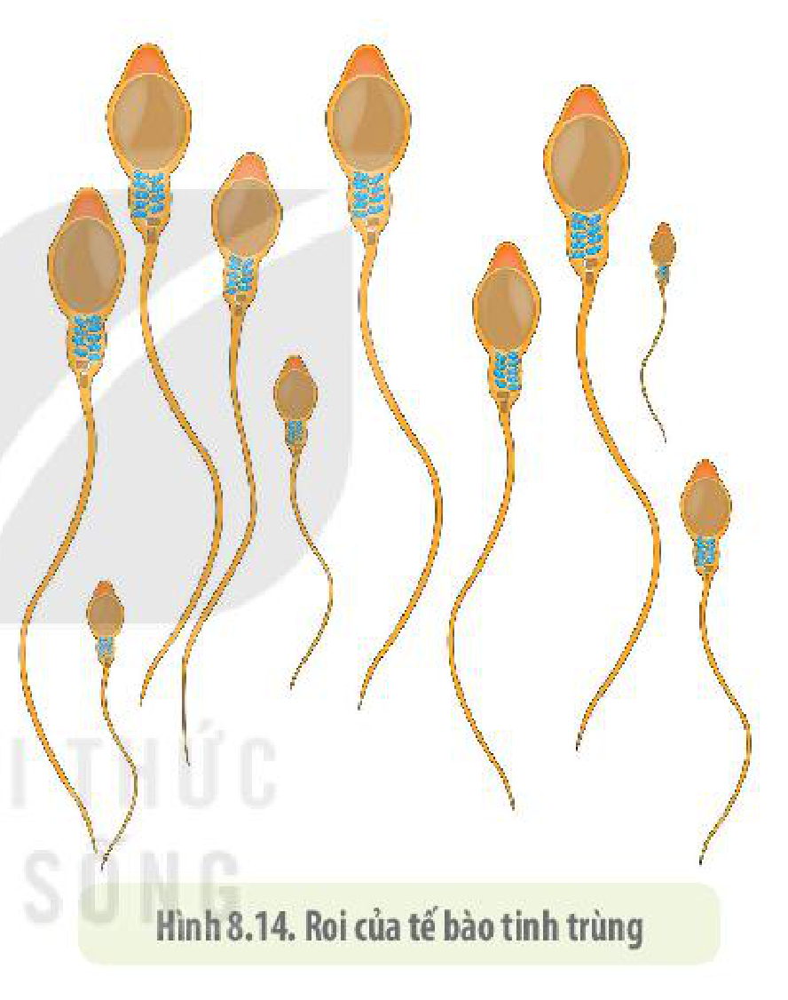

*Hình 8.14. Roi của tế bào tinh trùng*

Ngoài chức năng vận động, lông của một số tế bào còn có vai trò nhận và truyền tín hiệu từ ngoài vào trong tế bào, mở đầu cho con đường truyền tin dẫn đến thay đổi hoạt động của tế bào. Ở người, nếu lông của các tế bào trong tai bị tổn thương thì thính giác sẽ bị suy giảm, thậm chí bị điếc vì âm thanh làm lông rung động chuyển tín hiệu tới não bộ giúp chúng ta nghe được âm thanh.

## ❓ Dừng lại và suy ngẫm

1. Thành phần của thành tế bào thực vật và nấm khác nhau như thế nào?
2. Nêu chức năng của thành tế bào.

<!-- pdf:59 -->
### 14. Chất nền ngoại bào và các mối nối giữa các tế bào

**a) Chất nền ngoại bào**

Các tế bào động vật tiết ra các chất cấu tạo nên cấu trúc ở phía bên ngoài tế bào được gọi là **chất nền ngoại bào**. Đây là cấu trúc phức tạp gồm các phân tử **proteoglycan** (được hình thành từ các phân tử protein liên kết với carbohydate) kết hợp với các sợi collagen tạo nên một mạng lưới bao quanh bên ngoài tế bào. Hệ thống này lại được nối với bộ khung xương trong tế bào qua protein màng là integrin và fibronectin. Thông qua sự kết nối này, chất nền ngoại bào có thể điều khiển sự hoạt động của các gene bên trong tế bào, nhờ đó các tế bào trong cùng một mô có thể phối hợp các hoạt động với nhau (H 8.15).

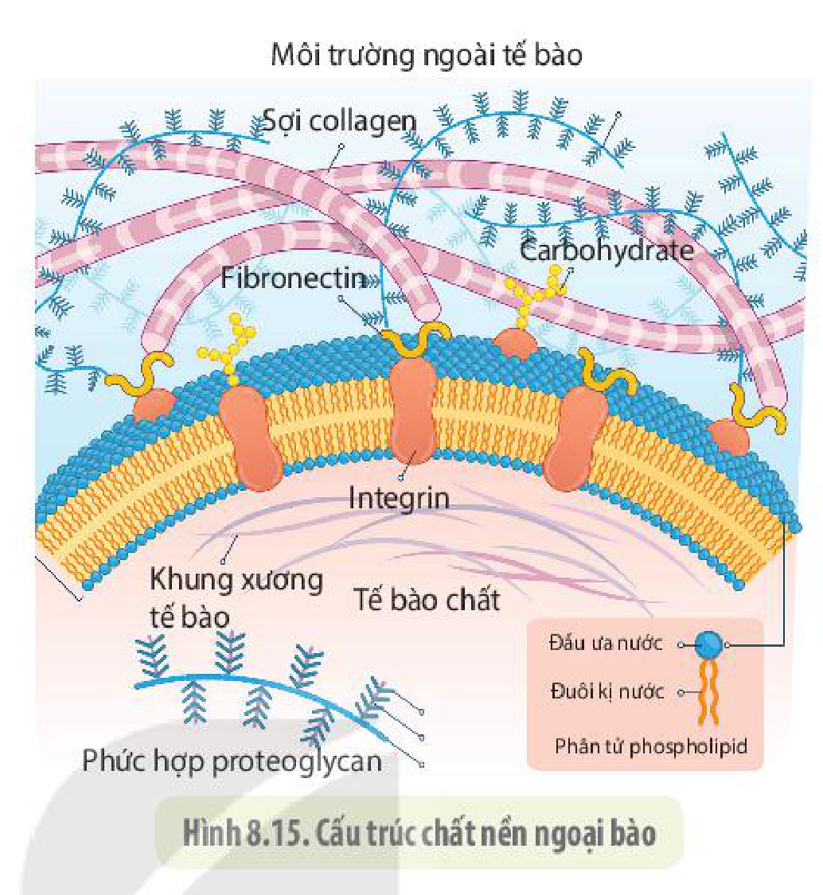

*Hình 8.15. Cấu trúc chất nền ngoại bào*

**b) Mối nối giữa các tế bào**

Các tế bào ở cơ thể đa bào kết nối với nhau thành các mô nhờ các loại mối nối khác nhau tuỳ theo chức năng của chúng.

*Mối nối kín*

Các tế bào được ghép sát với nhau bằng các loại protein đặc biệt khiến cho các chất không thể lọt qua được khe hở giữa các tế bào. Ví dụ: Các tế bào nằm ở niêm mạc ruột ở người có **mối nối kín** giữa các tế bào không cho các chất đi qua khe giữa hai tế bào mà buộc phải đi qua màng sinh chất. Nhờ vậy, tế bào có thể chọn lọc được những chất cần thiết, tránh hấp thụ những chất có hại.

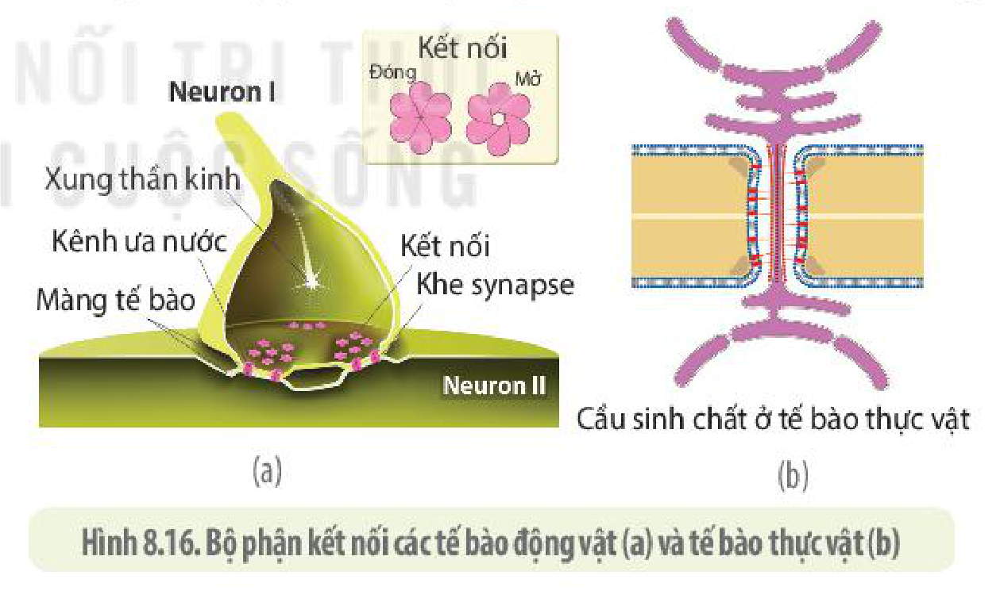

*Hình 8.16. Bộ phận kết nối các tế bào động vật (a) và tế bào thực vật (b)*

*Mối nối hở*

**Mối nối hở** hay còn gọi là **mối nối truyền tin**, nhờ có mối nối này các tế bào của mô được ghép với nhau bằng các cấu trúc tạo nên các kênh cho phép các tế bào truyền cho nhau những chất nhất định (H 8.16a). Các tế bào thực vật được ghép nối với nhau bằng mối nối được gọi là **cầu sinh chất**. Cầu sinh chất cho phép các tế bào liên thông với nhau, nhờ đó tế bào có thể chuyển đổi các chất cho nhau (H 8.16b).

<!-- pdf:60 -->
## ❓ Dừng lại và suy ngẫm

1. Chất nền ngoại bào là gì? Trình bày cấu trúc và chức năng của chất nền ngoại bào.
2. Các tế bào trong cơ thể đa bào kết nối với nhau bằng những loại mối nối nào? Nêu chức năng của từng loại mối nối.

## 📌 Kiến thức cốt lõi

- Tế bào nhân thực đã có nhân chính thức với màng nhân, hạch nhân và chất nhiễm sắc. Nhân là trung tâm điều khiển mọi hoạt động sống của tế bào.
- Hệ thống lưới nội chất gồm các ống và các túi dẹp chứa dịch nối thông nhau thành một mạng lưới, gồm lưới nội chất hạt và lưới nội chất trơn. Lưới nội chất trơn là nơi tổng hợp nhiều loại lipid, chuyển hoá đường, khử độc. Lưới nội chất hạt có các hạt ribosome, là nơi tổng hợp protein.
- Ribosome là bào quan không có màng bọc, giữ chức năng tổng hợp protein.
- Bộ máy Golgi gồm các túi dẹp nằm song song nhưng tách rời nhau, là nơi chế biến, lắp ráp, đóng gói và phân phối các sản phẩm của tế bào.
- Lysosome là túi màng đơn có chức năng phân huỷ các chất, các bào quan, các tế bào già và hỗ trợ tế bào tiêu hoá thức ăn theo con đường thực bào.
- Không bào là bào quan có màng đơn, chỉ có ở tế bào thực vật và một số động vật nguyên sinh, giữ nhiều chức năng khác nhau tuỳ loại tế bào.
- Ti thể và lục lạp đều có 2 lớp màng bao bọc, chứa DNA và ribosome. Đây là hai bào quan cùng sản xuất ATP, lục lạp tổng hợp ATP cung cấp cho tổng hợp chất hữu cơ, ti thể tổng hợp ATP cung cấp cho các hoạt động sống của tế bào.
- Peroxysome có dạng hình cầu được bao bọc bởi màng đơn giữ chức năng phân giải $\text{H}_2\text{O}_2$ và chuyển hoá lipid.
- Tế bào chất gồm bào tương, các bào quan và bộ khung tế bào, là nơi diễn ra các hoạt động sống của tế bào.
- Khung xương tế bào được tạo thành từ các vi ống, vi sợi và sợi trung gian, giúp nâng đỡ, duy trì hình dạng tế bào, neo giữ bào quan và các enzyme,...
- Màng tế bào được cấu tạo từ hai thành phần chính là lớp kép phospholipid và protein theo mô hình cấu trúc khảm động. Màng tế bào có chức năng kiểm soát sự trao đổi chất và truyền tin. Ở tế bào động vật, màng tế bào định hình và bảo vệ tế bào.
- Thành tế bào thực vật được cấu tạo từ cellulose giữ chức năng chủ yếu là định hình và bảo vệ tế bào.
- Nhiều tế bào động vật có các roi và lông giúp chúng có thể di chuyển, truyền tin và thực hiện các chức năng khác nhau.
- Bên ngoài tế bào của các động vật đa bào còn có chất nền ngoại bào, một cấu trúc phức tạp có khả năng điều hoà hoạt động của các gene bên trong tế bào, điều phối các hoạt động của các tế bào trong cùng một mô.
- Các tế bào trong một mô có thể kết nối với nhau bằng các mối nối kín hoặc hở.

<!-- pdf:61 -->
## ✏️ Luyện tập và vận dụng

1. Lập bảng hệ thống cấu trúc và chức năng của các bào quan trong tế bào nhân thực.
2. Vẽ đường đi của một phân tử protein từ khi được tổng hợp cho đến khi được vận chuyển ra khỏi tế bào.
3. Điều gì sẽ xảy ra với tế bào động vật nếu bộ khung xương tế bào bị tổn thương?
4. Trong tế bào có hai loại bào quan đều có vai trò khử độc bảo vệ tế bào, đó là hai bào quan nào? Giải thích.
5. Vì sao nói màng tế bào có cấu trúc khảm động?
6. Bằng cách nào các tế bào trong cùng một mô của cơ thể động vật có thể phối hợp hoạt động với nhau thông qua chất nền ngoại bào?
7. Lập bảng so sánh tế bào nhân sơ với tế bào nhân thực, tế bào thực vật với tế bào động vật.
8. Một nhà sinh học đã tiến hành lấy nhân của tế bào sinh dưỡng thuộc một loài ếch rồi cấy vào tế bào trứng của một loài ếch khác đã bị phá huỷ nhân. Sau nhiều lần thí nghiệm, ông đã thu được những con ếch con từ các tế bào trứng ếch chuyển nhân. Hãy cho biết, các con ếch này có đặc điểm của loài nào? Giải thích vì sao em lại khẳng định như vậy.
9. Vì sao những người uống nhiều rượu dễ mắc các bệnh về gan?
10. Hãy giải thích vì sao những người nghiện thuốc lá thường hay bị viêm đường hô hấp và viêm phổi, biết khói thuốc lá có thể làm liệt các lông rung của các tế bào niêm mạc đường hô hấp.

## 📷 Danh sách hình trong bài

| Mã hình | Trang PDF | Vị trí | Chú thích gốc |
|---|---|---|---|
| H10-sinh-b08-01 | 49 | Mở đầu (góc trên trái sát biểu tượng Mở đầu) | (Hình minh hoạ tế bào niêm mạc ruột non bình thường và tế bào bị bệnh) |
| H10-sinh-b08-02 | 49 | Mục I | Hình 8.1. Cấu trúc tế bào thực vật (a); cấu trúc tế bào động vật (b) |
| H10-sinh-b08-03 | 50 | Mục II.1 | Hình 8.2. Cấu trúc nhân tế bào |
| H10-sinh-b08-04 | 50 | Mục II.2 | Hình 8.3. Cấu trúc của ribosome |
| H10-sinh-b08-05 | 51 | Mục II.3 | Hình 8.4. Cấu trúc của lưới nội chất |
| H10-sinh-b08-06 | 51 | Mục II.4 | Hình 8.5. Cấu trúc bộ máy Golgi |
| H10-sinh-b08-07 | 52 | Mục II.5 | Hình 8.6. Cấu trúc của lysosome |
| H10-sinh-b08-08 | 53 | Mục II.6 | Hình 8.7. Không bào trung tâm trong tế bào thực vật (a) và các không bào trong tế bào trùng giày (b) |
| H10-sinh-b08-09 | 54 | Mục II.8 | Hình 8.8. Cấu trúc của ti thể |
| H10-sinh-b08-10 | 54 | Mục II.9 | Hình 8.9. Cấu trúc lục lạp (a) và mối quan hệ giữa lục lạp và ti thể (b) |
| H10-sinh-b08-11 | 55 | Mục II.10 | Hình 8.10. Bộ khung xương tế bào |
| H10-sinh-b08-12 | 56 | Mục II.11.a | Hình 8.11. Mô hình màng tế bào với cấu trúc khảm động |
| H10-sinh-b08-13 | 57 | Mục II.11.a | Hình 8.12. Một số chức năng của protein màng tế bào |
| H10-sinh-b08-14 | 58 | Mục II.12 | Hình 8.13. Cấu trúc thành tế bào thực vật |
| H10-sinh-b08-15 | 58 | Mục II.13 | Hình 8.14. Roi của tế bào tinh trùng |
| H10-sinh-b08-16 | 59 | Mục II.14.a | Hình 8.15. Cấu trúc chất nền ngoại bào |
| H10-sinh-b08-17 | 59 | Mục II.14.b | Hình 8.16. Bộ phận kết nối các tế bào động vật (a) và tế bào thực vật (b) |
