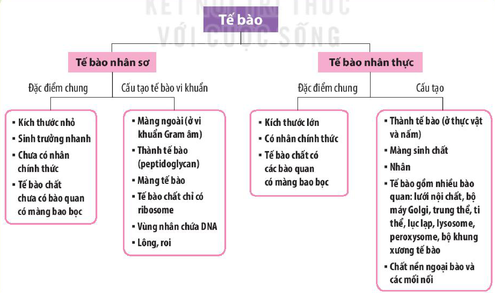

<!-- pdf:64 -->
# SƠ ĐỒ TÓM TẮT KIẾN THỨC CHƯƠNG 2

- Tế bào nhân sơ
  - Đặc điểm chung
    - Kích thước nhỏ
    - Sinh trưởng nhanh
    - Chưa có nhân chính thức
    - Tế bào chất chưa có bào quan có màng bao bọc
  - Cấu tạo tế bào vi khuẩn
    - Màng ngoài (ở vi khuẩn Gram âm)
    - Thành tế bào (peptidoglycan)
    - Màng tế bào
    - Tế bào chất chỉ có ribosome
    - Vùng nhân chứa DNA
    - Lông, roi
- Tế bào nhân thực
  - Đặc điểm chung
    - Kích thước lớn
    - Có nhân chính thức
    - Tế bào chất có các bào quan có màng bao bọc
  - Cấu tạo
    - Thành tế bào (ở thực vật và nấm)
    - Màng sinh chất
    - Nhân
    - Tế bào gồm nhiều bào quan: lưới nội chất, bộ máy Golgi, trung thể, ti thể, lục lạp, lysosome, peroxysome, bộ khung xương tế bào
    - Chất nền ngoại bào và các mối nối
<!-- ocr-ok: chữ trong các ô sơ đồ, OCR đọc theo cột ngang; đã đối chiếu ảnh trang 64 -->

## 📷 Danh sách hình trong bài

| Mã hình | Trang PDF | Vị trí | Chú thích gốc |
|---|---|---|---|
| H10-sinh-so-do-tom-tat-c02-01 | 64 | Nửa dưới trang 64 | Sơ đồ tóm tắt kiến thức của chương |
