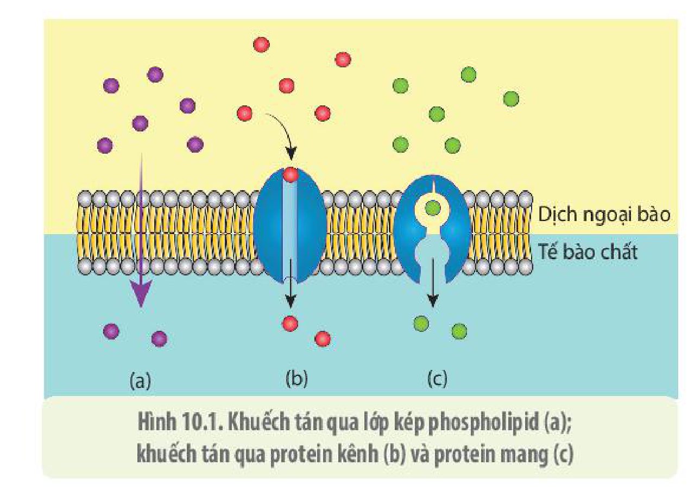
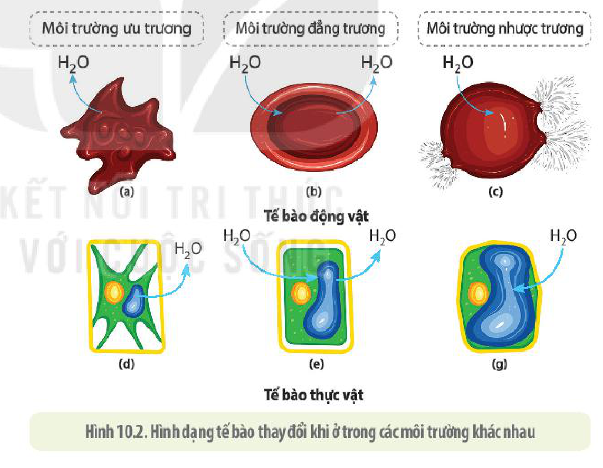
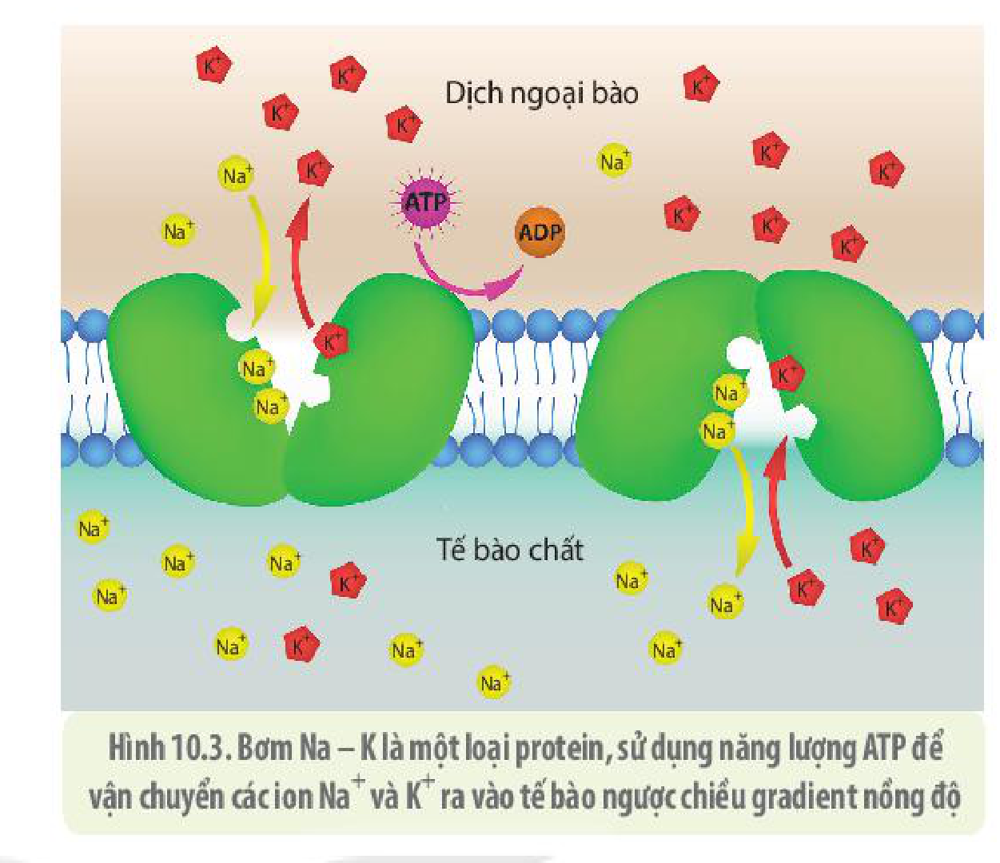
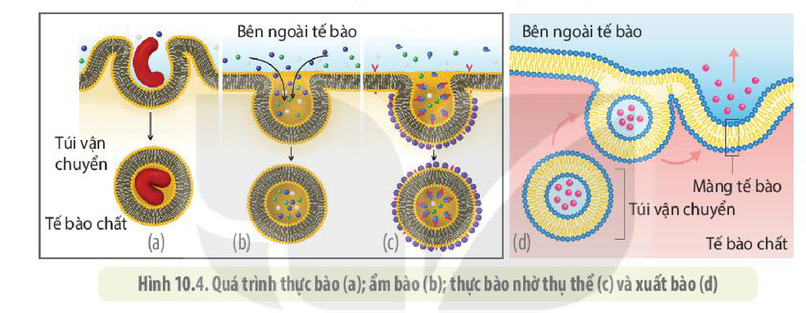

<!-- pdf:65 -->

# BÀI 10: TRAO ĐỔI CHẤT QUA MÀNG TẾ BÀO

## 🎯 Yêu cầu cần đạt

- Nêu được khái niệm trao đổi chất qua màng tế bào.
- Phân biệt được các hình thức vận chuyển các chất qua màng tế bào: vận chuyển thụ động, chủ động. Nêu được ý nghĩa của các hình thức đó. Lấy được ví dụ minh hoạ.
- Trình bày được hiện tượng nhập bào và xuất bào thông qua biến dạng của tế bào. Lấy được ví dụ minh hoạ.
- Vận dụng những hiểu biết về sự vận chuyển các chất qua màng tế bào để giải thích một số hiện tượng thực tiễn.

## 🔴 Mở đầu

Hình bên(\*) là ảnh chụp một tế bào u sắc tố chứa protein phát huỳnh quang màu xanh đang ẩm bào thuốc nhuộm màu hồng. Rất nhiều bệnh ở người liên quan đến rối loạn cơ chế vận chuyển các chất qua màng tế bào. Quá trình trao đổi chất qua màng tế bào diễn ra như thế nào?

## I. KHÁI NIỆM TRAO ĐỔI CHẤT QUA MÀNG TẾ BÀO

**Trao đổi chất qua màng tế bào** thực chất là quá trình vận chuyển các chất ra, vào tế bào qua màng tế bào. Tế bào không thể tồn tại nếu không có hoạt động trao đổi chất với môi trường bên ngoài. Vật chất mà tế bào cần trao đổi với môi trường có thể rất nhỏ như các loại ion cho tới các đại phân tử sinh học, thậm chí, tế bào bạch cầu của hệ miễn dịch có thể "nuốt" gọn cả một tế bào vi khuẩn hay tế bào bị bệnh của cơ thể. Màng tế bào được cấu tạo với thành phần hoá học chỉ cho những chất nhất định ra, vào tế bào. Vì vậy, có thể nói tế bào có cơ chế "chọn lọc" và kiểm soát sự trao đổi chất. Tế bào cần lấy các nguyên vật liệu để cấu tạo nên các phân tử sinh học như các loại đường đơn, amino acid, nucleotide, acid béo cũng như các loại nguyên tố vi lượng cần cho các hoạt động sống của tế bào. Những sản phẩm trao đổi chất thuộc loại phế thải luôn được thải vào môi trường như $\text{CO}_2$ và nhiều chất khác. Các tế bào trong cơ thể đa bào thường trao đổi chất và truyền các tín hiệu cho nhau.

> (\* Nguồn hình: Lê Hoàng Anh, Viện nghiên cứu Ung thư Beatson, Scotland, UK)

<!-- pdf:66 -->

<!-- term: Khuếch tán -->
Các phân tử nhỏ ra, vào tế bào chủ yếu dựa trên sự khuếch tán của các phân tử. Sự khuếch tán của các phân tử tuân theo các quy luật hoá lí. Tốc độ khuếch tán phụ thuộc vào kích thước, bản chất phân tử và sự chênh lệch nồng độ của chất khuếch tán cũng như phụ thuộc vào nhiệt độ, áp suất của môi trường.

Đối với những phân tử, vật thể lớn không thể khuếch tán qua màng tế bào, tế bào có các cơ chế đặc biệt để có thể vận chuyển chúng qua màng. Chúng ta sẽ cùng xem xét chi tiết các cơ chế trao đổi chất ở tế bào.

## II. CÁC CƠ CHẾ TRAO ĐỔI CHẤT QUA MÀNG TẾ BÀO

### 1. Vận chuyển thụ động

**Vận chuyển thụ động** là kiểu khuếch tán các chất từ nơi có nồng độ chất tan cao đến nơi có nồng độ chất tan thấp – xuôi chiều gradient nồng độ, vì vậy không cần tiêu tốn năng lượng. Các chất có thể khuếch tán qua lớp kép phospholipid hoặc qua các protein xuyên màng.

**a) Khuếch tán đơn giản**

Sự khuếch tán của các chất qua lớp kép phospholipid được gọi là **khuếch tán đơn giản** (H 10.1a). Do lớp kép phospholipid có tính kị nước, không phân cực nên chỉ những phân tử không phân cực và các phân tử có kích thước nhỏ mới có thể đi qua. Các ion dù có kích thước nhỏ cũng không thể khuếch tán qua lớp kép phospholipid, trong khi đó những phân tử nhỏ như $\text{O}_2$, $\text{CO}_2$ hay nước vẫn có thể khuếch tán qua. Tốc độ khuếch tán qua lớp kép phospholipid phụ thuộc vào bản chất của chất khuếch tán, sự chênh lệch nồng độ các chất bên trong và ngoài màng cũng như thành phần hoá học của lớp kép phospholipid.

**b) Khuếch tán tăng cường**

Những chất không thể khuếch tán qua lớp kép phospholipid của màng tế bào như các ion, các chất phân cực, các amino acid,... có thể ra, vào tế bào nhờ các kênh protein chuyên biệt – protein xuyên màng. Kiểu khuếch tán của các chất qua protein xuyên màng được gọi là **khuếch tán tăng cường**. Với khuếch tán tăng cường, tế bào có thể điều chỉnh tốc độ các chất ra, vào tế bào thông qua việc tăng, giảm số kênh protein hoặc đóng mở các kênh theo nhu cầu. Các protein xuyên màng làm nhiệm vụ vận chuyển các chất được chia thành nhiều loại. Một số được gọi là **protein kênh** khi chúng tạo nên các đường ống hay các lỗ trên màng cho từng loại chất đi qua (H 10.1b). Khác với protein kênh, **protein mang** khi liên kết với chất cần vận chuyển, cấu hình của chúng được biến đổi (H 10.1c).

Hình 10.1. Khuếch tán qua lớp kép phospholipid (a); khuếch tán qua protein kênh (b) và protein mang (c)

<!-- pdf:67 -->

<!-- term: Aquaporin -->
Khuếch tán qua các kênh protein có tính đặc thù cao vì mỗi kênh chỉ có thể vận chuyển những chất nhất định. Ví dụ: Kênh aquaporin (chuyên vận chuyển nước) có thể vận chuyển với tốc độ 3 tỉ phân tử nước/giây, trong khi nước cũng có thể khuếch tán qua lớp kép phospholipid nhưng với tốc độ rất chậm.

Khuếch tán tăng cường khác với khuếch tán đơn giản ở chỗ tốc độ khuếch tán không chỉ phụ thuộc vào sự chênh lệch nồng độ chất tan (gradient nồng độ) mà còn phụ thuộc vào số lượng kênh protein trên màng. Tốc độ khuếch tán gia tăng đến một mức độ nào đó không thể tăng lên nữa cho dù vẫn có sự chênh lệch nồng độ vì khi đó tất cả các protein vận chuyển đều hoạt động hết công suất. Người ta gọi hiện tượng này là **bão hoà kênh**.

Sự khuếch tán của các ion qua các kênh protein còn phụ thuộc vào sự chênh lệch về điện thế giữa hai phía của màng.

**c) Thẩm thấu**

<!-- term: Áp suất thẩm thấu -->
Sự khuếch tán của các phân tử nước qua màng tế bào được gọi là **thẩm thấu**. Tốc độ thẩm thấu của nước phụ thuộc vào áp suất thẩm thấu của tế bào. Áp suất thẩm thấu cao hay thấp tuỳ thuộc vào tổng nồng độ chất tan trong tế bào. Các tế bào của rễ cây có không bào trung tâm lớn, chứa nhiều chất tan nên có áp suất thẩm thấu cao hơn so với môi trường đất, do đó tế bào có thể hút nước và các chất tan vào trong rễ. Cũng giống như các chất, nước khuếch tán từ nơi có nồng độ chất tan thấp tới nơi có nồng độ chất tan cao. Dựa vào nồng độ chất tan trong dung dịch có dung môi là nước, người ta chia môi trường bên trong và bên ngoài tế bào thành các loại: **ưu trương**, **đẳng trương** và **nhược trương**.

Hình 10.2. Hình dạng tế bào thay đổi khi ở trong các môi trường khác nhau

- Môi trường bên ngoài chứa nồng độ chất tan cao hơn tổng nồng độ chất tan trong tế bào được gọi là **ưu trương**. Tế bào động vật ở trong môi trường ưu trương, nước trong tế bào thẩm thấu ra bên ngoài làm tế bào mất nước và bị co lại (H 10.2a). Các tế bào có thành như tế bào thực vật, khi mất nước chất nguyên sinh cùng màng sinh chất co lại, tách khỏi thành tế bào (hiện tượng **co nguyên sinh**) như ta thấy trong hình 10.2d. Tế bào bị co nguyên sinh sẽ xẹp xuống. Điều này giải thích vì sao lá rau bị héo khi mất nước và chỉ tươi khi trương nước.

<!-- pdf:68 -->

- Môi trường bên ngoài có nồng độ chất tan bằng nồng độ các chất tan trong tế bào, được gọi là **đẳng trương** (H 10.2b, e).
- Môi trường bên ngoài tế bào chứa nồng độ chất tan thấp hơn tổng nồng độ chất tan trong tế bào được gọi là **nhược trương**. Khi tế bào ở trong môi trường nhược trương, nước sẽ khuếch tán từ bên ngoài vào trong tế bào tạo nên một áp lực lên màng tế bào. Hình 10.2c cho thấy hình dạng của tế bào động vật trong môi trường nhược trương. Đối với các tế bào vi khuẩn, nấm và thực vật, nhờ có thành tế bào, nước chỉ đi vào một mức độ nhất định làm trương tế bào do thành tế bào tạo nên lực cản chống lại sự khuếch tán của các phân tử nước vào tế bào (H 10.2g).

## ❓ Dừng lại và suy ngẫm

1. Trao đổi chất ở tế bào là gì? Những loại chất nào có thể đi qua được lớp kép phospholipid, chất nào không? Giải thích.
2. Nêu đặc điểm của vận chuyển thụ động. Phân biệt khuếch tán đơn giản và khuếch tán tăng cường bằng cách hoàn thành bảng theo mẫu sau:

| | Thành phần (màng tế bào) tham gia khuếch tán | Đặc điểm chất khuếch tán | Các yếu tố ảnh hưởng đến tốc độ khuếch tán |
|---|---|---|---|
| Khuếch tán đơn giản | ? | ? | ? |
| Khuếch tán tăng cường | ? | ? | ? |
<!-- ocr-ok: bảng câu hỏi, OCR đọc dính chữ trong ô; đã đối chiếu ảnh PDF 68 -->

3. Vì sao tế bào rễ cây có thể hút được nước từ đất?
4. Thẩm thấu là gì? Điều gì sẽ xảy ra nếu tế bào thực vật và động vật được đưa vào dung dịch nhược trương? Giải thích.

## 💡 Khoa học và đời sống

**Tại sao lại dùng nước muối sinh lí để súc miệng?**

Nước muối $\text{NaCl}$ 0,09% được gọi là **nước muối sinh lí** vì là dung dịch đẳng trương với các tế bào ở người, giống như môi trường dịch mô. Do vậy, khi ta súc miệng bằng nước muối sinh lí, các tế bào niêm mạc miệng không bị ảnh hưởng. Trong khi đó, nước muối 0,09% là môi trường ưu trương với vi khuẩn nên các vi khuẩn có hại trong khoang miệng sẽ bị mất nước khiến quá trình phân chia của vi khuẩn bị hạn chế, thậm chí ngừng lại. Do vậy, dùng nước muối sinh lí có thể ngăn chặn được vi sinh vật gây bệnh phát triển trong miệng mà không làm tổn hại đến các tế bào niêm mạc miệng.

<!-- pdf:69 -->

### 2. Vận chuyển chủ động

**Vận chuyển chủ động** (hay **vận chuyển tích cực**) là kiểu vận chuyển các chất qua màng từ nơi có nồng độ chất tan thấp tới nơi có nồng độ chất tan cao (ngược chiều gradient nồng độ) và cần tiêu tốn năng lượng. Để làm được điều này, tế bào cần có những protein kênh vận chuyển hoạt động như những chiếc bơm, bơm các chất từ nơi có nồng độ thấp tới nơi có nồng độ cao. Muốn bơm hoạt động, tế bào phải cung cấp cho nó năng lượng dưới dạng ATP (H 10.3).

<!-- term: Bơm Na – K -->
Hình 10.3. Bơm Na – K là một loại protein, sử dụng năng lượng ATP để vận chuyển các ion $\text{Na}^+$ và $\text{K}^+$ ra vào tế bào ngược chiều gradient nồng độ

Vận chuyển chủ động các chất ra, vào tế bào giữ vai trò quan trọng đối với hoạt động sống của mọi tế bào. Một người khi nghỉ ngơi, các tế bào trong cơ thể vẫn phải sử dụng tới 40% năng lượng để vận chuyển chủ động. Một số tế bào chuyên hoá như tế bào thận phải sử dụng tới 90% năng lượng của tế bào để lọc máu và bơm các amino acid và glucose từ nước tiểu trở lại máu; các tế bào niêm mạc dạ dày phải bơm $\text{H}^+$ và $\text{Cl}^-$ vào dạ dày tạo môi trường acid để tiêu hoá thức ăn và tiêu diệt vi sinh vật gây bệnh.

## ❓ Dừng lại và suy ngẫm

1. Thế nào là vận chuyển chủ động?
2. Phân biệt vận chuyển thụ động và vận chuyển chủ động.

## 💡 Em có biết

**Các tế bào ung thư và nhiều tác nhân gây bệnh kháng thuốc bằng cách nào?**

Một trong số các cơ chế kháng thuốc của các tế bào ung thư là do chúng có các protein vận chuyển thuốc trên màng được gọi là **protein đa kháng thuốc** (MDR) hay còn gọi là **P–glycoprotein**. Các protein này hoạt động như những chiếc bơm, đẩy nhiều loại thuốc ra khỏi tế bào ung thư. Sử dụng thuốc chống ung thư khiến các dòng tế bào ngày càng có nhiều protein đa kháng thuốc được chọn lọc và giữ lại, dẫn đến làm tăng khả năng kháng thuốc.

Kí sinh trùng gây bệnh sốt rét ở người là *Plasmodium falciparum* và các vi khuẩn gây bệnh cũng kháng thuốc do có các protein tương tự làm nhiệm vụ bơm thuốc chống sốt rét và các loại kháng sinh ra khỏi tế bào.

<!-- pdf:70 -->

### 3. Vận chuyển vật chất nhờ biến dạng màng tế bào

Các đại phân tử như protein, đường đa, DNA có kích thước quá lớn nên không thể vận chuyển qua các protein xuyên màng. Tế bào vận chuyển các chất này theo cách thức vận chuyển đặc biệt được gọi là thực bào, ẩm bào và xuất bào thông qua sự biến dạng màng tế bào. Tất cả các hình thức vận chuyển này đều tiêu tốn năng lượng.

**a) Thực bào và ẩm bào**

**Thực bào** là thuật ngữ chỉ hoạt động "ăn" của tế bào. Tế bào có thể lấy các phân tử có kích thước lớn, thậm chí là cả một tế bào, nhờ sự biến dạng màng tế bào. Màng tế bào bao bọc lấy vật cần vận chuyển tạo nên một **túi vận chuyển** tách rời khỏi màng và đi vào trong tế bào chất (H 10.4a).

Tế bào lấy các chất tan từ môi trường theo cách tương tự được gọi là **ẩm bào** (H 10.4b).

Hình 10.4. Quá trình thực bào (a); ẩm bào (b); thực bào nhờ thụ thể (c) và xuất bào (d)

<!-- term: Thực bào nhờ thụ thể -->
Tế bào có thể "chọn" được những chất cần thiết nhờ những protein thụ thể trên màng tế bào (H 10.4c). Ví dụ: Cholesterol được vận chuyển trong máu dưới dạng lipoprotein, các lipoprotein này liên kết đặc hiệu với các thụ thể trên màng làm màng biến dạng, lõm vào phía trong tạo thành túi vận chuyển tách khỏi màng đi vào trong tế bào chất.

**b) Xuất bào**

**Xuất bào** là hình thức vận chuyển các chất có kích thước lớn ra khỏi tế bào. Các chất có kích thước lớn cần đưa ra khỏi tế bào được bao bọc trong túi vận chuyển, sau đó túi này liên kết với màng tế bào giải phóng các chất ra bên ngoài (H 10.4d). Ví dụ: Protein sữa sau khi được đóng gói trong túi vận chuyển và xuất ra khỏi tế bào tuyến sữa.

## ❓ Dừng lại và suy ngẫm

1. Phân biệt thực bào, ẩm bào và xuất bào.
2. Làm thế nào tế bào có thể vận chuyển được những phân tử protein có kích thước lớn ra khỏi tế bào? Giải thích.
3. Để đưa một loại thuốc vào trong một tế bào nhất định của cơ thể, ví dụ tế bào ung thư, người ta thường bao gói thuốc trong các túi vận chuyển. Hãy mô tả cách tế bào lấy thuốc vào bên trong tế bào.

<!-- pdf:71 -->

## 📌 Kiến thức cốt lõi

- Trao đổi chất qua màng tế bào là sự vận chuyển các chất qua màng.
- Vận chuyển thụ động là sự khuếch tán của các phân tử từ nơi có nồng độ chất tan cao tới nơi có nồng độ chất tan thấp mà không tiêu tốn năng lượng.
- Khuếch tán đơn giản là quá trình khuếch tán của các phân tử nhỏ, không phân cực qua màng tế bào.
- Khuếch tán tăng cường là sự khuếch tán của các phân tử nhỏ tích điện, phân cực qua các kênh protein của màng tế bào.
- Thẩm thấu là sự khuếch tán của các phân tử nước từ nơi có nồng độ chất tan thấp tới nơi có nồng độ chất tan cao.
- Vận chuyển chủ động là kiểu vận chuyển các chất từ nơi có nồng độ chất tan thấp tới nơi có nồng độ chất tan cao và cần có năng lượng.
- Các phân tử hay vật thể có kích thước lớn được vận chuyển qua màng bằng cách ẩm bào, thực bào và xuất bào nhờ sự biến dạng của màng tế bào và cần sử dụng năng lượng.

## ✏️ Luyện tập và vận dụng

1. Phân biệt các hình thức vận chuyển thụ động, vận chuyển chủ động, thực bào và xuất bào bằng cách hoàn thành bảng theo mẫu sau:

| | Khái niệm | Thành phần (màng tế bào) tham gia vận chuyển | Đặc điểm chất được vận chuyển | Các yếu tố ảnh hưởng đến tốc độ vận chuyển |
|---|---|---|---|---|
| Vận chuyển thụ động | ? | ? | ? | ? |
| Vận chuyển chủ động | ? | ? | ? | ? |
| Thực bào và xuất bào | ? | ? | ? | ? |

2. Em hãy giải thích tại sao trong thực tế, người ta sử dụng việc ướp muối để bảo quản thực phẩm.
3. Tại sao khi chẻ cuống rau muống thành sợi và ngâm vào nước thì các sợi rau lại cuộn tròn lại?
4. Hiện tượng xâm nhập mặn có thể gây hậu quả nghiêm trọng khiến hàng loạt các cây trồng bị chết và không còn tiếp tục gieo trồng được những loại cây đó trên vùng đất này nữa. Em hãy giải thích hiện tượng trên.
5. Tại sao động vật và người lại dự trữ năng lượng dưới dạng glycogen mà không dự trữ dưới dạng dễ sử dụng là glucose?

## 📷 Danh sách hình trong bài

| Mã hình | Trang PDF | Vị trí | Chú thích gốc |
|---|---|---|---|
| H10-sinh-b10-01 | 66 | Mục II.1.b | Hình 10.1. Khuếch tán qua lớp kép phospholipid (a); khuếch tán qua protein kênh (b) và protein mang (c) |
| H10-sinh-b10-02 | 67 | Mục II.1.c | Hình 10.2. Hình dạng tế bào thay đổi khi ở trong các môi trường khác nhau |
| H10-sinh-b10-03 | 69 | Mục II.2 | Hình 10.3. Bơm Na – K là một loại protein, sử dụng năng lượng ATP để vận chuyển các ion $\text{Na}^+$ và $\text{K}^+$ ra vào tế bào ngược chiều gradient nồng độ |
| H10-sinh-b10-04 | 70 | Mục II.3.a | Hình 10.4. Quá trình thực bào (a); ẩm bào (b); thực bào nhờ thụ thể (c) và xuất bào (d) |
