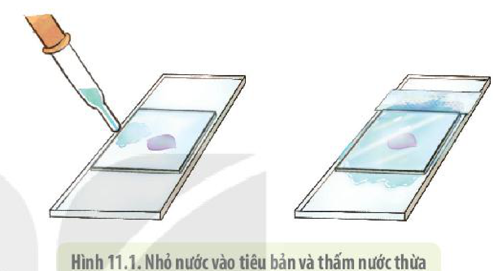

<!-- pdf:72 -->

# BÀI 11: THỰC HÀNH: THÍ NGHIỆM CO VÀ PHẢN CO NGUYÊN SINH

## I. YÊU CẦU CẦN ĐẠT
<!-- ocr-ok: tiêu đề đậm màu xanh, OCR đọc sai chữ CẦN; đã đối chiếu ảnh PDF 72 -->

Sau khi học xong phần thực hành, học sinh cần đạt được các yêu cầu sau:

- Thực hiện thành thạo kĩ năng sử dụng kính hiển vi và làm tiêu bản hiển vi.
- Quan sát và vẽ được các tế bào đang ở các giai đoạn khác nhau của quá trình co nguyên sinh và phản co nguyên sinh.
- Điều khiển được sự co nguyên sinh thông qua điều khiển mức độ thẩm thấu của nước ra, vào tế bào.
- Tự làm được thí nghiệm theo quy trình.

## II. CHUẨN BỊ

### 1. Dụng cụ, thiết bị

Lưỡi dao lam, lam kính, lamen, ống nhỏ giọt, giấy thấm, kính hiển vi quang học với vật kính 10×, 40×.

### 2. Hoá chất

Dung dịch $\text{NaCl}$ loãng (các em có thể sử dụng các nồng độ khác nhau để xem sự co nguyên sinh xảy ra nhanh hay chậm phụ thuộc vào nồng độ dung dịch).

### 3. Mẫu vật

Lá thài lài tía hoặc lá cây có kích thước tế bào lớn và có màu sắc để có thể dễ quan sát dưới kính hiển vi và dễ tách lớp biểu bì của lá.

## III. CÁCH TIẾN HÀNH

### 1. Nguyên lí

<!-- term: Phản co nguyên sinh -->
Khi môi trường bên ngoài tế bào có nồng độ chất tan cao hơn nồng độ chất tan bên trong tế bào, nước sẽ thẩm thấu từ bên trong tế bào ra bên ngoài khiến tế bào bị mất nước và toàn bộ nguyên sinh chất bị co lại, tách khỏi thành tế bào. Tế bào lá cây có sắc tố nên ta có thể dễ dàng quan sát được mức độ co nguyên sinh của tế bào khi thấy khối nguyên sinh chất tách khỏi thành tế bào nhiều hay ít, nhanh hay chậm. Ngược lại, khi bên trong tế bào có nồng độ chất tan cao hơn bên ngoài tế bào, nước sẽ thẩm thấu từ bên ngoài vào bên trong tế bào làm tế bào căng phồng lên.

### 2. Quy trình thí nghiệm

**a) Thí nghiệm co nguyên sinh**

*Bước 1:* Dùng lưỡi dao lam nhẹ nhàng tách lớp biểu bì dưới phiến lá cây thài lài tía, sau đó đặt lớp biểu bì lên trên lam kính có nhỏ sẵn giọt dung dịch $\text{NaCl}$. Tiếp đến, đặt lamen lên trên mẫu vật rồi dùng giấy thấm hút bớt dung dịch thừa ở phía ngoài. Lưu ý, các em có thể thử các nồng độ dung dịch $\text{NaCl}$ khác nhau xem kết quả co nguyên sinh sẽ xảy ra nhanh chậm như thế nào.

<!-- pdf:73 -->

*Bước 2:* Đặt lam kính lên bàn kính hiển vi và điều chỉnh vùng có mẫu vật vào giữa thị trường kính hiển vi rồi quan sát mẫu vật ở vật kính 10×.

*Bước 3:* Chọn vùng biểu bì chỉ có một lớp tế bào, sau đó chuyển sang vật kính 40× để quan sát tế bào rõ hơn.

*Bước 4:* Quan sát và vẽ các tế bào bình thường, tế bào khí khổng vào vở.

**b) Thí nghiệm phản co nguyên sinh**

*Bước 1:* Lấy tiêu bản ra khỏi kính hiển vi, dùng ống nhỏ giọt nhỏ một giọt nước cất vào rìa của một phía lamen. Sau đó dùng giấy thấm đặt ở phía đối diện với phía vừa nhỏ giọt nước cất của lamen để hút bớt nước thừa.

*Bước 2:* Đặt tiêu bản lên kính hiển vi để quan sát sự thay đổi của chất nguyên sinh trong tế bào ở vật kính 10×.

Hình 11.1. Nhỏ nước vào tiêu bản và thấm nước thừa

*Bước 3:* Chọn vùng biểu bì chỉ có một lớp tế bào, sau đó chuyển sang vật kính 40× để quan sát tế bào rõ hơn.

*Bước 4:* Quan sát và vẽ các tế bào bình thường, các tế bào bị co nguyên sinh và các tế bào bảo vệ đóng mở khí khổng vào vở.

## IV. THU HOẠCH

Học sinh viết báo cáo thực hành theo các nội dung sau:

**BÁO CÁO THỰC HÀNH**

1. **Mục đích**
2. **Cách tiến hành**
3. **Kết quả**
   Báo cáo kết quả thí nghiệm co và phản co nguyên sinh.
4. **Giải thích, kết luận**
5. **Trả lời câu hỏi**
   a) Khi tế bào co nguyên sinh thì khí khổng đóng hay mở? Giải thích.
   b) Nếu chất nguyên sinh trong các tế bào ở tiêu bản thí nghiệm co quá chậm hoặc quá nhanh thì cần phải làm gì để điều chỉnh? Giải thích lí do.

## 📷 Danh sách hình trong bài

| Mã hình | Trang PDF | Vị trí | Chú thích gốc |
|---|---|---|---|
| H10-sinh-b11-01 | 73 | Mục III.2.b | Hình 11.1. Nhỏ nước vào tiêu bản và thấm nước thừa |
