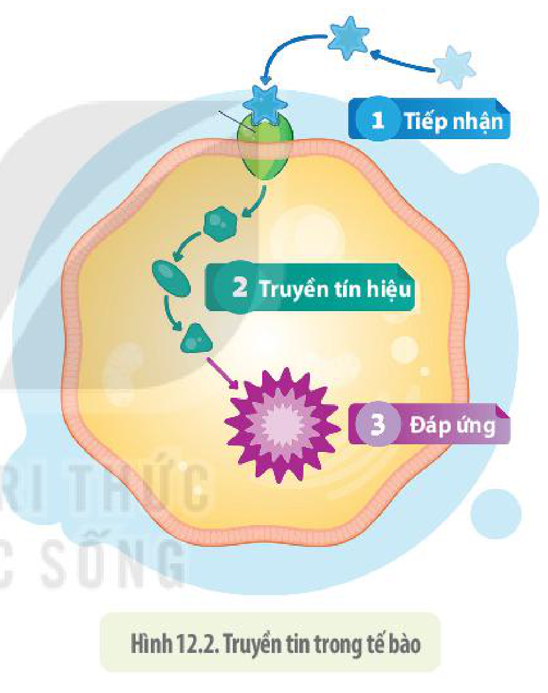

<!-- pdf:74 -->

# BÀI 12: TRUYỀN TIN TẾ BÀO

## 🎯 Yêu cầu cần đạt

- Nêu được khái niệm về thông tin giữa các tế bào.
- Trình bày được các quá trình:
  + Tiếp nhận: Một phân tử truyền tin liên kết vào một protein thụ thể làm thụ thể thay đổi hình dạng;
  + Truyền tin: Các chuỗi tương tác phân tử chuyển tiếp tín hiệu từ các thụ thể tới các phân tử đích trong tế bào;
  + Đáp ứng: Tế bào phát tín hiệu điều khiển phiên mã, dịch mã hoặc điều hoà hoạt động của tế bào.

## 🔴 Mở đầu

Hình bên minh hoạ sự truyền các phân tử tín hiệu hoá học giữa hai tế bào thần kinh qua một khe hở được gọi là **synapse** (khớp thần kinh). Nếu sự giao tiếp này bị ngưng trệ trong tích tắc, tính mạng chúng ta sẽ bị đe doạ. Vậy quá trình các tế bào truyền tín hiệu và nhận tín hiệu diễn ra như thế nào?

## I. TRUYỀN TIN GIỮA CÁC TẾ BÀO

**Truyền tin tế bào** là sự phát tán và nhận các phân tử tín hiệu qua lại giữa các tế bào. Truyền tin tế bào có thể thực hiện giữa các tế bào của cùng một cơ thể, hoặc giữa các tế bào của cá thể cùng loài cũng như khác loài. Các sinh vật đơn bào không sống biệt lập mà luôn tiếp nhận và phát tán các phân tử tín hiệu cho nhau. Tế bào của một số loài vi khuẩn trong điều kiện môi trường thuận lợi sống biệt lập, nhưng khi gặp môi trường bất lợi chúng phát tán tín hiệu cho nhau và tập hợp lại thành từng cụm. Trong cơ thể sinh vật đa bào, các tế bào trao đổi thông tin với nhau và với môi trường để cùng duy trì hoạt động sống của cả cơ thể.

Hình 12.1. **Truyền tín hiệu trực tiếp** giữa các tế bào qua mối liên kết hở (a); **truyền tin cận tiết**: Tế bào truyền tin cho các tế bào liền kề (b); **truyền tin nội tiết**: Tín hiệu hormone được tiết vào máu truyền tới các tế bào đích ở xa (c); **truyền tin qua synapse**: Tín hiệu là chất dẫn truyền xung thần kinh được truyền qua khe (synapse) giữa tế bào thần kinh và tế bào đích (d).

<!-- pdf:75 -->

Thông tin các tế bào truyền cho nhau rất đa dạng, trong đó chủ yếu là các tín hiệu hoá học. Tín hiệu có thể là amino acid, peptid ngắn, phân tử protein lớn, nucleotide, hormone, thậm chí chất khí như $\text{NO}$. Trong cơ thể đa bào, tín hiệu truyền từ tế bào này tới tế bào khác qua bốn cách chủ yếu: **truyền tin trực tiếp**, **truyền tin cận tiết**, **truyền tin nội tiết** và **truyền tin qua synapse** (H 12.1).

## ❓ Dừng lại và suy ngẫm

1. Thế nào là truyền tin giữa các tế bào?
2. Thông tin mà các tế bào truyền cho nhau có thể là gì?
3. Các tế bào trong cơ thể đa bào có thể truyền tin cho nhau bằng những cách nào?

## II. TRUYỀN TIN TRONG TẾ BÀO

<!-- term: Truyền tin trong tế bào -->
Truyền tin trong tế bào gồm ba giai đoạn: (1) tiếp nhận tín hiệu, (2) truyền tín hiệu và (3) đáp ứng tín hiệu nhận được (H 12.2).

### 1. Tiếp nhận tín hiệu

<!-- term: Tiếp nhận tín hiệu -->
<!-- term: Thụ thể -->
Tế bào tiếp nhận tín hiệu bằng các protein thụ thể trên màng tế bào hoặc thụ thể nằm trong tế bào chất. Mỗi loại thụ thể liên kết với một tín hiệu phù hợp như chìa khoá với ổ khoá. Thụ thể có thể là các protein kênh trên màng, các enzyme, các loại protein tham gia vào quá trình hoạt hoá gene hoặc nhiều loại protein kết cặp với enzyme. Các phân tử protein thụ thể được phân bố ở màng hay trong tế bào chất.

Hình 12.2. Truyền tin trong tế bào

### 2. Truyền tín hiệu

Truyền tín hiệu trong tế bào không như truyền tin từ người này sang người khác. Sự truyền tín hiệu bên trong tế bào thực chất là sự **chuyển đổi tín hiệu** giữa các phân tử trong con đường truyền tin của tế bào. Phân tử tín hiệu đến từ tế bào khác được thụ thể của tế bào tiếp nhận dẫn đến cấu hình của thụ thể bị biến đổi. Sự biến đổi cấu hình của thụ thể khiến nó thay đổi trạng thái từ bất hoạt sang hoạt động. Thụ thể hoạt động lại tác động tới phân tử liền kề gây hoạt hoá phân tử đó. Cứ như vậy, sự thay đổi trạng thái của phân tử này làm biến đổi cấu hình dẫn đến hoạt hoá hay bất hoạt phân tử kế tiếp cho tới khi đến phân tử đích cuối cùng của chuỗi chuyển đổi tín hiệu trong tế bào.

Trong trường hợp thụ thể nằm ở bên trong tế bào chất, con đường chuyển đổi tín hiệu có thể dẫn tới phân tử đích gây ra đáp ứng tế bào là hoạt hoá gene nhất định.

<!-- pdf:76 -->

### 3. Đáp ứng tín hiệu

<!-- term: Đáp ứng tín hiệu -->
Kết quả của quá trình truyền tín hiệu là sự đáp ứng của tế bào trước thông tin mà nó nhận được (H 12.3). Đáp ứng của tế bào rất đa dạng, sản phẩm tạo ra có thể là enzyme giúp tế bào sửa chữa các sai sót trong DNA khi nó nhận được tín hiệu là hệ gene bị tổn thương. Sản phẩm cũng có thể làm thay đổi hình dạng tế bào giúp tế bào có thể di chuyển hướng tới nguồn tín hiệu. Đáp ứng cũng có thể tạo ra các tín hiệu là yếu tố tăng trưởng gửi đến tế bào khác khiến tế bào nhận tiến hành phân bào. Có thể nói, mọi hoạt động sống của tế bào đều trực tiếp hay gián tiếp liên quan đến truyền tin tế bào.

Hình 12.3. Một ví dụ truyền tin trong tế bào. Tín hiệu là hormone aldosterone có thể đi qua màng tế bào vào trong tế bào chất và liên kết với thụ thể. Phức hợp hormone – thụ thể đi vào nhân, hoạt hoá gene tạo mRNA rồi sau đó mRNA đi ra tế bào chất tới ribosome tổng hợp nên protein

Cùng một loại tín hiệu nhưng có thể gây nên những đáp ứng khác nhau ở các tế bào khác nhau của cơ thể. Đó là do các loại thụ thể, con đường truyền tín hiệu và các protein đáp ứng ở các tế bào là khác nhau. Ví dụ: Epinephrine kích thích tế bào gan phân giải glycogen thành glucose nhưng cũng kích thích tế bào cơ tim co bóp mạnh làm tim đập nhanh hơn. Nguyên nhân dẫn đến sự đáp ứng khác nhau với cùng một tín hiệu của các tế bào là do các tế bào chuyên hoá có các nhóm gene khác nhau hoạt động nên có các protein thụ thể tiếp nhận tín hiệu, protein truyền tin cũng như protein tham gia vào các đáp ứng là khác nhau. Đáp ứng của tế bào cũng có thể dẫn đến thay đổi kết cấu của các protein khung tế bào, làm thay đổi hình dạng và sự vận động của tế bào hoặc dẫn đến sự phân chia tế bào.

Với cơ chế truyền tin trong tế bào như vậy, các tế bào không chỉ có khả năng tiếp nhận thông tin để đưa ra các đáp ứng mà chúng còn có khả năng điều chỉnh mức độ tiếp nhận thông tin cũng như mức độ đáp ứng cho phù hợp với nhu cầu tế bào. Ví dụ: Khi chúng ta hoạt động mạnh, nhu cầu năng lượng cho các tế bào của cơ thể tăng cao, các thụ thể tiếp nhận insulin có thể gia tăng độ nhạy cảm hoặc được tăng thêm về số lượng để vận chuyển glucose vào trong tế bào. Vì vậy, thường xuyên luyện tập thể dục thể thao cũng là cách giảm thiểu nguy cơ bị tiểu đường type 2.

## ❓ Dừng lại và suy ngẫm

1. Thụ thể là gì? Có những loại thụ thể nào?
2. Tín hiệu từ bên ngoài truyền đến tế bào được chuyển đổi như thế nào bên trong tế bào?

<!-- pdf:77 -->

## 💡 Em có biết

**Thực vật có khả năng "giao tiếp"?**

Chúng ta thường thấy các động vật trao đổi thông tin qua lại với nhau bằng cách này hay cách khác. Thật thú vị khi cây cối cũng có thể trao đổi thông tin với nhau. Các nhà khoa học đã phát hiện ra một số cây không những trao đổi thông tin với các cây cùng loài mà còn trao đổi với các loài khác, kể cả các loài động vật. Ở một số loài cây, khi bị sâu hại tấn công, chúng tiết ra các tín hiệu "cảnh báo" cho các cây gần đó để các cây này tăng cường sức đề kháng chống lại côn trùng gây hại. Ví dụ: Khi cây ngô bị sâu hại ăn, tín hiệu từ các tế bào bị tổn thương cùng các hoá chất trong nước bọt của sâu kích hoạt con đường truyền tín hiệu làm cho các tế bào tiết ra chất hoá học gửi vào không khí, cầu cứu một loài ong kí sinh. Nhận được tín hiệu từ cây ngô, các con ong kí sinh bay tới đẻ trứng lên các con sâu, giúp chúng sinh sản nhưng đồng thời cũng tiêu diệt sâu hại giúp bảo vệ cây.

*Nguồn: Campbell – Biology*

## 📌 Kiến thức cốt lõi

- Các tế bào có thể truyền cho nhau các phân tử tín hiệu theo nhiều cách khác nhau.
- Tín hiệu sau khi được tiếp nhận bởi các thụ thể, được chuyển đổi qua chuỗi các protein chuyển đổi tín hiệu tới protein đích, cuối cùng gây ra sự đáp ứng của tế bào như đóng/mở gene, thay đổi các hoạt động chuyển hoá của tế bào, thay đổi sự vận động hoặc điều khiển phân bào,...

## ✏️ Luyện tập và vận dụng

1. Vì sao cùng một tín hiệu nhưng các tế bào khác nhau của cùng một cơ thể lại có thể tạo ra các đáp ứng khác nhau?
2. Khi thụ thể tiếp nhận tín hiệu nằm trong tế bào chất thì phân tử tín hiệu thường là loại gì để có thể đi được qua màng sinh chất? Cho ví dụ.

## 📷 Danh sách hình trong bài

| Mã hình | Trang PDF | Vị trí | Chú thích gốc |
|---|---|---|---|
| H10-sinh-b12-01 | 74 | Mục I | Hình 12.1. Truyền tín hiệu trực tiếp giữa các tế bào qua mối liên kết hở (a); truyền tin cận tiết: Tế bào truyền tin cho các tế bào liền kề (b); truyền tin nội tiết: Tín hiệu hormone được tiết vào máu truyền tới các tế bào đích ở xa (c); truyền tin qua synapse: Tín hiệu là chất dẫn truyền xung thần kinh được truyền qua khe (synapse) giữa tế bào thần kinh và tế bào đích (d). |
| H10-sinh-b12-02 | 75 | Mục II.1 | Hình 12.2. Truyền tin trong tế bào |
| H10-sinh-b12-03 | 76 | Mục II.3 | Hình 12.3. Một ví dụ truyền tin trong tế bào. Tín hiệu là hormone aldosterone có thể đi qua màng tế bào vào trong tế bào chất và liên kết với thụ thể. Phức hợp hormone – thụ thể đi vào nhân, hoạt hoá gene tạo mRNA rồi sau đó mRNA đi ra tế bào chất tới ribosome tổng hợp nên protein |
