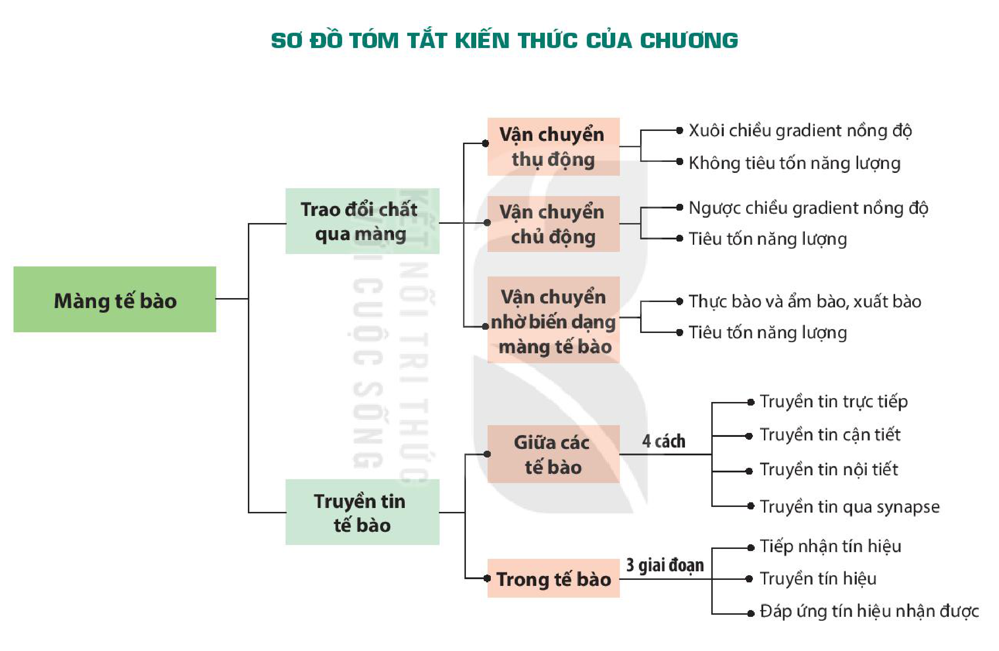

<!-- pdf:78 -->

# SƠ ĐỒ TÓM TẮT KIẾN THỨC CHƯƠNG 3

<!-- Trang in xoay ngang; ảnh đã xoay lại. Dưới đây chép các nhánh của sơ đồ thành danh sách, giữ nguyên chữ trong các ô và trên các mũi tên. -->

- Màng tế bào
  - Trao đổi chất qua màng
    - Vận chuyển thụ động
      - Xuôi chiều gradient nồng độ
      - Không tiêu tốn năng lượng
    - Vận chuyển chủ động
      - Ngược chiều gradient nồng độ
      - Tiêu tốn năng lượng
    - Vận chuyển nhờ biến dạng màng tế bào
      - Thực bào và ẩm bào, xuất bào
      - Tiêu tốn năng lượng
  - Truyền tin tế bào
    - Giữa các tế bào (4 cách)
      - Truyền tin trực tiếp
      - Truyền tin cận tiết
      - Truyền tin nội tiết
      - Truyền tin qua synapse
    - Trong tế bào (3 giai đoạn)
      - Tiếp nhận tín hiệu
      - Truyền tín hiệu
      - Đáp ứng tín hiệu nhận được

## 📷 Danh sách hình trong bài

| Mã hình | Trang PDF | Vị trí | Chú thích gốc |
|---|---|---|---|
| H10-sinh-so-do-tom-tat-c03-01 | 78 | Cả trang (in xoay ngang) | Sơ đồ tóm tắt kiến thức của chương |
