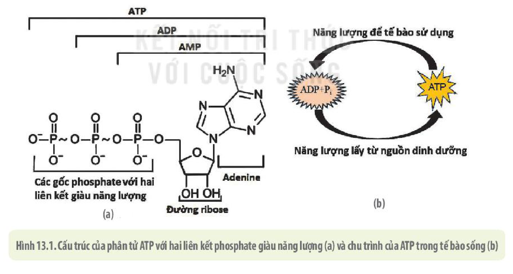
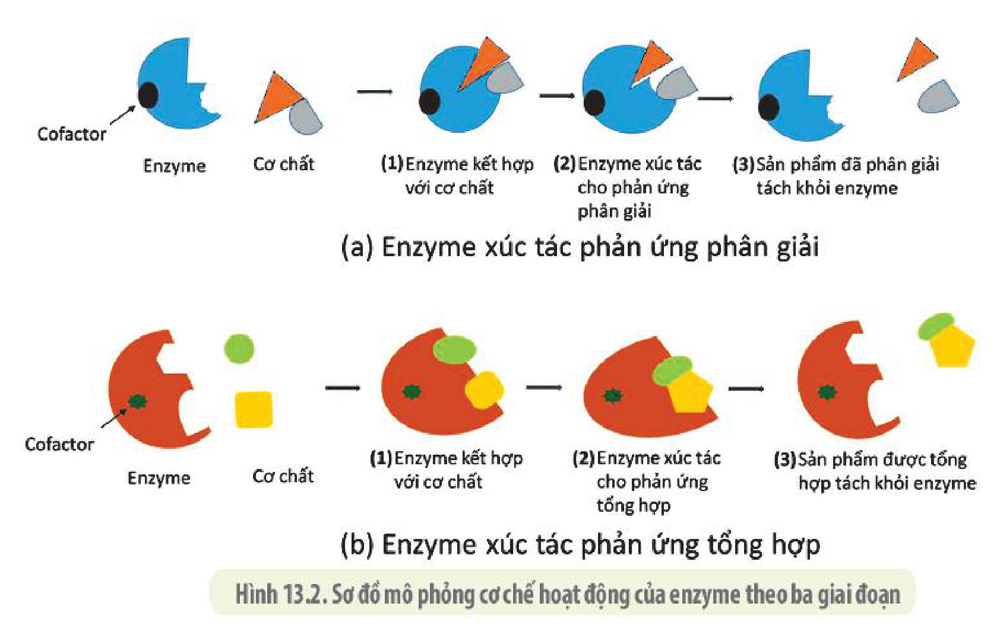
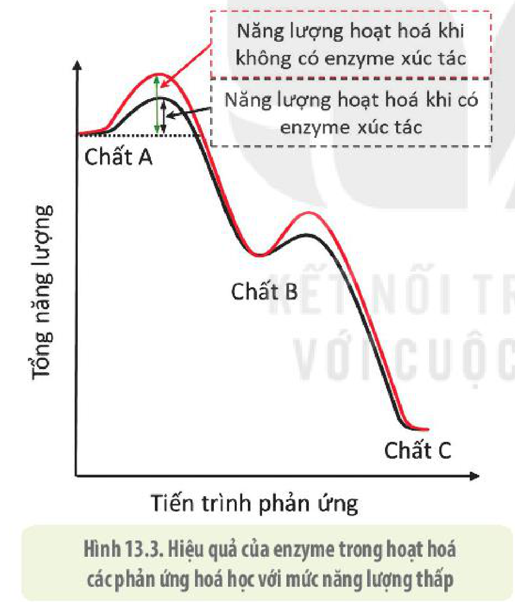
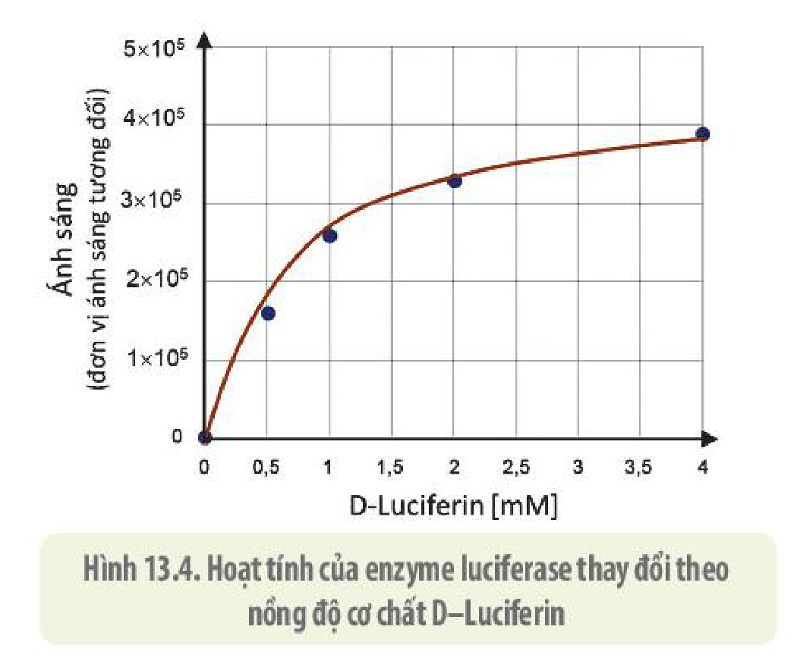
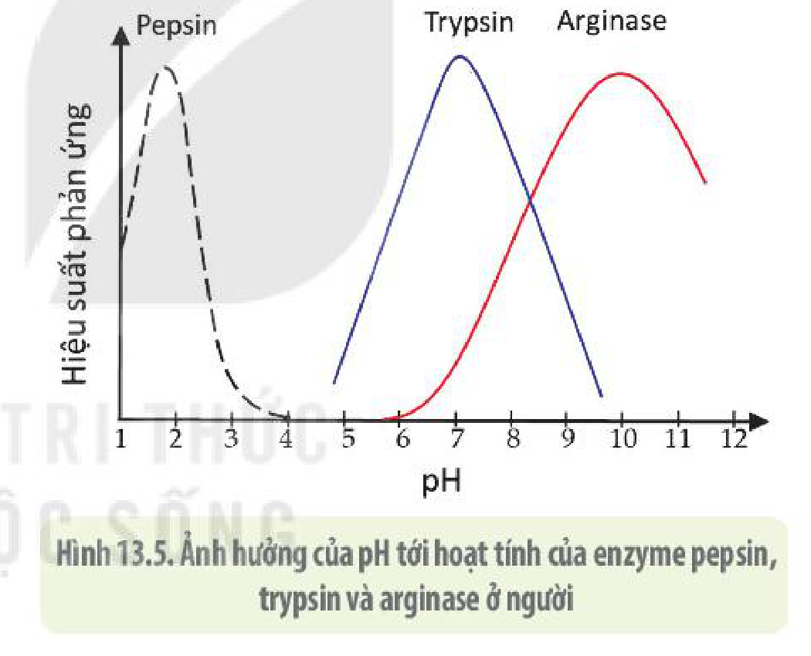
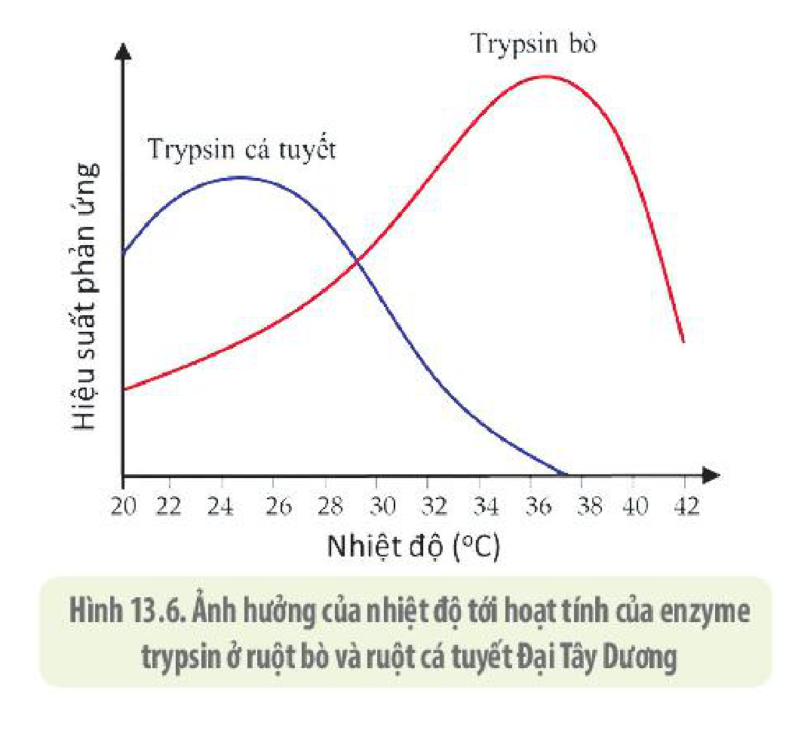
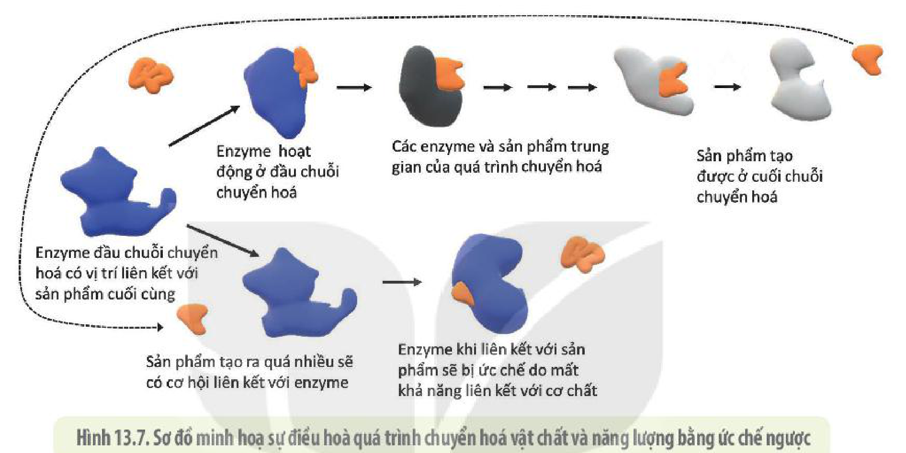

<!-- pdf:79 -->

# BÀI 13: KHÁI QUÁT VỀ CHUYỂN HOÁ VẬT CHẤT VÀ NĂNG LƯỢNG

## 🎯 Yêu cầu cần đạt

- Phân biệt được các dạng năng lượng trong chuyển hoá năng lượng ở tế bào. Giải thích được năng lượng được tích luỹ và sử dụng cho các hoạt động sống của tế bào là dạng hoá năng.
- Phân tích được cấu tạo và chức năng của ATP về giá trị năng lượng sinh học. Trình bày được quá trình tổng hợp và phân giải ATP gắn liền với quá trình tích luỹ, giải phóng năng lượng.
- Phát biểu được khái niệm chuyển hoá năng lượng trong tế bào.
- Nêu được khái niệm, cấu trúc và cơ chế tác động của enzyme. Trình bày được vai trò của enzyme trong quá trình trao đổi chất và chuyển hoá năng lượng. Phân tích được các yếu tố ảnh hưởng đến hoạt động xúc tác của enzyme.

## 🔴 Mở đầu

Hoạt động vận động như ở các cầu thủ bóng đá trong hình bên cần tiêu tốn rất nhiều năng lượng. Vậy, nguồn năng lượng đó đã được lấy từ đâu và chuyển đổi thành dạng nào để tế bào và cơ thể có thể sử dụng ngay khi cần thiết như vậy?

## I. KHÁI QUÁT VỀ NĂNG LƯỢNG VÀ SỰ CHUYỂN HOÁ

### 1. Các dạng năng lượng trong tế bào

**Năng lượng** là khả năng sinh công hay khả năng tạo nên sự chuyển động của vật chất. Năng lượng trong tế bào tồn tại ở hai dạng: động năng và thế năng (Bảng 13).

<!-- pdf:80 -->

**Bảng 13. Các dạng năng lượng trong tế bào**

| | Khái niệm | Dạng năng lượng tồn tại trong tế bào |
|---|---|---|
| **Động năng** | Năng lượng làm vật khác di chuyển hay thay đổi trạng thái. | Nhiệt năng (ví dụ: nhiệt độ cơ thể), cơ năng (ví dụ: sự co cơ, vận động của các cơ quan), điện năng (ví dụ: xung thần kinh, chuỗi truyền electron). |
| **Thế năng** | Năng lượng tiềm ẩn do vị trí hoặc trạng thái của vật chất tạo ra. | Năng lượng trong các liên kết hoá học, sự chênh lệch về điện thế và nồng độ các chất giữa bên trong và bên ngoài tế bào. |

### 2. ATP – "đồng tiền" năng lượng của tế bào

Trong một tế bào sống, rất nhiều các phản ứng hoá học liên tục xảy ra và chúng đều cần đến năng lượng hoặc giải phóng năng lượng. Nguồn năng lượng phổ biến cho các phản ứng hoá học này tồn tại trong phân tử đặc biệt có tên là adenosine triphosphate, viết tắt là **ATP**.

Hoạt động của phân tử ATP giống như một viên pin sạc mà năng lượng được dự trữ ở các liên kết hoá học. Trong tế bào, ATP thường xuyên được sinh ra và ngay lập tức được sử dụng cho mọi hoạt động sống của tế bào (tổng hợp và vận chuyển các chất, co cơ,...), chính vì vậy ATP được coi là "đồng tiền" năng lượng của tế bào.

<!-- term: ADP -->
<!-- term: AMP -->
Mỗi phân tử ATP có cấu tạo gồm ba thành phần cơ bản là: phân tử adenine, phân tử đường ribose và 3 gốc phosphate (H 13.1a). Khi liên kết giữa các gốc phosphate bị phá vỡ sẽ giải phóng năng lượng. Liên kết ngoài cùng thường dễ bị phá vỡ hơn và ATP sẽ chuyển thành ADP (Adenosine diphosphate). Đôi khi, cả hai liên kết cao năng đều bị phá vỡ giải phóng lượng năng lượng gấp đôi và ATP chuyển thành AMP (Adenosine monophosphate).

Hình 13.1. Cấu trúc của phân tử ATP với hai liên kết phosphate giàu năng lượng (a) và chu trình của ATP trong tế bào sống (b)

### 3. Sự chuyển hoá vật chất và năng lượng trong tế bào

**Sự chuyển hoá vật chất** là tập hợp tất cả các phản ứng hoá học xảy ra bên trong tế bào làm chuyển đổi chất này thành chất khác. **Sự chuyển hoá năng lượng** là sự chuyển đổi của năng lượng từ dạng này sang dạng khác và luôn tuân theo các quy luật vật lí cơ bản về nhiệt động học.

<!-- pdf:81 -->

Quá trình chuyển hoá vật chất luôn đi kèm với sự chuyển đổi năng lượng. Với phân tử ATP, khi năng lượng thay đổi thì thành phần cấu trúc của nó cũng thay đổi (H 13.1). Tương tự như vậy, các phản ứng hoá học trong tế bào và cơ thể sống cũng luôn có sự biến đổi về vật chất kèm theo sự biến đổi về năng lượng. Các phản ứng hoá học được chia thành hai loại: tổng hợp và phân giải. Các phản ứng tổng hợp các chất (còn được gọi là **đồng hoá**) cần tiêu tốn năng lượng. Các phản ứng phân giải các chất (còn gọi là **dị hoá**) kèm theo giải phóng năng lượng. Hầu hết các phản ứng trong tế bào và cơ thể là các phản ứng oxy hoá khử và cần có sự xúc tác của một loại phân tử sinh học được gọi là enzyme.

## ❓ Dừng lại và suy ngẫm

1. Kể tên một số dạng năng lượng tồn tại trong tế bào sinh vật.
2. Quan sát hình 13.1, nêu cấu tạo và chức năng của ATP. Phân tử ATP mang năng lượng loại nào? Vì sao nói ATP là "đồng tiền" năng lượng của tế bào?
3. Thế nào là chuyển hoá năng lượng trong tế bào? Vì sao nói chuyển hoá vật chất luôn đi kèm với chuyển hoá năng lượng?

## II. ENZYME

### 1. Khái niệm, cấu trúc và cơ chế hoạt động của enzyme

**Enzyme** là chất xúc tác sinh học được tổng hợp trong các tế bào sống, có tác dụng làm tăng tốc độ phản ứng trong điều kiện sinh lí bình thường của cơ thể nhưng không bị biến đổi sau phản ứng. Một số ít phân tử RNA cũng có khả năng xúc tác cho một số phản ứng hoá học trong tế bào được gọi là **ribozyme**.

Đa số enzyme được cấu tạo từ protein. Nhiều enzyme, ngoài thành phần protein còn có thêm **cofactor** là ion kim loại (như $\text{Fe}^{2+}$, $\text{Mg}^{2+}$, $\text{Cu}^{2+}$) hoặc các phân tử hữu cơ (như nhân heme, biotin, FAD, NAD, các vitamin). Các cofactor có thể liên kết cố định hay tạm thời với enzyme và rất cần thiết cho hoạt động xúc tác của enzyme.

Mỗi enzyme thường có một **trung tâm hoạt động**, là một vùng cấu trúc không gian đặc biệt có khả năng liên kết đặc hiệu với **cơ chất** (chất chịu tác động của enzyme) để xúc tác cho phản ứng diễn ra. Trung tâm hoạt động phải có cấu hình không gian phù hợp với cơ chất. Khi liên kết xảy ra thì cả hai đều biến đổi cấu hình làm cho liên kết chặt chẽ hơn. Sau khi phản ứng xảy ra, sản phẩm tạo thành sẽ có cấu hình không gian thay đổi và rời khỏi enzyme, enzyme trở lại hình dạng ban đầu. Cơ chế hoạt động này khiến cho enzyme chỉ có thể tác động lên một hay một số chất có cấu hình không gian tương ứng nên chỉ xúc tác cho một loại hoặc một nhóm phản ứng hoá học nhất định. Đây gọi là **tính đặc hiệu của enzyme**. Quá trình enzyme tác động tới cơ chất tạo thành sản phẩm là chuỗi các biến đổi liên tục. Tuy nhiên, để dễ hình dung, quá trình này được tóm tắt theo ba giai đoạn như ở hình 13.2.

<!-- pdf:82 -->

Hình 13.2. Sơ đồ mô phỏng cơ chế hoạt động của enzyme theo ba giai đoạn

### 2. Vai trò của enzyme trong quá trình chuyển hoá

<!-- term: Năng lượng hoạt hoá -->
Thông thường, để các phản ứng hoá học giữa các chất hữu cơ xảy ra bên ngoài tế bào đòi hỏi một lượng năng lượng rất lớn để hoạt hoá các chất tham gia. Nhiều phản ứng tổng hợp hay phân giải chất hữu cơ xảy ra ngoài cơ thể cần các điều kiện phản ứng rất nghiêm ngặt như nhiệt độ cao, áp suất lớn, độ pH phù hợp,... Tuy nhiên, trong cơ thể sinh vật, các phản ứng hoá học tương tự như vậy vẫn diễn ra ở điều kiện nhiệt độ, áp suất, độ pH bình thường của cơ thể. Đó chính là nhờ sự xúc tác của các enzyme. Enzyme đã làm giảm năng lượng hoạt hoá cần thiết cho các phản ứng xảy ra xuống mức độ thấp (H 13.3), nhờ đó làm tăng tốc độ của phản ứng lên nhiều lần. Nếu tế bào không có các enzyme thì không thể duy trì các hoạt động sống do tốc độ các phản ứng sinh hoá xảy ra quá chậm hoặc để phản ứng xảy ra thì năng lượng hoạt hoá đòi hỏi sẽ rất cao, điều này có thể làm tổn thương và gây chết tế bào.

Hình 13.3. Hiệu quả của enzyme trong hoạt hoá các phản ứng hoá học với mức năng lượng thấp

### 3. Các yếu tố ảnh hưởng đến hoạt tính của enzyme

**Hoạt tính enzyme** chỉ tốc độ của phản ứng xúc tác bởi enzyme và được đo bằng lượng cơ chất bị chuyển đổi (hoặc lượng sản phẩm tạo thành sau phản ứng) trong một phút ở những điều kiện tiêu chuẩn. Hoạt tính của enzyme bị ảnh hưởng bởi nhiều yếu tố như nhiệt độ, độ pH, nồng độ cơ chất, nồng độ enzyme cũng như nồng độ các chất ức chế hoặc hoạt hoá enzyme.

<!-- pdf:83 -->

**a) Nồng độ enzyme và cơ chất**

Nếu nồng độ cơ chất không đổi, lượng enzyme tăng lên thì hiệu suất của phản ứng cũng tăng nhưng chỉ đạt ngưỡng nhất định rồi dừng lại do đã sử dụng tối đa lượng cơ chất. Tương tự, nếu lượng enzyme không đổi và tăng nồng độ cơ chất thì hiệu suất phản ứng cũng tăng và sẽ đạt ngưỡng do lượng enzyme có trong môi trường đã hoạt động tối đa. Ví dụ: Khi phân tử D–Luciferin bị phân huỷ do sự xúc tác của enzyme luciferase với nguồn năng lượng cung cấp từ ATP sẽ giải phóng ra năng lượng dạng ánh sáng. Khi thay đổi lượng D–Luciferin, giữ nguyên lượng ATP và enzyme thì lượng ánh sáng phát ra cũng thay đổi và được biểu diễn ở hình 13.4. Sự thay đổi cũng xảy ra tương tự khi thay đổi lượng ATP và giữ nguyên lượng D–Luciferin và enzyme.

Hình 13.4. Hoạt tính của enzyme luciferase thay đổi theo nồng độ cơ chất D–Luciferin

**b) Độ pH**

Mỗi loại enzyme thường có khoảng pH phù hợp nhất để hoạt động hiệu quả, ngoài khoảng pH này enzyme có thể bị giảm hoạt tính hoặc bất hoạt (H 13.5).

Hình 13.5. Ảnh hưởng của pH tới hoạt tính của enzyme pepsin, trypsin và arginase ở người

**c) Nhiệt độ**

Thông thường, mỗi loại enzyme chỉ hoạt động hiệu quả trong một khoảng nhiệt độ nhất định. Ngoài khoảng nhiệt độ đó, hoạt tính enzyme sẽ giảm, thậm chí mất hoàn toàn (H 13.6).

Hình 13.6. Ảnh hưởng của nhiệt độ tới hoạt tính của enzyme trypsin ở ruột bò và ruột cá tuyết Đại Tây Dương

**d) Chất điều hoà enzyme**

Các enzyme thường chịu tác động của nhiều loại phân tử có trong môi trường. Có những loại phân tử khi liên kết sẽ làm tăng hoạt tính của enzyme được gọi là **chất hoạt hoá**. Ngược lại, có loại phân tử khi liên kết sẽ làm giảm hoặc mất hoạt tính của enzyme gọi là **chất ức chế**. Một chất ức chế có thể cạnh tranh với cơ chất để liên kết với trung tâm hoạt động của enzyme hoặc liên kết trên vị trí khác khiến cấu hình không gian của trung tâm hoạt động bị biến đổi làm enzyme không thể hoạt động được.

<!-- pdf:84 -->

### 4. Điều hoà quá trình chuyển hoá vật chất và năng lượng thông qua enzyme

Enzyme làm tăng tốc độ của các phản ứng hoá học trong cơ thể, tức là làm tăng tốc độ quá trình chuyển hoá vật chất và năng lượng trong tế bào. Tuy nhiên, tốc độ của quá trình này luôn thay đổi tuỳ thuộc vào giai đoạn phát triển, trạng thái của cơ thể. Vì vậy, tế bào có thể điều chỉnh tốc độ chuyển hoá vật chất và năng lượng bằng nhiều cách khác nhau. Một trong những cách đó là điều chỉnh hoạt tính của enzyme thông qua các chất hoạt hoá và ức chế enzyme. **Ức chế ngược** cũng là một kiểu điều hoà, trong đó sản phẩm chuyển hoá được tạo ra một khi đã đủ nhu cầu của tế bào, sẽ quay lại ức chế enzyme xúc tác cho phản ứng ở đầu chuỗi chuyển hoá để dừng tổng hợp sản phẩm (H 13.7).

Hình 13.7. Sơ đồ minh hoạ sự điều hoà quá trình chuyển hoá vật chất và năng lượng bằng ức chế ngược

Trong tế bào sống, các enzyme thường được định vị ở những vùng có các điều kiện thích hợp hoặc trong các bào quan để cho chúng hoạt động được tối ưu nhất.

Ví dụ: Các enzyme trong lysosome bình thường ở trạng thái bất hoạt, nhưng khi cần hoạt hoá enzyme, các bơm trên màng lysosome sẽ bơm $\text{H}^+$ vào bên trong làm giảm độ pH, khi đó các enzyme được hoạt hoá để hoạt động.

Việc định vị các enzyme trong chuỗi chuyển hoá theo một trình tự tại những vị trí nhất định trong tế bào cũng làm gia tăng hiệu quả chuyển hoá. Vì sản phẩm của phản ứng đứng trước sẽ là cơ chất cho phản ứng tiếp theo và vì thế sản phẩm cuối cùng của chuỗi chuyển hoá có thể diễn ra nhanh chóng và ít bị ảnh hưởng bởi các yếu tố môi trường.

## ❓ Dừng lại và suy ngẫm

1. Quan sát hình 13.2 và cho biết: Enzyme là gì? Nêu cấu trúc, cơ chế tác động và vai trò của enzyme trong quá trình chuyển hoá năng lượng.
2. Hoạt tính của enzyme chịu ảnh hưởng của những yếu tố nào và chúng có tác động như thế nào đến hoạt tính của enzyme?
3. Tế bào có thể điều hoà quá trình chuyển hoá vật chất thông qua điều khiển hoạt tính của enzyme bằng những yếu tố nào? Giải thích.
4. Giải thích vì sao khi tăng nhiệt độ lên quá cao so với nhiệt độ tối ưu của một enzyme thì hoạt tính của enzyme bị giảm, thậm chí là mất hẳn hoạt tính.

<!-- pdf:85 -->

## 📌 Kiến thức cốt lõi

- Năng lượng trong tế bào tồn tại ở nhiều dạng khác nhau trong đó hoá năng là dạng năng lượng chính được tích luỹ và sử dụng cho các hoạt động sống của tế bào.
- Sự chuyển hoá năng lượng trong tế bào là sự chuyển đổi năng lượng từ dạng này sang dạng khác và luôn đi kèm với chuyển hoá vật chất.
- ATP được cấu tạo từ ba thành phần: phân tử adenine, đường ribose và ba gốc phosphate. ATP dự trữ năng lượng ngắn hạn để cung cấp cho các hoạt động sống của tế bào ngay khi cần.
- Enzyme là chất xúc tác sinh học được tổng hợp trong các tế bào sống, có tác dụng làm giảm năng lượng hoạt hoá, giúp các phản ứng xảy ra được trong điều kiện sinh lí bình thường của cơ thể.
- Mỗi enzyme thường có một trung tâm hoạt động và thường chỉ liên kết với một hay một số chất có cấu hình không gian tương ứng nên chỉ xúc tác cho một hoặc một nhóm phản ứng hoá học nhất định.
- Hoạt tính enzyme chịu ảnh hưởng của một số yếu tố chủ yếu như nhiệt độ, độ pH, nồng độ cơ chất và nồng độ enzyme cũng như các chất điều hoà enzyme.

## ✏️ Luyện tập và vận dụng

1. Phát biểu nào sau đây là đúng khi nói về phân tử ATP?
   - A. Phân tử ATP có cấu tạo từ ba thành phần cơ bản: adenine, đường deoxyribose và muối phosphate.
   - B. Trong phân tử ATP, các gốc phosphate liên kết rất chặt chẽ với nhau bằng liên kết cộng hoá trị.
   - C. Mỗi phân tử ATP có ba gốc phosphate liên kết với nhau tạo nên ba liên kết cao năng.
   - D. ATP liên tục được tổng hợp, vận chuyển và sử dụng trong tế bào sống.
2. Phân tích sự phù hợp giữa cấu tạo và chức năng của phân tử ATP.
3. Tế bào nhân thực được chia thành nhiều xoang tách biệt bởi hệ thống nội màng và các bào quan có màng bao bọc, điều này có ý nghĩa gì trong hoạt động của enzyme và quá trình chuyển hoá năng lượng trong tế bào? Giải thích.
4. Dựa vào thành phần cấu tạo và cơ chế điều hoà quá trình chuyển hoá vật chất và năng lượng của enzyme, hãy giải thích vì sao trong trồng trọt và chăn nuôi, muốn thu được năng suất cao, con người phải chú ý bổ sung đầy đủ các nguyên tố khoáng vi lượng, vitamin vào chế độ dinh dưỡng cho cây trồng và vật nuôi.

## 📷 Danh sách hình trong bài

| Mã hình | Trang PDF | Vị trí | Chú thích gốc |
|---|---|---|---|
| H10-sinh-b13-01 | 80 | Mục I.2 | Hình 13.1. Cấu trúc của phân tử ATP với hai liên kết phosphate giàu năng lượng (a) và chu trình của ATP trong tế bào sống (b) |
| H10-sinh-b13-02 | 82 | Mục II.1 | Hình 13.2. Sơ đồ mô phỏng cơ chế hoạt động của enzyme theo ba giai đoạn |
| H10-sinh-b13-03 | 82 | Mục II.2 | Hình 13.3. Hiệu quả của enzyme trong hoạt hoá các phản ứng hoá học với mức năng lượng thấp |
| H10-sinh-b13-04 | 83 | Mục II.3.a | Hình 13.4. Hoạt tính của enzyme luciferase thay đổi theo nồng độ cơ chất D–Luciferin |
| H10-sinh-b13-05 | 83 | Mục II.3.b | Hình 13.5. Ảnh hưởng của pH tới hoạt tính của enzyme pepsin, trypsin và arginase ở người |
| H10-sinh-b13-06 | 83 | Mục II.3.c | Hình 13.6. Ảnh hưởng của nhiệt độ tới hoạt tính của enzyme trypsin ở ruột bò và ruột cá tuyết Đại Tây Dương |
| H10-sinh-b13-07 | 84 | Mục II.4 | Hình 13.7. Sơ đồ minh hoạ sự điều hoà quá trình chuyển hoá vật chất và năng lượng bằng ức chế ngược |
