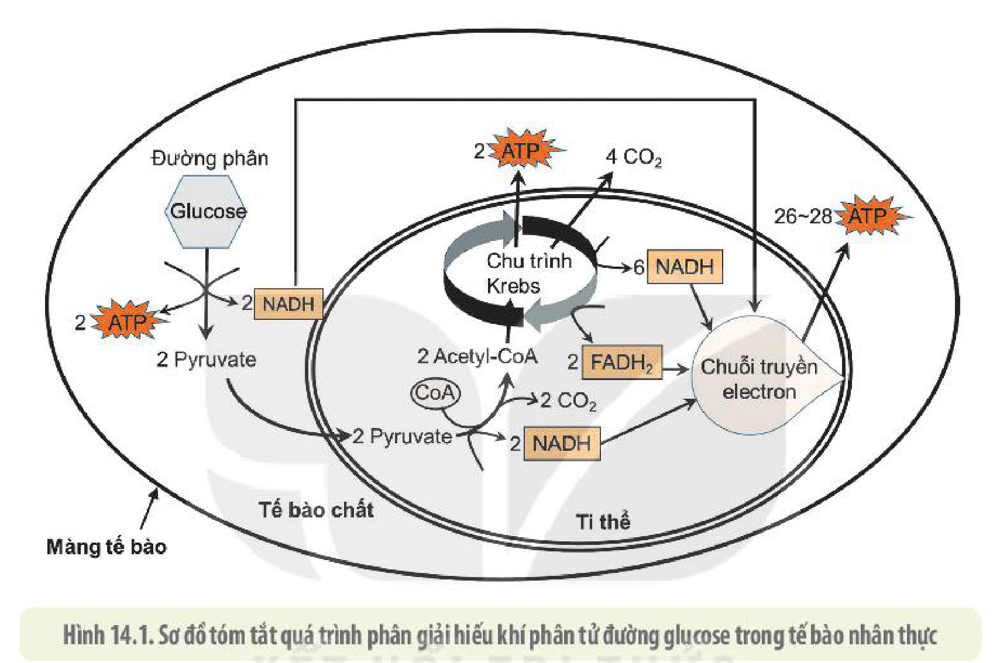
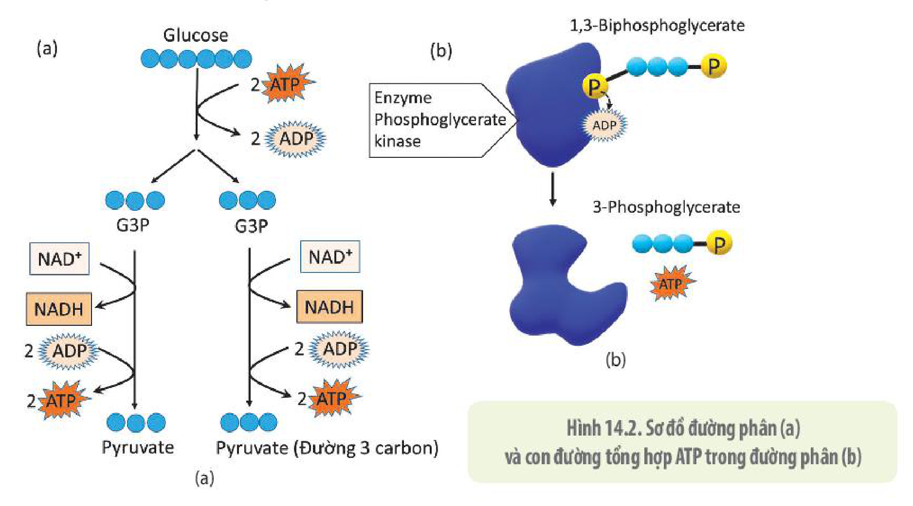
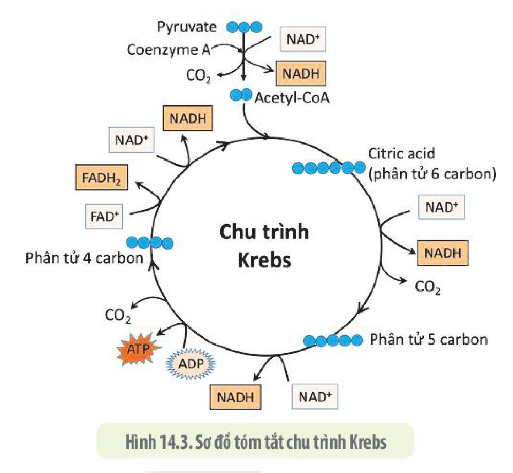
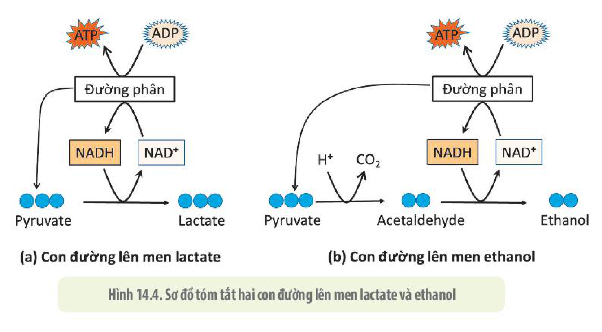
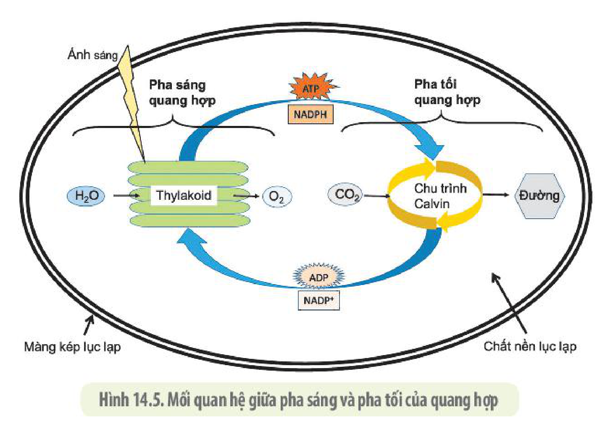
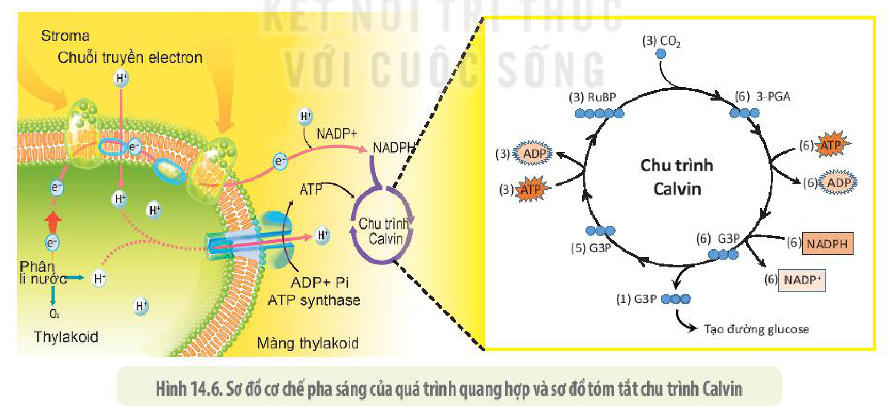
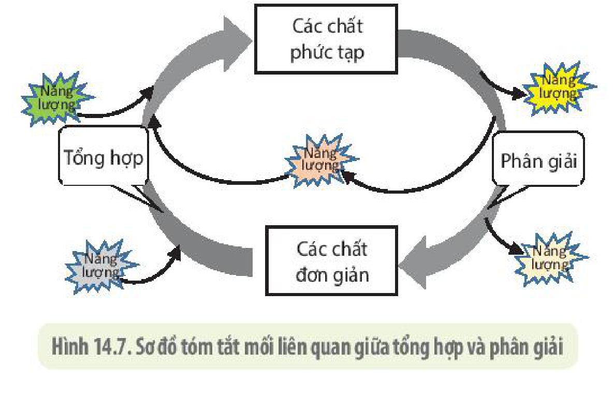

<!-- pdf:86 -->

# BÀI 14: PHÂN GIẢI VÀ TỔNG HỢP CÁC CHẤT TRONG TẾ BÀO

## 🎯 Yêu cầu cần đạt

- Phát biểu được khái niệm phân giải các chất trong tế bào. Trình bày được các giai đoạn phân giải hiếu khí (hô hấp tế bào) và các giai đoạn phân giải kị khí (lên men). Trình bày được quá trình phân giải các chất song song với giải phóng năng lượng.
- Nêu được khái niệm tổng hợp các chất trong tế bào. Lấy được ví dụ minh hoạ (tổng hợp protein, lipid, carbohydrate,...). Trình bày được quá trình tổng hợp các chất song song với tích luỹ năng lượng.
- Nêu được vai trò quan trọng của quang hợp trong việc tổng hợp các chất và tích luỹ năng lượng trong tế bào thực vật. Nêu được vai trò của hoá tổng hợp và quang khử ở vi khuẩn.
- Phân tích được mối quan hệ giữa tổng hợp và phân giải các chất trong tế bào.

## 🔴 Mở đầu

Mọi hoạt động sống của tế bào và cơ thể đều cần năng lượng ATP. Phân tử ATP giống như viên pin sạc. Vậy năng lượng nạp vào phân tử ATP để cung cấp cho các hoạt động sống được cơ thể lấy từ quá trình nào?

## I. PHÂN GIẢI CÁC CHẤT VÀ GIẢI PHÓNG NĂNG LƯỢNG TRONG TẾ BÀO

### 1. Khái niệm phân giải các chất và các con đường phân giải

**Phân giải** là quá trình phá vỡ các liên kết trong các phân tử sinh học để tạo ra các phân tử nhỏ hơn đồng thời giải phóng năng lượng. Một phần năng lượng được giải phóng sẽ chuyển thành năng lượng tích luỹ trong phân tử ATP và một phần sẽ giải phóng ra dưới dạng nhiệt năng. Các phân tử sinh học nhỏ và năng lượng từ ATP được tạo ra từ quá trình phân giải lại có thể được sử dụng để tổng hợp nên các phân tử sinh học mới cho tế bào. Một phân tử sinh học được xem là nguồn nguyên liệu có giá trị khi quá trình phân giải nó tạo ra được lượng lớn ATP. Carbohydrate là một trong số nguyên liệu chính được tế bào sử dụng trong quá trình phân giải.

Quá trình phân giải đường diễn ra theo ba con đường: (1) Hô hấp tế bào (còn gọi là **hô hấp hiếu khí**), cần sự tham gia của $\text{O}_2$; (2) **Hô hấp kị khí**, tương tự hô hấp hiếu khí nhưng không cần tới $\text{O}_2$; (3) Lên men, không có chuỗi truyền electron. Chi tiết hai quá trình phân giải đường chủ yếu trong tế bào là hô hấp tế bào và lên men sẽ được trình bày dưới đây.

### 2. Hô hấp tế bào

**Hô hấp tế bào** là quá trình phân tử đường bị phân giải hoàn toàn thành sản phẩm cuối cùng là $\text{CO}_2$ và nước với sự tham gia của $\text{O}_2$, đồng thời giải phóng năng lượng cung cấp cho các hoạt động của tế bào. Bản chất của quá trình này là một chuỗi các phản ứng oxy hoá khử, trong đó năng lượng dạng hoá năng trong phân tử đường sẽ được giải phóng từ từ qua các giai đoạn và chuyển thành dạng năng lượng dễ sử dụng hơn trong phân tử ATP, đồng thời giải phóng năng lượng dạng nhiệt năng.

<!-- pdf:87 -->

Phương trình tổng quát của quá trình phân giải hoàn toàn một phân tử đường glucose được biểu diễn như sau:

$$\text{C}_6\text{H}_{12}\text{O}_6\text{ (glucose)} + 2\text{ATP} + 6\text{O}_2 \longrightarrow 6\text{CO}_2 + 6\text{H}_2\text{O} + 30\text{–}32\text{ ATP} + \text{Nhiệt năng}$$
<!-- ocr-ok: phương trình tổng quát phân giải glucose, đã đối chiếu ảnh PDF 87 -->

Toàn bộ quá trình phân giải hiếu khí phân tử đường glucose được chia thành ba giai đoạn chính: đường phân, chu trình Krebs và chuỗi truyền electron (H 14.1).

Hình 14.1. Sơ đồ tóm tắt quá trình phân giải hiếu khí phân tử đường glucose trong tế bào nhân thực

<!-- term: Đường phân -->
Đường phân xảy ra trong tế bào chất và không có sự tham gia của $\text{O}_2$. Trong quá trình này mỗi phân tử đường glucose (hợp chất 6 carbon) được phân giải thành hai phân tử pyruvate (hợp chất 3 carbon), đồng thời thu được 2 phân tử NADH và 2 phân tử ATP (Hình 14.2).

Hình 14.2. Sơ đồ đường phân (a) và con đường tổng hợp ATP trong đường phân (b)

<!-- pdf:88 -->

<!-- term: Chu trình Krebs -->
Mỗi phân tử pyruvate (phân tử 3 carbon) chuyển hoá thành một phân tử acetyl-CoA (phân tử 2 carbon) đi vào chu trình Krebs giải phóng ra 2 phân tử $\text{CO}_2$, 3 NADH, 1 $\text{FADH}_2$ và 1 ATP (H 14.3). Như vậy, qua đường phân và chu trình Krebs, năng lượng hoá học trong các phân tử lớn, phức tạp đã được chuyển sang các liên kết hoá học ở các phân tử nhỏ dưới dạng dễ chuyển đổi và sử dụng hơn.

Hình 14.3. Sơ đồ tóm tắt chu trình Krebs

<!-- term: Chuỗi truyền electron -->
Chuỗi truyền electron diễn ra ở màng trong ti thể. Trong giai đoạn này, các phân tử NADH và $\text{FADH}_2$ được sinh ra trong giai đoạn đường phân và chu trình Krebs sẽ bị oxy hoá qua một chuỗi phản ứng oxy hoá khử để tạo ra ATP và nước. Đây là giai đoạn thu được nhiều ATP nhất trong quá trình hô hấp.

Toàn bộ năng lượng hoá học của một phân tử glucose được giải phóng trong quá trình hô hấp hiếu khí sẽ được chuyển sang liên kết hoá học dễ sử dụng hơn trong khoảng 30 đến 32 phân tử ATP (H 14.1) và một phần chuyển thành nhiệt năng duy trì nhiệt độ phù hợp cho các phản ứng sinh hoá khác. Trong điều kiện thực nghiệm tối ưu, 1 phân tử glucose trải qua quá trình hô hấp hiếu khí có thể tạo được khoảng 36 đến 38 phân tử ATP.

### 3. Lên men

**Lên men** là quá trình phân giải không hoàn toàn phân tử đường để tạo năng lượng mà không có sự tham gia của $\text{O}_2$ và chuỗi truyền electron. Quá trình này gồm hai giai đoạn: đường phân và lên men. Giai đoạn đường phân diễn ra tương tự như hô hấp hiếu khí. Trong giai đoạn lên men, electron từ glucose qua NADH được truyền đến phân tử hữu cơ khác.

Hình 14.4. Sơ đồ tóm tắt hai con đường lên men lactate và ethanol

<!-- pdf:89 -->

Các tế bào vi khuẩn có nhiều kiểu lên men, còn các tế bào nhân thực có hai kiểu lên men chính là lên men lactate và lên men ethanol (lên men rượu). Tế bào động vật và người thường chỉ sử dụng con đường lên men lactate trong khi tế bào thực vật chủ yếu lên men ethanol. Các loại vi sinh vật khác nhau có thể sử dụng một trong hai hoặc cả hai con đường lên men này.

<!-- term: Lên men lactate -->
<!-- term: Lên men ethanol -->
Trong quá trình lên men lactate, pyruvate nhận electron từ NADH và tạo ra sản phẩm là muối lactate (H 14.4a). Còn trong quá trình lên men ethanol, phân tử hữu cơ acetaldehyde là chất nhận electron từ NADH để tạo ra sản phẩm cuối cùng là ethanol (H 14.4b). Kết quả của quá trình lên men, 1 phân tử glucose chỉ tạo ra 2 phân tử ATP, ít hơn rất nhiều so với hô hấp hiếu khí.

## ❓ Dừng lại và suy ngẫm

1. Phân giải các chất trong tế bào là gì? Nêu một số ví dụ minh hoạ.
2. Phân giải hiếu khí trong tế bào gồm những giai đoạn chính nào? Đặc trưng của mỗi giai đoạn này là gì?
3. Trình bày các giai đoạn của quá trình lên men. Nêu sự khác nhau giữa lên men rượu và lên men lactate.
4. So sánh hiệu quả năng lượng của quá trình hô hấp hiếu khí và lên men. Giải thích sự khác biệt này.

## 💡 Khoa học và đời sống

**Hô hấp và vấn đề bảo quản thực phẩm**

Phần lớn các sản phẩm trồng trọt như rau, củ, quả, hạt vẫn tiếp tục quá trình hô hấp sau khi được thu hoạch. Do hô hấp là quá trình phân giải các chất hữu cơ trong tế bào nên về lâu dài sẽ làm tiêu hao khối lượng và giảm sút lượng chất dinh dưỡng trong nông sản. Vì vậy, để hạn chế hao hụt về số lượng và chất lượng của nông sản khi bảo quản, người ta thường áp dụng một số biện pháp ức chế hô hấp dưới đây:

*Làm lạnh:* là phương pháp bảo quản ở nhiệt độ thấp (khoảng từ $2\text{ }^\circ\text{C}$ đến $8\text{ }^\circ\text{C}$) và thường áp dụng đối với các loại rau, củ, quả tươi. Nhiệt độ thấp làm các enzyme giảm hoặc mất hoạt tính dẫn đến các phản ứng hô hấp trong nông sản bị chậm lại hoặc ngừng trệ, đồng thời quá trình hô hấp và lên men của các vi sinh vật gây hư hỏng nông sản cũng bị ức chế, giúp nông sản được bảo quản lâu hơn.

*Sấy khô:* là phương pháp loại bỏ nước trong nông sản, thường được dùng để bảo quản các loại hạt. Do nước là một trong những nguyên liệu quan trọng cho quá trình hô hấp, cũng là môi trường quan trọng cho các phản ứng sinh hoá xảy ra nên khi tế bào mất nước, mọi hoạt động sống sẽ bị chậm hoặc ngừng lại. Các vi sinh vật gây hư hỏng nông sản cũng không có đủ nước để hoạt động giúp nông sản được bảo quản lâu hơn.

Ngoài ra, các phương pháp khác như hút chân không, bảo quản trong môi trường có nồng độ $\text{CO}_2$ cao cũng hay được sử dụng. Các phương pháp bảo quản có thể được sử dụng riêng biệt hoặc kết hợp với nhau để tăng hiệu quả.

<!-- pdf:90 -->

## II. TỔNG HỢP CÁC CHẤT VÀ TÍCH LUỸ NĂNG LƯỢNG TRONG TẾ BÀO

### 1. Khái quát về quá trình tổng hợp các chất trong tế bào

**Tổng hợp** là sự hình thành hợp chất phức tạp từ các chất đơn giản và tiêu tốn năng lượng. Trong tế bào và cơ thể sống, quá trình tổng hợp giúp tạo ra các hợp chất phức tạp xây dựng nên tế bào và cơ thể, đồng thời cung cấp cho các hoạt động sống khác. Những đại phân tử sinh học là các polymer (protein, các nucleic acid và carbohydrate) được tổng hợp từ các đơn phân nhờ các enzyme xúc tác chuyên biệt và nguồn năng lượng ATP.

Các phân tử nucleic acid được hình thành từ phản ứng sinh tổng hợp tạo liên kết phosphodiester giữa các đơn phân nucleotide. Các phân tử protein hay các chuỗi polypeptide được tạo thành từ sự kết hợp của nhiều amino acid với nhau bằng các liên kết peptide trong quá trình sinh tổng hợp protein.

Phân tử lipid được tổng hợp từ các phân tử acid béo và glycerol.

Các đường đôi hay đường đa như tinh bột, glycogen, chitin,... được tổng hợp từ các đường đơn như glucose, fructose, galactose,... Nguồn năng lượng và nguyên liệu cho các quá trình tổng hợp đều bắt nguồn từ các sinh vật tự dưỡng như thực vật, tảo và một số vi khuẩn. Các sinh vật này có khả năng chuyển năng lượng ánh sáng hoặc năng lượng từ các phản ứng hoá học thành năng lượng hoá học trong quá trình tổng hợp đường glucose từ các chất vô cơ đơn giản. Như vậy, quá trình tổng hợp các chất cũng chính là quá trình tích luỹ năng lượng trong các liên kết hoá học của sản phẩm mới được tổng hợp.

### 2. Vai trò của quang hợp trong tổng hợp các chất và tích luỹ năng lượng trong tế bào thực vật

**Quang hợp** là quá trình tổng hợp quan trọng nhất đối với hệ thống sống. Đây là quá trình mà thực vật và các sinh vật quang tự dưỡng khác chuyển năng lượng ánh sáng thành năng lượng hoá học trong các hợp chất hữu cơ giàu năng lượng nhờ tế bào có lục lạp chứa hệ sắc tố có khả năng hấp thụ ánh sáng. Quang hợp ở thực vật sử dụng khí $\text{CO}_2$ và nước, dưới tác dụng của ánh sáng do diệp lục hấp thụ để tổng hợp nên carbohydrate và giải phóng khí $\text{O}_2$. Quá trình này có thể được diễn tả tổng quát như phương trình dưới đây:

$$6\text{H}_2\text{O} + 6\text{CO}_2 \xrightarrow[\text{Enzyme}]{\text{Năng lượng ánh sáng, Hệ sắc tố}} \text{C}_6\text{H}_{12}\text{O}_6 + 6\text{O}_2$$
<!-- ocr-ok: phương trình tổng quát quang hợp, đã đối chiếu ảnh PDF 90 -->

Quá trình quang hợp xảy ra theo hai pha kế tiếp nhau: pha sáng xảy ra ở màng thylakoid và pha tối diễn ra theo chu trình Calvin xảy ra ở chất nền của lục lạp. Mối quan hệ giữa pha sáng và pha tối được thể hiện trong hình 14.5.

<!-- pdf:91 -->

Hình 14.5. Mối quan hệ giữa pha sáng và pha tối của quang hợp

<!-- term: Pha sáng -->
<!-- term: Quang phân li nước -->
Trong pha sáng, các photon ánh sáng đập vào các diệp lục làm electron cao năng của chúng bật ra và chuyển qua chuỗi truyền electron tạo ra ATP và NADPH. Quá trình này đã chuyển năng lượng ánh sáng thành điện năng và sau đó là hoá năng trong phân tử ATP và NADPH. Năng lượng từ các photon ánh sáng cũng làm phân li nước giải phóng electron, $\text{H}^+$ và $\text{O}_2$. Electron sẽ bù vào electron đã mất ở diệp lục, $\text{H}^+$ được sử dụng tạo ra sự chênh lệch gradient $\text{H}^+$ giữa hai phía màng thylakoid nhờ đó tổng hợp được ATP (H 14.6a). Như vậy, trong quá trình quang phân li nước, năng lượng ánh sáng cũng đã biến đổi thành thế năng và sau đó là hoá năng trong ATP. Sản phẩm của pha sáng là ATP và NADPH được sử dụng trong **chu trình Calvin** – chuỗi các phản ứng không sử dụng trực tiếp năng lượng từ ánh sáng nên còn gọi là **pha tối** của quang hợp.

Hình 14.6. Sơ đồ cơ chế pha sáng của quá trình quang hợp và sơ đồ tóm tắt chu trình Calvin

Trong pha tối, $\text{CO}_2$ sẽ bị khử thành carbohydrate. Cứ 3 phân tử $\text{CO}_2$ đi vào chu trình Calvin sẽ được năng lượng của ATP và NADPH chuyển đổi thành một phân tử đường 3 carbon (G3P). Hai phân tử G3P kết hợp lại tạo thành một phân tử glucose. Các phân tử G3P từ chu trình Calvin còn được sử dụng để tổng hợp các phân tử hữu cơ khác cho tế bào như amino acid, lipid,... Như vậy, ở pha tối, năng lượng trong liên kết kém bền vững từ ATP và NADPH đã được chuyển sang liên kết bền vững hơn ở các phân tử hữu cơ phức tạp (H 14.6).

<!-- pdf:92 -->

### 3. Vai trò của quang khử trong tổng hợp các chất và tích luỹ năng lượng ở vi khuẩn

Một số loại vi khuẩn màu lục và màu tía vẫn dùng năng lượng ánh sáng để khử $\text{CO}_2$ nhưng lại không dùng $\text{H}_2\text{O}$ làm nguồn cung cấp $\text{H}^+$ và electron như trong quá trình quang hợp ở thực vật mà dùng $\text{H}_2\text{S}$, $\text{S}$, $\text{H}_2$ và một số chất hữu cơ khác. Quá trình quang hợp kiểu này không giải phóng ra $\text{O}_2$ nên còn gọi là quang hợp không tạo $\text{O}_2$ hay còn gọi là **quang khử**. Quang khử ở vi khuẩn đã chuyển năng lượng ánh sáng thành năng lượng hoá học mà không cần đến nước. Kết quả của quá trình này không chỉ cung cấp nguồn thức ăn cho các sinh vật dị dưỡng mà còn giúp các vi khuẩn quang khử thích nghi với nhiều môi trường sống khác nhau, đồng thời góp phần làm giảm ô nhiễm môi trường.

### 4. Vai trò của hoá tổng hợp trong tổng hợp các chất và tích luỹ năng lượng ở vi khuẩn

Quá trình cố định $\text{CO}_2$ thành các chất hữu cơ nhờ sử dụng năng lượng sinh ra từ các phản ứng oxy hoá các hợp chất vô cơ gọi là **hoá tổng hợp**. Những sinh vật tổng hợp các chất hữu cơ theo con đường này được gọi là **sinh vật hoá tổng hợp** hay **hoá tự dưỡng**. Các vi khuẩn hoá tổng hợp tiết ra enzyme xúc tác cho các phản ứng oxy hoá các hợp chất vô cơ và giải phóng năng lượng. Một phần năng lượng này được vi khuẩn sử dụng để đồng hoá $\text{CO}_2$ thành các chất hữu cơ cần thiết. Trong trường hợp này, năng lượng hoá học trong các phân tử vô cơ đã được chuyển thành năng lượng hoá học trong phân tử hữu cơ, tạo nguồn dinh dưỡng mà các sinh vật dị dưỡng có thể sử dụng được. Phương trình tổng quát của hoá tổng hợp được trình bày như sau:

$$\text{A (chất vô cơ)} + \text{O}_2 \xrightarrow{\text{Vi sinh vật}} \text{AO}_2 + \text{Năng lượng (Q)}$$
<!-- ocr-ok: phương trình hoá tổng hợp vế 1, đã đối chiếu ảnh PDF 92 -->

$$\text{CO}_2 + \text{RH}_2\text{ (chất cho }\text{H}^+\text{)} + \text{Q} \xrightarrow{\text{Vi sinh vật}} \text{Chất hữu cơ}$$
<!-- ocr-ok: phương trình hoá tổng hợp vế 2, đã đối chiếu ảnh PDF 92 -->

Một số nhóm vi khuẩn hoá tổng hợp và vai trò của chúng được trình bày ở bảng 14.

**Bảng 14. Một số nhóm vi khuẩn hoá tổng hợp**

| Nhóm vi khuẩn | Đại diện | Hoạt động | Vai trò |
|---|---|---|---|
| Nhóm vi khuẩn lấy năng lượng từ các hợp chất chứa lưu huỳnh | Vi khuẩn lưu huỳnh, vi khuẩn oxy hoá sulfide | Nhóm vi khuẩn này oxy hoá $\text{H}_2\text{S}$, $\text{S}$, $\text{SO}_3^{2-}$,... thành $\text{H}_2\text{SO}_4$ tạo ra năng lượng để vi khuẩn tổng hợp chất hữu cơ. | Làm sạch môi trường nước. |
| Nhóm vi khuẩn lấy năng lượng từ các hợp chất chứa nitrogen | Vi khuẩn nitride hoá: *nitrosomonas*; vi khuẩn nitrate hoá: *nitrobacter* | Chuyển hoá $\text{NH}_3$ thành $\text{HNO}_2$, rồi thành $\text{HNO}_3$ tạo ra năng lượng cho vi khuẩn tổng hợp chất hữu cơ. $2\text{NH}_3 \xrightarrow{\text{Vi khuẩn nitride}} 2\text{HNO}_2 + \text{Q} \xrightarrow{\text{Vi khuẩn nitrate}} 2\text{HNO}_3 + \text{Q}$ | – Đảm bảo chu trình tuần hoàn vật chất (chu trình nitrogen) trong tự nhiên. – Chuyển hoá $\text{NH}_3$ thành dạng muối $\text{NO}_3^-$ là dạng thực vật có thể hấp thụ được, làm đất thêm màu mỡ, có lợi cho cây trồng. |
| Nhóm vi khuẩn lấy năng lượng từ các hợp chất chứa sắt | Vi khuẩn sắt | Vi khuẩn sắt chuyển hoá $\text{Fe}^{2+}$ thành $\text{Fe}^{3+}$, giải phóng năng lượng cho vi khuẩn tổng hợp chất hữu cơ. | Hình thành mỏ sắt. |

<!-- pdf:93 -->

### 5. Mối quan hệ giữa quá trình phân giải và quá trình tổng hợp trong tế bào

Quá trình tổng hợp sử dụng năng lượng để tạo nên phân tử phức tạp từ các phân tử đơn giản và tích luỹ năng lượng. Quá trình phân giải phá vỡ các phân tử phức tạp thành phân tử đơn giản để giải phóng năng lượng. Như vậy, trong tế bào, tổng hợp và phân giải các chất là hai quá trình trái ngược nhau nhưng lại thống nhất và có liên quan mật thiết với nhau. Sản phẩm của quá trình tổng hợp cung cấp nguyên liệu cho quá trình phân giải, còn năng lượng và các sản phẩm trung gian được giải phóng ra trong quá trình phân giải lại có thể được sử dụng cho quá trình tổng hợp (H 14.7).

Hình 14.7. Sơ đồ tóm tắt mối liên quan giữa tổng hợp và phân giải

## ❓ Dừng lại và suy ngẫm

1. Tổng hợp các chất trong tế bào là gì? Nêu một số ví dụ minh hoạ cho quá trình tổng hợp các chất trong tế bào.
2. Quang hợp có vai trò như thế nào trong tổng hợp các chất và dự trữ năng lượng?
3. Hoá tổng hợp và quang khử ở vi khuẩn có gì khác so với quang hợp ở thực vật?
4. Quá trình tổng hợp và phân giải có mối quan hệ với nhau như thế nào?

## 💡 Em có biết

**Ăn quá nhiều đường dễ mắc bệnh hiểm nghèo**

Chất đường bột là nguồn cung cấp năng lượng chính cho mọi hoạt động của tất cả các loại tế bào trong cơ thể. Tuy vậy, ăn quá nhiều đường và ít vận động dễ dẫn đến tăng cân, béo phì vì đường dư thừa sẽ được chuyển hoá thành mỡ và tích luỹ ở các mô mỡ và làm gan nhiễm mỡ. Quá trình này sẽ làm tăng lượng chất béo triglyceride và cholesterol dưới dạng LDL và giảm cholesterol dưới dạng HDL vận chuyển trong máu. LDL khi tăng cao sẽ gây hại cho tế bào và cơ thể do tăng lượng cholesterol được sử dụng, trong khi HDL lại có nhiều tác dụng có lợi như chống viêm, tăng cường miễn dịch,... Khi ăn quá nhiều thức ăn chứa đường sucrose hoặc fructose, đường fructose sẽ được chuyển hoá liên tục mà không chịu sự điều tiết của hormone insulin, đồng thời cơ thể cũng không tiết hormone "no" và ức chế hormone "thèm ăn" khiến ta ăn nhiều hơn mức cần thiết dẫn đến tăng cường tích luỹ mỡ, gây nên béo phì và hàng loạt các bệnh liên quan.

<!-- pdf:94 -->

## 📌 Kiến thức cốt lõi

- Phân giải là quá trình phá vỡ các liên kết trong các phân tử sinh học để tạo ra các phân tử nhỏ hơn, đồng thời giải phóng năng lượng.
- Hô hấp tế bào là con đường mang lại hiệu quả năng lượng cao nhất, gồm ba giai đoạn chính là đường phân, chu trình Krebs, chuỗi truyền electron. Lên men gồm hai giai đoạn đường phân và lên men, là con đường mang lại hiệu quả ATP thấp hơn.
- Tổng hợp là quá trình hình thành hợp chất phức tạp từ những chất đơn giản và tiêu tốn năng lượng.
- Quang hợp là quá trình tổng hợp điển hình ở thực vật, gồm hai pha: Pha sáng có vai trò chuyển hoá năng lượng ánh sáng thành hoá năng trong các liên kết hoá học kém bền vững của ATP và NADPH. Pha tối có vai trò cố định $\text{CO}_2$ tạo thành đường qua chu trình Calvin, đồng thời chuyển năng lượng từ phân tử ATP và NADPH sang dạng hoá năng bền vững hơn trong phân tử đường.
- Quá trình tổng hợp cung cấp nguyên liệu cho quá trình phân giải, quá trình phân giải tạo ra năng lượng và nguyên liệu cho quá trình tổng hợp.

## ✏️ Luyện tập và vận dụng

1. So sánh quá trình quang hợp, hoá tổng hợp và quang khử.
2. Kẻ và hoàn thành bảng vào vở theo mẫu sau:

| Chỉ tiêu so sánh \ Các giai đoạn | Đường phân | Chu trình Krebs | Chuỗi truyền electron |
|---|---|---|---|
| Nơi diễn ra | ? | ? | ? |
| Nhu cầu $\text{O}_2$ | ? | ? | ? |
| Nguyên liệu | ? | ? | ? |
| Sản phẩm | ? | ? | ? |

3. Chứng minh quá trình chuyển hoá vật chất luôn đi kèm với quá trình chuyển hoá năng lượng thông qua hai quá trình quang hợp và hô hấp.
4. Ở người, hiện tượng đau mỏi cơ khi vận động nhiều là do lượng lactic acid được sản sinh và tích luỹ quá nhiều đã gây độc cho cơ. Dựa vào hiểu biết về quá trình lên men, hãy giải thích cơ chế gây ra hiện tượng này và cách phòng tránh.

## 📷 Danh sách hình trong bài

| Mã hình | Trang PDF | Vị trí | Chú thích gốc |
|---|---|---|---|
| H10-sinh-b14-01 | 87 | Mục I.2 | Hình 14.1. Sơ đồ tóm tắt quá trình phân giải hiếu khí phân tử đường glucose trong tế bào nhân thực |
| H10-sinh-b14-02 | 87 | Mục I.2 | Hình 14.2. Sơ đồ đường phân (a) và con đường tổng hợp ATP trong đường phân (b) |
| H10-sinh-b14-03 | 88 | Mục I.2 | Hình 14.3. Sơ đồ tóm tắt chu trình Krebs |
| H10-sinh-b14-04 | 88 | Mục I.3 | Hình 14.4. Sơ đồ tóm tắt hai con đường lên men lactate và ethanol |
| H10-sinh-b14-05 | 91 | Mục II.2 | Hình 14.5. Mối quan hệ giữa pha sáng và pha tối của quang hợp |
| H10-sinh-b14-06 | 91 | Mục II.2 | Hình 14.6. Sơ đồ cơ chế pha sáng của quá trình quang hợp và sơ đồ tóm tắt chu trình Calvin |
| H10-sinh-b14-07 | 93 | Mục II.5 | Hình 14.7. Sơ đồ tóm tắt mối liên quan giữa tổng hợp và phân giải |
