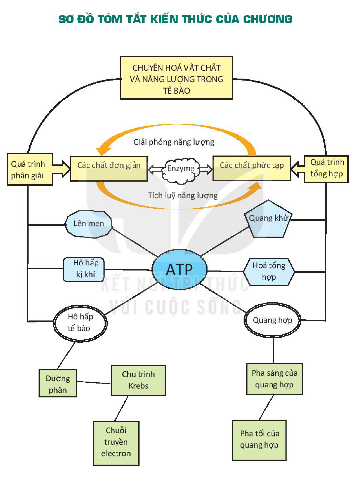

<!-- pdf:97 -->

# SƠ ĐỒ TÓM TẮT KIẾN THỨC CHƯƠNG 4

<!-- Trang 97 in dọc (không xoay). Dưới đây chép các nhánh của sơ đồ thành danh sách, giữ nguyên chữ trong các ô và trên các mũi tên. -->

- CHUYỂN HOÁ VẬT CHẤT VÀ NĂNG LƯỢNG TRONG TẾ BÀO
  - Quá trình phân giải (Các chất phức tạp $\xrightarrow{\text{Enzyme, Giải phóng năng lượng}}$ Các chất đơn giản):
    - Lên men $\longrightarrow$ ATP
    - Hô hấp kị khí $\longrightarrow$ ATP
    - Hô hấp tế bào $\longrightarrow$ ATP
      - Đường phân
      - Chu trình Krebs
      - Chuỗi truyền electron
  - Quá trình tổng hợp (Các chất đơn giản $\xrightarrow{\text{Enzyme, Tích luỹ năng lượng}}$ Các chất phức tạp):
    - Quang khử $\longleftarrow$ ATP
    - Hoá tổng hợp $\longleftarrow$ ATP
    - Quang hợp $\longleftarrow$ ATP
      - Pha sáng của quang hợp
      - Pha tối của quang hợp
<!-- ocr-ok: chữ trong các ô sơ đồ, OCR đọc không theo thứ tự; đã đối chiếu ảnh PDF 97 -->

## 📷 Danh sách hình trong bài

| Mã hình | Trang PDF | Vị trí | Chú thích gốc |
|---|---|---|---|
| H10-sinh-so-do-tom-tat-c04-01 | 97 | Cả trang | Sơ đồ tóm tắt kiến thức của chương |
