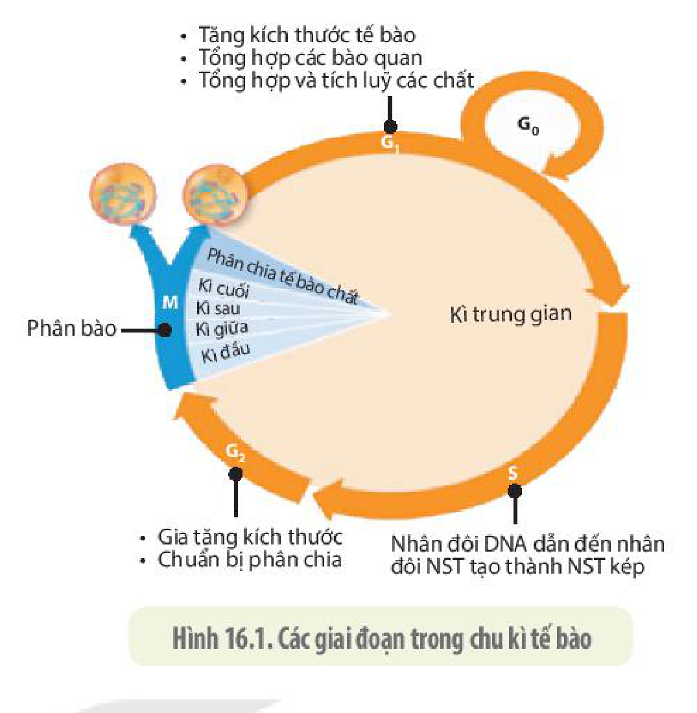
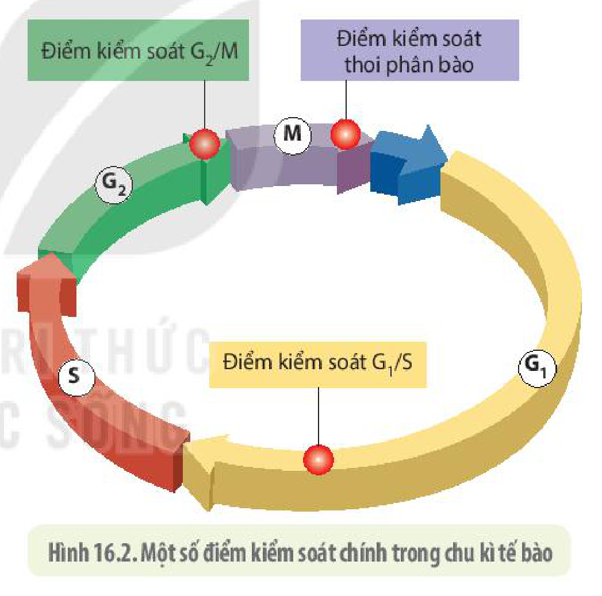
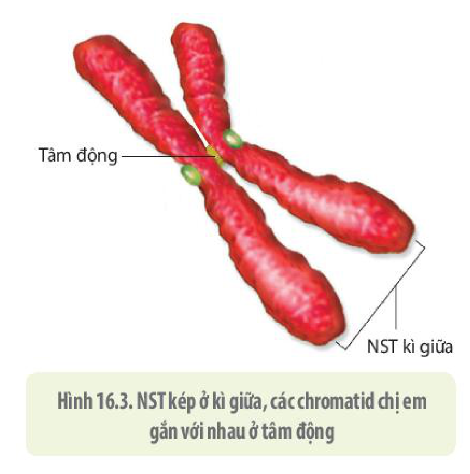
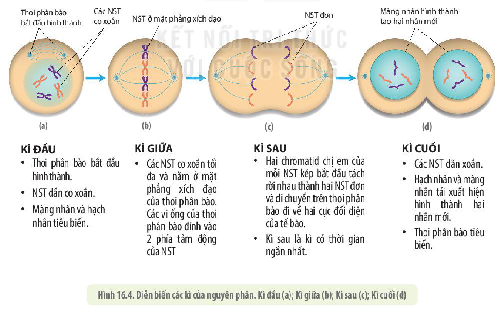
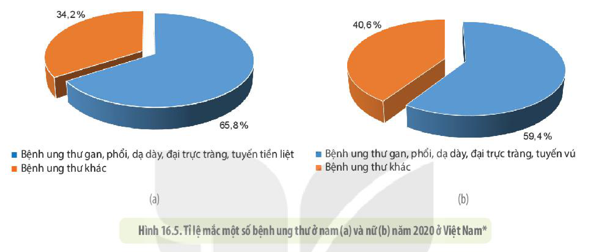
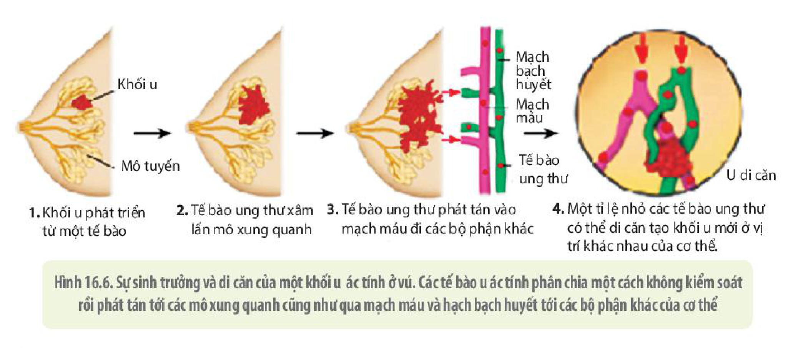

<!-- pdf:98 -->

# BÀI 16: CHU KÌ TẾ BÀO VÀ NGUYÊN PHÂN

## 🎯 Yêu cầu cần đạt

- Nêu được khái niệm chu kì tế bào. Dựa vào sơ đồ, trình bày được các giai đoạn và mối quan hệ giữa các giai đoạn trong chu kì tế bào của sinh vật nhân thực.
- Dựa vào cơ chế nhân đôi và phân li của NST để giải thích được quá trình nguyên phân là cơ chế sinh sản của tế bào.
- Giải thích được sự phân chia tế bào một cách không bình thường có thể dẫn đến ung thư.
- Trình bày được một số thông tin về bệnh ung thư ở Việt Nam. Nêu được một số biện pháp phòng tránh ung thư.

## 🔴 Mở đầu

Ảnh bên\* chụp tế bào ung thư ở cơ thể người. Tế bào ung thư được hình thành như thế nào?

## I. CHU KÌ TẾ BÀO Ở SINH VẬT NHÂN THỰC

**Chu kì tế bào** là khoảng thời gian từ khi tế bào được sinh ra, lớn lên và phân chia thành hai tế bào con. Tế bào nhân thực có kích thước và số lượng NST lớn hơn nhiều so với kích thước và số lượng NST của tế bào nhân sơ. Vì vậy, chu kì tế bào của sinh vật nhân thực dài hơn và phức tạp hơn so với chu kì của tế bào nhân sơ.

Các nhà khoa học thường mô tả chu kì tế bào dưới dạng một vòng tròn khép kín gồm hai giai đoạn là kì trung gian và quá trình nguyên phân. **Kì trung gian** là giai đoạn sinh trưởng của tế bào, được chia nhỏ thành các pha, kí hiệu theo tiếng Anh là $\text{G}_1$, S và $\text{G}_2$. Các sự kiện xảy ra trong các pha của kì trung gian được trình bày ở hình 16.1.

> (\* Nguồn ảnh: Lê Hoàng Anh, Viện Nghiên cứu Ung thư Beatson, Scotland, UK)

<!-- pdf:99 -->

Thời gian cần thiết để hoàn thành một chu kì tế bào là rất khác nhau giữa các loại tế bào của cùng một cơ thể. Các tế bào phôi của động vật chỉ cần khoảng 20 phút là hoàn thành một chu kì tế bào, các tế bào nguyên bào sợi ở người được nuôi cấy trong phòng thí nghiệm cần khoảng 24 giờ để hoàn thành chu kì tế bào, một số loại tế bào như tế bào gan người lại có chu kì tế bào kéo dài tới hơn một năm.

Hình 16.1. Các giai đoạn trong chu kì tế bào

Các giai đoạn của chu kì tế bào có mối liên hệ chặt chẽ với nhau và việc chuyển từ giai đoạn này sang giai đoạn khác được **hệ thống kiểm soát chu kì tế bào** điều khiển một cách nghiêm ngặt, đảm bảo cho chu kì tế bào diễn ra bình thường. Trong chu kì tế bào có các thời điểm được gọi là **điểm kiểm soát**, ở đó, các tín hiệu kích hoạt quá trình truyền tin tế bào đưa ra các đáp ứng đi tiếp hay dừng chu kì tế bào (H 16.2).

<!-- term: Điểm kiểm soát G1/S -->
<!-- term: Điểm kiểm soát G2/M -->
<!-- term: Điểm kiểm soát thoi phân bào -->
Tại điểm kiểm soát $\text{G}_1$/S, tế bào sẽ đưa ra "quyết định" có nhân đôi DNA để sau đó bước vào phân bào hay không. Ở điểm kiểm soát $\text{G}_2$/M – điểm kiểm soát cuối $\text{G}_2$ trước khi tế bào bước vào nguyên phân, lúc này hệ thống kiểm soát của tế bào "rà soát" quá trình nhân đôi DNA xem đã hoàn tất và mọi sai sót đã được sửa chữa hay chưa. Ở điểm kiểm soát thoi phân bào, hệ thống kiểm soát chu kì tế bào "rà soát" xem tất cả các NST đã gắn với các vi ống của thoi phân bào hay chưa. Nếu chưa hoàn tất, chu kì tế bào cũng sẽ dừng lại. Điều này là rất quan trọng, nếu không, các NST có thể sẽ không được phân chia đồng đều cho các tế bào con.

Hình 16.2. Một số điểm kiểm soát chính trong chu kì tế bào

## ❓ Dừng lại và suy ngẫm

1. Chu kì tế bào là gì? Mô tả các sự kiện chính của chu kì tế bào.
2. Kì trung gian là gì? Nêu tên và chức năng của các pha trong kì trung gian.
3. Hãy cho biết các giai đoạn của chu kì tế bào có mối quan hệ với nhau như thế nào.
4. Điểm kiểm soát chu kì tế bào là gì? Giải thích vai trò của các điểm kiểm soát chu kì tế bào.

<!-- pdf:100 -->

## II. NGUYÊN PHÂN

**Nguyên phân** (**phân bào nguyên nhiễm**) là một trong các kiểu phân chia tế bào ở sinh vật nhân thực. Đây là hình thức phân bào xảy ra ở các tế bào sinh dưỡng và các tế bào sinh dục sơ khai. Phân chia nhân được chia thành các giai đoạn nhỏ hơn gọi là các kì bao gồm: kì đầu, kì giữa, kì sau và kì cuối.

<!-- term: NST đơn -->
**Phân chia nhân**, thực chất là quá trình phân chia vật chất di truyền (DNA, NST) một cách đồng đều cho hai tế bào con. Mỗi NST đơn chứa một phân tử DNA dạng mạch thẳng. Ở pha S của kì trung gian, mỗi NST đơn nhân đôi tạo thành một **NST kép** gồm hai **chromatid** (hay còn gọi là **nhiễm sắc tử chị em**) đính với nhau ở **tâm động** (H 16.3). Mỗi chromatid chứa một phân tử DNA.

Hình 16.3. NST kép ở kì giữa, các chromatid chị em gắn với nhau ở tâm động

### 1. Phân chia nhân

Trước khi bước vào quá trình phân chia nhân, tế bào phải trải qua kì trung gian để chuẩn bị đầy đủ các điều kiện cần thiết cho sự phân bào (nhân đôi DNA – nhân đôi NST, nhân đôi trung tử ở tế bào động vật, tổng hợp thêm các bào quan và các chất cần thiết). Khi mọi sự chuẩn bị cho quá trình phân chia nhân đã hoàn tất, tế bào chuyển từ giai đoạn $\text{G}_2$ vào kì đầu của nguyên phân. Diễn biến các kì của nguyên phân được trình bày ở hình 16.4.

<!-- term: Kì đầu -->
<!-- term: Kì giữa -->
<!-- term: Kì sau -->
<!-- term: Kì cuối -->
<!-- term: Thoi phân bào -->
- **Kì đầu (a):** Thoi phân bào bắt đầu hình thành. NST dần co xoắn. Màng nhân và hạch nhân tiêu biến.
- **Kì giữa (b):** Các NST co xoắn tối đa và nằm ở mặt phẳng xích đạo của thoi phân bào. Các vi ống của thoi phân bào đính vào 2 phía tâm động của NST
- **Kì sau (c):** Hai chromatid chị em của mỗi NST kép bắt đầu tách rời nhau thành hai NST đơn và di chuyển trên thoi phân bào đi về hai cực đối diện của tế bào. Kì sau là kì có thời gian ngắn nhất.
- **Kì cuối (d):** Các NST dãn xoắn. Hạch nhân và màng nhân tái xuất hiện hình thành hai nhân mới. Thoi phân bào tiêu biến.
<!-- ocr-ok: nội dung chữ trong 4 cột của Hình 16.4, OCR ghép ngang các cột; đã đối chiếu ảnh PDF 100 -->

Hình 16.4. Diễn biến các kì của nguyên phân. Kì đầu (a); Kì giữa (b); Kì sau (c); Kì cuối (d)

<!-- pdf:101 -->

### 2. Phân chia tế bào chất

<!-- term: Phân chia tế bào chất -->
Sau khi phân chia nhân hoàn tất, vùng giữa của tế bào động vật dần co thắt lại, chia tế bào thành hai tế bào con. Ở các tế bào thực vật, việc phân chia tế bào chất được thực hiện khi vách ngăn xuất hiện ở mặt phẳng xích đạo chia tế bào thành hai tế bào con.

### 3. Ý nghĩa của nguyên phân

Nhờ quá trình nhân đôi NST (ở kì trung gian) và phân li đồng đều các NST về hai cực của tế bào (ở kì sau) nên từ một tế bào mẹ tạo ra được hai tế bào con có bộ NST giống nhau và giống với tế bào mẹ. Do đó, nguyên phân đảm bảo duy trì ổn định vật chất di truyền qua các thế hệ tế bào.

Ở sinh vật nhân thực đơn bào, nguyên phân chính là hình thức sinh sản tạo ra cá thể mới; còn ở sinh vật đa bào, nguyên phân làm tăng số lượng tế bào, thay thế các tế bào già và tế bào bị tổn thương, giúp cơ thể lớn lên và tái sinh các bộ phận cơ thể. Nguyên phân cũng là cơ chế tạo ra các cơ thể mới ở các loài sinh sản vô tính. Quá trình nguyên phân ở các mô, các cơ quan của cơ thể đa bào được điều hoà và kiểm soát nghiêm ngặt. Một khi quá trình này bị rối loạn sẽ gây ra những hậu quả nghiêm trọng.

## ❓ Dừng lại và suy ngẫm

1. Trình bày diễn biến các kì của nguyên phân.
2. Nêu kết quả của nguyên phân. Nguyên phân có ý nghĩa gì?

## III. BỆNH UNG THƯ

### 1. Cơ sở khoa học về bệnh ung thư

<!-- term: Tín hiệu điều hoà phân bào -->
Các tế bào cơ thể người có phân chia hay không, phân chia nhiều hay ít đều chịu sự điều tiết bởi các tín hiệu điều hoà phân bào. Các tín hiệu điều hoà phân bào được chia thành hai loại: một loại kích thích và một loại kìm hãm tế bào phân chia.

<!-- term: Khối u -->
Hầu hết các loại tín hiệu này đều tham gia vào kiểm soát chu kì tế bào, đảm bảo cho quá trình phân bào được diễn ra bình thường. Nếu các tín hiệu kích thích phân bào được sản sinh quá nhiều, trong khi tín hiệu kìm hãm phân bào lại sản sinh quá ít sẽ làm cho tế bào phân chia quá mức dẫn đến hình thành khối u. Khi khối u định vị ở một vị trí nhất định mà các tế bào của nó không phát tán đến các vị trí khác trong cơ thể thì được gọi là **u lành tính**. Nếu tế bào của khối u có thêm đột biến khiến chúng có thể tách khỏi vị trí ban đầu, di chuyển đến vị trí mới tạo nên nhiều khối u thì các khối u đó được gọi là **u ác tính** hay **ung thư**.

Giả thuyết về nguồn gốc phát sinh ung thư được nhiều nhà khoa học thừa nhận hiện nay là khối u xuất hiện từ một tế bào bị đột biến nhiều lần, làm rối loạn cơ chế điều hoà phân bào, khiến tế bào phân chia không kiểm soát tạo nên khối u ác tính. Tác nhân đột biến ở môi trường bên ngoài cơ thể như khói thuốc lá, các độc tố của vi sinh vật có trong các thực phẩm bị mốc, tia tử ngoại, tia phóng xạ, nhiều loại hoá chất như chất độc da cam, ... Tác nhân gây đột biến bên trong cơ thể như một số loại virus gây bệnh mãn tính (virus viêm gan B, virus gây viêm tử cung); các gốc tự do trong tế bào, sản phẩm của quá trình chuyển hoá và các chất độc hại mà cơ thể hấp thụ qua thức ăn hoặc từ các vi sinh vật sống kí sinh trong cơ thể.

<!-- pdf:102 -->

Hầu hết các bệnh ung thư là do đột biến gene phát sinh trong các tế bào cơ thể nên không di truyền được từ thế hệ này sang thế hệ khác. Chỉ khoảng hơn 10% bệnh ung thư là do gene đột biến được truyền từ bố mẹ.

### 2. Tình trạng ung thư ở Việt Nam và cách phòng tránh bệnh ung thư

Theo số liệu của Bộ Y tế Việt Nam, năm 2020, Việt Nam xếp thứ 91/185 nước về tỉ lệ mắc ung thư mới. Tỉ lệ mắc một số bệnh ung thư ở nam và nữ được thể hiện trong hình 16.5.

Hình 16.5. Tỉ lệ mắc một số bệnh ung thư ở nam (a) và nữ (b) năm 2020 ở Việt Nam\*

Một số nguyên nhân khiến tỉ lệ người mắc bệnh ung thư ngày càng gia tăng như tuổi thọ gia tăng (thời gian tiếp xúc với các tác nhân đột biến dài hơn), ô nhiễm môi trường sống làm phát sinh nhiều tác nhân đột biến, thói quen ăn uống không khoa học (uống nhiều rượu bia, ăn nhiều mỡ động vật, ăn các thức ăn bị mốc, hút nhiều thuốc lá, ăn nhiều thực phẩm chế biến sẵn như thịt hun khói, cá muối, thịt nướng cháy,...); thói quen sinh hoạt không lành mạnh (ít vận động, lười tập thể dục thể thao,...).

Tuy nhiên, ung thư là bệnh có thể phòng tránh bằng cách như hạn chế tiếp xúc với các nguồn chứa tác nhân gây ung thư, tích cực rèn luyện thể dục thể thao, thường xuyên thăm khám sức khoẻ định kì để tầm soát phát hiện sớm khối u, chữa trị triệt để những bệnh viêm nhiễm mãn tính do virus và các loại vi sinh vật.

Các biện pháp chữa trị ung thư hiện nay bao gồm: phẫu thuật cắt bỏ khối u, chiếu xạ hoặc dùng hoá chất tiêu diệt các tế bào khối u, dùng tế bào gốc để hỗ trợ quá trình điều trị khối u, sử dụng liệu pháp miễn dịch tăng cường khả năng đề kháng cùng một số biện pháp khác. Nếu phát hiện sớm, nhiều loại khối u có thể được cắt bỏ khi chúng chưa di căn và bệnh hoàn toàn có thể chữa khỏi như ung thư vú và nhiều loại ung thư khác. Những khối u lành tính như các polyp ở đại tràng nếu được phát hiện sớm và cắt bỏ thì các khối u này sẽ không có cơ hội phát triển thành u ác tính.

> (\*Nguồn: Bộ Y tế Việt Nam)

<!-- pdf:103 -->

Hình 16.6. Sự sinh trưởng và di căn của một khối u ác tính ở vú. Các tế bào u ác tính phân chia một cách không kiểm soát rồi phát tán tới các mô xung quanh cũng như qua mạch máu và hạch bạch huyết tới các bộ phận khác của cơ thể

## ❓ Dừng lại và suy ngẫm

1. Phân biệt u lành tính với u ác tính.
2. Nguyên nhân gây rối loạn quá trình điều hoà phân bào dẫn đến phát sinh ung thư là gì? Giải thích.
3. Những loại ung thư nào phổ biến nhất ở người Việt Nam?
4. Nêu một số biện pháp phòng tránh, chữa trị bệnh ung thư.

## 💡 Em có biết

**Voi rất hiếm khi chết vì bệnh ung thư**

<!-- term: Gene p53 -->
Các nhà khoa học cho biết, khoảng 17% dân số thế giới chết vì ung thư, trong khi đó ở loài voi chỉ có 5% cá thể bị ung thư, mặc dù voi có tuổi thọ gần ngang bằng với người (khoảng 70 tuổi) và số tế bào có thể chuyển thành tế bào ung thư ở voi cao hơn ở người gấp hàng trăm lần. Để lí giải hiện tượng này, nhà Di truyền học Vincent Lynch và các cộng sự ở Đại học Chicago và Đại học Utah (Mỹ) cho biết nguyên nhân là do voi có nhiều gene *p53* (gene ức chế khối u) hơn người. Voi có tới 20 bản sao của gene *p53* trong khi người chúng ta chỉ có một bản sao duy nhất trong hệ gene đơn bội. Gene *p53* tạo ra protein có khả năng nhận biết được những sai sót trong quá trình nhân đôi DNA và kích hoạt quá trình dừng chu kì tế bào để sửa sai. Nếu sai sót quá nhiều, vượt quá khả năng sửa chữa của tế bào thì protein này lại kích hoạt tế bào tự chết theo chương trình, khiến cho khối u không thể hình thành. Protein do gene *p53* tạo ra có chức năng đóng mở các gene liên quan đến các quá trình sửa sai và quá trình chết theo chương trình của tế bào.

> (Nguồn: Campbell Biology in focus)
<!-- ocr-ok: chữ nghiêng nhỏ, OCR đọc nhầm 'Biologv'; đã đối chiếu ảnh PDF 103 -->

<!-- pdf:104 -->

## 📌 Kiến thức cốt lõi

- Chu kì tế bào là khoảng thời gian từ khi tế bào được sinh ra, lớn lên và phân chia thành hai tế bào con. Chu kì tế bào gồm kì trung gian, quá trình phân chia vật chất di truyền và phân chia tế bào chất thành hai tế bào con. Chu kì tế bào được kiểm soát nghiêm ngặt bởi hệ thống kiểm soát chu kì tế bào.
- Nguyên phân là một hình thức phân bào ở tế bào nhân thực gồm giai đoạn phân chia nhân (các kì: kì đầu, kì giữa, kì sau và kì cuối) và phân chia tế bào chất. Ở cơ thể đa bào, nguyên phân giúp tái sinh các tế bào bị tổn thương, tạo các tế bào thay thế tế bào già, giúp cơ thể sinh trưởng và phát triển.
- Sự nhân đôi chính xác DNA và sự phân li đồng đều của các NST nhờ hệ thống thoi phân bào đảm bảo cho các tế bào con sinh ra có vật chất di truyền giống hệt nhau.
- Ung thư là bệnh hình thành do quá trình phân bào nguyên phân không được kiểm soát. Các tế bào bị tích luỹ nhiều đột biến, phân chia không ngừng và có khả năng phát tán tới nhiều vị trí khác nhau của cơ thể, tạo nên nhiều khối u chèn ép các cơ quan.
- Để phòng tránh ung thư, cần tránh tiếp xúc với tác nhân gây ung thư; sử dụng thực phẩm an toàn; thường xuyên vận động và tập luyện thể dục thể thao; ăn uống lành mạnh; sinh hoạt điều độ và thăm khám bệnh định kì để phát hiện sớm khối u.

## ✏️ Luyện tập và vận dụng

1. Trình bày được mối quan hệ giữa các giai đoạn trong chu kì tế bào. Tại sao tế bào lại cần có hệ thống kiểm soát chu kì tế bào?
2. Các NST co xoắn cực đại và tập trung ở mặt phẳng xích đạo của thoi phân bào vào kì giữa có ý nghĩa gì? Nếu các NST không co xoắn lại mà vẫn ở dạng sợi mảnh thì điều gì sẽ xảy ra khi các NST phân li ở kì sau?
3. Điều gì sẽ xảy ra khi hai chromatid của một NST nào đó không tách nhau ra ở kì sau của nguyên phân?
4. Nếu tế bào đang phân chia được xử lí bởi hoá chất colchicine có chức năng ức chế sự hình thành vi ống trong hệ thống thoi phân bào thì hậu quả sẽ như thế nào?
5. Không hút thuốc nhưng thường xuyên ngửi khói thuốc lá của những người hút thuốc xung quanh liệu chúng ta có nguy cơ bị bệnh ung thư không? Nếu có thì khả năng bị bệnh ung thư gì là cao nhất?

## 📷 Danh sách hình trong bài

| Mã hình | Trang PDF | Vị trí | Chú thích gốc |
|---|---|---|---|
| H10-sinh-b16-01 | 99 | Mục I | Hình 16.1. Các giai đoạn trong chu kì tế bào |
| H10-sinh-b16-02 | 99 | Mục I | Hình 16.2. Một số điểm kiểm soát chính trong chu kì tế bào |
| H10-sinh-b16-03 | 100 | Mục II | Hình 16.3. NST kép ở kì giữa, các chromatid chị em gắn với nhau ở tâm động |
| H10-sinh-b16-04 | 100 | Mục II.1 | Hình 16.4. Diễn biến các kì của nguyên phân. Kì đầu (a); Kì giữa (b); Kì sau (c); Kì cuối (d) |
| H10-sinh-b16-05 | 102 | Mục III.2 | Hình 16.5. Tỉ lệ mắc một số bệnh ung thư ở nam (a) và nữ (b) năm 2020 ở Việt Nam\* — (\*Nguồn: Bộ Y tế Việt Nam) |
| H10-sinh-b16-06 | 103 | Mục III.2 | Hình 16.6. Sự sinh trưởng và di căn của một khối u ác tính ở vú. Các tế bào u ác tính phân chia một cách không kiểm soát rồi phát tán tới các mô xung quanh cũng như qua mạch máu và hạch bạch huyết tới các bộ phận khác của cơ thể |
