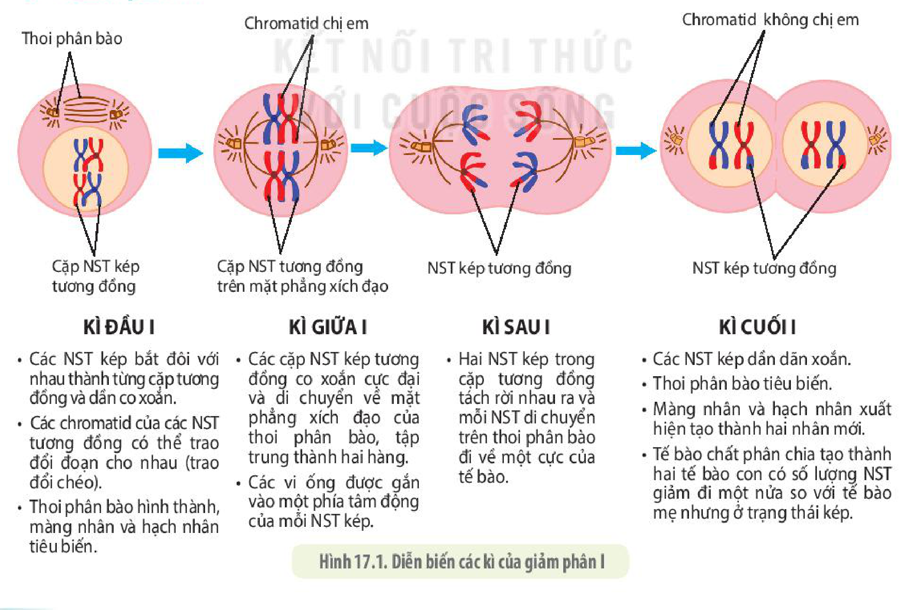
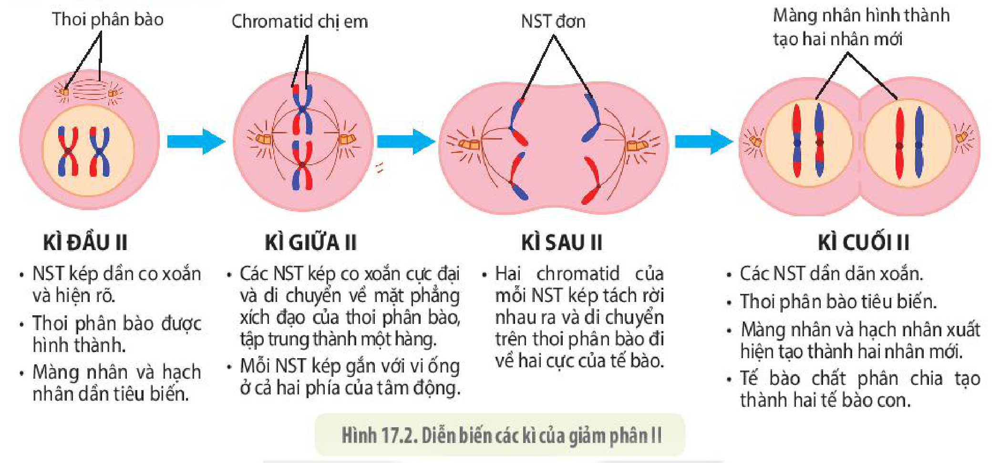
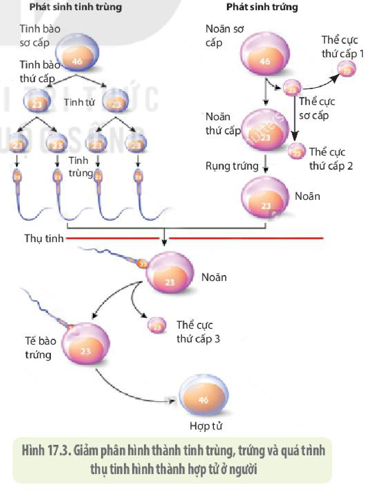
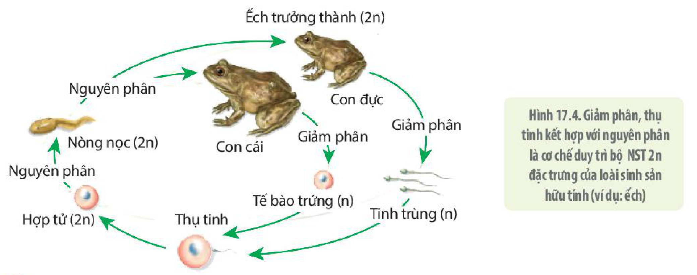
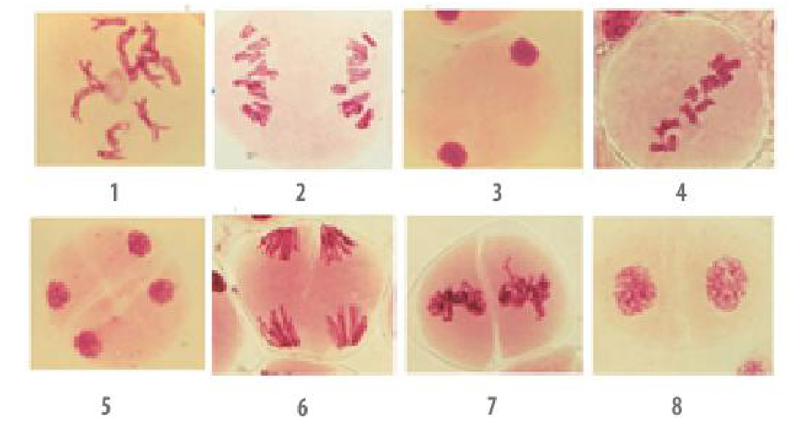

<!-- pdf:105 -->

# BÀI 17: GIẢM PHÂN

## 🎯 Yêu cầu cần đạt

- Dựa vào cơ chế nhân đôi và phân li của NST để giải thích được quá trình giảm phân, thụ tinh cùng với nguyên phân là cơ sở của sinh sản hữu tính ở sinh vật.
- Trình bày được một số nhân tố ảnh hưởng đến quá trình giảm phân.
- Lập được bảng so sánh quá trình nguyên phân và quá trình giảm phân.
- Vận dụng kiến thức về nguyên phân và giảm phân vào giải thích một số vấn đề trong thực tiễn

## 🔴 Mở đầu

Cơ chế nào giúp các loài sinh sản hữu tính duy trì được bộ NST của loài qua các thế hệ?

## I. DIỄN BIẾN CỦA GIẢM PHÂN

**Giảm phân** (**phân bào giảm nhiễm**) là hình thức phân chia của các tế bào mầm sinh dục trong quá trình sản sinh giao tử ở các cơ quan sinh sản. Giảm phân gồm hai lần phân bào liên tiếp là giảm phân I và giảm phân II. Trước khi tế bào bước vào giảm phân I, ở kì trung gian, mỗi NST được nhân đôi tạo thành NST kép.

### 1. Giảm phân I

<!-- term: Giảm phân I -->
- **Kì đầu I:** Các NST kép bắt đôi với nhau thành từng cặp tương đồng và dần co xoắn. Các chromatid của các NST tương đồng có thể trao đổi đoạn cho nhau (**trao đổi chéo**). Thoi phân bào hình thành, màng nhân và hạch nhân tiêu biến.
- **Kì giữa I:** Các cặp NST kép tương đồng co xoắn cực đại và di chuyển về mặt phẳng xích đạo của thoi phân bào, tập trung thành hai hàng. Các vi ống được gắn vào một phía tâm động của mỗi NST kép.
- **Kì sau I:** Hai NST kép trong cặp tương đồng tách rời nhau ra và mỗi NST di chuyển trên thoi phân bào đi về một cực của tế bào.
- **Kì cuối I:** Các NST kép dần dãn xoắn. Thoi phân bào tiêu biến. Màng nhân và hạch nhân xuất hiện tạo thành hai nhân mới. Tế bào chất phân chia tạo thành hai tế bào con có số lượng NST giảm đi một nửa so với tế bào mẹ nhưng ở trạng thái kép.
<!-- ocr-ok: nội dung chữ trong 4 cột của Hình 17.1, OCR ghép ngang các cột; đã đối chiếu ảnh PDF 105 -->

Hình 17.1. Diễn biến các kì của giảm phân I

<!-- pdf:106 -->

### 2. Giảm phân II

<!-- term: Giảm phân II -->
- **Kì đầu II:** NST kép dần co xoắn và hiện rõ. Thoi phân bào được hình thành. Màng nhân và hạch nhân dần tiêu biến.
- **Kì giữa II:** Các NST kép co xoắn cực đại và di chuyển về mặt phẳng xích đạo của thoi phân bào, tập trung thành một hàng. Mỗi NST kép gắn với vi ống ở cả hai phía của tâm động.
- **Kì sau II:** Hai chromatid của mỗi NST kép tách rời nhau ra và di chuyển trên thoi phân bào đi về hai cực của tế bào.
- **Kì cuối II:** Các NST dần dãn xoắn. Thoi phân bào tiêu biến. Màng nhân và hạch nhân xuất hiện tạo thành hai nhân mới. Tế bào chất phân chia tạo thành hai tế bào con.
<!-- ocr-ok: nội dung chữ trong 4 cột của Hình 17.2, OCR ghép ngang các cột; đã đối chiếu ảnh PDF 106 -->

Hình 17.2. Diễn biến các kì của giảm phân II

<!-- term: Giảm phân II -->
Kết thúc giảm phân II, từ một tế bào, qua hai lần giảm phân tạo ra bốn tế bào con với số lượng NST giảm đi một nửa. Sau giảm phân II, các tế bào con sẽ biến đổi thành các giao tử (H 17.3).

### 3. Kết quả của giảm phân

Từ một tế bào, qua hai lần phân bào của giảm phân tạo ra được bốn tế bào con có số lượng NST giảm đi một nửa. Khác với nguyên phân, giảm phân tạo ra các tế bào chứa các hệ gene đơn bội khác nhau. Nguyên nhân là do sự phân li ngẫu nhiên của các cặp NST tương đồng cũng như có sự trao đổi chéo xảy ra giữa chúng tạo ra những tổ hợp NST và tổ hợp gene mới.

<!-- term: Giao tử -->
<!-- term: Thể cực -->
Sau giảm phân, các tế bào con được biến đổi hình thái thành các giao tử. Ở động vật, từ một tế bào sinh tinh, qua giảm phân hình thành bốn tinh trùng; trong khi một tế bào sinh trứng, qua giảm phân chỉ tạo ra một tế bào trứng có kích thước lớn và ba tế bào nhỏ (thể cực) bị tiêu biến sau đó. Ở người, noãn nguyên bào (noãn sơ cấp) sau khi giảm phân I, nếu được thụ tinh mới tiếp tục hoàn tất quá trình giảm phân II hình thành tế bào trứng (H 17.3).

Hình 17.3. Giảm phân hình thành tinh trùng, trứng và quá trình thụ tinh hình thành hợp tử ở người

<!-- pdf:107 -->

## ❓ Dừng lại và suy ngẫm

1. Cơ chế nào dẫn đến số lượng NST giảm đi một nửa sau giảm phân?
2. Kết quả của giảm phân tạo ra bốn tế bào con có vật chất di truyền giống hệt nhau hay không? Giải thích.

## II. CÁC YẾU TỐ ẢNH HƯỞNG ĐẾN GIẢM PHÂN

Có nhiều yếu tố ảnh hưởng đến quá trình giảm phân. Ngoài yếu tố di truyền, nhiều yếu tố môi trường bên ngoài cũng ảnh hưởng đến quá trình giảm phân. Nhiều loài cây chỉ có thể ra hoa khi gặp điều kiện thời tiết, chế độ chiếu sáng thích hợp. Ví dụ: Để cho các cây thanh long ra hoa trái vụ, bà con nông dân thường thắp đèn chiếu sáng vào ban đêm.

Các hormone sinh dục đóng vai trò quan trọng trong quá trình giảm phân và sinh sản của nhiều loài động vật. Để cho vật nuôi sinh sản theo ý muốn, người ta có thể tiêm hormone sinh dục kích thích quá trình sinh sản cho vật nuôi.

Tuổi tác cũng ảnh hưởng đến giảm phân. Ở người, phụ nữ càng lớn tuổi, tỉ lệ sinh con bị hội chứng Down (do thừa một NST 21) càng gia tăng, đặc biệt từ tuổi 35 trở lên. Điều này được giải thích là do càng lớn tuổi thì quá trình giảm phân hình thành giao tử càng dễ bị rối loạn, dẫn đến tỉ lệ các giao tử bất thường tăng lên (giao tử thừa một NST 21), đặc biệt ở phụ nữ (do thời gian của kì đầu giảm phân I kéo dài quá lâu, đúng bằng số tuổi của người phụ nữ khi sinh con nên dễ dẫn đến rối loạn cơ chế phân li NST).

Hiểu được những yếu tố tác động đến giảm phân, chúng ta có thể vận dụng vào thực tiễn sản xuất để mang lại hiệu quả kinh tế cũng như phòng và chữa bệnh cho con người.

## ❓ Dừng lại và suy ngẫm

1. Quá trình giảm phân chịu ảnh hưởng của những yếu tố nào? Giải thích.
2. Cây hoa giấy trồng trong điều kiện khô cằn so với cây cùng loại được tưới đủ nước, cây nào sẽ ra hoa nhiều hơn? Giải thích.

## III. Ý NGHĨA CỦA GIẢM PHÂN
<!-- ocr-ok: tiêu đề in hoa trang trí, OCR đọc nhầm 'Ý MGHĨA GỦA'; đã đối chiếu ảnh PDF 107 -->

<!-- term: Giao tử -->
<!-- term: Thụ tinh -->
<!-- term: Hợp tử -->
Trong giảm phân, các NST nhân đôi một lần nhưng lại phân chia hai lần, kết quả là tạo ra các giao tử có số lượng NST giảm đi một nửa (n NST) so với tế bào ban đầu (2n NST). Các giao tử đực và giao tử cái kết hợp với nhau trong quá trình thụ tinh tạo thành hợp tử (2n), khôi phục lại bộ NST 2n đặc trưng cho loài. Tế bào hợp tử trải qua nhiều lần nguyên phân và biệt hoá tế bào phát triển thành cơ thể đa bào trưởng thành (H 17.4). Như vậy, quá trình giảm phân kết hợp với thụ tinh và nguyên phân là cơ sở của sinh sản hữu tính ở sinh vật, đảm bảo duy trì bộ NST 2n đặc trưng cho loài.

Mặt khác, do có sự trao đổi đoạn giữa các NST ở kì đầu I, kết hợp với sự phân li và tổ hợp ngẫu nhiên của các NST trong giảm phân tạo ra nhiều loại giao tử có kiểu gene khác nhau, là cơ sở để tạo ra vô số các biến dị tổ hợp ở đời con, cung cấp nguyên liệu cho quá trình tiến hoá và chọn giống.

<!-- pdf:108 -->

Hình 17.4. Giảm phân, thụ tinh kết hợp với nguyên phân là cơ chế duy trì bộ NST 2n đặc trưng của loài sinh sản hữu tính (ví dụ: ếch)

## ❓ Dừng lại và suy ngẫm

1. Giải thích vì sao quá trình giảm phân kết hợp với thụ tinh và nguyên phân là cơ sở của sinh sản hữu tính ở sinh vật, đảm bảo duy trì bộ NST 2n đặc trưng cho loài?
2. Nêu điểm khác nhau cơ bản nhất giữa nguyên phân và giảm phân.
3. Trao đổi chéo giữa các NST tương đồng trong giảm phân I có vai trò gì?

## 📌 Kiến thức cốt lõi

- Giảm phân gồm hai lần phân bào liên tiếp nhưng chỉ có một lần nhân đôi DNA. Từ một tế bào qua giảm phân tạo ra bốn tế bào con có bộ NST giảm đi một nửa và chứa các tổ hợp NST khác nhau.
- Giảm phân kết hợp với thụ tinh và nguyên phân đảm bảo duy trì ổn định bộ NST lưỡng bội đặc trưng của loài qua các thế hệ cơ thể, đồng thời tạo ra các tổ hợp gene đa dạng giúp sinh vật thích nghi với sự biến đổi của điều kiện môi trường.

## ✏️ Luyện tập và vận dụng

1. Hãy xếp các ảnh chụp các giai đoạn của giảm phân dưới kính hiển vi (ở hình bên) theo đúng trình tự các kì của quá trình giảm phân.

2. Bạn có một cây cam cho quả rất ngon và sai quả. Nếu muốn nhân rộng giống cam của mình, bạn sẽ chọn phương pháp chiết cành hay chọn nhân giống bằng hạt lấy từ quả của cây cam này? Hãy giải thích sự lựa chọn của bạn.

## 📷 Danh sách hình trong bài

| Mã hình | Trang PDF | Vị trí | Chú thích gốc |
|---|---|---|---|
| H10-sinh-b17-01 | 105 | Mục I.1 | Hình 17.1. Diễn biến các kì của giảm phân I |
| H10-sinh-b17-02 | 106 | Mục I.2 | Hình 17.2. Diễn biến các kì của giảm phân II |
| H10-sinh-b17-03 | 106 | Mục I.3 | Hình 17.3. Giảm phân hình thành tinh trùng, trứng và quá trình thụ tinh hình thành hợp tử ở người |
| H10-sinh-b17-04 | 108 | Mục III | Hình 17.4. Giảm phân, thụ tinh kết hợp với nguyên phân là cơ chế duy trì bộ NST 2n đặc trưng của loài sinh sản hữu tính (ví dụ: ếch) |
| H10-sinh-b17-05 | 108 | Luyện tập và vận dụng, câu 1 | Ảnh chụp các giai đoạn của giảm phân dưới kính hiển vi từ 1 đến 8 (sách không đánh số hình) |
