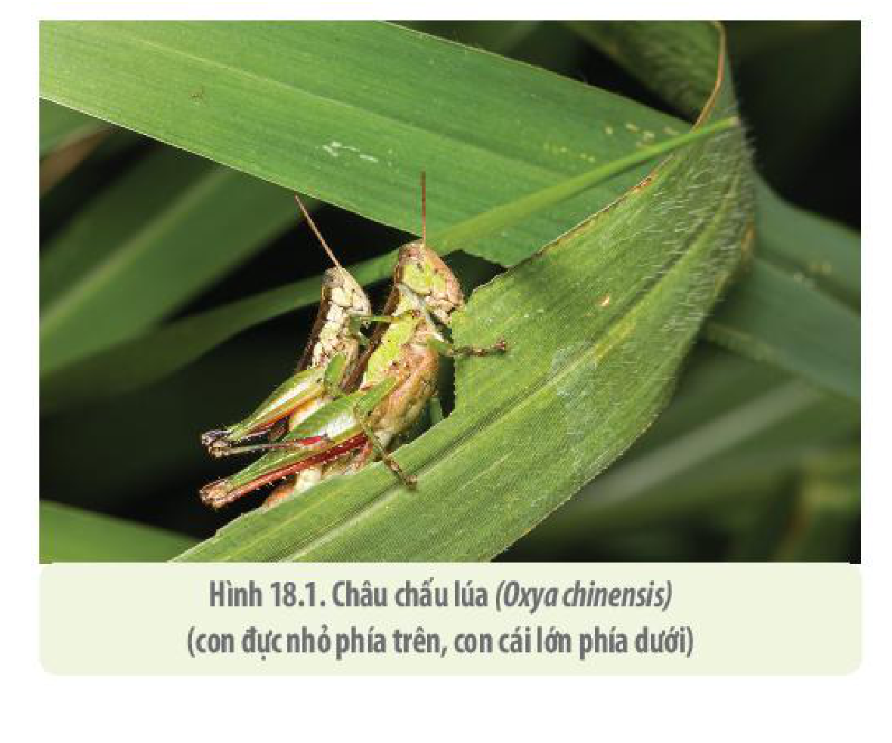

<!-- pdf:109 -->

# BÀI 18: THỰC HÀNH: LÀM VÀ QUAN SÁT TIÊU BẢN QUÁ TRÌNH NGUYÊN PHÂN VÀ GIẢM PHÂN

## I. YÊU CẦU CẦN ĐẠT
<!-- ocr-ok: tiêu đề in hoa trang trí, OCR đọc nhầm 'YÊU GẦU CẦM ĐẠT'; đã đối chiếu ảnh PDF 109 -->

Sau khi học xong phần thực hành, học sinh cần đạt được các yêu cầu sau:

- Thực hiện được các bước làm tiêu bản NST để quan sát quá trình nguyên phân và giảm phân.
- Quan sát và vẽ được các tế bào đang ở các giai đoạn khác nhau của quá trình nguyên phân và giảm phân.
- Rèn kĩ năng sử dụng kính hiển vi và làm tiêu bản hiển vi.

## II. CHUẨN BỊ

### 1. Dụng cụ

Kim mổ hay kim mũi mác, kéo nhỏ, panh, dao mổ hoặc dao lam, lam kính, lamen, ống nhỏ giọt, giấy thấm, đĩa Petri, đèn cồn hoặc bếp điện.

### 2. Hoá chất

<!-- term: Dung dịch cố định carnoy -->
Nước cất, dung dịch cố định các kì của nguyên phân, thuốc nhuộm acetocarmine 2%, glacial acetic acid 45%, dung dịch nhược trương KCl 0,56 M.

<!-- term: Dung dịch cố định carnoy -->
Lưu ý: Dung dịch cố định các kì của nguyên phân được pha theo tỉ lệ: 3 thể tích ethanol: 1 thể tích acetic acid (75 mL ethanol: 25 mL glacial acetic acid).

### 3. Mẫu vật

- Rễ cây (hành tây, hành ta, tỏi, lay ơn, khoai môn).
- Châu chấu lúa (*Oxya chinensis*): con đực (H 18.1).
- Tuỳ điều kiện, có thể chọn mẫu vật khác dễ kiếm, dễ làm, dễ quan sát NST như hoa hành,...

Hình 18.1. Châu chấu lúa (*Oxya chinensis*) (con đực nhỏ phía trên, con cái lớn phía dưới)

<!-- pdf:110 -->

## III. CÁCH TIẾN HÀNH

### 1. Thực hành: làm và quan sát tiêu bản quá trình nguyên phân của tế bào

<!-- term: Dung dịch cố định carnoy -->
- **Bước 1: Cố định mẫu:** Cắt các đầu rễ hành (khoảng 5 mm từ đầu rễ). Ngâm đầu rễ hành trong dung dịch cố định carnoy ít nhất 24 giờ.
- **Bước 2: Nhuộm mẫu vật:** Dùng panh gắp đầu rễ hành sang ống nghiệm đựng thuốc nhuộm acetocarmine 2%. Đun nóng nhẹ (không đun sôi) ống nghiệm chứa rễ hành cùng thuốc nhuộm khoảng 5 – 8 phút.
- **Bước 3: Làm tiêu bản:** Dùng panh gắp một đầu rễ hành đặt lên giữa lam kính. Dùng dao mổ hoặc dao lam cắt lấy một phần rễ (ở vị trí cách đầu chóp rễ khoảng 3 mm – vị trí có nhiều tế bào phân chia). Nhỏ một giọt nước cất lên đầu rễ rồi đậy lamen. Đặt lam kính lên lớp giấy thấm, đặt vài tờ giấy thấm lên trên lamen. Một tay giữ một cạnh của lamen, tay kia dùng đầu bút chì hoặc chuôi gỗ của kim mổ gõ nhẹ rồi ép nhẹ lên lamen để dàn mỏng tế bào.
- **Bước 4: Quan sát tiêu bản:** Đặt lam kính lên kính hiển vi và quan sát tiêu bản, ở vật kính 10× để tìm vùng rễ có nhiều tế bào đang phân chia. Quan sát tiêu bản ở vật kính 40× để nhận dạng tế bào tại các kì khác nhau của nguyên phân. Quan sát, nhận biết và vẽ các kì của nguyên phân vào vở.

### 2. Thực hành: làm và quan sát tiêu bản quá trình giảm phân của tế bào

- **Bước 1: Mổ châu chấu:** Cắt bỏ cánh, mổ bụng từ phía lưng. Dùng kim mổ/panh gắp các ống sinh tinh (các ống trắng đục) sang đĩa Petri chứa dung dịch nhược trương KCl. Loại bỏ các phần mỡ màu vàng bám xung quanh các ống sinh tinh.
- **Bước 2: Cố định mẫu:** Chuyển các ống sinh tinh vào ống nghiệm hoặc lọ đựng dung dịch cố định carnoy và ngâm trong khoảng 24 giờ.
- **Bước 3: Làm tiêu bản:** Dùng panh gắp một đoạn ống sinh tinh từ dung dịch cố định, đặt lên giữa lam kính. Nhỏ lên đó một giọt thuốc nhuộm acetocarmine 2% và một giọt glacial acetic acid để làm mềm mô rồi đậy lamen. Đặt lam kính lên lớp giấy thấm, đặt vài tờ giấy thấm lên trên lamen. Một tay giữ một cạnh của lamen, tay kia dùng đầu bút chì hoặc chuôi gỗ của kim mổ gõ nhẹ rồi ép nhẹ lên lamen để dàn mỏng tế bào.
- **Bước 4: Quan sát tiêu bản:** Quan sát tiêu bản (cách quan sát tương tự như nguyên phân). Nhận biết và vẽ các kì của giảm phân vào vở.

## IV. THU HOẠCH

Học sinh viết báo cáo thực hành theo các nội dung sau:

**BÁO CÁO THỰC HÀNH**

1. **Mục đích**
2. **Cách tiến hành**
3. **Kết quả**
   a) Báo cáo kết quả làm và quan sát tiêu bản quá trình nguyên phân.
   b) Báo cáo kết quả làm và quan sát tiêu bản quá trình giảm phân.
4. **Giải thích và kết luận**
5. **Trả lời câu hỏi:**
   a) Mục đích của bước nhuộm mẫu vật trong quy trình làm tiêu bản quá trình nguyên phân và giảm phân của tế bào là gì?
   b) Giải thích vì sao ở bước nhuộm mẫu vật trong quy trình làm tiêu bản quá trình nguyên phân của tế bào lại cần phải đun nóng nhẹ ống nghiệm chứa rễ hành cùng thuốc nhuộm mà không được đun sôi?
   c) Vì sao trong quy trình làm tiêu bản quá trình giảm phân của tế bào cần phải ngâm ống sinh tinh của châu chấu trong dung dịch nhược trương KCl và loại bỏ các phần mỡ bám xung quanh các ống sinh tinh?

## 📷 Danh sách hình trong bài

| Mã hình | Trang PDF | Vị trí | Chú thích gốc |
|---|---|---|---|
| H10-sinh-b18-01 | 109 | Mục II.3 | Hình 18.1. Châu chấu lúa (Oxya chinensis) (con đực nhỏ phía trên, con cái lớn phía dưới) |
