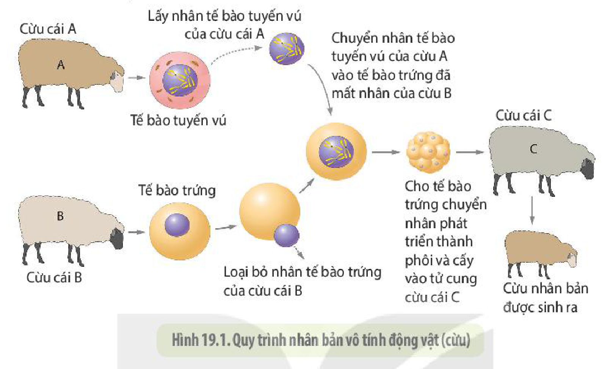
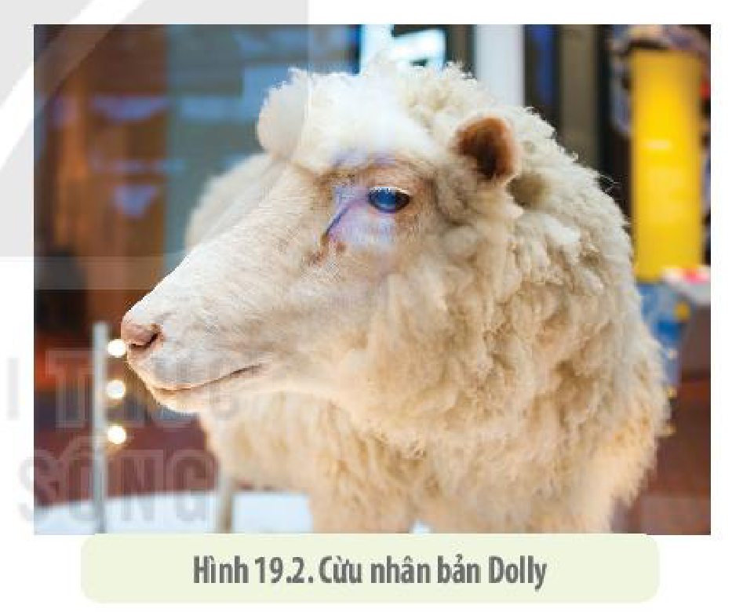
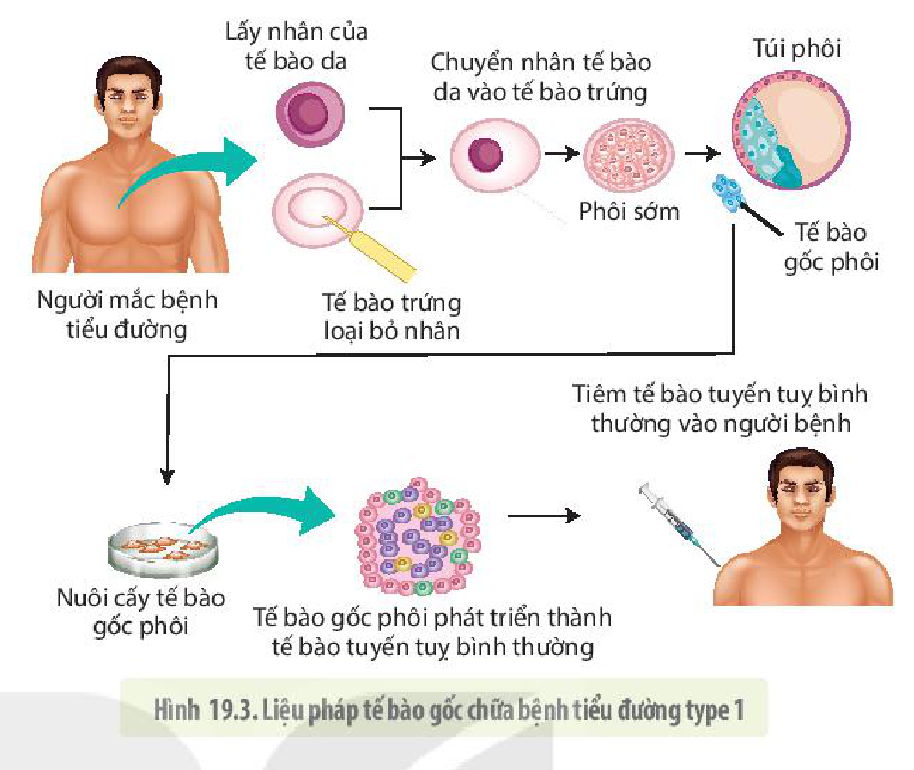
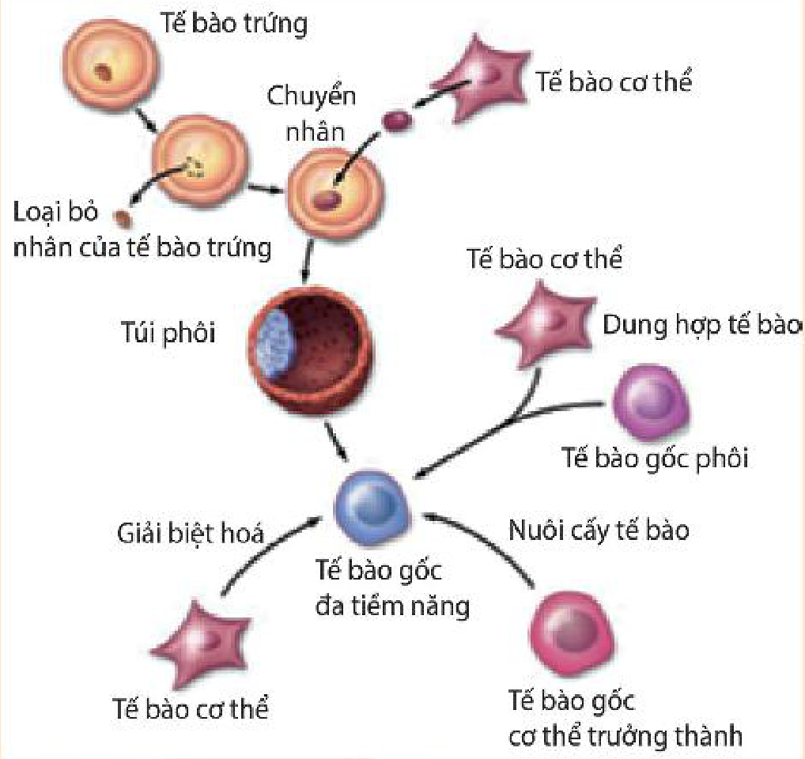
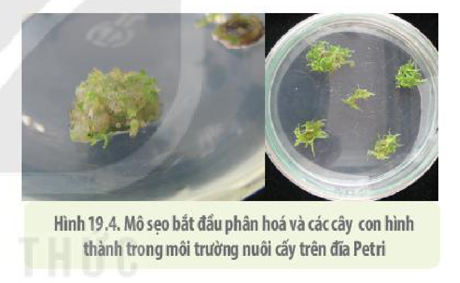

<!-- pdf:111 -->

# BÀI 19: CÔNG NGHỆ TẾ BÀO

## 🎯 Yêu cầu cần đạt

- Nêu được khái niệm, nguyên lí công nghệ và một số thành tựu công nghệ tế bào động vật.
- Nêu được khái niệm, nguyên lí công nghệ và một số thành tựu của công nghệ tế bào thực vật.

## 🔴 Mở đầu

Các con lợn Ỉ trong hình bên ghi nhận thành tựu về công nghệ tế bào của các nhà sinh học Việt Nam lần đầu tiên nhân bản thành công một loài động vật có vú. Vậy công nghệ tế bào là gì, nguyên lí của nó ra sao mà có thể làm nên những điều kì diệu như vậy?

## I. CÔNG NGHỆ TẾ BÀO ĐỘNG VẬT

### 1. Khái niệm

**Công nghệ tế bào động vật** là quy trình công nghệ nuôi cấy các loại tế bào động vật và tế bào người trong môi trường nhân tạo để tạo ra một lượng lớn tế bào nhằm mục đích nghiên cứu và ứng dụng trong thực tế.

### 2. Nguyên lí

Nguyên lí của công nghệ tế bào động vật là nuôi cấy các tế bào gốc trong môi trường thích hợp và tạo điều kiện để chúng phân chia rồi biệt hoá thành các loại tế bào khác nhau.

**Tế bào gốc** là những tế bào có thể phân chia và **biệt hoá** thành nhiều loại tế bào khác nhau. Tế bào gốc có thể được chia thành nhiều loại dựa theo nguồn gốc. Các tế bào gốc có nguồn gốc từ phôi sớm của động vật được gọi là **tế bào gốc phôi** hay **tế bào gốc vạn năng** do loại tế bào này có thể phân chia và biệt hoá thành mọi loại tế bào của cơ thể trưởng thành. Tế bào gốc có nguồn gốc từ các mô của cơ thể trưởng thành được gọi là **tế bào gốc trưởng thành** hay **tế bào gốc đa tiềm năng** do chúng chỉ có thể phân chia và biệt hoá thành một số loại tế bào nhất định của cơ thể. Trong cơ thể động vật, ngoại trừ các tế bào gốc, phần lớn các tế bào đã biệt hoá và không còn khả năng phân chia và tạo thành các loại tế bào khác nhau.

### 3. Thành tựu

Hiện nay, các nhà khoa học không chỉ nuôi cấy được các tế bào gốc phôi mà còn nuôi cấy được nhiều loại tế bào khác nhau của cơ thể người và động vật nhằm mục đích nghiên cứu và ứng dụng vào thực tế.

<!-- pdf:112 -->

Ba thành tựu nổi bật và có ý nghĩa lớn trong thực tiễn của công nghệ tế bào động vật là: (1) Nhân bản vô tính vật nuôi, (2) Liệu pháp tế bào gốc và (3) Liệu pháp gene.

**a) Nhân bản vô tính vật nuôi**

Hình 19.1. Quy trình nhân bản vô tính động vật (cừu)

**Nhân bản vật nuôi** là công nghệ tạo ra các con vật giống hệt nhau về kiểu gene không thông qua quá trình sinh sản hữu tính. Quy trình nhân bản vô tính được mô tả trong hình 19.1. Với quy trình này, các nhà khoa học đã tạo ra những động vật nhân bản vô tính ở nhiều loài như: ếch, bò, lợn, cừu, ngựa, lừa, mèo, chó, khỉ và nhiều loài động vật có vú khác, trong đó nổi bật nhất là sự ra đời của con cừu nhân bản đầu tiên trên thế giới có tên là Dolly vào năm 1996 (H 19.2). Tại Việt Nam, các nhà khoa học ở Viện Chăn nuôi cũng lần đầu tiên nhân bản thành công vật nuôi là con lợn Ỉ chúng ta nhìn thấy ở đầu bài.

Hình 19.2. Cừu nhân bản Dolly

Nhân bản vật nuôi không chỉ nhằm mục đích sinh sản tạo ra nhiều cá thể có cùng kiểu gene ưu việt mà chúng còn làm tăng số lượng cá thể của những loài có nguy cơ tuyệt chủng. Các nhà khoa học cũng đang nỗ lực tái sinh loài động vật đã tuyệt chủng như voi ma mút bằng cách cấy nhân.

**b) Liệu pháp tế bào gốc**

**Liệu pháp tế bào gốc** là phương pháp chữa bệnh bằng cách truyền tế bào gốc được nuôi cấy ngoài cơ thể vào người bệnh để thay thế các tế bào bị bệnh di truyền. Hình 19.3 cho thấy quy trình liệu pháp tế bào gốc trong chữa trị bệnh tiểu đường type 1. Ưu điểm của phương pháp này là cơ thể người sẽ không loại thải tế bào ghép vì nhân tế bào được cấy vào tế bào trứng là nhân của tế bào da người bệnh. Thực tế, các tế bào được nhân dòng trong ống nghiệm là tế bào của người bệnh nhưng là tế bào khoẻ mạnh.

<!-- pdf:113 -->

Mặc dù dùng tế bào phôi người để chữa bệnh được nhiều người ủng hộ, nhưng vẫn còn một số quan ngại về vấn đề đạo đức. Để tránh vấn đề vi phạm đạo đức, các nhà khoa học đã tìm kiếm, nhân nuôi các loại tế bào gốc tách chiết từ các mô của người trưởng thành. Ví dụ: Tách các tế bào gốc từ tuỷ xương người bệnh, đem nuôi cấy, sau đó truyền lại cho bệnh nhân để tái tạo các loại tế bào máu nhằm chữa trị bệnh ung thư máu.

Hình 19.3. Liệu pháp tế bào gốc chữa bệnh tiểu đường type 1

Bằng liệu pháp tế bào, các nhà khoa học kì vọng sẽ chữa được các bệnh Parkinson, bệnh tiểu đường type 1, người có cơ tim bị tổn thương do đột quỵ hay bị tổn thương các tế bào thần kinh. Liệu pháp tế bào gốc cũng đang được ứng dụng trong việc chữa trị một số bệnh ung thư ở người.

Thành tựu trong nuôi cấy các tế bào động vật cũng cho phép các nhà nghiên cứu phát triển thịt nhân tạo làm thực phẩm cho con người. Một số nước như Singapore, mới đây đã tuyên bố sớm sản xuất thịt nhân tạo đưa ra thị trường. Nuôi cấy tế bào cũng được dùng để sản xuất ra các protein chữa bệnh cho người.

**c) Liệu pháp gene**

**Liệu pháp gene** là phương pháp chữa bệnh di truyền nhờ thay thế gene bệnh bằng gene lành. Để làm được điều này, các nhà khoa học phải giải quyết được một số vấn đề cơ bản: (1) Nhân nuôi tế bào trong ống nghiệm, chỉnh sửa gene hoặc thay thế gene bệnh của tế bào bằng gene lành; (2) Sàng lọc các tế bào đã được chỉnh sửa gene và nhân bản trong ống nghiệm; (3) Truyền các tế bào chỉnh sửa gene vào cơ thể bệnh nhân. Liệu pháp thay thế gene chỉ sử dụng được cho người bị bệnh di truyền do hỏng một gene nhất định và tế bào bị bệnh phải thuộc loại tế bào liên tục phân chia trong suốt cuộc đời của bệnh nhân.

## ❓ Dừng lại và suy ngẫm

1. Thế nào là công nghệ tế bào động vật? Nêu nguyên lí và một số thành tựu của công nghệ tế bào động vật.
2. Tế bào gốc là gì? Phân biệt các loại tế bào gốc. Nuôi cấy các tế bào người và động vật trong ống nghiệm đem lại những lợi ích gì?

<!-- pdf:114 -->

## 💡 Em có biết

Năm 2006, Shinya Yamanaka, nhà sinh học tế bào người Nhật Bản đã tìm ra con đường chuyển các tế bào chuyên hoá ở người trưởng thành thành các tế bào gốc phôi, mở ra nhiều hướng nghiên cứu ứng dụng công nghệ tế bào trong y học. Các nhà khoa học còn kì vọng tạo ra được các mô, các cơ quan nhân tạo khác nhau để thay thế các mô và các cơ quan bị bệnh ở người. Việc chuyển các tế bào chuyên hoá của cơ thể trưởng thành thành các tế bào đa tiềm năng có thể được thực hiện bằng nhiều cách khác nhau (hình bên).

## II. CÔNG NGHỆ TẾ BÀO THỰC VẬT

### 1. Khái niệm

**Công nghệ tế bào thực vật** là quy trình công nghệ nuôi cấy các tế bào, mô thực vật ở điều kiện vô trùng để tạo ra các cây có kiểu gene giống nhau nhằm mục đích nhân giống.

Hình 19.4. Mô sẹo bắt đầu phân hoá và các cây con hình thành trong môi trường nuôi cấy trên đĩa Petri

### 2. Nguyên lí

Cơ sở khoa học của công nghệ tế bào thực vật là dùng môi trường dinh dưỡng có bổ sung các hormone thực vật thích hợp tạo điều kiện để nuôi cấy các tế bào thực vật tái sinh thành các cây.

### 3. Thành tựu

Ba kĩ thuật chủ yếu trong công nghệ tế bào thực vật là kĩ thuật nuôi cấy mô tế bào, kĩ thuật lai tế bào sinh dưỡng và kĩ thuật nuôi cấy hạt phấn hoặc noãn chưa thụ tinh.

**a) Nuôi cấy mô tế bào**

Đầu tiên các mô tế bào chuyên hoá được tách khỏi cây và đưa vào trong ống nghiệm nuôi cấy trong điều kiện vô trùng với đầy đủ chất dinh dưỡng cùng các loại hormone thực vật với tỉ lệ thích hợp. Các tế bào biệt hoá sẽ được đưa về trạng thái chưa phân hoá tạo nên mô phân sinh được gọi là **mô sẹo** hay **mô callus**. Các tế bào mô sẹo sau đó phân chia và hình thành nên rễ, thân, lá và cuối cùng hình thành nên cây con (H 19.4).

Phương pháp nuôi cấy mô đem lại nhiều thành tựu trong nông nghiệp cũng như lâm nghiệp như nhân nhanh với số lượng lớn cây ở những loài quý hiếm có thời gian sinh trưởng chậm, cây kháng bệnh virus và nhiều bệnh khác. Công nghệ tế bào thực vật kết hợp với công nghệ di truyền có thể tạo ra giống **cây biến đổi gene** (có gene đã được chỉnh sửa) hay **cây chuyển gene** (có thêm gene từ loài khác) nhằm thoả mãn nhu cầu của con người.

<!-- pdf:115 -->

**b) Lai tế bào sinh dưỡng**

**Lai tế bào sinh dưỡng** là kĩ thuật lai hai tế bào sinh dưỡng thuộc hai loài thực vật khác nhau sau khi được loại bỏ thành cellulose để tạo thành tế bào lai, sau đó đưa tế bào lai vào nuôi cấy trong môi trường đặc biệt để chúng phân chia và tạo thành cây lai khác loài.

Kĩ thuật này giúp tạo ra giống mới mang đặc điểm của hai loài mà bằng phương pháp tạo giống thông thường không tạo ra được.

**c) Nuôi cấy hạt phấn hoặc noãn chưa thụ tinh**

Hạt phấn và noãn chưa thụ tinh được nuôi cấy trong ống nghiệm rồi cho phát triển thành cây đơn bội hoặc lưỡng bội hoá các mô đơn bội và nuôi cấy để tạo thành cây lưỡng bội hoàn chỉnh.

Kĩ thuật này có thể tạo ra các cây có kiểu gene đồng hợp tử về tất cả các gene, đem lại nhiều lợi ích trong công tác tạo giống cây trồng.

## ❓ Dừng lại và suy ngẫm

1. Công nghệ tế bào thực vật là gì?
2. Nêu nguyên lí công nghệ tế bào thực vật. Để cho các tế bào thực vật đã biệt hoá có thể phân chia và phát triển thành một cây hoàn chỉnh thì các nhà khoa học cần nuôi cấy tế bào trong những điều kiện như thế nào?
3. Nêu một số thành tựu của công nghệ tế bào thực vật.

## 📌 Kiến thức cốt lõi

- Công nghệ tế bào động vật là quy trình công nghệ nuôi cấy các loại tế bào động vật và tế bào người trong môi trường nhân tạo để tạo ra một lượng lớn tế bào nhằm mục đích nghiên cứu và ứng dụng trong thực tế.
- Nguyên lí của công nghệ tế bào động vật là nuôi cấy các tế bào gốc trong môi trường thích hợp và tạo điều kiện để chúng phân chia rồi biệt hoá thành các loại tế bào khác nhau.
- Công nghệ tế bào động vật có thể giúp nhân bản nhiều loài động vật, tạo ra các tế bào dùng để thay thế các tế bào cơ thể bị bệnh hoặc tổn thương.
- Công nghệ tế bào thực vật là quy trình công nghệ nuôi cấy các tế bào, mô thực vật ở điều kiện vô trùng để tạo ra các cây có kiểu gene giống nhau nhằm mục đích nhân giống.
- Cơ sở khoa học của công nghệ tế bào thực vật là dùng môi trường dinh dưỡng có bổ sung các hormone thực vật thích hợp tạo điều kiện để nuôi cấy các tế bào thực vật tái sinh thành các cây.
- Công nghệ tế bào thực vật giúp nhân nhanh với số lượng lớn các giống cây quý hiếm, chống chịu bệnh hoặc kết hợp với công nghệ di truyền tạo ra cây biến đổi gene hoặc cây chuyển gene tạo các cây lai khác loài, các cây có kiểu gene đồng hợp tử về tất cả các gene, đem lại ý nghĩa lớn trong công tác chọn và tạo giống cây trồng.

## ✏️ Luyện tập và vận dụng

1. Khi đi ngang qua một cánh đồng trồng cây chuối, người ta có thể dễ dàng phát hiện ra đó có phải là những cây chuối nuôi cấy mô hay không. Em hãy giải thích tại sao.
2. Việc trồng các giống cây nuôi cấy mô trên một diện tích rộng có thể đem lại lợi ích kinh tế rất lớn nhưng cũng đem lại rủi ro cao. Tại sao?

## 📷 Danh sách hình trong bài

| Mã hình | Trang PDF | Vị trí | Chú thích gốc |
|---|---|---|---|
| H10-sinh-b19-01 | 112 | Mục I.3.a | Hình 19.1. Quy trình nhân bản vô tính động vật (cừu) |
| H10-sinh-b19-02 | 112 | Mục I.3.a | Hình 19.2. Cừu nhân bản Dolly |
| H10-sinh-b19-03 | 113 | Mục I.3.b | Hình 19.3. Liệu pháp tế bào gốc chữa bệnh tiểu đường type 1 |
| H10-sinh-b19-04 | 114 | Em có biết (chữ 'Dung hợp tế bào' ở mép phải sát nền màu của khung Em có biết) | Sơ đồ chuyển các tế bào chuyên hoá của cơ thể trưởng thành thành các tế bào đa tiềm năng (sách không đánh số hình) |
| H10-sinh-b19-05 | 114 | Mục II.1 | Hình 19.4. Mô sẹo bắt đầu phân hoá và các cây con hình thành trong môi trường nuôi cấy trên đĩa Petri |
