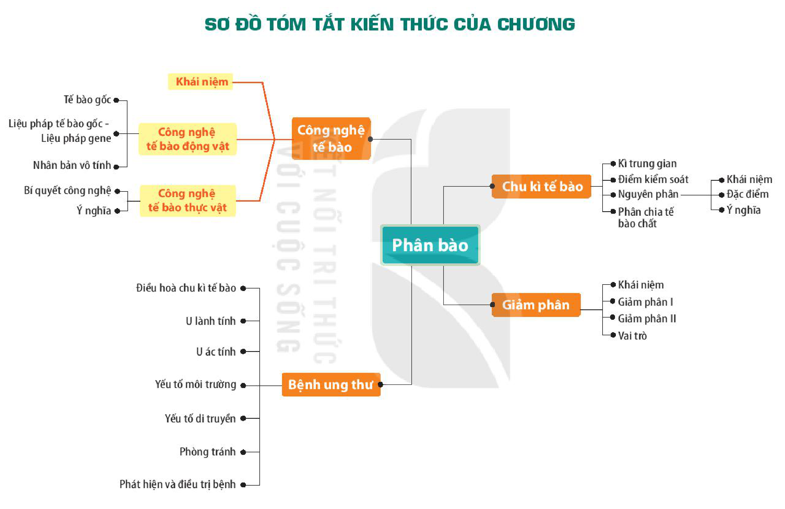

<!-- pdf:116 -->

# SƠ ĐỒ TÓM TẮT KIẾN THỨC CHƯƠNG 5

<!-- Trang in xoay ngang; ảnh đã xoay lại. Dưới đây chép các nhánh của sơ đồ thành danh sách, giữ nguyên chữ trong các ô. -->

- Phân bào
  - Chu kì tế bào
    - Kì trung gian
    - Điểm kiểm soát
    - Nguyên phân
      - Khái niệm
      - Đặc điểm
      - Ý nghĩa
    - Phân chia tế bào chất
  - Giảm phân
    - Khái niệm
    - Giảm phân I
    - Giảm phân II
    - Vai trò
  - Công nghệ tế bào
    - Khái niệm
    - Công nghệ tế bào động vật
      - Tế bào gốc
      - Liệu pháp tế bào gốc – Liệu pháp gene
      - Nhân bản vô tính
    - Công nghệ tế bào thực vật
      - Bí quyết công nghệ
      - Ý nghĩa
  - Bệnh ung thư
    - Điều hoà chu kì tế bào
    - U lành tính
    - U ác tính
    - Yếu tố môi trường
    - Yếu tố di truyền
    - Phòng tránh
    - Phát hiện và điều trị bệnh

## 📷 Danh sách hình trong bài

| Mã hình | Trang PDF | Vị trí | Chú thích gốc |
|---|---|---|---|
| H10-sinh-so-do-tom-tat-c05-01 | 116 | Cả trang (in xoay ngang) | Sơ đồ tóm tắt kiến thức của chương |
