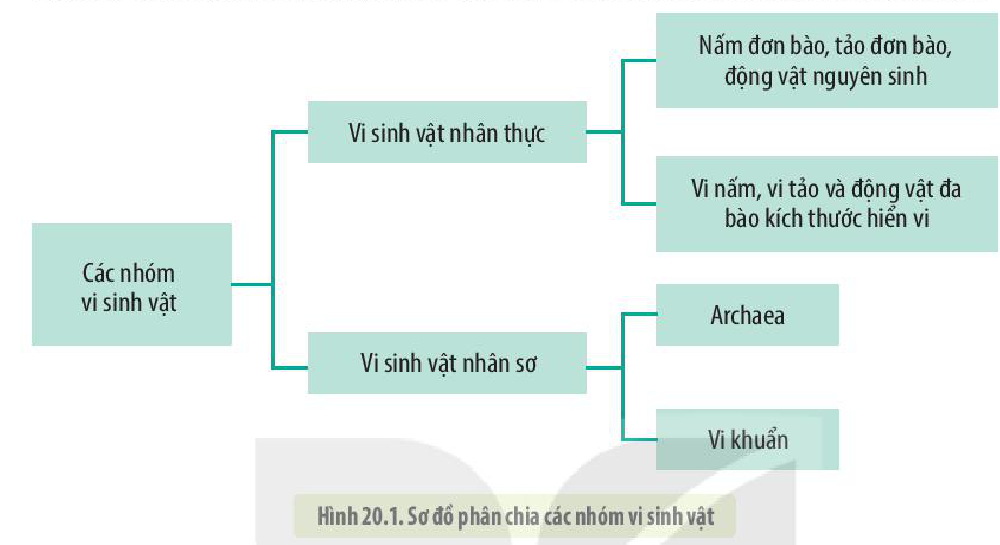
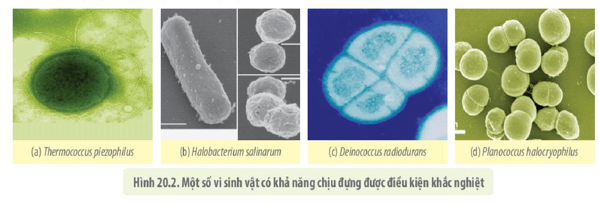
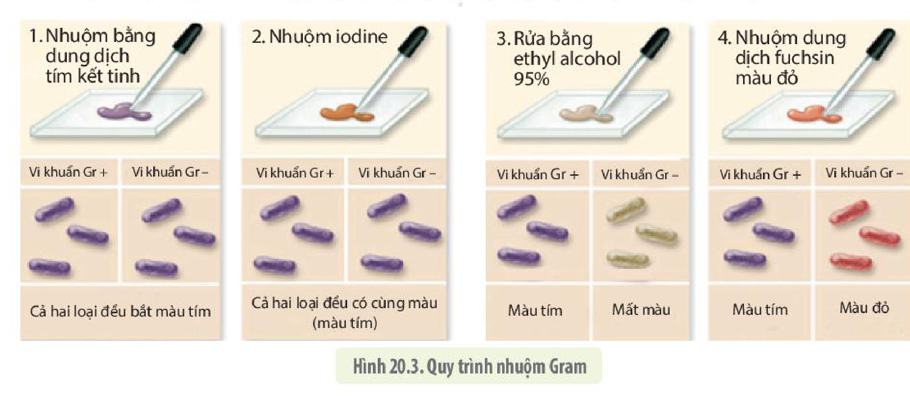
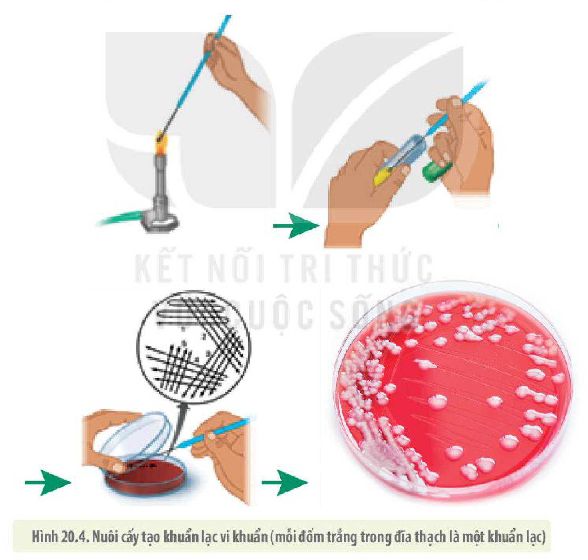
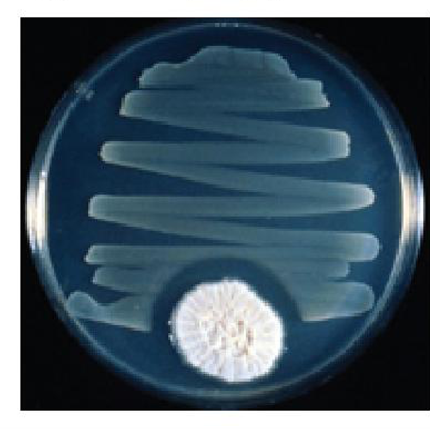

<!-- pdf:117 -->

# BÀI 20: SỰ ĐA DẠNG VÀ PHƯƠNG PHÁP NGHIÊN CỨU VI SINH VẬT

## 🎯 Yêu cầu cần đạt

- Nêu được khái niệm vi sinh vật. Kể tên các nhóm vi sinh vật.
- Phân biệt được các kiểu dinh dưỡng của vi sinh vật.
- Trình bày được một số phương pháp nghiên cứu vi sinh vật.

## 🔴 Mở đầu

Vệt màu khổng lồ trên vùng biển Ireland (H. a), màu hồng đỏ của Laguna Salada de Torrevieja thuộc Tây Ban Nha (H. b), bãi biển phát sáng ở vịnh Jervis ở Australia (H. c) hay màu xanh đặc trưng của Hồ Gươm ở Việt Nam (H. d) dưới đây, tất cả đều được tạo thành từ hàng nghìn tỉ sinh vật nhỏ bé không thể nhìn thấy bằng mắt thường có tên gọi chung là vi sinh vật. Vậy vi sinh vật là gì? Với kích thước vô cùng nhỏ bé như vậy thì "thức ăn" của chúng là gì và chúng ta làm thế nào để có thể nghiên cứu về chúng?

<!-- pdf:118 -->

## I. CÁC NHÓM VI SINH VẬT

**Vi sinh vật** là những sinh vật có kích thước nhỏ bé, thường chỉ quan sát được dưới kính hiển vi. Dựa vào thành phần cấu tạo, vi sinh vật được chia thành các nhóm như hình 20.1.

Hình 20.1. Sơ đồ phân chia các nhóm vi sinh vật

Mặc dù khác nhau về hình dạng, kích thước và cấu tạo cơ thể nhưng vì có kích thước tế bào nhỏ, cấu tạo đơn giản nên các vi sinh vật thường có đặc điểm chung là tốc độ chuyển hoá vật chất và năng lượng nhanh, sinh trưởng, sinh sản nhanh và phân bố rộng.

Vi sinh vật phân bố gần như ở khắp mọi nơi trên Trái Đất và trên các cơ thể sinh vật khác. Đa số các vi sinh vật là loại nhân sơ. **Archaea** là loại sinh vật nhân sơ đơn bào, có những đặc điểm giống với vi khuẩn nhưng lại có họ hàng gần với sinh vật nhân thực. Nhiều loại Archaea được gọi là **vi sinh vật cực đoan** sống được ở những nơi có điều kiện cực kì khắc nghiệt như loài *Thermococus piezophilus* (H 20.2a) sống ở hang động sâu dưới đáy biển, nơi có áp suất cao gấp 1 200 lần áp suất khí quyển hay loài *Halobacterium salinarum* (H 20.2b) chịu được môi trường có nồng độ muối cao gấp 10 lần độ mặn của nước biển. Đặc biệt, có loài vi khuẩn *Deinococcus radiodurans* (H 20.2c) sống được ở nơi có mức phóng xạ cao gấp 3 000 lần mức gây chết người, loài này còn sống được trong môi trường chân không, acid, nhiệt độ thấp và thiếu dinh dưỡng. Một số loài vi khuẩn có thể sống được ở nơi có nhiệt độ âm hàng chục độ như *Planoccocus halocryophilus* (H 20.2d), số khác lại có thể sống được ở các miệng thuỷ nhiệt có nhiệt độ cao đủ luộc chín mọi sinh vật khác.

Hình 20.2. Một số vi sinh vật có khả năng chịu đựng được điều kiện khắc nghiệt

<!-- pdf:119 -->

Số lượng vi sinh vật sống trên cơ thể mỗi người cao gấp chục lần số tế bào của toàn bộ cơ thể. Riêng số lượng vi khuẩn sống trong đường tiêu hoá của mỗi người cũng lớn hơn nhiều so với số lượng người đã và đang tồn tại trên Trái Đất. Trong các nhóm vi sinh vật, vi khuẩn là nhóm có số lượng lớn nhất (chiếm khoảng 1/2 sinh khối trên Trái Đất). Hiện nay, con người mới chỉ phát hiện khoảng 10% số lượng của chúng.

Không chỉ có số lượng lớn và đa dạng về hình thái, vi sinh vật còn có nhiều kiểu chuyển hoá vật chất và năng lượng hơn so với các nhóm sinh vật khác.

## ❓ Dừng lại và suy ngẫm

1. Vi sinh vật là gì? Quan sát hình 20.1, kể tên các nhóm vi sinh vật.
2. Giải thích vì sao vi sinh vật có tốc độ trao đổi chất nhanh, sinh trưởng, sinh sản nhanh hơn so với thực vật và động vật.

## II. CÁC KIỂU DINH DƯỠNG CỦA VI SINH VẬT

Vi sinh vật có nhiều kiểu dinh dưỡng khác nhau, những vi sinh vật có khả năng tự tổng hợp được các chất hữu cơ cần thiết từ các chất vô cơ được gọi là **vi sinh vật tự dưỡng**. Ngược lại, những vi sinh vật tổng hợp các chất hữu cơ cần thiết từ các chất hữu cơ có sẵn trong thức ăn được gọi là **vi sinh vật dị dưỡng**. Dựa vào nguồn năng lượng và nguồn carbon mà vi sinh vật sử dụng, có thể chia các hình thức dinh dưỡng của chúng thành bốn kiểu như bảng 20.

**Bảng 20.** *Các kiểu dinh dưỡng của vi sinh vật*

| Hình thức dinh dưỡng | Nguồn năng lượng | Nguồn carbon | Các loại vi sinh vật điển hình |
|---|---|---|---|
| **Quang tự dưỡng** | Ánh sáng | $\text{CO}_2$, $\text{HCO}_3^-$ hoặc các chất vô cơ tương tự | Vi sinh vật quang hợp (vi khuẩn lam, trùng roi, tảo) |
| **Hoá tự dưỡng** | Chất vô cơ ($\text{H}_2\text{S}$, $\text{NH}_3$ hoặc $\text{Fe}^{2+}$) | $\text{CO}_2$, $\text{HCO}_3^-$ hoặc các chất vô cơ tương tự | Chỉ một số vi khuẩn và Archaea (vi khuẩn nitrate hoá, vi khuẩn oxy hoá hydrogen,...) |
| **Quang dị dưỡng** | Ánh sáng | Chất hữu cơ | Chỉ một số vi khuẩn và Archaea (vi khuẩn không lưu huỳnh màu lục và màu tía) |
| **Hoá dị dưỡng** | Chất hữu cơ | Chất hữu cơ | Nhiều vi khuẩn, nấm, động vật nguyên sinh |

## ❓ Dừng lại và suy ngẫm

1. Đọc bảng 20, phân biệt các kiểu dinh dưỡng ở vi sinh vật. So với thực vật và động vật, vi sinh vật có thêm những kiểu dinh dưỡng nào?
2. Vi sinh vật có phạm vi phân bố rộng hơn rất nhiều so với những nhóm sinh vật khác nhờ đặc điểm nào? Giải thích.

<!-- pdf:120 -->

## III. MỘT SỐ PHƯƠNG PHÁP NGHIÊN CỨU VI SINH VẬT

Có nhiều phương pháp nghiên cứu vi sinh vật như quan sát, phân lập và nuôi cấy, phân tích hoá sinh, phân tích di truyền,...

### 1. Phương pháp quan sát

<!-- term: Phương pháp quan sát -->
Quan sát là phương pháp cơ bản được áp dụng khi nghiên cứu nhiều cấp độ tổ chức sống. Trong nghiên cứu vi sinh vật, phương pháp này được sử dụng để nghiên cứu hình thái, kích thước và cấu tạo tế bào vi sinh vật. Tuy nhiên, do vi sinh vật có kích thước rất nhỏ bé nên để quan sát được chúng người ta phải làm tiêu bản các tế bào vi sinh vật rồi đem soi dưới kính hiển vi quang học hoặc kính hiển vi điện tử có độ phóng đại và độ phân giải cao. Có nhiều phương pháp làm tiêu bản, từ đơn giản đến phức tạp như làm tiêu bản soi tươi, làm tiêu bản tạm thời, làm tiêu bản cố định kết hợp với nhuộm màu,... Mỗi phương pháp phù hợp với một mục đích và đối tượng quan sát riêng, trong đó, làm tiêu bản kết hợp với nhuộm màu thường được sử dụng nhằm quan sát rõ hơn hình dạng, cấu tạo tế bào.

- **Soi tươi**: có thao tác đơn giản, tiến hành nhanh, thường được sử dụng để quan sát trạng thái sống của tế bào vi khuẩn. Dùng lam kính làm tiêu bản, sử dụng lamen để đậy lên các tiêu bản hoặc lam kính lõm có thể quan sát khả năng di động của vi khuẩn.
- **Nhuộm đơn**: là phương pháp tương đối nhanh chóng và hữu ích để kiểm tra sự hiện diện và đánh giá sơ bộ về hình ảnh, tính chất bắt màu, cách sắp xếp của vi khuẩn cũng như hình thái tế bào. Chúng thường được nhuộm bằng thuốc nhuộm chuyên dụng như xanh methylene, tím kết tinh hoặc đỏ fuchsin để tăng độ tương phản, giúp việc quan sát rõ nét hơn. Phương pháp này chỉ cần một bước nhuộm duy nhất.
- **Nhuộm Gram**: Kĩ thuật nhuộm này được đặt theo tên của Hans Christian Gram, có ý nghĩa quan trọng trong việc định loại vi khuẩn. Đây là phương pháp được sử dụng để phân biệt vi khuẩn Gr + và Gr –. Nhuộm Gram sử dụng bốn loại thuốc thử khác nhau: tím kết tinh, iodine, ethyl alcohol 95% và fuchsin. Dựa vào kết quả nhuộm Gram, các bác sĩ có thể lựa chọn được loại thuốc hiệu quả để điều trị các bệnh nhiễm khuẩn (H 20.3).

Hình 20.3. Quy trình nhuộm Gram

<!-- pdf:121 -->

Tuy vậy, để định loại được chính xác từng loài và mối quan hệ họ hàng giữa chúng, các nhà khoa học thường sử dụng phương pháp phân tích hoá sinh hay sinh học phân tử (phân tích DNA, RNA). Các kĩ thuật này phức tạp, đòi hỏi trang thiết bị hiện đại và trình độ chuyên môn cao nên chỉ có những phòng nghiên cứu chuyên môn mới thực hiện được.

### 2. Phương pháp phân lập và nuôi cấy vi sinh vật

Muốn nghiên cứu các vi sinh vật như vi khuẩn, vi nấm, trước hết cần nuôi cấy chúng ở dạng thuần khiết, không lẫn với các loại vi sinh vật khác. Để làm được điều này, các nhà khoa học sử dụng **phương pháp phân lập, nuôi cấy vi sinh vật** trên môi trường thạch. Mẫu vật chứa vi khuẩn hoặc vi nấm được pha loãng trong nước đã được tiệt trùng sao cho khi dùng dung dịch này phết lên bề mặt thạch đặc, mỗi tế bào vi khuẩn phát triển tạo thành một khuẩn lạc riêng rẽ. **Khuẩn lạc** là một tập hợp các tế bào được sinh ra từ một tế bào ban đầu trên môi trường thạch và có thể quan sát được bằng mắt thường (H 20.4).

Hình 20.4. Nuôi cấy tạo khuẩn lạc vi khuẩn (mỗi đốm trắng trong đĩa thạch là một khuẩn lạc)

Các tế bào từ một khuẩn lạc có thể được nuôi cấy trong môi trường dinh dưỡng thích hợp ở dạng lỏng để có thể nhân lên với số lượng lớn dùng cho các loại nghiên cứu khác nhau.

<!-- pdf:122 -->

## ❓ Dừng lại và suy ngẫm

1. Làm thế nào có thể phân loại được các vi sinh vật trong khi chúng ta không nhìn thấy chúng bằng mắt thường?
2. Quan sát cấu tạo thành tế bào vi khuẩn Gr – và vi khuẩn Gr + ở hình 7.3, hãy giải thích vì sao hai loại vi khuẩn này lại bắt màu khác nhau khi nhuộm Gram.

## 📌 Kiến thức cốt lõi

- Vi sinh vật là nhóm sinh vật có kích thước rất nhỏ, thường chỉ quan sát được dưới kính hiển vi.
- Vi sinh vật được chia thành **vi sinh vật nhân sơ** gồm vi khuẩn, Archaea và **vi sinh vật nhân thực** gồm vi tảo, vi nấm, nguyên sinh động vật.
- Vi sinh vật có bốn kiểu dinh dưỡng chính là quang tự dưỡng, quang dị dưỡng, hoá tự dưỡng và hoá dị dưỡng.
- Một số phương pháp nghiên cứu vi sinh vật thường được áp dụng là phương pháp quan sát, phương pháp phân lập và nuôi cấy vi sinh vật.

## ✏️ Luyện tập và vận dụng

1. Một loại vi khuẩn chỉ cần amino acid loại methionine làm chất dinh dưỡng hữu cơ và sống trong hang động không có ánh sáng. Cho biết kiểu dinh dưỡng của vi khuẩn này và giải thích.
2. Hình dưới có hai loài vi khuẩn, một loài mọc tạo khuẩn lạc to, trắng và một loài mọc tạo thành những đường ziczac. Tuy nhiên, xung quanh khuẩn lạc to lại xuất hiện một vòng trong (gọi là vòng vô khuẩn). Em hãy giải thích hiện tượng trên.
3. Theo chẩn đoán ban đầu của bác sĩ, một người bị bệnh nhiễm khuẩn phổi. Theo em, bác sĩ sẽ ra chỉ định gì tiếp theo để có thể kê đơn thuốc chính xác giúp người này mau khỏi bệnh?

## 📷 Danh sách hình trong bài

| Mã hình | Trang PDF | Vị trí | Chú thích gốc |
|---|---|---|---|
| H10-sinh-b20-01 | 118 | Mục I | Hình 20.1. Sơ đồ phân chia các nhóm vi sinh vật |
| H10-sinh-b20-02 | 118 | Mục I | Hình 20.2. Một số vi sinh vật có khả năng chịu đựng được điều kiện khắc nghiệt |
| H10-sinh-b20-03 | 120 | Mục III.1 | Hình 20.3. Quy trình nhuộm Gram |
| H10-sinh-b20-04 | 121 | Mục III.2 | Hình 20.4. Nuôi cấy tạo khuẩn lạc vi khuẩn (mỗi đốm trắng trong đĩa thạch là một khuẩn lạc) |
| H10-sinh-b20-05 | 122 | Luyện tập và vận dụng, câu 2 | Đĩa thạch nuôi cấy hai loài vi khuẩn xuất hiện vòng vô khuẩn (sách không đánh số hình) |
