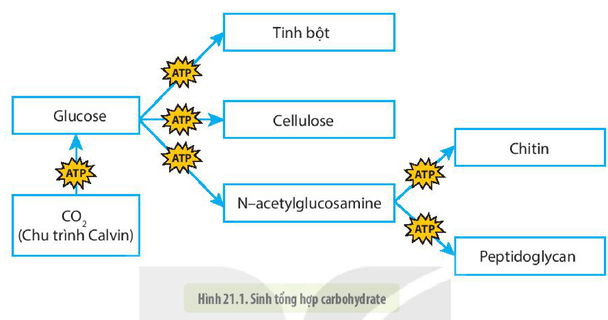
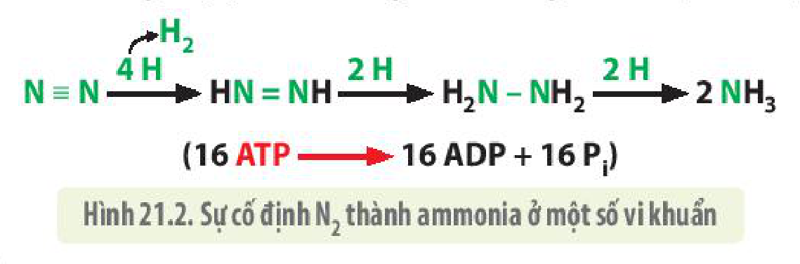
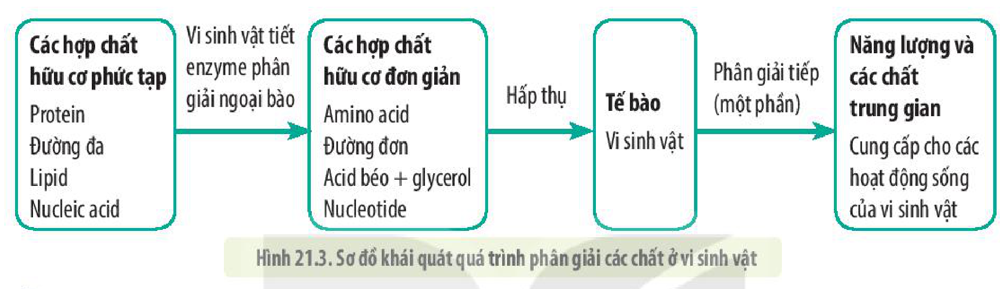
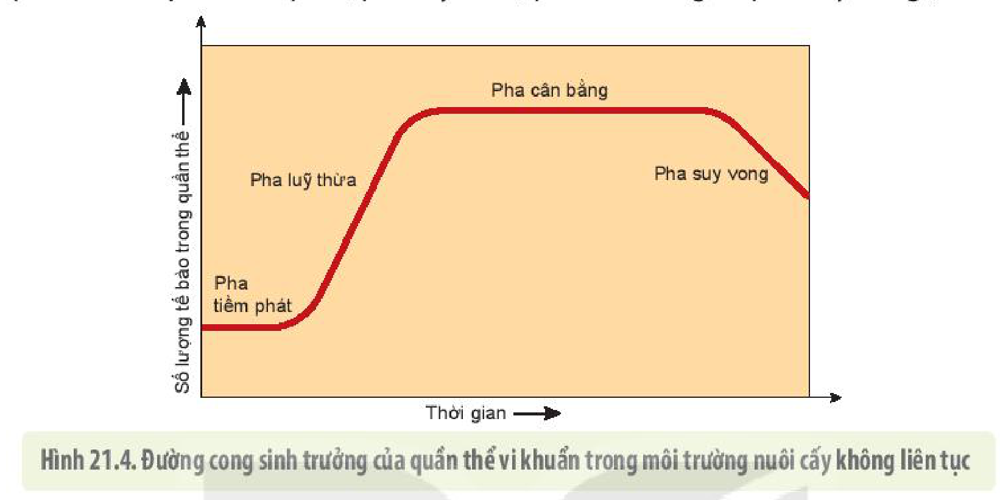
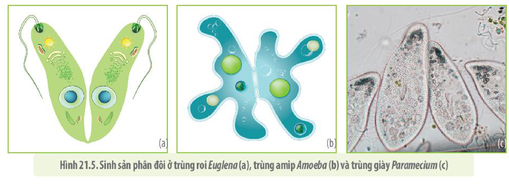
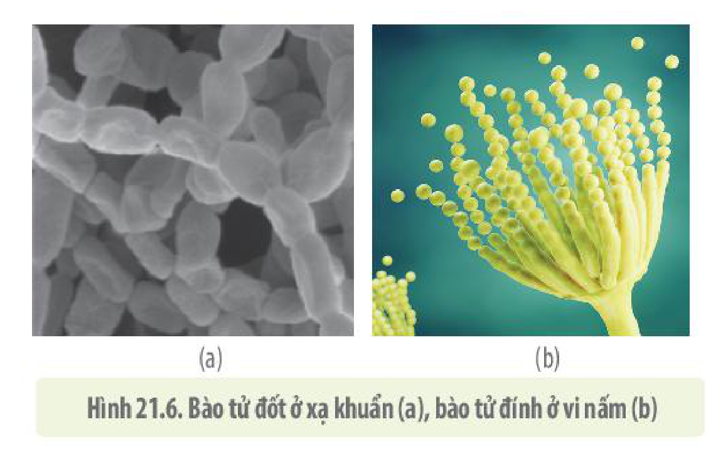
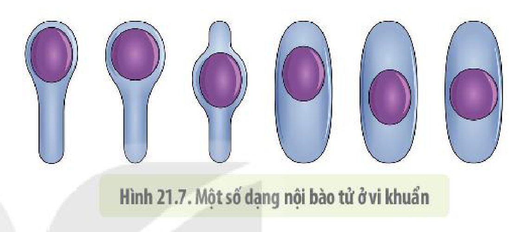
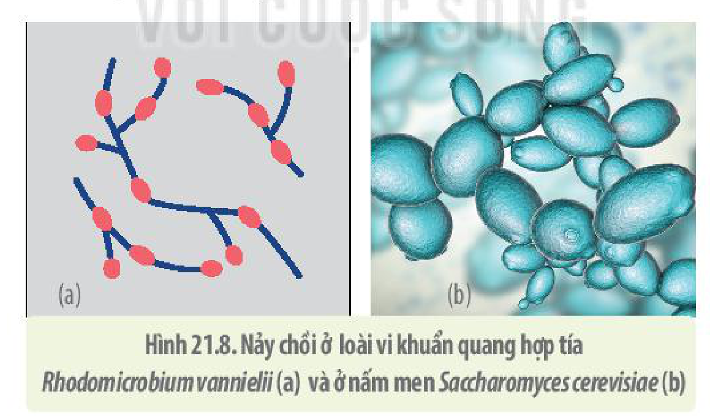

<!-- pdf:123 -->

# BÀI 21: TRAO ĐỔI CHẤT, SINH TRƯỞNG VÀ SINH SẢN Ở VI SINH VẬT

## 🎯 Yêu cầu cần đạt

- Nêu được một số ví dụ về quá trình tổng hợp và phân giải các chất ở vi sinh vật.
- Nêu được khái niệm sinh trưởng ở vi sinh vật. Trình bày được đặc điểm các pha sinh trưởng của quần thể vi khuẩn.
- Trình bày được các yếu tố ảnh hưởng đến sinh trưởng của vi sinh vật.
- Trình bày được ý nghĩa của việc sử dụng kháng sinh để ức chế hoặc tiêu diệt vi sinh vật gây bệnh và tác hại của việc lạm dụng thuốc kháng sinh trong chữa bệnh cho con người và động vật.
- Phân biệt được các hình thức sinh sản ở vi sinh vật nhân sơ và vi sinh vật nhân thực.

## 🔴 Mở đầu

*Escherichia coli* là một loại vi khuẩn sống trong đường tiêu hoá của người và động vật. Chúng sinh sản bằng cách phân đôi. Hãy tưởng tượng các em đang nuôi vi khuẩn *E. coli*, cứ sau 20 phút, các em chụp ảnh qua kính hiển vi và đếm số lượng vi khuẩn tại thời điểm đó (hình dưới). Theo em, sẽ có bao nhiêu vi khuẩn *E. coli* trong bức ảnh tiếp theo? Em có nhận xét gì quá trình sinh sản của chúng?

## I. QUÁ TRÌNH TỔNG HỢP VÀ PHÂN GIẢI CÁC CHẤT Ở VI SINH VẬT

### 1. Quá trình tổng hợp

**Sinh tổng hợp**, còn gọi là **quá trình đồng hoá**, trong đó tế bào sử dụng năng lượng để liên kết các phân tử đơn giản thành các phân tử hữu cơ phức tạp cần thiết. Vi sinh vật có khả năng sinh tổng hợp tất cả các chất thiết yếu cho tế bào như carbohydrate, protein, nucleic acid và lipid.

**a) Tổng hợp carbohydrate**

Nhiều loài vi sinh vật có khả năng tổng hợp nên một loại đường đơn quan trọng là glucose theo nhiều con đường khác nhau như quang hợp ở vi khuẩn lam và các loài tảo, quang khử ở vi khuẩn màu lục và màu tía hay hoá tổng hợp ở vi khuẩn sắt, vi khuẩn nitrate, trong đó con đường quang hợp là phổ biến và quan trọng nhất.

<!-- pdf:124 -->

Từ glucose, các vi sinh vật tổng hợp nên các đường đa làm nguyên liệu xây dựng tế bào và dự trữ năng lượng (H 21.1). Ví dụ: Chitin cấu tạo nên thành tế bào ở nấm, peptidoglycan tạo thành tế bào ở vi khuẩn và cellulose xây dựng nên thành tế bào ở tảo lục.

Hình 21.1. Sinh tổng hợp carbohydrate

**b) Tổng hợp protein**

Protein được tổng hợp từ các đơn phân là các amino acid. Phần lớn vi sinh vật có khả năng tự tổng hợp được toàn bộ 20 amino acid cần thiết cho sự phát triển, trong khi con người chỉ có thể tổng hợp được 11 amino acid. Tất cả các amino acid đều được vi sinh vật tổng hợp từ những sản phẩm của quá trình phân giải đường và nguồn nitrogen lấy từ môi trường.

Một số vi sinh vật (vi khuẩn lam, vi khuẩn *Rhizobium*) có khả năng chuyển hoá $\text{N}_2$ trong khí quyển thành ammonia ($\text{NH}_3$) cung cấp nguồn nitrogen cho quá trình tổng hợp các amino acid của chúng. Quá trình này được gọi là **quá trình cố định nitrogen** (H 21.2), không chỉ có vai trò quan trọng đối với bản thân các vi sinh vật mà còn có tầm quan trọng to lớn về mặt sinh thái và nông nghiệp vì nó cung cấp phần lớn nguồn nitrogen hỗ trợ cho hệ sinh thái toàn cầu.

Hình 21.2. Sự cố định $\text{N}_2$ thành ammonia ở một số vi khuẩn

**c) Tổng hợp lipid**

Lipid là thành phần chính của màng tế bào và màng ngoài của vi khuẩn Gram âm; lipid cũng có thể là nguồn dự trữ năng lượng và carbon. Ở vi sinh vật, lipid được tổng hợp từ các acid béo và glycerol.

**d) Tổng hợp nucleic acid**

Nucleotide được tổng hợp từ một gốc đường 5 carbon và các amino acid glutamine, glycine, aspartate và phosphoric acid. Các phản ứng đều sử dụng năng lượng từ ATP. Nucleic acid được tổng hợp từ các đơn phân là nucleotide qua một quá trình phức tạp.

<!-- pdf:125 -->

### 2. Phân giải các chất

<!-- term: Phân giải các chất ở vi sinh vật -->
Các vi sinh vật dị dưỡng phân giải các hợp chất hữu cơ do sinh vật khác cung cấp để lấy nguồn nguyên liệu cho các hoạt động sống của chúng. Những **vi sinh vật dị dưỡng hoại sinh** thường tiết các enzyme ra bên ngoài tế bào để phân giải chất hữu cơ phức tạp thành các chất hữu cơ đơn giản rồi mới hấp thụ chúng vào trong tế bào. Trong tế bào vi sinh vật (cả vi sinh vật dị dưỡng và tự dưỡng), một phần chất hữu cơ đơn giản được phân giải (ví dụ: Các đường đơn tiếp tục được phân giải theo con đường hô hấp hiếu khí, hô hấp kị khí hoặc lên men) để tạo ra năng lượng cung cấp cho các hoạt động sống của tế bào (H 21.3).

Hình 21.3. Sơ đồ khái quát quá trình phân giải các chất ở vi sinh vật

## ❓ Dừng lại và suy ngẫm

1. Nêu một số ví dụ về quá trình tổng hợp và phân giải các chất ở vi sinh vật.
2. Quá trình tổng hợp và phân giải các chất ở vi sinh vật có gì giống và khác so với các quá trình này ở động vật và thực vật?
3. Theo em, người ta có thể ứng dụng quá trình phân giải đường đa, lipid và protein ở vi sinh vật vào những lĩnh vực nào? Giải thích và lấy ví dụ minh hoạ.

## II. SINH TRƯỞNG CỦA QUẦN THỂ VI KHUẨN

Khác với khái niệm sinh trưởng nói chung chỉ sự tăng lên về kích thước cơ thể sinh vật, **sự sinh trưởng của quần thể vi sinh vật** được hiểu là sự tăng lên về mặt số lượng tế bào trong quần thể. **Thời gian thế hệ** (kí hiệu là g) là thời gian tính từ khi một tế bào sinh ra đến khi tế bào đó phân chia, hay cũng là thời gian cần có để số tế bào trong quần thể tăng gấp đôi. Trong điều kiện lí tưởng (mọi yếu tố trong môi trường đều là tối ưu đối với sự sinh trưởng của vi sinh vật), thời gian thế hệ của quần thể là một hằng số. Thời gian thế hệ khác nhau ở mỗi loài vi sinh vật.

Ví dụ: Vi khuẩn *E. coli* ở điều kiện tối ưu, cứ 20 phút phân chia một lần (g = 20), ở vi khuẩn lao là 12 giờ.

Trong điều kiện lí tưởng, sau n lần phân chia từ $N_0$ tế bào ban đầu, trong thời gian t, số tế bào tạo thành $N_t$ là:

$$N_t = N_0 \times 2^{t/g} = N_0 \times 2^n$$
<!-- ocr-ok: công thức toán học LaTeX -->

Số lượng tế bào trong quần thể thay đổi theo thời gian và còn tuỳ thuộc vào hình thức nuôi cấy vi sinh vật.

<!-- pdf:126 -->

### 1. Nuôi cấy không liên tục

Trong **môi trường nuôi cấy không liên tục** – môi trường không được bổ sung chất dinh dưỡng mới và không được lấy đi các sản phẩm trao đổi chất, sự sinh trưởng của vi khuẩn bao gồm bốn pha cơ bản: pha tiềm phát, pha luỹ thừa, pha cân bằng và pha suy vong (H 21.4).

Hình 21.4. Đường cong sinh trưởng của quần thể vi khuẩn trong môi trường nuôi cấy không liên tục

- **Pha tiềm phát** (pha lag): tính từ khi vi khuẩn được nuôi cấy cho đến khi chúng bắt đầu sinh trưởng (phân chia). Ở pha này, vi khuẩn dần thích nghi với môi trường, tổng hợp vật chất chuẩn bị cho sự phân chia.
- **Pha luỹ thừa** (pha log): Vi sinh vật phân chia mạnh mẽ theo tiềm năng, số lượng tế bào tăng theo luỹ thừa và đạt đến cực đại ở cuối pha.
- **Pha cân bằng**: Dinh dưỡng trong môi trường giảm, chất độc hại tăng. Tốc độ sinh trưởng và trao đổi chất của vi sinh vật giảm dần. Lượng tế bào sinh ra bằng lượng tế bào chết đi.
- **Pha suy vong**: Số lượng tế bào trong quần thể ngày càng giảm do chất dinh dưỡng cạn kiệt, chất độc hại tích luỹ ngày càng nhiều.

### 2. Nuôi cấy liên tục

Trong mô hình nuôi cấy lớn, thường xuyên được bổ sung chất dinh dưỡng và loại bỏ các sản phẩm trao đổi chất, môi trường nuôi cấy như vậy được gọi là **môi trường nuôi cấy liên tục**. Vi sinh vật nuôi trong các bình/bể lên men để sản xuất sinh khối nhằm tách chiết các sản phẩm sinh học có giá trị như các vitamin, enzyme, chất kháng sinh,... là một ví dụ của nuôi cấy liên tục. Số lượng vi sinh vật sẽ được duy trì ở một mức độ cân bằng sao cho năng suất sản phẩm đạt cao nhất.

## ❓ Dừng lại và suy ngẫm

1. Khái niệm sinh trưởng ở vi sinh vật có gì khác so với sinh trưởng ở thực vật và động vật? Giải thích vì sao lại có sự khác nhau đó.
2. Nêu điểm khác nhau giữa quá trình sinh trưởng của quần thể vi sinh vật trong môi trường nuôi cấy liên tục và môi trường nuôi cấy không liên tục. Tại sao lại có sự khác nhau đó?
3. Trong công nghệ vi sinh, việc nuôi cấy vi sinh vật thu sinh khối để sản xuất các chế phẩm sinh học có giá trị được thực hiện trên môi trường nuôi cấy nào? Vì sao?

<!-- pdf:127 -->

## III. CÁC YẾU TỐ ẢNH HƯỞNG ĐẾN SINH TRƯỞNG CỦA QUẦN THỂ VI SINH VẬT

Kiểu sinh trưởng trong nuôi cấy liên tục của quần thể vi khuẩn nêu trên chỉ có được khi môi trường nuôi cấy là tối ưu với từng loài. Tuy nhiên, trong tự nhiên, có nhiều yếu tố có thể ảnh hưởng đến sự sinh trưởng của quần thể vi sinh vật. Có những yếu tố làm tăng tốc độ sinh trưởng nhưng cũng có những yếu tố làm hạn chế, thậm chí tiêu diệt các loài vi sinh vật. Hiểu được ảnh hưởng của những yếu tố này có thể giúp con người thúc đẩy tốc độ sinh trưởng của các vi sinh vật có lợi, hạn chế cũng như tiêu diệt các loài có hại.

### 1. Các yếu tố vật lí

Quá trình sinh trưởng của vi sinh vật chịu ảnh hưởng của nhiều yếu tố vật lí như nhiệt độ, ánh sáng, độ ẩm,... (Bảng 21.1).

**Bảng 21.1.** *Ảnh hưởng của một số yếu tố vật lí đến sinh trưởng của vi sinh vật*

| Yếu tố | Ảnh hưởng | Ứng dụng |
|---|---|---|
| Nhiệt độ | Căn cứ vào nhiệt độ, vi sinh vật được chia thành các nhóm sau: – **Vi sinh vật ưa lạnh** (dưới 15 °C); – **Vi sinh vật ưa ấm** (từ 20 °C đến 40 °C); – **Vi sinh vật ưa nhiệt** (từ 55 °C đến 65 °C); – **Vi sinh vật siêu ưa nhiệt** (từ 75 °C đến 100 °C). | Con người dùng nhiệt độ cao để thanh trùng các chất lỏng, thực phẩm, dụng cụ,..., nhiệt độ thấp để kìm hãm sinh trưởng của vi sinh vật. |
| Độ ẩm | Hàm lượng nước trong môi trường quyết định độ ẩm. Nước là dung môi hoà tan các chất dinh dưỡng, tham gia phân huỷ các chất. Mỗi loại vi sinh vật sinh trưởng trong một giới hạn độ ẩm nhất định. | – Dùng nước để khống chế sinh trưởng của các nhóm vi sinh vật có hại và kích thích sinh trưởng của nhóm vi sinh vật có ích cho con người. – Điều chỉnh độ ẩm của lương thực, thực phẩm, đồ dùng để bảo quản được lâu hơn bằng cách phơi khô, sấy khô. |
| Độ pH | Ảnh hưởng đến tính thấm qua màng, sự chuyển hoá các chất trong tế bào, hoạt hoá enzyme, sự hình thành ATP,... Dựa vào độ pH của môi trường, vi sinh vật được chia thành 3 nhóm: vi sinh vật ưa acid, vi sinh vật ưa kiềm, vi sinh vật ưa pH trung tính. | – Tạo điều kiện nuôi cấy thích hợp với từng nhóm vi sinh vật. – Điều chỉnh độ pH môi trường để ức chế các vi sinh vật gây hại và kích thích các vi sinh vật có lợi. |
| Ánh sáng | Cần thiết cho quá trình quang hợp của các vi sinh vật quang tự dưỡng, tác động đến bào tử sinh sản, tổng hợp sắc tố, chuyển động hướng sáng. | Dùng bức xạ điện từ để ức chế, tiêu diệt vi sinh vật. |
| Áp suất thẩm thấu | Áp suất thẩm thấu cao gây co nguyên sinh ở các tế bào vi sinh vật khiến chúng không phân chia được. Áp suất thẩm thấu thấp làm các tế bào vi sinh vật bị trương nước và có thể vỡ ra (đối với các vi khuẩn không có thành tế bào). | Điều chỉnh áp suất thẩm thấu để bảo quản thực phẩm như ướp muối, ướp đường,... |

<!-- pdf:128 -->

### 2. Các yếu tố hoá học

**a) Chất dinh dưỡng**

Các loài vi sinh vật chỉ có thể tồn tại và sinh trưởng trong môi trường có các chất dinh dưỡng như protein, carbohydrate, lipid, ion khoáng,... Một số vi sinh vật chỉ sinh trưởng được khi có mặt các nhân tố sinh trưởng trong môi trường. **Nhân tố sinh trưởng** là những chất cần cho sự sinh trưởng của chúng nhưng với hàm lượng rất ít, có thể là một số loại amino acid, vitamin,... hay một số nguyên tố vi lượng như Mn, Zn, Mo,... Vi sinh vật không tự tổng hợp các nhân tố sinh trưởng được gọi là **vi sinh vật khuyết dưỡng**, vi sinh vật tự tổng hợp được các nhân tố sinh trưởng gọi là **vi sinh vật nguyên dưỡng**.

**b) Chất ức chế**

Một số chất hoá học có khả năng ức chế sự sinh trưởng của vi sinh vật theo các cơ chế khác nhau (Bảng 21.2).

**Bảng 21.2.** *Một số chất hoá học gây ức chế quá trình sinh trưởng của vi sinh vật*

| Chất hoá học | Ảnh hưởng | Ứng dụng |
|---|---|---|
| Các hợp chất phenol | Biến tính protein, màng tế bào | Khử trùng phòng thí nghiệm, bệnh viện |
| Các loại cồn (ethanol, izopropanol 70% đến 80%) | Làm biến tính protein, ngăn cản các chất qua màng tế bào | Thanh trùng trong y tế và phòng thí nghiệm |
| Iodine, rượu iodine (2%) | Oxy hoá các thành phần tế bào | Diệt khuẩn trên da, tẩy trùng trong bệnh viện |
| Clo (cloramin, natri hypoclorid) | Oxy hoá mạnh các thành phần tế bào | Thanh trùng nước máy, nước bể bơi, nước dùng trong công nghiệp thực phẩm |
| Hợp chất kim loại nặng (Ag, Hg,...) | Làm bất hoạt các protein | Diệt bào tử đang nảy mầm |
| Các aldehyde (formaldehyde 2%) | Làm bất hoạt các protein | Sử dụng để thanh trùng nhiều đối tượng |
| Các loại khí ethylene oxide (từ 10% đến 20%) | Oxy hoá các thành phần tế bào | Khử trùng các dụng cụ nhựa, kim loại |
| Kháng sinh | Diệt khuẩn có tính chọn lọc | Dùng chữa các bệnh nhiễm khuẩn trong y tế, thú y,... |

### 3. Kháng sinh, ý nghĩa của kháng sinh và tác hại của việc lạm dụng kháng sinh

Trong quá trình sinh trưởng, vi sinh vật có thể tiết ra môi trường những chất có tác dụng ức chế sự phát triển hoặc tiêu diệt vi khuẩn khác, được gọi là **chất kháng sinh**. Ngày nay, kháng sinh không chỉ được chiết xuất từ các vi sinh vật mà còn được tổng hợp nhân tạo. Kháng sinh ức chế và tiêu diệt vi khuẩn theo nhiều cơ chế khác nhau như ức chế tổng hợp thành tế bào, protein hay nucleic acid,... của vi khuẩn. Dựa vào đặc điểm này, con người đã phát triển và sử dụng rộng rãi các loại thuốc kháng sinh để điều trị các bệnh gây ra bởi vi khuẩn, giúp cứu sống nhiều người và thúc đẩy ngành chăn nuôi phát triển.

<!-- term: Kháng kháng sinh -->
Tuy nhiên, ngày nay, hiện tượng kháng lại thuốc kháng sinh ở vi khuẩn đang là mối lo ngại lớn đối với toàn nhân loại. Nguyên nhân chính gây ra tình trạng này là do việc sử dụng thuốc kháng sinh không đúng theo chỉ định của bác sĩ, hoặc do bệnh nhân tự ý dùng thuốc.

<!-- pdf:129 -->

<!-- term: Kháng kháng sinh -->
Ngoài ra, việc sử dụng rộng rãi thuốc kháng sinh trong chăn nuôi cũng làm tăng nguy cơ xuất hiện vi khuẩn kháng thuốc, thậm chí đa kháng thuốc trên vật nuôi. Những vi khuẩn này có thể được truyền sang người qua tiếp xúc, giết mổ và gene kháng kháng sinh có thể được truyền sang vi khuẩn gây bệnh ở người.

Vì vậy, để kéo dài hiệu quả điều trị bệnh của thuốc kháng sinh cũng như làm chậm quá trình kháng lại thuốc kháng sinh ở vi khuẩn gây bệnh, chúng ta cần tuân thủ triệt để quy trình điều trị bệnh bằng thuốc kháng sinh, hạn chế tối đa sử dụng thuốc kháng sinh trong chăn nuôi, đặc biệt là việc dùng chúng với vai trò như là một chất kích thích tăng trưởng.

## ❓ Dừng lại và suy ngẫm

1. Trình bày ảnh hưởng của các yếu tố bên ngoài đến sự sinh trưởng của vi sinh vật. Con người đã ứng dụng những hiểu biết này như thế nào trong lĩnh vực y tế và đời sống hằng ngày? Cho một vài ví dụ minh hoạ.
2. Nêu tác dụng của kháng sinh trong việc điều trị các bệnh do vi sinh vật gây ra. Thế nào là hiện tượng kháng kháng sinh, nêu nguyên nhân và tác hại của hiện tượng này.
3. Loét dạ dày từng được cho là do ăn nhiều thức ăn cay hoặc căng thẳng thần kinh, nay được biết là do vi khuẩn (*Helicobacter pylori*) gây ra. Với phát hiện mới này, việc điều trị loét dạ dày đã thay đổi như thế nào?

## IV. CÁC HÌNH THỨC SINH SẢN Ở VI SINH VẬT

Cả vi sinh vật nhân sơ và vi sinh vật nhân thực đều có ba hình thức sinh sản chính là phân đôi, hình thành bào tử và nảy chồi.

### 1. Phân đôi

**Phân đôi** là hình thức sinh sản phổ biến nhất ở vi sinh vật, trong đó, một tế bào mẹ phân chia thành hai tế bào con giống nhau (H 21.5). Vi sinh vật nhân sơ (vi khuẩn) chỉ có thể phân đôi vô tính, trong khi nhiều vi sinh vật nhân thực (ví dụ: trùng giày) có thể phân đôi hữu tính theo cách tiếp hợp. Trường hợp này có sự kết hợp vật chất di truyền (giữa hai nhân con đơn bội) của hai trùng giày khác nhau (giống như quá trình kết hợp vật chất di truyền của giao tử đực và giao tử cái trong sinh sản hữu tính), rồi sau đó hai trùng giày này mới tiến hành phân đôi nên hình thức này còn gọi là **phân đôi hữu tính**.

Hình 21.5. Sinh sản phân đôi ở trùng roi *Euglena* (a), trùng amip *Amoeba* (b) và trùng giày *Paramecium* (c)

<!-- pdf:130 -->

### 2. Sinh sản bằng bào tử

<!-- term: Sinh sản bằng bào tử -->
Nấm có khả năng sinh sản bằng bào tử dạng vô tính hoặc hữu tính, vi khuẩn cũng có thể sinh sản nhờ các ngoại bào tử. Có nhiều loại bào tử khác nhau như bào tử đính ở vi nấm, bào tử tiếp hợp ở nấm tiếp hợp, ngoại bào tử hay bào tử đốt ở xạ khuẩn (H 21.6). Tất cả các bào tử sinh sản ở vi khuẩn đều chỉ có các lớp màng, không có vỏ và không tìm thấy hợp chất calcium dipicolinate.

Hình 21.6. Bào tử đốt ở xạ khuẩn (a), bào tử đính ở vi nấm (b)

Ngoài các ngoại bào tử giữ chức năng sinh sản, khi gặp điều kiện khắc nghiệt, vi khuẩn còn có thể hình thành **nội bào tử** với lớp vỏ dày chứa calcium dipicolinate bên trong tế bào, giúp vi khuẩn sống tiềm sinh khi gặp điều kiện môi trường bất lợi (H. 21.7). Nội bào tử thường được tạo thành ở hai chi vi khuẩn là *Bacillus* và *Clostridium*. Nội bào tử không phải là hình thức sinh sản của vi khuẩn mà chỉ là cách thức giúp vi khuẩn chống chịu trước những điều kiện bất lợi của môi trường.

Hình 21.7. Một số dạng nội bào tử ở vi khuẩn

### 3. Nảy chồi

**Nảy chồi** là phương thức sinh sản vô tính đặc trưng của một số ít vi sinh vật như vi khuẩn quang dưỡng màu tía, nấm men (H 21.8). Một cá thể con sẽ dần hình thành ở một phía của cá thể mẹ. Cá thể con sau khi trưởng thành sẽ tách ra thành một cá thể độc lập. Khác với phân đôi, một cá thể mẹ có thể nảy chồi ra nhiều cá thể con.

Hình 21.8. Nảy chồi ở loài vi khuẩn quang hợp tía *Rhodomicrobium vannielii* (a) và ở nấm men *Saccharomyces cerevisiae* (b)
<!-- ocr-ok: chú thích hình bị tách dòng trong OCR -->

## ❓ Dừng lại và suy ngẫm

1. Vi sinh vật có những hình thức sinh sản nào? Nêu đặc điểm của mỗi hình thức đó và cho ví dụ.
2. Các hình thức sinh sản của vi sinh vật nhân sơ (vi khuẩn) có gì khác so với vi sinh vật nhân thực (vi nấm)?

<!-- pdf:131 -->

## 📌 Kiến thức cốt lõi

- Vi sinh vật có khả năng tự tổng hợp các đại phân tử hữu cơ cần thiết cho cơ thể như các đường đa, protein, nucleic acid và lipid từ các chất đơn giản hấp thụ từ môi trường.
- Các vi sinh vật tiết enzyme phân giải các chất hữu cơ phức tạp trong môi trường thành các chất đơn giản rồi hấp thụ vào tế bào, một phần các chất này tiếp tục được phân giải theo kiểu hô hấp hay lên men.
- Sinh trưởng của quần thể vi khuẩn chỉ sự tăng lên về mặt số lượng tế bào trong quần thể. Trong môi trường nuôi cấy không liên tục, quần thể vi khuẩn sinh trưởng theo bốn pha cơ bản: pha tiềm phát, pha luỹ thừa, pha cân bằng và pha suy vong. Trong môi trường nuôi cấy liên tục, mật độ vi khuẩn trong quần thể được giữ ở mức tối ưu để cho năng suất sản phẩm cao nhất.
- Sự sinh trưởng của vi sinh vật chịu ảnh hưởng của nhiều yếu tố vật lí và hoá học: chất dinh dưỡng, yếu tố sinh trưởng, nhiệt độ, độ ẩm, độ pH, ánh sáng, chất ức chế (chất kháng sinh),...
- Vi sinh vật có ba hình thức sinh sản chính là phân đôi, sinh sản bằng bào tử (vô tính hoặc hữu tính) và hình thức nảy chồi.

## ✏️ Luyện tập và vận dụng

1. Trong môi trường nuôi cấy không liên tục, số lượng tế bào vi khuẩn tăng nhanh nhất ở pha nào?
   A. Pha luỹ thừa.
   B. Pha cân bằng.
   C. Pha suy vong.
   D. Pha tiềm phát.
2. Hãy giải thích vì sao người ta có thể điều khiển nhiệt độ, độ ẩm, độ pH, áp suất thẩm thấu để bảo quản thực phẩm.
3. Vi sinh vật và hoạt động phân giải chất hữu cơ của chúng là nguyên nhân chủ yếu gây hỏng thực phẩm. Dựa vào những kiến thức đã học, em hãy đề xuất một số biện pháp bảo quản thực phẩm.
4. Hãy giải thích vì sao các bệnh do vi sinh vật gây ra (bệnh tả, nấm,...) dễ xuất hiện và phát triển thành dịch ở vùng nhiệt đới hơn so với vùng ôn đới. Vì sao thực phẩm và đồ dùng ở vùng nhiệt đới rất nhanh bị hỏng nếu không được bảo quản đúng cách?
5. Bạn A bị cảm lạnh, đau họng, ho, sổ mũi, nhức đầu. Để đỡ mất thời gian đi khám, bạn đã ra hiệu thuốc mua thuốc kháng sinh về nhà tự điều trị. Theo em, việc làm của bạn là nên hay không nên? Vì sao?

## 📷 Danh sách hình trong bài

| Mã hình | Trang PDF | Vị trí | Chú thích gốc |
|---|---|---|---|
| H10-sinh-b21-01 | 124 | Mục I.1.a | Hình 21.1. Sinh tổng hợp carbohydrate |
| H10-sinh-b21-02 | 124 | Mục I.1.b | Hình 21.2. Sự cố định $\text{N}_2$ thành ammonia ở một số vi khuẩn |
| H10-sinh-b21-03 | 125 | Mục I.2 | Hình 21.3. Sơ đồ khái quát quá trình phân giải các chất ở vi sinh vật |
| H10-sinh-b21-04 | 126 | Mục II.1 | Hình 21.4. Đường cong sinh trưởng của quần thể vi khuẩn trong môi trường nuôi cấy không liên tục |
| H10-sinh-b21-05 | 129 | Mục IV.1 | Hình 21.5. Sinh sản phân đôi ở trùng roi *Euglena* (a), trùng amip *Amoeba* (b) và trùng giày *Paramecium* (c) |
| H10-sinh-b21-06 | 130 | Mục IV.2 | Hình 21.6. Bào tử đốt ở xạ khuẩn (a), bào tử đính ở vi nấm (b) |
| H10-sinh-b21-07 | 130 | Mục IV.2 | Hình 21.7. Một số dạng nội bào tử ở vi khuẩn |
| H10-sinh-b21-08 | 130 | Mục IV.3 | Hình 21.8. Nảy chồi ở loài vi khuẩn quang hợp tía *Rhodomicrobium vannielii* (a) và ở nấm men *Saccharomyces cerevisiae* (b) |
