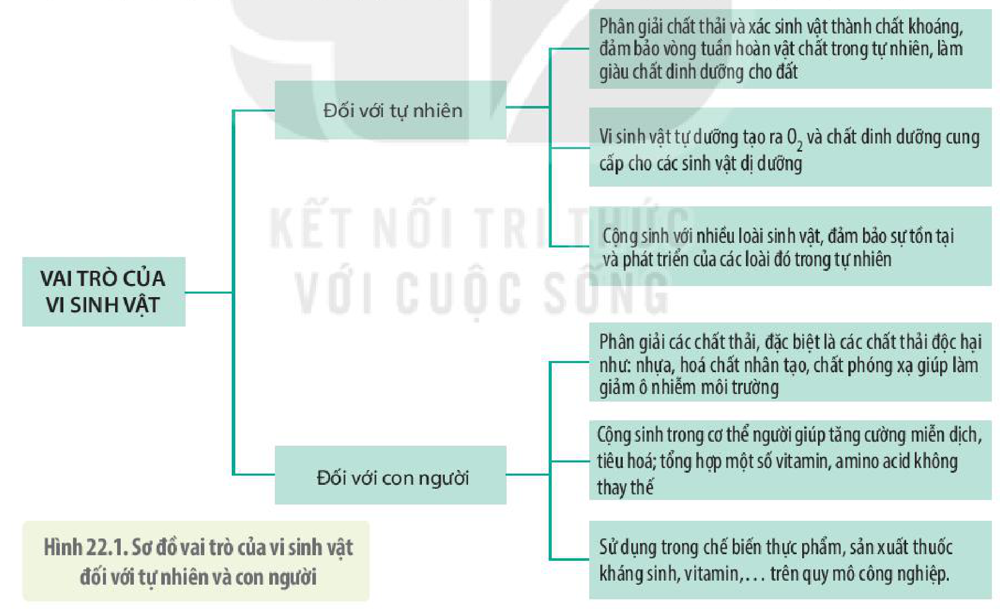
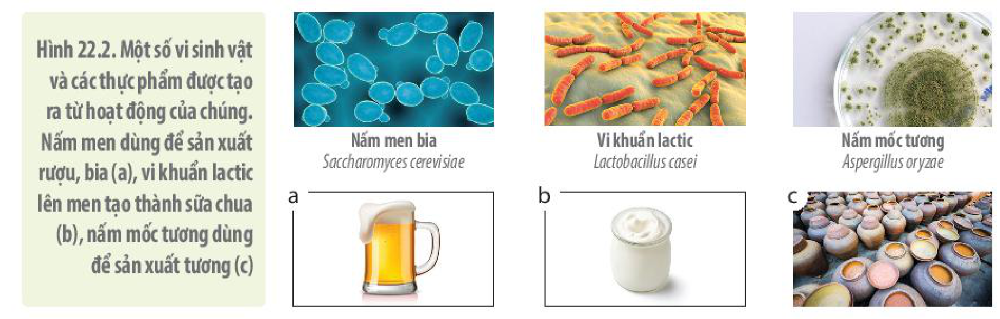
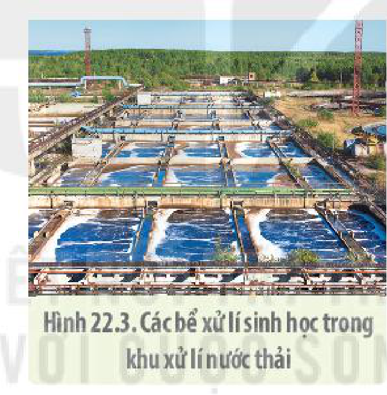
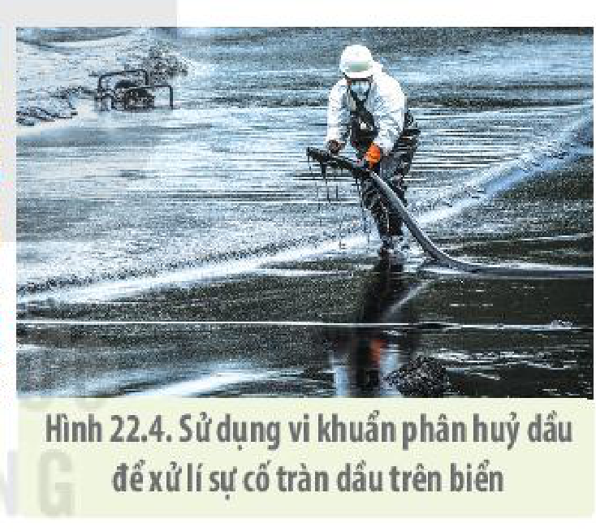
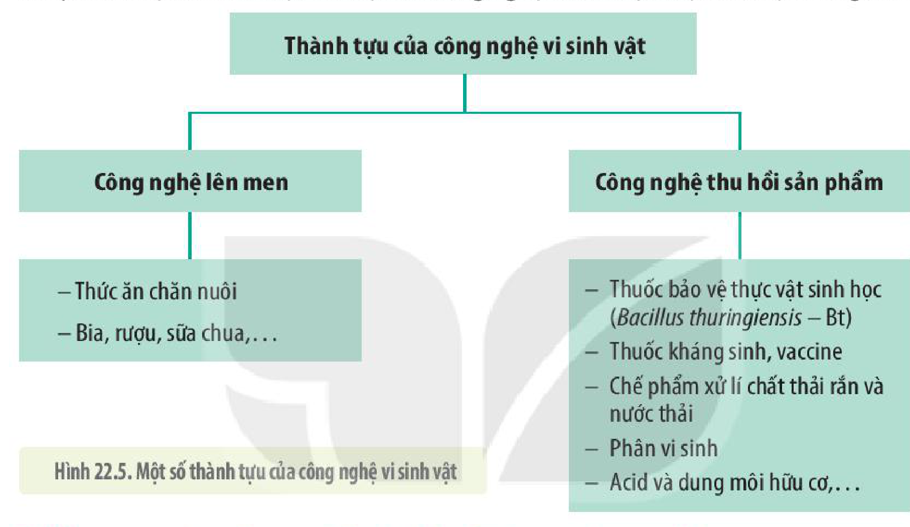
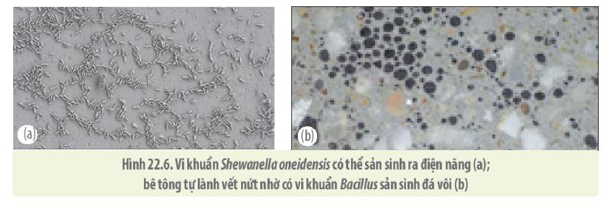

<!-- pdf:132 -->

# BÀI 22: VAI TRÒ VÀ ỨNG DỤNG CỦA VI SINH VẬT

## 🎯 Yêu cầu cần đạt

- Phân tích được vai trò của vi sinh vật trong đời sống con người và trong tự nhiên.
- Kể tên được một số thành tựu hiện đại của công nghệ vi sinh vật.
- Trình bày được cơ sở khoa học của việc ứng dụng vi sinh vật trong thực tiễn.
- Trình bày được một số ứng dụng vi sinh vật trong thực tiễn (sản xuất và bảo quản thực phẩm, sản xuất thuốc, xử lí môi trường,...).
- Phân tích triển vọng công nghệ vi sinh vật trong tương lai.
- Kể tên một số ngành nghề liên quan đến công nghệ vi sinh vật và phát triển của ngành nghề đó.

## 🔴 Mở đầu

Vi sinh vật có vai trò rất quan trọng với con người và tự nhiên. Hãy kể một số ví dụ về vai trò của vi sinh vật trong đời sống hằng ngày.

## I. VAI TRÒ CỦA VI SINH VẬT

Vi sinh vật đóng vai trò vô cùng quan trọng đối với tự nhiên và con người (H 22.1).

Hình 22.1. Sơ đồ vai trò của vi sinh vật đối với tự nhiên và con người

Tuy nhiên, bên cạnh những lợi ích, vi sinh vật cũng đem đến những tác hại đáng kể cho con người. Chúng là nguyên nhân gây ra nhiều căn bệnh nguy hiểm ở người như lao, uốn ván, nhiễm trùng huyết,... Chúng cũng gây nhiều bệnh cho vật nuôi và cây trồng, gây hỏng thực phẩm, đồ dùng dẫn đến thiệt hại lớn về kinh tế. Các loại vi sinh vật còn tập hợp lại với nhau thành **màng sinh học** (**biofilm** – một kiểu tổ chức đa bào giúp chúng sống sót tốt hơn dưới tác động của môi trường) bám trên các bề mặt thiết bị công nghiệp, đồ dùng nhà bếp, nhà vệ sinh,... làm tắc nghẽn đường ống, cản trở hoạt động sản xuất.

<!-- pdf:133 -->

## ❓ Dừng lại và suy ngẫm

1. Quan sát hình 22.1, nêu một số ví dụ minh hoạ về vai trò của vi sinh vật đối với tự nhiên.
2. Hãy kể tên những sản phẩm từ vi sinh vật phục vụ cho đời sống con người mà em biết.
3. Một bạn học sinh nói: “Vi sinh vật có hại vì chúng gây bệnh cho con người, vì vậy cần kìm hãm và tiêu diệt chúng”. Em có đồng ý với ý kiến của bạn không? Giải thích.

## 💡 Em có biết

**Vi khuẩn có thể gây viêm loét dạ dày**

Năm 1982, Robin Warren và Barry Marshall đã phân lập từ dịch vị một loài vi khuẩn có tên là *Campylobacter pylori* (nay được đặt tên là *Helicobacter pylori*). Trong nhiều năm, bằng chứng tích luỹ cho thấy vi khuẩn này thực sự là tác nhân gây bệnh cho phần lớn các trường hợp bị loét dạ dày tá tràng và ung thư dạ dày. Liệu pháp kháng sinh hiện nay có thể loại trừ được *H. pylori*. Tuy nhiên, hơn 80% những người bị nhiễm vi khuẩn này không có triệu chứng và điều đó khiến người ta cho rằng vi khuẩn có thể đóng một vai trò quan trọng trong “hệ sinh thái dạ dày” tự nhiên. Thực tế, hơn 50% dân số thế giới chứa *H. pylori* ở đường tiêu hoá trên, trong đó tỉ lệ nhiễm vi khuẩn này ở các nước đang phát triển phổ biến hơn ở các nước phương Tây (Biology-Solomon và cộng sự, 2019).

Vi khuẩn *H. pylori* có thể lây từ người này sang người khác theo đường ăn uống, vì vậy, cần giữ vệ sinh ăn uống để hạn chế sự lây lan của bệnh trong cộng đồng.

## II. MỘT SỐ ỨNG DỤNG CỦA VI SINH VẬT

### 1. Cơ sở khoa học của việc ứng dụng vi sinh vật trong thực tiễn

Việc ứng dụng vi sinh vật trong thực tiễn dựa trên các đặc điểm sinh học của chúng như: kích thước hiển vi, sinh trưởng nhanh, phát triển mạnh, hình thức dinh dưỡng đa dạng, quá trình tổng hợp và phân giải các chất tạo ra các sản phẩm có giá trị dinh dưỡng hoặc có ý nghĩa lớn trong đời sống con người.

*Kích thước hiển vi:* Vi sinh vật có kích thước rất nhỏ bé, dao động từ 0,2 $\mu\text{m}$ tới hơn 700 $\mu\text{m}$ và chỉ có thể quan sát được dưới kính hiển vi.

*Sinh trưởng nhanh, sinh sản mạnh:* Do có kích thước nhỏ nên tỉ lệ diện tích/thể tích (S/V) cơ thể ở vi sinh vật lớn, làm tăng tốc độ trao đổi chất và sinh trưởng. Tỉ lệ S/V lớn cho phép tốc độ trao đổi chất trên mỗi đơn vị thể tích của vi sinh vật cao hơn nhiều so với các cơ thể có kích thước lớn. Kích thước nhỏ còn có lợi trong việc nuôi cấy, lưu trữ và nghiên cứu vi sinh vật. Một số lượng rất lớn tế bào có thể được nuôi cấy chỉ trong một khoảng không gian nhỏ.

*Tổng hợp và phân giải các chất nhanh:* Sử dụng vi sinh vật trong công nghiệp và nghiên cứu có thể thu được sản lượng rất lớn trong một khoảng thời gian ngắn. Ví dụ: Trong điều kiện thí nghiệm tối ưu, 1 g của một số nhóm vi khuẩn lactic (tính theo khối lượng khô của tế bào) có thể sinh tới 15 g đến 22,8 g lactate trong một giờ. So với các sinh vật khác thì vi sinh vật có tốc độ sinh trưởng và sinh sản vô cùng lớn nhờ tốc độ trao đổi chất nhanh và cơ chế sinh sản phân đôi. Vi khuẩn đường ruột *E. coli* trong điều kiện tối ưu sẽ phân chia mỗi 20 phút một lần và sau 24 giờ sẽ cho ra hơn 4 700 tấn tế bào. Thời gian thế hệ của nấm men *Saccharomyces cerevisiae* là 120 phút.

<!-- pdf:134 -->

*Đa dạng về di truyền:* Do tốc độ sinh sản nhanh, tốc độ đột biến lớn, khả năng tái tổ hợp di truyền và lịch sử tiến hoá lâu dài nên vi sinh vật có sự đa dạng di truyền rất lớn.

*Phổ sinh thái và dinh dưỡng rộng:* Mức độ đa dạng di truyền vô cùng lớn ở vi sinh vật cũng được phản ánh ở khả năng thích nghi của chúng. Vi sinh vật có thể được tìm thấy ở tất cả những môi trường có thể có sự sống và có tất cả những hình thức dinh dưỡng sinh vật sống có thể có, trong đó bao gồm cả môi trường nuôi cấy thí nghiệm, trong bình lên men công nghiệp và các điều kiện nhân tạo khác. Sự đa dạng về sinh thái và dinh dưỡng của vi sinh vật dẫn đến sự đa dạng về hình thái, cấu trúc tế bào, thành phần cấu trúc protein và enzyme cũng như các sản phẩm chuyển hoá thứ cấp, từ đó có rất nhiều tiềm năng có thể ứng dụng vào thực tiễn.

### 2. Ứng dụng của công nghệ vi sinh vật

**a) Trong nông nghiệp**

<!-- term: Phân bón vi sinh -->
Nhiều loại vi sinh vật có khả năng cố định $\text{N}_2$ trong không khí thành $\text{NH}_3$ làm giàu chất đạm cho đất; biến lân khó tiêu thành lân dễ tiêu, giúp cây trồng hấp thụ lân dễ dàng hơn; phân giải mùn và các chất hữu cơ trong đất thành chất khoáng vô cơ mà cây có thể hấp thụ được; tiết ra chất kích thích tăng trưởng, polysaccharide hay chất kháng sinh giúp cây sinh trưởng, phát triển tốt hơn, giữ ẩm cho đất và ức chế mầm bệnh cho cây trồng. Dựa vào các đặc điểm này của vi sinh vật, người ta đã sử dụng chúng để sản xuất phân bón vi sinh giúp tăng đáng kể năng suất cây trồng, cải tạo đất và không gây ô nhiễm môi trường như phân bón hoá học.

<!-- term: Thuốc trừ sâu vi sinh -->
Một số vi sinh vật có khả năng ức chế sự phát triển của sâu, bệnh gây hại cho cây trồng cũng được sử dụng để sản xuất ra thuốc trừ sâu vi sinh thay cho thuốc trừ sâu hoá học, vừa có thể diệt trừ sâu, bệnh hại hiệu quả lại không gây hại cho môi trường, tránh nguy cơ tồn dư thuốc hoá học gây độc cho con người và vật nuôi.

**b) Trong chế biến thực phẩm**

Khả năng phân giải ngoại bào của vi sinh vật được ứng dụng nhiều trong công nghiệp chế biến thực phẩm. Rất nhiều thực phẩm quen thuộc với chúng ta là sản phẩm của vi sinh vật. Bánh mì, bia và rượu đều là sản phẩm lên men của nấm *Saccharomyces cerevisiae* qua quá trình lên men ethanol; sữa chua và pho mát là sản phẩm lên men của vi khuẩn lactic (H 25.2).

$$\text{Tinh bột} \longrightarrow \text{Glucose} \xrightarrow{\text{Nấm men rượu}} \text{Ethanol (rượu ethylic)} + \text{CO}_2$$
<!-- ocr-ok: sơ đồ phản ứng LaTeX -->

$$\text{Glucose} \xrightarrow{\text{Vi khuẩn lactic}} \text{Lactic acid}$$
<!-- ocr-ok: sơ đồ phản ứng LaTeX -->

Quá trình phân giải của vi sinh vật còn được ứng dụng để sản xuất các sản phẩm như nước tương, xì dầu, nước mắm (H 22.2).

Hình 22.2. Một số vi sinh vật và các thực phẩm được tạo ra từ hoạt động của chúng. Nấm men dùng để sản xuất rượu, bia (a), vi khuẩn lactic lên men tạo thành sữa chua (b), nấm mốc tương dùng để sản xuất tương (c)

<!-- pdf:135 -->

**c) Trong y dược**

Các sản phẩm trao đổi chất ở vi sinh vật còn được ứng dụng trong lĩnh vực y dược để sản xuất thuốc kháng sinh, vaccine, các amino acid, protein đơn bào, hormone, **probiotics** và nhiều chế phẩm sinh học có giá trị khác. Ví dụ: Các sản phẩm được tạo ra từ công nghệ tái tổ hợp vi khuẩn và nấm men như insulin, hormone sinh trưởng, chất kích thích miễn dịch cytokine, chất kháng virus như interferon. Ngoài ra, chúng còn được ứng dụng trong việc chẩn đoán các bệnh hiểm nghèo, ung thư, bệnh mới phát sinh (do coronavirus và virus hiếm gặp gây ra) bằng kĩ thuật PCR.

**d) Trong xử lí chất thải**
<!-- ocr-ok: tiêu đề mục con bị gộp dòng trong OCR -->

Dựa vào khả năng hấp thụ và phân giải nhiều hợp chất, kể cả chất thải, chất độc hại và kim loại nặng của vi sinh vật, con người đã sử dụng chúng để xử lí ô nhiễm môi trường. Biện pháp này đang trở thành xu hướng phổ biến trên thế giới vì vừa hiệu quả, ít tốn kém lại không gây ô nhiễm môi trường như các biện pháp truyền thống.

Trong các khu xử lí nước thải (H 22.3), có những bể xử lí sinh học bao gồm bể hiếu khí, bể thiếu khí và bể kị khí với những hệ vi sinh vật riêng. Tại đó, các chất thải trong nước được vi sinh vật chuyển hoá thành methane ($\text{CH}_4$), carbon dioxide ($\text{CO}_2$) và chất lắng không phân huỷ. Những sự cố tràn dầu (H 22.4) gây ô nhiễm hàng nghìn $\text{km}^2$ mặt nước biển có thể được xử lí nhờ các vi sinh vật “ăn” dầu như *Alcanivorax borkumensis*.

<!-- term: Khí biogas -->
Ở quy mô gia đình, chất thải chăn nuôi có thể được thu gom vào các bể kín và được phân giải bởi các Archaea sinh methane để tạo ra khí biogas dùng làm chất đốt cho gia đình. Cách làm này mang lại rất nhiều lợi ích cả về kinh tế và môi trường vì vừa xử lí được chất thải, tránh ô nhiễm môi trường lại tận dụng được triệt để các sản phẩm sau xử lí làm chất đốt và nguồn phân bón hữu cơ rất tốt cho cây trồng.

Hình 22.3. Các bể xử lí sinh học trong khu xử lí nước thải

Hình 22.4. Sử dụng vi khuẩn phân huỷ dầu để xử lí sự cố tràn dầu trên biển

Ngoài ra, công nghệ vi sinh vật cũng mở ra cuộc cách mạng trong ngành sản xuất bột giặt và ngành công nghiệp thuộc da. Các enzyme amylase, lipase, protease do các vi sinh vật sinh ra được bổ sung vào bột giặt sinh học giúp tẩy sạch các vết bẩn khó sạch. Các enzyme đó cũng giúp cho việc xử lí da được triệt để, góp phần nâng cao hiệu quả và giảm thiểu ô nhiễm môi trường.

## ❓ Dừng lại và suy ngẫm

1. Việc ứng dụng vi sinh vật trong thực tiễn dựa trên những cơ sở khoa học nào?
2. Công nghệ vi sinh vật được ứng dụng trong các lĩnh vực nào? Nêu một số ví dụ minh hoạ cho từng lĩnh vực.
3. Việc ứng dụng vi sinh vật trong sản xuất nước tương, nước mắm dựa trên cơ sở khoa học nào?

<!-- pdf:136 -->

## III. MỘT SỐ THÀNH TỰU VÀ TRIỂN VỌNG CỦA CÔNG NGHỆ VI SINH VẬT TRONG TƯƠNG LAI

### 1. Một số thành tựu của công nghệ vi sinh vật

<!-- term: Công nghệ vi sinh vật -->
Cho đến nay, công nghệ vi sinh vật đã được ứng dụng rộng rãi và đạt được những thành tựu vô cùng to lớn, ngày càng có ảnh hưởng sâu rộng đến mọi mặt của đời sống con người từ lĩnh vực thực phẩm, chăm sóc sức khoẻ, nông nghiệp đến xử lí ô nhiễm môi trường. Đóng vai trò then chốt trong công nghệ vi sinh vật là công nghệ lên men và công nghệ thu hồi sản phẩm. Một số thành tựu nổi bật của công nghệ vi sinh vật được thể hiện trong hình 22.5.

Hình 22.5. Một số thành tựu của công nghệ vi sinh vật

### 2. Triển vọng của công nghệ vi sinh vật trong tương lai

Công nghệ vi sinh vật đang ngày càng phát triển mạnh mẽ trên thế giới. Sự kết hợp giữa công nghệ vi sinh vật hiện đại, công nghệ nano, công nghệ thông tin và trí tuệ nhân tạo có thể mở ra những mô hình công nghệ mới và trở thành xu thế trong tương lai.

Những vấn đề lớn về công nghệ vi sinh vật đang được nghiên cứu trên thế giới bao gồm nghiên cứu hệ vi sinh vật Trái Đất và nghiên cứu hệ vi sinh vật con người. Những nghiên cứu này mở ra nhiều hướng ứng dụng mới có giá trị to lớn đối với mọi mặt của đời sống con người, trong đó có những hướng phát triển mới chưa từng có như nghiên cứu sản xuất ra điện năng từ những loại vi khuẩn có thể sản sinh ra điện năng hay xử lí vết nứt bê tông cho các công trình xây dựng bằng các vi sinh vật (H 22.6).

Hình 22.6. Vi khuẩn *Shewanella oneidensis* có thể sản sinh ra điện năng (a); bê tông tự lành vết nứt nhờ có vi khuẩn *Bacillus* sản sinh đá vôi (b)

<!-- pdf:137 -->

### 3. Một số ngành nghề liên quan đến công nghệ vi sinh vật và triển vọng phát triển của ngành nghề đó

Trong tương lai, công nghệ vi sinh vật sẽ không ngừng được cải tiến và phát triển trên quy mô lớn nhằm khai thác tối đa các lợi ích của vi sinh vật. Sự phát triển của công nghệ vi sinh vật kéo theo sự phát triển và xuất hiện của nhiều ngành nghề có liên quan như ngành công nghiệp thực phẩm chuyên nghiên cứu và sản xuất các loại rượu, bia, các sản phẩm lên men từ sữa,...; công nghiệp dược phẩm chuyên nghiên cứu và sản xuất các loại kháng sinh, kháng thể đơn dòng, vaccine, enzyme...; lĩnh vực y tế với các phòng xét nghiệm vi sinh giúp chẩn đoán bệnh, các trung tâm dịch tễ,...; lĩnh vực môi trường với các trung tâm xử lí ô nhiễm môi trường, tái tạo năng lượng. Sự phát triển của các ngành nghề kể trên lại mở ra cơ hội nghề nghiệp cho nhiều người. Kĩ sư chế biến thực phẩm, dược sĩ, nhân viên xét nghiệm, kĩ sư môi trường, nhà dịch tễ học,... là những nghề thú vị và hứa hẹn nhiều cơ hội phát triển trong tương lai.

## ❓ Dừng lại và suy ngẫm

1. Nêu một số thành tựu hiện đại của công nghệ vi sinh vật.
2. Phân tích triển vọng của công nghệ vi sinh vật trong tương lai. Kể tên một số ngành nghề liên quan đến vi sinh vật trong tương lai và triển vọng của các ngành nghề đó.

## 💡 Khoa học và đời sống

**Vi khuẩn gây sâu răng như thế nào?**

Vi khuẩn và các vi sinh vật khác có thể tạo thành một hỗn hợp cùng tồn tại trên một số bề mặt cực kì khó xử lí. Trên răng, màng sinh học hay còn gọi là **mảng bám**, bao gồm phần lớn các tế bào vi khuẩn được bao quanh bởi chất nền polysaccharide. Hiện tượng sâu răng ở người là do vi khuẩn có trong mảng bám tồn tại ở những vị trí khó tiếp cận với bàn chải đánh răng. Chế độ ăn có nhiều đường đơn có hại cho răng vì một số vi khuẩn lên men đường thành lactic aicd. Sự tạo thành acid này làm giảm độ pH, phá vỡ cấu trúc men răng. Khi men răng bị ăn mòn, chất nền mềm còn sót lại của răng trở nên dễ bị vi khuẩn tấn công gây sâu răng.

## 📌 Kiến thức cốt lõi

- Vi sinh vật phân giải là mắt xích quan trọng đảm bảo sự tuần hoàn vật chất trong tự nhiên. Nhiều vi sinh vật là mắt xích khởi đầu của vòng tuần hoàn vật chất, cung cấp khí $\text{O}_2$ và chất hữu cơ cho các mắt xích tiếp theo. Nhiều vi sinh vật sống cộng sinh cố định đạm, phân giải lân,... làm giàu chất dinh dưỡng cho đất.

<!-- pdf:138 -->

- Đối với con người, vi sinh vật tác động theo hai hướng, có lợi và có hại. Vi sinh vật có lợi sống cộng sinh trong cơ thể người cạnh tranh với vi sinh vật gây bệnh giúp nâng cao khả năng kháng bệnh, hỗ trợ tiêu hoá,... Con người còn sử dụng các vi sinh vật có lợi trong chế biến thực phẩm, làm thuốc, tổng hợp các loại vitamin mà con người không tự tổng hợp được,... Trong khi đó, nhiều loài vi sinh vật có hại gây bệnh cho con người, vật nuôi, cây trồng đồng thời làm hỏng thức ăn, đồ uống, đồ dùng,...
- Công nghệ vi sinh vật đang ngày càng phát triển mạnh mẽ trên thế giới. Sự phát triển của công nghệ vi sinh vật kéo theo sự xuất hiện và phát triển của nhiều ngành nghề có liên quan, mở ra nhiều cơ hội nghề nghiệp mới đầy hứa hẹn trong tương lai.
- Dựa trên các đặc điểm sinh học của vi sinh vật như sinh trưởng nhanh, phát triển mạnh, hình thức dinh dưỡng đa dạng, quá trình tổng hợp và phân giải các chất có nhiều lợi ích, con người đã ứng dụng vào thực tiễn thông qua hai công nghệ then chốt là công nghệ lên men vi sinh vật và công nghệ thu hồi tạo ra các sản phẩm có giá trị trong nhiều lĩnh vực đời sống như chế biến thực phẩm, nông nghiệp, y học, môi trường,...

## ✏️ Luyện tập và vận dụng

1. Giải thích vì sao các sinh vật nhân sơ mặc dù có kích thước nhỏ bé và cấu tạo đơn giản nhưng lại có vai trò “khổng lồ” đối với Trái Đất và sự sống.
2. Nêu một số ví dụ về ứng dụng của vi sinh vật trong đời sống.
3. Giải thích vì sao việc chuyển sang trồng đậu nành trên mảnh đất đã trồng khoai trước đó lại có tác dụng duy trì nitrogen trong đất.

## 📷 Danh sách hình trong bài

| Mã hình | Trang PDF | Vị trí | Chú thích gốc |
|---|---|---|---|
| H10-sinh-b22-01 | 132 | Mục I | Hình 22.1. Sơ đồ vai trò của vi sinh vật đối với tự nhiên và con người |
| H10-sinh-b22-02 | 134 | Mục II.2.b | Hình 22.2. Một số vi sinh vật và các thực phẩm được tạo ra từ hoạt động của chúng. Nấm men dùng để sản xuất rượu, bia (a), vi khuẩn lactic lên men tạo thành sữa chua (b), nấm mốc tương dùng để sản xuất tương (c) |
| H10-sinh-b22-03 | 135 | Mục II.2.d | Hình 22.3. Các bể xử lí sinh học trong khu xử lí nước thải |
| H10-sinh-b22-04 | 135 | Mục II.2.d | Hình 22.4. Sử dụng vi khuẩn phân huỷ dầu để xử lí sự cố tràn dầu trên biển |
| H10-sinh-b22-05 | 136 | Mục III.1 | Hình 22.5. Một số thành tựu của công nghệ vi sinh vật |
| H10-sinh-b22-06 | 136 | Mục III.2 | Hình 22.6. Vi khuẩn *Shewanella oneidensis* có thể sản sinh ra điện năng (a); bê tông tự lành vết nứt nhờ có vi khuẩn *Bacillus* sản sinh đá vôi (b) |
