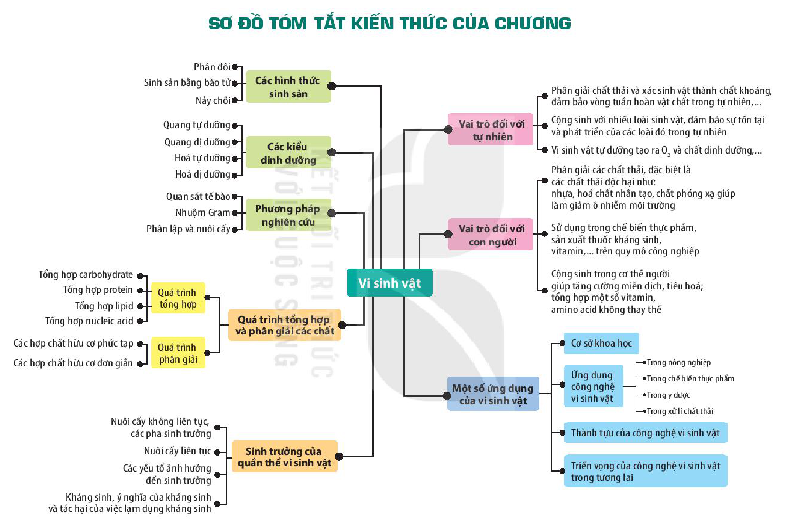

<!-- pdf:141 -->

# SƠ ĐỒ TÓM TẮT KIẾN THỨC CHƯƠNG 6

<!-- Trang in xoay ngang; ảnh đã xoay lại. Dưới đây chép các nhánh của sơ đồ thành danh sách, giữ nguyên chữ trong các ô. -->

- Vi sinh vật
  - Các hình thức sinh sản
    - Phân đôi
    - Sinh sản bằng bào tử
    - Nảy chồi
  - Các kiểu dinh dưỡng
    - Quang tự dưỡng
    - Quang dị dưỡng
    - Hoá tự dưỡng
    - Hoá dị dưỡng
  - Phương pháp nghiên cứu
    - Quan sát tế bào
    - Nhuộm Gram
    - Phân lập và nuôi cấy
  - Quá trình tổng hợp và phân giải các chất
    - Quá trình tổng hợp
      - Tổng hợp carbohydrate
      - Tổng hợp protein
      - Tổng hợp lipid
      - Tổng hợp nucleic acid
    - Quá trình phân giải
      - Các hợp chất hữu cơ phức tạp
      - Các hợp chất hữu cơ đơn giản
  - Sinh trưởng của quần thể vi sinh vật
    - Nuôi cấy không liên tục, các pha sinh trưởng
    - Nuôi cấy liên tục
    - Các yếu tố ảnh hưởng đến sinh trưởng
    - Kháng sinh, ý nghĩa của kháng sinh và tác hại của việc lạm dụng kháng sinh
  - Vai trò đối với tự nhiên
    - Phân giải chất thải và xác sinh vật thành chất khoáng, đảm bảo vòng tuần hoàn vật chất trong tự nhiên,...
    - Cộng sinh với nhiều loài sinh vật, đảm bảo sự tồn tại và phát triển của các loài đó trong tự nhiên
    - Vi sinh vật tự dưỡng tạo ra $\text{O}_2$ và chất dinh dưỡng,...
  - Vai trò đối với con người
    - Phân giải các chất thải, đặc biệt là các chất thải độc hại như: nhựa, hoá chất nhân tạo, chất phóng xạ giúp làm giảm ô nhiễm môi trường
    - Sử dụng trong chế biến thực phẩm, sản xuất thuốc kháng sinh, vitamin,... trên quy mô công nghiệp
    - Cộng sinh trong cơ thể người giúp tăng cường miễn dịch, tiêu hoá; tổng hợp một số vitamin, amino acid không thay thế
  - Một số ứng dụng của vi sinh vật
    - Cơ sở khoa học
    - Ứng dụng công nghệ vi sinh vật
      - Trong nông nghiệp
      - Trong chế biến thực phẩm
      - Trong y dược
      - Trong xử lí chất thải
    - Thành tựu của công nghệ vi sinh vật
    - Triển vọng của công nghệ vi sinh vật trong tương lai

## 📷 Danh sách hình trong bài

| Mã hình | Trang PDF | Vị trí | Chú thích gốc |
|---|---|---|---|
| H10-sinh-so-do-tom-tat-c06-01 | 141 | Cả trang (in xoay ngang) | Sơ đồ tóm tắt kiến thức của chương |
