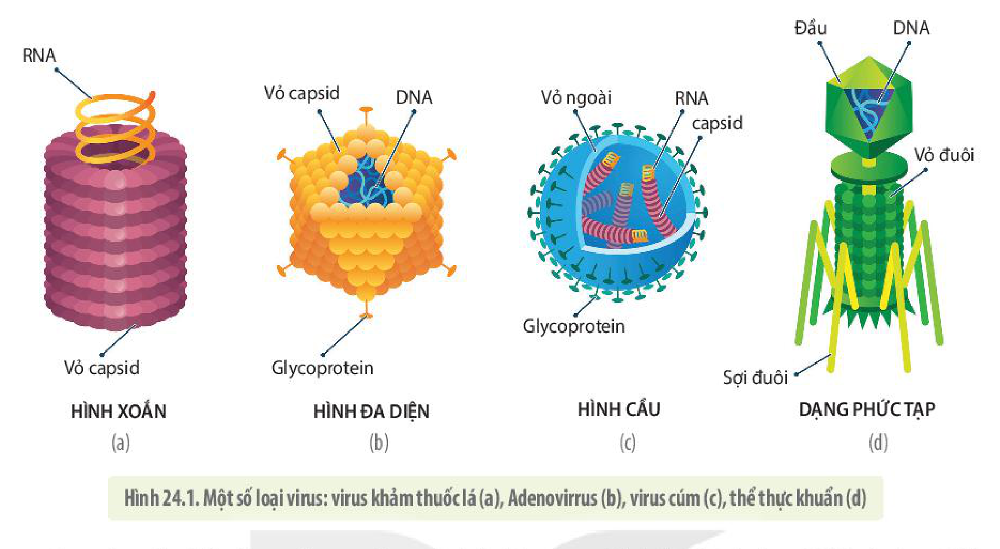
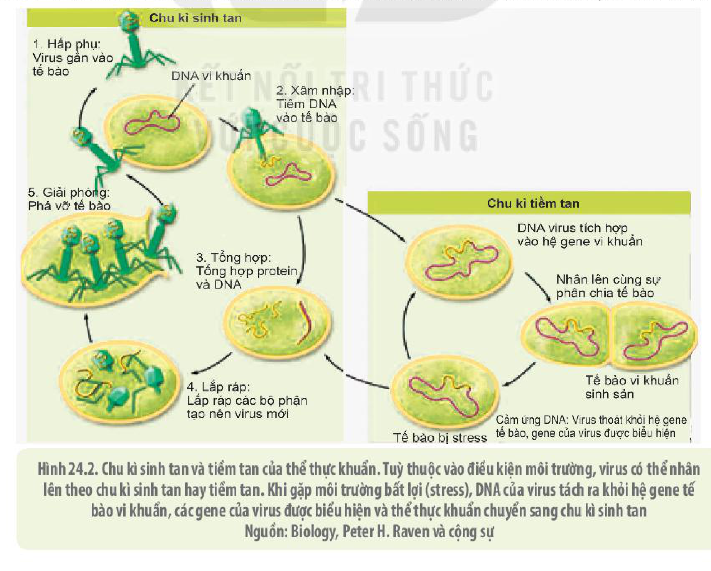

<!-- pdf:142 -->

# BÀI 24: KHÁI QUÁT VỀ VIRUS

## 🎯 Yêu cầu cần đạt

- Nêu được khái niệm và các đặc điểm của virus. Trình bày được cấu tạo của virus.
- Trình bày được các giai đoạn nhân lên của virus trong tế bào chủ.

## 🔴 Mở đầu

Một dạng vật chất không có cấu tạo tế bào, vô cùng nhỏ bé làm khuynh đảo thế giới có tên là virus. Virus là gì và có cấu tạo như thế nào mà khiến cho con người đã, đang và sẽ liên tục phải đối phó với những dịch bệnh do chúng gây ra?

## I. VIRUS VÀ CÁC ĐẶC ĐIỂM CHUNG CỦA VIRUS
<!-- ocr-ok: tiêu đề mục I in hoa màu xanh, OCR đọc nhầm CHUNG CỦA thành GHUNG GỦA; đã đối chiếu ảnh PDF 142 -->

**Virus** là thực thể chưa có cấu tạo tế bào, có kích thước vô cùng nhỏ bé, chỉ được nhân lên trong tế bào của sinh vật sống.

Virus (tiếng Latin có nghĩa là chất độc) là tác nhân gây bệnh truyền nhiễm, lần đầu được ghi nhận vào năm 1728. Nhiều nghiên cứu sau này cho thấy hầu hết các loại virus có kích thước siêu nhỏ, dao động từ 20 nm đến 300 nm. Hình dạng và cấu trúc của virus rất đa dạng (H 24.1). Virus không có khả năng sinh sản cũng như các hoạt động chuyển hoá khi ở bên ngoài tế bào do chúng chưa có đầy đủ các thành phần cấu tạo của một tế bào. Vì vậy, virus không được xem là một vật sống hoàn chỉnh mà được coi là vật kí sinh bắt buộc trong tế bào. Các nhà khoa học đã xác định được khoảng trên 2 000 loại virus khác nhau.

<!-- term: Gai glycoprotein -->
Về mặt cấu trúc, tất cả các loại virus đều được cấu tạo từ hai thành phần chính: lõi là nucleic acid và vỏ là protein (còn được gọi là **vỏ capsid**). Ngoài hai thành phần chính này, một số loại virus động vật còn có thêm lớp màng kép phospholipid ở bên ngoài, được gọi là **lớp vỏ ngoài** với các gai glycoprotein giúp chúng tiếp cận tế bào chủ (H 24.1c). Virus với cấu tạo như vậy được gọi là **virion** hay hạt virus.

Vật chất di truyền của mỗi virus có thể là DNA hoặc RNA, có cấu trúc mạch kép hay mạch đơn và gồm một hoặc một vài đoạn phân tử tương đối ngắn. Virus có hệ gene nhỏ nhất chỉ gồm 3 gene, virus có hệ gene lớn nhất chứa tới vài trăm gene thậm chí tới 2 000 gene.

<!-- pdf:143 -->

Hình 24.1. Một số loại virus: virus khảm thuốc lá (a), Adenovirrus (b), virus cúm (c), thể thực khuẩn (d)

<!-- term: Virus DNA -->
<!-- term: Virus RNA -->
Dựa vào vật chất di truyền người ta có thể chia virus thành hai loại: virus DNA và virus RNA. Loại virus RNA, ngoài RNA và vỏ capsid, mỗi hạt virus còn có thêm một số loại enzyme mà trong tế bào chủ thường không có. Đó là các enzyme cần thiết cho quá trình tổng hợp RNA như **enzyme sao chép ngược** (tổng hợp phân tử DNA từ mạch khuôn là RNA), enzyme giúp tích hợp hệ gene virus vào hệ gene tế bào chủ và một số enzyme giúp lắp ráp và giải phóng virus ra khỏi tế bào.

Virus có thể sống kí sinh ở tất cả các nhóm sinh vật, từ vi khuẩn đến động vật và thực vật. Mỗi loại virus chỉ có thể xâm nhập và lây nhiễm cho một số loài sinh vật nhất định. Tập hợp các loài sinh vật mà một loại virus có thể lây nhiễm được gọi là **phổ vật chủ** của virus. Một số virus có phổ vật chủ rộng, gồm nhiều loài sinh vật khác nhau nhưng có những loại virus có phổ vật chủ hẹp, chỉ lây nhiễm cho một loài, thậm chí chỉ kí sinh ở một loại tế bào của một mô nhất định.

Nơi virus tồn tại ngoài tự nhiên được gọi là **ổ chứa**. Các sinh vật như động vật, thực vật là các ổ chứa virus có thể biểu hiện hoặc không biểu hiện triệu chứng nhiễm virus, nhưng từ đó virus có thể phát tán và gây bệnh sang người hoặc sang các vật chủ khác. Vì vậy, việc phát hiện các ổ chứa hay vật trung gian truyền bệnh rất quan trọng trong việc khống chế dịch bệnh do virus gây ra ở người cũng như ở vật nuôi và cây trồng.

## ❓ Dừng lại và suy ngẫm

1. Virus là gì? Tại sao virus lại không được xem là một vật sống hoàn chỉnh?
2. Tất cả các loại virus đều có chung đặc điểm gì?
3. Nêu một số vật trung gian truyền bệnh virus ở người mà em biết.
4. Nếu vật chất di truyền của virus là RNA thì mỗi hạt virus, ngoài các phân tử RNA và lớp vỏ capsid còn có thêm những protein gì? Giải thích.

<!-- pdf:144 -->

## II. QUÁ TRÌNH NHÂN LÊN CỦA VIRUS

Sự gia tăng số lượng virus trong tế bào được gọi là **sự nhân lên của virus**.

Quá trình nhân lên của các loại virus về cơ bản là giống nhau và đều trải qua năm giai đoạn. Các giai đoạn nhân lên của virus được mô tả dưới đây là chung cho các loại virus, tuy vậy, từng loại virus có những cơ chế riêng, chúng ta sẽ xem xét ở bài sau.

(1) **Giai đoạn hấp phụ**: Virus bám vào tế bào chủ nhờ các gai glycoprotein hoặc protein bề mặt của virus (đối với virus không có vỏ ngoài) tương tác đặc hiệu với các thụ thể trên bề mặt của tế bào chủ (như chìa khoá với ổ khoá).

(2) **Giai đoạn xâm nhập**: Đây là giai đoạn vật chất di truyền của virus được truyền vào trong tế bào chủ. Tuỳ từng loại virus, giai đoạn này diễn ra có sự khác nhau. Đối với **thể thực khuẩn** – loại virus kí sinh ở vi khuẩn, DNA của virus được tiêm vào trong tế bào vi khuẩn bằng một bộ phận chuyên biệt, vỏ protein bị bỏ lại ở bên ngoài. Nhiều loại virus động vật có vỏ ngoài, đưa cả vỏ capsid cùng vật chất di truyền vào tế bào chủ, sau đó nucleic acid mới được giải phóng ra khỏi vỏ protein. Virus thực vật xâm nhập từ cây này sang cây khác qua các vết thương của tế bào do côn trùng là ổ chứa virus chích hút hoặc ăn các bộ phận của cây.

(3) **Giai đoạn tổng hợp**: Đây là giai đoạn tổng hợp các bộ phận của virus. DNA của virus khi vào trong tế bào, thu hút các enzyme của tế bào đến phiên mã, dịch mã tạo ra các protein của virus cũng như nhân bản vật chất di truyền của chúng. Một số virus RNA khi vào tế bào, RNA có thể trực tiếp thu hút các enzyme của tế bào tới dịch mã tạo ra các protein cũng như nhân bản vật chất di truyền của chúng. Số khác phải mang theo enzyme phiên mã ngược để sao chép RNA thành DNA rồi phiên mã thành các RNA làm vật chất di truyền của virus.

Hình 24.2. Chu kì sinh tan và tiềm tan của thể thực khuẩn. Tuỳ thuộc vào điều kiện môi trường, virus có thể nhân lên theo chu kì sinh tan hay tiềm tan. Khi gặp môi trường bất lợi (stress), DNA của virus tách ra khỏi hệ gene tế bào vi khuẩn, các gene của virus được biểu hiện và thể thực khuẩn chuyển sang chu kì sinh tan
Nguồn: Biology, Peter H. Raven và cộng sự

<!-- pdf:145 -->

(4) **Giai đoạn lắp ráp**: Lắp lõi nucleic acid vào vỏ protein để tạo thành các hạt virus hoàn chỉnh.

(5) **Giai đoạn giải phóng**: Virus thoát ra khỏi tế bào chủ.

Khi đã vào được bên trong tế bào, các loại virus có thể nhân lên theo một trong hai cách được gọi là **chu kì sinh tan** hoặc **chu kì tiềm tan** hay sử dụng cả hai cách như thể thực khuẩn được mô tả trong hình 24.2.

## ❓ Dừng lại và suy ngẫm

Quan sát hình 24.2, thực hiện các yêu cầu sau:

1. Mô tả các bước trong quá trình nhân lên của virus.
2. Phân biệt chu kì sinh tan với chu kì tiềm tan của thể thực khuẩn.

## 📌 Kiến thức cốt lõi

- Virus là thực thể chưa có cấu tạo tế bào, có kích thước vô cùng nhỏ bé, chỉ được nhân lên trong tế bào của sinh vật sống.
- Virus có hình dạng khá đa dạng, được cấu tạo từ hai thành phần chính là lõi nucleic acid và vỏ protein, một số virus có thêm vỏ ngoài.
- Sự nhân lên của virus trong tế bào chủ được thực hiện theo hình thức sinh tan, tiềm tan hoặc cả hai. Chu kì sinh tan gồm 5 giai đoạn: (1) hấp phụ, (2) xâm nhập, (3) tổng hợp, (4) lắp ráp, (5) giải phóng. Chu kì tiềm tan gồm 3 giai đoạn: (1) tích hợp DNA của virus vào hệ gene của tế bào chủ, (2) DNA của virus nhân lên cùng sự phân chia của tế bào, (3) DNA của virus thoát khỏi hệ gene tế bào và được biểu hiện.

## ✏️ Luyện tập và vận dụng

1. Tại sao dùng chế phẩm thể thực khuẩn phun lên rau, quả lại có thể bảo vệ được rau, quả lâu dài hơn? Dùng chế phẩm này liệu có an toàn cho người dùng? Giải thích.
2. Dựa trên quy trình nhân lên của virus, em hãy đề xuất cách ngăn cản virus xâm nhập vào tế bào.

## 📷 Danh sách hình trong bài

| Mã hình | Trang PDF | Vị trí | Chú thích gốc |
|---|---|---|---|
| H10-sinh-b24-01 | 143 | Mục I | Hình 24.1. Một số loại virus: virus khảm thuốc lá (a), Adenovirrus (b), virus cúm (c), thể thực khuẩn (d) |
| H10-sinh-b24-02 | 144 | Mục II | Hình 24.2. Chu kì sinh tan và tiềm tan của thể thực khuẩn. Tuỳ thuộc vào điều kiện môi trường, virus có thể nhân lên theo chu kì sinh tan hay tiềm tan. Khi gặp môi trường bất lợi (stress), DNA của virus tách ra khỏi hệ gene tế bào vi khuẩn, các gene của virus được biểu hiện và thể thực khuẩn chuyển sang chu kì sinh tan — Nguồn: Biology, Peter H. Raven và cộng sự |
