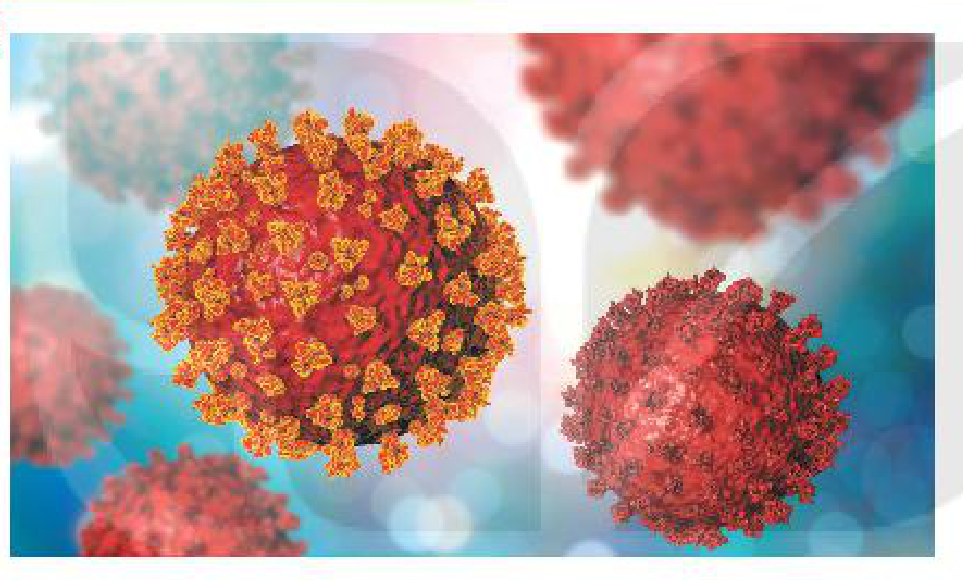
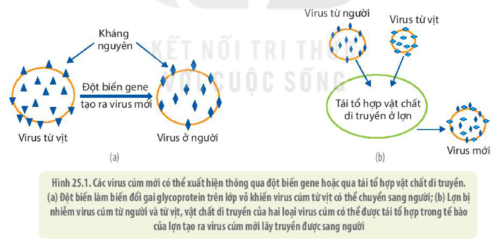
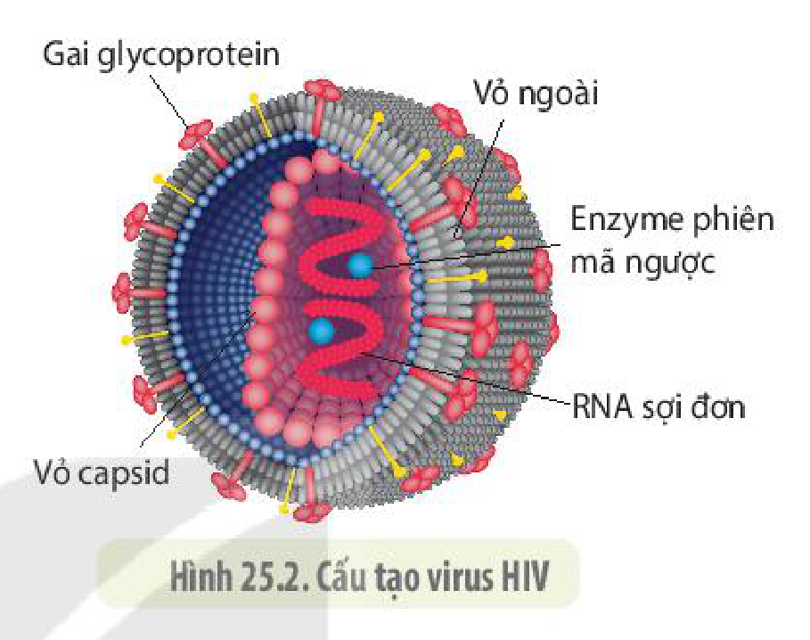
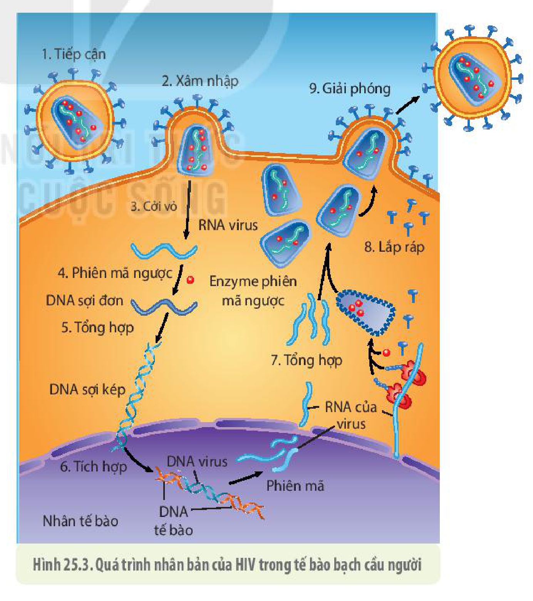
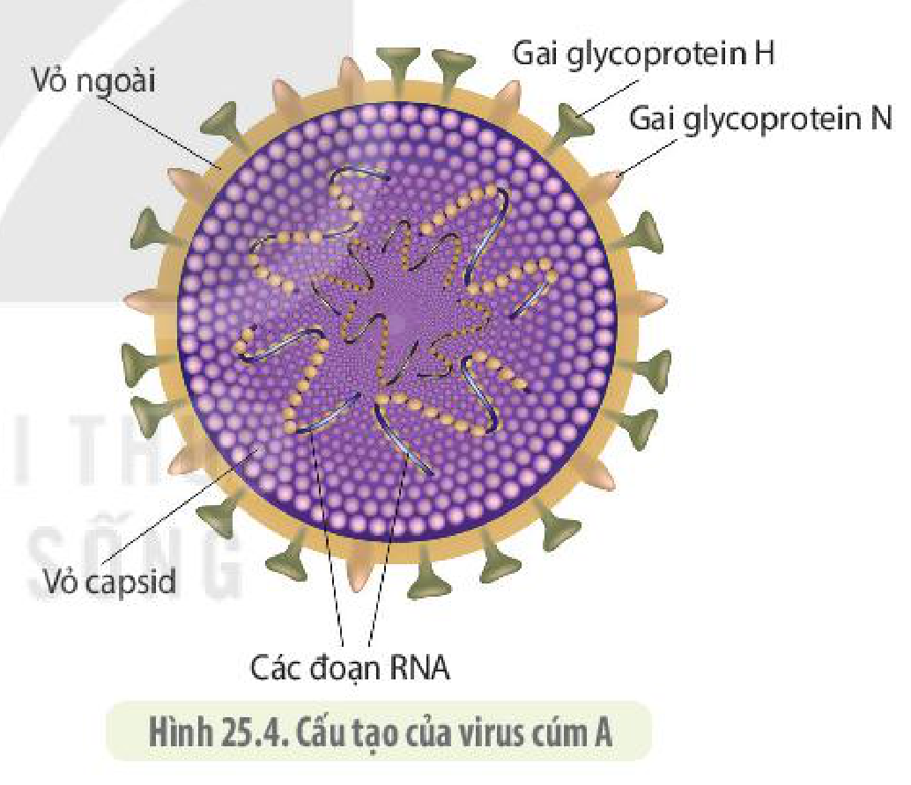
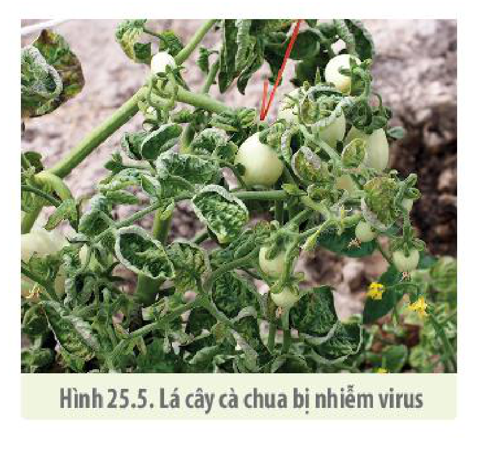
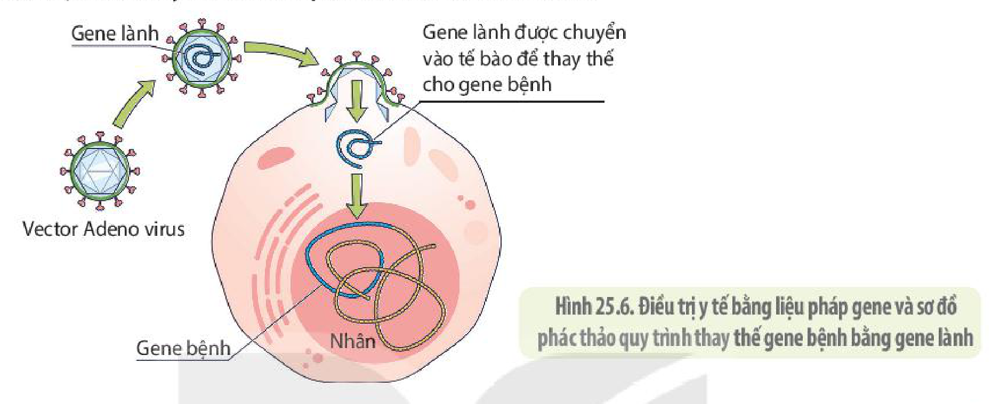

<!-- pdf:146 -->

# BÀI 25: MỘT SỐ BỆNH DO VIRUS VÀ CÁC THÀNH TỰU NGHIÊN CỨU ỨNG DỤNG VIRUS

## 🎯 Yêu cầu cần đạt

- Giải thích được cơ chế gây bệnh do virus.
- Trình bày được phương thức lây truyền một số bệnh do virus ở người, thực vật và động vật (HIV, cúm, sởi,...) và cách phòng chống.
- Giải thích được các bệnh do virus thường lây lan nhanh, rộng và có nhiều biến thể.
- Kể tên được một số thành tựu ứng dụng virus trong sản xuất chế phẩm sinh học; trong y học và nông nghiệp; sản xuất thuốc trừ sâu từ virus.

## 🔴 Mở đầu

Năm 2019, một dịch bệnh mới gây bệnh viêm phổi cấp xuất hiện do một loại virus hoàn toàn mới lạ và được đặt tên là SARS–CoV–2 (hình bên). Virus gây bệnh theo cơ chế nào và có các biện pháp nào để phòng chống virus?

## I. CƠ CHẾ GÂY BỆNH CHUNG CỦA VIRUS

Virus có thể gây bệnh cho tất cả các nhóm sinh vật từ vi khuẩn, nấm, thực vật đến động vật. Từ quá trình nhân lên của virus, chúng ta thấy virus có thể gây bệnh bằng một số cách như sau:

- Virus có cơ chế nhân lên kiểu sinh tan sẽ phá huỷ các tế bào cơ thể và các mô. Vì vậy, tình trạng bệnh nặng hay nhẹ phụ thuộc vào số tế bào bị phá huỷ nhiều hay ít cũng như khả năng tái sinh của các tế bào cơ thể nhanh đến mức nào. Ví dụ: Virus gây cảm lạnh hay virus gây viêm đường hô hấp thường gây ra các triệu chứng bệnh nhẹ, có thể tự biến mất sau một vài ngày khi niêm mạc đường hô hấp được phục hồi hoàn toàn. Trong khi đó, một số loại virus như poliovirus gây bệnh bại liệt, làm tổn hại các tế bào thần kinh, thường để lại hậu quả nặng nề và lâu dài vì các tế bào thần kinh trưởng thành không phân chia nữa.
- Một số loại virus khi xâm nhập vào tế bào có thể sản sinh ra các độc tố làm biểu hiện triệu chứng bệnh. Một số virus khác có các thành phần cấu tạo như protein vỏ ngoài cũng có thể gây bệnh.
- Virus có cơ chế nhân lên kiểu tiềm tan, ngoài việc phá huỷ các tế bào cơ thể, một số còn có thể gây đột biến gene ở tế bào chủ dẫn đến ung thư. Ví dụ: Những người bị viêm

<!-- pdf:147 -->

gan mãn tính do virus viêm gan B rất dễ bị bệnh ung thư gan, hay phụ nữ bị nhiễm virus HPV (Human Papilloma Virus) gây viêm tử cung cũng dễ bị mắc ung thư tử cung hơn những người không bị nhiễm. Ước tính, có khoảng trên 10% ca ung thư ở người là do các loại virus. Khi nhân lên theo kiểu tiềm tan, virus cài vật chất di truyền vào hệ gene của các loại vi khuẩn dẫn đến đột biến hoặc kích hoạt gene của tế bào chủ, biến các chủng vi khuẩn vốn không gây bệnh cho người thành những chủng gây bệnh. Ví dụ: Vi khuẩn *Vibrio chollerae* bình thường không gây bệnh tiêu chảy, nhưng khi chúng bị nhiễm thể thực khuẩn ở dạng tiềm tan, một gene đặc biệt của virus được kích hoạt phiên mã tạo ra chất độc gây bệnh tiêu chảy ở người.

Các bệnh do virus thường có một số biểu hiện chung là bị sốt cao, đau nhức các bộ phận cơ thể. Sốt cao, đau nhức cơ thể không phải do các tế bào bị phá huỷ bởi virus mà do đáp ứng của hệ thống miễn dịch của người chống lại virus. Việc điều khiển thân nhiệt tăng cao hơn bình thường nhằm ngăn chặn sự nhân lên và phát tán của virus trong cơ thể, đau nhức giúp cảnh báo chúng ta để có biện pháp điều trị.

Các loại virus gây bệnh còn nguy hiểm ở chỗ chúng dễ phát sinh chủng mới và nhanh chóng lan rộng thành đại dịch trên toàn cầu. Có tới 70% các loại virus có vật chất di truyền là RNA. Các enzyme nhân bản RNA để tạo ra các virus mới thường sao chép không chính xác và ít hoặc không có khả năng sửa chữa các sai sót nên để lại nhiều đột biến, làm phát sinh các chủng virus mới. Mặc dù rất hiếm khi hai virus cùng xâm nhập vào một tế bào vật chủ, nhưng khi hai loại virus khác nhau cùng ở trong tế bào chủ thì vật chất di truyền của chúng có thể được tái tổ hợp lại tạo ra loại virus mới có khả năng chuyển từ vật chủ này sang vật chủ khác hoặc thay đổi độc lực của virus (H 25.1).

Hình 25.1. Các virus cúm mới có thể xuất hiện thông qua đột biến gene hoặc qua tái tổ hợp vật chất di truyền. (a) Đột biến làm biến đổi gai glycoprotein trên lớp vỏ khiến virus cúm từ vịt có thể chuyển sang người; (b) Lợn bị nhiễm virus cúm từ người và từ vịt, vật chất di truyền của hai loại virus cúm có thể được tái tổ hợp trong tế bào của lợn tạo ra virus cúm mới lây truyền được sang người

## ❓ Dừng lại và suy ngẫm

1. Virus gây bệnh theo các cơ chế nào?
2. Loại virus có vật chất di truyền là DNA hay RNA sẽ dễ phát sinh các chủng đột biến mới? Giải thích.

<!-- pdf:148 -->

## II. MỘT SỐ BỆNH DO VIRUS

### 1. Hội chứng suy giảm miễn dịch mắc phải (AIDS) ở người

Virus gây **hội chứng suy giảm miễn dịch mắc phải** ở người có tên được viết tắt theo tiếng Anh là **HIV** (Human Imunodeficiency Virus). Virus tấn công các tế bào hệ miễn dịch, làm suy yếu khả năng miễn dịch của cơ thể. HIV được cho là đã phát tán từ loài tinh tinh sống ở Trung Phi sang người vào những năm 50 của thế kỉ trước.

**a) Cấu tạo của HIV**

HIV là loại virus có vật chất di truyền là RNA. Bên trong vỏ capsid của HIV có chứa hai phân tử RNA, hai enzyme phiên mã ngược, enzyme intergrase và enzyme phân giải protein. Bên ngoài lớp capsid là vỏ ngoài, được cấu tạo từ phospholipid kép có các gai glycoprotein (H 25.2). Các gai glycoprotein có chức năng giúp HIV liên kết được với các thụ thể đặc hiệu trên các tế bào bạch cầu của hệ miễn dịch ở người để xâm nhập vào các tế bào đó.

Hình 25.2. Cấu tạo virus HIV

**b) Quá trình nhân lên của HIV**

HIV lây nhiễm và phá huỷ một số tế bào của hệ thống miễn dịch ở người như tế bào bạch cầu T4, đại thực bào. HIV tiếp cận tế bào bạch cầu nhờ các gai glycoprotein ở lớp vỏ ngoài liên kết đặc hiệu với các thụ thể trên bề mặt tế bào. Sau đó, lớp vỏ ngoài dung hợp với màng sinh chất của tế bào, đưa virus cùng vỏ capsid vào trong tế bào. Các bước tiếp theo trong quá trình nhân lên của HIV được thể hiện trong hình 25.3.

Trong quá trình nhân lên, HIV thường tạo ra rất nhiều biến thể mới. Những chủng HIV mới có thể xuất hiện rất nhanh chóng trên cùng một người bệnh chỉ sau một vài tháng nhiễm virus. Đây cũng là một trong các nguyên nhân khiến việc phòng và điều trị hội chứng AIDS gặp nhiều khó khăn.

Hình 25.3. Quá trình nhân bản của HIV trong tế bào bạch cầu người

<!-- pdf:149 -->

**c) Phương thức lây truyền và cách phòng tránh hội chứng AIDS**

- *HIV lây truyền từ người sang người theo ba con đường:*
  + Qua đường máu: Người có vết thương hở, khi tiếp xúc trực tiếp với máu hoặc dịch tiết của người bệnh có nguy cơ lây nhiễm cao. Sử dụng chung bơm kim tiêm, dụng cụ xăm mình,... với người nhiễm HIV cũng khiến bệnh lây lan trong cộng đồng.
  + Qua đường tình dục: Quan hệ tình dục với người nhiễm HIV sẽ có nguy cơ lây bệnh cao, đặc biệt trong trường hợp không sử dụng các biện pháp bảo vệ (bao cao su).
  + Mẹ truyền sang con: Những người mẹ nhiễm HIV có thể truyền virus cho con qua nhau thai và qua sữa mẹ.

- *Khi đã xâm nhập vào cơ thể, virus HIV gây hội chứng suy giảm miễn dịch ở người qua ba giai đoạn:*
  + **Giai đoạn sơ nhiễm** hay còn gọi là **giai đoạn cửa sổ**: thường kéo dài từ 2 tuần đến 3 tháng kể từ khi tiếp xúc với mầm bệnh. Ở giai đoạn này, người bệnh thường không biểu hiện triệu chứng hoặc có nhưng rất nhẹ.
  + **Giai đoạn không triệu chứng**: Giai đoạn này thường kéo dài từ 1 đến 10 năm, tuỳ từng bệnh nhân. Lúc này, số lượng tế bào bạch cầu (lympho) T4 giảm dần, tuy nhiên, người bệnh không biểu hiện triệu chứng gì.
  + **Giai đoạn cuối** (**giai đoạn biểu hiện triệu chứng AIDS**): Lúc này số lượng tế bào bạch cầu giảm mạnh khiến hệ miễn dịch hầu như không còn tác dụng bảo vệ cơ thể. Bệnh nhân bị tấn công bởi nhiều căn bệnh do các vi sinh vật khác gây ra (được gọi là các **bệnh cơ hội**) như tiêu chảy, lao, ung thư, viêm da, sưng hạch, sốt kéo dài, khiến sức khoẻ suy kiệt và dẫn đến tử vong. Nguyên nhân tử vong của người mắc hội chứng AIDS thực chất là do các bệnh cơ hội này gây ra.

- *Cách phòng tránh hội chứng AIDS:*
  HIV biến đổi rất nhanh nên hiện nay chưa tìm ra được vaccine phòng tránh. Cách phòng tránh hội chứng AIDS chủ yếu là ngăn ngừa sự lây lan của virus bằng cách:
  + Quan hệ tình dục an toàn, một vợ một chồng hoặc sử dụng các biện pháp bảo vệ như bao cao su.
  + Không sử dụng chung kim tiêm hay các dụng cụ có nguy cơ dính máu hay dịch tiết từ người bệnh.
  + Thực hiện truyền máu an toàn.

  Phát hiện sớm và quản lí tốt những người nhiễm HIV cũng góp phần ngăn chặn việc lây truyền HIV. Ví dụ: Nếu phụ nữ nhiễm HIV khi mang thai được dùng thuốc kháng virus trong thai kì và giai đoạn cho con bú thì có thể ngăn chặn được sự lây nhiễm virus sang con.

  Hiện nay, các nhà khoa học đã chế tạo ra được nhiều loại thuốc ức chế sự nhân lên của HIV. Thuốc phát huy hiệu quả cao khi người bệnh được chữa trị sớm vì số lượng virus trong máu còn hạn chế. Tuy vậy, việc chữa trị còn hạn chế vì virus thường xuất hiện nhiều dạng đột biến kháng lại thuốc. Sự kháng thuốc ở người bệnh có thể xuất hiện chỉ sau một vài tuần sử dụng thuốc. Ngoài ra, do HIV nằm trong hệ gene của tế bào người và hiện chưa có cách gì loại bỏ HIV ra khỏi tế bào nên các loại thuốc chữa hội chứng AIDS hiện nay mới chỉ có tác dụng ngăn chặn sự nhân lên của virus. Do vậy, AIDS có thể tái phát bất kì lúc nào ở người nhiễm HIV.

<!-- pdf:150 -->

## ❓ Dừng lại và suy ngẫm

1. Tại sao HIV chỉ xâm nhập vào được một số loại tế bào miễn dịch ở người?
2. Hiện nay, người ta đã sản xuất ra các loại thuốc là những chất ức chế các enzyme và protein của HIV. Quan sát hình 25.3, hãy cho biết các loại thuốc này có thể ức chế những giai đoạn nào trong quá trình nhân lên của HIV.
3. HIV có thể lây truyền từ người này sang người khác bằng những con đường nào?

### 2. Bệnh cúm ở người và động vật

**a) Cấu tạo của virus cúm**

<!-- term: Virus cúm -->
Virus cúm tồn tại trong cơ thể người và nhiều loài động vật như gà, ngan, vịt, chim và lợn. Virus cúm thường lây nhiễm trong các tế bào niêm mạc đường hô hấp trên ở người và động vật. Có ba loại virus cúm kí hiệu là A, B, C; trong đó virus cúm A là tác nhân chủ yếu gây thành đại dịch cúm ở người, một số động vật có vú khác và gia cầm. Virus cúm A là một trong những tác nhân gây bệnh chết người nguy hiểm nhất trong lịch sử nhân loại, điển hình là đại dịch cúm năm 1918 – 1919. Loại virus cúm B và C ít khi gây nên những vấn đề về sức khoẻ ở người.

<!-- term: Virus cúm -->
Virus cúm có vật chất di truyền gồm 7 đến 8 đoạn phân tử RNA ngắn, mỗi đoạn mã hoá cho một hoặc hai protein. Bao bọc lấy vật chất di truyền là lớp vỏ capsid và bên ngoài cùng có lớp vỏ ngoài được cấu tạo từ lớp kép phospholipid có các gai glycoprotein (H 25.4). Các gai này được chia thành hai nhóm chính: một nhóm được kí hiệu là H có chức năng nhận biết và liên kết với các thụ thể đặc hiệu trên màng tế bào chủ; nhóm thứ hai được kí hiệu là N, là một loại enzyme có chức năng phá huỷ tế bào chủ, giải phóng virus ra khỏi tế bào sau khi chúng được nhân lên.

Hình 25.4. Cấu tạo của virus cúm A

Mỗi loại virus có thể được chia thành các phân nhóm nhỏ dựa trên tổ hợp của các gai H và N. Người ta chia virus cúm thành 16 phân nhóm khác biệt nhau bởi gai H (H1,... H16) và thành 9 nhóm khác nhau bởi gai N (N1,... N9). Ví dụ: Virus cúm gây đại dịch năm 1918 là loại H1N1 được truyền từ gia cầm sang người, virus gây dịch cúm ở Hong Kong năm 1968 thuộc loại H3N2, virus này được truyền từ gia cầm sang người. Virus gây dịch cúm ở Mexico năm 2019 cũng thuộc loại H1N1 được lây từ lợn sang người.

**b) Chu trình lây nhiễm**

Quá trình nhân lên của virus cúm trong tế bào chỉ theo chu kì sinh tan mà không theo chu kì tiềm tan như một số loại virus RNA khác. Virus cúm tiếp cận tế bào niêm mạc đường hô hấp bằng một loại gai glycoprotein nhóm H. Các gai này liên kết với thụ thể trên bề mặt của tế bào, qua đó vỏ ngoài của virus được dung nạp với màng tế bào, đưa hạt virus vào trong tế bào chất. Sau khi vào trong tế bào, hạt virus được cởi vỏ, các phân tử RNA được giải phóng.

<!-- pdf:151 -->

Không giống với HIV, RNA của các virus cúm khi vào trong tế bào được sử dụng như mRNA để dịch mã tạo ra các protein. RNA của virus cũng được dùng làm khuôn để tổng hợp nên RNA làm vật liệu di truyền của các hạt virus mới. Do vậy, sau khi tổng hợp các bộ phận cấu thành, các hạt virus được lắp ráp và giải phóng ra bên ngoài tế bào bằng con đường xuất bào. Quá trình lây nhiễm lại tiếp tục một cách nhanh chóng khiến các tế bào niêm mạc đường hô hấp bị phá huỷ, dẫn đến biểu hiện các triệu chứng bệnh viêm đường hô hấp cấp trong một thời gian tương đối ngắn.

**c) Phương thức lây truyền và cách phòng chống bệnh cúm**

Virus cúm thường phát tán từ người này sang người khác thông qua các giọt dịch khi hắt hơi, dịch tiết, qua tiếp xúc với các bề mặt có dịch tiết chứa virus. Do vậy, cần tránh tiếp xúc trực tiếp với người bệnh bằng cách đeo khẩu trang, thường xuyên vệ sinh môi trường bằng thuốc khử trùng, rửa tay thường xuyên bằng xà phòng, tránh tụ tập nơi đông người, đặc biệt là giữ ấm cơ thể và tăng cường sức đề kháng.

Không ăn thịt gia cầm và thịt động vật chết do dịch bệnh, ăn các thức ăn chín và được chế biến đảm bảo vệ sinh. Khi có dịch, mọi người cần tuân thủ triệt để các khuyến cáo của ngành y tế về công tác phòng chống dịch bệnh.

Không tiếp xúc trực tiếp cũng như mua bán, săn bắt động vật hoang dã vì chúng có thể là các ổ chứa virus gây bệnh. Tiêm phòng định kì cho vật nuôi như các loài gia cầm, lợn, chó, mèo giúp ngăn chặn dịch bệnh phát sinh. Mỗi người nên tiêm định kì vaccine phòng bệnh cúm, rèn luyện thể lực thường xuyên để có được một cơ thể khoẻ mạnh, tuân thủ khuyến cáo của bác sĩ, có sự hiểu biết cơ bản về khoa học sinh học là cách tốt nhất để tự phòng tránh được bệnh tật.

## ❓ Dừng lại và suy ngẫm

1. Quan sát hình 25.2 và hình 25.4, cho biết điểm giống và khác nhau giữa virus cúm và HIV.
2. Một số virus cúm bị đột biến không còn khả năng tiếp cận tế bào đường hô hấp của người. Hãy cho biết bộ phận nào của virus đột biến này bị hỏng.
3. Dựa vào hình 25.3, hãy vẽ sơ đồ mô tả quá trình nhân lên của virus cúm trong tế bào người (lưu ý virus cúm không tích hợp vào hệ gene của tế bào người như HIV).

### 3. Bệnh ở thực vật do virus

Hiện các nhà khoa học đã phát hiện ra nhiều bệnh ở thực vật do virus, gây tổn thất ước tính lên đến 15 tỉ USD mỗi năm. Các loại cây trồng và thực vật hoang dã bị nhiễm virus khác nhau đều có những dấu hiệu nhận biết chung là lá hay bị xoăn; có những vết nâu, trắng hoặc vàng trên lá và quả; cây sinh trưởng chậm, có nhiều tổn thương ở hoa hoặc rễ làm giảm năng suất cũng như chất lượng sản phẩm (H 25.5). Tuy nhiên, cây bị bệnh do virus thường ít khi bị chết.

Hình 25.5. Lá cây cà chua bị nhiễm virus

<!-- pdf:152 -->

Do đặc điểm cấu tạo của tế bào thực vật khác với tế bào động vật, nên cách xâm nhập và lây nhiễm của các loại virus thực vật cũng có những điểm khác biệt với sự lây nhiễm virus ở các tế bào động vật. Virus thực vật thường chỉ có vỏ capsid mà không có lớp vỏ ngoài glycoprotein như virus động vật. Sự phát tán của virus thực vật được thực hiện cơ bản theo hai cách: truyền theo hàng ngang và theo hàng dọc.

- **Truyền bệnh theo hàng ngang**: là sự lây nhiễm virus từ cây này sang cây khác. Do tế bào thực vật có thành tế bào nên virus không thể xâm nhập vào trong tế bào qua con đường thực bào hoặc dung hợp màng tế bào như ở các tế bào động vật. Virus có thể truyền từ cây này sang cây khác khi thành tế bào thực vật bị tổn thương, sau đó virus được nhân lên và lây nhiễm từ tế bào này sang tế bào khác qua cầu sinh chất.

  Quá trình lây nhiễm theo hàng ngang thường thực hiện thông qua sự "giúp đỡ" của côn trùng và có thể là con người. Côn trùng chích hút nhựa cây hoặc ăn lá cây có thể truyền virus từ cây bệnh sang các tế bào của cây lành bị tổn thương thành và màng tế bào. Ví dụ: Virus gây bệnh sọc lá lúa (RSV) được truyền từ rầy nâu sang lúa.

  Con người sử dụng các dụng cụ cắt tỉa cây cũng có thể truyền virus từ cây bệnh sang tế bào của cây lành bị tổn thương cơ học. Các cây bị bệnh cũng có thể truyền virus qua cây không bị bệnh qua sự tiếp xúc giữa các lá hoặc bộ phận bị tổn thương của cây bị bệnh với các bộ phận bị tổn thương (bị giập nát do gió hoặc cọ xát) của cây bình thường.

- **Truyền bệnh theo hàng dọc**: Virus được di truyền từ cây mẹ sang cây con qua con đường sinh sản hữu tính hoặc sinh sản vô tính.

Hiện nay chưa có thuốc trị bệnh virus cho cây trồng nên tiêu huỷ cây bị bệnh và ngăn chặn bệnh lây lan vẫn là biện pháp phòng chống bệnh chủ yếu.

Để phòng tránh bệnh do virus có hiệu quả, cần có sự hiểu biết về cơ chế lây nhiễm của từng loại virus, đặc điểm của virus và phổ vật chủ của chúng. Ví dụ: Một số virus thực vật có thể tồn tại ở các mảnh vụn hữu cơ của cây đã chết và trong đất ở điều kiện khô hạn từ 2 đến 3 năm. Do vậy, việc tiêu huỷ các cây đã nhiễm bệnh, vệ sinh đồng ruộng đúng cách là rất quan trọng.

Một số loại virus thực vật có phổ vật chủ rất rộng, chúng lây nhiễm ở nhiều loài cây khác nhau nên việc cách li các ổ chứa hay loài trung gian truyền bệnh virus cần được quan tâm đặc biệt. Rất nhiều virus thực vật được phát tán qua các loài côn trùng nên việc phòng trừ dịch bệnh virus loại này cần tập trung vào việc phòng trừ côn trùng truyền bệnh hay dùng nhà kính cách li cây trồng với vật trung gian truyền bệnh. Biện pháp chọn giống kháng virus cũng đã và đang được thực hiện ở nhiều loài cây trồng. Khử trùng các dụng cụ làm vườn cũng là một trong các biện pháp hữu hiệu ngăn chặn dịch bệnh virus ở cây trồng.

## ❓ Dừng lại và suy ngẫm

1. Virus gây bệnh ở các loài thực vật có thể truyền từ cây này sang cây khác và từ tế bào này sang tế bào khác bằng những cách nào?
2. Các cây trên đường phố hoặc trong công viên cũng như những cây trồng lâu năm thường hay được quét vôi ở gốc (khoảng một mét từ mặt đất lên). Việc quét vôi như vậy nhằm mục đích trang trí hay mục đích gì khác? Giải thích.

<!-- pdf:153 -->

## III. MỘT SỐ THÀNH TỰU ỨNG DỤNG VIRUS

Trong thời kì các chất kháng sinh chưa được sản xuất, để chống lại các loại vi khuẩn gây bệnh cho người và động vật, các nhà sinh học đã sử dụng thể thực khuẩn như một công cụ tiêu diệt các vi khuẩn gây bệnh. Năm 1917, nhà vi sinh vật học người Pháp – Canada là Fe'lix D'Herelle đã dùng thể thực khuẩn để tiêu diệt vi khuẩn *Salmonella gallinarum* gây bệnh ở gà và vi khuẩn gây bệnh tả ở người tại Ấn Độ. Sau này, chất kháng sinh được phát hiện và chữa trị hiệu quả các bệnh nhiễm khuẩn nên phương pháp dùng thể thực khuẩn chữa bệnh ít được quan tâm. Tuy nhiên, với tình trạng vi khuẩn kháng thuốc ngày một phổ biến, các nhà vi sinh vật học đã quay lại quan tâm tới việc sử dụng thể thực khuẩn để tiêu diệt vi khuẩn gây bệnh, đặc biệt dùng thể thực khuẩn để tiêu diệt các loại vi khuẩn gây hỏng các loại rau, quả. Hiện nay, virus được sử dụng vào nhiều mục đích khác nhau. Dưới đây là một số ứng dụng thực tiễn của virus.

### 1. Chế tạo vaccine

<!-- term: Vaccine -->
Nhiều bệnh do virus có thể phòng tránh một cách hiệu quả nhờ vaccine. Một trong số cách tạo ra vaccine là biến đổi chủng virus gây bệnh, sau đó tiêm vào người hoặc vật nuôi để tạo kháng thể chống lại virus khi bị chúng tấn công.

Việt Nam đã sản xuất được nhiều loại vaccine như Jevax (phòng bệnh viêm não Nhật Bản), Havax (phòng bệnh viêm gan A); Gene -HBvax (phòng bệnh viêm gan B),... nhờ đó tỉ lệ mắc bệnh và tử vong do các bệnh truyền nhiễm gây ra bởi virus đã giảm đáng kể.

Các nhà khoa học trên thế giới hiện đang nỗ lực nghiên cứu sản xuất các loại vaccine nhằm chống lại một số loại virus gây bệnh ung thư ở người. Năm 2006, Cục quản lí Thực phẩm và Dược phẩm Hoa Kỳ (FDA) đã cho phép tiêm vaccine HPV phòng chống ung thư cổ tử cung cho phụ nữ và các bé gái từ 11 tuổi trở lên. Hi vọng trong tương lai, thế giới sẽ sớm có được vaccine chống HIV và nhiều loại virus gây bệnh ung thư cũng như nhiều bệnh khác.

### 2. Sản xuất thuốc trừ sâu từ virus

<!-- term: Thuốc trừ sâu virus -->
Nhiều loại virus có thể tấn công và gây chết các loài côn trùng gây hại thực vật. Do đó, người ta có thể cho nhiễm virus vào các loài côn trùng này và nuôi chúng tạo ra các chế phẩm diệt côn trùng gây hại một số loài thực vật. Viện Bảo vệ thực vật ở Việt Nam đã sản xuất được thuốc trừ sâu virus chống lại một số côn trùng gây bệnh. Loại thuốc trừ sâu virus tác dụng đặc hiệu lên loài côn trùng gây hại mà không tiêu diệt các loài côn trùng có lợi nên ưu việt hơn các loại hoá chất diệt côn trùng.

Các nhà nghiên cứu đã tạo ra chế phẩm sinh học có chứa virus *Nucleo pohedrosis* nhằm diệt trừ sâu khoang, chế phẩm đó đã được ứng dụng thành công trên rau muống nước. Ngoài ra, các chế phẩm chứa virus khác cũng đã được sản xuất có tác dụng diệt trừ sâu xanh hại bông, diệt trừ sâu róm hại thông rừng,...

### 3. Sử dụng virus làm vector trong công nghệ di truyền

Vì virus có khả năng tích hợp hệ gene của chúng vào hệ gene của tế bào chủ nên một số loại virus đã được sử dụng làm **vector** (còn gọi là **thể truyền**) để truyền gene từ loài này sang loài khác. Hệ gene virus được cắt bỏ các gene có hại tạo ra vector rồi gắn thêm gene có lợi. Sau đó cho nhiễm vector mang gene có lợi vào tế bào. Ở trong tế bào, vector có thể gắn gene có lợi vào hệ gene của tế bào, bằng cách đó, có thể tạo ra các giống mới biến đổi gene.

<!-- pdf:154 -->

<!-- term: Liệu pháp gene -->
Một số loại virus có vật chất di truyền là RNA cũng được sử dụng trong các liệu pháp gene (H 25.6) nhằm thay thế các gene bệnh ở người bằng gene lành. Ví dụ: Có thể phân lập các tế bào gốc từ tuỷ xương người bệnh, đem nuôi cấy trong ống nghiệm, sau đó, cho các tế bào này nhiễm virus để chúng cài gene lành vào NST người. Các tế bào có gene lành được sàng lọc, nhân bản, rồi tiêm trở lại người bệnh. Bằng cách này người ta có thể chữa trị được một số bệnh di truyền có liên quan đến các tế bào máu.

Hình 25.6. Điều trị y tế bằng liệu pháp gene và sơ đồ phác thảo quy trình thay thế gene bệnh bằng gene lành

## ❓ Dừng lại và suy ngẫm

1. Việc sử dụng virus làm thuốc trừ sâu có ưu việt gì hơn so với việc dùng thuốc trừ sâu hoá học?
2. Tại sao việc tạo ra vaccine chống lại một số virus gây bệnh thường gặp rất nhiều khó khăn?
3. Ở người cần tiêm chủng vaccine phòng chống bệnh cúm mùa mỗi năm trong khi chỉ cần tiêm vaccine phòng bệnh quai bị hoặc một số bệnh khác chỉ một lần trong đời. Tại sao?

## 💡 Em có biết

**Viroid và prion, những tác nhân gây bệnh có cấu tạo đơn giản hơn cả virus**

**Viroid**

Một số loại tác nhân gây bệnh cho thực vật còn nhỏ hơn cả virus, chỉ cấu tạo từ một phân tử RNA trần, không có vỏ bọc protein được gọi là **viroid**. Vật chất di truyền của chúng là RNA gồm vài trăm nucleotide. Nhiều loại viroid gây bệnh trên cam, chanh, dừa và nhiều loại cây trồng khác.

**Prion**

Một số protein có thể gây bệnh được gọi là **prion**. Một số prion gây bệnh thoái hoá não, bệnh bò điên, gây thiệt hại lớn cho ngành chăn nuôi bò ở châu Âu trong những năm gần đây. Một số prion gây bệnh Creutzfeldt–Jacob ở người, giết chết 175 người ở Hoa Kì năm 1996. Prion có thể lây truyền qua thức ăn, ví dụ: khi ta ăn phải thịt một con bò bị bệnh bò điên chưa được nấu chín, chúng ta có thể bị nhiễm bệnh. Prion nguy hiểm ở chỗ chúng gây bệnh nhưng có thời gian ủ bệnh rất dài, ít nhất 10 năm sau khi nhiễm mới biểu hiện bệnh, nên rất khó phòng ngừa. Prion bị tiêu diệt hoặc làm bất hoạt ở

<!-- pdf:155 -->

nhiệt độ nấu ăn thông thường. Hiện nay cũng chưa có thuốc đặc hiệu để chữa trị. Chỉ là protein, vậy prion làm thế nào có thể nhân bản? Một giả thuyết cho rằng prion chính là một loại protein của tế bào thần kinh não bị biến dạng. Khi protein này vào cơ thể, bằng cách nào đó chúng lại biến các protein bình thường của não thành các prion. Các phân tử protein bị biến dạng, sau đó liên kết lại với nhau làm mất chức năng của tế bào não và cuối cùng dẫn đến thoái hoá não. Stanley Prusiner, người đưa ra giả thuyết này đã được trao giải Nobel Y học vào năm 1997.

## 📌 Kiến thức cốt lõi

- Virus gây bệnh qua nhiều cách khác nhau như phá huỷ tế bào, sản sinh ra các độc tố, gây đột biến ở tế bào chủ.
- Virus cúm có thể lây truyền từ người này qua người khác qua các giọt bắn khi hắt hơi hoặc tiếp xúc trực tiếp. Cách phòng ngừa tốt nhất là tránh tiếp xúc trực tiếp, đeo khẩu trang, giữ khoảng cách. HIV có thể truyền qua đường máu, qua tiêm chích, quan hệ tình dục không an toàn, vì vậy có thể phòng tránh bằng cách vệ sinh y tế, thực hiện lối sống lành mạnh, loại trừ tệ nạn xã hội. Virus thực vật có thể truyền từ cây này sang cây khác qua vết thương hoặc truyền từ cây mẹ sang cây con qua sinh sản; cách phòng, chống: phòng trừ côn trùng truyền bệnh, tiêu huỷ cây nhiễm bệnh, vệ sinh đồng ruộng.
- Phòng ngừa bệnh do virus chủ yếu bằng vaccine, tránh tiếp xúc với nguồn lây nhiễm, tăng cường sức đề kháng. Có rất ít thuốc điều trị đặc hiệu đối với các bệnh do virus, chủ yếu tăng cường sức đề kháng và chữa các triệu chứng bệnh lí.
- Nghiên cứu virus đem lại nhiều thành tựu ứng dụng thực tế như tạo ra các loại vaccine phòng bệnh, dùng virus làm vector chuyển gene tạo ra nhiều giống mới chưa từng xuất hiện trong tự nhiên.

## ✏️ Luyện tập và vận dụng

1. Dưới góc độ phòng bệnh, tại sao nên tránh tiếp xúc với các động vật hoang dã?
2. Tại sao khi điều trị AIDS, các bác sĩ thường cho bệnh nhân sử dụng cùng lúc nhiều loại thuốc khác nhau?
3. Có thể sử dụng các loại thuốc kháng sinh để chữa trị bệnh cúm hay không? Giải thích.
4. Các nhà khoa học cho biết họ đã phân lập được virus khảm thuốc lá từ tất cả các loại thuốc lá thương phẩm. Hãy cho biết những người hút thuốc lá có nguy cơ bị nhiễm virus này không. Giải thích.
5. Em đã được tiêm vaccine phòng những bệnh virus nào?

## 📷 Danh sách hình trong bài

| Mã hình | Trang PDF | Vị trí | Chú thích gốc |
|---|---|---|---|
| H10-sinh-b25-01 | 146 | Mở đầu | Hình mở đầu. Virus SARS–CoV–2 |
| H10-sinh-b25-02 | 147 | Mục I | Hình 25.1. Các virus cúm mới có thể xuất hiện thông qua đột biến gene hoặc qua tái tổ hợp vật chất di truyền. (a) Đột biến làm biến đổi gai glycoprotein trên lớp vỏ khiến virus cúm từ vịt có thể chuyển sang người; (b) Lợn bị nhiễm virus cúm từ người và từ vịt, vật chất di truyền của hai loại virus cúm có thể được tái tổ hợp trong tế bào của lợn tạo ra virus cúm mới lây truyền được sang người |
| H10-sinh-b25-03 | 148 | Mục II.1.a | Hình 25.2. Cấu tạo virus HIV |
| H10-sinh-b25-04 | 148 | Mục II.1.b | Hình 25.3. Quá trình nhân bản của HIV trong tế bào bạch cầu người |
| H10-sinh-b25-05 | 150 | Mục II.2.a | Hình 25.4. Cấu tạo của virus cúm A |
| H10-sinh-b25-06 | 151 | Mục II.3 | Hình 25.5. Lá cây cà chua bị nhiễm virus |
| H10-sinh-b25-07 | 154 | Mục III.3 | Hình 25.6. Điều trị y tế bằng liệu pháp gene và sơ đồ phác thảo quy trình thay thế gene bệnh bằng gene lành |
