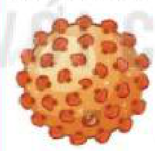

<!-- pdf:156 -->

# BÀI 26: THỰC HÀNH: ĐIỀU TRA MỘT SỐ BỆNH DO VIRUS VÀ TUYÊN TRUYỀN PHÒNG CHỐNG BỆNH

## I. YÊU CẦU CẦN ĐẠT
<!-- ocr-ok: tiêu đề mục I in hoa màu xanh, OCR đọc nhầm CẦU CẦN thành GẦU CẦM; đã đối chiếu ảnh PDF 156 -->

Sau khi học xong phần thực hành, học sinh cần đạt được các yêu cầu sau:

- Thực hiện được dự án hoặc đề tài điều tra một số bệnh do virus (ở người, vật nuôi và cây trồng) gây ra.
- Tuyên truyền được cách phòng chống một số loại bệnh do virus.

## II. CHUẨN BỊ

- Tranh ảnh, sách báo, tài liệu về các loại virus gây bệnh, động vật trung gian truyền bệnh, con đường lây bệnh, triệu chứng và cách phòng chống bệnh.
- Các dụng cụ và vật liệu để làm tờ rơi tuyên truyền,...

## III. CÁCH TIẾN HÀNH

### 1. Điều tra một số bệnh do virus ở người

- Tiến hành thu thập hình ảnh, tin tức qua internet và các nguồn tài liệu tham khảo khác nhau về một số bệnh do virus gây ra hoặc trực tiếp điều tra một số bệnh do virus thường gặp tại địa phương với các nội dung: tên và đặc điểm của loại virus gây bệnh, vật trung gian truyền bệnh (nếu có), con đường lây bệnh, triệu chứng và cách phòng tránh bệnh. Đối với các bệnh có vật trung gian truyền bệnh, cần điều tra kĩ môi trường sống, đặc điểm sinh sản và tập tính của vật trung gian để đưa ra được các biện pháp diệt trừ chúng, giúp phòng tránh bệnh hiệu quả. Ví dụ: Vật trung gian truyền virus gây bệnh sốt xuất huyết là muỗi vằn *Aedes aegypti*, chân có khoang đen trắng. Muỗi cái thường hút máu người vào ban ngày, đẻ trứng vào các dụng cụ chứa nước như nước mưa hay nước máy. Những mảnh bát vỡ, chum vại chứa nước mưa hoặc nước máy thường là nơi đẻ trứng của muỗi vằn,... Từ những thông tin này, đề xuất các biện pháp hạn chế môi trường sống của muỗi cũng như các biện pháp tiêu diệt ấu trùng, loăng quăng và muỗi trưởng thành.
- Ghi chép, lưu giữ lại các thông tin, tư liệu, hình ảnh thu thập được.
- Tổ chức, sắp xếp lại các nguồn thông tin, tư liệu thu thập được để viết báo cáo điều tra và thiết kế tờ rơi tuyên truyền cách phòng chống bệnh.

### 2. Điều tra một số bệnh ở cây trồng do virus gây ra tại địa phương

- Sưu tầm và thu thập các mẫu vật, hình ảnh về các đặc điểm của một số cây bị nhiễm virus như khoai tây, cà chua, cam, chanh ở địa phương.
- Tìm hiểu và ghi chép lại tên và đặc điểm của virus gây bệnh, vật trung gian truyền bệnh (nếu có), con đường lây truyền, triệu chứng bệnh và cách phòng tránh. Điều tra môi trường sống, đặc điểm sinh sản và tập tính của vật trung gian truyền bệnh để có biện pháp diệt trừ chúng và hạn chế bệnh hiệu quả.

<!-- pdf:157 -->

- Tổ chức sắp xếp lại các tư liệu thu thập được để viết báo cáo điều tra và nội dung tuyên truyền phòng chống các bệnh do virus ở cây trồng.
- Chú ý: Tuỳ theo tình hình dịch bệnh xảy ra mỗi năm ở địa phương mà các lớp có thể thực hiện các đề tài điều tra với các bệnh virus khác nhau ở người cũng như động vật và cây trồng.
  Ví dụ:
  + Tìm hiểu, sưu tầm hình ảnh về các đặc điểm nhận biết người bị bệnh quai bị, sốt xuất huyết, viêm gan B, bệnh tay–chân–miệng,... cũng như hình ảnh một số vật nuôi có triệu chứng mắc bệnh virus như cúm gia cầm, bệnh tai xanh ở lợn, bệnh lở mồm long móng ở trâu, bò,... và cách phòng chống bệnh do virus.
  + Tìm hiểu Chương trình Tiêm chủng Mở rộng Quốc gia phòng các bệnh do virus.

## III. THU HOẠCH

Học sinh viết báo cáo thực hành theo các nội dung sau:

**BÁO CÁO THỰC HÀNH**

1. **Mục đích**
2. **Cách tiến hành**
3. **Kết quả**
<!-- ocr-ok: các mục in đậm trong khung Báo cáo thực hành, OCR dính chữ Mụcđích/Kếtquả; đã đối chiếu ảnh PDF 157 -->

a) Báo cáo kết quả điều tra một số bệnh do virus ở người và ở vật nuôi, cây trồng theo gợi ý sau:

| Bệnh | Loại virus gây bệnh (tên và hình ảnh) | Vật trung gian truyền bệnh | Triệu chứng và cách thức truyền bệnh | Biện pháp phòng chống |
|---|---|---|---|---|
| Bệnh viêm gan B | Hepadnavirus  (DNA) | ? | ? | ? |
| Bệnh sốt xuất huyết | ? | ? | ? | ? |
| Bệnh dại | ? | ? | ? | ? |
| Bệnh quai bị | ? | ? | ? | ? |
| Bệnh sởi | ? | ? | ? | ? |
| Bệnh viêm cổ tử cung | ? | ? | ? | ? |
| Bệnh viêm đường hô hấp cấp do virus gây ra ở người | ? | ? | ? | ? |

b) Thiết kế tờ rơi tuyên truyền phòng tránh một bệnh do virus gây ra ở người.

4. **Kết luận**

## 📷 Danh sách hình trong bài

| Mã hình | Trang PDF | Vị trí | Chú thích gốc |
|---|---|---|---|
| H10-sinh-b26-01 | 157 | Mục III (Thu hoạch) | Hepadnavirus (DNA) — hình minh hoạ trong bảng mẫu Báo cáo thực hành |
