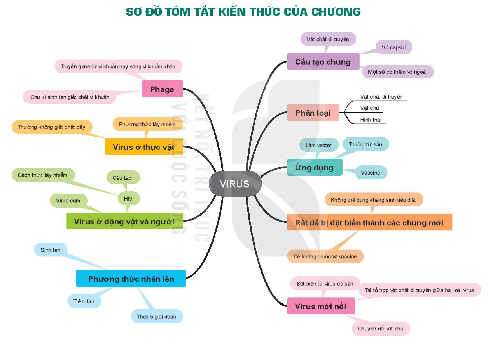

<!-- pdf:158 -->

# SƠ ĐỒ TÓM TẮT KIẾN THỨC CHƯƠNG 7

<!-- Trang in xoay ngang; ảnh đã xoay lại. Dưới đây chép các nhánh của sơ đồ thành danh sách, giữ nguyên chữ trong các ô. -->

- VIRUS
  - Cấu tạo chung
    - Vật chất di truyền
    - Vỏ capsid
    - Một số có thêm vỏ ngoài
  - Phân loại
    - Vật chất di truyền
    - Vật chủ
    - Hình thái
  - Ứng dụng
    - Làm vector
    - Thuốc trừ sâu
    - Vaccine
  - Rất dễ bị đột biến thành các chủng mới
    - Không thể dùng kháng sinh tiêu diệt
    - Dễ kháng thuốc và vaccine
  - Virus mới nổi
    - Đột biến từ virus có sẵn
    - Tái tổ hợp vật chất di truyền giữa hai loại virus
    - Chuyển đổi vật chủ
  - Phương thức nhân lên
    - Sinh tan
    - Tiềm tan
    - Theo 5 giai đoạn
  - Virus ở động vật và người
    - Virus cúm
    - HIV
      - Cấu tạo
      - Cách thức lây nhiễm
  - Virus ở thực vật
    - Phương thức lây nhiễm
    - Thường không giết chết cây
  - Phage
    - Truyền gene từ vi khuẩn này sang vi khuẩn khác
    - Chu kì sinh tan giết chết vi khuẩn
<!-- ocr-ok: chữ trong các ô sơ đồ trang xoay ngang, đã đối chiếu ảnh p0158_cw90.png -->

## 📷 Danh sách hình trong bài

| Mã hình | Trang PDF | Vị trí | Chú thích gốc |
|---|---|---|---|
| H10-sinh-so-do-tom-tat-c07-01 | 158 | Cả trang (in xoay ngang) | Sơ đồ tóm tắt kiến thức của chương |
