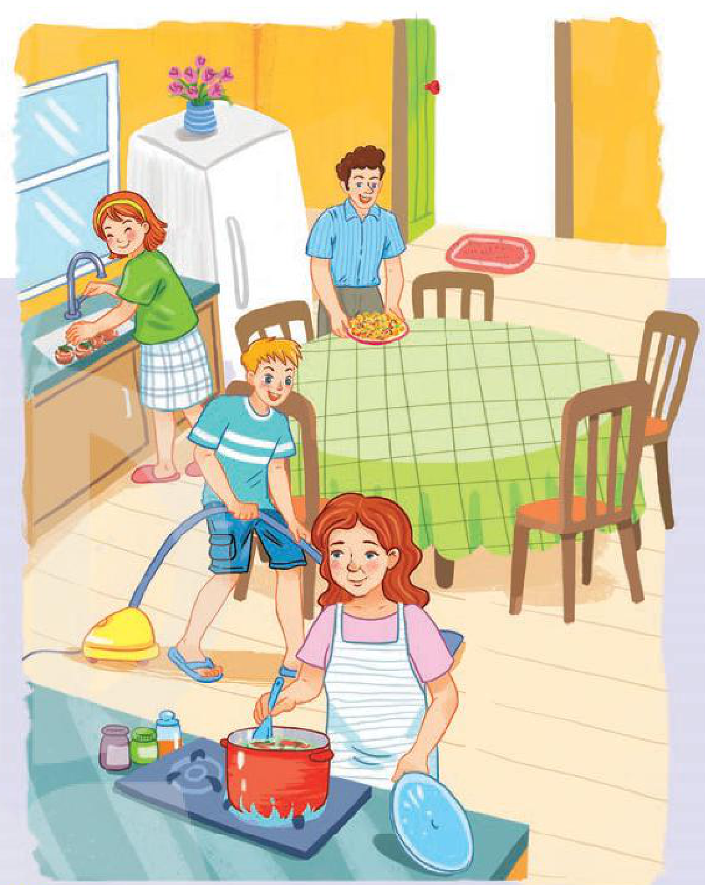
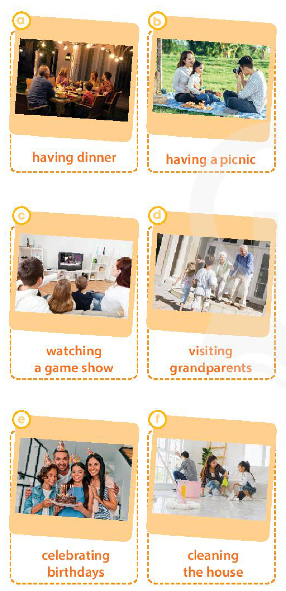

<!-- pdf:9 -->

# UNIT 1: FAMILY LIFE

> **This unit includes:**
> - **LANGUAGE**
>   - **Pronunciation:** /br/, /kr/, and /tr/
>   - **Vocabulary:** Words and phrases related to family life
>   - **Grammar:** Present simple vs. present continuous
> - **SKILLS**
>   - **Reading:** Reading for specific information in a text about the benefits of doing housework for children
>   - **Speaking:** Explaining why children should or shouldn't do housework
>   - **Listening:** Listening for specific information in a talk show about family life
>   - **Writing:** Writing about family routines
> - **COMMUNICATION AND CULTURE / CLIL**
>   - **Everyday English:** Expressing opinions
>   - **Culture:** Family values in the UK
> - **PROJECT**
>   - Doing research on Family Day in Viet Nam or other countries

## I. GETTING STARTED

**Household chores**

**1. Listen and read.**

**Nam:** Hello, Minh.

**Minh:** Hi, Nam. How are you? I'm going to play football at our school sports field with a few friends this evening. Are you free to join us?

**Nam:** I'd love to, but I'm afraid I can't. I'm preparing dinner.

**Minh:** Really? Doesn't your mum cook?

**Nam:** Oh, yes. My mum usually does the cooking, but she's working late today.
<!-- term: do the cooking -->

**Minh:** How about your sister, Lan? Does she help with the housework?

**Nam:** Yes. She often helps with the cooking. But she can't help today. She's studying for her exams.

**Minh:** I see. I never do the cooking. It's my mother's job.
<!-- term: do the cooking -->

**Nam:** Really? So how do you divide the household chores in your family?
<!-- term: divide the household chores -->

**Minh:** Mum is the **homemaker**, so she does the chores. My dad is the **breadwinner**; he earns money. And we, the kids, study.

**Nam:** Well, in my family, we divide the housework equally – Mum usually cooks and shops for **groceries**; Dad cleans the house and does the **heavy lifting**.
<!-- term: divide the household chores -->
<!-- term: clean the house -->

**Minh:** What about you and your sister?

**Nam:** My sister does the **laundry**. I do the **washing-up** and put out the **rubbish**. We also help with the cooking when our mum is busy.
<!-- term: do the laundry -->
<!-- term: do the washing-up -->
<!-- term: put out the rubbish -->

**Minh:** That sounds fair! Anyway, I have to go now. See you later.
<!-- ocr-ok: đã đối chiếu ảnh trang gốc, OCR đọc nhầm fair! thành fairl và I thành | -->

**Nam:** Bye. Have fun.

<!-- pdf:10 -->

**2. Read the conversation again and decide whether the following statements are true (T) or false (F).**

| | T | F |
| --- | --- | --- |
| 1. Nam's mother is cooking now. | | |
| 2. Everybody in Nam's family does some of the housework. | | |
| 3. The children in Minh's family don't have to do any housework. | | |

**3. Write the verbs or phrasal verbs that are used with the nouns or noun phrases in the conversation in 1.**

| | Verbs / Phrasal verbs | Nouns / Noun phrases |
| --- | --- | --- |
| **1.** | *put out* | the rubbish |
| **2.** | | the laundry |
| **3.** | | groceries |
| **4.** | | the heavy lifting |
| **5.** | | the washing-up |
<!-- ocr-ok: đã đối chiếu ảnh trang gốc, OCR bỏ sót tiêu đề bảng và dòng 1, 5 -->

**4. Complete the sentences from the conversation with the correct forms of the verbs in brackets.**

1. I'd love to, but I'm afraid I can't. I (prepare) \_\_\_\_\_\_\_ dinner.
2. My mum usually (do) \_\_\_\_\_\_\_ the cooking, but she (work) \_\_\_\_\_\_\_ late today.
<!-- ocr-ok: đã đối chiếu ảnh trang gốc, OCR đọc nhầm I (prepare) thành l(orepare), My mum usually thành Mymumusudlly và bỏ sót the cooking -->

## II. LANGUAGE

### Pronunciation

**/br/, /kr/, and /tr/**

**1. Listen and repeat. Pay attention to the consonant blends /br/, /kr/, and /tr/.**

| /br/ | /kr/ | /tr/ |
| --- | --- | --- |
| breadwinner | crash | track |
| breakfast | crane | tree |
| brown | cream | train |
<!-- ocr-ok: đã đối chiếu ảnh trang gốc, OCR bỏ sót dòng tiêu đề /br/ /kr/ /tr/ và đọc nhầm tree thành free -->

**2. Listen to the sentences and circle the words you hear.**

1. a. brush / b. crash / c. trash
2. a. brain / b. crane / c. train
3. a. bread / b. create / c. tread

<!-- pdf:11 -->

### Vocabulary

**Family life**

**1. Match the words with their meanings.**

| Words | Meanings |
| --- | --- |
| 1. **breadwinner** | a. a person who manages a home and often raises children instead of earning money |
| 2. housework | b. someone who earns money to **support** their family |
| 3. **groceries** | c. picking up and carrying heavy objects |
| 4. **homemaker** | d. work around the house such as cooking, cleaning, or washing clothes |
| 5. **heavy lifting** | e. food and other goods sold at a shop or a supermarket |
<!-- term: housework -->
<!-- ocr-ok: đã đối chiếu ảnh trang gốc, văn bản nằm trong các khung nối từ vựng 1-5 và a-e -->

**2. Complete the sentences using the words in 1.**

1. My mother is a \_\_\_\_\_\_\_. She doesn't go to work, but stays at home to look after the family.
2. When I lived in this city, I used to shop for \_\_\_\_\_\_\_ at this supermarket.
3. My eldest son is strong enough to do the \_\_\_\_\_\_\_ for the family.
4. Hanna hates doing \_\_\_\_\_\_\_ except cooking.
5. Mr Lewis is the \_\_\_\_\_\_\_ of the family, but he still helps his wife with the housework whenever he has time.

### Grammar

**Present simple vs. present continuous**

**Remember!**

- We use the present simple to talk about habits or things we do regularly.
  *Example:* My mother *cooks* every day.
- We use the present continuous to talk about things which are happening at the moment of speaking.
  *Example:* My mother *isn't cooking* now. She's *working* in her office.
<!-- term: Present simple -->
<!-- term: Present continuous -->

**Note:** We don't usually use the present continuous tense with stative verbs (*like*, *love*, *need*, *want*, *know*, *agree*, etc.).
<!-- term: Present simple -->
<!-- term: Present continuous -->

**1. Choose the correct form of the verb in each sentence.**

1. Mrs Lan usually *does* / *is doing* the cooking in her family.
2. I'm afraid he can't answer the phone now. He *puts out* / *is putting out* the rubbish.
3. He *cleans* / *is cleaning* the house every day.
4. My sister can't do any housework today. She *studies* / *is studying* for her exams.
5. My mother *does* / *is doing* the laundry twice a week.
<!-- term: put out the rubbish -->
<!-- term: clean the house -->
<!-- term: do the laundry -->

**2. Read the text and put the verbs in brackets in the present simple or present continuous.**

Mrs Lam is a housewife. Every day, she (1. do) \_\_\_\_\_\_\_ most of the housework. She cooks, washes the clothes, and cleans the house. But today is Mother's Day, so Mrs Lam (2. not do) \_\_\_\_\_\_\_ any housework. At the moment, she (3. watch) \_\_\_\_\_\_\_ her favourite TV programme. Her children (4. do) \_\_\_\_\_\_\_ the cooking and her husband (5. tidy up) \_\_\_\_\_\_\_ the house. Everybody (6. try) \_\_\_\_\_\_\_ hard to make it a special day for Mrs Lam.

<!-- pdf:12 -->

## III. READING

**Benefits of doing housework**

**1. Work in pairs. Look at the picture and answer the questions.**

1. What is each person in the picture doing?
2. Do you think that they are happy? Why or why not?

**2. Read the text and tick (✓) the appropriate meanings of the highlighted words.**

Most people think that housework is boring and is the responsibility of wives and mothers only. Many parents don't ask their children to do housework so that they have more time to play or study. However, studies show doing chores is good for children.

Kids who do housework develop important life skills that they will need for the rest of their lives. Doing the laundry, cleaning the house, and taking care of others are among the important skills that children will need when they start their own families. These are the things that schools cannot fully teach, so it's important for children to learn them at home. Sharing housework also helps young people learn to take **responsibility**. They know that they have to try to finish their tasks even though they do not enjoy doing them.

Doing chores also helps develop children's **gratitude** to their parents. When doing housework, they learn to appreciate all the hard work their parents do around the house for them. In addition, doing chores together helps **strengthen** family **bonds**, creating special moments between children and parents. It makes children feel they are members of a team.

All in all, doing housework can bring a lot of **benefits** to children. It teaches them life skills and helps build their **character**. Therefore, parents should encourage their kids to share the housework for their own good as well as the good of the whole family.

1. **responsibility**
   - [ ] a. duty
   - [ ] b. hobby
2. **gratitude**
   - [ ] a. the feeling of being great
   - [ ] b. the feeling of being grateful
3. **strengthen**
   - [ ] a. make something stronger
   - [ ] b. make something more difficult
4. **bonds**
   - [ ] a. close connections
   - [ ] b. common interests
5. **character**
   - [ ] a. qualities that make a person the same as others
   - [ ] b. qualities that make a person different from others

<!-- pdf:13 -->

**3. Read the text again and answer the questions.**

1. What do most people think about housework?
2. Why don't many parents make their children do housework?
3. What are some important life skills children can learn when doing housework?
4. What do children learn as they finish household tasks that they don't enjoy?
5. Why does sharing housework strengthen family bonds?

**4. Work in pairs. Discuss the question.**

What benefits do you think you can get from sharing housework?

## IV. SPEAKING

**Why should / shouldn't children do housework?**

**1. Below are reasons why children should or shouldn't do housework. Put them in the correct column. Add some more if you can.**

1. Doing housework helps them develop life skills.
2. Doing housework teaches them to take responsibility.
3. Kids should be given plenty of playtime when they are young.
4. They may break or **damage** things when doing housework.
5. Doing housework helps strengthen family bonds.
6. They need more time to study and do homework.

| Should | Shouldn't |
| --- | --- |
| *Doing housework helps them develop life skills.* | |
| | |
| | |
| | |

**2. Work in pairs. Complete the conversation between Anna, Nam, and Minh using some ideas from 1. Then listen to the conversation and check your answers.**

**Anna:** Nam, why do you think children should do housework?

**Nam:** Because (1) \_\_\_\_\_\_\_.

**Anna:** It's true. Life skills such as cooking, cleaning, or taking care of others are really necessary for kids when they grow up.

**Nam:** Yes, we should all have these basic life skills to be adults.

**Anna:** Now Minh, why do you think children shouldn't do housework?

**Minh:** I think kids are kids. (2) \_\_\_\_\_\_\_.

**Nam:** I don't agree with you. I'm afraid too much playtime isn't good for children.

**Anna:** Well, thank you both for sharing your ideas. They are very useful for my project.

**3. Work in groups. Have similar conversations exchanging opinions about whether children should or shouldn't do housework. You can use the ideas from 1 and the reading text.**

<!-- pdf:14 -->

## V. LISTENING

**Family support**

**1. Work in pairs. Look at the picture and answer the questions.**

1. What can you see in the picture?
2. What do you think the student is talking about?

**2. Listen to the introduction to the talk show and check whether your answer to Question 2 above is correct or not.**

**3. Listen to the talk show and decide whether the statements are true (T) or false (F).**

| | T | F |
| --- | --- | --- |
| 1. There are three people in Hieu's family. | | |
| 2. Hieu's parents teach him physics. | | |
| 3. When Hieu needs help, his brother always helps him. | | |
| 4. Hieu's family **routines** help them spend some time together every week. | | |

**4. Listen again and complete each sentence with ONE word from the recording.**

1. Hieu's parents always listen to him and **cheer** him **up** whenever he has \_\_\_\_\_\_\_.
2. His parents' \_\_\_\_\_\_\_ and trust give him strength to carry on.
3. Hieu's brother is his best friend. He shares his happy and \_\_\_\_\_\_\_ moments with him.

**5. Work in groups. Discuss the following question.**

How can parents help their children achieve success in their studies?

<!-- pdf:15 -->

## VI. WRITING

**Writing about family routines**

**1. Work in groups. Which of the following activities in the pictures do you think can be family routines?**

- a. having dinner
- b. having a picnic
- c. watching a game show
- d. visiting grandparents
- e. celebrating birthdays
- f. cleaning the house
<!-- ocr-ok: đã đối chiếu ảnh trang gốc, chú thích dưới 6 bức tranh a-f trong H10-tieng_anh-u01-03 -->

**2. Read Joey's email about his family routines and complete the table with the information from it.**

**New message**
**To:** dong@webmail.com
**Subject:** My family routines

Hi Dong,

How are you getting on? In your last email you asked me about my family **routines**. Well, we have quite a few routines to help us learn life skills and build family bonds, but I'll tell you about three main ones.

First, my family always have dinner together. Dinners are important for us since we share our daily experiences and talk about the latest news. Second, we watch our favourite game show on TV together every Friday evening. We discuss the questions and guess the answers. It's great fun every time we get a correct answer. Third, every two weeks, on Saturday we clean the house together. We make a list of all the chores. Each of us then chooses one or two household tasks according to personal choice. We all feel happy and proud when we see our home **spotlessly** clean at the end of the day.

Do you have similar family routines? I'd be interested to know about your family.

Please write back soon.

Best,
Joey

| Routines | When / How often | Things to do to strengthen family bonds |
| --- | --- | --- |
| **1.** have dinner together | | |
| **2.** | every Friday evening | |
| **3.** | | - make a list of chores - choose tasks |
<!-- ocr-ok: đã đối chiếu ảnh trang gốc, OCR bỏ sót tiêu đề bảng và nội dung dòng 3 -->

<!-- pdf:16 -->

**3. Complete the email about Dong's family routines using the information in the box.**

| Routines | When / How often | Things to do to strengthen family bonds |
| --- | --- | --- |
| **1.** have breakfast together | every day | - eat bread or noodles - share their plans for the day |
| **2.** watch TV together | every Saturday evening | - watch a film and share snacks - exchange opinions after the film |
| **3.** visit grandparents | on the second Sunday of the month | - do some housework for grandparents - have lunch with them |
<!-- ocr-ok: đã đối chiếu ảnh trang gốc, OCR đọc ghép cột bảng -->

**New message**
**To:** joey@webmail.com
**Subject:** My family routines

Hi Joey,

How are you? We're all doing fine here. You asked me about my family routines. Well, we have a number of routines to help us learn life skills as well as build family bonds. Here are three main ones.
\_\_\_\_\_\_\_\_\_\_\_\_\_\_\_\_\_\_\_\_\_\_\_\_\_\_\_\_\_\_\_\_\_\_\_\_\_\_\_\_\_\_\_\_\_\_\_

What do you think about my family routines? Please write back soon and let me know.

Best wishes,
Dong

## VII. COMMUNICATION AND CULTURE / CLIL

### Everyday English

**Expressing opinions**

**1. Listen and complete the conversation with the expressions in the box. Then practise it in groups of three.**

| A. I strongly believe that | B. I'm not sure about that | C. I have no doubt that |
| --- | --- | --- |

**Anna:** Do you guys think that teenagers should do housework?

**Minh:** Yes, (1) \_\_\_\_\_\_\_ teenagers as well as other members of the family should share the housework.

**Anna:** Do you mean everybody in the family has to help with the housework?

**Minh:** That's right. (2) \_\_\_\_\_\_\_ doing household chores together helps build family bonds.

**Tu:** Well, (3) \_\_\_\_\_\_\_. Teenagers should spend all their time studying instead of doing housework. They'll need good grades to get into top universities.

**2. Work in groups. Have similar conversations exchanging opinions about whether family members should spend time together.**

| **Useful expressions** | |
| --- | --- |
| **Strong opinion** | **Neutral opinion** |
| - I strongly believe that ... - I'm sure that ... - I have no doubt that ... | - In my opinion, ... - To my mind ... - I suppose that ... |
<!-- ocr-ok: đã đối chiếu ảnh trang gốc, OCR đọc nhầm bảng Useful expressions -->

<!-- pdf:17 -->

### Culture

**1. Read the text and list the five family values of British people in the 21st century in the table below.**

**BRITISH FAMILY VALUES**

Family **values** are ideas about how people want to live their family life and are passed on from parents to children. Strong family values can prepare children for a happy life. Results of a recent survey in the UK show that even though modern family life has changed greatly, a number of traditional family values are still important in the UK nowadays.
<!-- term: family values -->

On top of the list are the values of being **truthful** and honest, and respecting older people. Children are taught to tell the truth from an early age. They learn to show respect to older people, who have a wealth of life experiences. Having good table **manners** is the third important family value. Coming fourth and fifth on the list are the values of remembering to say *please* and *thank you*, and helping with family chores respectively.
<!-- term: table manners -->

It is clear that in the 21st century, British people still follow some traditional family values.

| | Traditional British family values |
| --- | --- |
| **1.** | |
| **2.** | |
| **3.** | |
| **4.** | |
| **5.** | |
<!-- ocr-ok: đã đối chiếu ảnh trang gốc, OCR không nhận diện được cột số thứ tự 1-5 trong bảng -->

**2. Work in pairs. Discuss whether Vietnamese people have similar family values.**

## VIII. LOOKING BACK

### Pronunciation

**Listen and write /br/, /kr/, or /tr/ above the word that has the corresponding consonant blends. Then practise reading the sentences.**

1. I like ice cream, but my brother likes bread pudding.
2. Tracy crashed her car into a tree and broke her leg.
3. They often have crab soup for breakfast.

### Vocabulary

**Complete the text. Use the correct forms of the word and phrases in the box.**

| do the washing-up | do the heavy lifting | do the cooking | clean the house | laundry |
| --- | --- | --- | --- | --- |

In Thanh's family, everybody shares the housework. His mother (1) \_\_\_\_\_\_\_. Thanh really enjoys the food she cooks. Thanh's father is a strong man, so he (2) \_\_\_\_\_\_\_. Thanh helps with the (3) \_\_\_\_\_\_\_. He feels proud that he knows how to run a washing machine. Thanh's sister helps with (4) \_\_\_\_\_\_\_. She does it regularly, so their house is never dirty. She also (5) \_\_\_\_\_\_\_ after each meal.

### Grammar

**There is a mistake in each sentence below. Find the mistake and correct it.**

1. I'm writing to you to tell you how much I'm wanting to see you.
2. Jack is away on business, so now I look after his dog.
3. Nam's often looking untidy.
4. She can't answer the phone now. She cooks dinner.
5. Excuse me, do you read the newspaper? Could I borrow it?
6. What are your family doing in the evenings?

<!-- pdf:18 -->

## PROJECT

**Happy Family Day!**

**Work in groups. Do research on Family Day in Viet Nam or other countries in the world.**

**Present your findings to the class. Your presentation should include:**

- where it is celebrated
- when it is celebrated
- when it was first celebrated
- why it is celebrated
- what people often do to celebrate the day

### Now I can ...

- pronounce the consonant blends /br/, /kr/, and /tr/ correctly in isolation and in sentences.
- understand and use words and phrases related to family life.
- use the present simple to talk about something that happens regularly in the present, and the present continuous to talk about activities happening at the moment of speaking.
- read for specific information in a text about the benefits of doing housework for children.
- explain why children should or shouldn't do housework.
- listen for specific information in a talk show about family life.
- write about family routines.
- express opinions.
- understand family values in the UK.
- do research on Family Day in Viet Nam or other countries and give a group presentation about it.

## 📷 Danh mục hình minh hoạ

| Mã hình | Trang PDF | Trang sách | Chú thích / Mô tả |
| --- | --- | --- | --- |
| H10-tieng_anh-u01-01 | 12 | 11 | Tranh minh hoạ gia đình bốn người cùng nhau làm việc nhà trong bếp và phòng ăn (mẹ nấu ăn, bố bày thức ăn lên bàn, con trai hút bụi sàn nhà, con gái rửa bát) |
| H10-tieng_anh-u01-02 | 14 | 13 | Tranh minh hoạ trường quay chương trình "Talk show Family Life" với nữ MC đang trò chuyện cùng một nam sinh đeo huy chương trên ngực |
| H10-tieng_anh-u01-03 | 15 | 14 | Sáu bức tranh minh hoạ các hoạt động sinh hoạt gia đình: (a) having dinner, (b) having a picnic, (c) watching a game show, (d) visiting grandparents, (e) celebrating birthdays, (f) cleaning the house |
