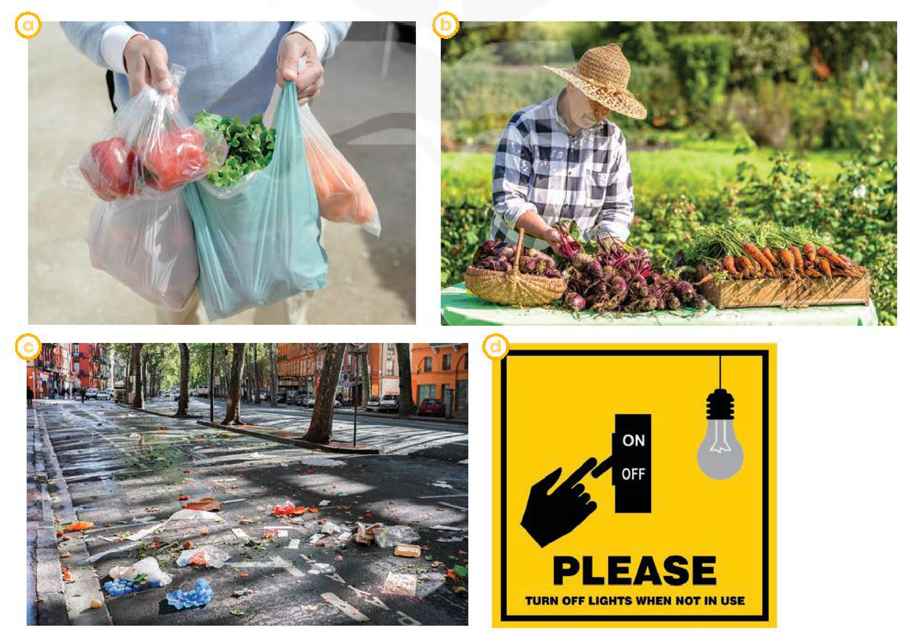
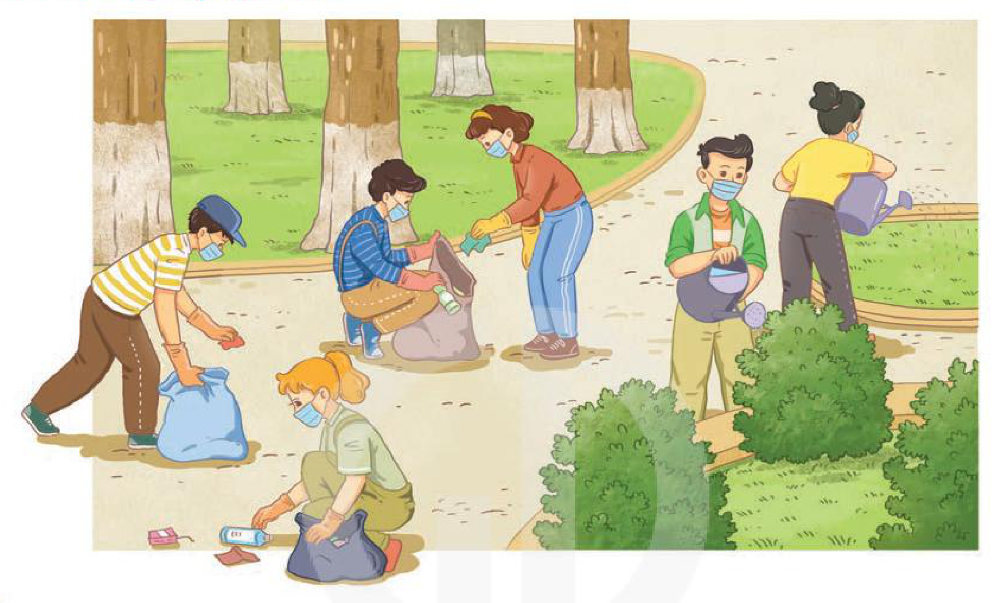

<!-- pdf:19 -->

# UNIT 2: HUMANS AND THE ENVIRONMENT

> **This unit includes:**
> - **LANGUAGE**
>   - **Pronunciation:** /kl/, /pl/, /gr/, and /pr/
>   - **Vocabulary:** Words and phrases related to human activities and the environment
>   - **Grammar:**
>     - The future with *will* and *be going to*
>     - Passive voice
> - **SKILLS**
>   - **Reading:** Reading for main ideas and specific information in a text about green living
>   - **Speaking:** Talking about ways to live green
>   - **Listening:** Listening for specific information in an announcement about a green event
>   - **Writing:** Writing about ways to improve the environment
> - **COMMUNICATION AND CULTURE / CLIL**
>   - **Everyday English:** Asking for and giving advice
>   - **CLIL:** Carbon footprint
> - **PROJECT**
>   - Planning activities for a *Go Green Weekend* event
<!-- term: green living -->
<!-- term: go green -->

## I. GETTING STARTED

**Go Green Club**

**1. Listen and read.**

**Mike:** What are you going to do this weekend, Nam?

**Nam:** I'm going to attend the first meeting of my school's Go Green Club.

**Mike:** Really? Can you tell me about the club, please?

**Nam:** Well, it was set up by the Youth Union in my school. Its aim is to improve our environment and **encourage** people to **adopt** a greener **lifestyle**.
<!-- term: set up -->

**Mike:** Sounds interesting. What's the first thing you are going to do?

**Nam:** We're going to clean up the school right after the ceremony.
<!-- term: clean up -->

**Mike:** Do you have any other planned events?

**Nam:** Not yet, but I think we'll organise more activities to raise local people's **awareness** of environmental **issues**.

**Mike:** I'm keen to reduce my **carbon footprint**, but I don't know what to do. Can I join the club?

**Nam:** Sure. The club welcomes all students in the area. I hope we'll be able to do a lot to protect our environment.

**Mike:** Great. Can you please give me the time and place of the club meeting?

**Nam:** OK. I'll text you. See you then.

<!-- pdf:20 -->

**2. Read the conversation again and answer the following questions.**

1. Who set up the Go Green Club?
2. What does the club want to achieve?
3. What does Nam think the club will do in the future?

**3. Match the verbs and phrasal verbs in A with suitable nouns and noun phrases in B to make phrases in 1.**

| A | B |
| --- | --- |
| 1. raise | a. a club |
| 2. reduce | b. a greener lifestyle |
| 3. clean up | c. awareness |
| 4. adopt | d. your carbon footprint |
| 5. set up | e. the school |

**4. Complete the following sentences based on the conversation in 1.**

1. The club \_\_\_\_\_\_\_ by the Youth Union in Nam's school.
2. The club members \_\_\_\_\_\_\_ clean up the school right after the ceremony.
3. Nam thinks they \_\_\_\_\_\_\_ organise more activities to raise local people's awareness of environmental issues.

## II. LANGUAGE

### Pronunciation

**/kl/, /pl/, /gr/, and /pr/**

**1. Listen and repeat. Pay attention to the consonant blends /kl/, /pl/, /gr/, and /pr/.**

| /kl/ | /pl/ | /gr/ | /pr/ |
| --- | --- | --- | --- |
| club | please | green | practise |
| clean | place | group | present |
| class | play | ground | protect |
<!-- ocr-ok: đã đối chiếu ảnh trang gốc, OCR bỏ sót cột /kl/ và từ please trong bảng xanh -->

**2. Listen and practise saying the following sentences.**

1. The club members will clean up all the classrooms.
2. We are pleased that we created an interesting plot for the school play.
3. Our group will make the playground green again.
4. The students are practising their presentation on environmental protection.

<!-- pdf:21 -->

### Vocabulary

**The environment**

**1. Match the words and phrases with their meanings.**

| Words and phrases | Meanings |
| --- | --- |
| 1. household **appliances** | a. the amount of carbon dioxide ($\text{CO}_2$) produced by the activities of a person or an organisation |
| 2. **energy** | b. rubbish lying in an open or public place |
| 3. **carbon footprint** | c. causing no harm to the environment |
| 4. **litter** | d. devices, such as fridges or TVs, used in people's homes |
| 5. **eco-friendly** | e. power used for driving machines, providing heat and light, etc. |
<!-- term: household appliances -->

**2. Complete the sentences using the words and phrases in 1.**

1. \_\_\_\_\_\_\_ car models always attract great attention at exhibitions.
2. Remember to turn off your \_\_\_\_\_\_\_ when they are not used.
3. Small changes in your daily habits can help reduce the \_\_\_\_\_\_\_ you produce.
4. One of the most important sources of \_\_\_\_\_\_\_ is the sun.
5. Students are reminded to pick up \_\_\_\_\_\_\_ that they see on the ground.

### Grammar

**The future with *will* and *be going to***

**Remember!**

We use *will* and *be going to* to talk about future actions.

| **will** | **be going to** |
| --- | --- |
| We use *will* to talk about: - plans which are made at the moment of speaking. *Example:* This shirt looks beautiful. I **will buy** it. - predictions based on what we think or believe about the future. *Example:* I think our team **will win** the competition. | We use *be going to* to talk about: - plans which are made before the moment of speaking. *Example:* I have made a reservation. We **are going to have** dinner at the Chinese restaurant nearby. - predictions based on what we see or know. *Example:* Look at the dark clouds. It **is going to rain** soon. |
<!-- term: The future with will and be going to -->

**Complete the following sentences with *will* or the correct forms of *be going to*.**

1. I don't think she \_\_\_\_\_\_\_ come tonight. She has to revise for her exam tomorrow.
2. We have already made the decision. We \_\_\_\_\_\_\_ buy a new house next month.
3. I'm sure she \_\_\_\_\_\_\_ pass the final exam.
4. Look at the sun. It \_\_\_\_\_\_\_ be a beautiful day.
5. I forgot to phone Dad. I \_\_\_\_\_\_\_ do it right after lunch.

<!-- pdf:22 -->

*Passive voice*

**Remember!**

> We use the passive voice when the person or thing that does the action is not important or not known, or we don't want to say who the doer is. We focus on the action itself.
> *Example:* The school playground **is cleaned up** every day (by students).
<!-- term: Passive voice -->

**Rewrite the following sentences using the passive voice. Begin each sentence as shown.**

1. More and more people adopt a green lifestyle.
   A green lifestyle \_\_\_\_\_\_\_.
2. The students didn't put the rubbish in the bins after the party yesterday.
   The rubbish \_\_\_\_\_\_\_.
3. We will plant more trees in the neighbourhood.
   More trees \_\_\_\_\_\_\_.
4. Our club is going to organise a lot of clean-up activities this weekend.
   A lot of clean-up activities \_\_\_\_\_\_\_.
5. They discussed important environmental issues at the meeting.
   Important environmental issues \_\_\_\_\_\_\_.

## III. READING

**1. Work in groups. Look at the pictures and answer the questions.**

*Which pictures show a green lifestyle? Why?*

<!-- pdf:23 -->

**2. Read the following text and choose the best title for it.**

- A. Green living
- B. Green issues
- C. Green products

> **Tips**
> When you choose the best title, you should:
> - read through the whole text.
> - pay attention to the opening paragraph.
> - choose the title that best represents the idea of the whole text, not just part of it.

More and more people **adopt** a green **lifestyle**. It is a choice we make to change to a greener and more **sustainable** lifestyle. There are many things you can do to become an **eco-friendly** person. Here are some of them.

**Turning off your appliances when they are not in use**

This is one of the easiest ways to save **energy** and reduce your **carbon footprint**. It also helps reduce energy bills and prevent any dangerous situations such as a fire or an explosion.
<!-- term: turn off -->

**Buying products that are grown using more natural and organic methods**

This helps reduce the use of harmful **chemicals** in food. **Organic** food is better for us because it is safer and healthier. It also tastes better.

**Cutting down on plastic use**

This really helps the environment because it takes many years for plastic waste to break down into small pieces. Bring a reusable bag when you go shopping, and your own **refillable** bottle instead of buying bottled water.
<!-- term: cut down on -->
<!-- term: break down -->

**Recycling as much as possible**

This prevents pollution because it reduces the need to collect new raw **materials** and protects natural **resources** such as water and trees. So don't throw away your used household items, but sort and recycle them.
<!-- term: natural resources -->
<!-- term: throw away -->

**3. Circle the correct meanings of the highlighted words and phrases in the text.**

1. sustainable
   - a. causing little or no damage to the environment
   - b. bringing no benefits to the environment
2. organic
   - a. without the use of animal organs
   - b. without the use of chemicals
3. cutting down on
   - a. reducing
   - b. reusing
4. natural resources
   - a. materials supporting life
   - b. materials harmful to life

**4. Read the text again and decide whether the following statements are true (T) or false (F).**

| | T | F |
| --- | --- | --- |
| 1. Green living is now compulsory for many people. | | |
| 2. Turning off **electrical** appliances is an easy way to save energy. | | |
| 3. It takes a long time for plastic waste to break down. | | |
| 4. The use of refillable water bottles is not encouraged. | | |

**5. Work in pairs. Discuss the following question.**

*In your opinion, which of the suggestions in the text is the easiest way to live green?*

<!-- pdf:24 -->

## IV. SPEAKING

**Living green**

**1. Which of the following activities do you think teenagers should or shouldn't do to live green? Put a tick (✓) in the appropriate column.**

| Activities | Should | Shouldn't |
| --- | --- | --- |
| 1. Leaving your appliances on when not in use | | |
| 2. Recycling your used items | | |
| 3. Using plastic bags when shopping | | |
| 4. Buying organic food | | |
| 5. Dropping litter in the street | | |
| 6. Planting trees | | |

**2. The table below presents the reasons why teenagers should or shouldn't do the activities in 1. Work in pairs and match them with the activities.**

| Reasons | Activities |
| --- | --- |
| a. This makes the street dirty and polluted. | |
| b. This wastes electricity and creates dangerous situations. | |
| c. It takes years for the material to break down into small pieces. | |
| d. This reduces the use of harmful chemicals in food. | |
| e. This protects natural resources. | |
| f. They provide shade and fresh air. | |

**3. Work in groups. Discuss and present your ideas about what you should or shouldn't do to live green.**

*Example:*

*There are many things that we should or shouldn't do to live green. We should recycle our used items so that we can protect natural resources. We shouldn't drop litter in the street because this will make the street dirty and pollute the environment.*

<!-- pdf:25 -->

## V. LISTENING

**A green event**

**1. Work in pairs. Look at the picture and answer the questions.**

*What are they doing? Why?*

**2. Listen to an announcement about a *Go Green Weekend* event and decide whether the following statements are true (T) or false (F).**

| | T | F |
| --- | --- | --- |
| 1. At the club meeting, the speaker only talks about the teams and activities. | | |
| 2. The Clean-up Team will pick up rubbish in the central market. | | |
| 3. Both students and local people will take part in the event. | | |
| 4. A report of the event will be produced by the Media Team. | | |

**3. Listen again and complete each gap in the table with ONE word from the recording.**

| | |
| --- | --- |
| **Clean-up Team** | Clean the central (1) \_\_\_\_\_\_\_ • Pick up rubbish, bottles, and (2) \_\_\_\_\_\_\_ bags • Water small trees and flowers |
| **Donation Team** | Collect used items (3) \_\_\_\_\_\_\_ the items and put them into the correct bags |
| **Media Team** | (4) \_\_\_\_\_\_\_ photos of the event on the club's website Make (5) \_\_\_\_\_\_\_ for the club's future activities |

**4. Work in groups. Discuss the following question.**

*If you have to organise a green event in your area, what will you do?*

<!-- pdf:26 -->

## VI. WRITING

**Writing about suggestions for improving the environment**

**1. Work in pairs. Match the suggestions for improving the environment with their expected results.**

| Suggestions | Expected results |
| --- | --- |
| 1. Cleaning up regularly (e.g. organising clean-up activities at weekends) | a. This reduces $\text{CO}_2$ and makes the air clean. |
| 2. Planting more trees (e.g. encouraging students to plant trees or flowers in their school) | b. This makes the waste collection easier. |
| 3. Setting up more rubbish bins (e.g. putting more rubbish bins in public places such as parks or bus stations) | c. This keeps the environment clean and makes it safe for everyone. |

**2. Read the incomplete paragraph about ways to improve the environment. Fill in the blanks with the words and phrases from the box.**

| First | In conclusion | For example |
| --- | --- | --- |

There are three things we can do to improve the environment in our school. (1) \_\_\_\_\_\_\_, we should clean up all areas regularly. (2) \_\_\_\_\_\_\_, we can organise clean-up activities at weekends. By doing this, we can keep our environment clean, beautiful, and safe for everyone.

.......................................................................................

.......................................................................................

(3) \_\_\_\_\_\_\_, we can improve the environment in our school in many ways and even small actions can make a big difference.

**3. Add two more suggestions to improve the environment in your school to complete the paragraph in 2. Use the ideas in 1 to help you.**

## VII. COMMUNICATION AND CULTURE / CLIL

### Everyday English

**Asking for and giving advice**

**1. Listen and complete the conversation with the expressions in the box. Then practise it in pairs.**

| A. You should | B. What should I do | C. I advise you | D. Should I |
| --- | --- | --- | --- |
<!-- ocr-ok: đã đối chiếu ảnh trang gốc, OCR nhận nhầm chữ I thành dấu gạch đứng | -->

**Lan:** I was asked to give a presentation on climate change next week. (1) \_\_\_\_\_\_\_, Mai?

**Mai:** (2) \_\_\_\_\_\_\_ search for information about the topic on the Internet.

**Lan:** (3) \_\_\_\_\_\_\_ also read books in the library?

**Mai:** That's a good idea. (4) \_\_\_\_\_\_\_ to collect information from different sources. Then you can decide what to include in the presentation.

**2. Work in pairs. Make similar conversations asking for and giving advice about green living. Use the expressions below to help you.**

| **Useful expressions** | |
| --- | --- |
| **Asking for advice** | **Giving advice** |
| What should I do? | I think you should ... |
| What do you advise me to do? | I advise you to ... |
| Do you have any suggestions for me? | How about ...? |
| What would you do if you were me? | If I were you, I would ... |
| Can you give me some advice about ...? | My advice would be to ... |
<!-- ocr-ok: đã đối chiếu ảnh trang gốc, OCR trộn dòng giữa hai cột trang 25 và đọc nhầm tiêu đề bảng -->

<!-- pdf:27 -->

### CLIL

**1. Read the text and complete the table.**
<!-- ocr-ok: đã đối chiếu ảnh trang gốc, OCR bỏ sót dòng đề bài mục CLIL -->

**CARBON FOOTPRINT**

A **carbon footprint** is the total amount of $\text{CO}_2$ produced by **human** activities. It also includes the **emissions** of other greenhouse gases. Although **calculating** your carbon footprint can be difficult, you can still **estimate** it based on how big your family is, how much electricity your **appliances** use, how much you drive or fly, or how much you recycle.

**Globally**, the average carbon footprint per person is more than 4 tons per year. Too much $\text{CO}_2$ in the Earth's atmosphere can cause serious problems. It can lead to increasing **global** temperatures and air pollution, and destroy the natural world.

It's not difficult to reduce your carbon footprint. You can do it by making your daily activities **eco-friendly**. For example, you can take shorter showers. The less hot water you use, the less **energy** is needed to heat the water. Instead of using your personal car or motorbike, you should use **public transport**, walk, or cycle as much as possible.

These simple activities can help reduce your carbon footprint and your impact on the environment.

| **Carbon footprint** | | |
| --- | --- | --- |
| **Definition** | **Effects of large carbon footprint** | **Ways to reduce it** |
| Carbon footprint is: - the total amount of (1) \_\_\_\_\_\_\_ produced by human activities - emissions of other greenhouse gases | - Increasing (2) \_\_\_\_\_\_\_ and air pollution - Destroying the natural world | Make your daily activities eco-friendly by: - taking shorter (3) \_\_\_\_\_\_\_ - using (4) \_\_\_\_\_\_\_, walking, or cycling |
<!-- ocr-ok: đã đối chiếu ảnh trang gốc, OCR trộn văn bản giữa 3 cột trong bảng Carbon footprint -->

**2. Work in pairs. Discuss things you can do to reduce your carbon footprint.**

## VIII. LOOKING BACK

### Pronunciation

**Listen and underline the words with the consonant blends /kl/, /pl/, /gr/, or /pr/. Then practise reading the sentences.**

1. The professor is proud of the results of our project.
2. Grass is growing on the ground.
3. Those toy planes are made of plastic.
4. Click the button to become a member of the club.

### Vocabulary

**Complete the sentences. Use the words and phrases in the box.**

| appliances | green lifestyle | carbon footprint | eco-friendly |
| --- | --- | --- | --- |

1. More people adopt a(n) \_\_\_\_\_\_\_ because it is good for the environment.
2. You should cut down on electricity usage to reduce your \_\_\_\_\_\_\_.
3. Many modern houses today are built from \_\_\_\_\_\_\_ materials.
4. Modern household \_\_\_\_\_\_\_ make housework much easier.

### Grammar

**Choose the best answers.**

1. Wind energy *is used* / *use* to produce electricity.
2. More trees *are planted* / *plant* around the school.
3. I'm sure you *are going to pass* / *will pass* your driving test. Don't worry.
4. - Mai has won the first prize in the speaking contest.
   - Really? I *will* / *am going to* phone her to give her my congratulations.
5. My parents have made their holiday plans. They *will travel* / *are going to travel* to the south of the country.
6. Do you hear the thunder? It *is going to rain* / *will rain* heavily.

<!-- pdf:28 -->

## PROJECT

**GO GREEN WEEKEND**

**Work in groups. Make a plan for a *Go Green Weekend* event. Think of activities that you can organise during the weekend. You should also provide the reasons and expected results of each activity you suggest.**
<!-- ocr-ok: đã đối chiếu ảnh trang gốc, nền màu xanh lá đậm khiến OCR mất chữ -->

**Present your plan to the class. Your presentation should include the following:**
<!-- ocr-ok: đã đối chiếu ảnh trang gốc, nền màu xanh lá đậm khiến OCR bỏ sót cả dòng -->

| **GO GREEN WEEKEND** | | | | |
| --- | --- | --- | --- | --- |
| **Activity** | **Time** | **Place** | **Reason** | **Expected result** |
| Picking up litter | Sunday morning | City park | The park is dirty because many people drop litter on the paths. | It will make the park cleaner and more beautiful. |

### Now I can ...

- pronounce the consonant blends /kl/, /pl/, /gr/, and /pr/ correctly in isolation and in sentences.
- understand and use words and phrases related to human activities and the environment.
- use *will* and *be going to* to talk about the future.
- use the passive voice.
- read for main ideas and specific information in a text about green living.
- talk about ways to live green.
- listen for specific information in an announcement about a green event.
- write about ways to improve the environment.
- ask for and give advice.
- understand what a carbon footprint is.
- plan activities for a *Go Green Weekend* event and give a group presentation about the event.

## 📷 Danh mục hình minh hoạ

| Mã hình | Trang PDF | Trang sách | Chú thích / Mô tả |
| --- | --- | --- | --- |
| H10-tieng_anh-u02-01 | 22 | 21 | Bốn bức tranh (a, b, c, d) minh hoạ các hoạt động liên quan đến môi trường trong phần Reading (a: đựng thực phẩm bằng nhiều túi ni lông; b: người nông dân thu hoạch rau củ hữu cơ; c: rác thải vứt bừa bãi trên đường phố; d: biển nhắc nhở tắt đèn khi không sử dụng "PLEASE TURN OFF LIGHTS WHEN NOT IN USE") |
| H10-tieng_anh-u02-02 | 25 | 24 | Tranh minh hoạ các bạn học sinh đeo khẩu trang đang thu gom rác thải, phân loại chai nhựa và tưới cây tại công viên trong sự kiện Go Green Weekend |
