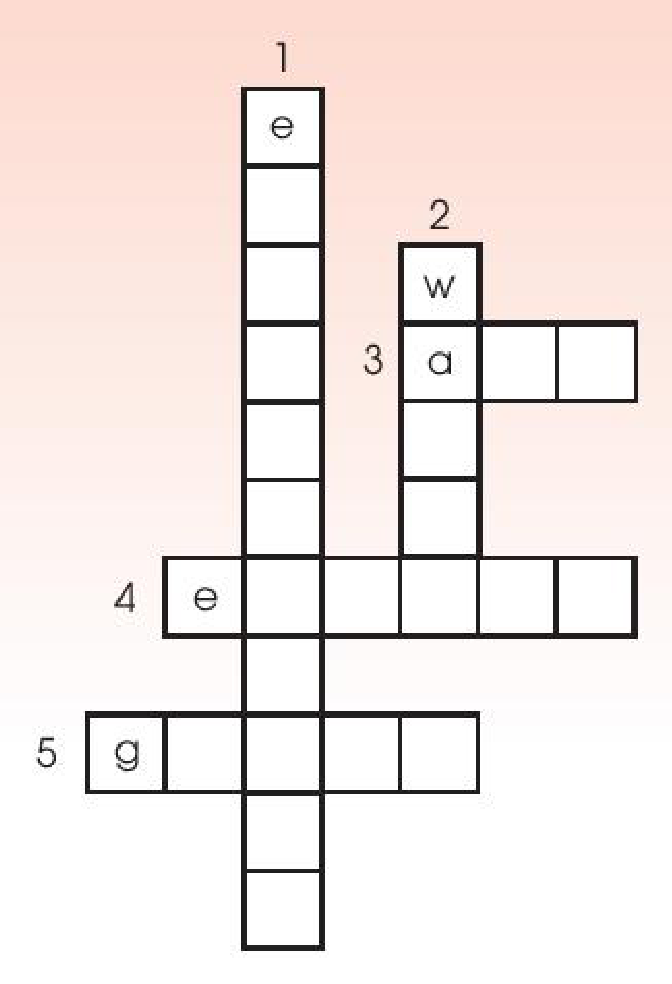

<!-- pdf:39 -->

# REVIEW 1

## I. LANGUAGE

### Pronunciation

**Listen and write the words in the correct columns. Then practise saying the words.**

| **/br/** | **/gr/** | **/kr/** | **/pr/** | **/tr/** |
| --- | --- | --- | --- | --- |
| | | | | |
<!-- ocr-ok: đã đối chiếu ảnh trang gốc, OCR không nhận diện đúng các kí hiệu phiên âm /br/, /gr/, /kr/, /pr/, /tr/ -->

### Vocabulary

**1. Match the two parts to make complete sentences.**

| | |
| --- | --- |
| 1. My father puts | a. on a popular TV talent show. |
| 2. Is it difficult to reduce | b. a green lifestyle. |
| 3. He was one of the **judges** | c. many **musical instruments**? |
| 4. Many people are trying to adopt | d. our carbon footprint? |
| 5. Can this artist play | e. the rubbish out every day. |
<!-- ocr-ok: đã đối chiếu ảnh trang gốc, OCR bỏ sót số 1-5 và chữ cái a-e trong các biểu tượng tròn -->

**2. Complete the following sentences using the words from the box.**

| **audience** | eco-friendly | laundry | **perform** | groceries |
| --- | --- | --- | --- | --- |

1. Viet helps his mum do the \_\_\_\_\_\_\_, clean the house, and take care of his little sister.
2. In my family, my mum does the cooking, and my dad shops for \_\_\_\_\_\_\_.
3. Will you \_\_\_\_\_\_\_ in the **live** music **concert** next week?
4. The \_\_\_\_\_\_\_ clapped for 15 minutes when the band finished playing.
5. Many people in our neighbourhood are using \_\_\_\_\_\_\_ materials to build their houses.

<!-- pdf:40 -->

### Grammar

**1. Complete the sentences with the correct forms of the verbs in brackets.**

1. Nam often (clean) \_\_\_\_\_\_\_ the house, but he can't now because he (help) \_\_\_\_\_\_\_ his sister with her homework.
2. I wanted (improve) \_\_\_\_\_\_\_ my cooking skills, and my mum let me (take) \_\_\_\_\_\_\_ a cooking course last year.
3. My grandparents (practise) \_\_\_\_\_\_\_ singing twice a week, and they (practise) \_\_\_\_\_\_\_ at the moment.
4. Next Sunday evening, I (watch) \_\_\_\_\_\_\_ their show **live** on TV. I think they (win) \_\_\_\_\_\_\_ a prize.

**2. Complete the sentences. Make sure they mean the same as the sentences above them.**

1. They collect the rubbish in the neighbourhood three times a week.
   → The rubbish \_\_\_\_\_\_\_.
2. We turned off all the electrical devices in the house.
   → All the electrical devices \_\_\_\_\_\_\_.
3. Millions of people will watch his music videos online.
   → His music videos \_\_\_\_\_\_\_.

**3. Match the two parts to make complete sentences.**

| | |
| --- | --- |
| 1. We divide household chores equally in our family, | a. or I can buy tickets for the *Vietnam Idol* Finals next week. |
| 2. I usually do the laundry, | b. so everyone has some responsibilities. |
| 3. Don't throw away unwanted items, | c. and my sister does the washing-up. |
| 4. We can attend the V-pop Festival this week | d. but sort them and send them for recycling. |

<!-- pdf:41 -->

## II. SKILLS

### Listening

**1. Listen and choose the best title for the talk.**

- A. Presley's death
- B. Presley's **singles**
- C. Presley's life and career

**2. Listen again and fill in each gap in the *Quick facts* with a number.**

**Quick facts**
1. He was born in \_\_\_\_\_\_\_.
2. He had his number 1 hit when he was \_\_\_\_\_\_\_.
3. He won \_\_\_\_\_\_\_ Grammy awards.
4. He died at the age of \_\_\_\_\_\_\_.

### Speaking

**Work in pairs. Talk about your favourite singer or musician. Use the expressions below to help you.**

- My favourite singer / musician is ...
- His / Her (most famous) **single** / song / album / work is ...
- His / Her **single** became a (number 1) hit in ...
- (During his / her life), he / she has received (many / some ...) awards, including ...

### Reading

**1. Read the text below. Then work in pairs to complete the crossword with five words from the text.**

**COLLECT WATER TO LIVE A GREEN LIFE**

Water is essential for life. Therefore, the methods of collecting water are important for meeting its growing need.

The traditional method involves collecting rainwater and storing it for later use. Rainwater is collected from a roof and sent to a container. Collected rainwater is an excellent source of water for people, animals, and plants.

There is also a new method of collecting water. It can turn the tiny drops of water in the air into drinking water. Air-to-water technology creates water from air and releases it all the time. It uses the sun's energy and works well even in dry conditions.

In general, collecting rainwater or creating water from air will allow people to save natural resources, improve the environment, and live a green life.

<!-- pdf:42 -->

**ACROSS**
3. the mixture of gases surrounding the earth that we breathe
4. a source of power that can be used to provide light and heat, or drive machines
5. a way of living that is good for the environment

**DOWN**
1. the natural world in which people, animals, and plants live
2. a liquid without colour or smell that falls as rain and is used for drinking, washing, etc.

**2. Read the text again and give short answers to the following questions.**

1. What's important for meeting the growing need for water?
2. What's the traditional method of collecting rainwater?
3. What's the new method of creating water?

### Writing

**Think about ways of living a green lifestyle. Complete the paragraph. Use what you have learnt and the ideas below to help you.**

**Living green**
- Planting more trees and plants
- Organising regular clean-up activities
- Collecting litter, setting up more recycling bins
- Turning off electrical devices when not in use
- Using energy from the sun, wind, and water

There are many ways you can make your life greener. \_\_\_\_\_\_\_

Living a green lifestyle is not difficult, but these small changes will make a big difference.

## 📷 Danh mục hình minh hoạ

| Mã hình | Trang PDF | Trang sách | Chú thích / Mô tả |
| --- | --- | --- | --- |
| H10-tieng_anh-r01-01 | 42 | 41 | Khung ô chữ (*crossword*) gồm 3 hàng ngang (*Across*: 3, 4, 5) và 2 cột dọc (*Down*: 1, 2) thuộc phần Reading của Review 1 |
