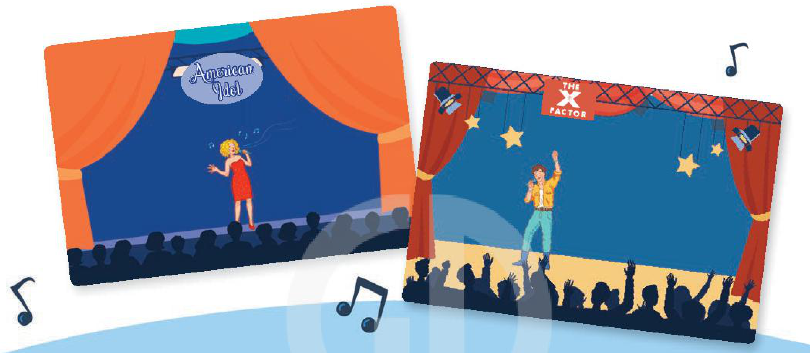
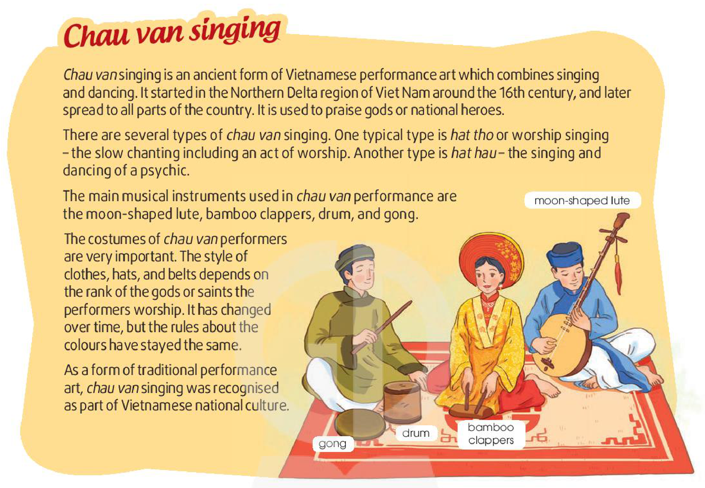
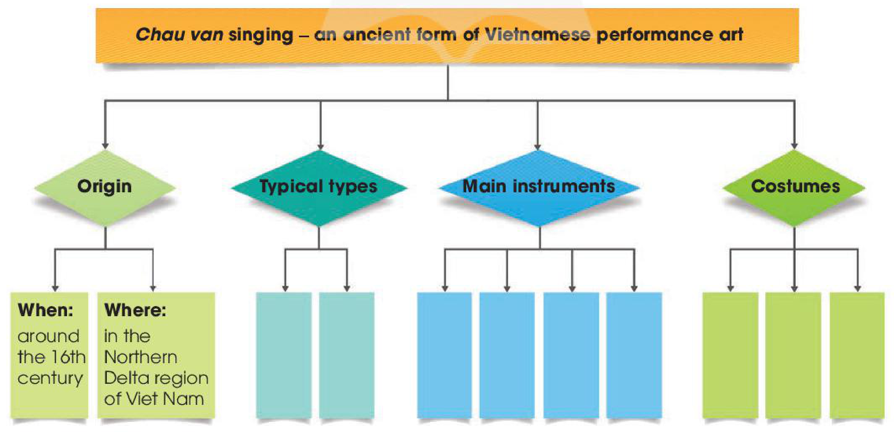

<!-- pdf:29 -->

# UNIT 3: MUSIC

**This unit includes:**

- **LANGUAGE**
  - **Pronunciation:** Stress in two-syllable words
  - **Vocabulary:** Words and phrases related to music
  - **Grammar:**
    - Compound sentences
    - *To*-infinitives and bare infinitives
- **SKILLS**
  - **Reading:** Reading for specific information in a text about a famous TV music show
  - **Speaking:** Talking about a TV music show
  - **Listening:** Listening for gist and specific information in an interview about a music festival
  - **Writing:** Writing a blog about an experience at a music event
- **COMMUNICATION AND CULTURE / CLIL**
  - **Everyday English:** Making and responding to suggestions
  - **Culture:** *Chau van* singing
- **PROJECT**
  - Doing research on a form of traditional music in Viet Nam or another country

## I. GETTING STARTED

**A talented artist!**

**1. Listen and read.**

**Mai:** That pop singer looks great, Ann!

**Ann:** Yeah. He's a popular teen idol around the world now.

**Mai:** Really? You must be a fan of his!

**Ann:** Yep, I really love his music. He's a **talented** artist who can write music and play many **musical instruments**. He has received several awards such as the Grammy, Billboard Music, and Teen Choice Awards.
<!-- term: award -->

**Mai:** Wow! Did he go to a music school?

**Ann:** No, he didn't, but he learnt to play the piano, drums, guitar, and **trumpet** by himself. When he was a teenager, he performed at the local theatre in his home town during the tourist season.

**Mai:** How did he become famous?

**Ann:** Well, when he was 12, his mother started to **upload** his cover song videos on **social media**, and the videos made him an online star within a couple of months.

<!-- pdf:30 -->

**Mai:** Sounds amazing!

**Ann:** And his videos have **reached** more than two billion total views. Many fans say that his beautiful songs have helped bring more love into their lives.

**2. Read the conversation again and answer the following questions.**

1. Who are Ann and Mai talking about?
2. What is he good at?
3. What made him popular?

**3. Find words or phrases in the conversation which refer to:**

1. a type of music
2. music awards
3. **musical instruments**
4. a way of sharing information and videos

**4. Match the two parts to make complete sentences.**

| | |
| --- | --- |
| 1. This artist didn't go to a music school, | a. and he has received several awards. |
| 2. His beautiful songs have helped | b. to **upload** his cover song videos on **social media**. |
| 3. His mother started | c. bring more love into people's lives. |
| 4. He is a **talented** artist, | d. but he learnt to play **musical instruments** by himself. |
<!-- ocr-ok: đã đối chiếu ảnh trang gốc, OCR bỏ sót đầu câu trong khung đồ hoạ và đọc nhầm learnt thành leorrt -->

## II. LANGUAGE

### Pronunciation

**Stress in two-syllable words**

**1. Listen and repeat. Pay attention to the stressed syllable in each word.**

| **Stress on the first syllable** | **Stress on the second syllable** |
| --- | --- |
| singer | relax |
| programme | **perform** |
| common | attract |
| careful | decide |

**Tips**

- Most two-syllable nouns and adjectives have stress on the first syllable.
- Most two-syllable verbs have stress on the second syllable.

**2. Listen and mark the stressed syllables in the words in bold.**

1. She is a **famous** **artist**.
2. I **enjoy** his songs about **friendship**.
3. Their **latest** show **received** a lot of good **comments**.

<!-- pdf:31 -->

### Vocabulary

**Music**

**1. Match the words with their meanings.**

| | |
| --- | --- |
| 1. **perform** (v) | a. having a natural ability to do something well |
| 2. **judge** (n) | b. a music recording that has one song |
| 3. **audience** (n) | c. to dance, sing, or play music in order to interest or please people |
| 4. **talented** (adj) | d. a person who decides on the results of a **competition** |
| 5. **single** (n) | e. the people who watch, read, or listen to the same thing |

**2. Complete the sentences using the words in 1.**

1. He has a nice voice, and he is a(n) \_\_\_\_\_\_\_ musician.
2. The TV show attracted a(n) \_\_\_\_\_\_\_ of more than 5 million.
3. Have you heard their new \_\_\_\_\_\_\_?
4. She was invited to be a(n) \_\_\_\_\_\_\_ in a popular TV talent show.
5. Many famous artists decided to \_\_\_\_\_\_\_ at the charity **concert**.

### Grammar

**Compound sentences**

**Remember!**

A **compound sentence** consists of two or more independent clauses joined by a coordinating conjunction (e.g. *and*, *or*, *but*, *so*).

*Example:* *It was raining, **but** they still went to the outdoor show.*

**Make compound sentences using the correct conjunctions in brackets.**

1. I am a jazz fan. My favourite style is from the late 1960s. (*and* / *but*)
2. Jackson wants to go to the music festival on Saturday. He has a maths exam on that day. (*but* / *so*)
3. You can book the tickets online. You can buy them at the stadium ticket office. (*but* / *or*)
4. The **concert** didn't happen. We stayed at home. (*or* / *so*)

**To-infinitives and bare infinitives**
**Remember!**
- Some verbs are followed by *to*-infinitives such as *decide*, *expect*, *plan*, *want*, *promise*, *agree*, *hope*, *hesitate*, *ask* ...
- Some verbs are followed by bare infinitives such as *make*, *let*, *hear*, *notice* ...

**Complete the following sentences using the *to*-infinitive or bare infinitive of the verbs in brackets.**

1. Her fans planned (send) \_\_\_\_\_\_\_ her a surprise present on her birthday.
2. Their **performance** was so boring that it made us (fall) \_\_\_\_\_\_\_ asleep.
3. Due to the bad weather, the band decided (**delay**) \_\_\_\_\_\_\_ their **live** **concert**.
4. Her parents won't let her (watch) \_\_\_\_\_\_\_ such TV shows.

<!-- pdf:32 -->

## III. READING

**American Idol**

**1. Work in pairs. Look at the pictures and discuss the following questions.**

*What are these shows? What do you know about them?*

**2. Read the text about a famous music show. Match the highlighted words and phrases in the text with the meanings below.**

*American Idol* was shown for the first time on television in January 2002. At that time, there were many movies and TV **series**, but no reality **competitions** on TV. The **participants** in this programme are ordinary people who the **audience** can really **identify with**.
<!-- term: reality TV show -->

First, **judges** travel all round America **in search of** the best singers and bring them to Hollywood. Twenty-four to thirty-six **participants** are then chosen to go on to the next stages where they **perform** **live** on TV, and receive the **judges'** opinions. From the semi-final onwards, people over 13 and living in the US, Puerto Rico, or the Virgin Islands can vote for their preferred singers online or through text messaging. The singer with the lowest number of votes is **eliminated**. On the final night, the most popular singer becomes the winner of that *American Idol* season.
<!-- term: semi-final -->
<!-- term: vote for -->

People watch *American Idol* not only to see the **participants** sing, but also to hear the **comments** of the **judges**, who play an important role in the **competition**. Their different opinions and interesting arguments make the show very exciting.

This music show has been held in many countries in the world. The first season of *Vietnam Idol* was shown in 2007. It included three stages: short **performances** to choose **participants**, semi-finals, and finals. The winners of the show's different seasons have become famous singers in Viet Nam.

| | |
| --- | --- |
| 1. **series** | a. feel that they are similar to and can understand them |
| 2. **identify with** | b. a set of TV or radio programmes on the same subject |
| 3. **in search of** | c. removed from the **competition** |
| 4. **eliminated** | d. looking for |
<!-- ocr-ok: đã đối chiếu ảnh trang gốc, OCR bỏ sót số 1-4 và chữ cái a-d trong khung tròn và đọc nhầm to thành fo -->

<!-- pdf:33 -->

**3. Read the text again and choose the best answers.**

1. What is *American Idol*?
   - A. A game show on TV
   - B. A TV singing **competition**
   - C. A **live** dancing **competition**
2. Which of the following statements is correct?
   - A. From the semi-final, singers who can go to the next stage are decided by the **audience** vote.
   - B. The **judges** choose as many singers as they can.
   - C. People around the world can vote for the songs they like.
3. Who wins *American Idol*?
   - A. The singer with the highest number of votes on the final night.
   - B. The singer with the highest number of votes and highest score from the **judges**.
   - C. The singer with the highest score from the **judges**.
4. Which of the following statements about the **judges** is NOT mentioned?
   - A. They give **comments** after each **live** **performance**.
   - B. They have different views about the singers' **performances**.
   - C. They are not in favour of choosing ordinary people.
5. What can be inferred about the **competition** in Viet Nam?
   - A. The **audience** decides who makes it to the final stage.
   - B. All the singers will be famous.
   - C. It can help develop **participants'** singing careers.

**4. Work in pairs. Discuss whether you want to participate in *Vietnam Idol*. Give your reasons.**

## IV. SPEAKING

**Talking about a TV music show**

**1. Read about a TV music show and complete the notes below.**

**I know your face**

Each week, six **participants** will dress up and **perform** as famous international or local artists in a **live** show. Two main **judges** and a guest artist will give their scores. After five weeks, only the three **participants** with the highest scores will remain on the show. On the final night, TV **audiences** can vote for their preferred **performance** and decide on the winner and two runners-up. The winner of the show will receive a cash prize.
<!-- term: dress up -->
<!-- term: runner-up -->
<!-- term: cash prize -->

1. Name: *I know your face*
2. People who give their scores: \_\_\_\_\_\_\_
3. Number of **participants**: \_\_\_\_\_\_\_
4. What **participants** have to do: \_\_\_\_\_\_\_
5. How **participants** win the show: \_\_\_\_\_\_\_
6. Prize(s): \_\_\_\_\_\_\_

**2. Work in groups. Make up a new music show. Use the points in 1 to organise your ideas.**

**3. Present your show to the whole class. Use your ideas in 2 and the expressions below. Vote for the best show.**

**Useful expressions:**
- We came up with an idea about a TV music show which is ...
- Let us give you an example.
- In our show, there will be ...
- The **participants** have to ...
- The winner will receive ...

<!-- pdf:34 -->

## V. LISTENING

**Enjoying music**

**1. Look at the picture and answer the following questions.**

1. What kind of event is it?
2. Where does the event usually take place?

**2. Listen to an interview about preparations for an International Youth Music Festival. Tick (✓) the information that you hear in the recording.**

| | |
| --- | --- |
| A. **Location** | |
| B. Guests | |
| C. **Decoration** | |
| D. Tickets | |

**3. Listen again and decide whether the following statements are true (T) or false (F).**

| | **T** | **F** |
| --- | --- | --- |
| 1. This is the first International Youth Music Festival. | | |
| 2. The organisers have finished preparations for the festival. | | |
| 3. Last year, the festival was held on the beach. | | |
| 4. They are selling tickets for the festival at the park gates. | | |
| 5. The country park is far from the town centre. | | |

**4. Work in groups. Discuss the following questions.**

*Do you want to go to a music festival? Why or why not?*

## VI. WRITING

**Writing a blog about an experience**

**1. Ann has just come back from a music event and shared her experience on a music website. Read her blog and complete the notes below.**

Last Saturday, I went to the International Youth Music Festival with some friends. This music event was even bigger and better than last year. There were a lot of exciting **performances** with many famous bands and singers from all over the world. I must say that they were really cool on stage! We had a chance to see our favourite idols **perform** **live** and listen to their greatest hits. We also tasted a lot of yummy food from different countries such as Korea, Mexico, and Thailand.
<!-- term: music festival -->

This year the festival took place in a big country park, so there was plenty of space for us to enjoy the music and relax. We all felt excited when going to this festival because we could make new friends and enjoy the party atmosphere ...
<!-- term: take place -->

**Ann's notes**
- **Event:** *International Youth Music Festival*
- **When:** \_\_\_\_\_\_\_
- **Where:** \_\_\_\_\_\_\_
- **Who with:** \_\_\_\_\_\_\_
- **Atmosphere:** \_\_\_\_\_\_\_
- **What we did:** \_\_\_\_\_\_\_
- **How we felt:** \_\_\_\_\_\_\_

<!-- pdf:35 -->

**2. Work in groups. Put the words and phrases in the box below into the appropriate columns. Some words and phrases can go into more than one column.**

| | |
| --- | --- |
| amazing | friendly |
| excited | beach |
| relaxed | wonderful |
| stadium | fun |
| watch fireworks | play games |
| take photos | see art exhibitions |
| play **musical instruments** | |

| **Location** | **Atmosphere** | **Activities** | **Feeling** |
| --- | --- | --- | --- |
| | | | |

**3. Imagine you went to a music event. Write a blog (about 120 words) to share your experience. Use the notes in 1 and the words and phrases in 2 to help you.**

## VII. COMMUNICATION AND CULTURE / CLIL

### Everyday English

**Making and responding to suggestions**

**1. Listen and complete the following conversation with the expressions from the box. Then practise it in pairs.**

- A. How about
- B. I'd love to
- C. Shall
- D. Let's
<!-- ocr-ok: đã đối chiếu ảnh trang gốc, OCR đọc nhầm B. I'd love to thành B.ldlovefo -->

**Ann:** Do you have any plans for this Saturday evening?

**Mai:** No, I don't. (1) \_\_\_\_\_\_\_ we do something together?

**Ann:** Yes, (2) \_\_\_\_\_\_\_. (3) \_\_\_\_\_\_\_ going to a music show? Let me check the weekend programme at the Modern Arts Centre. Look at their website!

**Mai:** Wow, so many famous artists are going to **perform** there. This band looks so cool. (4) \_\_\_\_\_\_\_ go to the Saturday show.

**Ann:** Sounds great.

**2. Work in pairs. Have similar conversations making and responding to suggestions about going to a music show.**

**Useful expressions**

| | |
| --- | --- |
| **Making suggestions** | - Shall we (do) ...? - Why don't (we) ...? - What / How about ...? - Let's ... |
| **Responding to suggestions** | - Yes, I'd love to ... - That's a good idea. - I don't feel like it. - I really want to ... but ... |
<!-- ocr-ok: đã đối chiếu ảnh trang gốc, OCR đọc nhầm Yes, I'd love to thành Yas, 1Ø love 10 và I really thành |redlly -->

<!-- pdf:36 -->

### Culture

**1. Read the passage about *chau van* singing and complete the mind map below.**

**Chau van singing**
*Chau van* singing is an ancient form of Vietnamese **performance** art which combines singing and dancing. It started in the Northern Delta region of Viet Nam around the 16th century, and later spread to all parts of the country. It is used to praise gods or national heroes.

There are several types of *chau van* singing. One typical type is *hat tho* or worship singing – the slow chanting including an act of worship. Another type is *hat hau* – the singing and dancing of a psychic.
<!-- term: hat tho -->
<!-- term: hat hau -->

The main **musical instruments** used in *chau van* **performance** are the **moon-shaped lute**, **bamboo clappers**, drum, and gong.

The costumes of *chau van* performers are very important. The style of clothes, hats, and belts depends on the rank of the gods or saints the performers worship. It has changed over time, but the rules about the colours have stayed the same.

As a form of traditional **performance** art, *chau van* singing was recognised as part of Vietnamese national culture.

- **Chau van singing – an ancient form of Vietnamese performance art**
  - **Origin**
    - **When:** around the 16th century
    - **Where:** in the Northern Delta region of Viet Nam
  - **Typical types:** \_\_\_\_\_\_\_; \_\_\_\_\_\_\_
  - **Main instruments:** \_\_\_\_\_\_\_; \_\_\_\_\_\_\_; \_\_\_\_\_\_\_; \_\_\_\_\_\_\_
  - **Costumes:** \_\_\_\_\_\_\_; \_\_\_\_\_\_\_; \_\_\_\_\_\_\_

**2. Work in pairs. Tell your partner what you find most interesting about *chau van* singing.**

<!-- pdf:37 -->

## VIII. LOOKING BACK

### Pronunciation

**Listen and mark the stressed syllables in the following words. Then read them out.**

| | | |
| --- | --- | --- |
| **perform** | **concert** | final |
| singer | famous | enjoy |

### Vocabulary

**Complete the text using the words in the box.**

| artists | music | **concerts** | **instrument** | fans |
| --- | --- | --- | --- | --- |

Our class survey revealed some surprising results about the students' (1) \_\_\_\_\_\_\_ habits. Most of them did not hesitate to say that they love music because they find it relaxing. Their favourite music is K-pop and British or American pop music as they are big (2) \_\_\_\_\_\_\_ of Korean and American (3) \_\_\_\_\_\_\_. Fourteen out of twenty students play a **musical** (4) \_\_\_\_\_\_\_ and most of them practise between one and three hours a week. Going to (5) \_\_\_\_\_\_\_ is usually popular among teenagers, but only eight people said that they like going to such music events.

### Grammar

**1. Match the two parts to make complete sentences.**

| | |
| --- | --- |
| 1. She writes her own songs, | a. or we can stay at home to watch the final night of *Vietnam Idol*. |
| 2. He participated in many talent **competitions**, | b. so we decided to walk to the stadium. |
| 3. We can go to a **live** **concert** at City Theatre, | c. and they always have deep meanings. |
| 4. The traffic was really bad, | d. but the **judges** never liked his songs. |

**2. There is a mistake in each sentence below. Find the mistake and correct it.**

1. She asked him attend the school **performance**. \_\_\_\_\_\_\_
2. Don't let her to go to the music festival! \_\_\_\_\_\_\_
3. Their parents will never agree buy that expensive piano. \_\_\_\_\_\_\_
4. To develop her musical talent, her father made her to sing at family gatherings. \_\_\_\_\_\_\_

<!-- pdf:38 -->

## PROJECT

**Traditional music**

**Work in groups. Do research on a form of traditional music in Viet Nam or another country.**

**Present your findings to the class. Your presentation should include:**
- when / where it started
- **instrument**(s)
- types
- artists / performers
- costumes

**Xoan singing**
1. Where it started: Phu Tho
2. **Instrument**(s): drum, clappers
3. Types: 3
<!-- ocr-ok: đã đối chiếu ảnh trang gốc, chữ nghiêng trên thẻ màu xanh lá của poster minh hoạ bị OCR bỏ sót -->

**Now I can ...**
- pronounce two-syllable words with correct stress.
- understand and use words and phrases related to music.
- use conjunctions to make compound sentences.
- use *to*-infinitives and bare infinitives after some verbs.
- read for specific information in a text about a famous TV music show.
- talk about a TV music show.
- listen for gist and specific information in an interview about a music festival.
- write a blog about an experience at a music event.
- make and respond to suggestions.
- identify *chau van* singing.
- do research on a form of traditional music in Viet Nam or another country and give a group presentation about it.

## 📷 Danh mục hình minh hoạ

| Mã hình | Trang PDF | Trang sách | Chú thích / Mô tả |
| --- | --- | --- | --- |
| H10-tieng_anh-u03-01 | 32 | 31 | Hai bức tranh minh hoạ sân khấu biểu diễn của hai chương trình âm nhạc truyền hình nổi tiếng: *American Idol* và *The X Factor* |
| H10-tieng_anh-u03-02 | 34 | 33 | Tranh minh hoạ một buổi biểu diễn lễ hội âm nhạc ngoài trời sôi động trên bãi biển |
| H10-tieng_anh-u03-03 | 36 | 35 | Văn bản và tranh minh hoạ nghệ thuật hát chầu văn cổ truyền Việt Nam cùng các nhạc cụ chính: đàn nguyệt (*moon-shaped lute*), phách (*bamboo clappers*), trống (*drum*) và chiêng (*gong*) |
| H10-tieng_anh-u03-04 | 36 | 35 | Sơ đồ tư duy (*mind map*) tóm tắt nguồn gốc (*Origin*), các loại hình tiêu biểu (*Typical types*), nhạc cụ chính (*Main instruments*) và trang phục (*Costumes*) của nghệ thuật hát chầu văn |
