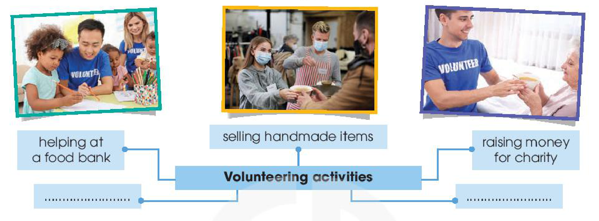
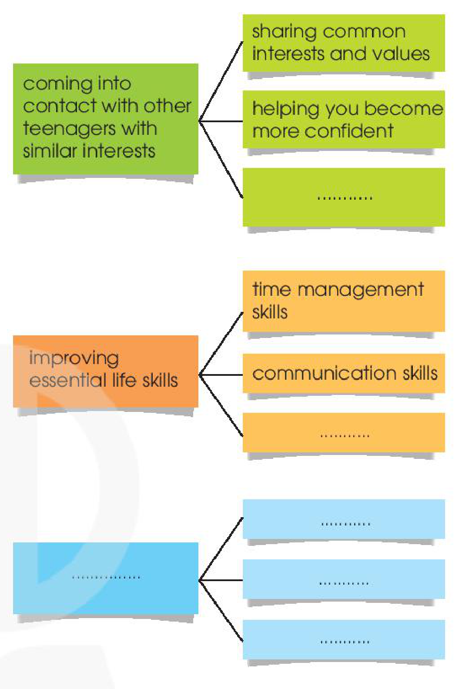
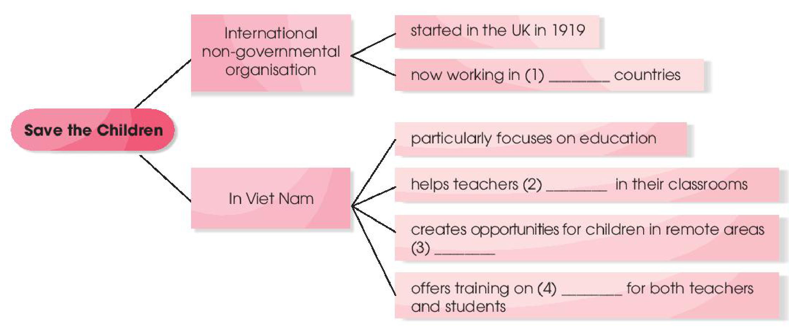

<!-- pdf:43 -->

# UNIT 4: FOR A BETTER COMMUNITY

> **This unit includes:**
> - **LANGUAGE**
>   - **Pronunciation:** Stress in two-syllable words with the same spelling
>   - **Vocabulary:**
>     - Words and phrases related to community development;
>     - Adjective suffixes: *-ed* vs. *-ing*; *-ful* vs. *-less*
>   - **Grammar:** Past simple vs. past continuous with *when* and *while*
> - **SKILLS**
>   - **Reading:** Reading for main ideas and specific information in a text about a volunteer club
>   - **Speaking:** Talking about the benefits of volunteering activities
>   - **Listening:** Listening for specific information in an announcement for volunteers
>   - **Writing:** Writing an application letter for volunteer work
> - **COMMUNICATION AND CULTURE / CLIL**
>   - **Everyday English:** Expressing feelings
>   - **Culture:** *Save the Children* organisation
> - **PROJECT**
>   - Doing research on a volunteer project in your community

## I. GETTING STARTED

**Volunteering in the community**

**1. Listen and read.**

**Kim:** Hi, Tam. I went to your house at 9 a.m., but you weren't there.

**Tam:** Oh, when you came, I was working as a **volunteer** at our local centre for **community development**.
<!-- term: community -->

**Kim:** Ah, I see. How did you become a **volunteer** there?

**Tam:** Just by chance. Last summer, while I was visiting the centre, I saw an advertisement for **volunteers**. I applied, and my application was successful.
<!-- term: by chance -->

**Kim:** I also want to be a **volunteer**. I find **community** work very interesting.

**Tam:** I agree. **Community service** not only benefits the local area, but can also **boost** our **confidence** and help us learn many useful skills.

**Kim:** What are the regular activities organised by the centre?

**Tam:** Oh, there are endless opportunities for getting **involved**. For example, you can join a local environmental group to clean up the park once a week or **volunteer** at an **orphanage**.

**Kim:** Sounds good. How can I apply?
<!-- ocr-ok: đã đối chiếu ảnh trang gốc, OCR nhận nhầm chữ I thành dấu gạch đứng | -->

**Tam:** I'll email you the form. You just fill it in and send it in.

**Kim:** Thanks so much. I'm so excited about **volunteering** at the centre.

**Tam:** No problem. Good luck. Hope your application is successful, and you enjoy the work.

<!-- pdf:44 -->

**2. Read the conversation again and answer the questions.**

1. What was Tam doing when Kim went to her house?
2. What are some regular activities at the centre for community development?
3. How can Kim apply for volunteer work at the centre?

**3. Find adjectives with the following suffixes in the conversation and write them below.**

- *-ed*: \_\_\_\_\_\_\_\_\_\_\_\_\_\_\_\_\_\_\_\_\_\_\_
- *-ing*: \_\_\_\_\_\_\_\_\_\_\_\_\_\_\_\_\_\_\_\_\_\_\_
- *-ful*: \_\_\_\_\_\_\_\_\_\_\_\_\_\_\_\_\_\_\_\_\_\_\_
- *-less*: \_\_\_\_\_\_\_\_\_\_\_\_\_\_\_\_\_\_\_\_\_\_\_

> **Tips**
> **Meanings of adjective suffixes:**
> - *-ful*: full of or having the qualities of
> - *-less*: without or lacking
> - *-ed*: describing how people are made to feel
> - *-ing*: describing things or people causing the feeling
<!-- term: Adjectives ending in -ed / -ing; -ful / -less -->

**4. Find a verb or verb phrase in the conversation in 1 to complete each sentence.**

1. Oh, when you came, I \_\_\_\_\_\_\_ as a volunteer at our local centre for community development.
2. Last summer, while I was visiting the centre, I \_\_\_\_\_\_\_ an advertisement for volunteers.

## II. LANGUAGE

### Pronunciation

**Stress in two-syllable words with the same spelling**

**1. Listen to the sentences and circle the word with the stress you hear.**

1. The centre keeps a *record* of all **donations**.
   - a. 'record
   - b. re'cord
2. We will *record* the charity live show for those who can't watch it live.
   - a. 'record
   - b. re'cord
3. There was an *increase* in house prices last year.
   - a. 'increase
   - b. in'crease
4. We want to *increase* students' interest in volunteering at the community centre.
   - a. 'increase
   - b. in'crease
5. I got this *present* from a visitor to our centre.
   - a. 'present
   - b. pre'sent
6. We need to help local businesses to *export* their products.
   - a. 'export
   - b. ex'port

> **Tips**
> In many two-syllable words with the same spelling:
> - nouns are usually stressed on the first syllable.
>   *Example:* *a 'record*
> - verbs are usually stressed on the second syllable.
>   *Example:* *to re'cord*
>
> **Note:** There is not always a change of stress in words that are both nouns and verbs.
> *Example:* *an 'answer*, *to 'answer*
> *a 'picture*, *to 'picture*

**2. Listen again and practise saying the sentences in 1.**

<!-- pdf:45 -->

### Vocabulary

**Community development**

**1. Match the words with their meanings.**

| Words | Meanings |
| --- | --- |
| 1. **donate** (v) | a. giving or willing to give freely |
| 2. **volunteer** (n) | b. far away from places where other people live |
| 3. **generous** (adj) | c. to give money, food, clothes, etc. to a charity |
| 4. **remote** (adj) | d. to be in a better position because of something; to be useful to somebody |
| 5. **benefit** (v) | e. a person who does a job without being paid for it |

**2. Complete the following sentences using the correct forms of the words in 1.**

1. He is very \_\_\_\_\_\_\_. He is always willing to give a lot of money to charity.
2. The school is difficult to get to because it is located in a \_\_\_\_\_\_\_ area.
3. If you don't have time to volunteer, you can \_\_\_\_\_\_\_ money and food.
4. This clean water project will \_\_\_\_\_\_\_ the people in the village.
5. Our club needs more \_\_\_\_\_\_\_ to clean up the park at the weekend.

**3. Choose the correct word to complete each of the following sentences.**

1. We need to be *careful* / *careless* when we record the donations.
2. I am *interested* / *interesting* in community development activities.
3. There are *excited* / *exciting* volunteering opportunities in our community.
4. Last year, I was *hopeful* / *hopeless* at maths. I couldn't even do simple addition in my head.

### Grammar

**Past simple vs. past continuous with *when* and *while***

**Remember!**

> We use:
> - the past continuous for a past action in progress (longer action).
> - the past simple for an action which interrupted it (shorter action).
>
> *Example:*
> *I **was reading** an article when she **called**.*
> *While I **was reading** an article, she **called**.*
>
> | Past | Now | Future |
> | --- | --- | --- |
> | was reading $\rightarrow$ $\times$ called | | |
<!-- term: Past simple vs. past continuous with when and while -->

**1. Choose the correct verb form in each of the following sentences.**

1. While Lan *was working* / *worked* as a volunteer in the countryside, she met an old friend.
2. I was revising for my civics class when my dad *was telling* / *told* me about the volunteer job.
3. We saw many unhappy children while we *were helping* / *helped* people in remote areas.
4. He was sorting the donations when he *was realising* / *realised* how generous people were.

**2. Combine the two sentences using *when* or *while* where appropriate.**

1. They were cleaning the streets. It started to rain.
2. I was watching TV. I saw the floods and landslides in the area.
3. Tim was searching for employment opportunities. He found a job advert from a **non-governmental** organisation.
4. They decided to help build a community centre for young people. They were visiting some poor villages.

<!-- pdf:46 -->

## III. READING

**Teenagers and voluntary work**

**1. Work in pairs. Complete the mind map with popular volunteering activities for teenagers. Use the pictures below to help you.**

- **Volunteering activities:**
  - helping at a food bank
  - selling handmade items
  - raising money for charity
  - ....................
  - ....................

**2. Read the text and choose the main idea.**

- A. The writer's secondary school has a long and interesting history.
- B. The Volunteer Club was set up 15 years ago to help teens gain work experience.
- C. The club organises many volunteering activities that benefit both the community and the students.

I joined the Volunteer Club when I started secondary school. The club was formed fifteen years ago, shortly after the school was set up. Since then, it has organised **various** volunteering activities for all students to **participate**.

One of the most popular activities of our club is selling handmade **items** to **raise** money for the local **orphanage** and homeless old people. Last year, we also **raised** over one hundred million VND to help people in flooded areas. The money was used to buy warm clothes, blankets, food, and clean water.

Our club welcomes different types of **donations**: clothes, picture books, unused notebooks, and other unwanted items. At the end of each month, we take the donations to the community centre. Our club also organises after-school games for the children at the orphanage and concerts for the old people at the centre. In addition, it offers other volunteering activities, such as helping at a food bank or **delivering** free meals to poor families.

Volunteering has helped me gain life experiences and find my sense of purpose in life. When I see suffering and hardships, I feel thankful for what I have. What is more, these activities provide opportunities for me to meet other teenagers with similar interests and help me build essential life skills.
<!-- term: sense of purpose -->
<!-- term: suffering -->
<!-- term: hardship -->
<!-- term: peer -->

**3. Match the highlighted words in the text with their meanings.**

| Words | Meanings |
| --- | --- |
| 1. **various** | a. objects or things |
| 2. **participate** | b. taking things to someone |
| 3. **items** | c. several different |
| 4. **raised** | d. to take part in an activity |
| 5. **delivering** | e. collected money |
<!-- ocr-ok: đã đối chiếu ảnh trang gốc, OCR bỏ sót số thứ tự và chữ cái trong vòng tròn màu vàng và đọc nhầm several thành severdl -->

<!-- pdf:47 -->

**4. Read the text again. Decide whether the following statements are true (T) or false (F).**

| | T | F |
| --- | --- | --- |
| 1. The Volunteer Club was set up long after the school was opened. | | |
| 2. All students can join different volunteering activities. | | |
| 3. The money collected from selling handmade items is used to build a local centre for orphans and homeless old people. | | |
| 4. Students can volunteer at the orphanage or the community centre. | | |
| 5. Club members can also help cook free meals for poor families. | | |

**5. Work in pairs. Discuss the following question.**

*If you were a member of the Volunteer Club, what could you do to help?*

## IV. SPEAKING

**Benefits of volunteering activities**

**1. Look at the following benefits of volunteering activities. Choose the THREE most important benefits.**

- Coming into contact with other teenagers with similar interests
- Improving essential life skills, such as skills that will get you a job, or time management skills
- Appreciating the good things in life and being positive
- Helping teenagers find a sense of purpose in life
- Gaining life experiences

**2. Complete the following diagram with examples and details that explain the benefits of volunteering activities.**

- **coming into contact with other teenagers with similar interests**
  - sharing common interests and values
  - helping you become more confident
  - ............
- **improving essential life skills**
  - time management skills
  - communication skills
  - ............
- **...............**
  - ............
  - ............
  - ............

**3. Work in groups. Give a presentation about the benefits of volunteering activities. Use the information in 2 and the expressions below to help you.**

| **Useful expressions** | |
| --- | --- |
| First of all, ... | For example, ... |
| Second, ... | For instance, ... |
| Third, ... | ... such as ... |
| Finally, ... | |

<!-- pdf:48 -->

## V. LISTENING

**An announcement for volunteer positions**

**1. Read the job advert and answer the questions.**

> **CITY CENTRE *for* COMMUNITY DEVELOPMENT**
> **Needs Volunteers!**
> - Interested in community development projects?
> - Have a couple of hours to spare at the weekend?
> $\rightarrow$ Apply now!!!
> Location: Cau Giay, Ha Noi
> Email: communitydevelopment@webmail.com

1. Who needs volunteers?
2. Who can apply for the job?

**2. Listen to an announcement and choose the best answer to complete each sentence.**

1. This non-profit organisation supports \_\_\_\_\_\_\_ people and communities.
   - A. remote
   - B. local
   - C. poor
2. They organise job training courses for \_\_\_\_\_\_\_.
   - A. poor people
   - B. teenagers
   - C. old people
3. They are looking for teenagers who can volunteer \_\_\_\_\_\_\_.
   - A. on weekdays
   - B. every day
   - C. at the weekend
4. People whose application is successful will be trained by \_\_\_\_\_\_\_ volunteers.
   - A. experienced
   - B. helpful
   - C. young
5. Volunteers will have a chance to meet teenagers with \_\_\_\_\_\_\_ interests.
   - A. strong
   - B. different
   - C. similar

**3. Listen again and decide whether the following statements are true (T) or false (F).**

| | T | F |
| --- | --- | --- |
| 1. This organisation helps people in the area. | | |
| 2. Only poor people can get support from the City Centre for Community Development. | | |
| 3. The centre is looking for volunteers now. | | |
| 4. The new volunteers will only become members of the local community development network. | | |
| 5. The deadline for the application letter is the 1st of January. | | |

**4. Work in groups. Discuss the following question.**

*What do you think you can do to help people in your community?*

<!-- pdf:49 -->

## VI. WRITING

**Writing an application letter for volunteer work**

**1. Read the application letter for a volunteer position. Match the paragraphs with their aims.**
<!-- term: application letter -->

- **A.** Saying why you want to do the job
- **B.** Saying when you are available for an interview and can start work
- **C.** Mentioning the job you are applying for and where you got the information from

> 187 Giang Vo Street
> Dong Da, Ha Noi
> 1 January 20\_\_\_
>
> Heart to Heart
> Charitable Organisation
> 100 Ha Thanh Street, Ha Noi
>
> Dear Sir or Madam,
>
> **Paragraph 1:** \_\_\_
> I am writing to apply for a volunteer position at the local centre for community development. I heard about this opportunity in a public **announcement** last Monday.
>
> **Paragraph 2:** \_\_\_
> I am interested in your community development projects because I really care about the life of people in the community and want to offer my services to you. Currently, all my Sunday afternoons are free, and I will be able to help at the centre if I am chosen.
>
> **Paragraph 3:** \_\_\_
> I have already filled in the online application form and sent it in as requested. I am available for an interview on any weekday after 4.30 p.m. or at weekends. If my application is successful, I can start immediately.
>
> I look forward to hearing from you.
>
> Yours faithfully,
> *Nguyen Ha Vi*

**2. Read the job advert and answer the questions below.**

> **VOLUNTEERS NEEDED**
> - Our Heart to Heart Charitable Organisation needs reliable and hard-working volunteers to work at our head office.
> - The job will involve welcoming guests and visitors to the office, and receiving and sorting donations.
<!-- term: reliable -->
<!-- term: hard-working -->

1. What qualities are needed for the job?
2. What are the job duties?

**3. Complete the application letter for the job in 2. You can use the ideas in 1.**

> .................... Street
> ...................., ....................
> 1 January 20\_\_\_
>
> Heart to Heart
> Charitable Organisation
> 100 Ha Thanh Street, Ha Noi
>
> Dear Sir or Madam,
>
> I am writing to apply for a volunteer position ............................................................
>
> I am interested in .............................................
>
> I am available for an interview ............................................................ If my application is successful, I can start ............................................................
>
> I look forward to hearing from you.
>
> Yours faithfully,
> ............................

<!-- pdf:50 -->

## VII. COMMUNICATION AND CULTURE / CLIL
<!-- ocr-ok: đã đối chiếu ảnh trang gốc, OCR chèn số La Mã VII vào giữa tiêu đề hai dòng -->

### Everyday English

**Expressing feelings**

**1. Listen and complete the conversation with the words from the box. Then practise it in pairs.**

| A. excited | B. worried |
| --- | --- |
| **C.** **cheerful** | **D.** **confused** |
<!-- ocr-ok: đã đối chiếu ảnh trang gốc, OCR đọc cột B D trước cột A C trong hộp từ vựng -->

**Nam:** Hi Lan! You look very (1) \_\_\_\_\_\_\_ today! I heard you went on a volunteer trip to the mountains. How was it?

**Lan:** Great! I'm so happy and relaxed now though at first I was (2) \_\_\_\_\_\_\_. I didn't understand the purpose of the trip. I knew nothing about the place, so I also felt a little bit (3) \_\_\_\_\_\_\_.

**Nam:** Oh, did you go there with other members of the volunteer club? Was everything OK?

**Lan:** Yes, we went as a team. The local people were so friendly and helpful. Now we are preparing for our next volunteer trip in the summer. I'm so (4) \_\_\_\_\_\_\_ about it.

**2. Imagine you are back from a volunteer trip. Work in pairs. Take on a role and act out a conversation like the one in 1. Use the expressions below to help you.**

| **Useful expressions** |
| --- |
| I feel / felt / am / was excited / confused / confident / pleased ... |
| To be honest, I'm / I was a little bit stressed / disappointed / upset ... |
| Volunteering / Helping people made me feel happy / grateful / appreciated ... |

### Culture

**1. Read the text below and complete the diagram (page 50) about *Save the Children*.**

**Save the Children** is an international **non-governmental** organisation that helps improve children's lives. It was set up in the United Kingdom in 1919, and now it is working in 120 countries around the world.

*Save the Children* started its work in Viet Nam in 1990. It provides **practical** support in different areas. One of the areas that the organisation particularly focuses on is education. It has organised different training courses to help teachers improve their teaching skills and use digital technology in their classrooms. It is also working on projects that create more opportunities for children in **remote** areas to go to school. By providing these children with books and other school materials, *Save the Children* makes sure they have **access** to learning. In addition, the organisation offers training on **life-saving** skills for both teachers and students in case of disasters. Children and households in need can also receive support from *Save the Children*.

<!-- pdf:51 -->

- **Save the Children**
  - **International non-governmental organisation**
    - started in the UK in 1919
    - now working in (1) \_\_\_\_\_\_\_ countries
  - **In Viet Nam**
    - particularly focuses on education
    - helps teachers (2) \_\_\_\_\_\_\_ in their classrooms
    - creates opportunities for children in remote areas (3) \_\_\_\_\_\_\_
    - offers training on (4) \_\_\_\_\_\_\_ for both teachers and students

**2. Work in groups. Use the diagram to talk about *Save the Children*.**

## VIII. LOOKING BACK

### Pronunciation

**Listen and mark the stressed syllables in the words in bold. Then practise saying the sentences.**

1. We hope that the number of volunteers will **increase** this year.
2. When will you **present** your report about the volunteer project?
3. I always keep a **record** of visitors' donations.
4. We still **import** too many products that can be made in our country.

### Vocabulary

**Fill in the gaps with the correct forms of the words in brackets.**

1. There are (end) \_\_\_\_\_\_\_ opportunities for teenagers to volunteer these days.
2. We were very (excite) \_\_\_\_\_\_\_ to help children organise after-school activities.
3. The local people were really (help) \_\_\_\_\_\_\_. They supported us all the time we stayed there.
4. We need more (volunteer) \_\_\_\_\_\_\_ for our community projects.
5. Our charity groups received generous (donate) \_\_\_\_\_\_\_ from the local people.

### Grammar

**Complete the sentences using the correct forms of the verbs in brackets. Use the past simple or past continuous.**

1. I first (meet) \_\_\_\_\_\_\_ Lan while we (work) \_\_\_\_\_\_\_ as volunteers.
2. While we (walk) \_\_\_\_\_\_\_ home, we (see) \_\_\_\_\_\_\_ a girl crying near a bus stop.
3. Kim (notice) \_\_\_\_\_\_\_ the poverty of the area while she (deliver) \_\_\_\_\_\_\_ free meals to old people.
4. When I (arrive) \_\_\_\_\_\_\_ at the community centre, a guest speaker (give) \_\_\_\_\_\_\_ a speech.

<!-- pdf:52 -->

## PROJECT

**A Volunteer Project**

**Work in groups. Find information about a volunteer project in your community.**

**Present your findings to the class. Your presentation should include:**

- What is the volunteer project about?
- What are the aims of the project?
- Where is it carried out?
- Who takes part in the project?
- What are the main activities of the project?
- Who will benefit from the project?

### Now I can ...

- pronounce two-syllable words with the same spelling with correct stress.
- understand and use words and phrases related to community development.
- understand and use adjective suffixes: *-ed* vs. *-ing*; *-ful* vs. *-less*.
- use the past simple and the past continuous with *when* and *while*.
- read for main ideas and specific information in a text about a volunteer club.
- talk about the benefits of volunteering activities.
- listen for specific information in an announcement for volunteers.
- write an application letter for volunteer work.
- express feelings.
- identify factual information about the *Save the Children* organisation and its activities to help Viet Nam.
- do research on a volunteer project in my community and give a group presentation about it.

## 📷 Danh mục hình minh hoạ

| Mã hình | Trang PDF | Trang sách | Chú thích / Mô tả |
| --- | --- | --- | --- |
| H10-tieng_anh-u04-01 | 46 | 45 | Ba bức ảnh chụp hoạt động tình nguyện của thanh thiếu niên và sơ đồ tư duy (mind map) về các hoạt động tình nguyện phổ biến (helping at a food bank, selling handmade items, raising money for charity) trong phần Reading |
| H10-tieng_anh-u04-02 | 47 | 46 | Sơ đồ phân nhánh các lợi ích của hoạt động tình nguyện kèm ví dụ và chi tiết minh hoạ (coming into contact with other teenagers with similar interests, improving essential life skills) trong phần Speaking |
| H10-tieng_anh-u04-03 | 51 | 50 | Sơ đồ tóm tắt thông tin về tổ chức phi chính phủ quốc tế Save the Children và các hoạt động hỗ trợ tại Việt Nam trong phần Culture |
