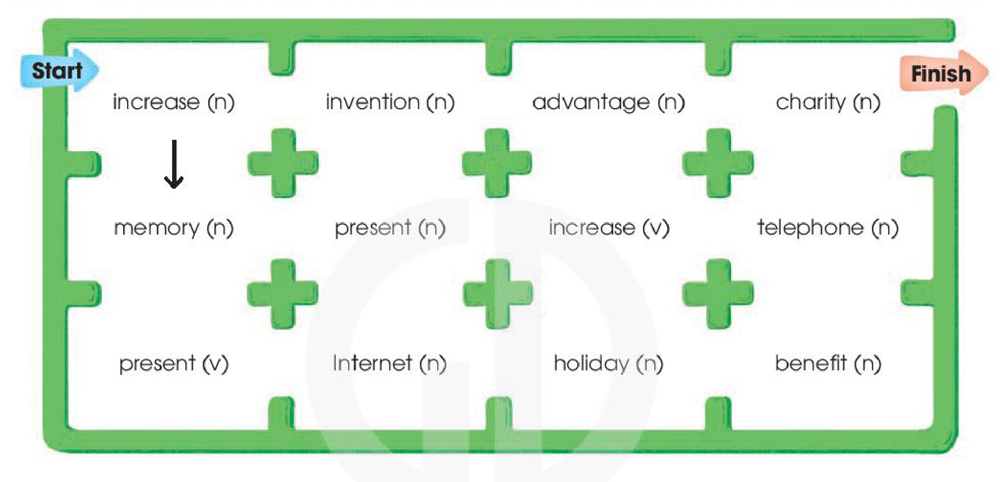
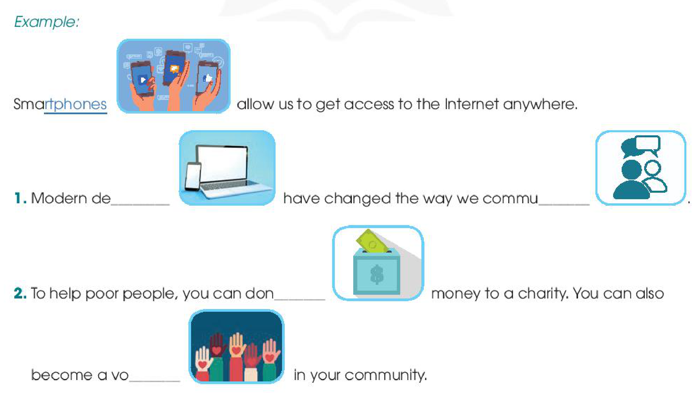
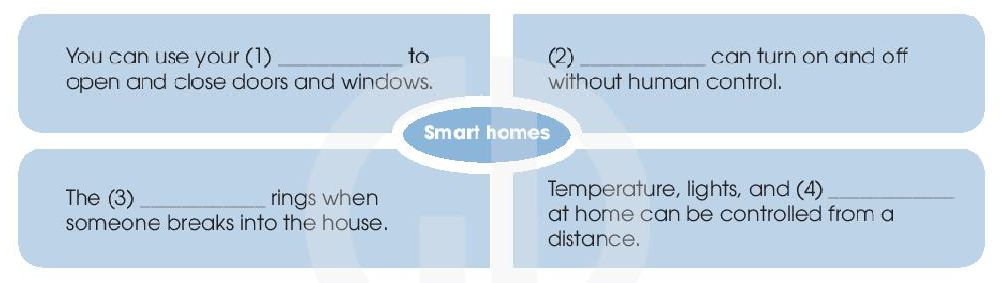

<!-- pdf:63 -->

# REVIEW 2

## I. LANGUAGE

### Pronunciation

**Escape the maze by connecting all the words with stress on the FIRST syllable. Follow the example. Then listen to check your answers. Practise saying the words.**

| **Start** → | | | → **Finish** |
| :---: | :---: | :---: | :---: |
| increase (n) ↓ | invention (n) | advantage (n) | charity (n) |
| memory (n) | present (n) | increase (v) | telephone (n) |
| present (v) | Internet (n) | holiday (n) | benefit (n) |

### Vocabulary

**1. What are the missing letters? Complete the sentences using the pictures to help you. The first word is done for you.**

*Example:*

Smart<u>phones</u> allow us to get access to the Internet anywhere.
<!-- ocr-ok: đã đối chiếu ảnh trang gốc, phần gạch chân và hình minh hoạ xen giữa câu làm OCR tách từ -->

1. Modern de\_\_\_\_\_\_\_ have changed the way we commu\_\_\_\_\_\_\_.
2. To help poor people, you can don\_\_\_\_\_\_\_ money to a charity. You can also become a vo\_\_\_\_\_\_\_ in your community.
<!-- ocr-ok: đã đối chiếu ảnh trang gốc, các câu có hình minh hoạ xen giữa làm OCR bỏ sót chữ -->

<!-- pdf:64 -->

**2. Complete the sentences using these words. There are some extra ones.**

| useful | useless | interested |
| :---: | :---: | :---: |
| interesting | careful | careless |
<!-- ocr-ok: đã đối chiếu ảnh trang gốc, 6 từ gợi ý in trên nền giấy xé màu nâu bị OCR bỏ sót -->

1. Many \_\_\_\_\_\_\_ inventions in the world are the results of hard work and \_\_\_\_\_\_\_ experiments.
2. Things such as old clothes or toys seem \_\_\_\_\_\_\_, but you can donate them to charity. Some poor people may be \_\_\_\_\_\_\_ in them.

### Grammar

**Read the text and circle the correct answers.**

**Inventions and discoveries by accident!**

The invention or discovery of something is not always the result of careful experiments. Sometimes, luck can help scientists (1) *finding* / *find* new things. Below are some famous examples.

**Gravity:** (2) *Discover* / *Discovering* the law of gravity is probably the most famous example. Isaac Newton (3) *sat* / *was sitting* under an apple tree when an apple (4) *fell* / *was falling* on his head. He realised that something made apples fall straight to the ground. That was gravity!

**Penicillin:** Alexander Fleming came back from his holiday. He (5) *was cleaning* / *cleaned* his laboratory when he (6) *discovered* / *was discovering* something at the window. That was penicillin! Since then, doctors (7) *used* / *have used* penicillin around the world to save millions of lives.

**Popsicles:** In 1905, 11-year-old Frank Epperson decided (8) *to make* / *making* himself a soft drink. When he finished (9) *make* / *making* the drink, he left it outside with the wooden stick inside it. That night, the drink froze in cold weather and thanks to this 'accident', popsicles were later invented!

<!-- pdf:65 -->

## II. SKILLS

### Listening

**1. Listen and choose the best title for the talk.**

- A. Smart home technology
- B. The popularity of smart homes
- C. The future of smart homes

**2. Listen again and fill in each blank with ONE word.**

- **Smart homes**
  - You can use your (1) \_\_\_\_\_\_\_ to open and close doors and windows.
  - (2) \_\_\_\_\_\_\_ can turn on and off without human control.
  - The (3) \_\_\_\_\_\_\_ rings when someone breaks into the house.
  - Temperature, lights, and (4) \_\_\_\_\_\_\_ at home can be controlled from a distance.
<!-- ocr-ok: đã đối chiếu ảnh trang gốc, văn bản nằm trong sơ đồ H10-tieng_anh-r02-03 -->

### Speaking

**Work in groups. What other features should a smart home have? How will they help us? Use the expressions you learnt in Unit 5 to help you.**
<!-- ocr-ok: đã đối chiếu ảnh trang gốc, dòng thứ hai của câu lệnh mục Speaking bị OCR bỏ sót -->

- ... (will) help(s) / allow(s) / enable(s) us to do sth.
- ... is / are used to do sth / for sth / for doing sth.
<!-- ocr-ok: đã đối chiếu ảnh trang gốc, dòng cấu trúc đầu tiên trong khung viền chấm bị OCR bỏ sót -->

*Example: I think a smart home should have a smart heating system that is controlled from a mobile phone. This will allow us to save energy and money.*

### Reading

**1. Read the text. Match the highlighted words with their meanings.**

There are two types of community service. The first one is a kind of punishment. For example, people who litter may be forced to clean up the streets. In this case, they may not feel happy about the work. The second type of community service is **voluntary**. This means people are **willing**, or pleased to do the work. For instance, people may volunteer to build houses for poor people, or raise money for children in mountainous areas.

However, it does not mean that volunteering is always a **selfless** act because volunteers may also benefit from the volunteering activities. For example, they may volunteer to meet new people, to develop social skills, or to 'find themselves' (learn what they truly want in life). In general, people may volunteer not just to help others, but also to help themselves.

<!-- pdf:66 -->

| **Words** | **Meanings** |
| --- | --- |
| 1. voluntary | a. caring more about other people |
| 2. willing | b. ready to do something |
| 3. selfless | c. done without being forced to do it |

**2. Read the text again and choose the best answers.**

1. Which is the best title for this text?
   - A. Community service as a punishment
   - B. Types of community service and the benefits of volunteering
   - C. Social skills in volunteering
2. According to the text, what is a benefit of volunteering?
   - A. Developing better English language skills
   - B. Meeting richer people
   - C. Better understanding of what you want in life
3. What can be inferred from the text?
   - A. Volunteers think about their needs as well as the needs of others.
   - B. Volunteers are selfless people who never expect anything in return.
   - C. People mainly volunteer to gain benefits.

### Writing

**Complete this application letter for a volunteer job by writing a short paragraph. You may use the ideas below to help you.**

| fond of reading | love helping others |
| :---: | :---: |
| love meeting new people | develop social skills |

Dear Sir or Madam,

I am writing to apply for the volunteer job. I believe I can help your organisation collect books for poor children.

I am very interested in the job because .................................................................
...................................................................................................................................
...................................................................................................................................
...................................................................................................................................

I look forward to hearing from you.

Yours faithfully,
.............................

## 📷 Danh sách hình trong bài

| Mã hình | Trang PDF | Trang sách | Chú thích / Mô tả |
| --- | --- | --- | --- |
| H10-tieng_anh-r02-01 | 63 | 62 | Mê cung các từ có hai và ba âm tiết dùng để nối các từ có trọng âm rơi vào âm tiết thứ nhất từ Start đến Finish |
| H10-tieng_anh-r02-02 | 63 | 62 | Các câu điền chữ cái còn thiếu kèm 5 hình minh hoạ gợi ý (điện thoại thông minh, thiết bị máy tính – điện thoại, hai người giao tiếp, thùng quyên góp từ thiện, những bàn tay tình nguyện viên) |
| H10-tieng_anh-r02-03 | 65 | 64 | Sơ đồ bốn tính năng của ngôi nhà thông minh (Smart homes) cần điền từ trong bài nghe |
