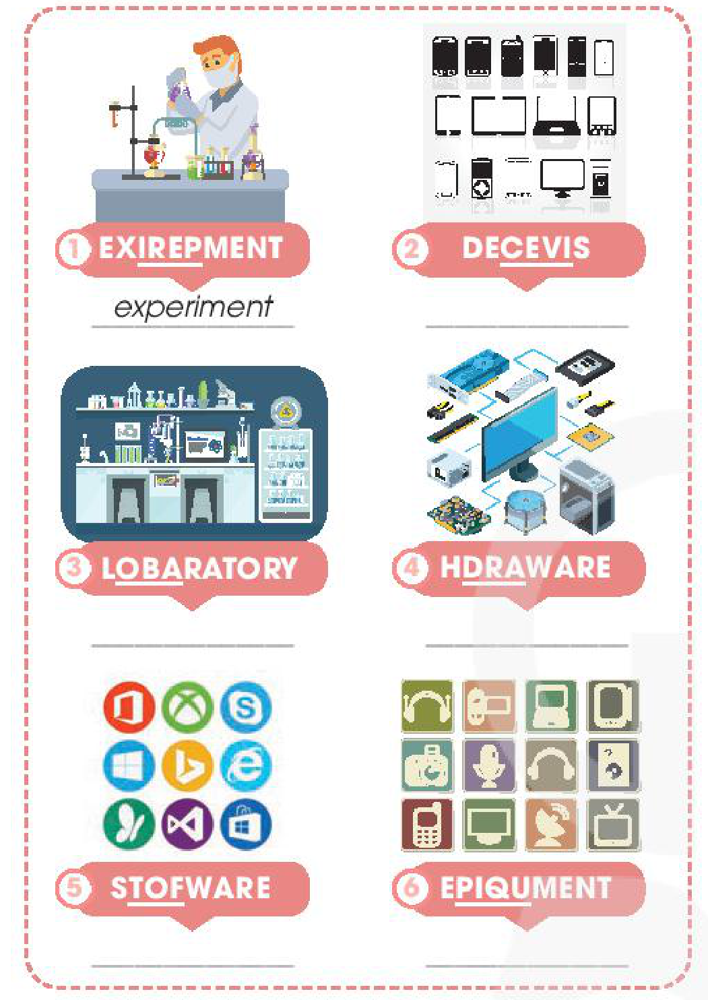
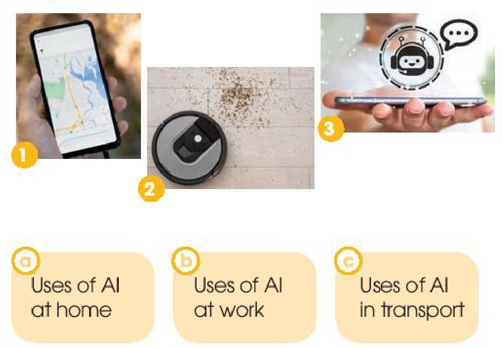
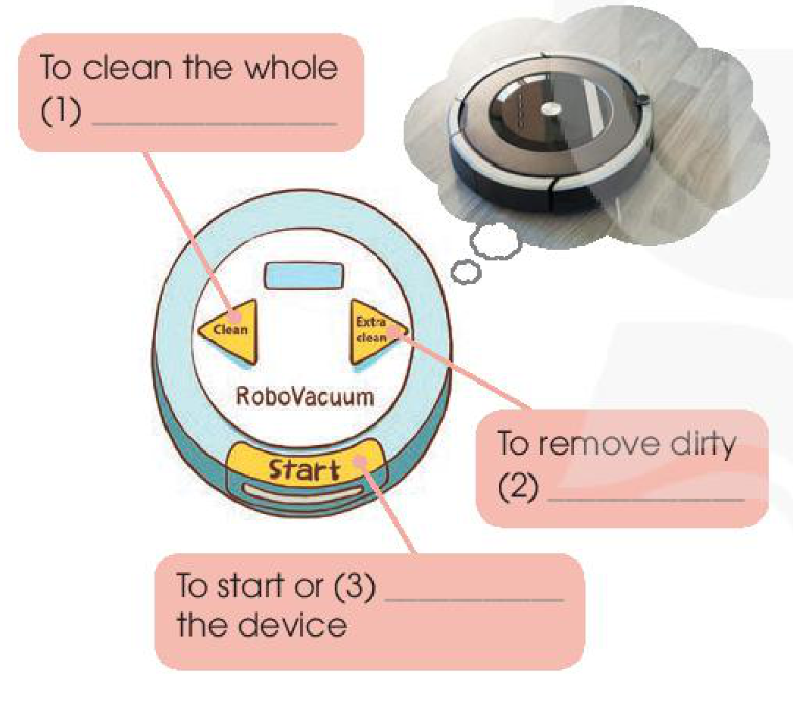
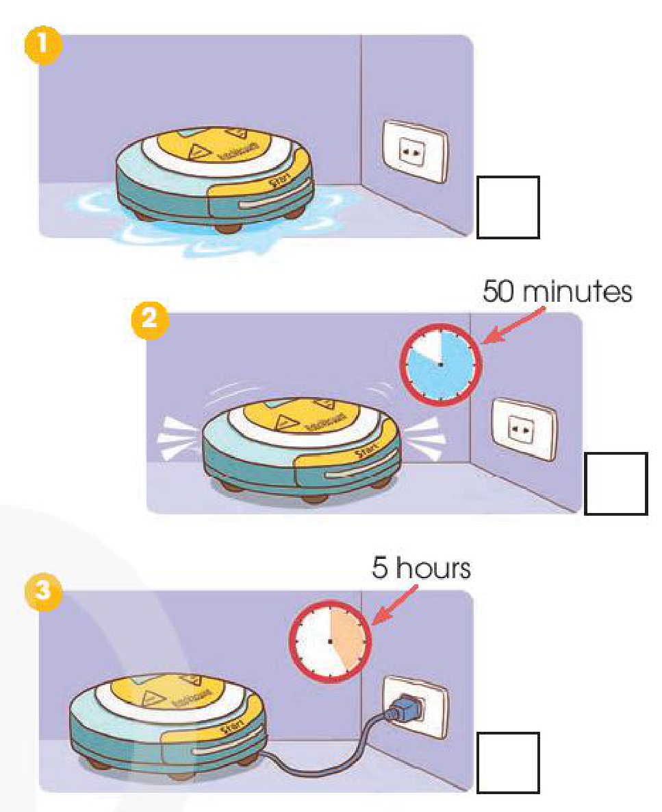
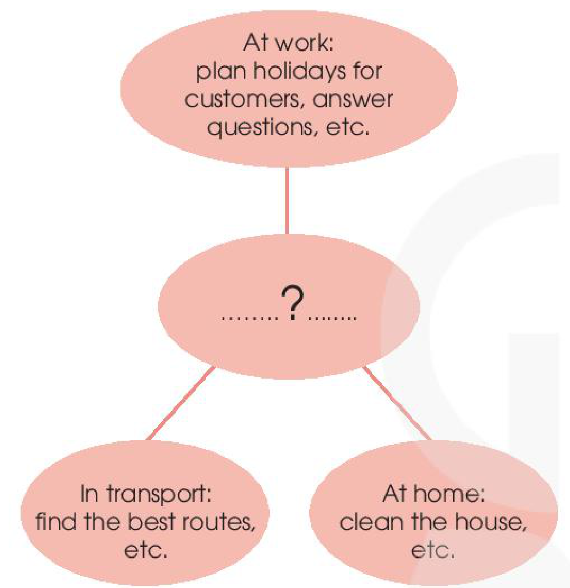
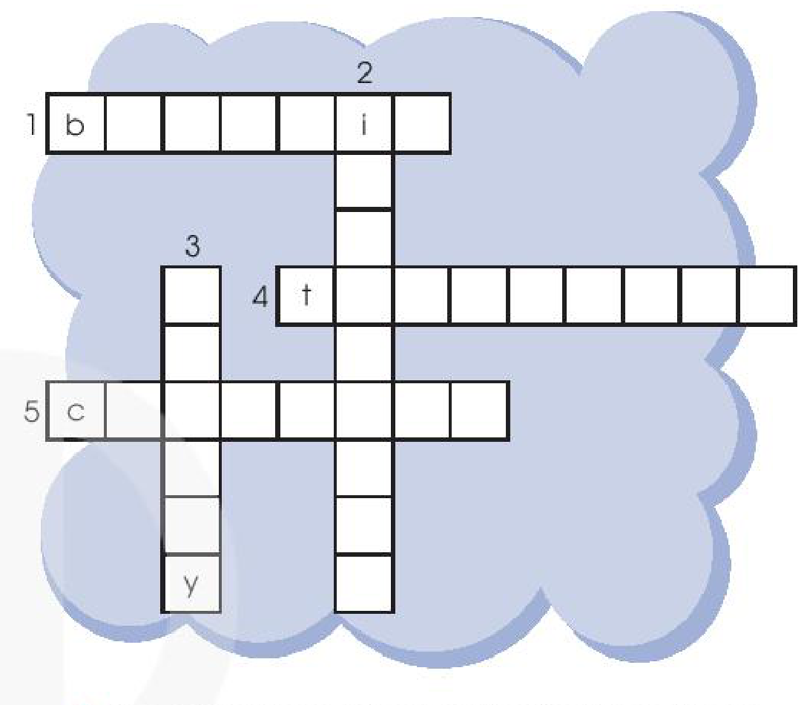

<!-- pdf:53 -->

# UNIT 5: INVENTIONS

**This unit includes:**

- **LANGUAGE**
  - **Pronunciation:** Stress in three-syllable nouns
  - **Vocabulary:** Words and phrases related to inventions
  - **Grammar:**
    - Present perfect
    - Gerunds and *to*-infinitives
- **SKILLS**
  - **Reading:** Reading for main ideas and specific information in a text about an invention
  - **Speaking:** Talking about inventions and their uses
  - **Listening:** Listening to instructions on how to use an invention for specific information
  - **Writing:** Writing about the benefits of an invention
- **COMMUNICATION AND CULTURE / CLIL**
  - **Everyday English:** Making and responding to requests
  - **CLIL:** Computer hardware
- **PROJECT**
  - Collecting information about an existing invention for the classroom or creating a new one

## I. GETTING STARTED

**Inventions for education**

**1. Listen and read.**

**Phong:** Dad, I've saved some money since Tet holiday. I think I'll buy something new for my studies.

**Dad:** Good idea, Phong. What do you want to buy?

**Phong:** I'm not sure. It's hard to choose between a **smartphone** and a **laptop**. They're both useful, and I've wanted either of them for a long time. What do you think, Dad?

**Dad:** Perhaps a laptop is a better choice. Since laptops were invented, they've allowed us to study better and work faster. They've completely changed our lives in the last 20 years.

**Phong:** That's true, Dad. But smartphones have also improved the way we work and study.

**Dad:** Really? I didn't know smartphones were **suitable** for learning.

**Phong:** Well, it's actually a lot of fun to learn with educational **apps**. It's also very convenient for learners to use them. Some of my classmates love using them on their smartphones. The apps allow them to **communicate** and learn at the same time.
<!-- term: educational app -->

**Dad:** I didn't know that! There have been so many **valuable** **inventions**. Hmm... Perhaps you should ask your teacher. She may be able to help you decide.

<!-- pdf:54 -->

**2. Read the conversation again and answer the questions.**

1. What inventions are Phong and his dad talking about?
2. How useful are laptops?
3. Why is it fun and convenient to learn with educational apps on smartphones?

**3. Find three nouns and three adjectives in the conversation in 1 to talk about inventions. Follow the example.**

| | | | | | | | | | |
| :---: | :---: | :---: | :---: | :---: | :---: | :---: | :---: | :---: | :---: |
| S | S | U | I | T | A | B | L | E | L |
| M | U | M | R | T | U | U | V | Y | M |
| A | H | L | A | P | T | O | P | W | M |
| R | **U** | A | P | P | S | U | T | E | R |
| T | **S** | X | R | R | T | G | M | R | B |
| P | **E** | F | O | G | V | V | W | Y | T |
| H | **F** | V | K | Q | W | F | E | W | X |
| O | **U** | M | A | U | K | B | Z | G | U |
| N | **L** | V | A | L | U | A | B | L | E |
| E | K | Z | E | O | D | N | X | F | W |
<!-- ocr-ok: đã đối chiếu ảnh trang gốc, bảng ô chữ 10x10 bị OCR nhận diện sai kí tự -->

1. *useful*
2. \_\_\_\_\_\_\_
3. \_\_\_\_\_\_\_
4. \_\_\_\_\_\_\_
5. \_\_\_\_\_\_\_
6. \_\_\_\_\_\_\_
<!-- ocr-ok: đã đối chiếu ảnh trang gốc, các dòng gạch ngang điền từ 2–6 bị OCR bỏ sót -->

**4. Fill in each gap in the summary of the conversation with ONE word from 1.**

Phong and his father are discussing what to buy for his studies. Phong has wanted a laptop or a smartphone (1) \_\_\_\_\_\_\_ a long time because they are both very useful. Laptops (2) \_\_\_\_\_\_\_ completely changed our lives since their invention, but smartphones have also (3) \_\_\_\_\_\_\_ the way we work and study. For example, it's fun (4) \_\_\_\_\_\_\_ study with educational apps on smartphones. They allow students (5) \_\_\_\_\_\_\_ (6) \_\_\_\_\_\_\_ and communicate at the same time. It's really difficult for Phong to choose between the two.

## II. LANGUAGE

### Pronunciation

**Stress in three-syllable nouns**

**1. Listen and repeat. Pay attention to the stressed syllable in each word.**

| **invention** | **computer** | **holiday** | **century** |
| :---: | :---: | :---: | :---: |
| ▄▀▄ | ▄▀▄ | ▀▄▄ | ▀▄▄ |

**2. Connect all the words with the stress pattern ▄▀▄ to cross the river. Then listen and check your answers. Practise saying these words in pairs.**

| | | |
| :---: | :---: | :---: |
| Internet | family | advantage |
| chocolate | invention | Africa |
| computer | syllable | afternoon |
| grandfather | tradition | century |
<!-- ocr-ok: đã đối chiếu ảnh trang gốc, các từ nằm trên hình vẽ hòn đá qua sông bị OCR bỏ sót -->

<!-- pdf:55 -->

### Vocabulary

**Inventions**

**Unscramble the underlined letters in these words. Use the pictures below and the glossary (page 127) to help you.**

1. EX<u>IREP</u>MENT → ***experiment***
2. DE<u>CEVI</u>S → \_\_\_\_\_\_\_
3. L<u>OBA</u>RATORY → \_\_\_\_\_\_\_
4. H<u>DRA</u>WARE → \_\_\_\_\_\_\_
5. S<u>TOF</u>WARE → \_\_\_\_\_\_\_
6. E<u>PIQU</u>MENT → \_\_\_\_\_\_\_
<!-- ocr-ok: đã đối chiếu ảnh trang gốc, các chữ cái xáo trộn có gạch chân nằm trong băng rôn hình vẽ -->

### Grammar

**Present perfect**
**Remember!**
We use the **present perfect** (*have* / *has* + *past participle*) to talk about:
- something that happened in the past, but is still true or important now.
  *Example: I **have lost** my key. Now I can't open the door.*
- something that started in the past, and is still happening now (often used with *since* or *for*).
  *Example: They **have lived** here for a year.*
- something that was completed in the very recent past (often used with *just* or *recently*).
  *Example: He **has** just **finished** his homework.*

**Circle the correct answers.**

1. They *just found* / *have just found* a suitable solution to the problem.
2. Since people *invented* / *have invented* the first computer, they *create* / *have created* many more interesting inventions.
3. The woman is very angry because her son *lost* / *has lost* his smartphone.

**Gerunds and to-infinitives**
**Remember!**
We use *gerunds* (*verb* + *-ing*):
- after verbs such as *avoid*, *enjoy*, and *finish*.
  *Example: I enjoy **cooking**.*
- as subjects of sentences.
  *Example: **Learning** English is fun.*
We use *to*-infinitives (*to* + *verb*):
- after verbs such as *want*, *decide*, and *allow*.
  *Example: My parents don't allow me **to use** a smartphone.*
- after adjectives to give opinions, starting with *It's* ...
  *Example: It's fun **to learn** English.*
- as subjects of sentences.
  *Example: **To learn** English is fun.*
**Note:** Some verbs, such as *like*, *love*, and *hate* can be followed by either gerunds or *to*-infinitives.
*Example: I like **playing** / **to play** computer games.*

**Complete the sentences using the gerund or the to-infinitive of the verbs in brackets. Sometimes both forms are possible.**

1. Many children enjoy (use) \_\_\_\_\_\_\_ modern **devices** nowadays.
2. I decided (study) \_\_\_\_\_\_\_ computer science at university.
3. (Play) \_\_\_\_\_\_\_ language games on a smartphone is fun.
4. It is very convenient (study) \_\_\_\_\_\_\_ with a smartphone.

<!-- pdf:56 -->

## III. READING

**Artificial Intelligence**

**1. Look at the pictures of Asimo and Sophia and discuss the questions below in pairs.**

1. What are they?
2. What do you think they can do?

*(Pictures: Asimo in 2000; Sophia in 2020)*
<!-- ocr-ok: đã đối chiếu ảnh trang gốc, nhãn chú thích nghiêng trên hai ảnh Asimo in 2000 và Sophia in 2020 bị OCR bỏ sót -->

**2. Read the text below and choose the best title for it.**

- A. AI development over time
- B. Robots: The best AI inventions
- C. AI in use today
- D. AI in education
<!-- ocr-ok: đã đối chiếu ảnh trang gốc, OCR đọc nhầm chữ AI thành Al và dính chữ Alin -->

In 2000, Asimo, a robot created by Honda, amazed everyone by just walking down the stairs. Twenty years later, a robot named Sophia can even **communicate** with people by using human language and expressing emotions.

However, robots are just one example of **Artificial Intelligence** (**AI**) – the study and development of machines that can copy human intelligence. Nowadays, AI has been **applied** to various areas of life.

At home, **devices** such as vacuum cleaners can now use AI to measure the room size and recognise any furniture. They can then decide on the most effective way to clean the house.
<!-- term: vacuum cleaner -->

In transport, AI can be used on many **smartphones** to collect information about traffic. This can then help drivers find the most **suitable** route. Travelling has become much more convenient thanks to AI.
<!-- term: transport -->

At work, the uses of AI are even more useful and exciting. Computer programs, such as AI **software** or chatbots, can help customers plan their holidays, book flights and hotels, and answer questions.
<!-- term: chatbot -->
<!-- term: customer -->

AI is one of the most important **inventions** of the 21st century. It has completely changed our daily work and life.

**3. Read the text again and match the pictures with the uses of AI.**

- a. Uses of AI at home
- b. Uses of AI at work
- c. Uses of AI in transport
<!-- ocr-ok: đã đối chiếu ảnh trang gốc, chữ trong các ô màu vàng của bài 3 bị OCR đọc nhầm -->

**4. Decide whether the following statements are true (T) or false (F).**

| | **T** | **F** |
| --- | :---: | :---: |
| 1. Sophia can show emotions when talking to humans. | | |
| 2. AI helps to make machines that think and act like humans. | | |
| 3. AI is one of the most important inventions of the 20th century. | | |

**5. Work in groups and discuss how AI can be used in schools. Then share your ideas with the class.**
<!-- ocr-ok: đã đối chiếu ảnh trang gốc, dòng giữa của câu lệnh bài 5 bị OCR bỏ sót -->

<!-- pdf:57 -->

## IV. SPEAKING

**Inventions and how they are used**

**1. Work in pairs. Talk about the uses of these inventions. Use the expressions below to help you.**

| **Inventions** | **Main uses** |
| --- | --- |
| 1. the Internet | communicate over long distances |
| 2. **e-readers** | **store** and read texts from the Internet |
| 3. robots | do difficult or dangerous tasks effectively |
| 4. **3D printing** | make three dimensional objects |
| 5. **driverless** cars | travel around without a person in control |
<!-- ocr-ok: đã đối chiếu ảnh trang gốc, nhãn các phát minh dưới tranh trong bảng bị OCR bỏ sót -->

**Useful expressions:**
- ... help(s) / allow(s) us to do sth.
  *Example: The Internet **helps us to communicate** over long distances.*
- We / People (can) use sth to do / for sth.
  *Example: People can **use** the Internet **to communicate** over long distances.*
- ... is / are used for sth / doing sth.
  *Example: The Internet **is used for communication / communicating** over long distances.*

**2. Work in groups. Talk more about one of the inventions in 1. Use the outline below to help you prepare a presentation.**

**Talking about an invention**
- **Introduction:**
  - *What is it?*
- **Development:**
  - *What are its uses? What are some examples?*
  - *Have you ever used it? When / Where / How (often) do you use it?*
- **Conclusion:**
  - *How important is it in our daily life?*
  - *Do you like using it?*

**3. Present your ideas to the whole class. Then vote for the most interesting group presentation.**

<!-- pdf:58 -->

## V. LISTENING

**RoboVacuum**

**1. Complete the sentences with the words in the box.**

| **button** | **charge** | **stain** |
| :---: | :---: | :---: |

1. Press the \_\_\_\_\_\_\_ to start the **device**.
2. There is a dirty \_\_\_\_\_\_\_ on your smartphone. Wipe it away.
3. You need to \_\_\_\_\_\_\_ your mobile phone. The battery is very low.

**2. Listen to a conversation about RoboVacuum. Fill in each gap in the diagram below with ONE word.**

- **Clean:** To clean the whole (1) \_\_\_\_\_\_\_
- **Extra clean:** To remove dirty (2) \_\_\_\_\_\_\_
- **Start:** To start or (3) \_\_\_\_\_\_\_ the device
<!-- ocr-ok: đã đối chiếu ảnh trang gốc, văn bản nằm trong sơ đồ H10-tieng_anh-u05-03 -->

**Tips**
When labelling a diagram, you should:
- study the diagram carefully.
- predict the answer in each blank *(e.g. What kind of information is it? Is this a noun, a verb, or an adjective?)*.
- listen for key words.
- double-check your answers *(e.g. spelling, grammar, the number of words)*.

**3. Listen again. Put a tick (✓) next to the correct way and a cross (✗) next to the wrong way to use RoboVacuum.**

- 1. ☐
- 2. ☐ (50 minutes)
- 3. ☐ (5 hours)
<!-- ocr-ok: đã đối chiếu ảnh trang gốc, các mục đánh dấu nằm trong hình H10-tieng_anh-u05-04 -->

**4. What other buttons do you want RoboVacuum to have? Add them to the picture below and tell your friends about them.**

*Example: I want my RoboVacuum to have a Timer button on the top. First, you press it. Then, you set the time by pressing the minutes and seconds buttons on the right.*

<!-- pdf:59 -->

## VI. WRITING

**Writing about the benefits of an invention**

**1. Choose an invention in this unit. Draw a diagram to show how it is used. Then work in groups to guess one another's inventions.**

*Example:*

- **....... ? .......**
  - **At work:** plan holidays for customers, answer questions, etc.
  - **In transport:** find the best routes, etc.
  - **At home:** clean the house, etc.

*Answer: It's Artificial Intelligence.*

**2. Rewrite the second sentence so that it has a similar meaning to the first. Use the expressions and the prompts below to help you.**

**Useful expressions:**
- *Sth / Doing sth* is one of the (many) **benefits** of ...
- ... **enable(s) / allow(s) / help(s)** *us to do sth*.
- ... is / are **used** *in sth / for sth / for doing sth / to do sth*.
- ... is / are **useful** *for sth / for doing sth / for sb to do sth / in doing sth*.

1. AI helps drivers to find the best routes in transport.
   → Helping drivers \_\_\_\_\_\_\_ benefits of AI in transport.
2. Vacuum cleaners allow us to clean the house quickly.
   → \_\_\_\_\_\_\_ useful \_\_\_\_\_\_\_.
3. Smartphones are used for learning languages.
   → \_\_\_\_\_\_\_ help \_\_\_\_\_\_\_.
4. Telephones are useful in communicating over long distances.
   → \_\_\_\_\_\_\_ used \_\_\_\_\_\_\_.

**3. Write a paragraph (120 - 150 words) to describe two or three benefits of the invention you chose in 1. Use the outline below to help you.**

- **First sentence (Introduction):**
  *What is the invention?*
- **Supporting sentences (Development):**
  - *What is the first benefit? Give some explanation and / or examples.*
  - *What is the second benefit? Give some explanation and / or examples.*
  - *What is the third benefit? Give some explanation and / or examples.*
- **Last sentence (Conclusion):**
  *How important / useful is the invention in our life?*

## VII. COMMUNICATION AND CULTURE / CLIL
<!-- ocr-ok: đã đối chiếu ảnh trang gốc, tiêu đề mục VII in trên hai dòng trong khung màu xanh -->

### Everyday English

**Making and responding to requests**

**1. Listen and complete a conversation at a computer store with the expressions in the box. Then practise it in pairs.**

- **A.** can you let me know about
- **B.** Can you please recommend
- **C.** Certainly
- **D.** Feel free to ask me if you need further information
- **E.** Sure

<!-- pdf:60 -->

**Tim:** Hello. I'm looking for a laptop. (1) \_\_\_\_\_\_\_ a good one to me?
<!-- ocr-ok: đã đối chiếu ảnh trang gốc, OCR đọc nhầm Tim thành im và dính chữ a good one -->

**Shop assistant:** (2) \_\_\_\_\_\_\_, but (3) \_\_\_\_\_\_\_ your needs first?
<!-- ocr-ok: đã đối chiếu ảnh trang gốc, OCR đọc lỗi khoảng trống điền từ (2) và (3) -->

**Tim:** (4) \_\_\_\_\_\_\_. I'm a student, so I'd like a cheap and light laptop.

**Shop assistant:** Then I think this laptop is the best one for you. You can take a look at it. (5) \_\_\_\_\_\_\_.
<!-- ocr-ok: đã đối chiếu ảnh trang gốc, OCR đọc dính chữ a look at it và nhầm (5) thành (8) -->

**2. Work in pairs. Role-play similar conversations about other devices you want to buy. Use the example in 1 and the expressions below to help you.**

| **Making requests** | **Responding to requests** |
| --- | --- |
| • Can you tell me (more) about ...? • Please let me know (more) about ... • I want / would like to know about ... | • Sure. / Certainly. / No problem. • What can I do for you? • How can I help you? • Feel free to ask me if you need further information. |
<!-- ocr-ok: đã đối chiếu ảnh trang gốc, văn bản nằm trong các bóng thoại minh hoạ bị OCR bỏ sót -->

### CLIL

**1. Read the text below. Match the highlighted words and phrase with their meanings.**

**COMPUTER HARDWARE**

A **computer** needs both **hardware** and **software** to run, but decisions about the hardware must be made before you buy a computer. Understanding some basic information about the hardware is very important and will help you decide on the most **suitable** computer for you.

- **Processors:** The **processor** controls all of the activities of a computer. Processor speed is often shown in gigahertz (GHz). High processor speed means that your computer can run faster.
- **Random Access Memory**, or **RAM**: It is **displayed** in gigabytes (GB). The RAM shows how powerful your computer is. The more RAM in a computer, the more tasks your computer can do at the same time.
- **Storage space**: It shows how much information (such as documents, music, photos, etc.) a computer can **store**. It is also displayed in gigabytes (GB).

There is other information about the hardware, such as the screen size, the battery, and the weight, that you need to know before choosing the best computer for you.

<!-- pdf:61 -->

| | |
| --- | --- |
| 1. **processor** | a. shown |
| 2. **RAM** | b. to keep something and use it later |
| 3. **displayed** | c. the part of the computer that controls all other parts |
| 4. **storage space** | d. a type of computer memory |
| 5. **store** | e. the amount of information a computer can keep |
<!-- ocr-ok: đã đối chiếu ảnh trang gốc, bảng nối từ hai cột nằm trong các khung bo tròn màu vàng -->

**2. Look at the advertisements. Decide which one is most suitable for each person below.**

| | **ComOffice** | **ComBusiness** | **ComPro** |
| --- | :---: | :---: | :---: |
| **Price** | VND 8,000,000 | VND 12,000,000 | VND 15,000,000 |
| **Processor** | 1.4 GHz | 1.8 GHz | 2.6 GHz |
| **RAM** | 16 GB | 16 GB | 64 GB |
| **Storage space** | 1,000 GB | 2,000 GB | 6,000 GB |
| **Weight** | 1.5 kg | 2 kg | 3 kg |
<!-- ocr-ok: đã đối chiếu ảnh trang gốc, tiêu đề 3 cột quảng cáo máy tính in chữ trắng trên nền màu bị OCR bỏ sót -->

- **Anne:** I'm a designer, so I often have to run many large programs at the same time. I also want to keep a lot of photos and videos on my laptop.
- **Bob:** I'm a student, so I prefer something not too expensive. I have to bring my laptop to school, so it should not be too heavy, either.

## VIII. LOOKING BACK

### Pronunciation and vocabulary

**Solve the crossword. Use the three-syllable nouns in this unit. Read out the correct answers in pairs when you finish.**

1. the advantage (of something); stress pattern: ▀▄▄ (`b _ _ _ _ _ _`)
2. a new thing; stress pattern: ▄▀▄ (`_ i _ _ _ _ _ _ _`)
3. the M in (computer) RAM; stress pattern: ▀▄▄ (`_ _ _ _ _ y`)
4. a device used for long-distance communication; stress pattern: ▀▄▄ (`t _ _ _ _ _ _ _ _`)
5. a modern device which allows us to store information; stress pattern: ▄▀▄ (`c _ _ _ _ _ _ _`)

### Grammar

**Circle the correct answers.**

1. They *just installed* / ***have** just **installed*** some interesting software on the school computers. The programs are working very well, and everyone enjoys *to use* / *using* them.
2. Smartphones allow people *sending* / *to send* information over long distances. *Learn* / *To learn* with a smartphone is fun as well.
3. Since television *was invented* / *has been invented*, TV designs *changed* / *have changed* a lot.

<!-- pdf:62 -->

## PROJECT

**Inventions for the classroom**

**Work in groups. Your class is organising a Technology Fair. The theme is 'Inventions for the classroom'. Each group is presenting a useful invention for the classroom. This can be an existing or new invention.**

**Use these questions to help you.**
- What is the invention? (If it's a new invention, give it an interesting name.)
- What does it look like?
- How can it be used in the classroom?
- Why do you think it will be a useful invention?

**Now I can ...**
- pronounce common three-syllable nouns with correct stress.
- understand and use words and phrases related to inventions.
- use the present perfect, gerunds, and *to*-infinitives correctly.
- read for main ideas and specific information in a text about an invention.
- talk about inventions and their uses.
- listen to instructions on how to use an invention.
- write about the benefits of an invention.
- make and respond to requests.
- understand computer hardware.
- collect information about an existing invention for the classroom or create a new one and give a group presentation about it.

## 📷 Danh sách hình trong bài

| Mã hình | Trang PDF | Trang sách | Chú thích / Mô tả |
| --- | --- | --- | --- |
| H10-tieng_anh-u05-01 | 55 | 54 | Sáu bức tranh minh hoạ kèm các chữ cái xáo trộn trong bài tập từ vựng về phát minh: (1) phòng thí nghiệm hoá học (experiment), (2) các thiết bị điện tử (devices), (3) phòng thí nghiệm (laboratory), (4) linh kiện phần cứng máy tính (hardware), (5) biểu tượng các phần mềm máy tính (software), (6) các trang thiết bị (equipment) |
| H10-tieng_anh-u05-02 | 56 | 55 | Ba bức ảnh minh hoạ ứng dụng của trí tuệ nhân tạo (AI) nối với ba lĩnh vực (ở nhà, ở nơi làm việc, trong giao thông): (1) bản đồ chỉ đường trên điện thoại thông minh, (2) rô-bốt hút bụi lau sàn nhà, (3) hộp trò chuyện (chatbot) trên điện thoại |
| H10-tieng_anh-u05-03 | 58 | 57 | Sơ đồ cấu tạo các nút bấm của rô-bốt hút bụi RoboVacuum (Clean, Extra clean, Start) kèm ba ô chú thích chức năng cần điền từ trong bài nghe |
| H10-tieng_anh-u05-04 | 58 | 57 | Ba bức tranh minh hoạ cách sử dụng rô-bốt hút bụi RoboVacuum trong bài tập nghe: (1) dùng trên sàn có vũng nước, (2) vận hành trong 50 phút, (3) cắm sạc pin trong 5 giờ |
| H10-tieng_anh-u05-05 | 59 | 58 | Sơ đồ tư duy minh hoạ lợi ích của trí tuệ nhân tạo (AI) trong ba lĩnh vực: tại nơi làm việc (At work), trong giao thông (In transport) và ở nhà (At home) |
| H10-tieng_anh-u05-06 | 61 | 60 | Ô chữ gồm 5 danh từ có ba âm tiết thuộc chủ đề phát minh trong phần Looking Back |
