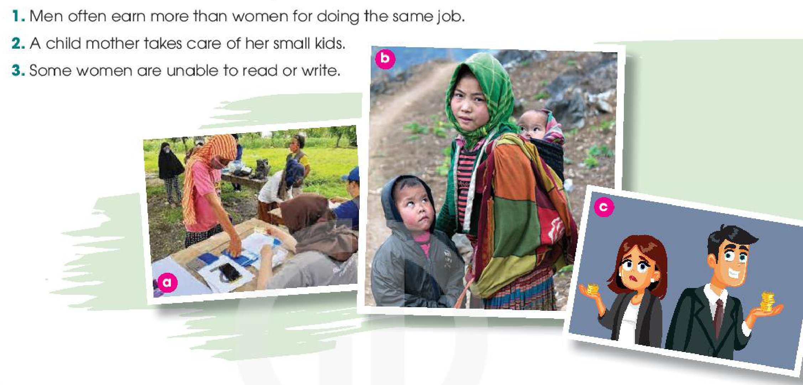
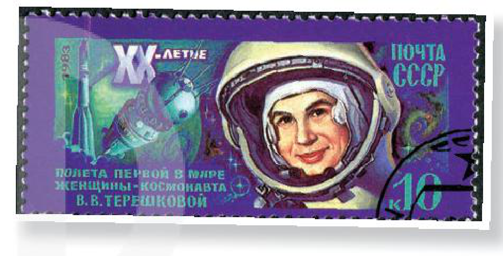
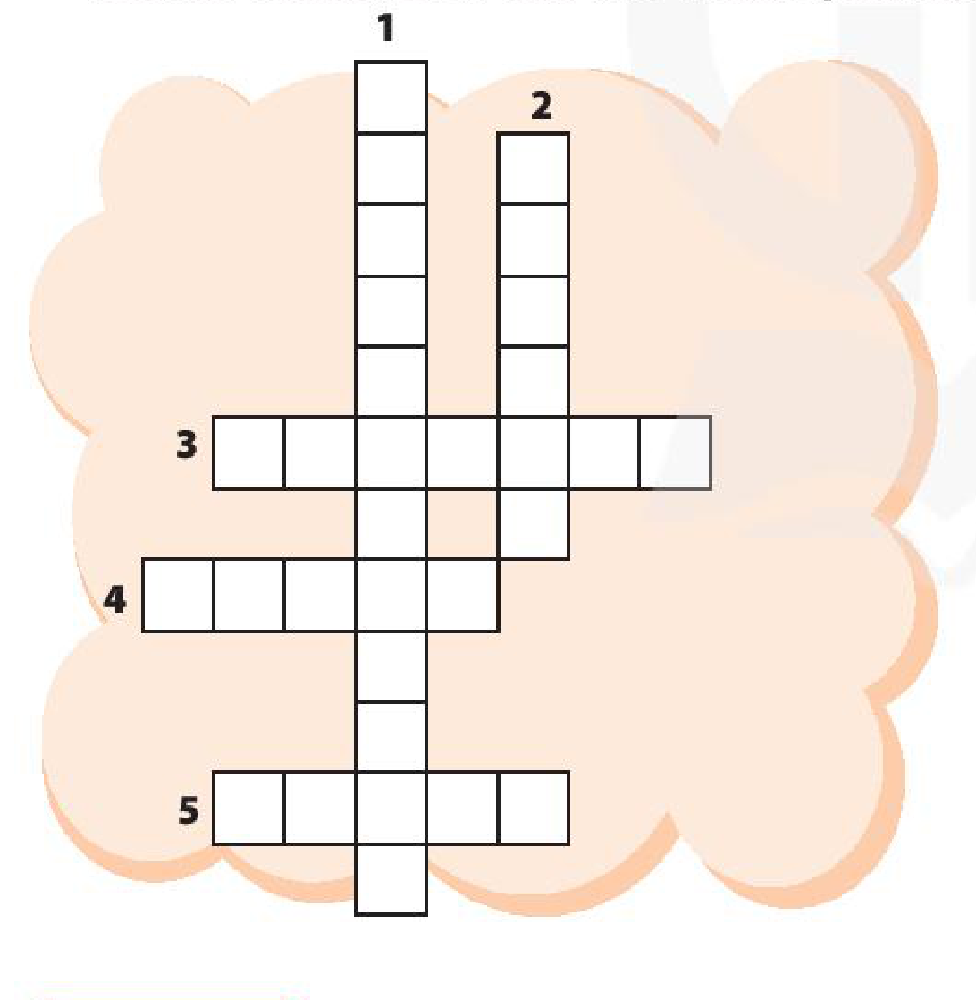

<!-- pdf:67 -->

# UNIT 6: GENDER EQUALITY

> **This unit includes:**
> - **LANGUAGE**
>   - **Pronunciation:** Stress in three-syllable adjectives and verbs
>   - **Vocabulary:** Words and phrases related to gender equality
>   - **Grammar:** Passive voice with modals
> - **SKILLS**
>   - **Reading:** Reading for specific information in a text about gender equality
>   - **Speaking:** Talking about career choices
>   - **Listening:** Listening for specific information in a talk about the first woman in space
>   - **Writing:** Writing about jobs for men and women
> - **COMMUNICATION AND CULTURE / CLIL**
>   - **Everyday English:** Expressing agreement and disagreement
>   - **CLIL:** Women's football
> - **PROJECT**
>   - Doing a survey on students' future jobs

## I. GETTING STARTED

**Equal job opportunities**

**1. Listen and read.**

*At an international summer camp: Lan is talking with Mark and Linda about jobs.*

**Lan:** It's great to have another week full of activities and trips at the camp.

**Mark:** Oh, yeah. I like the trip to the **kindergarten** most. The kids were adorable and the teachers were great. I think I'll be a kindergarten teacher.

**Lan:** That's fantastic. My cousin works at a kindergarten and the children love being in his class. By the way, what do you want to be in the future, Linda?

**Linda:** Oh, I've always wanted to be a **surgeon**, so I'll go to medical school. What about you, Lan?
<!-- term: medical school -->

**Lan:** Me? My dream is to become an airline **pilot**. That's why I'm focusing on maths and physics, and exercising more to improve my fitness.
<!-- term: airline pilot -->

**Linda:** Cool! I hope your dream will come true. In some countries girls may not be allowed to be pilots.

**Lan:** That's true, Linda. We're lucky to live in a country where boys and girls are encouraged to do the jobs they want.

**Mark:** I couldn't agree more. Girls mustn't be kept home in today's world. Boys and girls should be treated equally and given the same job opportunities.
<!-- term: job opportunity -->

<!-- pdf:68 -->

**2. Read the conversation again. Decide whether the following statements are true (T) or false (F).**

| | T | F |
| --- | --- | --- |
| 1. Linda would like to be a kindergarten teacher. | | |
| 2. Lan wants to be a teacher of maths and physics in the future. | | |
| 3. Mark says that girls mustn't be kept home in today's world. | | |

**3. Match the words to make meaningful phrases in 1.**

| | |
| --- | --- |
| 1. treated | a. school |
| 2. medical | b. opportunities |
| 3. job | c. equally |
<!-- ocr-ok: đã đối chiếu ảnh trang gốc, OCR đọc lệch cột và bỏ sót kí tự đánh số trong vòng tròn màu -->

**4. Complete the summary below. Use the verb phrases from the conversation in 1.**

Three students are talking about future jobs. While Mark wants to work as a kindergarten teacher, Linda wants to be a surgeon and Lan dreams to be an airline pilot. Linda says that in some countries girls (1) \_\_\_\_\_\_\_ to be pilots. Mark thinks girls (2) \_\_\_\_\_\_\_ home in today's world. He says that boys and girls (3) \_\_\_\_\_\_\_ equally and given the same job opportunities.

## II. LANGUAGE

### Pronunciation

**Stress in three-syllable adjectives and verbs**

**1. Listen and repeat. Pay attention to the stressed syllable in each word.**

| Three-syllable adjectives | Three-syllable verbs |
| --- | --- |
| ex'pensive | 'organise |
| fan'tastic | 'benefit |
| 'medical | de'velop |
| 'opposite | en'courage |

**2. Listen and mark the stressed syllables in the words in bold.**

1. We'll **celebrate** her success with a party.
2. They hope to **discover** new ways to promote gender equality.
3. The job requires both **physical** and mental strength.
4. Equal opportunities in education bring **important** changes in society.

### Vocabulary

*Gender equality*

**1. Match the words with their meanings.**

| | |
| --- | --- |
| 1. **equal** (adj) | a. school for children aged three to five |
| 2. **kindergarten** (n) | b. to deal with or behave towards somebody in a certain way |
| 3. **treat** (v) | c. a doctor who does **operations** in a hospital |
| 4. **surgeon** (n) | d. the fact of being male or female |
| 5. **gender** (n) | e. having the same rights, opportunities, etc. as other people |
<!-- ocr-ok: đã đối chiếu ảnh trang gốc, OCR đọc trộn hai cột nối từ và nhận diện sai một số từ -->

<!-- pdf:69 -->

**2. Complete the following sentences with the words in 1.**

1. Nowadays male teachers can be seen working at \_\_\_\_\_\_\_.
2. The \_\_\_\_\_\_\_ performed an eight-hour **operation** on my grandpa yesterday.
3. Some parents may \_\_\_\_\_\_\_ boys differently from girls.
4. Traditional \_\_\_\_\_\_\_ roles influenced how men and women should behave.
5. They should promote \_\_\_\_\_\_\_ income opportunities for men and women.

### Grammar

*Passive voice with modals*

**Remember!**

**Modal verbs:** can, could, may, might, must, ought to, should

| | **Active voice** | **Passive voice** |
| --- | --- | --- |
| **Rule** | Modal + verb | Modal + be + past participle |
| *Example:* | Engineers *may build* a new bridge. | A new bridge *may be built* (by engineers). |
<!-- term: Passive voice with modals -->

**1. Choose the best answers.**

1. Some people still think married women *shouldn't allow* / *shouldn't be allowed* to work.
2. Both men and women *can work* / *can be worked* as surgeons.
3. Cooking classes *may offer* / *may be offered* to all students.
4. My sister *could join* / *could be joined* the air force. She wants to be a fighter pilot.
5. All the food *must prepare* / *must be prepared* before the guests arrive.

**2. Rewrite the following sentences using the passive voice.**

1. They may complete the report on gender **equality** by April.
   → The report \_\_\_\_\_\_\_.
2. Businesses can create more jobs for girls and women.
   → More jobs \_\_\_\_\_\_\_.
3. They must provide all girls with access to education.
   → All girls \_\_\_\_\_\_\_.
4. Governments should improve education in rural areas.
   → Education \_\_\_\_\_\_\_.
5. They ought to give men and women **equal** rights.
   → Men and women \_\_\_\_\_\_\_.

<!-- pdf:70 -->

## III. READING

**For an equal world**

**1. Match the sentences with the pictures.**

1. Men often earn more than women for doing the same job.
2. A child mother takes care of her small kids.
3. Some women are unable to read or write.

**2. Read the text and circle the correct meanings of the highlighted words and phrases.**

Gender **equality** has been greatly promoted around the world. However, there are still many challenges that women face.
<!-- term: gender equality -->

First of all, there are still girls who **are forced** to get married before the age of 18. In many places, parents may see child marriage as a way to protect their daughters from violence. However, many of these young girls become **victims** of **domestic violence**. Child marriage also carries serious health risks as young girls are not physically developed to give birth.
<!-- term: child marriage -->
<!-- term: give birth -->

Secondly, more than half of the world's **uneducated** people are women. This means fewer girls than boys go to school or stay long at school. Girls who receive an education are less likely to marry young. They can also have better job skills and can earn higher salaries. Education gives girls the opportunity to have a better life and give back to their communities.

Thirdly, women are often paid less than men. In other words, women have to work longer than men to earn the same amount of money. Differences in career choices might be one reason. Women tend to become nurses, secretaries, or **shop assistants**, which are **low-paying** jobs, while men choose high-paying careers as **surgeons**, airline **pilots**, or engineers.
<!-- term: career choice -->

Women are still not **equal** to men in today's society, and governments, organisations and individuals must work together to achieve gender equality.

<!-- pdf:71 -->

1. **be forced**
   - a. be made to do something unwanted
   - b. be made to do something necessary
2. **domestic violence**
   - a. action taken to please someone
   - b. behaviour intended to hurt someone you live with
3. **uneducated**
   - a. having little or no formal education at school
   - b. not having many job opportunities
4. **low-paying**
   - a. giving money to a person
   - b. providing very little money

**3. Read the text again and decide whether the following statements are true (T), false (F) or not given (NG).**

| | T | F | NG |
| --- | --- | --- | --- |
| 1. Child marriage involves a girl under the age of 18. | | | |
| 2. Fewer men than women around the world are educated. | | | |
| 3. Men work much less than women, but earn much more. | | | |
| 4. Men's career choices lead to high-paying jobs. | | | |
| 5. Only individuals must work towards gender equality. | | | |

**4. Work in groups. Discuss possible solutions to one of the following problems.**

- Child marriage
- A lack of education for girls
- Low pay for women

## IV. SPEAKING

*Career choices*

**1. Work in pairs. Decide which jobs are traditionally done by men or women. Use the expressions given to help you.**

| Jobs | Men | Women |
| --- | --- | --- |
| 1. **Surgeons** | | |
| 2. **Shop assistants** | | |
| 3. Nurses | | |
| 4. Airline **pilots** | | |
| 5. **Firefighters** | | |
| 6. **Kindergarten** teachers | | |
| 7. Engineers | | |
| 8. Secretaries | | |
<!-- ocr-ok: đã đối chiếu ảnh trang gốc, OCR bỏ sót dòng 4. Airline pilots trong bảng -->

**Useful expressions:**

- I think / I believe (that) ...
- There are many more male (surgeons) than female (surgeons).
- Men / Women traditionally work as (firefighters) ...
- (Nursing) jobs are done by men / women.
- The (nurse's) job is traditionally done by men / women.

**2. Work in pairs. Discuss why the jobs mentioned in 1 are traditionally done by men or women. Use the ideas below to help you.**

| Suggested ideas | |
| --- | --- |
| - Good **physical** strength   - Good communication skills   - Ability to work well under pressure   - Being kind, gentle and caring | - Ability to work long hours   - Good persuasion skills   - Flexible working schedule   - More time to take care of their families |
<!-- ocr-ok: đã đối chiếu ảnh trang gốc, OCR đọc trộn hai cột trong bảng Suggested ideas -->
<!-- term: working schedule -->

*Example:*

*The surgeon's job is traditionally done by men because women often can't work long hours as they need to take care of their families.*

<!-- pdf:72 -->

**3. Work in groups of three. Talk about your career choice(s).**

*Example:*

**A:** *I think I'll work as a **shop assistant** because people often say that I have good persuasion skills.*

**B:** *Good for you. I'd like to be a nurse because I enjoy helping people.*

**C:** *Sounds great. I'd like to be a **surgeon**. I believe I can work well under pressure and don't mind working long hours.*

## V. LISTENING

**The first woman in space**

**1. Work in pairs. Look at the picture and tell your partner what this woman's job is.**

**2. Listen to a talk about Valentina Tereshkova. Choose the best answer to complete each sentence.**

1. Valentina Tereshkova joined a local flying club and became a talented **parachutist** while she was \_\_\_\_\_\_\_.
   - A. working as a factory worker
   - B. training to be a **cosmonaut**
2. Tereshkova and \_\_\_\_\_\_\_ other women were chosen for the **Soviet** space programme.
   - A. three
   - B. four
3. Tereshkova joined the Soviet Air Force and became \_\_\_\_\_\_\_ after completing her training and passing an examination.
   - A. an Air Force **officer**
   - B. the first female **pilot**
4. She travelled into space in Vostok 6 and successfully returned to Earth on \_\_\_\_\_\_\_.
   - A. 16 June, 1963
   - B. 19 June, 1963
5. After the flight, Tereshkova received many awards, and \_\_\_\_\_\_\_.
   - A. travelled in space again
   - B. completed her university degree
<!-- term: Valentina Tereshkova -->

**3. Listen again and give short answers to the following questions.**

1. When was Tereshkova born?
2. How old was she when she started working?
3. When did she join the Soviet space programme?
4. At what age did she travel into space?
5. How many days did she spend in space?

**4. Work in groups. Discuss the following questions.**

*Do you want to be a **cosmonaut**? Why or why not?*

<!-- pdf:73 -->

## VI. WRITING

**Writing about jobs for men and women**

**1. Choose suitable information from the box below to complete the table.**

| The surgeon's job | |
| --- | --- |
| **Main responsibilities** | **Main qualities** |
| | |
<!-- ocr-ok: đã đối chiếu ảnh trang gốc, OCR bỏ sót tiêu đề bảng trên nền màu xanh -->

- A. Performing **operations** on **patients**
- B. Medical knowledge
- C. **Physical** and **mental** strength
- D. Welcoming and serving customers
- E. Good persuasion skills
- F. Making important decisions about **patients'** health and safety
- G. Excellent **eyesight** and **skilful** hands
- H. Good teamwork and communication skills

**2. Work in pairs. Do you think both men and women can do the surgeon's job well? Give reasons. Use the ideas below to help you.**

- Men and women have the same abilities to learn and apply medical knowledge.
- Women can be as mentally strong as men.
- Men and women can perform long and tiring operations.
- Both men and women can make great surgeons.

**3. Write a paragraph (120 - 150 words) about the surgeon's job. Use these guiding questions to help you.**

- Is the job traditionally done by men or women?
- What are the main responsibilities of the job? Give details.
- What qualities do people need for the job? Give details or / and explanations.
- Can both men and women do it? Give reasons.
- Will people benefit from having both male and female surgeons?

<!-- pdf:74 -->

## VII. COMMUNICATION AND CULTURE / CLIL

### Everyday English

**Expressing agreement and disagreement**

**1. Listen and complete a conversation with the expressions from the box. Then practise it in pairs.**

| A. I'm afraid I disagree | B. Absolutely |
| --- | --- |
| C. You're right | D. I'm sorry, but |

**Mum:** Mai, Dad and I would like you to be a **shop assistant**.

**Mai:** (1) \_\_\_\_\_\_\_ that's not possible. I want to go to medical school and become a **surgeon**.

**Mum:** (2) \_\_\_\_\_\_\_. It's not easy to be a surgeon.

**Mai:** (3) \_\_\_\_\_\_\_. But I'm sure I can.

**Mum:** Besides medical knowledge, a surgeon must have **physical** and **mental** strength. Most surgeons are also men ...

**Mai:** (4) \_\_\_\_\_\_\_. That's why we need more women surgeons. We can be as good as men.

**2. Work in pairs. Have similar conversations expressing agreement and disagreement about other jobs. Use the expressions below to help you.**

| **Useful expressions** | |
| --- | --- |
| **Agreement** | **Disagreement** |
| • You're right.   • I couldn't agree more.   • Absolutely. | • That's not true.   • I'm afraid I disagree.   • I'm sorry, but ... |
<!-- ocr-ok: đã đối chiếu ảnh trang gốc, OCR bỏ sót tiêu đề Useful expressions trên nền màu xanh -->

### CLIL

**1. Read the text and fill the timeline about women's football.**

**WOMEN'S FOOTBALL**

It is commonly thought that football is a sport for men. In fact, it is a sport for women, too.

The first recorded football matches between women took place in 1890s in Scotland and England. Women's football became very popular during the First World War when women started working in the factories. In 1921, however, the Football Association (FA) decided that the game was not suitable for women.

The ban lasted for 50 years until it was finally lifted in 1971. In the same year, France and the Netherlands played the first official women's international football match. However, it took 20 years for the first FIFA Women's World Cup to happen in 1991 in Asia. Since then, the competition has been held every four years.

Nowadays, like men's football, women's football is becoming more and more popular. Women's professional football has developed significantly and the Women's World Cup has drawn worldwide interests.

| 1. \_\_\_\_\_\_\_ | 2. \_\_\_\_\_\_\_ | 3. \_\_\_\_\_\_\_ | 4. \_\_\_\_\_\_\_ | 5. \_\_\_\_\_\_\_ |
| --- | --- | --- | --- | --- |
| First recorded matches | FA's ban start | FA's ban lift | First official women's international football match | First FIFA Women's World Cup |

<!-- pdf:75 -->

**2. Work in groups. Fill the timeline about women's football in Viet Nam.**

| 1. \_\_\_\_\_\_\_ | 2. \_\_\_\_\_\_\_ | 3. \_\_\_\_\_\_\_ | 4. \_\_\_\_\_\_\_ | 5. \_\_\_\_\_\_\_ |
| --- | --- | --- | --- | --- |
| Women's football team establishment | First official match | First gold medal in the SEA Games | First AFF Women's Championship | Most recent AFF Women's Championship |

## VIII. LOOKING BACK

### Pronunciation

**Listen and mark the stressed syllables in the words in bold.**

1. The surgeon's job is quite **difficult**.
2. Soviet cosmonauts learnt how to **parachute** to safety.
3. I'm proud of my sister. She's studying at a **medical** school.
4. We need to **continue** fighting for equal rights.

### Vocabulary

**Do the crossword. Use the words you have learnt in this unit.**

1. A \_\_\_\_\_\_\_ teacher works with small children to prepare them for school.
2. Job adverts should not mention their ideal candidate's \_\_\_\_\_\_\_.
3. A very experienced \_\_\_\_\_\_\_ was able to rebuild his nose after the accident.
4. Boys and girls should have \_\_\_\_\_\_\_ opportunities in education.
5. Parents should not \_\_\_\_\_\_\_ boys differently from girls.

### Grammar

**Each of the following sentences has a mistake. Underline it and write the correct word(s) in the space given.**

1. One paragraph about gender equality ought to write by each student. \_\_\_\_\_\_\_
2. Action to stop domestic violence must take immediately. \_\_\_\_\_\_\_
3. Should all people be provide with equal access to information? \_\_\_\_\_\_\_
4. Young girls mustn't force into marriage. \_\_\_\_\_\_\_
5. Can men and women given equal opportunities in the workplace? \_\_\_\_\_\_\_

<!-- pdf:76 -->

## PROJECT

**STUDENTS' FUTURE JOBS**

**Work in groups. Choose any class in your school and do a survey to find out:**

- the number of boys and girls.
- how many of them would like to work as surgeons, airline pilots, nurses and shop assistants, or do other jobs in the future.

| Class: \_\_\_\_\_\_\_ | | | | | |
| --- | --- | --- | --- | --- | --- |
| **Number of students** | **Surgeons** | **Airline pilots** | **Nurses** | **Shop assistants** | **Others** |
| \_\_\_\_\_\_\_ boys | | | | | |
| \_\_\_\_\_\_\_ girls | | | | | |

**Report your results to the class. Which of the jobs is the least popular among the boys and which one the least popular among the girls? Give possible reasons.**

### Now I can ...

- pronounce three-syllable adjectives and verbs with correct stress.
- understand and use words and phrases related to gender equality.
- use the passive voice with modals.
- read for specific information in a text about gender equality.
- talk about career choices.
- listen for specific information in a talk about the first woman in space.
- write about jobs for men and women.
- express agreement and disagreement.
- learn about women's football.
- do a survey on students' future jobs and report survey results.

## 📷 Danh mục hình minh hoạ

| Mã hình | Trang PDF | Trang sách | Chú thích / Mô tả |
| --- | --- | --- | --- |
| H10-tieng_anh-u06-01 | 70 | 69 | Ba bức tranh minh hoạ (a, b, c) về những thách thức bất bình đẳng giới mà phụ nữ phải đối mặt (mù chữ, tảo hôn, chênh lệch thu nhập giữa nam và nữ) trong phần Reading |
| H10-tieng_anh-u06-02 | 72 | 71 | Con tem bưu chính của Liên Xô năm 1983 kỉ niệm 20 năm chuyến bay vào vũ trụ của nữ phi hành gia đầu tiên trên thế giới Valentina Tereshkova trong phần Listening |
| H10-tieng_anh-u06-03 | 75 | 74 | Sơ đồ ô chữ gồm 5 từ vựng thuộc chủ đề bình đẳng giới (1 hàng dọc, 2 hàng dọc, 3–5 hàng ngang) trong phần Looking Back |
