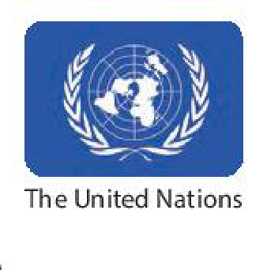
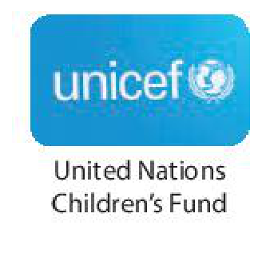
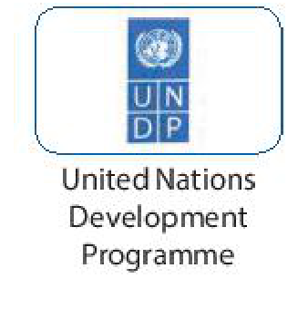
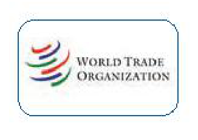
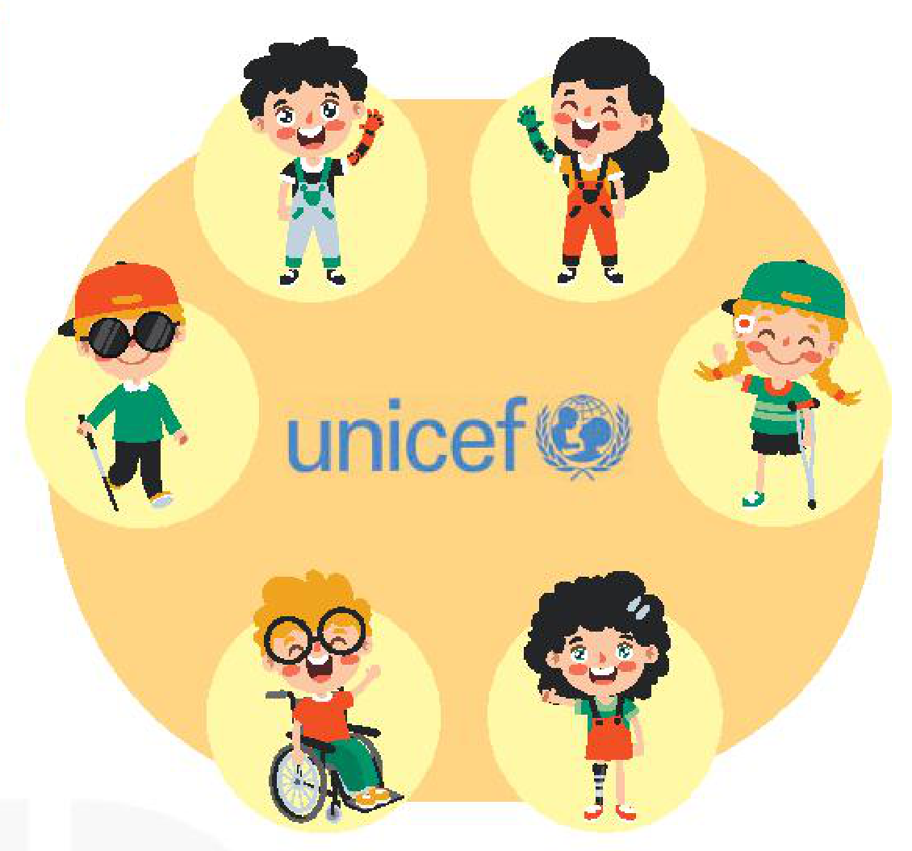
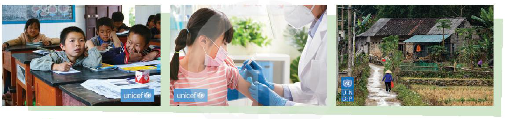
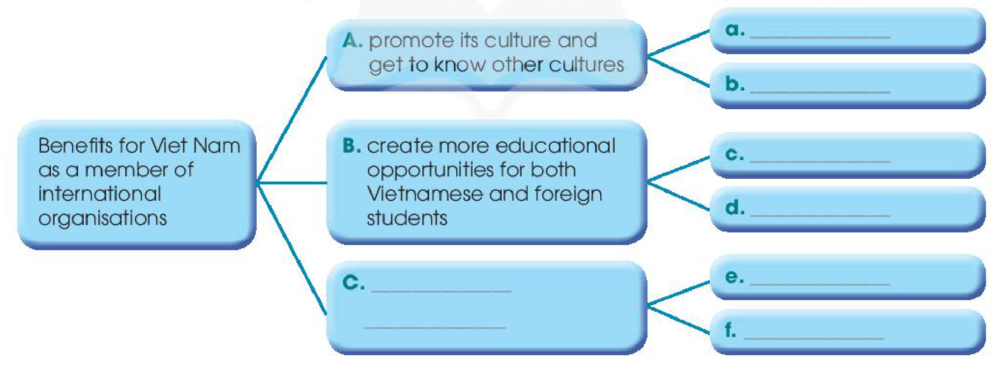
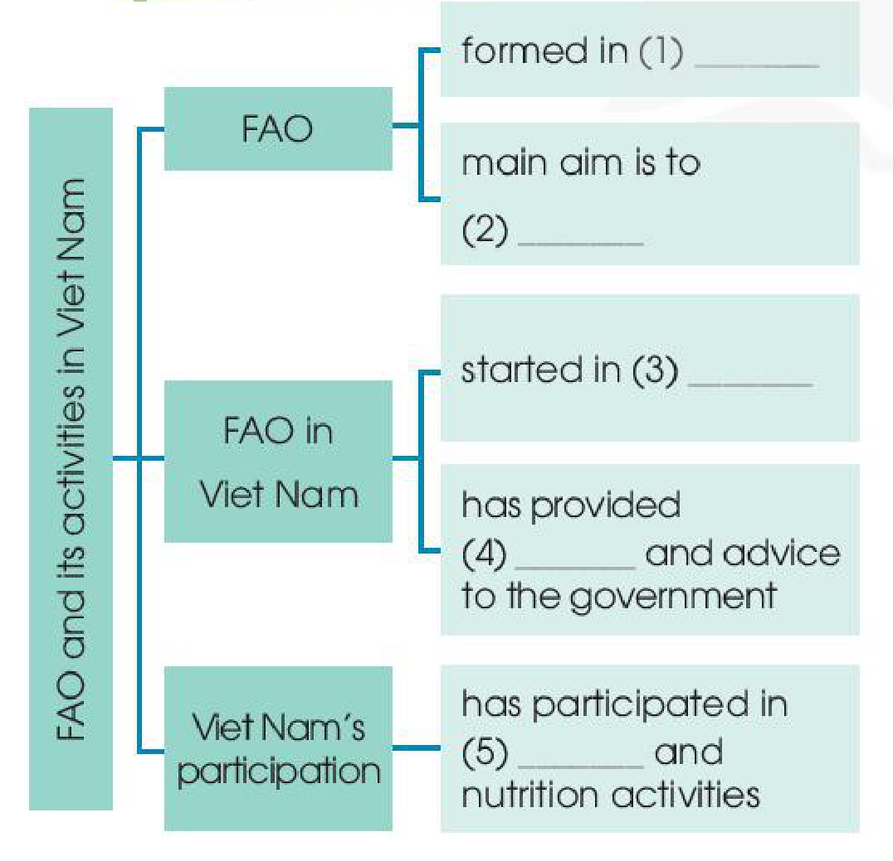

<!-- pdf:77 -->

# UNIT 7: VIET NAM AND INTERNATIONAL ORGANISATIONS

> **This unit includes:**
> - **LANGUAGE**
>   - **Pronunciation:** Stress in words with more than three syllables
>   - **Vocabulary:** Words and phrases related to international organisations
>   - **Grammar:** Comparative and superlative adjectives
> - **SKILLS**
>   - **Reading:** Reading for specific information in a text about UNICEF's support for Viet Nam's education
>   - **Speaking:** Talking about programmes for communities
>   - **Listening:** Listening for specific information in a conversation about Viet Nam's participation in international organisations
>   - **Writing:** Writing about Viet Nam's participation in international organisations
> - **COMMUNICATION AND CULTURE / CLIL**
>   - **Everyday English:** Making and responding to invitations
>   - **Culture:** FAO and its activities to support Viet Nam
> - **PROJECT**
>   - Doing research on an international organisation

## I. GETTING STARTED

**Viet Nam and international organisations**

**1. Listen and read.**

**DO YOU KNOW ...?**

**A.** The United Nations (UN) was created in 1945. It is an organisation of most of the world's countries. Its main goal is world peace. It also works to reduce **poverty** and improve people's lives in other ways. Viet Nam joined the organisation in 1977. Since then, our country has become more active and has participated in many UN activities including **peacekeeping**.
<!-- term: UN -->

**B.** UNICEF was formed in 1946. It works in over 190 countries to help improve health and education of children. It particularly **aims** to support the most disadvantaged children all over the world. UNICEF's **aim** in Viet Nam is to protect children and make sure they are healthy, educated, and safe from **harm**.
<!-- term: UNICEF -->

**C.** UNDP was formed in 1965 as part of the UN. It provides **technical** support, **expert** advice, and training to help people in developing countries have a better life. In Viet Nam, UNDP works closely with the government to reduce **poverty** and improve people's lives.
<!-- term: UNDP -->

<!-- pdf:78 -->

**D.** The WTO was formed in 1995. It is the world's largest international **economic** organisation. Viet Nam became a WTO member in 2007. Since then, our **economy** has achieved a high growth level. Viet Nam has also become more attractive to foreign **investors**.
<!-- term: WTO -->

**2. Read the texts again and choose the correct answers.**

1. Which organisation was formed in 1945?
   - A. The UN
   - B. UNICEF
   - C. The WTO
2. Which organisation aims to help improve children's health and education?
   - A. UNDP
   - B. UNICEF
   - C. The WTO
3. Which of the following is the largest international economic organisation?
   - A. The UN
   - B. UNDP
   - C. The WTO

**3. Find words in the texts (A, B, C, or D) that mean the following.**

| | |
| --- | --- |
| 1. \_\_\_\_\_\_\_ | helping stop people fighting (A) |
| 2. \_\_\_\_\_\_\_ | damage or injury (B) |
| 3. \_\_\_\_\_\_\_ | having great knowledge (C) |
| 4. \_\_\_\_\_\_\_ | people or organisations that invest money (D) |

**4. Complete the sentences with the words and phrases in 1.**

1. Since joining the UN, Viet Nam has become \_\_\_\_\_\_\_ and has participated in many UN activities including peacekeeping.
2. UNICEF particularly aims to support \_\_\_\_\_\_\_ children all over the world.
3. UNDP helps people in developing countries have a \_\_\_\_\_\_\_ life.
4. The WTO is the world's \_\_\_\_\_\_\_ international economic organisation.
5. Viet Nam has also become \_\_\_\_\_\_\_ to foreign investors.

## II. LANGUAGE

### Pronunciation

**Stress in words with more than three syllables**

**1. Listen and repeat. Pay attention to the syllable with the primary stress.**

| | |
| --- | --- |
| 1. ˌappliˈcation | 5. ˌpopuˈlation |
| 2. comˌmuniˈcation | 6. ˌindeˈpendent |
| 3. ˌecoˈnomic | 7. ˌpossiˈbility |
| 4. ˌexplaˈnation | 8. parˌticiˈpation |
<!-- ocr-ok: đã đối chiếu ảnh trang gốc, OCR không nhận diện được dấu trọng âm chính và phụ -->

> **Tips**
>
> Some long words have a secondary stress which is much weaker than the primary stress.
> *Example:* ˌecoˈnomic
> In dictionaries, primary stress is marked with a raised vertical line and secondary stress is marked with a lowered vertical line at the beginning of the stressed syllable.

**2. Listen and mark the primary stress in the words in bold. Then practise saying the sentences.**

1. Viet Nam is a member of different **international** **organisations**.
2. Our **responsibility** is to help the most **disadvantaged** children.
3. This **organisation** aims to promote **environmental** protection.
4. UNICEF aims to create **educational** **opportunities** for all children.

<!-- pdf:79 -->

### Vocabulary

**Joining international organisations**

**1. Match the words in bold with their meanings in the box.**

| A. intends | B. is pleased to accept | C. go into | D. encourage | E. promised |
| --- | --- | --- | --- | --- |

1. Because we are a member of the WTO, our goods can **enter** more markets.
2. Organising different festivals helps Viet Nam **promote** local customs and values.
3. UNICEF particularly **aims** to support the most disadvantaged children.
4. UNDP has **committed** to provide Viet Nam with technical support and advice.
5. Viet Nam **welcomes** foreign businesses who want to **invest** in the economy.

**2. Complete the following sentences, using the correct forms of the words in bold in 1.**

1. Joining the WTO has helped Viet Nam \_\_\_\_\_\_\_ its economic growth.
2. Viet Nam \_\_\_\_\_\_\_ foreign investors in various parts of the economy.
3. We \_\_\_\_\_\_\_ to use the donations effectively. We have signed an agreement on this.
4. This environmental organisation \_\_\_\_\_\_\_ to protect local forests. It has a detailed plan to achieve this.
5. We need to improve the **quality** of goods and services so that they can \_\_\_\_\_\_\_ new markets.

### Grammar

**Comparative and superlative adjectives**
> **Remember!**
> - We use comparative adjectives to:
>   - compare a person or thing with another person or thing.
>     *Example:*
>     *The European markets are usually **more** **competitive** **than** the Asian markets.*
>     *The Asian markets are **less** **competitive** **than** the European markets.*
>   - show changes.
>     *Example:*
>     *Since then, our country has become **more active**.*
> - We use superlatives to compare a person or thing with the whole group of which that person or thing is a member.
>   *Example:*
>   *This **trade** organisation includes two of **the largest** **economies** in the world: the United States and China.*
>   *UNICEF supports **the most disadvantaged** children all over the world.*

**1. Choose the correct answers.**

1. WTO rules make trade *the easiest* / *easier* for smaller member countries.
2. This job offer is *more attractive* / *the most attractive* than the previous one.
3. Because of poorly designed packaging, our products are *less competitive* / *the least competitive* than foreign products.
4. Over the past few years, Viet Nam has become one of *more popular* / *the most popular* destinations for foreign visitors in Southeast Asia.

**2. Write another sentence using the word(s) in brackets. Make sure it has the same meaning as the previous one.**

*Example:*
The ASEAN markets are less competitive than the EU markets. (more competitive)
→ *The EU markets are more competitive than the ASEAN markets.*
<!-- term: ASEAN -->

1. No place is more popular with foreign visitors than this city. (the most popular)
   → \_\_\_\_\_\_\_
2. In many supermarkets, imported goods are not as expensive as locally produced goods. (cheaper)
   → \_\_\_\_\_\_\_
3. No international organisation is larger than the United Nations. (the largest)
   → \_\_\_\_\_\_\_
4. In the past, our country wasn't as active on the international stage as it is today. (more active)
   → \_\_\_\_\_\_\_

<!-- pdf:80 -->

## III. READING

**UNICEF's support for Viet Nam's education**

**1. Work in pairs. Which of the following do you think UNICEF does to support Viet Nam's education?**

- a. Providing opportunities for all children to attend school and learn
- b. Finding jobs for out-of-school children
- c. Giving disadvantaged teenagers a chance to continue their education
- d. Helping teenagers learn necessary skills for the job market

**2. Read the text and circle the correct meanings of the highlighted words.**

Since UNICEF set up an office in 1975 in Viet Nam, it has run projects in various fields to provide the highest possible support for children in our country. The organisation particularly aims to **create** opportunities for all children in Viet Nam to attend school, learn, and succeed. The following programmes help achieve the UNICEF's education aims for Viet Nam.

**Education for Disadvantaged Young People**

UNICEF helps disadvantaged teenagers continue their education by offering them job training and career advice. They are also taught **essential** skills for the job market.

**Providing Education Opportunities for Children with Disabilities**

This programme gives children with disabilities a chance to get access to and benefit from a **quality** education. It also helps promote equal participation in society and a culture in which people **respect** each other.
<!-- term: disability -->

**Improving Learning Achievements**

This is another **practical** programme supported by UNICEF. The aim is to better prepare children for the challenges in the future. UNICEF helps Viet Nam in joining **regional** educational programmes to improve children's learning achievements. When they leave school, they should have the necessary skills and knowledge to work in a fast-changing world.

1. **create**
   - a. make something happen
   - b. increase something
   - c. refuse something
2. **essential**
   - a. usual
   - b. necessary
   - c. successful
3. **respect**
   - a. have a good opinion of somebody
   - b. look down on somebody
   - c. get on well with somebody
4. **practical**
   - a. connected with organisations
   - b. connected with ideas
   - c. connected with real situations

<!-- pdf:81 -->

**3. Read the text again and answer the following questions.**

1. What does UNICEF particularly aim to do for children in Viet Nam?
2. Which programme helps disadvantaged teenagers continue their education?
3. Which programme supports disabled teenagers?
4. What is the aim of the *Improving Learning Achievements* programme?

**4. Work in groups. Discuss the following questions.**

*Which of the UNICEF's education programmes mentioned in the text do you think can be the most useful for your local community? Why?*

## IV. SPEAKING

**Programmes for communities**

**1. Complete the conversation about a UNICEF programme with the sentences in the box. Then practise it in pairs.**

> - **a.** It offers young people job training and career advice. It also teaches them essential skills for the job market.
> - **b.** It is Education for Disadvantaged Young People.
> - **c.** It focuses on helping disadvantaged teenagers continue their education.

**A:** What is the name of the programme?
**B:** (1) \_\_\_\_\_\_\_
**A:** What does this programme focus on?
**B:** (2) \_\_\_\_\_\_\_
**A:** What are the activities of this programme?
**B:** (3) \_\_\_\_\_\_\_

**2. Work in pairs. Student A looks at the table below. Student B looks at the table on page 85. Ask each other the questions in 1 to complete your table.**

*Student A*

| | **UNICEF Programme** | **UNDP Project** |
| --- | --- | --- |
| What / name? | Vaccines for Children | \_\_\_\_\_\_\_ |
| What / focus on? | protecting children with life-saving vaccines | \_\_\_\_\_\_\_ |
| What / activities? | - educating people about the benefits of vaccines - **vaccinating** as many children as possible | \_\_\_\_\_\_\_ |

*Example:*
**A:** *What is the name of the UNDP project?*
**B:** *It's ...*

<!-- pdf:82 -->

**3. Work in groups. Discuss and decide which programme or project in 1 and 2 will bring more benefits to people in your local area. Then share your ideas with the whole class.**

> **Useful expressions:**
> - I think / believe that the project / programme ... is more important / necessary for my local area because ...
> - This project / programme helps local people ... / brings local people more opportunities to ...
> - In our group, most of us agree that ... But one member thinks that ...

*Example:*
**A:** *Now, let's decide which programme or project will bring more benefits to people in our village. B, what do you think?*
**B:** *Well, I think Education for Disadvantaged Young People will be a very useful programme for our village. You see, many teenagers here drop out of school and start working to earn a living. They really need help.*
**A:** *You're right, B.*
*...*
<!-- term: drop out of school -->

## V. LISTENING

**Viet Nam's participation in international organisations**

**1. Work in pairs. Discuss which of the following statements are true about Viet Nam's foreign relations.**

1. Viet Nam is a member of different international organisations.
2. Viet Nam is willing to develop friendly **relations** with other countries.
3. Viet Nam only wants to form **relations** with its neighbours.
4. Viet Nam has become more active in the international community.

**2. Listen to a conversation about Viet Nam's foreign relations. Decide whether the following statements are true (T) or false (F).**

| | **T** | **F** |
| --- | --- | --- |
| 1. Viet Nam is a member of more than 60 international organisations. | | |
| 2. Viet Nam has relations with 650 non-governmental organisations. | | |
| 3. Viet Nam is more active in international activities than in regional ones. | | |
| 4. Viet Nam has been selected as the first training centre for international peacekeeping activities in Southeast Asia. | | |

**3. Listen to the conversation again and complete each sentence with no more than TWO words from the recording.**

1. Viet Nam is currently a member of different \_\_\_\_\_\_\_ organisations.
2. Viet Nam is a \_\_\_\_\_\_\_ of many countries in the international community.
3. Viet Nam has sent officers to \_\_\_\_\_\_\_ in the UN's peacekeeping activities.
4. Developing foreign relations has helped Viet Nam gain many \_\_\_\_\_\_\_ benefits.

<!-- pdf:83 -->

**4. Work in groups. Discuss the following questions.**

*Which of the following are the benefits for Viet Nam as a member of international organisations? Can you add more?*

- Promoting its culture and getting to know other cultures
- Creating more educational opportunities for both Vietnamese and foreign students
- Increasing both local and international tours
- Facilitating imports and exports

## VI. WRITING

**Writing about Viet Nam's participation in international organisations**
<!-- ocr-ok: đã đối chiếu ảnh trang gốc, OCR đọc nhầm chữ t nghiêng thành f trong participation, international, organisations -->

**1. Complete the following sentences. Use the words in the box.**

| cultural | open to | popular |
| --- | --- | --- |
| experiencing | easier | international |

1. Our country has become one of the most \_\_\_\_\_\_\_ destinations for foreign tourists in the region.
2. Various \_\_\_\_\_\_\_ exchanges help visitors know more about our country.
3. Greater educational opportunities abroad are now \_\_\_\_\_\_\_ Vietnamese students.
4. It is also \_\_\_\_\_\_\_ for Vietnamese people to travel abroad.
5. Viet Nam's colleges and universities can also accept \_\_\_\_\_\_\_ students.
6. Vietnamese people have a better chance of \_\_\_\_\_\_\_ different cultures.

**2. Complete the following diagram. Use the ideas in 1 and your own ideas.**

- **Benefits for Viet Nam as a member of international organisations:**
  - **A.** promote its culture and get to know other cultures
    - **a.** \_\_\_\_\_\_\_
    - **b.** \_\_\_\_\_\_\_
  - **B.** create more educational opportunities for both Vietnamese and foreign students
    - **c.** \_\_\_\_\_\_\_
    - **d.** \_\_\_\_\_\_\_
  - **C.** \_\_\_\_\_\_\_
    - **e.** \_\_\_\_\_\_\_
    - **f.** \_\_\_\_\_\_\_

**3. Write a paragraph (120 - 150 words) about the benefits for Viet Nam as a member of international organisations. Use the information in the diagram in 2.**

Viet Nam has gained three main benefits since it joined different international organisations.
First, \_\_\_\_\_\_\_
Second, \_\_\_\_\_\_\_
Finally, \_\_\_\_\_\_\_

<!-- pdf:84 -->

## VII. COMMUNICATION AND CULTURE / CLIL

### Everyday English

**Making and responding to invitations**

**1. Listen and complete the conversations with the expressions in the box. Then practise them in pairs.**

| A. Yes, I'd love to | B. I'm sorry, but I can't |
| --- | --- |
| C. Do you want to join me | D. Let's go to see it |

**1.**
**Nam:** Lan, there'll be a talk about international organisations in my school on Sunday morning. (1) \_\_\_\_\_\_\_?
**Lan:** (2) \_\_\_\_\_\_\_. Can you meet me outside the school gate?
**Nam:** OK, see you at 8 a.m. on Sunday then.
**Lan:** Yeah, I'll be there on time. Bye.

**2.**
**Lan:** Nam, there's an art exhibition near my school. (3) \_\_\_\_\_\_\_ this afternoon.
**Nam:** Oh, (4) \_\_\_\_\_\_\_. I have to visit my grandparents today.
**Lan:** Never mind. Another time, perhaps.

**2. You want to invite a friend to join you in an activity. Work in pairs. Make similar conversations like the ones in 1. Use the useful expressions below to help you.**

**Useful expressions**

| **Making invitations** | **Responding to invitations: Accepting an invitation** | **Responding to invitations: Declining an invitation** |
| --- | --- | --- |
| **Informal** • Do you want to ...? • Do you feel like ...? • Let's go to ... **Formal** • Would you like to ...? • Would you care to ...? | **Informal** • Sure. I'll be there. • Yes, I'd love to. **Formal** • I would be delighted. • Thank you very much for inviting me. | **Informal** • I'm sorry, but I can't. • Sorry, maybe next time. **Formal** • Oh, I'd love to, but ... • That's very kind of you, but ... |
<!-- ocr-ok: đã đối chiếu ảnh trang gốc, OCR đọc lệch cấu trúc bảng 3 cột và dính chữ -->

<!-- pdf:85 -->

### Culture

**FAO and its activities in Viet Nam**

**1. Read the text below and complete the diagram.**

**FAO AND ITS ACTIVITIES IN VIET NAM**

The Food and Agriculture Organisation (**FAO**) of the United Nations was formed in 1945. Its main **aim** is to end hunger and **poverty** by making sure all people have access to healthy food. It hopes to raise the levels of nutrition and the standard of living in its member countries. It also tries to improve the production of food and agricultural products, and make sure they reach all groups of society.

FAO started working in Viet Nam in 1978. Since then, it has provided Viet Nam with **technical** support and advice to the government in the field of agriculture. It has also helped Viet Nam carry out hundreds of projects in different areas.

In response to FAO's support, Viet Nam has actively participated in FAO activities, including food security and nutrition. Food security means that all people have access to enough and safe food while good nutrition or getting the right type of food is **essential** for normal growth and development.
<!-- term: food security -->

- **FAO and its activities in Viet Nam:**
  - **FAO:**
    - formed in (1) \_\_\_\_\_\_\_
    - main aim is to (2) \_\_\_\_\_\_\_
  - **FAO in Viet Nam:**
    - started in (3) \_\_\_\_\_\_\_
    - has provided (4) \_\_\_\_\_\_\_ and advice to the government
  - **Viet Nam's participation:**
    - has participated in (5) \_\_\_\_\_\_\_ and nutrition activities

**2. Work in pairs. Use the diagram in 1 to talk about FAO and its activities in Viet Nam.**

## VIII. LOOKING BACK

### Pronunciation

**Listen and mark the primary stress in the words in bold. Then practise saying the sentences.**

1. WWF is the world's largest non-profit **environmental** **organisation**.
2. Viet Nam has become a more active **participant** in the **international** **community**.
3. Japan is the biggest financial provider to this **economic** **organisation**.
4. UNICEF helps **disadvantaged** teenagers continue their **education**.
5. There are more **educational** **opportunities** for Vietnamese students now.

### Vocabulary

**Complete the text with the correct forms of the verbs in the box.**

| aim | enter | promote | commit | welcome |
| --- | --- | --- | --- | --- |

As a member of various international organisations, Viet Nam can (1) \_\_\_\_\_\_\_ into **relations** with other countries in the international community. Our country (2) \_\_\_\_\_\_\_ to work closely with these organisations to achieve their aims.

As Viet Nam (3) \_\_\_\_\_\_\_ to develop its economy, it (4) \_\_\_\_\_\_\_ foreign investors. Viet Nam also creates good conditions for both international and local businesses. This will help (5) \_\_\_\_\_\_\_ our economic growth.

<!-- pdf:86 -->

### Grammar

**Write another sentence using the word(s) in brackets. Make sure it has the same meaning as the previous one.**

1. Viet Nam wasn't as attractive to foreign tourists as it is nowadays. (more attractive)
   → \_\_\_\_\_\_\_
2. The United Nations is the largest international organisation. (larger)
   → \_\_\_\_\_\_\_
3. The international market wasn't as competitive as it is now. (more competitive)
   → \_\_\_\_\_\_\_
4. No other country is a bigger financial provider to this organisation than Japan. (the biggest)
   → \_\_\_\_\_\_\_

## PROJECT

**An international organisation**

**Work in groups. Do research on an international organisation and present your findings to the class.**

**Your presentation should include:**

- What is the name of the international organisation?
- When and where was it formed?
- How many member countries does it have? Is Viet Nam a member of this organisation?
- What are the organisation's aims?
- What are the current activities / projects of this organisation?
- What has this organisation done to help Viet Nam?

**IV Speaking, Activity 2**

*Student B*

| | **UNICEF Programme** | **UNDP Project** |
| --- | --- | --- |
| What / name? | \_\_\_\_\_\_\_ | Poverty Reduction |
| What / focus on? | \_\_\_\_\_\_\_ | reducing poverty and developing economy in disadvantaged areas |
| What / activities? | \_\_\_\_\_\_\_ | - providing technical support - helping develop solutions to local issues |
<!-- ocr-ok: đã đối chiếu ảnh trang gốc, OCR đọc lỗi chữ trong bảng Student B -->

### Now I can ...

- pronounce words with more than three syllables with correct stress.
- understand and use words and phrases related to international organisations.
- use comparative and superlative adjectives.
- read for specific information in a text about UNICEF's support for Viet Nam's education.
- talk about programmes for communities.
- listen for specific information in a conversation about Viet Nam's participation in international organisations.
- write about Viet Nam's participation in international organisations.
- make and respond to invitations.
- learn about FAO and its activities to support Viet Nam.
- do research on an international organisation and give a group presentation about it.

## 📷 Danh mục hình minh hoạ

| Mã hình | Trang PDF | Trang sách | Chú thích / Mô tả |
| --- | --- | --- | --- |
| H10-tieng_anh-u07-01 | 77 | 76 | Biểu trưng (logo) của Tổ chức Liên Hợp Quốc (The United Nations – UN) |
| H10-tieng_anh-u07-02 | 77 | 76 | Biểu trưng (logo) của Quỹ Nhi đồng Liên Hợp Quốc (United Nations Children's Fund – UNICEF) |
| H10-tieng_anh-u07-03 | 77 | 76 | Biểu trưng (logo) của Chương trình Phát triển Liên Hợp Quốc (United Nations Development Programme – UNDP) |
| H10-tieng_anh-u07-04 | 78 | 77 | Biểu trưng (logo) của Tổ chức Thương mại Thế giới (World Trade Organization – WTO) |
| H10-tieng_anh-u07-05 | 80 | 79 | Tranh minh hoạ biểu trưng UNICEF ở trung tâm cùng sáu trẻ em (bao gồm cả trẻ em khuyết tật) được hỗ trợ tiếp cận giáo dục |
| H10-tieng_anh-u07-06 | 81 | 80 | Ba bức ảnh chụp các chương trình vì cộng đồng của UNICEF (giáo dục cho trẻ em vùng khó khăn, tiêm vắc-xin cho trẻ em) và dự án xoá đói giảm nghèo của UNDP tại Việt Nam |
| H10-tieng_anh-u07-07 | 83 | 82 | Sơ đồ tư duy về các lợi ích đối với Việt Nam khi là thành viên của các tổ chức quốc tế (Benefits for Viet Nam as a member of international organisations) |
| H10-tieng_anh-u07-08 | 85 | 84 | Sơ đồ tóm tắt thông tin về Tổ chức Lương thực và Nông nghiệp Liên Hợp Quốc (FAO) cùng các hoạt động tại Việt Nam |
