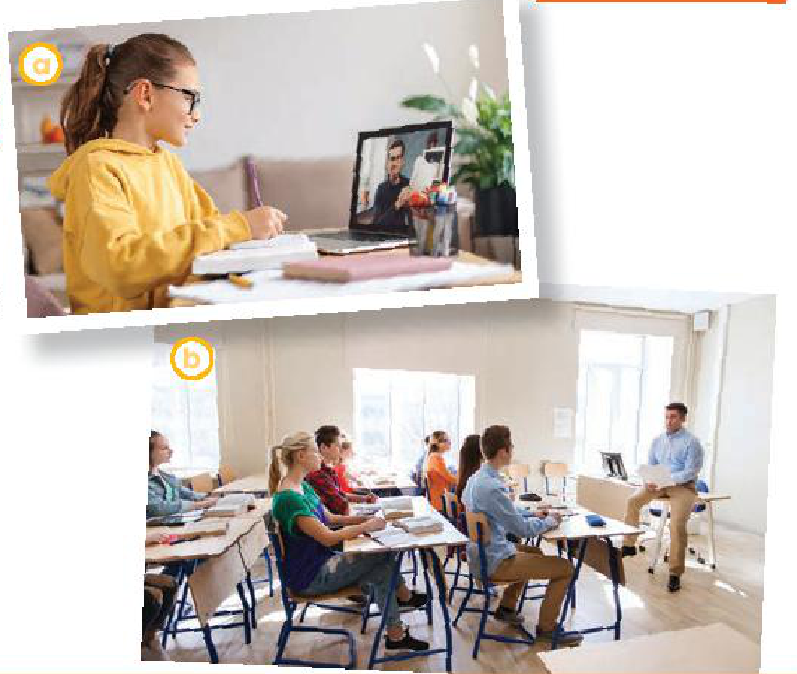
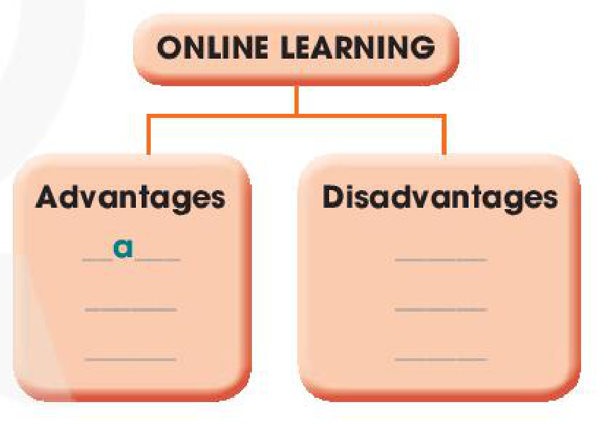
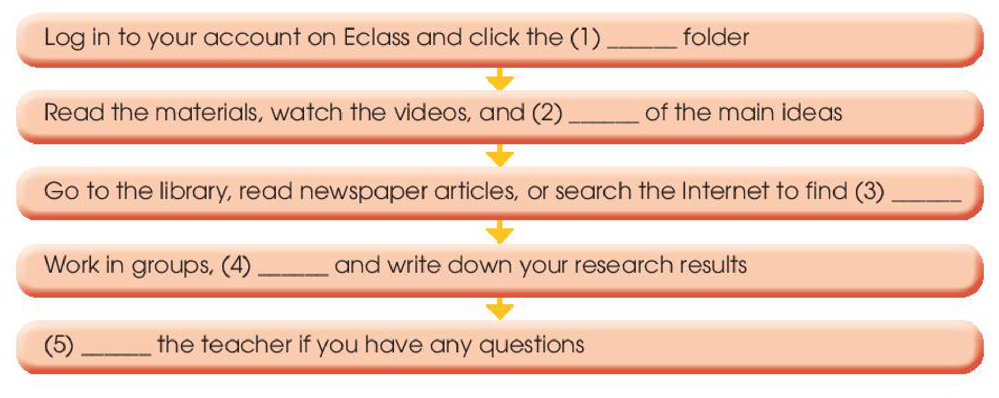

<!-- pdf:87 -->

# UNIT 8: NEW WAYS TO LEARN

**This unit includes:**

- **LANGUAGE**
  - **Pronunciation**
    - Sentence stress
  - **Vocabulary**
    - Words and phrases related to different ways of learning
  - **Grammar**
    - Relative clauses: defining and non-defining relative clauses with *who*, *that*, *which*, and *whose*
- **SKILLS**
  - **Reading:** Reading for main ideas and specific information in a text about online and **face-to-face** learning
  - **Speaking:** Talking about the advantages and disadvantages of **online learning**
  - **Listening:** Listening to instructions on how to prepare for a **blended learning** class for specific information
  - **Writing:** Writing about the benefits of **blended learning**
- **COMMUNICATION AND CULTURE / CLIL**
  - **Everyday English**
    - Giving instructions
  - **Culture**
    - Modern schools
- **PROJECT**
  - Doing a survey to find out how students use electronic devices to learn

## I. GETTING STARTED

**New learning activities**

**1. Listen and read.**

**Long:** Hi, Nick. What are you doing?

**Nick:** I'm watching the video that my geography teacher **uploaded** on Eclass.

**Long:** Really? What is it about?
<!-- ocr-ok: đã đối chiếu ảnh trang gốc, OCR đọc nhầm Really thành Redly -->

**Nick:** It's about global warming. My teacher asked us to watch the video and find more information about this topic.

**Long:** So, is watching the video part of your homework?

**Nick:** Yes, then next week, we'll work in groups and discuss the topic in class.

**Long:** Sounds interesting. You can watch the video many times and also search for more information at home.

**Nick:** You're right. I'm not good at taking notes in class, you know. So I prefer this way of learning. It gives me a chance to discuss with my classmates, who may have **original** ideas on the topic.
<!-- term: take notes -->

**Long:** Does your teacher often ask you to prepare materials at home and discuss in class, Nick?

**Nick:** Yes, she does. We're doing a lot of projects that help us understand the lessons better. This way of studying, which gives us more **control** over our own learning, is quite useful.
<!-- term: do projects -->

**Long:** You're lucky. My teachers use very traditional methods of teaching at my school. I wish I could try these new learning activities.

<!-- pdf:88 -->

**2. Read the conversation again and decide whether the following statements are true (T) or false (F).**

| | **T** | **F** |
| --- | --- | --- |
| 1. Nick is preparing for his next geography class. | | |
| 2. Nick's note taking skills are quite good. | | |
| 3. Nick's class is working on many projects now. | | |

**3. Match the verbs with the nouns to make phrases in 1.**

| | |
| --- | --- |
| 1. **upload** | a. notes |
| 2. do | b. a video |
| 3. find | c. a project |
| 4. take | d. information |
<!-- ocr-ok: đã đối chiếu ảnh trang gốc, OCR lỗi nhận diện các khung tròn đánh số 1-4 và chữ cái a-d -->

**4. Complete each of the following sentences with ONE word from the conversation.**

1. Nick is watching the video \_\_\_\_\_\_\_ his geography teacher **uploaded** on Eclass.
2. This way of learning gives him a chance to discuss with his classmates, \_\_\_\_\_\_\_ may have **original** ideas on the topic.
3. They are doing a lot of projects \_\_\_\_\_\_\_ help them understand the lessons better.
4. That way of studying, \_\_\_\_\_\_\_ gives them more **control** over their own learning, is quite useful.

## II. LANGUAGE

### Pronunciation

**Sentence stress**

**1. Listen and repeat. Pay attention to the stressed words in bold in the sentences.**

1. We should **'finish** the **'project** for our **'history** **'class**.
2. **'Peter** is **re'vising** for his **e'xam** **'next** **'week**.
3. **'Students** will **'spend** more **'time** **'working** with **'other** **'classmates**.
4. I **'like** to **'watch** **'videos** that **'help** me **'learn** **'new** **'things**.
5. I have **in'stalled** some **'apps** on my **'phone**.

**Tips**

**Sentence stress** is the emphasis on certain words in a sentence. We usually stress content words such as main verbs, nouns, adjectives, and adverbs.

*Example:* *I'll **'go** to the **'cinema** on **'Friday**.*

**2. Read and underline the stressed words in the sentences. Then practise reading them.**

1. Our teacher often gives us videos to watch at home.
2. I never read books on my tablet at night.
3. It is a new way of learning and students really like it.
4. You can find a lot of useful tips on this website.
5. They should make an outline for their presentation.

<!-- pdf:89 -->

### Vocabulary

**Different ways of learning**

**1. Match the words and phrases with their meanings.**

| | |
| --- | --- |
| 1. **face-to-face** (adj) | a. an intended plan to achieve a specific purpose |
| 2. **prepare** (for) (v) | b. a way of learning that combines online materials with traditional classroom methods |
| 3. **strategy** (n) | c. close together and facing each other |
| 4. **online learning** (n) | d. to make things ready to be used |
| 5. **blended learning** (n) | e. a way of learning that happens on the Internet |
<!-- ocr-ok: đã đối chiếu ảnh trang gốc, OCR ghép lệch dòng giữa hai cột nối từ và nghĩa -->

**2. Complete the sentences with the words and phrases in 1.**

1. \_\_\_\_\_\_\_ learning allows us to **communicate** with teachers **immediately** and directly.
2. One benefit of \_\_\_\_\_\_\_ is that you can learn anytime and anywhere.
3. Our teachers always encourage us to \_\_\_\_\_\_\_ lessons before class.
4. You need a specific \_\_\_\_\_\_\_ to improve your English speaking skills.
5. \_\_\_\_\_\_\_ combines online videos with traditional classroom methods.

### Grammar

**Relative clauses**

**1. Match the two parts to make complete sentences.**

| | |
| --- | --- |
| 1. Mr Smith was talking to the students | a. that explains how to use **voice recorders**. |
| 2. The film which we saw yesterday | b. is Laura. |
| 3. The speaker, who will share new learning activities in our workshop, | c. which is in the middle of Viet Nam. |
| 4. We often go to Da Nang, | d. whose presentations were really impressive. |
| 5. My cousin gave me an instruction book | e. was quite interesting. |

**Remember!**

A relative clause gives more information about a person or thing by defining the noun before it. It usually begins with a relative pronoun: *who*, *that*, *which*, or *whose*.

There are two types of relative clauses:

1. A defining relative clause gives essential information about the person or thing mentioned.
   *Example: The man **who visited us yesterday** is a famous doctor.*
2. A non-defining relative clause gives extra information about the person or thing mentioned. It is often placed between commas.
   *Example: My uncle, **who visited us yesterday**, is a famous doctor.*
<!-- term: Relative clauses: defining and non-defining relative clauses with who, that, which, and whose -->

**2. Join the following sentences. Use *who*, *that*, *which*, or *whose*. Add commas where necessary.**

1. My brother teaches me how to use a laptop. He is good at computers.
   → My brother \_\_\_\_\_\_\_.
2. Peter is a friend of mine. His sister is taking an online maths course.
   → Peter \_\_\_\_\_\_\_.
3. Lan has read the book. I lent her the book.
   → Lan \_\_\_\_\_\_\_.
4. The boy has designed this invention. He is only 10 years old.
   → The boy \_\_\_\_\_\_\_.
5. That app is easy to use. It can help improve your English pronunciation.
   → That app \_\_\_\_\_\_\_.

<!-- pdf:90 -->

## III. READING

**1. Work in pairs. Look at the photos and answer the questions.**

1. How do the students learn in each photo?
2. Are you familiar with these ways of learning?

**2. Read the texts. What are the two students talking about? Choose the correct answer.**

- A. Ways of helping students
- B. Ways of learning
- C. How to enjoy learning

**Kim**

I think **face-to-face** learning is better than **online learning** because I can **communicate** with teachers and other classmates **immediately** and directly when I have questions. In class, I can work in groups and discuss with friends. This helps me understand the lessons better. When I have a problem, I can ask for answers or help **immediately**. I can't do this in online classes. I have to email my teachers and wait for their reply.

Learning in a traditional classroom also has fewer **distractions** than learning online. My teachers have many **strategies** to keep us **focused** on the lessons. I really enjoy my lessons and learn a lot.

**Laura**

I think **online learning** has more advantages than disadvantages. My school is trying to change from **face-to-face** to **blended learning**, so sometimes we have online classes. I don't have to go to school, but I don't feel I'm missing any lessons by taking online classes. Furthermore, I think I learn online as much as I learn in a traditional class. I can't talk to my teacher and classmates, but I can email them at any time. I also have an online discussion board where I can **exchange** comments and ideas about my projects with my classmates. The only disadvantage is I really need to have a fast Internet connection.
<!-- term: Internet connection -->

<!-- pdf:91 -->

**3. Read the texts again and decide who mentions the following by putting a tick (✓) in the correct box.**

| This person ... | *Kim* | *Laura* |
| --- | --- | --- |
| 1. thinks that **online learning** isn't as good as **face-to-face** learning. | | |
| 2. gains the same knowledge in both ways of learning. | | |
| 3. has more direct conversations and discussions. | | |
| 4. uses emails to contact classmates. | | |
| 5. can pay more attention in class. | | |
| 6. needs to have access to **high-speed** Internet. | | |

**4. Work in pairs. Discuss the following questions.**

*Which way of learning do you think is better? Why?*

## IV. SPEAKING

**Online learning**

**1. Put the advantages and disadvantages of online learning from the box into suitable categories. You may add more to each category.**

- a. We can learn at our own pace.
- b. We may have technical problems.
- c. We sit in front of a computer for a long time.
- d. We can learn anytime and anywhere with an Internet connection.
- e. We can organise our own study **schedule**.
- f. We can't discuss and talk to each other face to face.
<!-- term: technical problem -->

| **ONLINE LEARNING** | |
| --- | --- |
| **Advantages** | **Disadvantages** |
| `a` | \_\_\_\_\_\_\_ |
| \_\_\_\_\_\_\_ | \_\_\_\_\_\_\_ |
| \_\_\_\_\_\_\_ | \_\_\_\_\_\_\_ |
<!-- ocr-ok: đã đối chiếu ảnh trang gốc, văn bản nằm trong sơ đồ H10-tieng_anh-u08-02 -->

**2. Work in groups. Each group chooses to be either For or Against online learning. Discuss and provide explanations to support your side. Use the table below to note your ideas.**

| | **Online learning** | **Examples / Evidence** |
| --- | --- | --- |
| **For** | learn anytime and anywhere with an Internet connection | don't go to school and save time |
| **Against** | harm our health | can cause short-sightedness or backache |
<!-- term: short-sightedness -->

**3. Work with a classmate from the opposite group. Discuss your opinions about online learning. Use your notes in 2.**

*Example:*

**A:** *I think **online learning** has more advantages than disadvantages. First, we can learn anytime and anywhere with an Internet connection. So, we don't have to travel long distances to school. We can stay at home to attend lessons.*

**B:** *I don't agree with you. **Online learning** has more disadvantages than advantages. Studying online means we have to sit in front of a computer for many hours and this is not healthy for our eyes and back.*

<!-- pdf:92 -->

## V. LISTENING

**Blended learning**

**1. Work in pairs. Tick (✓) what you often do to prepare before a new lesson.**

- ☐ Read materials for the new lesson (textbooks)
- ☐ Watch videos related to the lesson
- ☐ Search information related to the new lesson
- ☐ Review old lessons

**2. Listen to the first part of the conversation between a teacher and her students, then answer the following questions.**

1. What is the teacher talking about?
2. What has she **uploaded** on Eclass?

**3. Listen to the second part of the conversation and complete the flow chart with no more than TWO words.**

- Log in to your account on Eclass and click the (1) \_\_\_\_\_\_\_ folder
- ↓
- Read the materials, watch the videos, and (2) \_\_\_\_\_\_\_ of the main ideas
- ↓
- Go to the library, read newspaper articles, or search the Internet to find (3) \_\_\_\_\_\_\_
- ↓
- Work in groups, (4) \_\_\_\_\_\_\_ and write down your research results
- ↓
- (5) \_\_\_\_\_\_\_ the teacher if you have any questions

**4. Work in groups. Discuss the questions.**

*Which is more effective: blended or traditional learning? Why?*
<!-- term: traditional learning -->

<!-- pdf:93 -->

## VI. WRITING

**Writing about the benefits of blended learning**

**1. Work in pairs. Discuss and tick (✓) the benefits of blended learning.**

1. It helps students have more **control** over their own learning. ☐
2. It is easier to get access to lesson materials. ☐
3. It may not prepare students well for tests. ☐
4. Students can develop better communication and **teamwork** skills. ☐
5. It is not suitable for students who have no Internet connection or computers. ☐

**2. Work in groups. Use the benefits in 1 and your own ideas to complete the following outline.**

| | | |
| --- | --- | --- |
| **Topic sentence** | *Blended learning is a way of studying a subject, which combines learning over the Internet and **face-to-face** learning, and brings several benefits to us.* | |
| **First benefit** | *First, **blended learning** helps us have more **control** over our own learning.* | |
| | Explanation 1 | *Learning materials are available at all times online.* |
| | Explanation 2 | *Students who are absent from school won't miss lessons.* |
| **Second benefit** | *Second,* \_\_\_\_\_\_\_ | |
| | Explanation 1 | \_\_\_\_\_\_\_ |
| | Explanation 2 | *We have more time for pairwork and group work.* |
| **Concluding sentence** | \_\_\_\_\_\_\_ | |

**3. Use the outline in 2 and expressions below to write a paragraph (120 - 150 words) about the benefits of blended learning.**

**Useful expressions**

- First, **blended learning** helps students / us do sth
- Second, they / we can do sth
- This enables / allows us / students to do sth

First, \_\_\_\_\_\_\_

Second, \_\_\_\_\_\_\_

Finally, \_\_\_\_\_\_\_

<!-- pdf:94 -->

## VII. COMMUNICATION AND CULTURE / CLIL

### Everyday English

**Giving instructions**

**1. Listen and complete the conversation with the words in the box. Then practise it in pairs.**

| A. go | B. wait | C. click | D. type |
| --- | --- | --- | --- |

**Tam:** Mai, can you show me how to install the app I-Speak on my smartphone? I want to practise my English speaking skills.

**Mai:** Of course. First, (1) \_\_\_\_\_\_\_ to the App store on your phone. Second, (2) \_\_\_\_\_\_\_ 'I-Speak' in the search box at the top of the screen, then (3) \_\_\_\_\_\_\_ the 'Search' button.

**Tam:** Let me try. OK, I see the search results. What do I do next?
<!-- ocr-ok: đã đối chiếu ảnh trang gốc, OCR đọc nhầm try thành fry và I thành | -->

**Mai:** Now, click 'Get' next to the 'I-Speak' icon and (4) \_\_\_\_\_\_\_ until the download is complete.

**2. Work in pairs. Make similar conversations about how to install another study app on a smartphone.**

### Culture

**1. Read the text about modern schools and answer the questions.**

**MODERN SCHOOLS**

Modern schools are designed to help each student to be successful. Teachers play the role of a guide for them and prepare them for lifelong learning. They encourage and challenge them to become responsible and confident individuals.

Class discussion is a main feature of modern schools. Students are expected to take part in discussions and express personal opinions. It is also important to ask questions in class if students do not understand any point or instruction. Group learning is another common feature. Students may work in small groups on a project task.

In class, teachers and students use computers to access **digital** learning resources. Teachers use technology and audio-visual materials to support their lessons. Outside the classroom, students have a chance to participate in field trips to famous landmarks such as museums, hospitals, and industry locations. These trips give them **real-world** experiences. Students also attend school camps to make friends with other students and to develop life skills in unfamiliar environments.
<!-- term: field trip -->

1. What is the role of teachers in modern schools?
2. What are two common features of modern schools?
3. How do students use computers in the learning process?
4. How do students learn about the real world?

**2. Work in groups. Discuss whether your school has similar features and learning activities.**

<!-- pdf:95 -->

## VIII. LOOKING BACK

### Pronunciation

**Listen and underline the stressed words in the sentences. Then practise reading them.**

1. Many students bring smartphones to school nowadays.
2. You can download the app to study English.
3. Thanks to technology, students can learn anywhere.
4. My sister is looking for information for her presentation tomorrow.

### Vocabulary

**Complete the sentences using the words in the box.**

| blended | connection | traditional | teamwork | online |
| --- | --- | --- | --- | --- |

1. I don't like \_\_\_\_\_\_\_ learning because it's hard to make friends with my classmates.
2. \_\_\_\_\_\_\_ schools may not prepare us for the jobs of the future.
3. I'm taking an online course so I need a fast Internet \_\_\_\_\_\_\_.
4. With \_\_\_\_\_\_\_ learning, students are still able to attend **face-to-face** classes.
5. Projects help us improve our \_\_\_\_\_\_\_ skills.

### Grammar

**Complete the sentences with *who*, *which*, *that*, or *whose*. You may use more than one relative pronoun in some sentences.**

1. That is the teacher \_\_\_\_\_\_\_ has received an award for excellent teaching.
2. We were invited to attend a talk show \_\_\_\_\_\_\_ is popular with teenagers.
3. Their school, \_\_\_\_\_\_\_ offers both **face-to-face** and online classes, is the best in the city.
4. The students \_\_\_\_\_\_\_ names are on the list will join the field trip.
5. Have you finished the project \_\_\_\_\_\_\_ was given by our art teacher?
6. My cousin John, \_\_\_\_\_\_\_ lives in Da Nang, is coming to visit me this weekend.

<!-- pdf:96 -->

## PROJECT

**TECHNOLOGY FOR LEARNING**

**Work in groups. Do a survey to find out how students in your school use electronic devices to learn. Try to find at least 15 students to interview. Ask about the following:**

- names of students using electronic devices in learning
- types of electronic devices (e.g. desktop computers, laptops, tablets, smartphones)
- how often they use them (e.g. every day, twice a week)
- purposes for using them (e.g. to read articles, to use educational apps, to take online courses)

| **Names** | **Devices** | **Frequency** | **Purposes** |
| --- | --- | --- | --- |
| | | | |
| | | | |

**Present your group's findings to the class. Your presentation should include:**

- How many students use each device?
- Which electronic devices do students use for study / relaxation / social interaction?
- How often do they use these devices? Give possible reasons.

**Now I can ...**

- identify and use sentence stress appropriately.
- understand and use words and phrases related to different ways of learning.
- understand and use defining and non-defining relative clauses with *who*, *that*, *which*, and *whose*.
- read for main ideas and specific information in a text about online and **face-to-face** learning.
- talk about the advantages and disadvantages of **online learning**.
- listen to instructions on how to prepare for a **blended learning** class for specific information.
- write about the benefits of **blended learning**.
- give instructions.
- learn about modern schools.
- do a survey to find out how students use electronic devices to learn and report survey results in a group presentation.

## 📷 Danh mục hình minh hoạ

| Mã hình | Trang PDF | Trang sách | Chú thích / Mô tả |
| --- | --- | --- | --- |
| H10-tieng_anh-u08-01 | 90 | 89 | Hai bức ảnh minh hoạ các phương thức học tập trong phần Reading: (a) một nữ sinh học trực tuyến tại nhà qua máy tính xách tay và ghi chép bài, (b) các học sinh và thầy giáo trong giờ học trực tiếp trên lớp |
| H10-tieng_anh-u08-02 | 91 | 90 | Sơ đồ phân loại ưu điểm (Advantages) và nhược điểm (Disadvantages) của việc học trực tuyến (Online learning) trong phần Speaking |
| H10-tieng_anh-u08-03 | 92 | 91 | Lưu đồ quy trình (flow chart) gồm 5 bước hướng dẫn học sinh chuẩn bị cho tiết học kết hợp (blended learning) trên hệ thống Eclass trong phần Listening |
