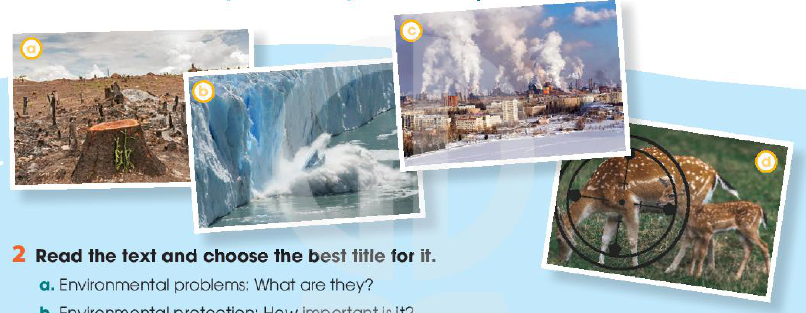
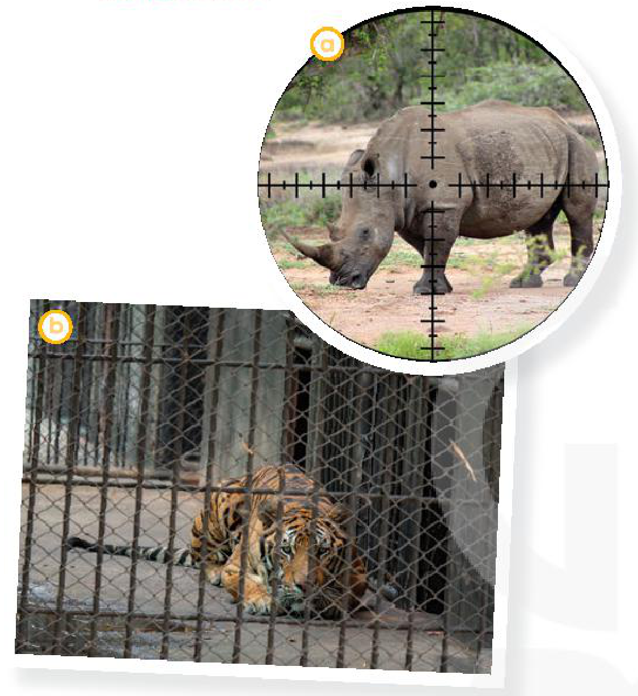
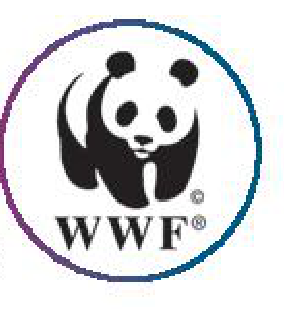

<!-- pdf:101 -->

# UNIT 9: PROTECTING THE ENVIRONMENT

<!-- ghi chú: Tại trang mở đầu Unit 9 (trang in 100, PDF 101), lá cờ góc trên bên trái chỉ in số "9" (thiếu chữ "Unit" so với Unit 1–8), trong khi ở bảng Contents, Book Map và tiêu đề chạy đầu trang vẫn ghi "UNIT 9 / Unit 9". -->

> **This unit includes:**
> - **LANGUAGE**
>   - **Pronunciation:** Rhythm
>   - **Vocabulary:** Words and phrases related to the environment and ways to protect it
>   - **Grammar:** Reported speech
> - **SKILLS**
>   - **Reading:** Reading for main ideas and specific information in a text about environmental problems
>   - **Speaking:** Talking about environmental solutions
>   - **Listening:** Listening for specific information in a conversation about ways to protect endangered animals
>   - **Writing:** Writing about a wildlife organisation
> - **COMMUNICATION AND CULTURE / CLIL**
>   - **Everyday English:** Making and responding to apologies
>   - **CLIL:** Earth Hour
> - **PROJECT**
>   - Doing research on a local or an international environmental organisation

## I. GETTING STARTED

**A presentation on the environment**

**1. Listen and read.**

**Nam's father:** What are you doing, Nam?

**Nam:** I'm preparing a presentation for my geography class.

**Nam's father:** What's the topic?

**Nam:** It's **environmental protection**. My teacher asked me to do some research, but I don't know where to start.

**Nam's father:** I think you should identify some environmental problems first. What have you found so far?

**Nam:** I've come up with a range of environmental issues such as global warming, **deforestation**, **endangered** animals and pollution, but I don't know how to organise them.
<!-- term: come up with -->

<!-- pdf:102 -->

**Nam's father:** You should focus on each problem, explain the main causes of it, and then suggest the solutions.

**Nam:** Thanks, Dad. But presenting all the solutions will be hard.

**Nam's father:** Have you asked your teacher for advice?

**Nam:** Yes, I have. She advised me to start with small, **practical** actions to protect the environment before coming up with big ideas that need a lot of effort or money to succeed.
<!-- term: come up with -->

**Nam's father:** Sounds good. You'd better follow her advice. When did she ask you to present it?

**Nam:** She said I should present it the following week.

**Nam's father:** You still have a lot of time. Good luck!

**Nam:** Thanks, Dad.

**2. Read the conversation again and answer the questions.**

1. What did Nam's teacher ask him to do?
2. What has Nam come up with so far?
3. When does Nam have to deliver the presentation?

**3. Match the words in A with the words in B to make phrases in 1.**

| A | B |
| --- | --- |
| 1. global | a. animals |
| 2. **practical** | b. issues |
| 3. environmental | c. actions |
| 4. **endangered** | d. warming |

**4. Complete the following sentences with verbs from the conversation in 1.**

1. My teacher \_\_\_\_\_\_\_ me to do some research on **environmental protection**.
2. She \_\_\_\_\_\_\_ me to start with small, **practical** actions to protect the environment.
3. She \_\_\_\_\_\_\_ I should deliver my presentation the following week.

## II. LANGUAGE

### Pronunciation

**Rhythm**

**1. Listen and repeat. Pay attention to the stressed words in the sentences.**

1. 'Don't 'pick the 'flowers when you 'go to the 'park.
2. The 'students 'clean the 'school 'playground 'every week'end.
3. 'What's 'happening with the 'polar 'bears?
4. Did you 'watch the docu'mentary about 'air pol'lution?

**2. Mark the stressed syllables in the words in bold. Then practise saying the sentences with a natural rhythm.**

1. **Don't** **feed** the **animals** in the **zoo** while they are **resting**.
2. The **teacher** **asked** his **students** to **focus** on their **work**.
3. **What** were you **doing** when I **rang** you **up** an **hour** **ago**?
4. Are you **reading** the **book** about **endangered** **animals** in the **world**?

<!-- pdf:103 -->

### Vocabulary

**Environment**

**1. Match the words and phrases with their meanings.**

| Words and phrases | Meanings |
| --- | --- |
| 1. **biodiversity** | a. the variety of plants and animals in a particular area |
| 2. **habitat** | b. animals and plants that grow in natural conditions |
| 3. **ecosystem** | c. changes in the world's weather, especially an increase in temperature |
| 4. **wildlife** | d. the natural environment in which a plant or an animal lives |
| 5. **climate change** | e. all the plants and animals in an area and the way they affect each other and the environment |

**2. Complete the sentences using the correct form of the words and phrases in 1.**

1. \_\_\_\_\_\_\_ is important because plants and animals depend on each other to survive.
2. A new series of educational programmes shows the importance of \_\_\_\_\_\_\_ to humans.
3. Their work involves protecting and creating natural \_\_\_\_\_\_\_ for plants and animals.
4. Countries need to work together to deal with global issues such as **deforestation** and \_\_\_\_\_\_\_.
5. Pollution can have serious effects on the **balance** of \_\_\_\_\_\_\_.

### Grammar

**Reported speech**

**Remember!**

> We use **reported speech** when we want to tell someone what we or someone else said before.
> When we use reported speech, we change personal pronouns, tenses of verbs, and adverbs of time.
> *Example:*
> *'I will fly to Ho Chi Minh City tomorrow,' Nam said.*
> → *Nam said **he would fly** to Ho Chi Minh City **the following day**.*
> When reporting questions, we often use the verb *ask* and the word order for statements, and omit the question mark.
> - *Wh*-questions:
>   *Example:*
>   *'Where do you live?'*
>   → *He asked me **where I lived**.*
> - *Yes/No* questions:
>   *Example:*
>   *'Do you like the book?'*
>   → *He asked me **if I liked the book**.*
<!-- term: Reported speech -->

**1. Choose the correct word or phrase to complete each sentence.**

1. Minh's teacher asked him if he *was* / *is* ready to present the following day.
2. Nam's father *suggested* / *denied* that Nam should focus on one aspect of the problem.
3. Tuan said he would complete his project *the following week* / *next week*.
4. Mai *asked* / *said* her teacher where she could get the information from.
5. Phong said he *handed* / *had handed* in his project the previous day.

<!-- pdf:104 -->

**2. Change these sentences into reported speech.**

1. 'The burning of coal leads to air pollution,' Mrs Le explained.
2. 'I have to present my paper on **endangered** animals next week,' Nam said.
3. 'Do human activities have an impact on the environment?' Linda asked the speaker.
4. 'What environmental projects is your school working on?' Nam asked Mai.
5. 'I will read more articles before writing the essay, Nam,' Tom said.

## III. READING

**1. Work in pairs. Look at the pictures and answer the following question.**

*What environmental problems do you see in the pictures?*

**2. Read the text and choose the best title for it.**

- a. Environmental problems: What are they?
- b. **Environmental protection**: How important is it?
- c. Environmental solutions: How **practical** are they?

The environment we live in is facing many serious problems. We need to be aware of these problems so that we can find ways to protect nature.

**A.** Global warming is the rise in the average temperature of the earth's atmosphere. It is one of the biggest issues facing humans today. It can have serious **consequences** such as rising sea levels, polar **ice melting**, and **extreme** weather events like floods or **heatwaves**.
<!-- term: global warming -->

**B.** Another environmental problem is the cutting and clearing of natural forests. The loss of forests can have a negative impact on the environment. It can damage the natural **habitats** of many animals and put **wildlife** in danger. It can also destroy the natural soil and lead to **climate change**.
<!-- term: loss of habitat -->

**C.** Air pollution is also a serious problem. It is mainly caused by waste gases that come out of vehicles, machines, or factories. When these harmful gases combine with the water in the air, they come down as rain or snow, which can damage all forms of life. In addition, this problem leads to global warming and **climate change**. It is also a major cause of **respiratory** diseases or even lung cancer.
<!-- term: air pollution -->

**D.** Around the world, the number of **endangered** animals is rising. Many of them disappear because of pollution and **climate change**. In addition, humans illegally hunt and kill animals, and catch too many fish at once. This is **upsetting** the natural **balance** of **ecosystems**, which can be harmful to all living and non-living things.

<!-- pdf:105 -->

**3. Read the text again and decide which paragraph contains the following information.**

| Information | Paragraph |
| --- | --- |
| 1. an example of harmful substances in the air and water | |
| 2. one of the reasons for destroying **wildlife** **habitats** | |
| 3. an increase in the level of the world's oceans | |
| 4. an effect of illegal hunting on the **ecosystem** | |

**4. Complete the sentences with the information from the text. Use no more than TWO words for each answer.**

1. Global warming can cause **extreme** \_\_\_\_\_\_\_ such as floods or **heatwaves**.
2. The natural \_\_\_\_\_\_\_ of many animals can be destroyed in the process of cutting down forests.
3. One of the main causes of air pollution is \_\_\_\_\_\_\_ produced by machines and factories.
4. When many animals disappear, this damages the natural **balance** of \_\_\_\_\_\_\_.
<!-- term: cut down -->

**5. Work in groups. Discuss the question.**

*Which of the problems mentioned in the text do you think is the most serious in Viet Nam?*

## IV. SPEAKING

**Solutions to environmental problems**

**1. Work in pairs. Match the environmental problems with the suggested solutions.**

| Environmental problems | Suggested solutions |
| --- | --- |
| 1. DISAPPEARANCE OF **ENDANGERED** ANIMALS | a. Recycle paper, plastics, and wood products b. Use electric vehicles or public transport, and plant more trees c. Stop illegal hunting and fishing d. Stop burning leaves, rubbish, and other materials e. Avoid products that are made from animal parts f. Introduce strict laws to prevent the cutting of natural forests |
| 2. **DEFORESTATION** | |
| 3. AIR POLLUTION | |

<!-- pdf:106 -->

**2. Work in pairs. Complete the presentation outline below with the information in the box.**

**SOLUTIONS TO AIR POLLUTION**
**Presentation Outline**

1. Welcoming the audience and introducing the topic
   \_\_\_\_\_\_\_\_\_\_\_\_\_\_\_\_\_\_\_\_\_\_\_\_\_\_\_\_\_\_
2. The first solution
   \_\_\_\_\_\_\_\_\_\_\_\_\_\_\_\_\_\_\_\_\_\_\_\_\_\_\_\_\_\_
3. The second solution
   \_\_\_\_\_\_\_\_\_\_\_\_\_\_\_\_\_\_\_\_\_\_\_\_\_\_\_\_\_\_
4. Finishing the presentation and thanking the audience
   \_\_\_\_\_\_\_\_\_\_\_\_\_\_\_\_\_\_\_\_\_\_\_\_\_\_\_\_\_\_

- **A.** The first solution is to stop burning leaves, rubbish, and other materials. This will reduce the smoke produced in the air.
- **B.** That concludes our presentation today. Thank you for listening.
- **C.** Another solution is to use electric vehicles or public transport. This will reduce the gas emissions from private vehicles and will make the air cleaner.
- **D.** Hi everyone. I'm here today to talk to you about the solutions to one of the most serious problems in our city – air pollution.

**3. Work in groups. Choose an environmental problem in 1 and make a presentation on the solutions to it. Use the expressions below to help you.**

| **Useful expressions** |
| --- |
| **Welcoming the audience and introducing the topic** Hi everyone. Good morning / afternoon. I'm here today to talk to you about / discuss ... I'd like to talk about ... Today, I'd like to share with you ... |
| **Introducing the first point / idea** Firstly, the problem can be solved by ... The first solution is to ... |
| **Introducing the second point / idea** My next point is ... Another solution is to ... |
| **Finishing the presentation and thanking the audience** That concludes our presentation. That's the end of our presentation today. Thank you for listening. Thank you for your attention. |

<!-- pdf:107 -->

## V. LISTENING

**Saving endangered animals**

**1. Work in pairs and answer the question.**

*What is happening to the animals in the pictures?*

**2. Nam and Mai are talking about Mai's project on ways to save endangered animals. Listen to the conversation and decide whether the statements are true (T) or false (F).**

| | T | F |
| --- | --- | --- |
| 1. Mai will complete her mid-term project in two weeks. | | |
| 2. Nam believes that people should first be made aware of the importance of the problem. | | |
| 3. Mai thinks that illegal hunting may not destroy wild animals' natural **habitats**. | | |
| 4. Nam believes that illegal hunting can be prevented by banning **wildlife** trade. | | |
<!-- term: wildlife trade -->

**3. Listen to the conversation again and complete the notes. Use ONE word for each gap.**

| **Ways to save endangered animals** |
| --- |
| Helping people understand the (1) \_\_\_\_\_\_\_ of the problem |
| Introducing strict (2) \_\_\_\_\_\_\_ to prevent people from illegal hunting |
| Banning **wildlife** (3) \_\_\_\_\_\_\_ |
| Avoiding products made from **endangered** (4) \_\_\_\_\_\_\_ parts |

**4. Work in groups and answer the questions.**

*Which is the most effective way to save **endangered** animals? Why?*

## VI. WRITING

**Writing about a wildlife organisation**

**1. Work in pairs. Look at the picture and answer the questions.**

1. Do you recognise the animal?
2. Where does it come from?
3. What do the letters WWF stand for?

**2. Read the text about WWF and complete the table.**

The World Wide Fund for Nature (WWF), originally called the World Wildlife Fund, is a non-governmental organisation. It was set up in 1961, and today it is the world's largest environmental organisation. It aims to stop the process of destroying the planet's natural environment and to build a future in which humans respect nature.
<!-- term: WWF -->

Much of the work of WWF focuses on the survival of **endangered** animals and the protection of their natural **habitats**. These animals include the Indian elephant, the **gorilla**, the **giant** **tortoise**, and the **giant** **panda**. Currently, WWF has 5 million supporters worldwide. It works in more than 100 countries and supports around 1,300 environmental projects.

<!-- pdf:108 -->

| | World Wide Fund for Nature (WWF) |
| --- | --- |
| **Kind of organisation** | (1) \_\_\_\_\_\_\_ |
| **Set up in** | (2) \_\_\_\_\_\_\_ |
| **Aims** | - (3) \_\_\_\_\_\_\_ - to build a future in which humans respect nature |
| **Focus of their work** | (4) \_\_\_\_\_\_\_ |
| **Number of projects supported** | (5) \_\_\_\_\_\_\_ |
<!-- ocr-ok: đã đối chiếu ảnh trang gốc, OCR đọc tách 2 cột bảng WWF và nhận nhầm số (1)-(5) -->

**3. Write a paragraph (120 - 150 words) about *Save the Elephants*, using the information in the table below.**

| | Save the Elephants (STE) |
| --- | --- |
| **Kind of organisation** | non-profit organisation |
| **Set up in / by** | 1993 / Iain Douglas-Hamilton |
| **Aims** | - to make sure elephants do not die out - to protect the **habitats** in which elephants are found |
| **Focus of their work** | **Protection** stopping the illegal hunting of elephants especially in Africa and Asia **Research** working together with scientists and experts to conduct research on elephant behaviour **Awareness** raising people's awareness through films, television, and new media sources |
| **Number of projects supported** | 335 projects in 40 countries |
<!-- term: die out -->

## VII. COMMUNICATION AND CULTURE / CLIL
<!-- ocr-ok: đã đối chiếu ảnh trang gốc, OCR đọc nhầm thứ tự chữ trên băng tiêu đề thành COMMUNICATION VII AND CULTURE / CLIL -->

### Everyday English

**Making and responding to apologies**

**1. Listen and complete the conversations with the expressions in the box. Then practise them in pairs.**

| A. Never mind | B. I'd like to apologise for | C. That's all right | D. I'm sorry to |
| --- | --- | --- | --- |

**1**
**Mai:** (1) \_\_\_\_\_\_\_ submitting my assignment late. I'm sorry, but my laptop was broken.
**Mr Ha:** (2) \_\_\_\_\_\_\_. Next time you should finish it earlier and have a back-up copy in case you have any technical problems.

**2**
**Nam:** (3) \_\_\_\_\_\_\_ keep you waiting for so long. The talk was longer than expected.
**Mai:** (4) \_\_\_\_\_\_\_. We still have enough time for dinner before the show.

**2. Work in pairs. Make similar conversations making and responding to apologies. Use the expressions below to help you.**

| **Useful expressions** | |
| --- | --- |
| **Making apologies** | **Responding to apologies** |
| (I hope you'll) excuse me for ... | Don't mention it. |
| Sorry for ... I'm sorry to ... | Never mind. |
| I'd like to apologise for ... | That's all right. |
| Please accept my apology for ... | Don't worry about it. |

<!-- pdf:109 -->

### CLIL

**1. Read the text and complete each blank of the fact file about Earth Hour with ONE word.**

**EARTH HOUR**

**Earth Hour** is a global event organised by the World Wide Fund for Nature (WWF). Held every year, it encourages people and businesses to turn off their lights and other unnecessary electrical devices for one hour from 8:30 p.m. to 9:30 p.m. on the last Saturday of March. Earth Hour was started as a lights-out event in Sydney, Australia, in 2007. Since then, it has grown to become an international movement for the environment, happening in more than 7,000 cities and towns across 187 countries and territories.
<!-- term: Earth Hour -->

Earth Hour has created a positive environmental impact. It shows the public support for protecting the environment and saving the planet. It also draws attention to **climate change** and global energy issues, and promotes green activities worldwide.

Viet Nam joined the event in 2009 and has been an active and keen supporter since then. Besides switching off lights, people can take part in a number of activities to raise awareness of environmental problems and call for action for climate, people and nature.

| **EARTH HOUR** | |
| --- | --- |
| **Organised by** | World Wide Fund for Nature |
| **Held from** | 8.30 p.m. – 9.30 p.m. on the last (1) \_\_\_\_\_\_\_ of March |
| **Started in** | Sydney, Australia, in 2007 |
| **Aims** | - to show the public (2) \_\_\_\_\_\_\_ for protecting the environment and saving the planet - to draw attention to (3) \_\_\_\_\_\_\_ change and global energy issues - to promote green (4) \_\_\_\_\_\_\_ worldwide |
| **First held in Viet Nam in** | (5) \_\_\_\_\_\_\_ with a variety of activities nationwide |

**2. Work in pairs. Discuss the following questions.**

1. Do you want to take part in this lights-out event in Viet Nam? Why or why not?
2. If you have a chance to take part in the event, what would you do?

## VIII. LOOKING BACK

### Pronunciation

**Listen and mark the stressed syllables in the words in bold. Then practise saying the sentences with a natural rhythm.**

1. **Don't** **buy** **products** that are **made** from **wild** **animal** **parts**.
2. **What** can we **do** to **help** the **animals** in the **wild**?
3. **Larger** **tigers** tend to **live** in **colder** **areas** while **smaller** **tigers** **live** in **warmer** **countries**.
4. **Elephants** are **endangered** because of **illegal** **hunting** and **body** **part** **trade**.
5. Do you **know** **why** so **many** **endangered** **animals** are **disappearing**?
<!-- term: illegal hunting -->

<!-- pdf:110 -->

### Vocabulary

**Choose the correct word to complete each sentence.**

1. Many **wildlife** *habits* / ***habitats*** will be destroyed if people keep cutting down the forests.
2. Researchers are looking for ways to reduce the environmental *impact* / *affect* of air pollution on the local community.
3. It's illegal to kill **pandas**, tigers or any other *dangerous* / ***endangered*** animals.
4. Global *warming* / *climate* is mainly caused by pollution and clearing of forests.
<!-- term: cut down -->

### Grammar

**Change the following sentences into reported speech.**

1. 'The rising sea level is a result of global warming,' the teacher explained.
2. 'I will take part in the competition next month,' my friend told me.
3. 'The clearing and burning of forests lead to air pollution,' the speaker said.
4. 'Are you interested in joining the event this weekend, Minh?' asked Tuan.
5. 'When are you going to deliver your presentation on the environment, Mai?' asked Nam.

## PROJECT

**AN ENVIRONMENTAL ORGANISATION**

**Work in groups. Find information about a local or an international environmental organisation and complete the table. Present it to the class.**

| | |
| --- | --- |
| 1. Name of the organisation | |
| 2. Set up in | |
| 3. Aims | |
| 4. Activities | |
<!-- ocr-ok: đã đối chiếu ảnh trang gốc, OCR đọc lẫn các dòng trong bảng Project với cột hướng dẫn bên trái -->

### Now I can ...

- use sentence stress appropriately to speak with a natural rhythm.
- understand and use words and phrases related to the environment and ways to protect it.
- use reported speech.
- read for main ideas and specific information in a text about environmental problems.
- talk about environmental solutions.
- listen for specific information in a conversation about ways to protect **endangered** animals.
- write about a **wildlife** organisation.
- make and respond to apologies.
- learn about Earth Hour.
- do research on a local or an international environmental organisation and give a group presentation about it.

## 📷 Danh mục hình minh hoạ

| Mã hình | Trang PDF | Trang sách | Chú thích / Mô tả |
| --- | --- | --- | --- |
| H10-tieng_anh-u09-01 | 104 | 103 | Bốn bức tranh (a, b, c, d) minh hoạ các vấn đề môi trường nghiêm trọng trong phần Reading: (a) nạn chặt phá rừng trơ gốc cây; (b) băng tan ở vùng cực; (c) khói thải từ các nhà máy gây ô nhiễm không khí; (d) săn bắn động vật hoang dã trái phép (hươu sao mẹ và con trong tâm ngắm) |
| H10-tieng_anh-u09-02 | 107 | 106 | Hai bức tranh (a, b) trong phần Listening minh hoạ các mối đe doạ đối với động vật hoang dã có nguy cơ tuyệt chủng: (a) tê giác bị nhắm bắn trong ống ngắm săn trộm; (b) hổ bị nhốt trong lồng sắt chật hẹp |
| H10-tieng_anh-u09-03 | 107 | 106 | Biểu trưng (logo) hình gấu trúc của Quỹ Quốc tế Bảo vệ Thiên nhiên (WWF – World Wide Fund for Nature) trong phần Writing |
