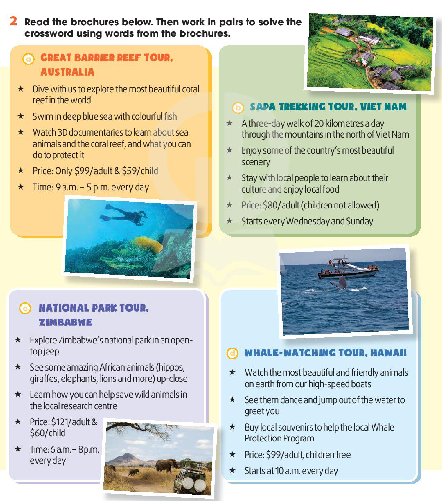
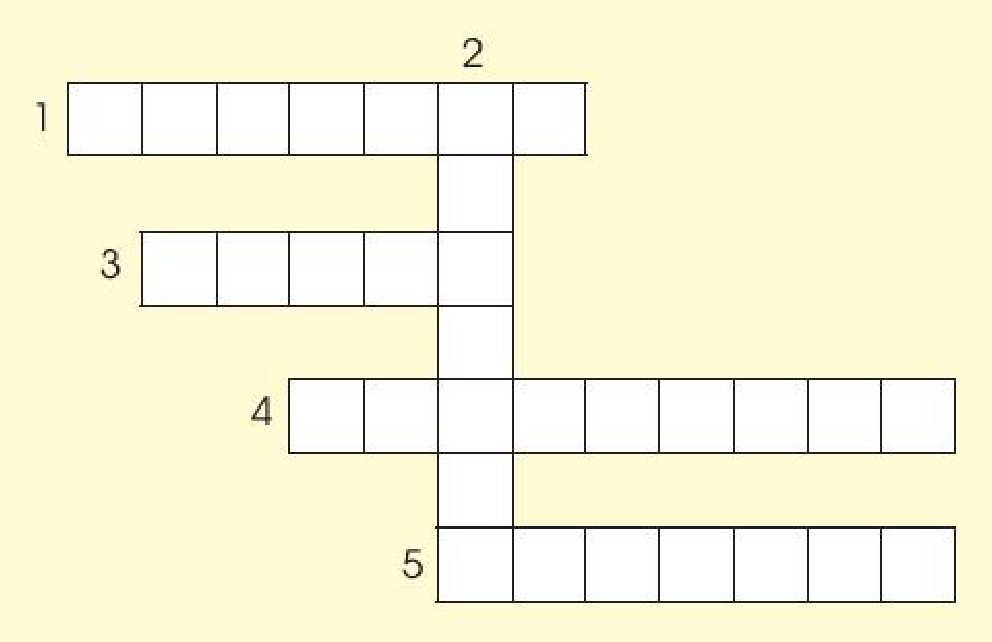
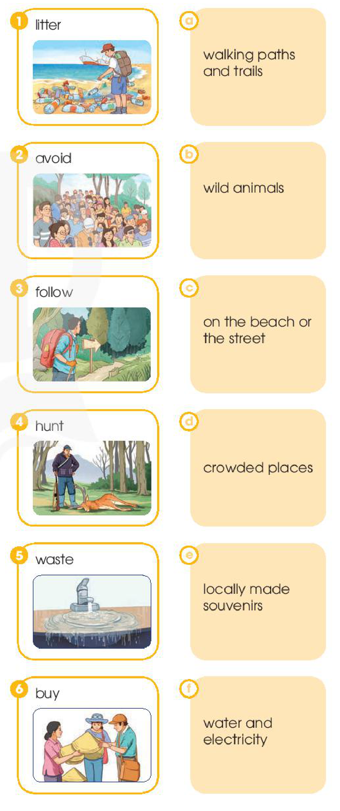
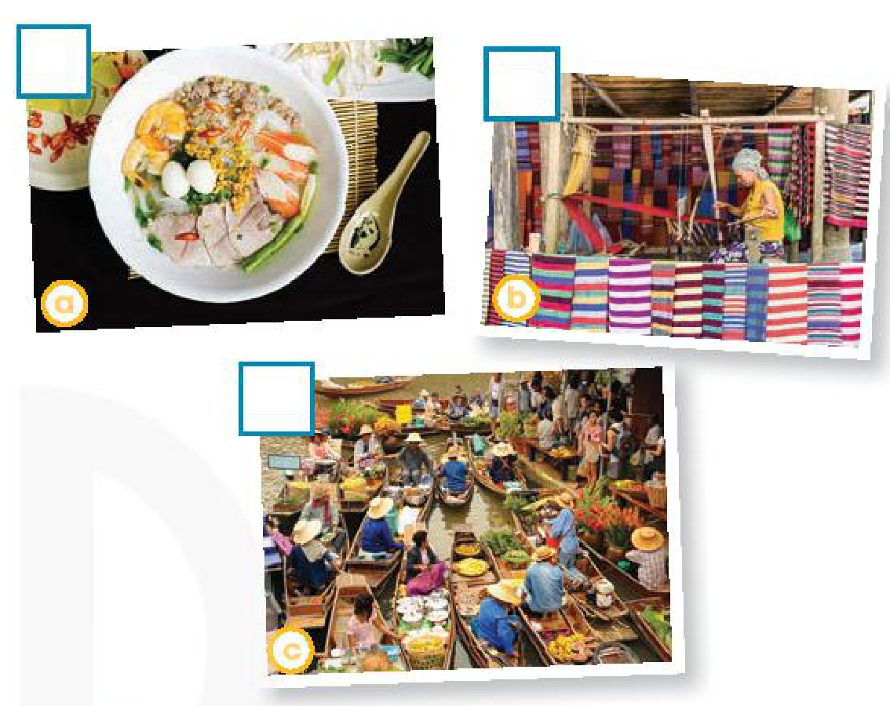
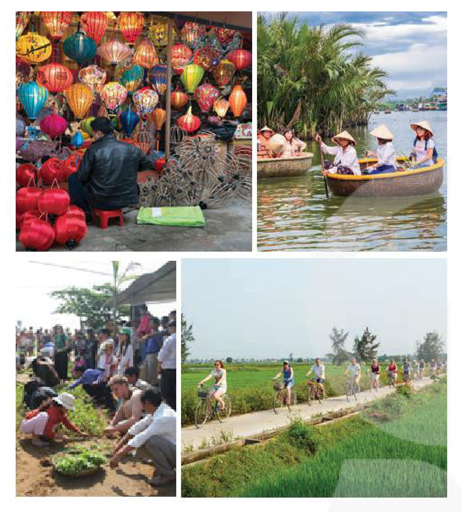

<!-- pdf:111 -->

# UNIT 10: ECOTOURISM
<!-- ghi chú: Tại trang mở đầu Unit 10 (trang in 110, PDF 111), lá cờ góc trên bên trái chỉ in số "10" (thiếu chữ "Unit" so với Unit 1–8), trong khi ở bảng Contents, Book Map và tiêu đề chạy đầu trang vẫn ghi "UNIT 10 / Unit 10". -->

> **This unit includes:**
> - **LANGUAGE**
>   - **Pronunciation:** Intonation
>   - **Vocabulary:** Words and phrases related to **ecotourism**
>   - **Grammar:** Conditional sentences Type 1 and Type 2
> - **SKILLS**
>   - **Reading:** Reading for specific information in a **brochure** about ecotours
>   - **Speaking:** Talking about how to become an ecotourist
>   - **Listening:** Listening for specific information in a tour guide speech welcoming ecotourists in the Mekong Delta
>   - **Writing:** Writing a website advertisement for an ecotour
> - **COMMUNICATION AND CULTURE / CLIL**
>   - **Everyday English:** Asking for and giving advice
>   - **CLIL:** Tourism **impact** on the environment
> - **PROJECT**
>   - Designing an ecotour to a **local** attraction
<!-- term: ecotour -->
<!-- term: ecotourist -->

## I. GETTING STARTED

**An eco-friendly fieldtrip to Phong Nha Cave**

**1. Listen and read.**

**Ms Hoa:** Listen, everyone! This year, we're going on a fieldtrip to Phong Nha Cave, a tourist attraction in Quang Binh Province.
<!-- term: fieldtrip -->
<!-- term: tourist attraction -->

**Class:** Hooray!

**Nam:** I hope I can find some small pieces of **stalactites**. If I add some to my rock collection, it will be the best at school.

**Mai:** I'll buy a lot of snacks to share. We'll have fun!

**Ms Hoa:** We will have fun, but in a different way. This time, the fieldtrip is going to be eco-friendly.

**Nam:** Ms Hoa, what's an eco-friendly fieldtrip?

**Ms Hoa:** Going on an eco-friendly fieldtrip means we'll enjoy, **explore**, and learn about the place, but in a way that will not damage it. So, Nam, I'm afraid you can't take any **stalactites** because it takes hundreds or sometimes thousands of years for them to form.

**Nam:** Wow! I didn't know that. I won't even touch them, I promise.
<!-- ocr-ok: đã đối chiếu ảnh trang gốc, OCR đọc nhầm chữ I thành kí tự | -->

**Mai:** But can we bring snacks?

> **stalactite** /ˈstæləktaɪt/: piece of rock hanging down from the roof of a cave

<!-- pdf:112 -->

**Ms Hoa:** Yes, but if I were you, I wouldn't bring too many snacks. We don't want to leave litter behind and damage the environment.
<!-- term: leave litter behind -->

**Mai:** I agree. I'll also try to bring snacks with less packaging.

**Ms Hoa:** That's a good idea. Let's hope our fieldtrip will be a fun educational experience for everyone.

**2. Read the conversation again. Then find and correct a mistake in each sentence below.**

*Example:*
Nam and Mai's class are going on an eco-friendly fieldtrip to ~~Ha Long Bay~~.
→ *Phong Nha Cave*
<!-- ocr-ok: đã đối chiếu ảnh trang gốc, OCR lỗi nhận diện chữ gạch ngang Ha Long Bay -->

1. On an eco-friendly fieldtrip, tourists enjoy, **explore**, and damage the environment.
2. Nam will take pieces of **stalactites** because they take a long time to form.
3. Mai will bring snacks with a lot of packaging on the trip.

**3. Put each phrase into the correct column.**

- **explore** the place
- damage the environment
- leave litter behind
- learn about the place

| Dos | Don'ts |
| --- | --- |
| | |

**4. Complete these sentences from 1.**
<!-- ocr-ok: đã đối chiếu ảnh trang gốc, dòng tiêu đề bài 4 bị OCR bỏ sót -->

1. Nam says, 'If I \_\_\_\_\_\_\_ some to my rock collection, it \_\_\_\_\_\_\_ the best at school.'
2. Ms Hoa says, 'If I \_\_\_\_\_\_\_ you, I \_\_\_\_\_\_\_ bring too many snacks.'
<!-- ocr-ok: đã đối chiếu ảnh trang gốc, OCR dính chữ không khoảng trắng ở hai câu -->

## II. LANGUAGE

### Pronunciation

**Intonation**

**1. Listen to these sentences. Pay attention to the intonation and repeat.**

1. I'll also try to bring snacks with less packaging. ↘
2. What's an eco-friendly fieldtrip? ↘
3. Can we bring snacks? ↗

> **Remember!**
> - Statements often have a falling tone at the end.
> - *Wh*-questions often have a falling tone at the end.
> - *Yes-No* questions often have a rising tone at the end.

**2. Work in pairs and role-play this conversation. Pay attention to the intonation. Then listen and check.**

**Mum:** Have you packed for the trip tomorrow?
**Mai:** Yes, I have.
**Mum:** Why are you taking so little food?
**Mai:** Because I don't want to leave litter behind. It's not good for the environment.
**Mum:** That's a good idea.

<!-- pdf:113 -->

### Vocabulary

**Ecotourism**

**1. Below is what ecotourists do. Match each sentence on the left with its explanation on the right.**

| | |
| --- | --- |
| 1. I am **responsible** for **protecting** the environment. | a. I know that when I travel, I may damage the environment. |
| 2. I am **aware** of the damage I may cause to the environment. | b. I understand it is my duty to **protect** the environment. |
| 3. I help people learn about the environmental **impact** of tourism. | c. I buy handmade things to help **local** artists and craftsmen or craftswomen earn some money and introduce their **culture** to more people. |
| 4. I help **local** businesses make a **profit**. | d. I help **local** people earn some money by using **local** services and buying **local** products. |
| 5. I buy traditional arts and **crafts** to help **local** **culture** and businesses. | e. I tell people about the positive and negative effects of tourism on the environment. |
<!-- term: make a profit -->
<!-- term: arts and crafts -->

**2. Complete these sentences with the highlighted words in 1.**

1. We can help **local** artists make a \_\_\_\_\_\_\_ by buying handmade arts and \_\_\_\_\_\_\_.
2. Many tourists are not \_\_\_\_\_\_\_ of the \_\_\_\_\_\_\_ of their actions on the **local** community.
3. Both **local** people and tourists should be \_\_\_\_\_\_\_ for **protecting** the environment.

### Grammar

**Conditional sentences *Type 1* and *Type 2***

**1. Decide whether these statements can be real (R) or not (N).**

| | R | N |
| --- | --- | --- |
| 1. If I were a bird, I would fly. | | |
| 2. If we work hard, we will get good marks. | | |
| 3. If my parents were 10 years younger, they would travel around the world. | | |
| 4. If it rains tomorrow, we will stay at home. | | |

> **Remember!**
> - Conditional sentences Type 1 talk about real situations in the present or future that we believe are possible or likely to happen.
>   *If* + present simple, ... (*will*) ...
>   *Example:* *If you work hard, you will pass the exam.*
> - Conditional sentences Type 2 talk about imaginary situations that are impossible or unlikely to happen.
>   *If* + past simple, ... (*would*) ...
>   *Example:* *If I were a bird, I would fly.*
> - **Note:** We can use *were* instead of *was* after *if* in Conditional sentences Type 2.
<!-- term: Conditional sentences Type 1 and Type 2 -->

**2. Put the verbs in brackets in the correct forms.**

1. If tourists buy **local** products, more of their money (stay) \_\_\_\_\_\_\_ in the community.
2. If we lived in the countryside, we (grow) \_\_\_\_\_\_\_ our own vegetables.
3. If my grandmother (be) \_\_\_\_\_\_\_ still alive, she (be) \_\_\_\_\_\_\_ a hundred today.
4. If people (give) \_\_\_\_\_\_\_ up flying, they (reduce) \_\_\_\_\_\_\_ their **carbon footprint**.

<!-- pdf:114 -->

## III. READING

**Ecotour brochures**

**1. Work in pairs. Answer these questions.**

1. Have you ever been on an ecotour?
2. Look at the photos in **2**. What do you think tourists do on these tours?

**2. Read the brochures below. Then work in pairs to solve the crossword using words from the brochures.**

**a. GREAT BARRIER REEF TOUR, AUSTRALIA**

- Dive with us to **explore** the most beautiful coral reef in the world
- Swim in deep blue sea with colourful fish
- Watch 3D documentaries to learn about sea animals and the coral reef, and what you can do to **protect** it
- Price: Only \$99/adult & \$59/child
- Time: 9 a.m. – 5 p.m. every day

**b. SAPA TREKKING TOUR, VIET NAM**
<!-- ocr-ok: đã đối chiếu ảnh trang gốc, kí tự $ trong giá tiền làm bộ lọc LaTeX xoá đoạn OCR -->

- A three-day walk of 20 kilometres a day through the mountains in the north of Viet Nam
- Enjoy some of the country's most beautiful scenery
- Stay with **local** people to learn about their **culture** and enjoy **local** food
- Price: \$80/adult (children not allowed)
- Starts every Wednesday and Sunday
<!-- ocr-ok: đã đối chiếu ảnh trang gốc, kí tự $ trong giá tiền làm bộ lọc LaTeX xoá đoạn OCR -->

**c. NATIONAL PARK TOUR, ZIMBABWE**

- **Explore** Zimbabwe's national park in an open-top jeep
- See some amazing African animals (hippos, giraffes, elephants, lions and more) up-close
- Learn how you can help save wild animals in the **local** research centre
- Price: \$121/adult & \$60/child
- Time: 6 a.m. – 8 p.m. every day

**d. WHALE-WATCHING TOUR, HAWAII**

- Watch the most beautiful and friendly animals on earth from our high-speed boats
- See them dance and jump out of the water to greet you
- Buy **local** **souvenirs** to help the **local** Whale Protection Program
- Price: \$99/adult, children free
- Starts at 10 a.m. every day

<!-- pdf:115 -->

**ACROSS**

1. (v) to keep something safe from damage or harm (**Brochure** a)
3. (adj) connected with the place you are living (**Brochure** b)
4. (n) things you buy or keep to remind yourself of a place or holiday (**Brochure** d)
5. (v) to find more about a place (**Brochures** a and c)

**DOWN**

2. (n) the way of life of a group of people or countries (**Brochure** b)

**3. Which tour does each statement below talk about? Write a, b, c, or d.**

1. You can buy arts and **crafts** to help **protect** the environment. \_\_\_\_\_\_\_
2. You can learn how to help **protect** wildlife. \_\_\_\_\_\_\_
3. This tour is not suitable for families with children. \_\_\_\_\_\_\_
4. This tour offers educational videos about the environment. \_\_\_\_\_\_\_

**4. Work in groups. Think of new ideas for making one of the tours better for the environment.**

*Example:*
*In the Zimbabwe's National Park Tour, if tourists choose electric cars instead of jeeps that run on fuel, they will be more eco-friendly.*

## IV. SPEAKING

**How to become an ecotourist**

**1. Match each verb on the left with a phrase on the right. Use the pictures to help you.**

| | |
| --- | --- |
| 1. **litter** | a. walking **paths** and **trails** |
| 2. avoid | b. wild animals |
| 3. **follow** | c. on the beach or the street |
| 4. **hunt** | d. **crowded** places |
| 5. **waste** | e. **locally** made **souvenirs** |
| 6. buy | f. water and electricity |
<!-- ocr-ok: đã đối chiếu ảnh trang gốc, OCR bỏ sót các từ đơn trong thẻ hình bên trái -->

<!-- pdf:116 -->

**2. Work in pairs. Discuss which of the things in 1 we should or should not do to become ecotourists. Use the expressions below to help you.**

> **Useful expressions:**
> - ... should (not) / ought (not) to / do sth.
>   *Example:* *We **should not litter** on the beach or the street.*
> - One of the things ... can / should (not) do / is (to) do sth.
>   *Example:* *One of the things we **should not do** is to **litter** on the beach or the street.*
> - I suggest that ... (should / should not) do sth.
>   *Example:* ***I suggest that** we should not **litter** on the beach or the street.*
> - It will (be better / good ...) if ... / do / avoid doing sth.
>   *Example:* ***It will be better** for the environment **if we avoid** littering on the beach or the street.*

**3. Work in groups. Talk about what tourists should or should not do if they are on an ecotour to a tourist attraction in your local area. Use the discussion questions below to help you.**

- What is the tourist attraction in your **local** area?
- What do you suggest that tourists should / should not do on an ecotour?
- What is the second thing you suggest tourists should / should not do there if they are on an ecotour? Why?
- Do you believe that it will be better for the environment if tourists **follow** these suggestions? How will your **local** area and people benefit? What can you do to help?

**4. Share your ideas with the whole class. Vote for the best ideas.**
<!-- ocr-ok: đã đối chiếu ảnh trang gốc, OCR bỏ sót phần đầu dòng 4 -->

## V. LISTENING

**An ecotour in the Mekong Delta**

**1. Work in pairs. Look at the photos from an ecotour in the Mekong Delta. What do you think ecotourists can do there?**

- a. ☐
- b. ☐
- c. ☐

**2. Listen to a tour guide introducing the tour. Number the pictures in 1 in the order you hear them.**

**3. Listen again. Fill in each gap in the brochure below with ONE word.**
<!-- ocr-ok: đã đối chiếu ảnh trang gốc, OCR bỏ sót nửa sau dòng đề bài 3 -->

> \*\*\* Sunshine Travel \*\*\*
> **MEKONG DELTA ECOTOUR (Day 1)**
>
> ***Join our (1) \_\_\_\_\_\_\_ tour to explore the Mekong Delta:***
> - **Cai Be** **Floating Market**: Experience the daily life of the people on the river.
> - **Cham River Village:** Visit a **weaving** workshop and learn about (2) \_\_\_\_\_\_\_ people's **weaving** skills.
> - **Arts and crafts market:** Buy **locally** made (3) \_\_\_\_\_\_\_.
> - **Evening meal:** Enjoy (4) \_\_\_\_\_\_\_ foods cooked by the **host** family.

**4. Work in pairs. Discuss the questions.**
<!-- ocr-ok: đã đối chiếu ảnh trang gốc, dòng đề bài 4 bị OCR bỏ sót -->

*Which part of the tour do you like most? Why?*

<!-- pdf:117 -->

## VI. WRITING

**Writing a website advertisement for an ecotour**

**1. Look at the photos of an ecotour to Hoi An villages (Da Nang, Viet Nam), and complete the notes below. Then discuss your ideas in pairs.**

- What do you think is special about Hoi An villages?
  - beautiful vegetable and herb gardens
  - \_\_\_\_\_\_\_
  - \_\_\_\_\_\_\_
- What do you think tourists can do there?
  - work on a **local** farm
  - \_\_\_\_\_\_\_
  - \_\_\_\_\_\_\_
- What can tourists do to make their trip more eco-friendly?
  - buy handmade products to help **local** businesses
  - \_\_\_\_\_\_\_
  - \_\_\_\_\_\_\_

**2. Rewrite these sentences about Hoi An villages. Use the expressions below to help you.**

1. Hoi An villages are famous for their beautiful vegetable and herb gardens.
   → \_\_\_\_\_\_\_ well-known \_\_\_\_\_\_\_.
2. Tourists can work on a **local** farm in the morning.
   → \_\_\_\_\_\_\_ spend \_\_\_\_\_\_\_.
3. Tourists should buy handmade products to help **local** businesses.
   → \_\_\_\_\_\_\_ recommended \_\_\_\_\_\_\_.

> **Useful expressions:**
> - ***What is special about the place?***
>   - ... is / are famous for sth.
>   - ... is / are well-known for sth.
> - ***What can tourists do / explore there?***
>   - ... can enjoy doing sth.
>   - ... can spend time doing sth.
>   - Favourite leisure activities are / include doing sth.
> - ***What can tourists do to make their trip more eco-friendly?***
>   - ... ought (not) to / should (not) do sth ...
>   - ... are encouraged / recommended (not) to do sth.

**3. Write a website advertisement (120 – 150 words) for an ecotour to Hoi An villages. Use what you have learnt in 1 and 2 and the suggested outline below to help you.**

> Welcome to Hoi An villages in Da Nang (Viet Nam)!
> *(Describe what is special about the place)* \_\_\_\_\_\_\_
> *(Describe what tourists can do there)* \_\_\_\_\_\_\_
> *(Describe what tourists should do on an ecotour there)* \_\_\_\_\_\_\_
> *Call us at 0929292929 and book your tour today!*

<!-- pdf:118 -->

## VII. COMMUNICATION AND CULTURE / CLIL

### Everyday English

**Asking for and giving advice**

**1. Listen to a conversation between a woman and a tour guide. Fill in each gap with ONE word you hear. Then practise it with your partner.**

**Woman:** Excuse me. What do you think we (1) \_\_\_\_\_\_\_ wear tomorrow?

**Guide:** Well, it may be windy on the beach, so if I (2) \_\_\_\_\_\_\_ you, I would bring some warm clothes.

**Woman:** Thanks. And my friend is interested in diving. (3) \_\_\_\_\_\_\_ he bring his equipment?

**Guide:** I don't think that would be a good idea because the sea will probably be rough tomorrow. I'd (4) \_\_\_\_\_\_\_ surfing instead. People can rent surfboards and wetsuits at the beach shop.

**Woman:** That's a great idea. Thanks!

**2. Work in pairs. Make similar conversations asking for and giving advice about trips. Use the expressions below to help you.**

| **Useful expressions** | |
| --- | --- |
| **Asking for advice** | **Giving advice** |
| Can you help me with (sth)? I have a problem and I need your help / advice. Should I (do sth)? What do you think I should (do / bring...)? | You should / ought to / had better (do sth). It's / It'll be a good idea (to do sth). If I were you, I would (do sth). What about / How about (doing sth)? Why don't you (do sth)? I'd recommend (doing sth). |
<!-- ocr-ok: đã đối chiếu ảnh trang gốc, OCR đọc trộn thứ tự 2 cột trong bảng Useful expressions -->

### CLIL

**1. Read the text below and fill in each gap in the table below with ONE of the highlighted words from the text.**

**Environmental Impact of Tourism**

Although tourism is often called 'the smokeless industry', or an environmentally-friendly industry, it can actually damage nature. However, different kinds of tourism may have different effects on the environment.

- **Mass** tourism is a kind of tourism which involves tens of thousands of people **crowding** the same places at the same time of year. It often has a lot of negative **impact** on the **local** area, such as **litter** from tourists and pollution from traffic.
- **Ecotourism** provides tourists with opportunities to **explore** nature, and at the same time helps **protect** the environment and educates travellers on **local** environmental issues. It also promotes tourists' respect for **local** communities.
- Sustainable tourism involves not only environmental protection and cultural respect, but also efforts to keep **profits** **local**. It often refers to actions of the tourist industry as a whole.
- **Responsible** tourism encourages tourists to be more than visitors. **Responsible** tourists should not only be **aware** of their role, but also take part in **protecting** the environment, **culture** and improving the **profits** for **local** people. **Responsible** tourism often relates to specific actions of individuals, businesses, and communities.
<!-- term: mass tourism -->
<!-- term: sustainable tourism -->
<!-- term: responsible tourism -->

| Negative impact | Positive impact |
| --- | --- |
| (1) \_\_\_\_\_\_\_ | (2) \_\_\_\_\_\_\_ (3) \_\_\_\_\_\_\_ (4) \_\_\_\_\_\_\_ |
<!-- ocr-ok: đã đối chiếu ảnh trang gốc, OCR lỗi nhận diện các số (1)-(4) trong bảng -->

<!-- pdf:119 -->

**2. Which kind of tourism does each description below fit best? Tick (✓) the appropriate column.**

| | Mass tourism | Ecotourism | Sustainable tourism | Responsible tourism |
| --- | --- | --- | --- | --- |
| 1. It attracts many tourists at the same time. | | | | |
| 2. It stresses the active role and specific actions of visitors in saving the environment. | | | | |
| 3. It stresses the role of the whole tourist industry. | | | | |

## VIII. LOOKING BACK

### Vocabulary

**Choose the correct words to complete the conversation.**

**Mai:** Ms Hoa, what is (1) ***mass*** / *sustainable* tourism?

**Ms Hoa:** Well, the aim of this kind of tourism is to (2) ***protect*** / *damage* the environment, respect **local** **culture**, and keep (3) *benefits* / ***profits*** **local**.

**Mai:** Can you give me an example?

**Ms Hoa:** When travelling, we should not (4) ***litter*** / ***impact*** on the street. We should also be (5) ***aware*** / ***responsible*** of the **local** traditions and respect them.

**Mai:** So is this kind of tourism similar to (6) ***ecotourism*** / ***mass*** *tourism*?

**Ms Hoa:** Well, it's a form of sustainable tourism because it has a positive (7) ***impact*** / ***craft*** on the environment.

### Pronunciation

**Work in pairs. Role-play the conversation above. Try to use appropriate intonation.**

### Grammar

**Put the verbs in brackets in the correct forms.**

1. If I (be) \_\_\_\_\_\_\_ you, I (live) \_\_\_\_\_\_\_ with a **host** family so that I can learn more about the **local** **culture**.
2. If we (work) \_\_\_\_\_\_\_ together, we (be) \_\_\_\_\_\_\_ able to reduce the negative **impact** of tourism on the environment.
3. If we (allow) \_\_\_\_\_\_\_ more people to **crowd** the city centre, we (have) \_\_\_\_\_\_\_ to deal with environmental pollution in the future.
4. If we (have) \_\_\_\_\_\_\_ enough money, we (go) \_\_\_\_\_\_\_ on an ecotour to Finland. Instead, we're staying in Viet Nam in the summer.

<!-- pdf:120 -->

## PROJECT

**DESIGN AN ECOTOUR**

**Work in groups. Design an ecotour to a tourist attraction in your local area. Present your ideas to the class. Use these questions as cues for your presentation.**

- What is the **local** tourist attraction?
- What is it famous for?
- What can tourists do there?
- What are some eco-friendly activities that tourists can do there?

### Now I can ...

| Now I can ... | ✓ | ✓✓ | ✓✓✓ |
| --- | --- | --- | --- |
| • use appropriate intonations (i.e. rising or falling tone). | | | |
| • understand and use words and phrases related to **ecotourism**. | | | |
| • use conditional sentences Type 1 and Type 2 correctly. | | | |
| • read for specific information in a **brochure** about ecotours. | | | |
| • talk about how to become an ecotourist. | | | |
| • listen for specific information in a tour guide speech welcoming ecotourists in the Mekong Delta. | | | |
| • write a website advertisement for an ecotour. | | | |
| • ask for and give advice. | | | |
| • understand the differences between types of tourism and their **impact** on the environment. | | | |
| • design an ecotour to a **local** attraction and give a group presentation about it. | | | |

## 📷 Danh sách hình trong bài

| Mã hình | Trang PDF | Trang sách | Chú thích / Mô tả |
| --- | --- | --- | --- |
| H10-tieng_anh-u10-01 | 114 | 113 | Bốn tờ rơi quảng cáo các tour du lịch sinh thái: (a) Great Barrier Reef Tour ở Úc, (b) Sapa Trekking Tour ở Việt Nam, (c) National Park Tour ở Zimbabwe, (d) Whale-watching Tour ở Hawaii |
| H10-tieng_anh-u10-02 | 115 | 114 | Lưới ô chữ gồm 4 hàng ngang (1, 3, 4, 5) và 1 cột dọc (2) trong bài tập từ vựng phần Reading |
| H10-tieng_anh-u10-03 | 115 | 114 | Sáu thẻ tranh minh hoạ hành động của khách du lịch (1. litter, 2. avoid, 3. follow, 4. hunt, 5. waste, 6. buy) ghép với 6 cụm từ tương ứng (a–f) trong phần Speaking |
| H10-tieng_anh-u10-04 | 116 | 115 | Ba bức ảnh minh hoạ hoạt động trong tour du lịch sinh thái đồng bằng sông Cửu Long: (a) thưởng thức món ăn địa phương, (b) thăm xưởng dệt thủ công, (c) trải nghiệm chợ nổi trên sông |
| H10-tieng_anh-u10-05 | 117 | 116 | Bốn bức ảnh minh hoạ các điểm đặc sắc và hoạt động du lịch sinh thái tại các làng nghề Hội An: làm đèn lồng thủ công, đi thuyền thúng ở rừng dừa, làm vườn rau và đạp xe qua cánh đồng lúa |
