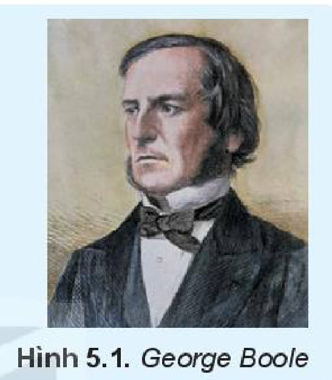
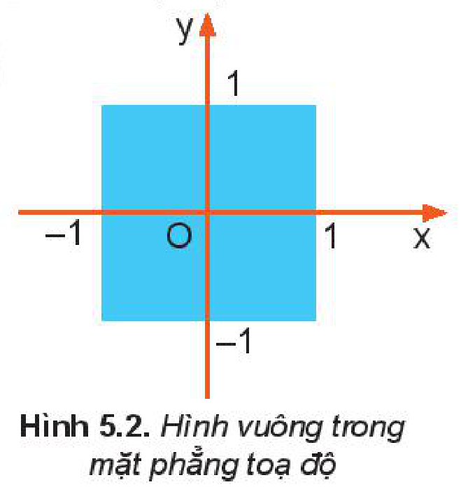
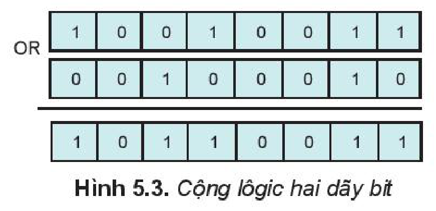
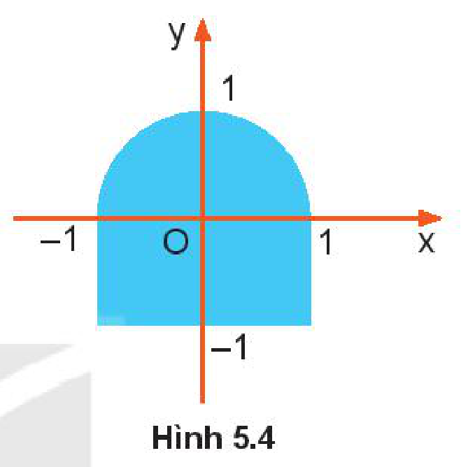
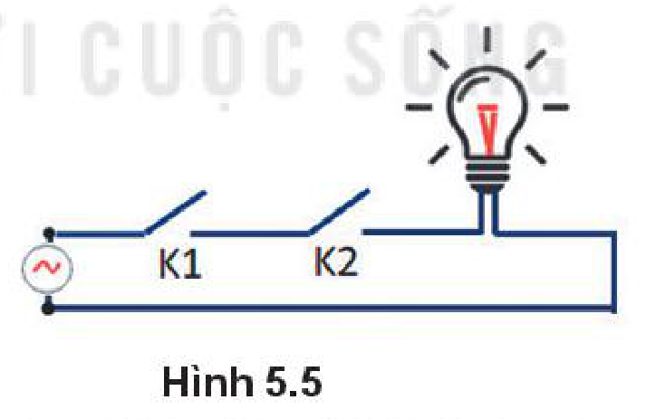
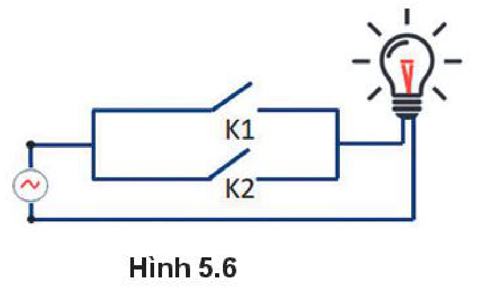

<!-- pdf:25 -->

# BÀI 5: DỮ LIỆU LÔGIC

## 🎯 Sau bài học này em sẽ:

- Biết được giá trị chân lí và các phép toán lôgic AND, OR, XOR, NOT.
- Biết được biểu diễn dữ liệu lôgic.

## 🔴 Khởi động

> Việc thiết kế các mạch điện tử của máy tính có liên quan đến lôgic toán mà người có đóng góp nhiều nhất cho ngành Toán học này là nhà toán học người Anh George Boole (1815 – 1864). Ông đã xây dựng nên **đại số lôgic**, trong đó có các phép toán liên quan đến các yếu tố “đúng”, “sai”.
>
> Vậy phép toán trên các yếu tố “đúng”, “sai” là các phép toán nào?

*Hình 5.1. George Boole*

## 1. CÁC GIÁ TRỊ CHÂN LÍ VÀ CÁC PHÉP TOÁN LÔGIC

> **Hoạt động 1: Đúng hay sai?**
>
> Dự báo thời tiết cho biết “Ngày mai trời lạnh và có mưa”. Thực tế thì không phải khi nào dự báo thời tiết cũng đúng. Có bốn trường hợp có thể xảy ra như Bảng 5.1, trường hợp nào dự báo là đúng? Trường hợp nào dự báo là sai?
>
> **Bảng 5.1.** *Các trường hợp dự báo*
>
> | Ngày mai trời lạnh | Ngày mai trời có mưa | Dự báo |
> | --- | --- | --- |
> | Đúng | Đúng | ? |
> | Đúng | Sai | ? |
> | Sai | Đúng | ? |
> | Sai | Sai | ? |

Nếu ngày mai trời lạnh là đúng và ngày mai trời có mưa là đúng thì dự báo thời tiết là đúng. Như vậy chỉ trường hợp thứ nhất là đúng, còn tất cả các trường hợp khác đều sai.

### a) Lôgic mệnh đề

**Mệnh đề** là một khẳng định có tính chất hoặc đúng hoặc sai. Ví dụ “Hà Nội là Thủ đô của Việt Nam” là một mệnh đề đúng, còn “9 là số nguyên tố” là một mệnh đề sai.

Các giá trị “Đúng” hay “Sai” chính là ***giá trị chân lí*** (**giá trị lôgic**) của mệnh đề mà nó thể hiện. ***Đại lượng lôgic*** là đại lượng chỉ nhận giá trị là giá trị lôgic. Để ngắn gọn, người ta thường biểu diễn các giá trị lôgic “Đúng” và “Sai” tương ứng là 1 và 0.

<!-- pdf:26 -->

Trong toán học, các biểu thức so sánh đều là các mệnh đề. Ví dụ “$3 > 5$” là mệnh đề sai; “$2 \times 3 = 6$” là mệnh đề đúng.

Trong các ngôn ngữ lập trình, các biến hay các hàm cũng có thể mang giá trị lôgic.

### b) Các phép toán lôgic cơ bản

Từ ví dụ về dự báo thời tiết trên ta thấy, nếu ghép hai mệnh đề bằng liên từ “VÀ” thì được một mệnh đề mới và có thể “tính” được giá trị Đúng/Sai của mệnh đề mới từ giá trị lôgic của hai mệnh đề thành phần. "VÀ" có thể coi là một phép toán lôgic.

Bốn phép toán lôgic quan trọng nhất là các phép toán **AND** (**phép nhân lôgic**), **OR** (**phép cộng lôgic**), **XOR** (viết tắt của eXclusive OR - **cộng loại trừ lôgic**) và **NOT** (**phép phủ định**). Giá trị lôgic của mệnh đề là kết quả của các phép toán được cho trong Bảng 5.2:

**Bảng 5.2.** *Các phép toán lôgic*

| $p$ | $q$ | $p\text{ AND }q$ | $p\text{ OR }q$ | $p\text{ XOR }q$ | $\text{NOT }p$ |
| --- | --- | --- | --- | --- | --- |
| 1 | 1 | 1 | 1 | 0 | 0 |
| 1 | 0 | 0 | 1 | 1 | 0 |
| 0 | 1 | 0 | 1 | 1 | 1 |
| 0 | 0 | 0 | 0 | 0 | 1 |

Như vậy, $p\text{ AND }q$ (đọc là $p$ và $q$) là mệnh đề có giá trị đúng nếu cả $p$ và $q$ đều đúng; $p\text{ OR }q$ (đọc là $p$ hoặc $q$) là mệnh đề có giá trị sai khi cả $p$ và $q$ đều sai; $p\text{ XOR }q$ là mệnh đề có giá trị sai khi $p$ và $q$ có giá trị như nhau; $\text{NOT }p$ (đọc là phủ định của $p$) là mệnh đề có giá trị sai khi $p$ đúng.

**Biểu thức lôgic** là một dãy các đại lượng lôgic được nối với nhau bằng các phép toán lôgic, có thể có dấu ngoặc để chỉ định thứ tự ưu tiên thực hiện các phép toán.

Ví dụ về các biểu thức lôgic:

- $p\text{ AND }(q\text{ OR }r)$.
- Giả sử $p$ là mệnh đề ($|x| \le 1$), $q$ là mệnh đề ($|y| \le 1$). Khi đó $p\text{ AND }q$ chính là tập tất cả các điểm có toạ độ $(x, y)$ thuộc hình vuông được biểu diễn trong Hình 5.2.

*Hình 5.2. Hình vuông trong mặt phẳng toạ độ*

Trong một biểu thức lôgic, phép toán đặt trong dấu ngoặc có độ ưu tiên cao nhất. Nếu không có dấu ngoặc thì phép phủ định được thực hiện trước. Các phép toán lôgic AND và OR có độ ưu tiên ngang nhau, được thực hiện tuần tự từ trái sang phải.

Kết quả của các phép toán trong Bảng 5.2 chỉ phụ thuộc vào giá trị lôgic (tương ứng với giá trị 1 hoặc 0) của các mệnh đề mà không phụ thuộc vào nội dung câu chữ cụ thể của chúng. Do vậy, các phép toán lôgic nêu trên có thể coi là các **phép toán lôgic trên các bit** (gọi tắt là các **phép toán trên bit**). Ví dụ, $1\text{ AND }0 = 0$; $1\text{ OR }0 = 1$,...

<!-- pdf:27 -->

Các phép toán lôgic cũng được mở rộng cho các dãy bit. Ví dụ, phép cộng lôgic 2 byte sẽ cộng từng cặp bit tương ứng của 2 byte đó như trong ví dụ Hình 5.3.

*Hình 5.3. Cộng lôgic hai dãy bit*

> - Các giá trị lôgic gồm “Đúng” và “Sai”, được thể hiện tương ứng bởi 1 và 0 trong đại số lôgic.
> - $p\text{ AND }q$ chỉ đúng khi cả $p$ và $q$ đều đúng.
> - $p\text{ OR }q$ là đúng khi ít nhất một trong $p$ hoặc $q$ đúng.
> - $p\text{ XOR }q$ chỉ đúng khi $p$ và $q$ có giá trị khác nhau.
> - $\text{NOT }p$ cho giá trị đúng nếu $p$ sai và cho giá trị sai nếu $p$ đúng.

> ❓ **Câu hỏi**
>
> 1. Cho mệnh đề $p$ là “Hùng khéo tay”, $q$ là “Hùng chăm chỉ”. Em hãy diễn giải bằng lời các mệnh đề “$p\text{ AND NOT }q$”; “$p\text{ OR }q$” và đề xuất một hoàn cảnh thích hợp để phát biểu các mệnh đề đó. Ví dụ, mệnh đề “$\text{NOT }p$” nghĩa là “Hùng không khéo tay”.
> 2. Cho Bảng 5.3 như sau. Phương án nào có kết quả sai?
>
> **Bảng 5.3.** *Giá trị của biểu thức lôgic $p\text{ AND NOT }q$*
>
> | Phương án | $p$ | $q$ | $p\text{ AND NOT }q$ |
> | --- | --- | --- | --- |
> | A. | 0 | 1 | 0 |
> | B. | 1 | 0 | 1 |
> | C. | 0 | 0 | 1 |
> | D. | 1 | 1 | 0 |

## 2. BIỂU DIỄN DỮ LIỆU LÔGIC

Trong cuộc sống, những sự vật/hiện tượng có hai trạng thái đối lập như "sáng/tối", "bật/tắt", "có/không"... đều có thể coi là thể hiện của hai đại lượng lôgic "Đúng/Sai".

<!-- term: Biểu diễn dữ liệu lôgic -->
Trong Tin học, chỉ cần 1 bit với các giá trị 1 hoặc 0 là đủ để biểu diễn dữ liệu lôgic, với quy ước 1 là "Đúng", 0 là "Sai". Tuy nhiên, một số ngôn ngữ lập trình có quy ước riêng, không mã hoá các đại lượng lôgic bởi một bit. Chẳng hạn, ngôn ngữ lập trình Python coi số 0 thể hiện giá trị "Sai" còn một số bất kì khác 0 thể hiện giá trị "Đúng". Trong tiếng Anh, đúng là True, sai là False nên có ngôn ngữ lập trình dùng ngay hai kí tự “T” và “F” để biểu diễn dữ liệu lôgic.

<!-- pdf:28 -->

> - Chỉ cần 1 bit để biểu diễn dữ liệu lôgic, bit có giá trị bằng 1 cho giá trị đúng và bit có giá trị bằng 0 cho giá trị sai.
> - Trên thực tế, có thể biểu diễn dữ liệu lôgic theo các cách khác miễn là tạo ra hai trạng thái đối lập.

> ❓ **Câu hỏi**
>
> Em hãy tìm một vài ví dụ về thông tin có hai giá trị đối lập, có thể quy về kiểu lôgic.

## ✏️ Luyện tập

1. Một hình tạo bởi nửa hình tròn đơn vị và một hình chữ nhật trong mặt phẳng toạ độ như minh hoạ trong Hình 5.4. Hãy viết biểu thức lôgic mô tả hình vẽ.

*Hình 5.4*

2. Tại sao $p\text{ AND NOT }p$ luôn luôn bằng 0, còn $p\text{ OR NOT }p$ luôn luôn bằng 1?

## 🚀 Vận dụng

Trong mạch điện có các công tắc và bóng đèn, ta quy ước các công tắc đóng thể hiện giá trị lôgic 1 và công tắc mở thể hiện giá trị lôgic 0; đèn sáng thể hiện giá trị lôgic 1 còn đèn tắt thể hiện giá trị lôgic 0.

a) Cho một mạch điện có hai công tắc K1 và K2 nối với một bóng đèn như Hình 5.5. Giá trị lôgic của đèn được tính qua giá trị lôgic của các công tắc K1 và K2 như thế nào?

*Hình 5.5*

b) Cho mạch điện mắc như Hình 5.6. Giá trị lôgic của đèn được tính qua giá trị lôgic của các công tắc K1 và K2 như thế nào?

*Hình 5.6*

## 📷 Danh sách hình trong bài

| Mã hình | Trang PDF | Vị trí trong bài | Chú thích gốc |
| --- | --- | --- | --- |
| H10-tin_hoc-b05-01 | 25 | Khởi động | Hình 5.1. George Boole |
| H10-tin_hoc-b05-02 | 26 | Mục 1.b | Hình 5.2. Hình vuông trong mặt phẳng toạ độ |
| H10-tin_hoc-b05-03 | 27 | Mục 1.b | Hình 5.3. Cộng lôgic hai dãy bit |
| H10-tin_hoc-b05-04 | 28 | Luyện tập, Câu 1 | Hình 5.4 |
| H10-tin_hoc-b05-05 | 28 | Vận dụng, Câu a | Hình 5.5 |
| H10-tin_hoc-b05-06 | 28 | Vận dụng, Câu b | Hình 5.6 |
