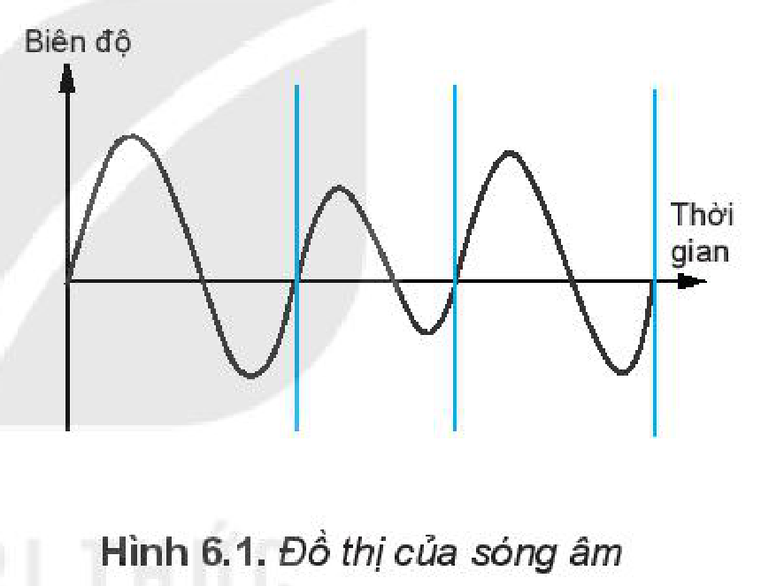
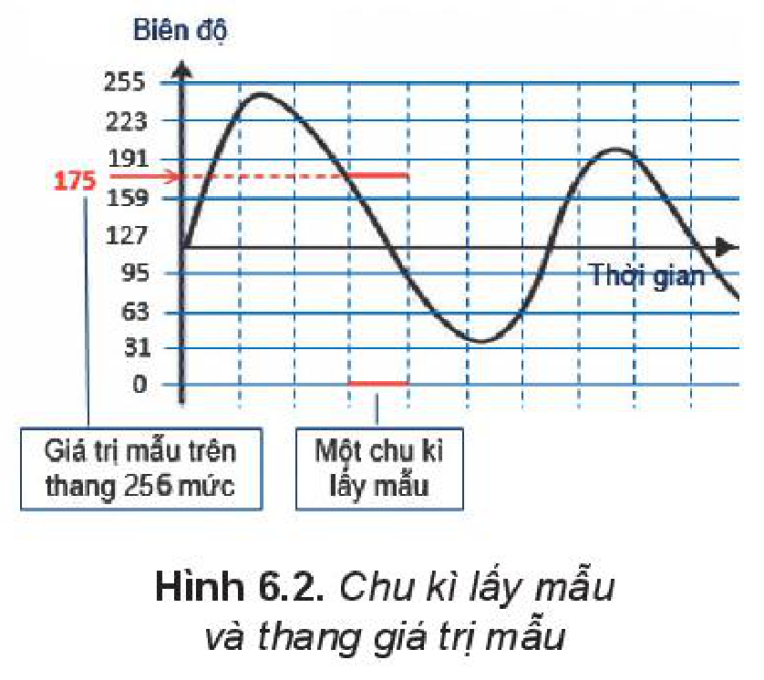
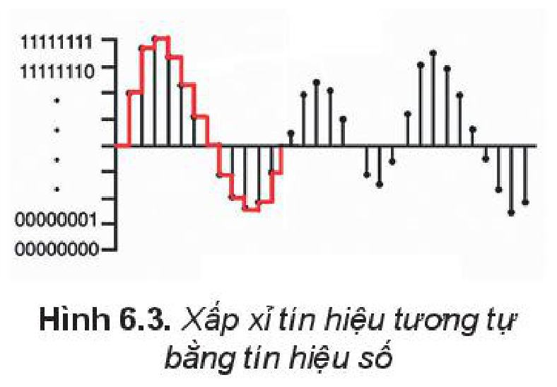
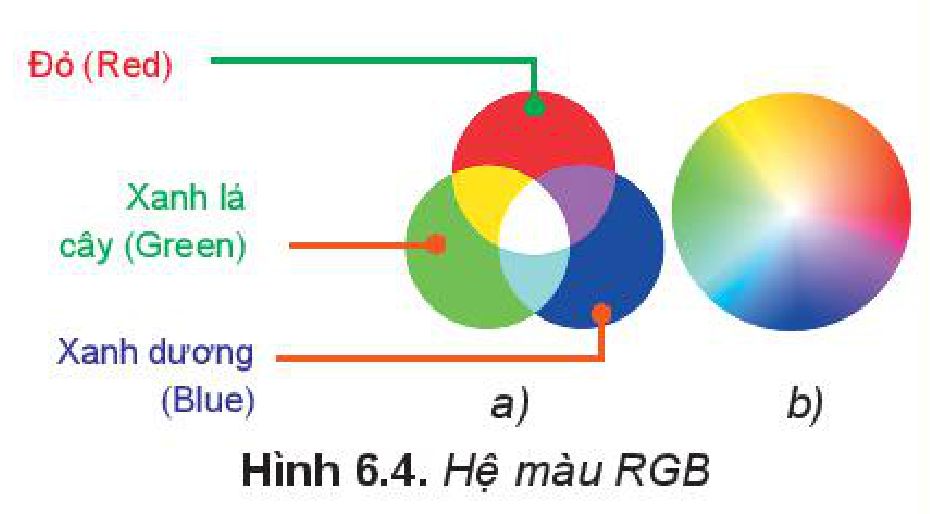
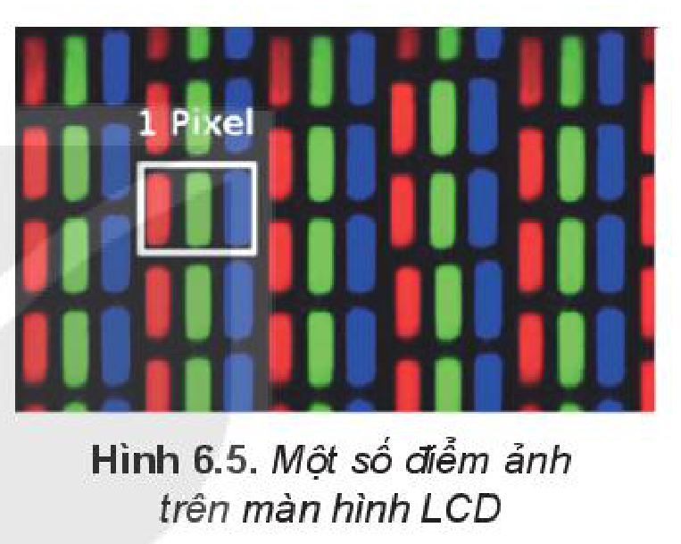
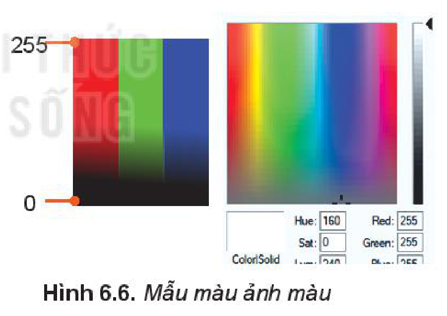
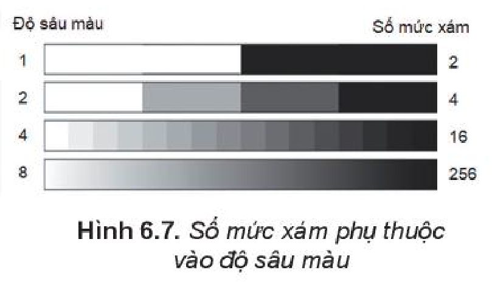
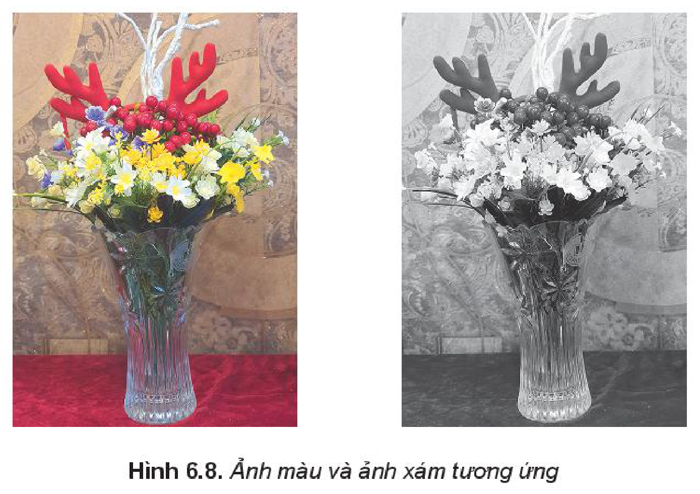
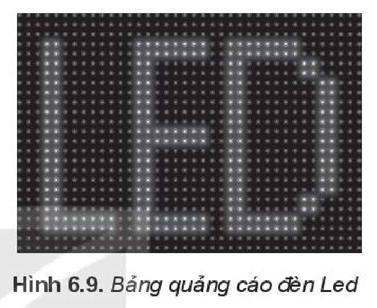

<!-- pdf:29 -->

# BÀI 6: DỮ LIỆU ÂM THANH VÀ HÌNH ẢNH

## 🎯 Sau bài học này em sẽ:

- Giải thích được việc số hoá âm thanh.
- Giải thích được việc số hoá hình ảnh.

## 🔴 Khởi động

> Trong tin học, âm thanh và hình ảnh là hai trong các dạng thông tin quan trọng của **đa phương tiện** (**multimedia**) mà con người có thể tiếp nhận qua các giác quan. Những thông tin này được lưu trong máy tính như thế nào?

## 1. BIỂU DIỄN ÂM THANH

> **Hoạt động 1: Bản chất của âm thanh**
>
> Âm thanh được truyền đi bằng sóng âm.
>
> Trên thực tế, sóng âm có dạng hình sin như Hình 6.1, trục hoành là trục thời gian, trục tung thể hiện biên độ của tín hiệu. Tín hiệu âm thanh có đồ thị liên tục như vậy được gọi là **tín hiệu âm thanh tương tự** (**analog**).
>
> Để có thể xử lí một cách hiệu quả, âm thanh trong máy tính cần được lưu trữ dưới dạng số hoá (**âm thanh số**). Vậy âm thanh số được tạo ra như thế nào?

*Hình 6.1. Đồ thị của sóng âm*

### a) Số hoá âm thanh

Phương pháp cơ bản số hoá âm thanh là **điều chế mã xung** (**Pulse Code Modulation**, viết tắt là **PCM**) được thực hiện theo các bước như sau:

*Bước 1: Lấy mẫu.* Lấy giá trị biên độ tín hiệu ở những thời điểm rời rạc, cách đều nhau. Khoảng thời gian giữa hai lần lấy mẫu gọi là **chu kì lấy mẫu**.

*Bước 2: Biểu diễn giá trị mẫu.* Chọn một **thang biểu diễn giá trị mẫu**, gồm một số mức đều nhau, ví dụ 256 mức. Biên độ tín hiệu được quy đổi theo tỉ lệ trên **thang lấy mẫu** và làm tròn. Ví dụ với thang 256 ($2^8$) mức thì giá trị mẫu sẽ nhận trong khoảng từ 0 tới 255, hay từ 00000000 đến 11111111 trong hệ nhị phân, có thể ghi trong một byte.

*Hình 6.2. Chu kì lấy mẫu và thang giá trị mẫu*

<!-- pdf:30 -->

*Bước 3: Biểu diễn âm thanh.* Dãy giá trị biên độ đã quy đổi tại các điểm lấy mẫu được ghi lại làm biểu diễn âm thanh, ví dụ 128, 192, 242, 255, 235, 210,...

Như vậy, đồ thị liên tục dạng hình sin của sóng âm (Hình 6.2) được xấp xỉ bằng đồ thị hình bậc thang (đường màu đỏ trên Hình 6.3). Trong đó, giá trị biên độ tín hiệu được coi là không thay đổi trong một chu kì lấy mẫu.

Để đồ thị đường bậc thang bám sát hơn với đồ thị của tín hiệu gốc, chu kì lấy mẫu cần phải nhỏ và dùng thang lấy mẫu chi tiết hơn. Khi đó, khối lượng dữ liệu âm thanh cho một đơn vị thời gian tăng thêm nhưng âm thanh số sẽ trung thực hơn. Để số hoá âm thanh, người ta dùng các thiết bị ghi âm cài đặt sẵn phần mềm số hoá, trong đó có các mạch điện tử chuyển tín hiệu tương tự sang tín hiệu số (**Analog to Digital Converter** – **ADC**).

*Hình 6.3. Xấp xỉ tín hiệu tương tự bằng tín hiệu số*

Số bit cần thiết để biểu diễn được một giây âm thanh gọi là **tốc độ bit** (**bit-rate**).

Các thiết bị âm thanh số cần có mạch điện tử gọi là **DAC** (**Digital to Analog Converter**) có chức năng tạo lại tín hiệu tương tự từ tín hiệu số để phát ra loa hoặc tai nghe.

### b) Các định dạng lưu trữ âm thanh

Cách số hoá âm thanh theo phương pháp PCM cho chất lượng âm thanh khá trung thực nhưng kích thước tệp lớn. Do đó, người ta đã tìm các phương pháp nhằm giảm kích thước tệp. Có hai phương pháp chính:

Phương pháp thứ nhất là nén dữ liệu nhưng không làm giảm chất lượng âm thanh, tạo nên **định dạng âm thanh không mất mát** (**lossless**).

Phương pháp thứ hai là bỏ bớt một phần thông tin âm thanh, nhưng vẫn đảm bảo chất lượng chấp nhận được. Một trong các định dạng thông dụng nhất là **Mp3**, có thể làm giảm kích thước tệp khoảng 10 lần so với định dạng **wav** của PCM (là định dạng thường được dùng trong các ứng dụng trên Windows) mà chất lượng âm thanh giảm không đáng kể.

> - Âm thanh được số hoá bằng cách lấy mẫu biên độ tín hiệu của sóng âm theo chu kì lấy mẫu. Chu kì lấy mẫu càng nhỏ, thang lấy mẫu càng chi tiết, âm thanh càng trung thực nhưng cần nhiều không gian lưu trữ.
> - Có nhiều định dạng âm thanh khác nhau giúp giảm bớt không gian lưu trữ trên cơ sở nén không mất mát (lossless) hoặc giảm chất lượng âm thanh ở mức chấp nhận được.

> ❓ **Câu hỏi**
>
> 1. Khi số hoá âm thanh, chu kì lấy mẫu tăng thì lượng thông tin lưu trữ tăng hay giảm?
> 2. Tốc độ bit 128 Kb/s (còn được viết là Kbps) nghĩa là gì?

<!-- pdf:31 -->

## 2. BIỂU DIỄN HÌNH ẢNH

> **Hoạt động 2: Tạo màu như thế nào?**
>
> Hãy đọc để biết màu trên màn hình máy tính hay ti vi được tạo như thế nào.
>
> Hệ ba màu cơ bản đỏ, xanh lá cây – lục và xanh dương – lam (Hình 6.4.a) phối hợp theo các “liều lượng” khác nhau để tạo ra tất cả các màu (Hình 6.4.b) được gọi là **hệ màu RGB** (viết tắt từ Red – Green – Blue).

*Hình 6.4. Hệ màu RGB*
<!-- ocr-ok: đã đối chiếu ảnh trang 31, chú thích Hình 6.4 bị OCR nhận diện sai thành H4 màu ÐB -->

Màn hình LCD hay OLED của máy tính hay ti vi ngày nay dùng ba diode cạnh nhau phát ba màu theo hệ RGB để tạo thành một điểm ảnh (Hình 6.5).

Biểu diễn tự nhiên nhất của hình ảnh số chính là tập hợp thông tin màu của các **điểm ảnh**. Điểm ảnh trong tiếng Anh gọi là **pixel** (picture element – phần tử ảnh). Ảnh lưu thông tin theo từng điểm ảnh gọi là **ảnh bitmap**.

*Hình 6.5. Một số điểm ảnh trên màn hình LCD*

Số bit cần thiết để mã hoá thông tin màu của một điểm ảnh trong tiếng Anh là “**bit depth**” được hiểu là **độ sâu màu**. Độ sâu màu càng lớn thì màu sắc của ảnh càng tinh tế.

*Ảnh màu.* **Ảnh màu** thông dụng có độ sâu màu 24 bit, mỗi màu cơ bản được mã hoá bởi 8 bit, tương ứng với 256 sắc độ khác nhau. Mã màu $255_{10} = 11111111_2$ có sắc độ đậm nhất. Mã màu càng nhỏ thì độ màu giảm đi, đến $0_{10} = 00000000_2$ là mất màu, trở thành đen hoàn toàn.

*Hình 6.6. Mẫu màu ảnh màu*

Màu trắng có mã (255, 255, 255), màu đỏ có mã (255, 0, 0), màu xanh lá cây có mã (0, 255, 0), màu xanh dương có mã (0, 0, 255) còn màu đen có mã (0, 0, 0). Tổng cộng có $256^3$ tổ hợp tạo ra khoảng 16,7 triệu sắc độ màu khác nhau.

*Ảnh xám và ảnh đen trắng.* Ngoài ảnh màu, người ta cũng dùng **ảnh xám**, trong tiếng Anh gọi là **grayscale**, với nhiều mức đậm nhạt khác nhau, phổ biến là 256 mức.

*Hình 6.7. Số mức xám phụ thuộc vào độ sâu màu*

<!-- pdf:32 -->

**Ảnh đen trắng** chỉ có hai sắc độ màu là đen và trắng, tương đương với độ sâu màu là 1.

*Hình 6.8. Ảnh màu và ảnh xám tương ứng*

**Biểu diễn ảnh bitmap**

Ảnh bitmap nguyên gốc được lưu vào các tệp có phần mở rộng là .bmp.

Lưu ảnh theo thông tin của từng điểm ảnh rất tốn bộ nhớ. Có hai cách giải quyết vấn đề này: hoặc nén tệp, lúc xem thì giải nén mà không gây mất mát chất lượng; hoặc giảm bớt một phần thông tin, chịu mất mát một phần chất lượng. Sau đây là một số định dạng ảnh phổ biến thường được dùng trong các ứng dụng trên web:

- “**.jpeg**”: là ảnh đã được nén có mất mát chất lượng nhưng có tệp dung lượng khá nhỏ, tốn ít thời gian truyền và không gian lưu trữ.
- “**.png**”: có độ nén tốt, không mất mát chất lượng, có thể có nền trong suốt để chồng ảnh mà không che ảnh dưới nền.

Việc **số hoá hình ảnh** có thể thực hiện bằng các thiết bị số như máy ảnh số, máy quét, điện thoại thông minh,...

> - Ảnh màu thông dụng trong máy tính là ảnh theo hệ RGB. Mỗi điểm ảnh được mã hoá bởi 24 bit, mỗi màu cơ bản sử dụng 8 bit để mô tả sắc độ từ 0 (đen) đến 255 (màu đậm nhất).
> - Ảnh xám thông dụng có độ sâu màu 8 bit, cho 256 sắc độ xám khác nhau.
> - Có nhiều định dạng tệp hình ảnh khác nhau. Mỗi định dạng có mức lưu trữ và hiệu ứng thể hiện khác nhau.

> ❓ **Câu hỏi**
>
> 1. Hình ảnh hiển thị trên màn hình máy tính sử dụng hệ màu nào?
>    A. Đỏ – Lam – Vàng (RBY).
>    B. Đỏ – Lục – Lam (RGB).
>    C. Xanh lơ – Hồng sẫm – Vàng (CMY).
>    D. Xanh lơ – Hồng sẫm – Vàng – Đen (CMYK).

<!-- pdf:33 -->

> 2. Điều nào sai khi nói về ảnh định dạng ".jpeg"?
>    A. Kích thước tệp nhỏ, giảm được chi phí lưu trữ.
>    B. Kích thước tệp nhỏ nên khi dùng với web tải về nhanh hơn.
>    C. Tuy kích thước giảm đáng kể so với ảnh bitmap nhưng chất lượng ảnh đủ tốt.
>    D. Công nghệ web không dùng được với các định dạng ảnh khác với “.jpeg”.

## ✏️ Luyện tập

1. Có một bảng quảng cáo LED như trong Hình 6.9. Nếu coi mỗi vị trí đặt bóng LED tương ứng với một điểm ảnh thì độ sâu màu của ảnh này là bao nhiêu?
2. Nhạc CD có tốc độ bit là 1411 Kb/s. Hãy ước tính một đĩa nhạc CD có dung lượng 650 MB có thể nghe được bao lâu.

*Hình 6.9. Bảng quảng cáo đèn Led*

## 🚀 Vận dụng

1. Có nhiều website cung cấp dịch vụ nhạc số. Một số trang cho phép tải nhạc về máy. Khi tải nhạc thường có gợi ý lựa chọn 128 Kbps, 320 Kbps hay Lossless (Hình 6.10). Em hãy giải thích ý nghĩa của những lựa chọn đó.

*Hình 6.10. Lựa chọn tải nhạc*

2. Sử dụng phần mềm Paint có sẵn trong Windows mở một hình, sau đó chọn lệnh `Save As`. Phần mềm sẽ hỏi lưu ảnh dưới định dạng nào trong các định dạng “.png”, “.jpeg”, “.bmp” và “.gif”. Hãy lưu tệp với bốn định dạng trong cùng một thư mục và so sánh độ lớn của các tệp.

## 📷 Danh sách hình trong bài

| Mã hình | Trang PDF | Vị trí trong bài | Chú thích gốc |
| --- | --- | --- | --- |
| H10-tin_hoc-b06-01 | 29 | Mục 1, Hoạt động 1 | Hình 6.1. Đồ thị của sóng âm |
| H10-tin_hoc-b06-02 | 29 | Mục 1.a | Hình 6.2. Chu kì lấy mẫu và thang giá trị mẫu |
| H10-tin_hoc-b06-03 | 30 | Mục 1.a | Hình 6.3. Xấp xỉ tín hiệu tương tự bằng tín hiệu số |
| H10-tin_hoc-b06-04 | 31 | Mục 2, Hoạt động 2 | Hình 6.4. Hệ màu RGB |
| H10-tin_hoc-b06-05 | 31 | Mục 2 | Hình 6.5. Một số điểm ảnh trên màn hình LCD |
| H10-tin_hoc-b06-06 | 31 | Mục 2, Ảnh màu | Hình 6.6. Mẫu màu ảnh màu |
| H10-tin_hoc-b06-07 | 31 | Mục 2, Ảnh xám và ảnh đen trắng | Hình 6.7. Số mức xám phụ thuộc vào độ sâu màu |
| H10-tin_hoc-b06-08 | 32 | Mục 2, Ảnh xám và ảnh đen trắng | Hình 6.8. Ảnh màu và ảnh xám tương ứng |
| H10-tin_hoc-b06-09 | 33 | Luyện tập, Câu 1 | Hình 6.9. Bảng quảng cáo đèn Led |
| H10-tin_hoc-b06-10 | 33 | Vận dụng, Câu 1 | Hình 6.10. Lựa chọn tải nhạc |
